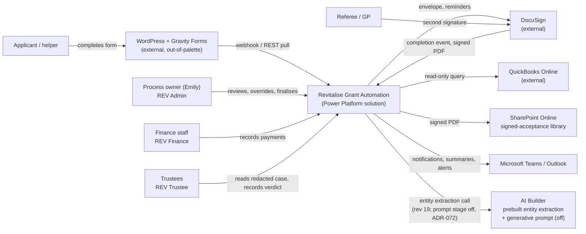
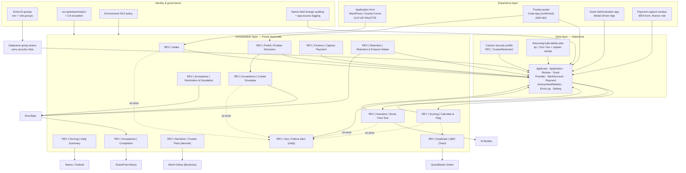
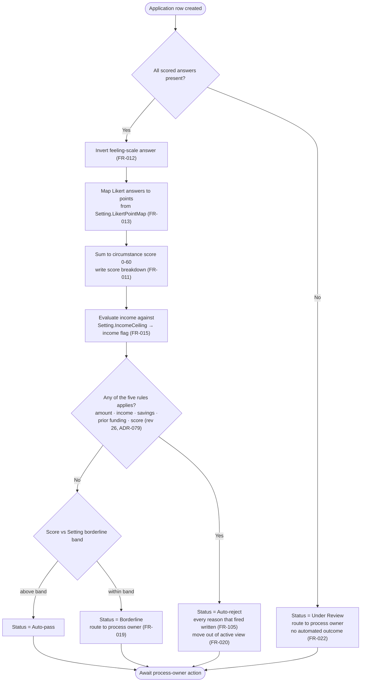
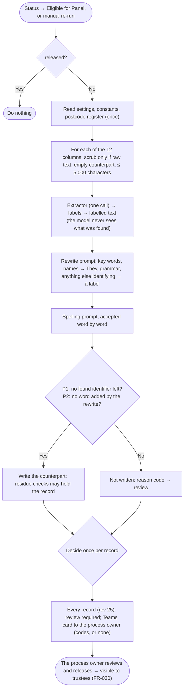
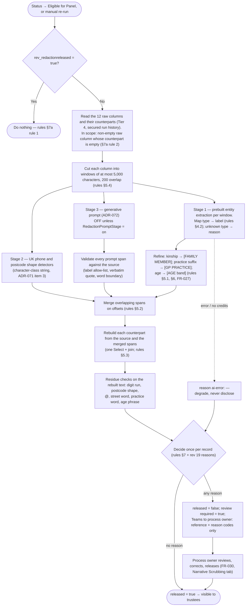
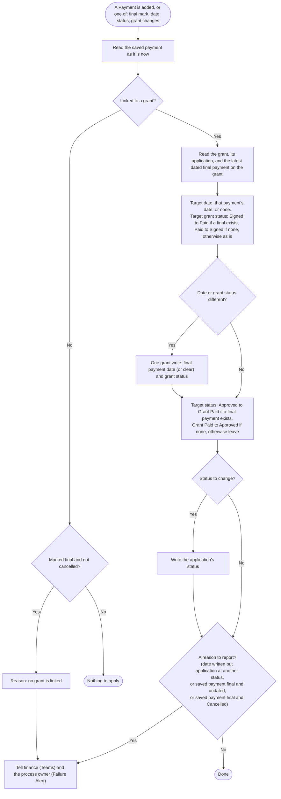

# Technical Architecture Document — Revitalise Grant Application Automation

**Feature Slug:** revitalise-grant-automation
**SDD Reference:** docs/plans/revitalise-grant-automation-plan.md (APPROVED 2026-08-10)
**Date:** 2026-08-10
**Status:** APPROVED — **rev 13 approved 2026-09-27** (Xander Lykopoulos), correcting rev 12's `ADR-053` point 3 (`IMP-0934`). Revisions 9 and 10 were returned for revision and are superseded by rev 11; rev 11 is superseded by rev 12; rev 12 is corrected, not superseded, by rev 13 — same two ADRs, same WBS tasks. See the rev 9, 10, 11, 12 and 13 entries below. **Rev 14 (2026-10-02: `ADR-011` re-decided, §5 Dataverse write-shape rule) is presented for review and not yet approved.** **Rev 15 (2026-10-02: Create Envelope split into draft / fill / send, `ADR-067`; referee signing bound to the named person, `ADR-068`) is presented for review separately from rev 14 and not yet approved.** **Rev 18 (2026-10-05: design-document corrections, middle name and suffix dropped from the helper name) is presented for review and not yet approved.** **Rev 19 (2026-10-05: Automation #5 detector re-designed, `ADR-071`/`ADR-072`, `ADR-012` amended) was approved 2026-10-06** (Xander Lykopoulos, verbatim *"Approve architecture"*, logged in `logs/routing.log`). **Rev 20 (2026-10-06: Automation #5 uses the postcode register, `ADR-073`, and reads its tunable redaction rules and prompt categories from `rev_setting`, `ADR-074`) was approved 2026-10-06** (Xander Lykopoulos). His words were not the keyword `APPROVED` but an instruction to build *"as currently designed"*; lead-agent read that as approval of rev 20, and the verbatim text is in the Approval section so a reader can disagree. Residency (`IMP-1063`) is parked at the customer and does not block building; it is still not decided (§12, `A-R82`). **Rev 21 (2026-10-14, a deterministic neutral-term stage) was returned for revision on 2026-10-16 and is superseded by rev 22.** **Rev 22 (2026-10-16: Automation #5 simplified to about 80 actions — the extractor labels, one prompt rewrites, a second corrects spelling, three fixed checks decide the write, `ADR-075`; `ADR-071` to `ADR-074` superseded in part) was **approved 2026-10-16** (Xander Lykopoulos, verbatim *"Approved Design revision 22"*, relayed by lead-agent).** **Rev 23 (2026-10-16: the rewrite rules Emily may change move into four `rev_setting` rows, the single source of the prompt's rules and of checks P2 and P3, `ADR-076`; `ADR-075` items 3 and 8 amended) was **approved 2026-10-16** (Xander Lykopoulos, verbatim *"Approved for revision 23"*, relayed by lead-agent).** Hosting in Switzerland is settled by the client's legal office (2026-10-16); where a prompt is processed is stated separately in `ADR-075`. **Rev 16 (2026-10-05: §5.8 rewritten to the Create Envelope design the 3–4 October DEV hotfixes settled, `ADR-069`; the referee's name and address columns, `ADR-070`, superseding `ADR-043`) was **approved 2026-10-05** (Xander Lykopoulos, verbatim *"Approved for development"*, logged in `logs/routing.log`); the approval amendment below records his answers.** **Rev 24 (2026-10-19: applicant-then-referee signing order restored, `ADR-077`; `p_type` removal applied to §5.8) **approved 2026-10-19 (the reviewer), with the flow-side order check dropped and `ADR-077` Accepted.** **Rev 25 (2026-10-19: Automation #5 — every scrubbed application is released by the process owner and `RedactionAutoRelease` is retired, `ADR-078`; Dev Summary Iteration 11 recorded in `ADR-075` items 2 and 7 and in `ADR-076`'s `RedactionNameRules` seed) was **approved 2026-10-19** (Xander Lykopoulos, verbatim *"1. Approved"*, relayed by lead-agent).** **Rev 26 (2026-10-19: Automation #2 — five auto-reject rules, every one tunable in `rev_setting`, every reason that fired written for Emily, `ADR-079`; SDD Amendment A-10 rev 2) was **approved 2026-10-19** (Xander Lykopoulos, verbatim *"Approved"*, relayed by lead-agent), including `ADR-079` item 6 (the four existing FR-017 rows become create-only) and the carried SOFT warning C-DOM-005.** Independent of rev 25 (Automation #5). **Rev 27 (2026-10-20: Automation #6 — Finalise Decisions is started by the process owner from the review list in the Grant Administration app, one run per selected review, `ADR-080`; flow #8's trigger wording corrected; the reviewer's answers on three business rules recorded) was **approved 2026-10-20** (Xander Lykopoulos, verbatim *"Approved"*, relayed by lead-agent, including the carried SOFT warning C-DOM-005).** **Rev 28 (2026-10-20: `REV | Finance | Capture Payment` authorised as `wbs:8.6` and designed against FR-107 to FR-111, `ADR-081`; SDD Amendment A-12, change order `CO-010`) was **approved 2026-10-20** (Xander Lykopoulos, verbatim *"APPROVED"* after three numbered answers, relayed by lead-agent); the approval folds in his answers: `A-R100` accepted, `rev_FinanceAlertUpn` is the process owner (Janine in test), and a final payment must carry a date and is marked Issued by the flow. It is independent of the rev 27 entry above, which belongs to a separate dispatch (Automation #6).** **Rev 28, amendment b (2026-10-20: the same flow also moves the grant's own status, `rev_grant.rev_status`, from Acceptance Signed (3) to Paid (4), and back on reversal; `ADR-081` items 3 and 9 amended, FR-113) is recorded as approved by the reviewer** (verbatim *"Obviously the final payment should change the grant status as well."*, relayed by lead-agent); it adds no component and no revision number, so it does not collide with other revisions. **Rev 28, amendment c (2026-10-20: the payment's Issued mark and the date-required rule move out of the flow into ONE table-scope business rule on `rev_payment`; `ADR-081` items 6 to 8 rewritten, `A-CP-8` withdrawn, `A-CP-9` reworked, `A-CP-7` narrowed, `A-R102` closed by design pending verification, `A-R104` added) is recorded as approved by the reviewer** (verbatim *"4"*, his choice of option 4 after build 20261020-4 was blocked by the `NoTriggerLoop` check, relayed by lead-agent); it adds no component class and no revision number: the form business rule of item 8 was already counted as the one new workflow component, and its scope changes from one form to the table. **Rev 28, amendment d (2026-10-20: small edits to the exported payment rule are allowed, closed by a DEV import and the affected `A-CP-9` checks; the as-authored `Rev-Payment-Issued` accepted with its differences; `ADR-081` item 8) is recorded as approved by the reviewer** (verbatim *"Amend-ADR-081: Yes, that is allowed."*, relayed by lead-agent); no component, no revision number. **Rev 29 (2026-10-20: Automation #5 — a GP practice the extractor misses is labelled `[GP PRACTICE]` before the rewrite, `ADR-075` amended; `ADR-076` line-1 erratum) was **approved 2026-10-20** (Xander Lykopoulos, verbatim *"LAbel the name and approved for development"*, relayed by lead-agent, including the carried SOFT warning C-DOM-005).** **Rev 30 (2026-10-21: Automation #5 — one extractor call per batch of columns, one prompt that rewrites and corrects spelling, the action ceiling raised to 125, `ADR-082`; `ADR-075` amended by note) was **approved 2026-10-21** (Xander Lykopoulos, verbatim *"Approved"*, relayed by lead-agent).** **Rev 31 (2026-10-22: the volume figure becomes about 1,000 applications a year, `A-R16` gains the credit purchase routes and §6.3's Azure-subscription statement is reconciled with §12; two retention jobs are designed, a 6-year paid-grant job and a 30-day `msdyn_aievent` job in PRD only, `ADR-083`) was **approved 2026-10-22** (Xander Lykopoulos, verbatim *"2. Approved"*, relayed by lead-agent, re-accepting the carried SOFT warning C-DOM-005; the `aiEvents` cadence confirmed, verbatim *"1. Yes, daily."*). `ADR-083` is `Accepted`.** **Rev 32 (2026-10-22: SDD Amendment A-14 — trustees read benefit status, benefit provider and employment status through a new read-only column security profile, `REV_TrusteeFinancialEligibility`; the design lives in `docs/architecture/trustee-portal-design-2-architecture.md` Revision 4, `ADR-084` to `ADR-087`) was **approved 2026-10-22** (Xander Lykopoulos, verbatim *"Approved."*, relayed by lead-agent, accepting the SOFT warning C-DOM-005). It is independent of rev 31.** **Rev 33 (2026-10-22: a subject access request is answered by §5.12 mode 3 of the Retention & Erasure helper — one trigger by the process owner, the flow running as the service identity gathers every reachable store, payments, bank details, QuickBooks and audit included, into one extract in the secured SAR folder; the exposure is a reviewer-accepted risk, `A-R108`; `ADR-088`; QuickBooks is out of erasure until Finance deletes it after six years, outside this solution; `A-R22` closed by design) was **approved 2026-10-22** (Xander Lykopoulos, verbatim *"Approved."*, relayed by lead-agent), with delivery decided as option B, verbatim *"Option B. the file is saved in the SAR folder and send protected email. If protected email is not possible then Option A."* `ADR-088` is `Accepted`. In the same reply the reviewer accepted `A-NS-45` (c) as a risk (`A-R109`) and placed the website's Gravity Forms copy outside this solution (`A-R107` closed for this solution).** **Rev 34 (2026-10-22: helper modes 1 and 2 and the retention evidence log designed to the same level as mode 3, so change order `CO-011` can be sized for the whole Retention & Erasure helper; `ADR-089`) was **approved 2026-10-22** (Xander Lykopoulos, relayed by lead-agent, verbatim *"Approved."*, with D1 to D5 answered). `ADR-089` is `Accepted`; the helper is `wbs:0.13` under `CO-011`, approved unbilled.** **Rev 35 (2026-10-23: the settings table gains a Category column on a new global choice set, the settings list is sorted by it, and the seed script writes description and category on create-only rows without touching their value, `ADR-090`; `wbs:2.2`, change order `CO-012` closed with no change order) was **approved 2026-10-23** (Xander Lykopoulos, relayed by lead-agent, verbatim *"Option A. GroupBy is available in the table view. So the Process Owner can select this."* and *"Approved."*). `ADR-090` is `Accepted`; decision (A) taken as recommended; (B) and (C) were not separately answered (Approval).** Two earlier drafts the same day were corrected by the reviewer: the first withdrew mode 3 (verbatim *"So, not withdrawn from the design."*), the second left payments, bank details, QuickBooks and audit to two other people (verbatim *"Have two people handle one request is ridiculous."*).
**Revision:** rev 1 — 2026-08-10. Reviewer decisions applied to ADR-003 (Code App confirmed), ADR-006
(three environments: DEV, TST/ACC, PRD), §6.1 (group-team pattern confirmed), §6.5 (audit retention
confirmed at 6 years), role-membership review cadence (confirmed at 6 months), and §4.2 (SAR mechanism
reframed as a proposal and carried forward as an accepted open item).
**Revision:** rev 2 — 2026-08-12. **ADR-007 closed to Power Platform Pipelines** by explicit reviewer
decision, superseding this TAD's own recommendation of pac CLI + GitHub Actions; §9.2 rewritten as the
GitHub-Actions/Pipelines responsibility boundary; **ADR-021 added**, resolving C-TECH-044 to a GitHub OIDC
federated credential with **one deploy identity per environment** (three app registrations, one federated
credential each); §6.7 and the §6 security table corrected (the deploy registrations are required either
way); **§12 gains four tenant prerequisites** — a custom pipelines host, pipeline/stage configuration,
Managed Environment status on TST/ACC and PRD (a licence cost), and pipelines access assignment. §9.1 and
ADR-006 are unaffected: the topology is unchanged and there are still two promotion hops.
**Revision:** rev 3 — 2026-08-27. **SDD Amendment A-05** (`wbs:6.3`). §3.1 gains the **five new
`…redacted` counterpart columns** on `rev_application` (delta TAD `ADR-031`) and explicit rows for the
financial-eligibility, benefit/employment and helper-context columns FR-035 now surfaces. §7's **NFR-001
row is corrected** — it named the two condition profiles as members of `REV_TrusteeRestricted` and they
are not, and never were (A-05 Finding 3; verified live in DEV 2026-08-27). §7's **NFR-003 row is
strengthened** by `ADR-032`: the trustee portal never selects a secured column at all, so FR-078's
restricted state is rendered rather than queried. **No column's classification, `IsSecured` value or
profile membership changes in this revision** — the five new columns are additions, and the two
corrections describe what was already true. The full design is in the delta TAD,
`docs/architecture/trustee-portal-visual-refresh-architecture.md` **Revision 3**, §3.2.2 and §3.2.3.
**Revision:** rev 4 — 2026-09-06. **CO-002 scope decision** (`wbs:3.2`, no new WBS task): the four
DocuSign Grant Referee (Signer 2) anchor tabs Title/Address/Town-City/Postcode are **not** modelled
in Dataverse — `rev_application` gains no `referee_*` columns, no referee entity is created, and
automation #1's intake form gains no referee-facing step. §5.8–5.10 and **ADR-043** record the
decision and its basis. No column's classification or the data model in §3.1 changes.
**Revision:** rev 5 — 2026-09-09. **§3.5 conflict 2 RESOLVED — the payment capture form is
authorised** (`wbs:8.3`), by reviewer approval of `docs/plans/revitalise-payment-capture-plan.md`
(FR-150–FR-154, NFR-150, US-030). The **form** half of Automation #8 now has requirements behind
it; the **`REV | Finance | Capture Payment` flow** does not, and stays unauthorised and unbuilt —
§3.5 and §5.11 state the split. §3.1's `rev_bankaccount` and `rev_payment` blocks gain the
**lookup-name-projection** consequence of `C-TECH-070`(3) and the previously omitted column
`rev_payment.rev_paymentstatus`. §6.1's **Finance persona App Access changes to a separate
model-driven app** (`ADR-044`); §6.2's Finance role row gains the **Grant and Provider privileges
FR-150/FR-151 require and the approved row omitted**. §9 and §12 gain the new app module and its
two per-environment configuration rows. **`ADR-044`–`ADR-047` added.** **No column is added,
altered or reclassified, no `IsSecured` value changes and no profile membership changes in this
revision** — the surface binds columns WBS 8.1 already delivered. Acceptance of `wbs:8.3` is
gated on `wbs:8.2` (the Finance security role, which does not exist) — see `ADR-047` and §6.2.1.
**Revision:** rev 6 — 2026-09-09. **Reviewer decisions on the rev-5 gate applied.** (1) **`ADR-044`
is REJECTED by the reviewer** — the finance surface is **not** a separate app; it is an area inside
the existing `REV Grant Administration` model-driven app, which is what §6.1's approved App Access
cell always said. `ADR-044` is retained with `Status: Rejected` and superseded by **`ADR-048`**,
which records the area design and the defence-in-depth this choice gives up. §6.1's cell is
**restored**; §9.4, §12.1, §12.2 and Appendix A are re-derived from the area design, not
patched. (2) **§6.2's two Finance-role privilege corrections are CONFIRMED** by the reviewer
(Provider: add Create; Grant: add Read + AppendTo) — §6.2 and §6.2.1 items 2 and 3 are unchanged in
content and now read *confirmed* rather than *flagged for confirmation*. (3) **The
`REV | Finance | Capture Payment` flow is OPEN, DEFERRED BY REVIEWER DECISION** — not authorised,
not descoped, not resolved; §3.5 conflict 2, §5.11 and risk **A-R56** carry it in that state and no
task is opened for it. **`wbs:8.3`'s evidence rule in `contract/evidence-map.json` is now wrong**:
it names a separate app directory that this revision has decided will never exist. The corrected
rule is specified in §9.4 for `pm-agent`, which owns that file. **No column is added, altered or
reclassified, no `IsSecured` value changes and no profile membership changes in this revision.**
**Revision:** rev 7 — 2026-09-10. **`ADR-046` corrected against what shipped, and SDD OQ-151
resolved as far as architecture may resolve it** (`wbs:8.3`; test report **D-02**, TC-07/TC-08).
(1) **`ADR-046`'s Decision named two interventions and its own Consequences named one.** The
shipped Bank Account form carries one — the column `<Description>` — so the Decision is amended to
one and the *"labelled instruction beside the control"* half is **struck, not deferred**: it never
shipped, it has no ground-truthed shape in this solution (no shipped form here contains a
label-only cell or a WebResource control), and it would add nothing the description does not.
(2) **`ADR-046a` is added**, stating the FR-154 naming convention for **both** payee types — the
provider case the shipped description already illustrated, and the **applicant reimbursement** case
it was silent on, which is the only case FR-154 exists for. The applicant convention is the **grant
reference**, derived from `ADR-013`'s existing pseudonymous reference rather than invented. It
carries a description-only build specification for `development-agent`. (3) **SDD OQ-151 is
re-scoped and re-dated, not silently answered**: its architectural half is closed by `ADR-046a`; the
business half narrows to *confirm-or-replace* and moves from the unmeetable *"before build"* to
**before `wbs:8.2` deploys** — the date the exposure actually becomes live. (4) **A new §12.2 row
names a contract this ADR had been assuming**: whether Unified Interface renders a
column description as visible help text or only as a hover tooltip. As a tooltip, FR-154's shipped
control is effectively nothing, and that is now stated rather than implied. **No column is added,
altered or reclassified, no `IsSecured` value changes and no profile membership changes in this
revision** — the one source change specified is a `<Description>` edit.

**Revision:** rev 8 — 2026-09-10. **Reviewer confirmed `ADR-046a`'s applicant-reimbursement nickname
convention as proposed.** The business half of SDD OQ-151 that rev 7 re-scoped to *confirm-or-replace*
is answered: the convention ships as designed — `REV-2026-001 - reimbursement` (the grant reference,
per `ADR-013`), no replacement. `ADR-046a`'s Status line and Consequences are updated from *pending
confirmation* to *reviewer-confirmed*, and **SDD OQ-151 is closed**, not merely re-scoped: Appendix A's
traceability row now records the confirmation and its date rather than an open due date. No source,
schema or build specification changes — `ADR-046a`'s build specification for `development-agent`
already matched what is now confirmed.

**Revision:** rev 9 — 2026-09-25. **The intake contract changes to the website's own payload**
(`wbs:4.1,4.2,4.3`). The website developer supplied the first real submission payload,
`docs/Import/2026-09-25-website-intake-payload-sample.json`, sanitised on intake. It is a native
Gravity Forms entry, and it matches none of the contract the intake flow was built to. That contract
was derived from an Excel export because no real payload existed at the time. The reviewer's
instruction is that **the flow accepts this payload as sent**. So: (1) **`ADR-051` added** — the flow
accepts the native entry and does all translation itself, in one normalisation step plus
configuration-held label maps. (2) **Appendix C added** — the field-by-field map, every payload key to
a column or explicitly unmapped. It is the `wbs:4.2` field-mapping deliverable and supersedes the
payload-contract half of the form-validation spec (§8 there). (3) §4, §5.1 and §12 amended.
(4) **`ADR-011` re-checked and still open.** The payload shows the channel choice is no longer
invisible downstream. (5) §11 gains risks **A-R62–A-R67**, and §12.3 is new (the intake contract
verification plan). **No column is added or reclassified, no `IsSecured` value changes and no
profile membership changes.** One schema change is specified: `rev_applicant.rev_dateofbirth` and
`rev_email` move from ApplicationRequired to None, because the only thing that writes them can never
supply the first and supplies the second only conditionally (`ADR-051` item 9).

**Revision:** rev 10 — 2026-09-25. **Reviewer feedback on rev 9 applied** (`wbs:4.1,4.2,4.3`).
(1) **The reviewer answered "yes" to all four rev 9 decisions**: accept the native payload, drop the
two requirement levels, secure run history, and send Alex the questions. `ADR-051` items 7 and 9
now read *confirmed*. (2) **`ADR-011` is DECIDED: Entra client credentials**, on the reviewer's
statement *"I have shared the url, clientid and secret with Alex"*. The decision block records the
statement, the consequences (a client secret now held in WordPress; per-environment verification of
the trigger setting and the client-id check) and the remaining questions for Alex. (3) **The website
developer's covering note is intaked**
(`docs/Import/2026-09-25-alex-intake-payload-covering-note.md`) and cited from `ADR-051` and
Appendix C. (4) **The reviewer's transfer rule is applied** — *"Keep all data that is actively
requested from the user … Only transfer what is actually filled in by the user of the form"*. It
becomes `ADR-051` item 12. Every applicant-entered answer is stored, and **seven new columns plus one
new global option set** are specified in §3.1 and Appendix C §C.8, where there was no column. Two
further columns are specified *conditionally*. Everything the form or plugin generates is not
transferred, with the entry `id` as the single exception. `rev_privacynoticeacceptedon` stops
receiving a date nobody entered. The applicant-typed-total comparison is withdrawn: the total is
form-calculated. (5) **Not-answered is shape-tolerant** (`ADR-051` item 11): an absent key, null,
`""`, `[]` and a false on an unseen question all mean *nothing written*, whatever Alex decides to
send. Key-drift detection is re-scoped to questions every applicant sees, so an omitted conditional
key is never reported as drift. (6) **`CASCADE: SPEC_GAP`** is emitted for the requirement text the
new columns and the transfer rule need (Appendix C §C.9). No FR text is invented here. The new
columns are deferred under `TD-010`/`TD-011` in `contract/tad-deferrals.json` until they are built. *(Rev 17: `TD-011` and its two columns were removed.)*
(7) The rework of `wbs:4.2`/`4.3` is **contracted work, not a change order** (reviewer,
2026-09-25), and `IntakeContract.Tests.ps1` is **rewritten against Appendix C, not patched**
(reviewer, 2026-09-25).

**Revision:** rev 11 — 2026-09-25. **SDD Amendment A-08 applied** (APPROVED 2026-09-25; FR-083–FR-093,
OQ-051–OQ-053; `wbs:4.1,4.2,4.3`). Rev 10's SPEC_GAP is resolved by it. (1) **OQ-051 — `ADR-052`
added:**
- The two Equality Act Yes/No answers are **released to trustees as values**
  (`IsSecured=0`, a `secured: exception` register row under C-DOM-031, and an NFR-031 necessity
  record), beside `rev_conditionprofile`.
- The two disability descriptions **stay secured** and gain **two redacted counterparts**
  (`rev_disabilityimpactdescriptionredacted`, `rev_supportrecipientdisabilityimpactdescriptionredacted`)
  on the ADR-027 narrative pattern. Automation #5 writes them, and until it does they render
  withheld (FR-035, FR-079).
- The §3.1 trustee-visible count rises from 37 to 41, and `TD-010` gains the two counterparts.

(2) **OQ-052 — consent dates hold the receipt time.** Rev 10's interpretation question is closed.
(3) **OQ-053 — middle name, suffix and state/province are not built** until Alex confirms the form
shows them. *(Rev 17: the middle name and suffix half is closed, the columns are removed and `TD-011` is deleted.)*
(4) Appendix A traces FR-083–FR-093.

**No other column, flow mechanism or decision changes from rev 10.**

**Revision:** rev 12 — 2026-09-27. **Reviewer feedback on the Revision 1 gate applied** (`wbs:4.2,4.3`;
Test Report `20260927-1` D-03, O-1). Two decisions, both the reviewer's, verbatim in the gate that
requested this revision. **(1) Widen, don't truncate.** development-agent's truncate-to-MaxLength-plus-note
fix for D-03 is **superseded, not kept as a backstop** — a truncation note is not itself seen by the
grant administrator, so a silent cut is worse than a wide column. `ADR-053` added: every applicant-entered
text/multiline column on `rev_application` and `rev_applicant` is classified as **structured** (stays a
String column, unchanged) or **free-text** (becomes/stays a Memo column, `MaxLength` raised to the
platform ceiling), never blanket-widened to 4,000, because Dataverse's SQL-Server-backed 8,060-byte
per-row ceiling makes that literally unbuildable on both tables (§12.2, `C-TECH-051`; the arithmetic is in
`ADR-053`). Appendix C §C.10 is the per-column map. Eleven `rev_application` columns change **Type**
(String → Memo) as a result — Dataverse has no in-place String↔Memo conversion (confirmed against
Microsoft's own column-editing documentation, and against this project's own `rev_helperrelationship`/
`rev_exceptionalcircumstance` precedent, Dev Summary 2026-08-16) — so each is a source-level Type/Format/
`MaxLength` edit plus a `FormXml` control `classid` swap, listed in §C.10. **No `rev_applicant` column
changes** — every applicant-entered column there is structured (name, contact, address parts) and stays
String at its current width; §C.10 states why. **(2) Preserve on omission, update path only.**
`ADR-054` added, amending FR-083/`ADR-051` item 11: on `Refresh_existing_applicant`, a column the new
submission does not answer keeps its stored value instead of being overwritten with null (Test Report
O-1). This applies **only** to the `rev_applicant` columns that action writes — `rev_application` is
created once per submission and has nothing to preserve, so **create is unaffected**. The named limitation:
a deliberately blank re-answer is indistinguishable from *not answered* in this payload shape, and no
sentinel is invented for it without reviewer sign-off. **No column is added or reclassified for
classification/security purposes, and no new `IsSecured` value** — this revision changes column `Type`
and `MaxLength` only, plus the update-path write rule.
**Revision:** rev 13 — 2026-09-27. **ARCH_GAP raised by development-agent against rev 12** (`IMP-0934`,
blocker) **closed.** Four corrections, all inside `ADR-053`/`ADR-054`; no new ADR, no new column, no
`IsSecured` change beyond what rev 12 already stated.

1. **`ADR-053` point 3 picks a mechanism instead of asserting one.** Rev 12 said the eleven retypes ship
   "under Dataverse's own solution-import mechanics." This project's own 2026-08-16 precedent (Dev
   Summary, [Deployment, 2026-08-16](../development/revitalise-grant-automation-dev-summary.md#L4425))
   measured the opposite: import rejects the type change outright (`"Attribute rev_helperrelationship is
   a Picklist, but a String type was specified."`), and the working path was five steps, one of them a
   live attribute **delete**, refused by the harness's own safety classifier until the reviewer
   authorised it explicitly. **Decision: the measured delete-and-recreate sequence, and only in DEV.**
   §12.4 now carries the eight-step sequence, which environment it runs in and why, and which steps are
   reviewer-executed. `IMP-0934`'s three-route framing is resolved: additive new columns are rejected
   (it would strand the eleven old ones and every reader of them, for no benefit this schema doesn't
   already get for free); narrower String-width increases are rejected (four of the eleven already
   exceed a 4,000-character String ceiling in practice — `rev_helpername`'s five-part join and
   `rev_provisionaldate`'s free-text phrase are unbounded by construction, not merely long — so a String
   ceiling does not solve the crash D-03 found).
2. **The five secured columns' field permissions and audit history are traced, not assumed unaffected.**
   §12.4 states explicitly that `IsSecured`/`FieldSecurityProfiles.xml` membership is keyed on
   `LogicalName`, survives the delete-and-recreate because the profile's `RootComponent` and the
   attribute's own `IsSecured` flag are re-applied by the same `Entity.xml`/`FieldSecurityProfiles.xml`
   pack that recreates the attribute, and is verified live, per column, before the final import — and
   that each column's **audit history is not preserved**: a deleted attribute's audit trail is deleted
   with it, and the recreated attribute starts a fresh one. Consequence 4, below, states this.
3. **Appendix C §C.10 gains `rev_helperemail` and `rev_helperphone`.** Both are applicant-entered,
   written by this intake flow (Appendix C §C.6), structured and short (`MaxLength` 100 and 25, `Format`
   `email`/`phone`) — the same shape as `rev_applicant.rev_email`/`rev_phone` — and D-03 named neither.
   They stay String, unchanged, exactly as `ADR-053` point 1 already reasons for `rev_applicant`'s
   contact columns; C.10's structured list was scoped to `rev_applicant` only and silently dropped the
   two `rev_application` structured columns this flow also writes. No other applicant-entered
   `rev_application` text column is missing: `rev_supportrecipientname` and every referee/emergency-
   contact column are never written by this flow (grepped, zero hits — `rev_supportrecipientname` is
   "never asked", §C.6; referee/emergency-contact are DERIVED elsewhere, §3.1), so `ADR-053` correctly
   does not classify them.
4. **`ADR-053` point 4 gains a length guard for the columns that stay String.** Removing all truncation
   was right for the columns this ADR makes Memo — nothing plausible can overflow 1,048,576 — but it was
   never right for the ones that *stay* String at a few hundred characters or fewer, and point 4's
   original wording removed the guard from those too. An over-length answer on `rev_postcode` (10),
   `rev_helperphone` (25) or any other structured column returns to D-03's own failure: `Create_application`
   fails the write and the whole submission is lost, unannounced. **Decision:** `Normalise_payload`'s
   `TEXT` rule (Appendix C §C.2) gains one more case, for the closed list of columns `ADR-053` point 1
   classifies as structured only: if the trimmed value exceeds that column's literal `MaxLength`, the
   result is null and a note is added to `rev_intakereviewnote` naming the field and the limit — the same
   shape item 10 already uses for an unparseable number, not a truncation of the answer to fit. This is
   narrower than development-agent's superseded truncate-and-note fix in exactly the way rev 12 already
   required: it cannot fire on a free-text column, because every column that could plausibly hold an
   unbounded answer is Memo after this ADR.
5. **`ADR-054`'s coalesce is narrowed to the raw answer, not the derived output.** Rev 12's
   `coalesce(<this submission's normalised answer>, <the existing stored value>)` reads correctly for the
   nine columns `Refresh_existing_applicant` writes straight through from `Normalise_payload`
   (`rev_phone`, `rev_addressline`, `rev_addressline2`, `rev_towncity`, `rev_postcode`), but five of the
   fourteen written columns are not the normalised answer itself — they are the *output of a further
   derivation step* fed by one or more normalised answers (`rev_title`, `rev_applicanttype`, `rev_gender`,
   `rev_ethnicgroup`, `rev_agerange`, `rev_preferredcontactmethod` via the label-map/`Derive_<field>`
   shape, `ADR-051` item 3; `rev_localauthority`, `rev_localauthoritystatus`, `rev_locationarea`,
   `rev_derivedcity` via the postcode-lookup shape, [flow JSON L1126](../../src/solutions/RevitaliseGrantAutomation/Workflows/REVIntakeWordPressToDataverse-8F1C2A44-1001-4B7A-9E21-0A1B2C3D4E01.json#L1126)).
   For those, `Derive_<field>` returns null on **two different facts** the reviewer's literal coalesce
   cannot tell apart: the input was **not answered this time** (item 11's own definition — key absent,
   `null`, `""`, `[]`), or the input **was answered and the derivation could not resolve it**
   (`ADR-024`'s "leave the column empty and flag" case — an unmatched choice label, or, for the postcode
   pair, a register lookup that returns `Not Known`/`Multi-Authority`, [`Derive_local_authority_status`
   L1170](../../src/solutions/RevitaliseGrantAutomation/Workflows/REVIntakeWordPressToDataverse-8F1C2A44-1001-4B7A-9E21-0A1B2C3D4E01.json#L1170)). Coalescing on the derived output collapses both into
   "preserve the old value," which is right for the first fact and wrong for the second: a genuinely new
   postcode this submission pairs with a stale local authority the applicant's new address does not
   have, and a genuinely re-answered (but unmatched) title or contact preference silently keeps the old
   one instead of surfacing the mismatch `ADR-024` exists to surface. **Decision: for these five
   columns, the coalesce condition is `empty(coalesce(outputs('Normalise_payload')?['<source key>'], ''))`
   — the same raw-input null test item 11 already defines — not `empty(outputs('Derive_<field>'))`.**
   When the raw input is not answered this time, the stored value is kept (postcode's own derived
   columns keep their existing pairing, matching `ADR-001`'s "frozen at intake" language). When the raw
   input is answered but unresolved, the freshly derived value — including a null one — is written,
   exactly as `Create_application` already behaves on the create path, so update and create diverge only
   in what happens on genuine silence, which is the one thing `ADR-054` was written to fix.
   `rev_preferredcontactmethod` is fed by three raw keys (contact-method preferences); "not answered this
   time" for it means all three are, since any one of them being answered is the applicant re-stating
   this preference. The match-key columns are unaffected, as rev 12 already states.

**Consequences, added to `ADR-053`'s existing list (in Decision order, continuing from item 5):**
6. *Negative* — a delete-and-recreate is destructive and, unlike every other change in this ADR, cannot
   be undone by re-importing; DEV's existing data in these eleven columns is real, in the sense that it
   is whatever the deployed tests have written, so §12.4's export-before-delete step is not cosmetic.
7. *Negative* — the five secured columns' audit history for these attributes does not survive; only
   DEV holds any today, and DEV's Article 9 columns are exempt from the six-year audit-retention
   commitment (§6.5) precisely because DEV never holds real applicant data (C-TECH-007) — so this is a
   one-time, DEV-only, already-priced-in cost, not a recurring one.
8. *Positive* — TST/ACC and PRD never see this cost: neither has ever received any import of this
   solution (§9, deployment status), so their first import creates all eleven attributes as Memo
   directly, by ordinary `CREATE` semantics, with no live String value to conflict with and no delete
   involved.
9. *Positive* — the length guard added to point 4 closes the one path by which D-03's crash could recur
   after this ADR ships, for the columns this ADR deliberately leaves narrow.
10. *Positive* — `ADR-054`'s narrowed coalesce (item 5 above) means a returning applicant's genuinely
    new postcode or re-stated choice answer is never paired with a stale derived value on the update
    path; a re-answer that the derivation cannot resolve now surfaces the same way it already does on
    create, via `ADR-024`'s empty-column-plus-note pattern, instead of silently reading as "no change."

**Gate interactions, added to `ADR-053`'s existing table:**

| Gate | Interaction |
|---|---|
| `IntakeContract.Tests.ps1` | Gains one assertion per structured column in the new length-guard list: an over-length answer produces a null column and the note, not a write failure. Also gains O-1's regression test's counterpart: a second submission with a genuinely new, unmatched choice label or an unresolvable postcode must **not** read as "no change" |
| `verify-field-security-coverage.py` | Re-run after the DEV recreation, per §12.4 — asserts the five secured columns are still members of `REV_TrusteeRestricted` post-recreation, before the final import |
| `flow-definition-language` check 3 (nested `item` on `UpdateRecord`) | Not tripped — the narrowed coalesce is still one scalar expression per flat `item/<column>` key (`if(empty(...), stored, derived)` in place of `coalesce(derived, stored)`); no key becomes a nested object |
| `no-hardcoded-environment-values` | Unaffected — the DEV-only scoping of the delete-and-recreate sequence is stated in §12.4 as a procedure, not as an environment value in source |

**Revision:** rev 14 — 2026-10-02. **Reviewer decision on the intake endpoint's trust, and one design rule
from `IMP-1010`** (`wbs:4.2,4.3`, warranty-class rework). No new column, no `IsSecured` change, no new flow.

1. **`ADR-011` is re-decided: the trigger accepts *Anyone* holding the signed callback URL, plus the
   `x-rev-client-id` header check.** The rev 10 Entra client-credentials route is superseded. The basis is the
   reviewer's statement of 2026-10-02, quoted in `ADR-011`. The reason: Gravity Forms webhooks send only fixed
   header values, so an Entra token that expires within the hour cannot be refreshed. `ADR-011` states the
   residual risk, the effect on `NFR-008`, and what changes downstream. §6, §7 (`NFR-008`), §11 (`A-R68`
   superseded; `A-R71`–`A-R73` added), §12 (two rows superseded, one added) and §12.3 (`A-INT-11`–`A-INT-15`)
   are amended to match.
2. **The intake trigger's secure outputs stay on, as source declares.** A designer save removed them in DEV; the
   next import is expected to restore them. Recorded in `ADR-011`.
3. **New design rule in §5: every Dataverse create or update action writes its columns as flat `item/<column>`
   parameters, never as a nested `item` object.** A designer save drops the nested form. Three actions need
   converting: the intake flow's `Create_application` and `Create_new_applicant`, and the Ops Failure Alert
   flow's `Write_error_log_row`.

**Revision:** rev 15 — 2026-10-02. **`REV | Acceptance | Create Envelope` redesigned, and the referee's
signature bound to the referee** (`wbs:3.1,3.2,3.5`; recipient authentication is a `commercial-agent`
decision, see `ADR-068` item 4). Raised by the reviewer (single-call `SendEnvelope` no longer accepts tabs)
and by Emily Sheardown's test feedback of 2026-10-02 (mandatory fields could be left empty; a forwarded
referee email could be signed by someone else and was recorded as the referee). No new column, no
`IsSecured` change, no new connector, no new connection reference.

1. **`ADR-067` added: the envelope is created as a draft, filled, then sent** — three DocuSign steps instead
   of one, with each tab addressed by the recipient's DocuSign id and the tab's label, both read back from
   the draft rather than assumed. §5.8–5.10 rewritten to the new action sequence.
2. **`ADR-068` added: four controls so only the named referee can sign.** (1) Mandatory fields are set on the
   **template**, which is the only place the connector can set them. (2) "Assign to someone else" is
   switched off. (3) Each signer gets their own email subject and message. (4) **Decided by the reviewer
   the same day:** the referee must enter an access code, the last six digits of the referee's phone number,
   before the document opens.
3. **`ADR-043` gains a rev 15 note**: the referee-entered tabs it leaves blank must be *required* on the template.
4. §4 (DocuSign row), §11 (`A-R74`–`A-R79`) and §12 (one row amended, two added; new §12.5 verification plan)
   amended to match. New open platform-contract markers `A-DS-14`–`A-DS-18`.
5. **Amended the same day, after the reviewer's throwaway DEV flow `TEST_Docusign`** (evidence only — the reviewer states it is not the intended design) (read-only by
   lead-agent, 2026-10-02). Its designer-written definition is the first E1 for three DocuSign operations.
   `ADR-067`'s ground truth, its Decision step 1, §5.8–5.10 step 3 and §12.5 are reconciled with it. The
   rest of rev 15, `ADR-068` included, is unchanged.
6. **Revised again the same day, after the reviewer's designer check** (*"create envelope from template with
   recipients and tabs" can create the envelope and the recipients' tabs, but not the prefill tabs and not a
   custom email*). `ADR-067` now carries the definitive action list D1–D10: `SendEnvelopeWithRecipientFields`
   creates the draft with recipient tabs; prefill tabs, per-signer email, authentication and reminders are set
   on the draft; `SendDraftEnvelope` sends. Reminders move before the send. §5.8–5.10 and §12.5 (T2–T4) are
   rewritten to match.
7. **Revised a third time, the same day, to the reviewer's `TEST_Docusign` v2c and three decisions.** The create is
   `CompositeTemplates` (`status: Created`). Each signer is bound by `UpdateEnvelopeRecipient`. Tabs are read once
   and written as one array through `UpdateEnvelopePrefillTabs` (**option A**, the reviewer's choice), with
   **option B** (prefill array + one `UpdateRecipientTabsValues` array per signer) as the measured fallback. The
   D1–D10 list is superseded by C1–C10. Rev 15's *"one tab per call"* for `UpdateRecipientTabsValues` is corrected:
   it takes an array per signer (E1). **`ADR-068` item 4 becomes an access code** (the last six digits of the
   referee's phone, free per the reviewer), and it sits within `wbs:3.2`/`3.5` — no change order. §5.8–5.10,
   §11 (`A-R76`, `A-R78`, `A-R79`), §12 and §12.5 are amended.

**Revision:** rev 16 — 2026-10-05. **`REV | Acceptance | Create Envelope` brought back in line with the flow the
reviewer ran** (`wbs:3.2`; raised by `IMP-1043`; the reviewer's instruction was *"Yes architect agent should update the
design"*). Between 3 Oct 18:51 and 4 Oct 07:25 the reviewer fixed the flow in DEV by hotfix imports with the gates
overridden ([pipeline log L299–L316](logs/pipeline.log#L299)); this TAD kept describing the rev 15 design, and 35 contract
tests asserted it. No new connector or connection reference. **One column set is new (item 2).**

1. **§5.8 rewritten and `ADR-069` added.** The rev 15 action list is replaced by the 70-action chain the source has:
   three fill calls (prefill, applicant, referee) each with a one-shot spelling fallback, no routing order, an access
   code set before the referee is bound, a signer read-back, a conditional company fill, five stop conditions and a
   seven-case failure lookup. The tab-fill structure and the test fixture are specified exactly, so the 35 failing
   tests can be rewritten against them. Rev 15's option A (one array) is dropped as a design: it was never measured.
2. **`ADR-070` added, superseding `ADR-043`.** Eight secured columns on `rev_application` for the referee's name
   parts, title, job title, company, address, town and postcode. The reviewer created them in DEV on 3–4 Oct; **the
   reason is now recorded (approval amendment, below).** §3.1 gains the rows.
3. **Measured DocuSign facts recorded against `A-DS-16`** (§12.5): the two `tabType` spellings, a Company tab the signer
   sees empty, and a template-locked routing order answering `200` with `RECIPIENT_UPDATE_FAILED` (improvement review
   2026-09-30-2 row 43). Marker `A-DS-19` was added here and closed at approval (no signing order).
4. **`secureData` restored (D-2)**, with its inputs-only exceptions, in §5.8.
5. §4 (DocuSign row), §11 (`A-R74`, `A-R76` amended; `A-R80`, `A-R81` added) and §12.5 amended. `ADR-067`'s
   superseded rows are marked, not deleted.

**Rev 16 approval amendment, 2026-10-05** (`wbs:3.2`; the reviewer's answers recorded, not a new design pass):

- **`ADR-070` is `Accepted`.** Reviewer, verbatim: *"The referee columns are added to make the docusign envelope
  completely data driven. Instead of having empty fields in the docusign form. The grant admin will collect those items
  i am guessing. Something to discuss with Emily."* **Still open, not settled:** who collects the referee details (the
  reviewer guesses the grant admin). Owner: reviewer, to raise with Emily (client side).
- **There is no signing order.** Reviewer, verbatim: *"There is no signing order. The agreement gets send to both."*
  Both signers receive the agreement at the same time and no sequence is expected. `A-DS-19` is **closed as not
  applicable**, `A-R80` is **retired**, check `R7` is rewritten to confirm both are emailed together, and `ADR-069`
  item 3 and §5.8 are reworded. FR-041/FR-042 in the SDD still say *in sequence*; correcting them belongs to
  `plan-agent`, not to this document, and is raised in the gate output.
- **`CO-002`** is being reopened by `commercial-agent` in parallel. This document cites it and does not edit `contract/`.
- **The backfill is dropped** (reviewer: *"Yes drop the backfill"*). DEV holds test data only. Nothing in this
  document expects one: the eight columns are nullable and existing rows stay blank.
- **Still open, as recorded:** the referee-data DPIA and retention question (`A-R81`), and the applicant and referee
  names in the email text (the document's assumption stands).

**Rev 17 amendment, 2026-10-05** (`wbs:3.2` build blocked at HARD step `tad-coverage`; `TD-006` and `TD-007` lapsed
2026-10-03; a small amendment on the approved rev 16, not a new design pass). The reviewer's four rulings, verbatim:

- **`TD-006`:** *"TD006: we don't need this column"*. `rev_financialanswers` is **not needed**; FR-013's score inputs
  are `rev_wellbeinganswer1..10` and `rev_incomeband`. §3.1 drops the name and `TD-006` is deleted. (Source already
  replaced the column with eight typed financial columns, Dev Summary rev of 2026-08; nothing reads it.)
- **`TD-007`:** *"TD007: agreed, create a change order with commercial agent"*. The five duplicate-check columns
  **stay in §3.1**, unbuilt, pending `commercial-agent`'s change order (raised 2026-10-05). Built if approved; removed
  from §3.1 if declined. `TD-007` is re-dated to 2026-10-19 (two weeks); **re-dated again 2026-10-20 to 2026-11-17 (four weeks, reviewer: *"Re-date for 4 weeks. I am in discussion now about Quickbooks"*; `CO-008` still proposed)**. This document does not edit `contract/`.
- **`TD-008`:** *"TD008: these columns will be made with the narrative scrubbing flows"*. Confirms the existing
  reason (automation #5, `wbs:5.3`/`5.4`). Unchanged in §3.1; expiry 2026-11-27 stands.
- **`TD-011`:** *"TD011: there are no middle name and suffix fields on the form"*. **`ADR-011` remaining question 8 is
  closed for the Name sub-fields:** `rev_middlename` and `rev_namesuffix` are **removed from §3.1** and Appendix C
  §C.8, `name_middle` / `name_suffix` are not transferred, and `TD-011` is deleted. The State/Province and Country
  half of question 8 is unaffected: both stay NOT TRANSFERRED (§C.6), as already specified.

Sections changed: §3.1 (three rows), Appendix C §C.1/§C.8/§C.9 item 6, `ADR-011` question 8, and the `TD-011`
pointers in the rev 10 summary, §10 `ADR-051`/`ADR-052`, §12.4 and Appendix A. Nothing else moves.

**Rev 18 amendment, 2026-10-05** (`wbs:3.2`; unbilled corrections to this document and the delta TAD, no change order;
no design decision changes). Reviewer: *"fix the design document"*, *"remove middle name and suffix whilst you are at it"*.

- **§3.1 gains blocks for `rev_localauthorityregister` and `rev_citysettlementregister`** (`IMP-0862`), folded in from
  the two delta TADs as `rev_roundfinance` was.
- **§3.1 `rev_helperorganisation` / `rev_helperrelationship` row corrected to `IsSecured=1`, citing `EF-10`** (`IMP-0944`).
- **Appendix C §C.8: the helper name JOIN uses prefix, first and last only;** middle and suffix are NOT TRANSFERRED.
  Matches rev 17's applicant-side removal. The intake flow and its tests follow in a parallel development dispatch.
- **Delta TAD `trustee-portal-visual-refresh-architecture.md`:** §3.3's `status` enumeration lists every value produced
  (`error` flow-authored, `pending` app-synthesised) and drops `threshold-unset` (`IMP-0454`, `IMP-0481`); the
  `range()`/`addToTime()`/`formatDateTime()` question is renumbered `A-FLOW-13` to `A-FLOW-15` (`IMP-0792`).
- `CO-008`/`TD-007` untouched: `CO-008` is not yet approved.

Sections changed: §3 table list note, §3.1 (two blocks, one row), Appendix C §C.8, this entry.

**Revision:** rev 19 — 2026-10-05. **Automation #5's detector re-designed against the platform as measured**
(`wbs:5.3`, `5.4`; rules `wbs:5.1`, corpus `wbs:5.2`). Raised by development-agent as `CASCADE: ARCH_GAP`
(`IMP-1064`): the *"AI Builder prebuilt PII model"* this document named does not exist in the tenant.
Reviewer decision, verbatim (Xander Lykopoulos, 2026-10-05): *"It's called the entity extractor prebuilt model in
Europe. use generative prompt for the indirect links"*, and on the type list, *"Those were the same entities"*.

1. **The detector is the AI Builder prebuilt entity extraction model** (template `EntityExtraction`, E1 in DEV),
   everywhere this document said "prebuilt PII model": §2.1, §2.3, §4, §5.5, `ADR-012` (amended, not superseded).
2. **`ADR-071` (new): every direct-identifier label has a named owner and a fail-closed residue check.** UK phone
   numbers and postcodes get a deterministic in-flow owner, built on the character-class `Select` that
   `REV | Acceptance | Create Envelope` already runs (`Select_referee_phone_digits`). No plug-in, no new language.
   Until the threshold is calibrated in `wbs:5.7`, every record goes to the process owner (`RedactionAutoRelease`).
3. **`ADR-072` (new): the AI Builder generative prompt is a detector stage, designed now and OFF.** Template
   `GptPromptEngineering` is E1 in DEV; its output is `text` and `finishReason` only, so **a prompt gives no
   confidence score**. Its output can only add spans over existing text, and every span is checked against the
   source. It cannot be switched on in this tenant's geography without moving narrative text across regions (§12).
4. **§5.5 rewritten** to the stage design: window, extract, shape-detect, refine, (prompt), merge, rebuild, residue
   check, decide. The record decision of rules §7 and §7a is unchanged, plus five reason codes.
5. **Residency measured, not decided.** All three environments are on `crm17`, Switzerland (`IMP-1063`). §6, NFR-009,
   §11 (`A-R19` amended, `A-R82`–`A-R84` added) and §12 now say what runs where. The reviewer and DPO decide.
6. **§3.1 corrections.** The care-costs pair is added (`IMP-1066`); the stale *"not yet built (`TD-010`)"* notes on the
   Equality Act and disability-impact rows are removed (`IMP-1068`). Three `rev_setting` keys are added.
7. **§12.6 added:** the verification plan for the new contracts, markers `A-NS-8` to `A-NS-14`.

Not decided here: rules `D-1` to `D-4` (reviewer), and whether to move the environments or accept the risk
(`IMP-1063`, reviewer and DPO). Sections changed: status line, §2.1, §2.3, §3.1, §4, §5.5, §6, §7, §10 (`ADR-012`
amended; `ADR-071`, `ADR-072` added), §11, §12, §12.6, Appendix A, Approval.

**Revision:** rev 20 — 2026-10-06. **Automation #5: the postcode register strengthens the postcode detector, and the
redaction rules a process owner may tune move into `rev_setting`** (`wbs:5.3`; tuning in `wbs:5.6`). Reviewer requests,
verbatim (Xander Lykopoulos, 2026-10-06): *"Why not against the postcode list we already have?"* and *"Also, for the
prompts maybe create a setting rows for the prompt with the rules? Make it data driven"*.

1. **`ADR-073` (new): the flow loads `rev_citysettlementregister` once per run.** A register-confirmed outward code lets
   the flow replace a postcode written without its space (`LS62AB`) and a district written with a cue word ("LS6 area").
   Any other district on its own goes to review (`residual-district`). The register never cancels a full postcode
   match: it holds no `A9A` or `AA9A` district at all (measured), so a veto would let `EC1A 1BB` through.
2. **`ADR-074` (new): the prompt is a fixed template with three inputs, and what it looks for lives in `rev_setting`.**
   One row per label holds that label's category text. The validation allow-list is derived from the same rows in the
   same run, so the two cannot drift. Four word lists get additive rows over a tested built-in list; the shapes stay
   constants. Guard rails: Admin-only and audited; a malformed row fails closed; any edit to a `Redaction*` row stops
   auto-release and prompt calibration until the process owner confirms again.
3. **`ADR-071` items 3, 6 and 8 and `ADR-072` items 3, 4, 6 and 8 are amended** by notes under their status lines.
   Both ADRs are `Accepted` (rev 19 approval).
4. **Region (FR-027): measured, no schema change.** A postcode-to-region map already exists as the seeded setting
   `PostcodeRegionMap`. The source file's Region column agrees with it on every row except 243, where it says only
   "England". Rules decision D-1 (a town on its own is kept) stands.
5. **Five reason codes** (§5.5.1): `residual-district:<column>`, `postcode-register-unavailable`,
   `redaction-setting-invalid:<key>`, `auto-release-stale` and `prompt-config-invalid`.

**Approved 2026-10-06** (see Approval; the reading of the reviewer's words is recorded there). Not decided here or by that
approval: residency (`IMP-1063`), parked at the customer and not a build blocker. The prompt stays off and *Move data
across regions* stays unticked. Sections
changed: status line, this entry, §3.1 (`rev_setting` and `rev_citysettlementregister` blocks), §5.5 (ownership row,
new §5.5.1), §6.6 (one row), §7 (NFR-019), §10 (`ADR-071` and `ADR-072` status and amendment notes; `ADR-073`,
`ADR-074` added), §11 (`A-R84` amended; `A-R85`–`A-R87` added), §12.6 (`A-NS-20`–`A-NS-22`), Appendix A, Approval.

**Revision:** rev 21 — 2026-10-14. **Returned for revision 2026-10-16 and superseded by rev 22** (reviewer: *"Simplify the workflow, 340 actions is absurd for the goal of this workflow."*). **Automation #5: gendered and relationship words become the neutral words of the
client's Anonymisation Key, and the output reads correctly** (`wbs:5.6`; the flow `wbs:5.3`). Resolves
development-agent's `CASCADE: ARCH_GAP` of Iteration 8. Reviewer decisions, verbatim (Xander Lykopoulos, 2026-10-14):
*"1. follow the key file"* and *"2. Yes also add spell checking and auto correct that for readability"*.

1. **`ADR-075` (new): a deterministic stage in the flow.** After the merge, it finds the key's words in the source and
   writes neutral words, the verb agreement a replaced *he* or *she* needs, and *my* before a *Mum* used as a name. The
   rebuild contract is restated: every character is copied from the source or taken from a closed list the flow holds,
   and a run-time check enforces it. The prompt still supplies no text.
2. **`ADR-071` item 5 and `ADR-072` item 7 are amended** by notes under their status lines.
3. **One setting row** (`RedactionNeutralTermsExtra`), additive over the built-in key list, and **four reason codes**:
   `residual-gendered-term:<column>`, `neutral-output-invalid:<column>`, `neutral-terms-skipped:<column>` and
   `redaction-setting-invalid:RedactionNeutralTermsExtra`.
4. **Rejected:** the prompt rewriting the text (it reverses `ADR-072` item 7 and cannot run while residency is
   undecided), and a C# plug-in (outside the language palette).

Not decided here: Dev Summary §8.6 items 4 (names: `[NAME]` or *They*) and 6 (the second verb after *and*); `ADR-075`
states what each answer changes. General spell-checking is `CO-009`, not approved; `ADR-075` states its architecture as
contingent. No schema change and no privilege change. Sections changed: status line, this entry, §3.1 (`rev_setting`
block), §5.5 (diagram, one paragraph), §5.5.1 (one settings row), §10 (`ADR-071` and `ADR-072` notes; `ADR-075`
added), §11 (`A-R88`–`A-R90`), §12.6 (`A-NS-29`, `A-NS-30`), Appendix A, Approval.

**Revision:** rev 22 — 2026-10-16. **Automation #5 simplified** (`wbs:5.3`, `5.6`), on the reviewer's 2026-10-16
feedback and answers, relayed by lead-agent (`logs/routing.log`, 2026-10-16 11:45).

1. **`ADR-075` rewritten:** one extractor call per column labels what it finds; one prompt rewrites the labelled text
   (the client's key, names to *They*, grammar, anything else identifying to a label); a second prompt corrects spelling,
   accepted word by word; checks P1 (no found identifier survives) and P2 (the rewrite added no word) decide whether the
   column is written, and the residue checks decide whether the record is held. **The flow goes from 313 actions to about
   80.**
2. **`ADR-071` to `ADR-074` superseded in part**, by notes under each status line.
3. **Hosting settled** (client legal office, `IMP-1063`); prompt processing measured as EU Data Boundary, with flex
   routing to be checked (`A-NS-32`, `A-R92`). *Move data across regions* is on in DEV and TST/ACC by the reviewer's
   statement of 2026-10-16, and **in PRD** by the reviewer's further statement, verbatim: *"the move accross regions is on in prd as well."* (`A-NS-32a` resolved;
   *previously read: "PRD not stated"*). plan-agent's NFR-009 amendment to permit EU Data Boundary
   processing is pending. **Prompt processing in the EU is decided** (reviewer, 2026-10-16, verbatim: *"Yes, the AI prompt processed in EU is agreed."*). **Flex
   routing is disabled at tenant level** (reviewer, 2026-10-16, verbatim: *"Ah, the flex routing option is disabled on tenant level. Only EU handling"*; stated, not agent-measured). *Previously
   read: "flex routing is not [decided]".* `A-R82` updated.
4. **Settings:** five kept, `RedactionNeutralTermsExtra` added, six retired; `RedactionPromptStage` is a kill switch.
5. **Decided by the reviewer and recorded:** names become *They*; *him* and *hers* follow the client's examples; seven
   words and four titles are added; a second identifying word after *and* changes; the three uncovered questions get no
   counterpart. `A-NS-28` (*Brief confirmation13*): lead-agent read intake flow `…-1001`, where
   `support_recipient_disability_impact_description` is built from `brief_confirmation_2` and maps to
   `rev_supportrecipientdisabilityimpactdescription` (Appendix C); recorded at **E3, source read, not live**, for
   development-agent's register.

**Approved 2026-10-16** (Xander Lykopoulos, verbatim: *"Approved Design revision 22"*). The FR trace is no longer provisional: SDD Amendment A-09
was approved in the same turn (*"Approved for requirements Amendment A-09"*, OQ-054 to OQ-056 at their defaults). Spelling
(FR-099) is `CO-009`, **approved, unbilled** (reviewer, verbatim: *"CO-009 Approved with unbilled tag. Features always expand a bit during development and this one is within reasonable limits."*). *Previously read: "Provisional: the FR trace
waits for plan-agent's FR-026 and NFR-009 amendment. Spelling's commercial status is `CO-009`, re-assessed by
commercial-agent in parallel."* No schema change, no privilege change. Sections changed:
status line, rev 21 entry, this entry, §3.1 (`rev_setting` block), §5.5 (rev 22 block), §5.5.1 (settings rows), §10
(`ADR-071` to `ADR-074` notes; `ADR-075` rewritten), §11 (`A-R82` note; `A-R88`, `A-R89` revised; `A-R90` withdrawn;
`A-R91`, `A-R92` added), §12.6 (`A-NS-29` kept, `A-NS-30` withdrawn, `A-NS-31`–`A-NS-33` added), Appendix A, Approval.

**Revision:** rev 23 — 2026-10-16. **The rewrite rules Emily may change move into `rev_setting`** (`wbs:5.6`, `5.3`).
Reviewer correction of approved rev 22, verbatim (Xander Lykopoulos, 2026-10-16): *"Ok, I added the two prompts in DEV."*
and *"I noticed in the rewrite prompt there are quite some rules in there."* *"We agreed that those rules would be set as settings on the settings table. So that Emily can change these without me changing the prompts or workflows."*

1. **`ADR-076` (new):** four rows (`RedactionNeutralTerms`, `RedactionTitles`, `RedactionNameRules`, `RedactionLabels`)
   become the rewrite prompt's inputs and the single source of P2's closed list and P3's gendered and title lists. The
   template keeps only the fixed contract (injection guard, output format, change nothing else). Absent, blank or
   malformed rows fail closed. Seeded once per environment by a new create-only mode of `seed-settings.ps1`.
2. **`ADR-075` items 3 and 8 amended** by a note under its status line.
3. **Flow:** about 95 actions (90 in Iteration 9). The rewrite prompt in DEV is re-edited (R1b); the spelling prompt is
   unchanged.

New risk `A-R93`; new verification rows `A-NS-36`, `A-NS-37`. No schema or privilege change. Sections changed: status
line, this entry, §5.5.1 (settings rows), §10 (`ADR-075` note; `ADR-076` added), §11, §12.6, §12.6.1, Approval.
**Approved 2026-10-16** (Xander Lykopoulos, verbatim: *"Approved for revision 23"*).

**Revision:** rev 24 — 2026-10-19. **Applicant signs first, referee second, and the referee sees what the applicant
entered** (`wbs:3.2`; the customer's requirement, relayed by the reviewer 2026-10-19). **Approved 2026-10-19** (the reviewer; decisions in item 6). No new column, connector or connection reference, **no new flow action**.

1. **`ADR-077` (new).** **Reverses the rev 16 approval decision *"There is no signing order. The agreement gets send to
   both."*** (reviewer, 2026-10-05) because the customer now requires applicant-then-referee, which is also FR-042 as
   baselined. The order is set **on the DocuSign template** (the flow cannot send it: `RECIPIENT_UPDATE_FAILED`,
   measured 2026-10-04) and **no flow check verifies it** (dropped 2026-10-19, item 6). `A-DS-19` and `A-R80` stay closed
   and retired; they are **replaced by `A-DS-20`, `A-DS-22`, `A-DS-23` and `A-R94`–`A-R96`**, not reused; `A-DS-21` is retired (item 6).
2. **The access code is unchanged and not found defective** (`ADR-068` item 4 stands). The reviewer's 2026-10-19 report
   that the referee's document opened without the code is explained by DocuSign staff-stated behaviour for a
   sender-or-same-email session (E3), not by anything in the flow's source; it was **never measured** (`A-DS-17`'s second
   half was open). §12.5 gains retest **R10**, which discriminates the explanation from a defect. Risk `A-R96` records it.
3. **`p_type` removal applied** (the 2026-10-19 DEV push; Dev Summary 2026-10-19). §5.8: 57 keys become 55, 15 required
   ids become 14, five prefill tabs become four, 31 tabs read and 23 sent become 30 and 22, `Holiday type` leaves the
   key lists, the value list and ADR-067's expected set. `rev_breaktype` is not named in a `Get_the_application`
   `$select` anywhere in this document (grepped; its two other hits are the intake field map and `BreakTypeLabelMap`,
   which are unaffected), so nothing there changes.
4. **Update, same day, after the DEV observation (rev 24 stays presented, not approved).** **Reviewer-observed live in DEV, 2026-10-19, after build `revitalise-grant-automation-20261019-1`** (reported by the reviewer; no artefact captured, so this is an observation, not E1): (a) the reviewer turned on the DEV
   template's signing order, Grant Acceptor 1 and Grant Referee 2; ~~the ACC template is not yet confirmed~~ (**corrected 2026-10-19: there is one shared DocuSign template, so ACC and PRD are the same template**); (b) the signing order
   is correct, the applicant first and the referee after; (c) the referee is asked for the access code and it works. So **`R7` and
   `R10` pass in DEV** (below), `A-DS-17`'s second half is closed at that level, and `A-R96` is reduced. The earlier "opened without a
   code" was a signed-in browser session: **the explained test-setup case, not a defect.** The order is held by the template and works
   **with no flow change**; the flow-side order check was **dropped at approval** (item 6). *(Superseded by item 6: the "ACC template is a pre-promotion check" and "`A-R95` stays open" statements above no longer hold.)* The email bodies are **pending with Emily** (asked separately by the reviewer).
5. Sections changed (original list): status line, this entry, §4 (DocuSign row), §5.8 (introduction, steps 8 and 9, tab-fill structure,
   read-back, test contract), §10 (`ADR-067` requirement 1 and `ADR-069` item 3 notes; `ADR-077` added), §11
   (`A-R94`–`A-R96`), §12.5 (R7 rewritten, R9, R10, `A-DS-19` row, `A-DS-20`–`A-DS-23`). **Update:** also the §5.8 step 9 and test-contract rows, `ADR-077` status, items 2 and 3, Consequences, flow size and gate interactions, `A-R94`, `A-R96`, `R7`, `R10`, `M4`, `A-DS-17`, `A-DS-20`, `A-DS-21`. **Approval edit (2026-10-19), also:** §5.8 step 8, step 9 and test-contract rows, the §5 Create Envelope paragraph, `ADR-077` heading, items 1, 2, 4, 5, Rejected, Consequences, Update, flow size, gate interactions and the retired-words list, `ADR-069` Consequence 5, `A-R75`, `A-R94`, `A-R95`, `A-R96`, §12 DocuSign rows, `R7`, `R7-result`, `M4`, `A-DS-17`, `A-DS-20`, `A-DS-21`.
6. **Reviewer decisions on rev 24, 2026-10-19.** (a) **Approved.** (b) **`ADR-077` item 2 (the flow-side signing-order check) is DROPPED** and moved to rejected options (the template holds the order, verified in DEV; the reviewer chose not to add a flow guard). `ADR-077` is **Accepted**. `A-DS-21` (`int()`) is **retired as not applicable**, id not reused. **No flow guard exists: the template setting is the only control** (`A-R94`). (c) **`A-R95` is closed by the reviewer: the referee sees ALL applicant details.** Reviewer's rationale, near-verbatim: *"Referees already know the applicant and perform the role of a GP, doctor or other official role and know how to treat personal data."* Residual dependency: the referee's identity rests on the access code (`A-R96`). (d) **There is ONE DocuSign environment** (a single account and template serving every Power Platform environment); promotion to PRD goes via Power Platform Pipelines. The "set the ACC template's signing order" pre-promotion checks added to `M4` and `A-R94`, the "ACC unconfirmed" wording of `A-DS-20`, and the per-environment-template wording are **removed or corrected**; the template change already made applies everywhere. The template-id setting is described as it is and no config is changed.

**Revision:** rev 25 — 2026-10-19. **Automation #5: the process owner releases every scrubbed application, and what
Iteration 11 built is recorded** (`wbs:5.3`, `5.4`, `5.6`). Independent of rev 24 (Automation #3); either can be
approved without the other. **Approved 2026-10-19** (Xander Lykopoulos, verbatim: *"1. Approved"*). No new column, connector, privilege or prompt input.

1. **`ADR-078` (new), on the reviewer's decision of 2026-10-19,** verbatim (Xander Lykopoulos, relayed by lead-agent):
   *"All records should be checked by the process owner regardless. So, we don't need that setting at all."* The flow
   never writes `rev_redactionreleased`; it sets `rev_redactionreviewrequired` on every application it scrubs and sends
   the Teams card for every one. `RedactionAutoRelease`, `auto-release-off`, `auto-release-stale` and the
   "saved after every other `Redaction*` row" guard are retired. `RedactionConfidenceThreshold` and `below-threshold`
   are **kept as a review signal** and the threshold is now seeded create-only at 0.85. About 97 actions (100 today).
   **Reverses** the approved intent of `ADR-071` item 8 and `ADR-074` item 5 that a record with no reason would be
   released automatically once `RedactionAutoRelease` was set after `wbs:5.7`.
2. **`ADR-075` items 2 and 7 amended by note** to record Dev Summary Iteration 11, approved by the reviewer on
   2026-10-19 (verbatim, relayed by lead-agent: *"Yes please, process the suggested changes"*): a name span is trimmed of a
   leading *Dr*, *Dr.* or *Doctor* and widened over one joined hyphen or apostrophe fragment on each side before
   labelling; two new reasons, `residual-name-fragment:<column>` and `rewrite-dropped-punctuation:<column>`.
3. **`ADR-076`'s `RedactionNameRules` seed value replaced** by the seven-line text Iteration 11 put in the three settings
   files (DEV row already holds it, lead-agent 2026-10-19). FR-095 does not cover the writer's own name: plan-agent.
4. Sections changed: status line, this entry, §3.1 (`rev_redactionconfidence` and release rows; `rev_setting` block),
   §5.5 (rev 25 block; `[NAME]` owner row; record decision; writes; what a person sees), §5.5.1 (settings rows, what a
   person sees), §7 (NFR-017, NFR-018), §10 (`ADR-071`, `ADR-074`, `ADR-075`, `ADR-076` notes; `ADR-076` seed value;
   `ADR-078` added), §11 (`A-R83`, `A-R85`, `A-R88`, `A-R93` revised; `A-R97` added), §12.6 (`A-NS-22` withdrawn),
   Appendix A, Approval.

**Revision:** rev 26 — 2026-10-19. **Automation #2: the scoring flow rejects on five rules, each one tunable by the
process owner, and writes every reason that fired** (`wbs:2.4`, `2.7`; SDD Amendment A-10 rev 2, approved 2026-10-19,
not billable by reviewer statement). Independent of rev 25 (Automation #5); either can be approved without the other.
**Approved 2026-10-19** (Xander Lykopoulos, verbatim *"Approved"*, relayed by lead-agent), item 3 below included. No new column, connector, privilege or option set.

1. **`ADR-079` (new).** One action, `Derive_eligibility_rules`, decides the five rules once (amount, income, savings,
   prior funding, score); `Derive_status` and `Derive_autoreject_reason` both read it, so the status and the reasons
   cannot disagree. The income rule reads the income flag, never the benefits answer again. All reasons that fired are
   written, one per line, in the SDD's order. About 74 actions (61 today).
2. **Seven new `rev_setting` rows,** seeded create-only in DEV, TST/ACC and PRD with the reviewer's values: five amount
   limits by break type and two on/off switches. The flow's row-count guard goes from 8 to 15.
3. **The four existing FR-017 rows (`KnockoutThreshold`, `BorderlineBandLower`, `BorderlineBandUpper`, `IncomeCeiling`)
   become create-only too.** Today every deploy overwrites them, so Emily's change would be undone at the next deploy.
   This is a change to approved seeding behaviour and is a separate reviewer decision (`ADR-079` item 6), **approved
   2026-10-19 with the revision**: the lead-agent told the reviewer that approving as written included it.
4. `rev_autorejectreason` keeps its 1,000 characters: five reasons at their longest come to about 440.
5. Sections changed: status line, this entry, §3.1 (`rev_autorejectreason` row; `rev_setting` block), §5.2 (diagram;
   §5.2.1 added), §10 (`ADR-079` added), §11 (`R3` note; `A-R98` added), §12.7 (added), Appendix A, Approval.

**Revision:** rev 27 — 2026-10-20. **Automation #6: the process owner starts Finalise Decisions from the review list, and
each approved review she selects becomes a Grant** (`wbs:6.6`, work item `WI-0129` reopened; `IMP-1162`, `IMP-1161`).
The reviewer corrected the built flow on 2026-10-20, verbatim: *"the finalise decisions workflow is meant for Emily to
create grants after the reviews are done. So the button should be on the review table. This is a step after the verdicts
of the trustees. She can then create grants for them, which in turn creates the docusign agreements."* Presented for
review; **approved 2026-10-20** (Xander Lykopoulos, verbatim *"Approved"*, relayed by lead-agent, carried SOFT warning
C-DOM-005 accepted). No new column, option set, privilege or connector.

1. **`ADR-080` (new).** Flow #7's trigger changes from a Power Automate button to the Dataverse *When a row is selected*
   trigger on `rev_review`. Emily opens **Reviews → Awaiting Finalisation** in `REV Grant Administration`, selects the
   decided reviews and chooses **Flow → REV | Portal | Finalise Decisions**. The platform starts one run per selected row.
   The button acts on the **selected** reviews, not on every decided review; the reason is in `ADR-080`.
2. **Flow #8's trigger is a `rev_grant` row being created, not "status becomes Approved".** Read from source; the flow
   table now says so. Flow #7 has no DocuSign action: creating the Grant is the hand-off.
3. **Three business rules, answered by the reviewer on 2026-10-20 and recorded in §5.7.** A split between the two
   verdicts is not finalised by the flow: it waits for the quarterly panel, and the outcome Emily then records wins
   (`A-FD-1`, which **changes** the built flow). A deferral writes no snapshot and adds no option value, and each
   application is counted once, at its final outcome (`A-FD-3`, confirmed). The Grant carries the amount requested
   (`A-FD-8`, confirmed); the reviewer will bring new requirements if that ever changes.
4. Sections changed: status line, this entry, §2 sequence diagram, §5 flow table rows 7 and 8, §5.7 (rewritten), §5.13
   items 1 and 3, §10 (`ADR-080` added), §11 (`A-R99` added), §12.8 (added), Appendix A (FR-037/040/047 row), Approval.
   Revised in place on 2026-10-20 with the reviewer's DEV observations and answers (not an approval).
5. **Erratum, 2026-10-20, after approval (`IMP-1180`).** §5.7 and §12.8 named the run-only group by the pattern
   `REV-PP-GrantApplications-Admins-<env>`, which gives a DEV group that does not exist. The reviewer, verbatim:
   *"groups per security role have been shared in the past. check documentation"*. §12.8 now names each environment's
   group from the deployment settings files (DEV `REV-PP-GrantApplications-DEV`, TST/ACC
   `REV-PP-GrantApplications-Admins-ACC`, PRD `REV-PP-GrantApplications-Admins-PRD`), and §5.7 and `A-FD-9` point to that
   table. A factual correction of a name; the design, `ADR-080` and the approval are unchanged.

**Revision:** rev 28 — 2026-10-20. **`REV | Finance | Capture Payment` is authorised and designed** (`wbs:8.6`; SDD
Amendment A-12, FR-107 to FR-111, US-026, approved 2026-10-20; change order `CO-010`, scope accepted unbilled; OQ-057 and
OQ-058 answered at their defaults). Independent of rev 27 (Automation #6), which another dispatch was editing in this
file while this one was written; ids here were allocated after reading its entries. **Approved 2026-10-20 with three answers folded in (item 7 below).**

1. **§5.11, §3.5 conflict 2 row 2 and risk `A-R56` move from "deferred, unauthorised" to authorised.** `A-R56` is rewritten, not
   deleted: it stays on the register as the standing risk until the flow is built, deployed and V4-tested.
2. **`ADR-081` (new).** One flow, triggered when a Payment is added or changed. It does not react to *what changed*; it
   re-reads the payments that exist on the grant and makes the grant's final payment date and the application's status
   match them. A repeat save, a corrected date, an unticked mark and a cancelled payment are therefore one code path, which
   is how FR-109 and FR-110 are met without a second mechanism. About 25 actions.
3. **The pre-issue duplicate re-check is NOT part of this flow.** It stays with `wbs:8.5` and FR-023, as `CO-010` says.
   §5.4's second call site is not built by `wbs:8.6`.
4. **The paid-grants retention job stays out of `wbs:8.6`, and is flagged, not added** (`ADR-081` item 10). The flow makes its
   precondition true; the job is not in `CO-010`.
5. **No new column, option set, connector, connection reference or privilege. One new environment variable,
   `rev_FinanceAlertUpn`** (the person in finance who is told when a final payment cannot be applied, FR-111). §12.9
   holds the verification plan; `A-CP-1` to `A-CP-9` are the new open assumptions (`A-CP-7` to `A-CP-9` added at the approval, item 7).
6. Sections changed: status line, this entry, §3.5 (conflict 2 row 2), §5 (intro; table rows 4 and 11), §5.4 (one
   sentence), §5.11 (rewritten), §5.13 (item 2 annotated), §10 (`ADR-081` added), §11 (`A-R56` rewritten; `A-R100` and
   `A-R101` added), §12 (one row), §12.9 (added), Appendix A, Approval.
7. **The reviewer's three answers, folded in at the approval (2026-10-20).** (1) *"Agreed"*: `A-R100` stands as written, with its pre-PRD
   listing. (2) The finance recipient is the process owner for now, a combined role, likely split later; in the test environments it is
   Janine. The separate variable `rev_FinanceAlertUpn` is **kept** so the split needs no flow change (`ADR-081` item 5). (3) *"Make payment
   date required when final payment is set. Then the flow can set the payment status to issued."* This **withdraws `ADR-081` item 2's
   creation-day rule** (kept below as *previously read*), and adds one read of the saved payment and one write to it, `rev_paymentstatus`
   from Pending to Issued. The flow is now about 28 actions. Sections changed: status line, this entry, §5.11 (flow, decision table,
   identity, idempotency, visibility, size), §10 `ADR-081` items 2, 5, 6 and 7, §11 (`A-R100` accepted; `A-R102` added), §12 (variable row),
   §12.9 (`A-CP-7` to `A-CP-9`), Appendix A, Approval.
8. **Amendment b, 2026-10-20: the grant's own status.** The reviewer, verbatim: *"Obviously the final payment should change the grant status as well."* Recorded as approved; his answer to OQ-059, *"No. payment final means final."*, is the design as written (the payment stays Issued on untick). **Retires** the rev 28 note that the grant's "Paid" status was *flagged, not added* (§5.11 "does not" item 3, `ADR-081` item 9, Consequences 7). The grant's status goes in the **same single grant write** as `rev_finalpaymentdate`: Acceptance Signed (3) to Paid (4) when a dated final payment exists, Paid back to Acceptance Signed when none does, every other status left alone and reported. About 30 actions. **No new column, option value, connector, privilege, profile permission, environment variable or `A-CP` row**: `rev_status` is unsecured and value 4 is already in source. One new risk, `A-R103`; `A-R100` widened. Sections changed: status line, this entry, §3.5 (conflict 2 row 2), §5 (row 11), §5.11 (what it does, flow diagram, decision table, new "The grant's own status" subsection, size, serves), §10 `ADR-081` (context, items 2 to 4 and 9, Consequences 4 and 7, gate interactions, words retired), §11 (`A-R100` widened, `A-R103` added), §12.9 (`A-CP-6` evidence, pre-PRD listing), Appendix A, Approval.
9. **Amendment b, clarification, 2026-10-20 (Dev Summary "Revision — Flow #11").** `ADR-081` item 3 and §5.11 said both "sends the current status back" and "never writes 1 or 2". Intended meaning: the flow never **changes** a grant to 1 or 2; in the single write it may **echo** the current status, which is `A-R103`'s race. Reworded in both places and in the unit-test row; old words kept once as *previously read*. Three as-built differences recorded and accepted in a new §5.11 subsection (reasons as one `Compose`; reads with an all-zero id and no no-grant branch; Warning alert before Teams), and the size line corrected to the shipped file's count. No design change, no new component, no reviewer decision.
10. **Amendment c, 2026-10-20: the flow stops writing the Payment.** Build 20261020-4 was blocked: the `NoTriggerLoop` check (`src/tests/narrative/test_solution_flows.py`) rejects a flow that triggers on `rev_payment` (with `rev_paymentstatus` in the filter) and writes `rev_paymentstatus` = Issued, and it has no guarded-self-edge mechanism. The reviewer, verbatim, choosing option 4: *"4"*: replace the flow's Issued write and the form-scope "date required" rule (WI-0136, `A-CP-9`) with ONE table-scope (Entity) business rule on `rev_payment`: (a) Final = Yes and no payment date shows an error, which blocks the save server-side too; (b) Final = Yes and status Pending sets status Issued. **Removes** `Write_the_payment_issued` and its Pending guard (the flow is two writes, about two actions fewer). **Withdraws** `A-CP-8`; **reworks** `A-CP-9` into six checks on the rule; **narrows** `A-CP-7`; **closes** `A-R102` by design pending those checks; **adds** `A-R104`. The audit attribution of the payment's status changes to the saving user. **No new component class, column, privilege, profile permission, connector or environment variable.** Sections changed: status line, this entry, §5.11 (what it does, "does not" item 2, flow diagram, payment-status table, secured columns, audit, idempotency and the loop, the payment's status, the payment rule, size), §10 `ADR-081` (status, context (k), items 6 to 8, Consequences 2, 4 and 6, what it reverses, rejected options, flow size, gate interactions, words retired, contracts), §11 (`A-R102`, `A-R104`), §12.9 (`A-CP-7`, `A-CP-8`, `A-CP-9`), Appendix A, Approval.
11. **Amendment d, 2026-10-20: small edits to the exported payment rule.** The reviewer, verbatim: *"Amend-ADR-081: Yes, that is allowed."* `ADR-081` item 8 said the exported rule is "not edited"; now a new rule is authored once in the DEV designer, and an existing rule may take a small edit (error text, an option value, one comparison inside a condition) directly in source, done only after it imports into DEV and the affected `A-CP-9` checks pass there. The definition of small edit vs new rule and the closing evidence are in `ADR-081` item 8. The as-authored `Rev-Payment-Issued` is recorded as accepted with its three differences. No new component, column, privilege, connector or revision number. Sections changed: status line, this entry, §5.11 (the payment rule), §10 `ADR-081` item 8, §12.9 `A-CP-9` check 6, Approval. *Previously read: "the exported file is checked in source and not edited."*


**Revision:** rev 29 — 2026-10-20. **Automation #5: a GP practice the extractor misses** (`wbs:5.3`, `5.6`). Presented for
review; **approved 2026-10-20** (Xander Lykopoulos, verbatim: *"LAbel the name and approved for development"*). No column, connector, privilege, prompt input or setting key added.

1. **`ADR-075` amended by note (item 2): the labelling mechanism.** In DEV the extractor did not return *Moorside Medical
   Centre* for TD-13, so the column was written with the practice name and only flagged (Dev Summary addendum 12.10). The
   capitalised phrase before a capitalised practice suffix is now labelled `[GP PRACTICE]` before the rewrite. The
   reviewer was shown both mechanisms by name and chose the labelling (verbatim above). *Do not write the column*
   (`practice-name-survived`) is kept in the note as a rejected alternative. *Previously read (rev 29 as presented):* the
   reply *"Safeguard: option B"* was recorded as *do not write*, with labelling offered for confirmation; the letters had
   been relabelled when the options were presented (lead-agent, 2026-10-20).
2. **`ADR-076` erratum, wording only:** line 1 of the `RedactionNameRules` seed is the reviewer's confirmed wording of
   2026-10-20 (*"Confirm the wording"*); DEV already holds it. No approval needed.
3. Sections changed: status line, this entry, §10 (`ADR-075` note; `ADR-076` seed line 1 and erratum), Approval.

**Revision:** rev 30 — 2026-10-21. **Automation #5: the flow's AI Builder cost and size** (`wbs:5.3`, `5.6`; spelling under `CO-009`, approved unbilled). Presented for review; **not yet approved**. Reviewer decisions of 2026-10-21 (Xander Lykopoulos, relayed by lead-agent; his wording is not in the hand-off, so it is not quoted), prompted by the measured credit cost in `IMP-1189`. An amendment in place, not a new document: `ADR-075` and §5.5 already specify this flow.

1. **`ADR-082` (new): D1, D2, D3.** (a) One extractor call per *batch* of columns instead of per column, columns joined by a two-line-feed separator and mapped back by offset, at most **5,000 characters** per call (Microsoft Learn: *"Documents can't exceed 5,000 characters"*, read 2026-10-21), a failed call marking every column in its batch `ai-error`; a value straddling two columns holds both. (b) The spelling prompt merged into the rewrite prompt; P2 now accepts a corrected spelling only as a *declared, validated near-spelling pair*, and the merged prompt's input and output contract is fixed. (c) The 100-action ceiling replaced by **125**, nesting 5 by **6**, with the reasons; the flow is about 109 actions.
2. **`ADR-075` amended by note** (items 1, 2, 4, 6, the Rejected option *"One prompt for rewrite and spelling"*, and the flow-size paragraph). **One reviewer decision is reversed:** that the spelling call stays separate (2026-10-16, quoted in `ADR-075`'s context). Every other decision quoted there is kept (table in `ADR-082`).
3. **`A-R16` revised** (it said the extractor is billed per 5,000-character window; it is billed per started 1,000 characters per call, `IMP-1189`). **`A-R105` added: `IMP-1190` is an open item.** `msdyn_aievent.msdyn_datainfo` stores the raw input of every AI Builder call, so §5.5's *"What is never in run history"* paragraph is not true of that table. Recorded, **not designed here**, at the reviewer's instruction.
4. **§12.6:** `A-NS-41` to `A-NS-45` added, all OPEN. **§12.6.1:** R1d (the reviewer edits the rewrite prompt in DEV, **after** the flow is deployed).
5. Sections changed: status line, this entry, §4 (the extractor row), §5.5 (one paragraph and the note on what is never in run history), §10 (`ADR-075` note; `ADR-082` added), §11 (`A-R16` revised; `A-R105` added), §12.6 (`A-NS-41`–`A-NS-45`), §12.6.1 (R1d), Approval.
6. **Erratum, rev 31:** this entry said *"Presented for review; not yet approved"*. Rev 30 was approved on 2026-10-21 (status line; `logs/routing.log` 2026-10-21 11:57, `ADR-082` APPROVED). The Approval section now records it.

**Revision:** rev 31 — 2026-10-22. **Volume, credit purchase routes, and the two retention jobs nobody had designed** (`wbs:0.7` for the jobs; `wbs:0.1` for the volume and credit sizing, with `A-R16` serving `wbs:5.3`). **Approved 2026-10-22** (verbatim *"2. Approved"*; *"1. Yes, daily."* confirms `ADR-083` item 2; see Approval). *Previously read: "Presented for review; not yet approved".* Routed rows R3 and R4 of the improvement review of 2026-10-21. Reviewer answers, verbatim (`logs/routing.log` 2026-10-22 10:26): R3 *"Change to 1000"*; R4 *"Go ahead and build."* Reviewer decision D-1 (2026-10-22): `msdyn_aievent`, `OlderThanXDays` 30, PRD only, none in DEV, *"Bundle it with the other bulk delete jobs that have to be setup for the 6 year timeline for given applications and the i believe 1 year timeline for rejected ones"*. An amendment in place: §3, §7, `ADR-004` and §12 already specify the retention jobs.

1. **NFR-021 at about 1,000 applications a year** (about 90 a month; the reviewer's count was 730 from 2026-02-16 to 2026-10-21). The TAD row is rewritten and every volume-dependent decision re-checked (§7 NFR-021). **The SDD's NFR-021 is plan-agent's to amend** (next amendment id, by the SDD's own amendment convention); this TAD does not edit `docs/plans/`. Until it lands, the TAD row states the measured figure and names the SDD figure as superseded.
2. **`A-R16` gains the three Copilot Credit purchase routes** and a sizing at the new volume, and §12's AI Builder credit row names them. The purchase is Revitalise's decision; the TAD records the routes and the fit.
3. **§6.3 and §12 reconciled on Azure.** §6.3 said Key Vault needs an Azure subscription no source evidences; `ADR-011` (rev 14) has since removed the intake secret, so Key Vault is not needed. An Azure subscription is now needed **only** for a pay-as-you-go route (trustee Power Apps pay-as-you-go, already in §12's licence row, and the Copilot Credit meter). §12 gains one row for it; the Key Vault row and `A-R14` are closed by `ADR-011`.
4. **`ADR-083` (new): two bulk-delete jobs added to `dataverse.bulkDeleteJobs`, each with its own `jobKey` branch in `ensure-bulk-delete-jobs.ps1`.** (a) `paidGrantApplications`: applications at Grant Paid whose grant's `rev_finalpaymentdate` is older than 72 months, in TST/ACC and PRD like every other retention job. (b) `aiEvents`: `msdyn_aievent` rows older than 30 days, **PRD only**, daily. Who can read `msdyn_aievent` is settled by design (`A-NS-45` narrowed to a verification), and the table is named as a store for the DPIA and RoPA.
5. **`A-R105` moves from open to designed**; §5.5's open-item note and `ADR-082`'s *"Not decided here"* paragraph are corrected. `ADR-081` item 10 is annotated: the job it left out of `wbs:8.6` is designed here under `wbs:0.7`.
6. **New OPEN platform assumptions:** `A-NS-46` (whether deleting AI Event rows changes credit reporting; Microsoft does not say) and `A-NS-47` (a `BulkDelete` over `msdyn_aievent` is accepted and removes the rows), both §12.6; `A-RET-1` (the paid-grant query selects exactly the right applications), new §12.10. No new column, option set, connector, privilege, security role or environment variable.
7. Sections changed: status line, rev 30 entry (erratum), this entry, §3 (Entities table: one row), §3.4.1 (added), §5.5 (open-item note), §5.11 (one note under the paid-grants subsection), §6 (Secrets row), §6.3 (one note), §7 (NFR-010, NFR-021), §10 (`ADR-004` note, `ADR-081` item 10 note, `ADR-082` paragraph, `ADR-083` added), §11 (`A-R14`, `A-R16`, `A-R76`, `A-R105`), §12 (five rows), §12.6 (`A-NS-45` rewritten, `A-NS-46`, `A-NS-47`), §12.10 (added), Appendix A (FR-048), Approval.
**Revision:** rev 32 — 2026-10-22. **SDD Amendment A-14: three Art. 9 answers released to trustees by a new read-only
column security profile** (`wbs:6.3`, unbilled; FR-114, FR-115; NFR-001 and NFR-031 as amended). **Approved 2026-10-22.** The design, its gates and the portal changes (own-verdict button, awaiting count,
group verdict) are in `docs/architecture/trustee-portal-design-2-architecture.md` **Revision 4** (`ADR-084` to
`ADR-087`); this entry records only what changes in this document's security model. **Approved 2026-10-22** by
Xander Lykopoulos with parent-portal Revision 4; SOFT warning C-DOM-005 accepted. In DEV the trustee team is
`REV-PP-GrantApplications-Trustees-DEV` (reviewer correction of fact, 2026-10-22, *"there is a trustees team with
linked Entra ID group in DEV"*, superseding *"There is no trustees team for DEV"*; no design change), so DEV verifies
the trustee-side read directly.

1. **A third column security profile, `REV_TrusteeFinancialEligibility`**: read only, on `rev_receivesbenefits`,
   `rev_benefitprovider` and `rev_employmentstatus`; its only member is the trustee group team. The three columns
   stay `IsSecured=1`, registered, audited (`C-DOM-031`, `C-DOM-032` unchanged). **`REV_TrusteeRestricted` keeps
   its permissions and its two member teams**; only its description is corrected, because its sentence "including
   every trustee" would otherwise be false for three of its columns.
2. **The trustee team still never joins `REV_TrusteeRestricted`.** `no-trustee-in-column-security-profile` is
   amended to allow exactly one profile for a trustee team, the one that is read-only and whose columns equal the
   special-category register's trustee-release rows; everything else still fails (`ADR-085`).
3. Sections changed: status line, this entry, §3.1 (one row), §6 (column-level row), §6.1 (Trustee row note), §7
   (NFR-001, NFR-003), §12 (membership row). **No column, data type, role, privilege, connector, flow or
   environment variable is added.** The profile is a new §12.1-class prerequisite (`C-TECH-050`), specified in the
   portal TAD's §12.1.
4. **Relation to rev 31:** none. Rev 32 edits different rows of §3, §6, §7 and §12 from rev 31's, and neither
   depends on the other; they can be approved in either order.
**Revision:** rev 33 — 2026-10-22 (third draft, the same day, after two rounds of reviewer feedback). **The subject access request path, decided: §5.12 mode 3 of the Retention & Erasure helper — one trigger by the process owner; the flow, running as the service identity, gathers every reachable store, payments, bank details, QuickBooks and audit included, into one extract in the secured SAR folder; one person per request; the exposure accepted by the reviewer; QuickBooks out of erasure until Finance deletes it** (`wbs:0.7`; QuickBooks step depends on `wbs:7.1`; one pointer line in the `wbs:0.8` runbook; all flagged to commercial-agent). **Approved 2026-10-22** (item 12, Approval). Reviewer answers of 2026-10-22, verbatim (relayed by lead-agent): *"3. Yes, I like that design. It should indeed be a manual step by the process owner."*; *"The erasure flow can't delete data from QuickBooks. That holds financial data and needs to be kept under other legal obligations. After that period has ended records can be deleted."*; *"Sar include Quickbooksdata is correct."*; *"Finance will delete records after 6 years. process outside of this solution."*; on the first draft, *"The SAR is part of the workflow.. but is triggered manually by the process owner. So, not withdrawn from the design."*; on the second draft, *"No, the payments, bank details and Quickbooks record should all be included in the file. One trigger handling that creates the document. So the file doesn't even land under the eyes of the process owner. The copy is in the secured SAR folder. It is an accepted risk. Have two people handle one request is ridiculous."* An amendment in place: §4.2 and §5.12 already specify the area. The hand-off called this revision 32; rev 32 was already used by SDD Amendment A-14 the same day, so this is rev 33.

**Correction record (kept visible).** *First draft:* read *"a manual step by the process owner"* as *"a documented manual procedure, not an automated flow mode"*, withdrew §5.12 mode 3 and said *"No flow mode, no component"*; *manual* named the trigger. *Second draft:* restored mode 3 but bound it to *"nothing the process owner cannot already see"*, so Finance added payments, bank details and QuickBooks and the tenant administrator added audit history by hand; the reviewer rejected two people per request and accepted the exposure instead. Each earlier draft's wording is kept as a *Previously read* note where it stood; `ADR-088` lists the second draft's five reversed positions.

1. **`ADR-088` (new): a SAR (Art. 15) is answered by §5.12 mode 3 — one trigger, one extract.** *When a row is selected* on the applicant in the Grant Administration app; the flow runs as the service identity, reuses the erasure locate step (a child flow shared with mode 2), is read-only, writes the one extract to the secured SAR folder, logs the run with who started it and when, and tells the process owner only the file name. Its own flow definition, because a cloud flow has one trigger (§5.12).
2. **A SAR is access, not erasure.** Unchanged.
3. **The flow gathers every store it can reach** (§4.2 item 4): applicant, application, review (without trustee identities), grant, payment and bank account rows (every column, `REV_FinanceOnly` included); audit records through a new audit-read privilege on `REV Service Automation`; the service mailbox's messages to or from the applicant and referee; the signed PDF. Statements for `msdyn_aievent`, Teams notifications and the website entry.
4. **QuickBooks is read by the flow through the read-only `ADR-017` connection**, looking up each payment's QuickBooks reference column. That QuickBooks connection is absent from source and depends on `wbs:7.1` (`A-SAR-10`). Until then the extract's QuickBooks section holds the payment rows and a "not read" line; Finance exports only as a fallback if the requester asks for the QuickBooks copy itself.
5. **New accepted risk `A-R108`** (reviewer, 2026-10-22): finance, bank and audit data in the SAR folder, gathered by a service identity whose reach exceeds the person who starts it.
6. **QuickBooks is outside erasure until the six-year finance period ends; then Finance deletes it, outside this solution.** Unchanged.
7. **Human steps left, all with the process owner:** identity check before the run; a requester who is not the applicant. **Delivery, decided at approval (item 12): option B**, the flow sends the extract by protected email; option A (the process owner opens it, removes other people's data, sends it protected) only if protected email is not possible (§4.2 item 8, `A-SAR-4`). *As presented: the other-people's-data judgement and delivery were put to the reviewer, with (a) recommended.* Fallbacks only: Finance (QuickBooks, until `wbs:7.1`), tenant administrator (audit, if `A-SAR-11` fails; `msdyn_aievent` on explicit request). **Turnaround is not set here** (OQ-023, NFR-025).
8. **The procedure document is the process owner's runbook for mode 3**, at `docs/training/subject-access-request-procedure.md` (`wbs:0.7`, not yet written), with a pointer line in the Governance Runbook §7 (`wbs:0.8`).
9. **NFR-021 aligned to SDD OQ-061, answered 2026-10-22** (reviewer verbatim *"Yes, recod it that way."*): headroom to 1,250 applications a year; every record held for its full retention period; about 730 records at 2026-10-22, none before 2026-02-16; a 7,500-record planning ceiling, which `A-R18`'s capacity check now sizes against. Not part of `ADR-088`; `wbs:0.1`. Unchanged.
10. **C-DOM-005 is met by design**; `A-R22` closed by design. Risks `A-R106` (a store outside the six tables is missed), `A-R107` (website entries), `A-R108` (accepted). OPEN assumptions `A-SAR-1`, `A-SAR-3`, `A-SAR-5` now fallbacks; `A-SAR-2` withdrawn; `A-SAR-4`, `A-SAR-6` to `A-SAR-12` open, §12.11. **Components this adds:** the mode 3 flow definition and the locate child flow (both part of the unbuilt helper), one privilege on `REV Service Automation` (audit read), one environment variable `rev_SpoSarFolderUrl`, the SAR folder in every environment, and a second use of the not-yet-built QuickBooks connection reference. No new column, table, role or connector type (QuickBooks Online is already in the §6.4 Business group).
11. Sections changed: status line, this entry, reader's note item 5, §4.2 (rewritten), §5 flow inventory row 12, §5.12 (intro, packaging, diagram with mode 3, mode 3 specification), §6.6 (SAR extract row), §7 (NFR-021, NFR-025), §10 (`ADR-088`), §11 (`A-R18`, `A-R22`, `R7`, `A-R106`, `A-R107`, `A-R108`), §12 (QuickBooks row note, SAR folder row, audit-privilege row), §12.11 (rewritten), Appendix A (FR-050, FR-053, FR-054), Appendix B (row 1 note), Approval. Rev 31's approval is recorded in the same dispatch (status line, rev 31 entry, `ADR-083` status, Approval).
12. **Approved 2026-10-22, with three decisions recorded at approval** (Xander Lykopoulos, relayed by lead-agent, `logs/routing.log` 2026-10-22 13:40). (a) **Delivery: option B**, verbatim *"Option B. the file is saved in the SAR folder and send protected email. If protected email is not possible then Option A."* The flow saves the extract in the SAR folder **and** sends it from the service mailbox to the requester's email on record by protected email; other people's data in the applicant's own application (Art. 15(4)) leaves **without human review**, a reviewer-accepted risk recorded with these words in `A-R108`. The identity check stays with the process owner, before the trigger. `A-SAR-4` is the gate that selects B or A at build time: closed true, mode 3 carries the send step; false, mode 3 is built without it and the process owner delivers by option A. (b) **`A-NS-45` (c) accepted**, verbatim *"2. Accepted."*: in DEV the scrub flow's `msdyn_aievent` rows are owned by `svc_grantapplications`, a sign-in account holding System Administrator (`docs/tests/revitalise-grant-automation-test-report-20261022-adr083.md`, `IMP-1219`); recorded as `A-R109`, the DPIA note is Revitalise's (§12). (c) **Website entries out of scope**, verbatim *"Yes, website keeps those records. Falls outside of scope of this solution and will have to be discussed with Process Owner and Alex."*: `A-R107` closed for this solution, owner Revitalise (process owner and Alex), §12 external item; the SAR runbook still notes the website copy exists. Sections changed at approval: status line, this entry, reader's note item 5, §4.2 (heading note, item 2, item 4 website row, item 8), §5.12 mode 3 (Writes, Size), §6.6 (SAR row), §10 (`ADR-083` item 4 note, `ADR-088` status, Implements, items 1 and 7, Not decided, Consequences 1 and 7), §11 (`A-R22`, `A-R107`, `A-R108`, `A-R109` added), §12 (SAR folder, website and DPIA rows; protected-email row added), §12.6 (`A-NS-45`), §12.11 (`A-SAR-4`), Appendix A (FR-053), Approval.

**Revision:** rev 34 — 2026-10-22. **The whole Retention & Erasure helper, designed: mode 1 (weekly retention
sweep), mode 2 (erasure), the evidence log, and two child flows, so `CO-011` can be sized from one design**
(`wbs:0.13`, change order `CO-011`, approved by the reviewer 2026-10-22, unbilled, recorded by commercial-agent; SDD §10
placed the helper under `wbs:0.7`). **Approved 2026-10-22** (item 8, Approval). Reviewer, verbatim (`logs/routing.log` 2026-10-22 15:21): *"SAR mode 3 is a change order unbilled... cause it should have been part of the work in a regulated environment."* and *"Definitely include helper modes 1 and 2 in one go."* An amendment in place:
§5.12 already specifies the area.

1. **`ADR-089` (new): the helper ships as five flow definitions** — mode 1, mode 2, mode 3 (rev 33), the locate child
   (rev 33) and a new *snapshot* child — about **130 actions** in total (table in §5.12.4).
2. **Mode 1 runs weekly and only does what the bulk-delete jobs cannot:** it writes the Not Granted snapshot a deferred,
   never-decided application needs before deletion (FR-055), records every application and applicant the jobs are about
   to delete, confirms the deletion on its next run, deletes the signed PDF once the row is gone (FR-049), flags a job
   that did not delete, and once a month lists stale open cases. It **does not** delete Dataverse rows (the jobs do,
   `ADR-004`) and **no longer** sweeps orphaned applicants (the `orphanedApplicants` job does since rev 31) or purges
   DocuSign envelopes (decision D1).
3. **Mode 2 is its own definition**, started on one applicant from the Flow menu with the reference typed as a
   confirmation; it checks the hold rule, writes the snapshot, deletes the signed PDFs and the service-mailbox messages,
   deletes the applicant row (the cascade removes the case), logs each record, and emails the requester what was
   deleted and what is kept, why and until when (FR-051, FR-052). QuickBooks is untouched (`ADR-088` item 6).
4. **New table `rev_retentionlog`** (Retention Evidence Log, §3, §5.12.3): references, data types, rules, dates and
   outcomes, no lookup to any case table, no data-subject personal data (FR-054, NFR-016).
5. **Five decisions for the reviewer** (§5.12, `ADR-089` item 9): D1 DocuSign purged by the account's own document
   retention setting, not by a flow step; D2 the hold rule; D3 audit history after an erasure; D4 stale open cases;
   D5 the evidence log kept indefinitely.
6. **Found while designing (`A-R110`):** no bulk-delete job covers an application in statuses 1 to 7, so a case that
   stops moving is never deleted; §5.13 step 3's deferred case is the visible instance.
7. Sections changed: status line, this entry, §3 (Entities: one row; §3.3: one row), §5.12 (intro, packaging,
   diagram modes 1 and 2, §5.12.1 to §5.12.4 added, mode 3 *Depends on* row), §6.6 (erasure row), §10 (`ADR-089`;
   `ADR-088` *Not decided* note), §11 (`A-R110`, `A-R111`), §12 (four rows), §12.12 (added), Appendix A (FR-048,
   FR-049, FR-051/052, FR-054, FR-055), Approval.
8. **Approved 2026-10-22, D1 to D5 answered** (`logs/routing.log` 2026-10-22 15:39), verbatim: *"D1. Agreed. Will be a platform setting on Docusign"*, *"D2. Agreed. It only erases when final payment is checked."*, *"D3. Option A is agreed."*, *"D4. Thats alright. Process owner will deal with it via the monthly list."*, *"D5. That's alright."*, *"Approved."* D1: DocuSign
   retention is a platform setting. **D2 aligned to the reviewer's words:** a case with a grant is erased only once its
   final payment is recorded (`rev_finalpaymentdate` set on every grant); otherwise mode 2 stops and tells the requester
   and the process owner; a case without a grant is unaffected. *As presented: stop only if a grant was signed and not
   finally paid* — an unsigned grant would have been erased; now it stops too. Mode 2 gains the requester email on the
   stop path (about 40 actions; helper about 130). D3: option (a). D4: the monthly list settles `A-R110`; no FR-048
   change. D5: kept indefinitely. `CO-011` approved the same day: the helper is `wbs:0.13`.

**Revision:** rev 35 — 2026-10-23. **A Category on every setting, and a way to reach the create-only rows** (`wbs:2.2`; `CO-012`,
closed 2026-10-23 with no change order, folded into `wbs:2.2` by the reviewer's choice, `CE-0024`; work items `WI-0151`, `WI-0153`).
**Approved 2026-10-23** (see Approval). An amendment in place: §3.1 already specifies `rev_setting`.
Reviewer, verbatim (`contract/change-orders/CO-012.md`): *"add a category column connected to a new global choice set so the
settings can be grouped in the view. Wich makes it easier to look for the right setting."*

1. **`ADR-090` (new): one new global choice set `rev_settingcategory` (eight values) and one new Choice column `rev_category` on
   `rev_setting`.** Every setting gets one category; the key-by-key table is in `ADR-090`.
2. **The Settings list is sorted by category, then display name, with Category as its first column.** Grouping into collapsible
   sections is a Power Apps grid feature the person using the list switches on herself; it cannot be written into a saved view.
   Whether the app's grid offers it is not verified (`A-SETCAT-1`, `A-SETCAT-2`), so this revision promises sort and filter and
   treats grouping as a bonus that a DEV check turns on or leaves off.
3. **`seed-settings.ps1` gains a metadata path:** on a create-only row that already exists it updates the row's description and
   category by its own id and nothing else, so the process owner's value, data type and effective date are never in the request.
4. **The settings file carries `category` as the choice's label text on each row**, as it already does for `dataType`.
5. **Sections changed:** status line, this entry, §3.1 (`rev_setting` block), §10 (`ADR-090`), §12 (two rows), Approval.
6. **No SDD amendment.** `FR-017` and `NFR-019` say the process owner can change the settings without a developer; neither lists
   the table's columns. Category organises the list and no flow reads it.
7. **Two rows of the live table are not in the settings files, and they are `CitySourceFile` and `CitySourceCapturedOn`** (measured
   in DEV by the reviewer, created 2026-09-24; `A-SETCAT-5` disproved the guess that they were the two rev 34 keys). They are
   written by `seed-city-settlement-register.ps1`, not by `seed-settings.ps1`; `ADR-090` places them in category 6 and says how
   their category reaches the environment. Amended in place 2026-10-23, same revision: a correction to the key table, no new
   design.
8. **Dependency on another dispatch:** `WI-0150`/`WI-0152` rewrite the `description` fields in the same three files. The
   `category` field is added after that edit lands, in the same rows, so the two edits do not collide.

---

> **Source:** adopted from `docs/Import/Revitalise-Solution-Architecture-v0.4.docx` on 2026-08-10 by architect-agent (intake mode).
> Original author: Xander Lykopoulos — Argelis Consultancy (v0.4 Draft for review, 14 July 2026, revised 15 July 2026).
> Read via a plain-text extraction of the same content. See Adoption Report in gate log.
>
> **Supporting source — authoritative for §6 Security Design and §6.1** (received 2026-08-10):
> - `docs/Import/Revitalise-Security-Model-v0.1.docx` — Security Model v0.1, 15 July 2026 (Draft, WBS 0.5).
>   This is the deliverable the Solution Architecture named but left to be written; §6 adopts it in preference
>   to the architecture's summary treatment wherever the two differ in detail.
>
> **Cited for context only** (not adopted as TAD content — see the user's scope decision recorded in the Adoption Report):
> - `docs/Import/Revitalise-ALM-Runbook-v0.1.docx` — cited in §9 for the promotion procedure and connection-reference / environment-variable inventory.
> - `docs/Import/Revitalise-Data-Governance-Framework-v0.2.docx` — cited in §3 for cascade-delete behaviour and the classification tiers, cross-checked against SDD §7.1/§7.6.
> - `docs/Import/Revitalise-DPIA-v0.1.docx`, `docs/Import/Revitalise-RoPA-v0.1.docx` — already adopted into SDD §7; cited in §11 only.
> - `docs/Import/Revitalise-Governance-Runbook-v0.1.docx` — day-2 operations; not TAD content.
>
> ⚠️ **Reader's note — three gates sit above this document.**
> 1. **DPO sign-off (SDD OQ-004/005/006)** gates build on the field-level-security basis this TAD adopts.
>    ADR-002 is `Adopted (conditional)` for that reason.
> 2. **WBS 0.3 — the service account `svc-grantautomation` and its scoped Conditional Access exception — is
>    outstanding with Wanstor** (SDD OQ-018). Every unattended automation in §5 depends on it. It is carried
>    forward as a blocking dependency in §12.
> 3. **Resolved at the architecture gate on 2026-08-10 (Xander Lykopoulos):** the trustee portal is a
>    **Code App** and Canvas App is descoped (ADR-003, now `Adopted`); the environment topology is
>    **three environments — DEV, TST/ACC, PRD** (ADR-006, now `Adopted`); the §6.1 group-team binding
>    pattern is confirmed as derived. Audit retention is confirmed at 6 years and the role-membership
>    review cadence at 6 months.
> 4. ~~**Two decisions remain open and are not blocking this gate:** the ALM tooling (ADR-007) and the
>    intake channel / endpoint-trust route (ADR-011).~~ → **ADR-007 IS NOW CLOSED (2026-08-12):
>    Power Platform Pipelines, by explicit reviewer decision, superseding this TAD's own recommendation
>    of pac CLI + GitHub Actions.** See §9.2 and ADR-007. It brings **two new tenant prerequisites**
>    (a custom pipelines host; Managed Environment status on TST/ACC and PRD, which carries a licence
>    cost) — both added to §12. **ADR-011 remains open.** → **DECIDED 2026-09-25 (rev 10): Entra client credentials, by reviewer statement — see ADR-011.** ADR-021 was added at the same time, resolving
>    C-TECH-044 to a GitHub OIDC federated credential with one deploy identity per environment.
> 5. **One accepted open item** carried forward to development-agent: no SAR extract mechanism is built or
>    agreed. §4.2 records a *proposed* approach only. Accepted as a known gap by the reviewer on
>    2026-08-10 (C-DOM-005, SOFT). → **Rev 33 (2026-10-22, approved): closed by design — a SAR is answered by
>    helper mode 3: one trigger by the process owner, one extract with every reachable store (§4.2, §5.12, `ADR-088`).**
>    *Rev 33's first draft said "a documented manual procedure"; its second left payments, bank details, QuickBooks and
>    audit to Finance and the tenant administrator; both corrected by the reviewer.*
>
> ⚠️ **Knowledge-base gap.** `knowledge/domain/data-entities.md`, `knowledge/domain/compliance-requirements.md`,
> `knowledge/technology/stack-overview.md` (Publisher Convention), `platform.md`, `dataverse.md` (column-security
> profile table), `build-and-deploy.md`, `entra-id.md`, `sharepoint.md` and `teams.md` are unpopulated template
> placeholders in this repository. No project-specific technology decision was taken from them. The one exception
> is **`knowledge/technology/security-model.md`, which IS populated** — its Group Teams pattern and Canonical
> Persona Mapping are real platform decisions and §6.1 is built on them. Where a placeholder file left a gap,
> this TAD relies on the source documents plus general Power Platform practice and says so at the point of use.
> Carried forward from SDD OQ-029.

---

## 1. Architecture Overview

The solution automates the grant journey from application submission to trustee decision and signed
acceptance on the Microsoft 365 / Power Platform stack Revitalise already owns. It automates the **data
handling, not the decision-making**: scoring is automatic with the process owner's oversight and override,
and trustees make the funding decision.

**Dataverse is the system of record and the integration hub.** Applications land in Dataverse, every
automation reads from and writes to it, and external systems never talk to each other directly. One
document — the signed DocuSign PDF — lives outside Dataverse, in a SharePoint library, linked by URL from
the Grant record.

### 1.1 Architecture principles (adopted from source §2)

| Principle | What it means here |
|---|---|
| Low-code, no custom code | Power Automate cloud flows, Power Apps and Dataverse configuration only. No macros, no scripts on anyone's laptop. |
| Maintainable by non-developers | Thresholds, templates and mappings live in configuration — a Dataverse `Setting` table plus environment variables — so the process owner can adjust them without editing a flow (NFR-019). |
| Cloud-native and portable | Data lives in Dataverse. No local file dependency, no "single source of truth on one laptop". |
| AI only where it earns its place | AI Builder redacts only the free-text narratives a trustee must read. Structured identifiers are hidden by column security, not by AI. |
| Governed foundation first | Environments, DLP, service identity, the data model and its security roles, naming and ALM are established before any automation is built, so every later component inherits a controlled structure. |

### 1.2 Why this design — and what was rejected

| Chosen | Rejected alternative | Why |
|---|---|---|
| Dataverse as system of record | SharePoint lists (the v0.3 baseline) | Relational integrity, cascade delete, native status-aware bulk-delete retention, column-level security and native field-change auditing. SharePoint could not enforce the retention schedule or the trustee control. Cost: Dataverse is a premium data source, so per-user premium entitlements are needed (ADR-001). |
| Field-level (column) security for trustee anonymisation | Manual anonymisation by one person per board cycle | Removes 3–4 hours per cycle and removes the single-missed-name breach risk. It is a *stronger but different* control, so it is gated on DPO sign-off (ADR-002). |
| Native Dataverse bulk delete + cascade | Custom retention sweep flow; Purview Suite event-based retention | Native, status-aware, configured once, logged as a system job, no extra licence. A light helper flow covers only what the native job cannot reach (ADR-004, ADR-005). |
| **Code App** for the trustee portal | Canvas App (out-of-palette, **rejected**); Model-Driven App; Power BI report; static mail-merged Word pack | Live secured data, decision capture written back to the Review table, no Power BI Pro licence. **Application type confirmed as a Code App by the reviewer on 2026-08-10 — ADR-003.** |
| Single solution, DEV → PROD as managed | Editing in production | One version number describes the live system; rollback is re-importing the prior managed package (§9). |

### 1.3 Solution boundary

Everything inside the Microsoft 365 tenant ships in **one Power Platform solution**,
`RevitaliseGrantAutomation`, publisher prefix `rev`. Four systems sit outside that boundary and are reached
through connectors: the **WordPress / Gravity Forms website** (application intake), **DocuSign** (acceptance
signatures), **QuickBooks Online** (duplicate-grant checks), and **SharePoint Online** (the signed-PDF
library, inside the tenant but outside the Dataverse store).

> **Naming conventions are adopted from source §4 unchanged**: publisher prefix `rev`; solution
> `RevitaliseGrantAutomation`; environments `Revitalise – Grant Automation (DEV)` / `(PROD)`; flows
> `REV | <Automation> | <Action>`; tables singular PascalCase; connection references `rev-<Service>`;
> environment variables `rev_<Purpose>`; service account `svc-grantautomation@revitalise.org`.
> `knowledge/technology/stack-overview.md` → Publisher Convention is an unpopulated placeholder; it should be
> populated with `rev` / `RevitaliseGrantAutomation` so downstream agents derive schema names consistently.

---

## 2. Component Diagram

### 2.1 Context diagram (C4 L1)



### 2.2 Component diagram (C4 L2)



### 2.3 Sequence — happy path, submission to signed acceptance

```mermaid
sequenceDiagram
  participant A as Applicant
  participant W as WordPress form
  participant I as REV Intake flow
  participant D as Dataverse
  participant S as REV Scoring flow
  participant E as Process owner
  participant N as REV Narrative flow
  participant AI as AI Builder
  participant T as Trustee portal
  participant P as REV Finalise Decisions
  participant X as REV Create Envelope
  participant DS as DocuSign
  participant SP as SharePoint

  A->>W: Completes validated form (FR-001..FR-006)
  W->>I: Webhook POST (fallback: scheduled REST pull)
  I->>D: Create Application + Applicant, assign reference (FR-007, FR-008)
  I->>E: Teams notification, name + reference (FR-009)
  D-->>S: Row created trigger
  S->>D: Score 0-60, status, income flag (FR-011..FR-016)
  S->>E: Borderline routed for review (FR-019, FR-022)
  E->>D: Reviews / overrides, marks eligible for panel (FR-018)
  D-->>N: Row updated trigger
  N->>AI: Extract entities from each free-text window (prebuilt entity extraction, rev 19)
  AI-->>N: Entities: type, offset, length, score
  N->>D: Write redacted narrative; flag if below threshold (FR-026..FR-029)
  E->>D: Reviews and releases flagged redactions (FR-030)
  T->>D: Trustee reads redacted case, column security filters identity (FR-034..FR-038)
  T->>D: Records Approve / Defer / Reject (FR-037)
  E->>D: Admin app, Reviews - Awaiting Finalisation: selects decided reviews, Flow menu (rev 27, ADR-080)
  D-->>P: When a row is selected - one run per selected review
  P->>D: Apply the verdict, create the Grant if approved, write snapshot, stamp finalised (FR-040, FR-055)
  D-->>X: Grant row created trigger
  X->>DS: Create envelope, applicant signs first, referee second, order set in the template (FR-041, ADR-077)
  DS->>DS: Reminders day 3 and 7; escalate day 14 (FR-043, FR-044)
  DS-->>SP: Signed PDF stored, URL written to Grant (FR-045)
```

---

## 3. Data Model

Ten Dataverse tables (the source's seven personal/process tables, plus the Anonymised Statistic snapshot,
the Error Log, and the Setting configuration table), one SharePoint document library, and no other store.
Classification uses the four-tier scale in `skills/data-classification.md`, cross-referenced to the
UK GDPR tier used by SDD §7.1, the Security Model §3 and the Data Governance Framework §3 (all three agree).

### Entities

| Entity | Table | Purpose | UK GDPR tier (source) | Classification (`skills/data-classification.md`) | Retention (C-DOM-003) |
|---|---|---|---|---|---|
| Applicant | `rev_applicant` | The person, stored once; carries the pseudonymised ID | Special category + personal | **Tier 4 — Restricted** | Deleted with its last Application (derived orphan sweep — see §3.4) |
| Application | `rev_application` | The spine: one row per submission; folds support recipient, helper, group, referee, emergency contact | Special category + personal | **Tier 4 — Restricted** | 6 years from final payment (Grant Paid) / 12 months from decision (Rejected) / 6 months from last contact (Withdrawn, Incomplete) |
| Review | `rev_review` | One row per monthly panel attempt; trustee verdicts | Pseudonymised + staff identity | **Tier 3 — Confidential** | Cascade with Application |
| Grant | `rev_grant` | Created on success; folds acceptance and impact report; links the signed PDF | Personal + financial | **Tier 4 — Restricted** | Cascade with Application (6 years) |
| Provider | `rev_provider` | Reusable holiday providers | **Not classified in any source** | **Tier 2 — Internal (DERIVED — see §3.2)** | Reference data; retained while active, reviewed annually. No personal-data clock. |
| Bank Account | `rev_bankaccount` | Every account paid into, held once; finance role only | Personal — financial | **Tier 4 — Restricted** | Cascade with Applicant. Earlier purge after payment reconciliation is an open decision (§3.4) |
| Payment | `rev_payment` | Disbursements; the duplicate check matches these rows | Personal — financial | **Tier 4 — Restricted** | Cascade with Grant. The QuickBooks financial record is retained separately under the finance policy (FR-050) |
| Anonymised Statistic | `rev_anonymisedstatistic` | Non-personal outcome snapshot, no identifiers, never linked back | Anonymised — not personal data | **Tier 2 — Internal** | Indefinite (FR-055) |
| Error Log | `rev_errorlog` | Operational failure capture across all flows | Operational — non-personal | **Tier 2 — Internal** | 90 days (DERIVED — source says only "short operational retention") |
| AI Event *(platform table, not in the solution; rev 31)* | `msdyn_aievent` | Written by AI Builder, not by this solution: one row per extractor or prompt call, holding the call's input text in `msdyn_datainfo` (the raw narrative columns sent to the extractor; the labelled text and rule rows sent to the prompt) and its credit consumption (§5.5, `ADR-083`) | Special category + personal (a copy of the raw narrative) | **Tier 4 — Restricted** | **PRD: 30 days**, daily bulk delete (`ADR-083`, reviewer decision D-1, 2026-10-22). DEV and TST/ACC: none, because they hold synthetic test text only |
| Retention Evidence Log **(rev 34)** | `rev_retentionlog` | One row per record a retention sweep, an erasure or a SAR extract acted on: reference, data type, rule, dates, outcome (FR-054, `ADR-089`) | Operational — references only (the data subject is never named) | **Tier 2 — Internal** | Indefinite, decision D5 (NFR-016: durable) |
| Setting | `rev_setting` | Thresholds, Likert point map, redaction threshold, income ceiling — editable by the process owner | Non-personal configuration | **Tier 2 — Internal** | Indefinite; changes audited |
| Round Finance | `rev_roundfinance` | Trustee Portal Visual Refresh (delta TAD, ADR-028, WBS 6.9): one row per review round — the round's open/close calendar and its charity-level finance figures, entered by hand. No relationship to any other table; scopes no application visibility | Non-personal, no data subject | **Tier 2 — Internal** | Indefinite. Not personal data — out of scope of erasure (FR-051) and subject access (FR-053) |
| Round Statistics Request | `rev_roundstatisticsrequest` | Trustee Portal Visual Refresh (delta TAD Revision 5, ADR-038, section 3.9, WBS 6.9): one row, ever — the trustee's ask for a fresh round-statistics computation. Reduced to the ask from Revision 5: three columns (`rev_status`, `rev_resultjson`, `rev_computedon`) are unused and stay declared with superseding descriptions rather than deleted, see delta TAD section 3.9.2. No relationship to any other table | Non-personal, no data subject | **Tier 2 — Internal** | Indefinite. Not personal data — out of scope of erasure (FR-051) and subject access (FR-053) |
| Round Statistics Result | `rev_roundstatisticsresult` | Trustee Portal Visual Refresh (delta TAD Revision 5, ADR-038, section 3.9, WBS 6.9): one row, ever — the flow's answer to the round-statistics ask, split off `rev_roundstatisticsrequest` so a trustee's Write privilege on the ask can never reach the answer. No relationship to any other table | Non-personal, no data subject | **Tier 2 — Internal** | Indefinite. Not personal data — out of scope of erasure (FR-051) and subject access (FR-053) |
| Grant History *(conditional)* | `rev_granthistory` | QuickBooks cross-reference fallback only — see ADR-017 | Personal | **Tier 3 — Confidential** | 6 years, aligned to the QBO financial record |

### 3.1 Key attributes and the controls each carries

Only attributes that drive a control, a requirement or a relationship are listed. Every table additionally
carries the platform columns required by `knowledge/technology/dataverse.md`: `rev_name` (primary),
`createdon`, `createdby`, `modifiedon`, `modifiedby`, `statecode`, `statuscode`.

**`rev_applicant` — Tier 4**

| Attribute | Type | Classification | Control |
|---|---|---|---|
| `rev_name` | Autonumber `REV-A-00001` | Tier 2 | **Primary name column is the pseudonymised ID, never the person's name** (ADR-013) |
| `rev_fullname` | Text | Tier 4 | Column security: `REV_TrusteeRestricted` — Admin + Service only |
| `rev_email`, `rev_phone` | Text | Tier 4 | Column security — Admin + Service only |
| `rev_addressline`, `rev_postcode` | Text | Tier 4 | Column security — Admin + Service only |
| `rev_dateofbirth` | Date | Tier 4 | Column security — Admin + Service only |
| `rev_agerange` | Choice | Tier 3 | Derived from DOB at intake; trustee-visible (FR-027) |
| `rev_locationarea` | Choice | Tier 3 | Derived from postcode at intake; trustee-visible (FR-027) |
| `rev_ethnicgroup` | Choice | Tier 4 (Art. 9) | Column security. **Only if actually captured — SDD OQ-027 open** |
| `rev_lastcontactdate` | Date | Tier 2 | Drives the 6-month withdrawn/incomplete retention clock |

**`rev_application` — Tier 4**

| Attribute | Type | Classification | Control |
|---|---|---|---|
| `rev_name` | Autonumber, reference | Tier 2 | **Format conflict — see §3.5.** SDD FR-008 requires `REV-YYYY-NNN`; source §4 specifies `GA-2026-00001` |
| `rev_applicantid` | Lookup → Applicant | — | Parental, cascade delete |
| `rev_submittedon` | DateTime (UTC) | Tier 2 | FR-008 |
| `rev_status` | Choice | Tier 2 | Submitted · Auto-pass · Borderline · Auto-reject · Under Review · Eligible for Panel · Approved · Rejected · Withdrawn · Incomplete · Grant Paid. Drives every retention clock (FR-048) |
| `rev_circumstancescore` | Whole number 0–60 | Tier 3 | Written by the scoring flow only; trustee-visible (FR-011) |
| `rev_scorebreakdown` | Multiline text | Tier 3 | Trustee-visible; evidences the score (FR-035) |
| `rev_incomeflag` | Choice | Tier 3 | Separate from the circumstance score (FR-015). **Rev 26 (`ADR-079`):** its value 2 *Above income ceiling* is the income auto-reject rule's only input, so the benefits answer is not read again |
| `rev_autorejectreason` | Multiline text, 1,000 | Tier 3 (personal, financial; SDD §7.1d) | **Rev 26 (`ADR-079`):** every auto-reject rule that fired, one per line, in the order amount, income, savings, prior funding, score (FR-105). Written by the scoring flow only, in the same write as `rev_status`; empty for every other status; an override leaves it. Never names employment, benefits, disability or health. `IsSecured=0`; shown on the admin app's main form only, which the trustee role is not given (reviewer ruling 2026-10-19). Longest five-reason text is about 440 characters |
| `rev_statusoverridden`, `rev_overriddenby`, `rev_overriddenon`, `rev_overridereason` | Bool / Lookup / DateTime / Text | Tier 2 | Named human accountability for every outcome (FR-018) |
| `rev_wellbeinganswer1..n`, `rev_incomeband` | Choice / Text | Tier 3 | Trustee-visible; the only inputs to the score (FR-013, FR-016) |
| `rev_narrativeraw`, `rev_otherconditionraw` | Multiline text | **Tier 4 (Art. 9)** | Column security — **Admin + Service only. Never reaches a trustee** (FR-031, NFR-001) |
| `rev_narrativeredacted` | Multiline text | Tier 3 | Written by the narrative flow; trustee-visible (FR-026) |
| `rev_redactionconfidence` | Decimal | Tier 2 | Compared against the `Setting` threshold, initially 85% (FR-029, NFR-017). **Rev 25 (`ADR-078`):** the comparison flags a record for the process owner's attention; it no longer decides release |
| `rev_redactionreviewrequired`, `rev_redactionreleased` | Bool | Tier 2 | Human-in-the-loop gate; trustee visibility requires `released = true` (FR-029, FR-030). **Rev 25 (`ADR-078`):** `rev_redactionreleased` is written only by the process owner, never by a flow; the scrub flow sets `rev_redactionreviewrequired` to true on every application it scrubs |
| `rev_conditionprofile` | Multi-select choice | Tier 4 (Art. 9) | **Trustee-visible by design** — condition is relevant, identity is not (Security Model §5) |
| `rev_supportrecipientname`, `rev_helpername/email/phone`, `rev_refereename/email/phone`, `rev_emergencycontactname/phone` | Text | Tier 4 | Column security — Admin + Service only. Referee and emergency contact are **DERIVED** into the profile; the source names only helper and support-recipient identity. **Rev 12:** `rev_helpername` retypes String→Memo, `MaxLength` 1,048,576 — it joins five name parts and the join, not any one part, overflowed (`ADR-053`, Appendix C §C.10) |
| `rev_refereefirstname`, `rev_refereelastname`, `rev_refereetitle`, `rev_refereejobtitle`, `rev_refereecompany`, `rev_refereeaddress`, `rev_refereetowncity`, `rev_refereepostcode` | Text (`nvarchar` 100, 100, 50, 100, 100, 250, 100, 10) | Tier 4 | **Rev 16, `ADR-070` (supersedes `ADR-043`).** Column security — Admin + Service only, in `REV_TrusteeRestricted`. Entered by the process owner on the Application form; read only by Create Envelope to pre-fill the referee's DocuSign tabs. `wbs:3.2` |
| `rev_supportrecipientconditionprofile` | Multi-select choice | Tier 4 (Art. 9) | Trustee-visible, identity hidden (Security Model §5) |
| `rev_grouplinkage` | Text / Lookup | Tier 3 | Trustee-visible |
| `rev_breakstart`, `rev_breakend`, `rev_amountrequested`, `rev_costs` | Date / Currency | Tier 3 | Trustee-visible (FR-028, FR-034) |
| `rev_duplicateflag`, `rev_priorgrantref`, `rev_priorgrantdate`, `rev_priorgrantamount`, `rev_duplicatecheckedon` | Bool / Text / Date / Currency / DateTime | Tier 3 | FR-023, FR-024, FR-025. Visible to Finance on the record (US-015 AC-3). **Rev 17: not built; pending a change order (`commercial-agent`, raised 2026-10-05, `TD-007`). Built if approved; removed from this row if declined** |
| `rev_decisiondate` | Date | Tier 2 | Drives the 12-month rejected clock |
| `rev_eligibleforround`, `rev_reviewround` | Bool / Text | Tier 2 | Scopes trustee visibility to the current round (FR-038) |
| `rev_sourcesubmissionid` | Text, alternate key | Tier 2 | **Idempotency guard on intake** — a replayed webhook cannot create a second row (§5.1) |
| `rev_caresupportdescriptionredacted`, `rev_careprovidedexampleredacted`, `rev_othercareprovidedtyperedacted` | Multiline text | Tier 3 | **Trustee Portal Visual Refresh (delta TAD, ADR-027 amended, WBS 6.3).** Redacted counterparts of the three secured columns immediately below; trustee-visible once `rev_redactionreleased` is true. `IsSecured=0` — same class as `rev_narrativeredacted`. Written by `REV \| Narrative \| Scrub Free-Text` once extended (Automation #5, deferred); empty on every row until then |
| `rev_careprovidedexample`, `rev_caresupportdescription`, `rev_othercareprovidedtype` | Multiline text | **Tier 4** | Column security: `REV_TrusteeRestricted` — Admin + Service only. Unchanged by the redacted counterparts above — the source free text stays secured (ADR-027) |
| `rev_unabletofundexplanationredacted`, `rev_exceptionalfundingdetailredacted`, `rev_otherexceptionalcircumstanceredacted`, `rev_otherconditionredacted`, `rev_supportrecipientotherconditionredacted` | Multiline text | Tier 3 | **SDD Amendment A-05 / delta TAD ADR-031, `wbs:6.3`.** Redacted counterparts of the five secured free-text columns immediately below; trustee-visible once `rev_redactionreleased` is true (FR-079). `IsSecured=0` — same class as `rev_narrativeredacted`. Written by `REV \| Narrative \| Scrub Free-Text` once extended (Automation #5, deferred); empty on every row until then |
| `rev_unabletofundexplanation`, `rev_exceptionalfundingdetail`, `rev_otherexceptionalcircumstance`, `rev_supportrecipientotherconditionraw` | Multiline / text | **Tier 4** | Column security: `REV_TrusteeRestricted` — Admin + Service only, **verified live 2026-08-27**. Unchanged by the counterparts above; the source free text stays secured (ADR-031). `rev_otherconditionraw` carries the same control and is listed with `rev_narrativeraw` above. **Rev 12:** `rev_exceptionalfundingdetail` is `MaxLength` 1,048,576 (already Memo); `rev_otherexceptionalcircumstance` retypes String→Memo, same ceiling (`ADR-053`, Appendix C §C.10) |
| `rev_receivesbenefits`, `rev_benefitprovider`, `rev_employmentstatus` | Choice / Text | **Tier 4 (Art. 9)** | ⚠️ **Rev 32 (A-14, proposed):** still `IsSecured=1` in `REV_TrusteeRestricted` (Admin + Service, read/update/create), **and** released **read only to trustees** by `REV_TrusteeFinancialEligibility`; the trustee portal **selects** them and shows their values, the benefit provider as written (FR-114, FR-115; portal TAD `ADR-084`, `ADR-085`). The rest of this cell is the position before rev 32. Column security: `REV_TrusteeRestricted` — Admin + Service only, verified live 2026-08-27. Named on the trustee detail screen by FR-035 (A-05) and rendered as a **restricted state**, never a value: the app selects none of them (FR-078, ADR-032). **Rev 12:** `rev_benefitprovider` retypes String→Memo, `MaxLength` 1,048,576 (`ADR-053`, Appendix C §C.10) |
| `rev_savingsover6000` | Choice / Bool | Tier 3 | `IsSecured=0`. Trustee-visible by design (FR-035, A-05) — financial eligibility context, alongside `rev_incomeflag` and `rev_incomeband` above |
| `rev_helperorganisation`, `rev_helperrelationship`, `rev_helperdeclarationconsent`, `rev_helperdeclarationconsentdate` | Text / Choice / Bool / Date | Tier 3 | `rev_helperdeclarationconsent` and `rev_helperdeclarationconsentdate`: `IsSecured=0`. **`rev_helperorganisation` and `rev_helperrelationship`: `IsSecured=1`** (**EF-10**, reclassified 2026-09-17; source and `FieldSecurityProfiles.xml` already say so — this row was stale, `IMP-0944`) — free text that can name the helper's employer or the care relationship, so it is held back from trustees like the helper's identity. The consent pair is trustee-visible (FR-035, A-05). The helper's name, email and phone are Tier 4 and listed above. **Rev 12:** `rev_helperorganisation` and `rev_helperrelationship` retype String→Memo, `MaxLength` 1,048,576 (`ADR-053`, Appendix C §C.10) |
| `rev_hasequalityactdisability`, `rev_supportrecipienthasequalityactdisability` | Two options | **Tier 4 (Art. 9)** | **Built** (rev 19 correction: the earlier *"not yet built (`TD-010`)"* note was stale; `TD-010` is cleared, `IMP-1068`). **Trustee-visible by design** (`ADR-052`, SDD OQ-051, FR-035): `IsSecured=0` with a `secured: exception` register row (C-DOM-031) and an NFR-031 necessity record, the `rev_conditionprofile` precedent. Audited. Written by intake (Appendix C §C.8) |
| `rev_disabilityimpactdescription`, `rev_supportrecipientdisabilityimpactdescription` | Multiline text (2,000) | **Tier 4 (Art. 9)** | **Built**, `MaxLength` 1,048,576 in source (rev 19 correction, `IMP-1068`; the "2,000" in this row's type column is the rev 10 design value). Column security: `REV_TrusteeRestricted` — Admin + Service only; audited; special-category register rows; main-form controls. Unchanged by the redacted counterparts below — the source free text stays secured (NFR-031, ADR-027). Written by intake |
| `rev_disabilityimpactdescriptionredacted`, `rev_supportrecipientdisabilityimpactdescriptionredacted` | Multiline text (4,000) | Tier 3 | **Built** (rev 19 correction, `IMP-1068`). Redacted counterparts of the two secured columns above (`ADR-052`); trustee-visible once `rev_redactionreleased` is true. `IsSecured=0` — same class as `rev_narrativeredacted`. Written by `REV \| Narrative \| Scrub Free-Text` (§5.5, `ADR-071`); empty on every row until it runs, so the portal renders them withheld (FR-035, FR-079) |
| `rev_carecostsexplanation` | Multiline text (1,048,576) | **Tier 4** | **Rev 19, added to this table (`IMP-1066`); the column already exists.** `IsSecured=1`, column security `REV_TrusteeRestricted` — Admin + Service only. The applicant's explanation of care costs or medical expenses; written by intake (Appendix C §C.1) |
| `rev_carecostsexplanationredacted` | Multiline text (4,000) | Tier 3 | **Rev 19, added to this table (`IMP-1066`); the column already exists**, added on the reviewer's 2026-09-30 pack-order decision. Redacted counterpart of `rev_carecostsexplanation`; `IsSecured=0`; trustee-visible once `rev_redactionreleased` is true. Written by `REV \| Narrative \| Scrub Free-Text` (§5.5). **This is the twelfth raw/redacted pair: Automation #5's scope is all twelve, derived from `Entity.xml`, not from this table** |
| `rev_someonehelping`, `rev_provisionaldate`, `rev_otherfundingstatus` | Two options / **Multiline text (1,048,576, rev 12)** / Choice (new global option set `rev_otherfundingstatus`) | Tier 3 | `IsSecured=0`; audited. Written by intake (Appendix C §C.8). Hidden from trustees until a requirement says so. **`rev_provisionaldate` retypes String→Memo in rev 12** — the crash cause named by Test Report D-03 (`ADR-053`, Appendix C §C.10) |

**`rev_review` — Tier 3:** `rev_name` (`REV-R-00001`), `rev_applicationid` (parental), `rev_paneldate`,
`rev_round`, `rev_trustee1`/`rev_trustee2` (lookup → systemuser), `rev_verdict1`/`rev_verdict2`
(Approve · Defer · Reject), `rev_notes1`/`rev_notes2`, `rev_staffrecommendation`, `rev_outcome`,
`rev_nonqualificationreason` (Choice: Circumstance score below threshold · Applicant under 18 ·
Applicant not UK-based · Other — see note below), `rev_finalisedon`. Trustees write verdict and
notes only (FR-037); all other columns are read-only to them.

> **AMENDMENT (PROPOSED), 2026-08-16 — `rev_nonqualificationreason` added.** Not part of the
> originally approved TAD; added from the Dev Summary's Task 2 raw-export audit
> (`revitalise-grant-automation-dev-summary.md`, "Finding 2"). The charity's own back-office
> export (raw column 8, "Reason for Non-Qual") has no home anywhere in the approved design — not
> in the already-built Phase 1 scoring engine, and not in `rev_review` as originally specified.
> Placed here on the reviewer's explicit instruction ("keep that together") rather than as a new
> column on `rev_application`, alongside the *staff-facing* `rev_outcome`/`rev_notes1`/`rev_notes2`
> this table already carries. **Two things this does NOT do, flagged for whoever builds Automation
> #6 / Phase 3:** (1) it does not build an automated capture path — nothing in the Phase-1 scoring
> flow writes this column yet, so age- and UK-residency-based non-qualification still has no
> automated check at all (only the score-threshold case is inferable from
> `rev_circumstancescore`/`rev_scorebreakdown`); (2) the three option values given are a
> reasonable first cut from the charity's own annotation ("too low overall circumstance score, age
> being under 18, location of applicant not in the UK") and are a PLACEHOLDER in the same sense as
> `rev_title`/`rev_breaktype`/etc. — confirm with the process owner before Phase 3 build.

**`rev_grant` — Tier 4:** `rev_name` (`GR-2026-00001`), `rev_applicationid` (parental),
`rev_providerid` (referential), `rev_amountawarded`, `rev_status` (Awarded · Acceptance Issued ·
Acceptance Signed · Paid), `rev_holidaystart`/`rev_holidayend`, `rev_conditions`,
`rev_docusignenvelopeid`, `rev_acceptanceissuedon`, `rev_acceptancesignedon`, `rev_signedpdfurl`,
`rev_manualacceptancerecorded` + `rev_manualacceptancenote` (FR-046), `rev_impactreport`,
`rev_finalpaymentdate` (starts the 6-year clock).

**`rev_provider` — Tier 2 (derived):** `rev_name` (provider organisation name), `rev_contactemail`
and `rev_contactphone` (**role-based mailbox / switchboard only — see §3.2**), `rev_addressline`,
`rev_region`, `rev_active`.

**`rev_bankaccount` — Tier 4:** `rev_name` (account nickname / masked last four — **never the full
account number**), `rev_applicantid` (parental), `rev_accountholdername`, `rev_sortcode`,
`rev_accountnumber`, `rev_active`. **Every column except `rev_name` sits in the `REV_FinanceOnly`
column security profile** — `rev_name` is this table's primary name attribute, and Dataverse does not
permit field-level security on a primary name under any circumstances (0x8004f501, ground-truthed
2026-08-23 against a live create call; see §6's note below the security table). This is a platform
limit with no privacy consequence: the value is never the full account number. The Admin role has no
table privilege at all on this table regardless, so this remains defence in depth (NFR-002).
Also `rev_providerid` (referential) and `rev_payeetype` — **7 of this table's 8 columns are
`IsSecured=1`**, every one except `rev_name`.

> **Amended rev 5 (`wbs:8.3`, FR-154) — the "no privacy consequence" sentence above is true only
> while a convention nothing enforces is followed, and WBS 8.3 builds the surface where the value
> is typed.** `rev_name` is plain text, `ApplicationRequired`, 100 characters, and it is
> **projected onto every Payment row** through `rev_payment.rev_bankaccountid`: a lookup's
> automatic `<lookup>name` companion reports `CanBeSecuredForRead=False`, so securing the lookup
> hides the GUID and never the text (`C-TECH-070`(3)). For a *provider* account a nickname is
> naturally non-identifying ("Sunrise Lodge - main"); for an **applicant reimbursement** account
> the natural thing to type is the applicant's name, and that would attribute a bank account to a
> named person for every holder of Read on Bank Account **or** Payment. FR-154 forbids it,
> `ADR-046` states plainly that the control is documentation rather than enforcement, and
> **`ADR-046a` (rev 7, reviewer-confirmed rev 8) states the convention itself for both payee types —
> the grant reference for an applicant reimbursement account, the organisation name for a provider
> account.** *Previously read (rev 5): "SDD OQ-151 asks the business for the convention to use
> instead" — rev 7 re-scoped that to a confirm-or-replace due before `wbs:8.2` deploys; rev 8 records
> the reviewer's confirmation of the default as proposed, and SDD OQ-151 is now closed.* Today the only
> principal holding
> that Read is the service identity (§6.2), so the exposure is latent, not live — it opens when
> WBS 8.2 grants a persona Read on Payment without `REV_FinanceOnly` membership.

**`rev_payment` — Tier 4:** `rev_name` (`PAY-2026-00001`), `rev_grantid` (parental),
`rev_bankaccountid` (referential), `rev_providerid` (referential), `rev_amount`, `rev_paymentdate`,
`rev_method`, `rev_qboreference`, `rev_isfinalpayment`, `rev_paymentstatus` (Pending · Issued ·
Cleared · Cancelled — **added to this narrative in rev 5; the column has existed in
`Entity.xml` since WBS 8.1 and this list had omitted it**). **9 of this table's 10 columns are
`IsSecured=1`**, every one except `rev_name`.

> **Two rev-5 notes, both platform facts rather than design choices.** (1) `rev_name` is an
> **autonumber** (`PAY-{DATETIMEUTC:yyyy}-{SEQNUM:5}`), so although it is unsecurable for the same
> primary-name reason as Bank Account's, it **cannot carry an identity** — no user can type into
> it. The unsecurable-value risk on the finance tables is `rev_bankaccount.rev_name` alone.
> (2) `rev_amount` is **`decimal`, not `money`** — which is correct and must stay that way: a Money
> column's automatic `_base` twin reports `CanBeSecuredForRead=False` and would republish the
> amount to anyone holding table Read (`C-TECH-070`(2)).

**`rev_anonymisedstatistic` — Tier 2:** `rev_name` (`STAT-2026-00001`), `rev_agerange`,
`rev_locationarea`, `rev_conditionareas`, `rev_outcome`, `rev_amountawarded`, `rev_decisionmonth`,
`rev_snapshotdate`. **Deliberately carries no lookup and no reference to Applicant or Application** — a
foreign key or a stored reference number would make it pseudonymised rather than anonymised, and it would
then inherit the parent's retention clock instead of being retained indefinitely (Data Governance
Framework §3; SDD §7.1).

**`rev_errorlog` — Tier 2:** `rev_name` (`ERR-...`), `rev_flowname`, `rev_runid`, `rev_errormessage`,
`rev_recordreference` (text, **not a lookup**), `rev_occurredon`, `rev_severity`, `rev_resolved`,
`rev_resolvednote`. Holds run status, error message and record reference only — no personal data
(NFR-012, FR-010, FR-054).

**`rev_setting` — Tier 2:** `rev_name` (setting key), `rev_value`, `rev_datatype`, `rev_description`,
`rev_effectivefrom`. Seeded keys: `KnockoutThreshold`, `BorderlineBandLower`, `BorderlineBandUpper`,
`IncomeCeiling`, `RedactionConfidenceThreshold`, `LikertPointMap`, `FeelingScaleInversion`,
`ReminderDays`, `EscalationDays`, `PackScheduleDay`. **Rev 19 adds three Automation #5 keys** (`ADR-071`, `ADR-072`): `RedactionAutoRelease`, `RedactionPromptStage` and `RedactionPromptCalibrated`. **None is seeded at first deploy, and an absent row is the safe value:** no record is released without the process owner, and the prompt stage does not run. **Rev 20 adds eight keys** (`ADR-074`): `RedactionPromptCategory.Name`, `RedactionPromptCategory.FamilyMember`, `RedactionPromptCategory.GpPractice`, `RedactionPromptCategory.Address`, `RedactionKinshipWordsExtra`, `RedactionPracticeSuffixesExtra`, `RedactionStreetWordsExtra` and `RedactionPracticeWordsExtra`. None is seeded, and an absent row leaves the rev 19 behaviour. **Rev 22 (`ADR-075`)** adds `RedactionNeutralTermsExtra` (not seeded; absent leaves the template's built-in key list), makes `RedactionPromptStage` a kill switch (absent means the prompts run), and retires `RedactionPromptCalibrated`, the four `RedactionPromptCategory.*` rows, `RedactionKinshipWordsExtra` and `RedactionPracticeSuffixesExtra`. `RedactionPromptCalibrated` now holds the confirmed category labels, not `true`. **No `Redaction*` row is added to the pipeline's `settingRows`**: `seed-settings.ps1` upserts every listed row on every deploy, which would overwrite the process owner's edit. **Rev 23 (`ADR-076`)** adds `RedactionNeutralTerms`, `RedactionTitles`, `RedactionNameRules` and `RedactionLabels`, seeded **create-only** (created where absent, never overwritten). **Rev 25 (`ADR-078`)** retires `RedactionAutoRelease` (never seeded; a leftover row is not read) and seeds `RedactionConfidenceThreshold` create-only at `0.85`. *Previously read, this block's "Seeded keys" list:* it named `RedactionConfidenceThreshold`, but no deploy seeded it (rules §7 item 1), because a seed would have made auto-release stale. **Rev 26 (`ADR-079`)** adds seven Automation #2 keys, seeded **create-only** in all three environments: `AmountLimitHolidayAccommodation` (500), `AmountLimitDayTripsOrOutings` (100), `AmountLimitActivityOrExperience` (100), `AmountLimitRespiteCareFacilityStay` (500), `AmountLimitOther` (500), all `Whole Number`, pounds; and `SavingsRuleEnabled` (`true`), `PriorFundingRuleEnabled` (`true`), both `Boolean`. It also makes `KnockoutThreshold`, `BorderlineBandLower`, `BorderlineBandUpper` and `IncomeCeiling` create-only (`ADR-079` item 6). An absent or malformed row of the fifteen the scoring flow reads stops the run with no outcome and an alert. Auditing is enabled on this table because a
threshold change is decision-relevant evidence (FR-017, NFR-019).

Rev 35 (`ADR-090`, `wbs:2.2`) adds the column `rev_category` to this table: a Choice bound to the global choice set named
rev_settingcategory in `ADR-090`, not required, audited, not secured. `rev_displayname` is also a column of this table (seeded,
shown in the Settings list). Same classification as the table: Tier 2, non-personal configuration. No flow, app or
script reads the new column except the Settings list and the seed script; nothing branches on it.

**`rev_roundfinance` — Tier 2 (Trustee Portal Visual Refresh, delta TAD, ADR-028, WBS 6.9):**
`rev_name` (the round key, alternate key so a round cannot be entered twice), `rev_isopen`
(FR-057 — which round the landing screen shows), `rev_roundopenedon` (FR-058's "date the round
opened" — entered, not derived), `rev_roundclosedon` (nullable, for the per-day average once a
round closes), `rev_amountcommitted`, `rev_peoplesupported`, `rev_individualssupported`,
`rev_peoplereachedbygroupgrants`, `rev_grantgivingcapacity` (charity-level, not round-scoped),
`rev_suggestedmaximumspend`, `rev_monthlydisbursement`, `rev_remaininglegacyfund` (charity-level,
not round-scoped) — all seven measures FR-063 — and `rev_figuresasat` (the date those seven
measures are current as of). No column secured: charity-level aggregate figures with no data
subject. Not personal data; out of scope of erasure (FR-051) and subject access (FR-053). No
relationship to any other table — this is not a `Round` entity and scopes no application
visibility (delta TAD §3.5). **Trustee-visible (FR-057, FR-063)** — read directly by the
`REV Trustee` role, which holds `prvReadrev_roundfinance` at Global (Roles/REV Trustee/
REV Trustee.xml).

**`rev_roundstatisticsrequest` — Tier 2 (Trustee Portal Visual Refresh, delta TAD Revision 5, ADR-038, section 3.9, WBS 6.9):** From Revision 5 the whole request is `rev_name` (fixed key `CURRENT`, alternate key so a second row is impossible) and `rev_triggeredon` (written by the trustee's "Refresh figures" control; the column the Dataverse row trigger fires on) — both **trustee-visible (Read and Write)**, held by `REV Trustee` at Global (`prvReadrev_roundstatisticsrequest`, `prvWriterev_roundstatisticsrequest`, Roles/REV Trustee/REV Trustee.xml). `rev_status`, `rev_resultjson` and `rev_computedon` are UNUSED from Revision 5 and retained in source with superseding descriptions rather than deleted (delta TAD section 3.9.2) — the live columns of these names moved to the new result table below, written by nothing and read by nothing here. No column secured. No relationship to any other table.

**`rev_roundstatisticsresult` — Tier 2 (Trustee Portal Visual Refresh, delta TAD Revision 5, ADR-038, section 3.9, WBS 6.9):** `rev_name` (fixed key `CURRENT`, alternate key so a second row is impossible), `rev_status` (the flow's own verdict, reusing the existing global option set rev_roundstatisticsrequeststatus rather than a new one — a cosmetic naming mismatch the TAD accepts, delta TAD section 3.9.2), `rev_resultjson` (the JSON document delta TAD section 3.3 specifies; not audited — a re-derivable snapshot regenerated on every trigger) and `rev_computedon` (written by the flow the instant it finishes; the only input to the freshness decision) are all **trustee-visible (Read only)**, held by `REV Trustee` at Global (`prvReadrev_roundstatisticsresult`, Roles/REV Trustee/REV Trustee.xml) — a trustee can request a computation and can never author one. No column secured. No relationship to any other table.

**`rev_localauthorityregister` — Tier 2 (Postcode Lookup, `docs/architecture/postcode-lookup-architecture.md` §3, `wbs:0.11`; folded in here, `IMP-0862`):** One row per UK postcode outward code, holding the resolved local authority name or a flagged non-resolution state (FR-200–FR-203). Columns: `rev_name` (outward code, max 4, primary name), `rev_localauthorityname` (max 100, populated only when resolved), `rev_ladcode`, `rev_ladnamesource`, `rev_resolutionstatus` (global option set rev_localauthorityresolutionstatus: Resolved / Multi-Authority / NI Pending Licence / Out of UK LA Scope) and `rev_lastseeninsource`. Public geographic reference data, not personal data (NFR-202): **no column secured**, no data subject, out of scope of erasure (FR-051) and subject access (FR-053). Audited at table level. No relationship to any other table. Written only by the seed script and read by `REV Service Automation`.

**`rev_citysettlementregister` — Tier 2 (City Derivation, `docs/architecture/city-derivation-architecture.md` §3, FR-220–FR-222; folded in here, `IMP-0862`):** One row per UK postcode outward code in the client's delivered file, holding its *Main Postal Town / City*. Columns: `rev_name` (outward code, max 4, primary name and alternate key) and `rev_cityname` (max 100, always populated). Organisation-owned reference data, seeded once and never refreshed; same tier as the settings table and the sibling register above. **No column secured**, not personal data (NFR-220), indefinite retention. No relationship to any other table; read by outward-code value by the intake flow to populate the applicant's derived-city column (city-derivation TAD §3). **Rev 20 (`ADR-073`): also read in full, `rev_name` only, once per run by `REV \| Narrative \| Scrub Free-Text`** to confirm postcode outward codes. `REV Service Automation` already holds Read at Global on it; no privilege changes. Measured 2026-10-06: 3,394 codes, all of shapes `A9`, `A99`, `AA9` or `AA99`; **no `A9A` or `AA9A` code** (so no `EC1A`, `W1A` or `SW1A`).

### 3.2 Provider classification — DERIVED, reviewer confirmation required

**No source document classifies the Provider entity.** The Solution Architecture describes it only as
"reusable holiday providers"; the Security Model §3 tier table, the Data Governance Framework §3 inventory
and SDD §7.2 all omit it (SDD OQ-026 records the gap and assigns it to the TAD stage).

**Derived classification: Tier 2 — Internal. Not personal data. No Art. 6 basis required.**

Reasoning, stated so a reviewer can overturn it:
1. The entity's described purpose is organisational — the holiday provider a grant is spent with. It holds
   no data subject: no applicant, helper, referee or trustee attribute appears in it.
2. The access matrix supports this reading: Provider is the only table a trustee has **no** access to while
   Finance has read access — the pattern of commercial reference data, not personal data.
3. It is not in the erasure sweep in the Data Governance Framework §Right to erasure, which lists
   Applicant, Application, Review, Grant and Payment. A table holding personal data would have to be.

**The derivation carries one binding design condition:** `rev_provider` must hold **no named individual**.
Contact details are captured as a role-based mailbox and switchboard number (`bookings@provider.example`),
never a person. If the reviewer or DPO confirms that named provider contacts are required, Provider
**reclassifies to Tier 3 — Confidential**, needs an Art. 6 basis (6(1)(b) contract performance, or 6(1)(f)
legitimate interests) added to SDD §7.2, and must be added to the erasure locate-step in §5.12.

> **Flagged for reviewer confirmation. SDD OQ-026 remains open until answered.**

### 3.3 Relationships and cascade behaviour

Cascade behaviour is load-bearing here: the retention design (ADR-004) depends on deleting one parent row
and having the whole case follow. Adopted from the Data Governance Framework §4 and Solution Architecture §8.

| Parent | Child | Cardinality | Type | Delete behaviour | Why |
|---|---|---|---|---|---|
| Applicant | Application | 1:N | **Parental** | Cascade delete | Erasure runs from a single applicant reference and must remove the whole case (DGF §Right to erasure) |
| Applicant | Bank Account | 1:N | **Parental** | Cascade delete | *DERIVED* — no source states it; without it, Tier 4 bank details survive erasure |
| Application | Review | 1:N | **Parental** | Cascade delete | "Review, Grant and Payment rows hang off the Application through cascade-delete relationships" (DGF §4) |
| Application | Grant | 1:N | **Parental** | Cascade delete | As above |
| Grant | Payment | 1:N | **Parental** | Cascade delete | *DERIVED* — the source says Payment hangs off the Application; parenting it to Grant is the normalised form and the cascade still reaches it transitively via Application → Grant → Payment |
| Provider | Grant | 1:N | **Referential, Restrict Delete** | Provider survives; cannot be deleted while grants reference it | Reference data must not disappear from historical records |
| Provider | Payment | 1:N | **Referential, Restrict Delete** | As above | As above |
| Bank Account | Payment | 1:N | **Referential** | Payment survives a bank-account purge | Supports the "purge bank details early" option in §3.4 without destroying the payment record |
| Review | systemuser (trustee) | N:1 | **Referential** | Verdict survives the trustee's account being disabled | A leaver must not erase the board's decision record |
| Anonymised Statistic | — | — | **None, by design** | Never deleted | A relationship would make it linkable and therefore personal data |
| Retention Evidence Log | — | — | **None, by design** (rev 34) | Never cascaded; outlives the rows it records | The reference is text, so the evidence survives the deletion it evidences |
| Error Log | — | — | **None, by design** | Deleted on its own 90-day clock | Reference held as text, so no dangling lookup after the parent is deleted |

> ⚠️ **Documented deviation from `knowledge/technology/dataverse.md`.** That file states "Enable **Restrict
> Delete** on all tables with a regulatory retention period" and "Referential: preserve child on parent
> delete — use for records with compliance retention". Applied literally, that rule would **block the entire
> retention design**, because here the regulatory obligation is to *delete* at the end of the period, not to
> preserve. Parental cascade is therefore used on the Applicant/Application spine, and the guardrails against
> accidental deletion are: (a) the bulk-delete jobs run against an explicit status-plus-date query, never an
> unfiltered one; (b) Purview basic labels as a time-based backstop; (c) the pre-delete Anonymised Statistic
> check in §5.12; (d) Restrict Delete retained on Provider, where preservation genuinely is the requirement.
> Recorded for reviewer acknowledgement.

### 3.4 Two retention gaps found in the source design — DERIVED remediation

**Gap 1 — orphaned Applicant rows survive retention.** The retention bulk-delete jobs query
**Application** by status and date. Deleting an Application cascades to Review, Grant and Payment, but
**the Applicant row is the parent, so it is not deleted**. An applicant whose only application is deleted
would leave a `rev_applicant` row holding full name, address, date of birth and — where captured — ethnic
group, indefinitely. That breaches FR-048 ("delete the full application record"), NFR-010 and
Art. 5(1)(e).
**Remediation (DERIVED):** a fourth recurring bulk-delete job, or a step in the Retention & Erasure helper
flow, deletes `rev_applicant` rows that have **no remaining child Application**. Listed in §12 as a
provisioning item. Flagged for reviewer confirmation — no source document covers it.

**Gap 2 — Bank Account has no retention rule.** No source document states a retention period or a delete
trigger for `rev_bankaccount`, and the DGF erasure sweep names Applicant, Application, Review, Grant and
Payment but not Bank Account. Sort code and account number are Tier 4.
**Remediation (DERIVED):** parent Bank Account to Applicant with cascade delete, so it is removed by both
the retention cascade and erasure. **Open decision for the DPO and finance:** whether bank details should be
purged earlier — as soon as the final payment is reconciled — which would be materially better data
minimisation (Art. 5(1)(c)) than holding them for six years. The Referential relationship from Bank Account
to Payment is chosen specifically so that this option stays open without a schema change.

### 3.4.1 Rev 31 — every retention job, where it runs, and what it deletes (`ADR-083`, `wbs:0.7`)

One table for the whole set, because until rev 31 the set was spread across §3, §7, §12, the script header and two
settings files, and the paid-grant job was missing from all of them. Every job is one entry in
`dataverse.bulkDeleteJobs` and one `jobKey` branch in `provisioning/dataverse/ensure-bulk-delete-jobs.ps1`.

| `jobKey` | Deletes | Clock | Recurrence, first run (UTC) | TST/ACC | PRD | DEV |
|---|---|---|---|---|---|---|
| `paidGrantApplications` **(rev 31)** | `rev_application` at Grant Paid (11); the cascade removes Review, Grant and Payment | the grant's `rev_finalpaymentdate` older than 72 months | monthly, 01:40 | yes | yes | no |
| `rejectedApplications` | `rev_application` at Rejected (8) | `rev_decisiondate` older than 12 months | monthly, 02:00 | yes | yes | no |
| `withdrawnIncompleteApplications` | `rev_application` at Withdrawn (9) or Incomplete (10) | the applicant's `rev_lastcontactdate` older than 6 months | monthly, 02:20 | yes | yes | no |
| `orphanedApplicants` | `rev_applicant` with no application left; the cascade removes Bank Account | none of its own (§3.4 gap 1) | monthly, 02:40, after every application sweep | yes | yes | no |
| `errorLog` | `rev_errorlog` | `rev_occurredon` older than 90 days | weekly, 03:00 | yes | yes | no |
| `aiEvents` **(rev 31)** | `msdyn_aievent`, every row | `createdon` older than 30 days | **daily**, 03:30 | **no** | **yes** | **no** |

**Why the paid-grant job runs first.** The orphan sweep must find an applicant whose last application was deleted that
same night; 01:40 keeps every application sweep ahead of 02:40.

**Why TST/ACC has the paid-grant job but not the AI Event job.** Retention periods are policy, and the existing
settings test holds the five personal-data jobs identical in both environments. The AI Event job is the reviewer's
PRD-only decision, on the ground that DEV and TST/ACC hold test text. **That ground is the condition:** if real
applicant text is ever put through the scrub flow in TST/ACC, the job is added there with one settings entry, no
script change.

### 3.5 Conflicts between the SDD and the architecture source — reviewer decision needed

| # | SDD (approved, upstream) | Architecture source | Recommendation |
|---|---|---|---|
| 1 | FR-008: reference format `REV-YYYY-NNN` | §4: Application autonumber `GA-2026-00001`; Applicant `REV-A-00001` | **Adopt the SDD** — `rev_application.rev_name` = `REV-2026-001`. Keep `REV-A-00001` for the Applicant pseudonymised ID; the two serve different purposes and both are needed. Reviewer to confirm. |
| 2 | §3 Out of scope: "Payment process automation"; seven automations only | Component map and §4 include **automation #8 Finance** — `REV | Finance | Capture Payment` flow and a payment capture form | ✅ **RESOLVED 2026-09-09 (rev 5) — SPLIT, and the two halves went opposite ways.** **The payment capture FORM is AUTHORISED** by reviewer approval of `docs/plans/revitalise-payment-capture-plan.md`, which supplies the FR layer this row said was missing: **FR-150** (one finance surface over Provider, Bank Account and Payment), **FR-151** (Grant, payee account and amount required), **FR-152** (QuickBooks reference), **FR-153**/**FR-154** (the two data-entry rules the unsecurable values force), **NFR-150** and **US-030**. It is `wbs:8.3`, inside the customer-accepted WBS — `docs/Import/baseline-lock.yml` records the reviewer's D-2 answer that Automation #8 needs no change order — and its design is §6.1, §6.2.1, §9, §12 and `ADR-045`–`ADR-048` (`ADR-044` was proposed and **rejected** — rev 6). **The `REV \| Finance \| Capture Payment` FLOW is AUTHORISED 2026-10-20 (rev 28) as `wbs:8.6`**, minimum behaviour only: a final payment sets `rev_grant.rev_finalpaymentdate`, moves the application to "Grant Paid" and (amendment b) moves the grant's own status to "Paid", and withdrawing the final mark reverses all three. Requirements FR-107 to FR-111 (SDD Amendment A-12); change order `CO-010`, accepted unbilled; design §5.11 and `ADR-081`. **The pre-issue duplicate re-check is not part of it** (stays with `wbs:8.5` / FR-023). The compliance gap it closes is risk **A-R56**. *Previously read (rev 6): OPEN — DEFERRED BY REVIEWER DECISION 2026-09-09; the reviewer answered "decide later", so the flow was not authorised, not descoped, had no FR and no task id, and nothing was built toward it. Before that (rev 5): reviewer decision still required on the flow alone — authorise as a scope addition or descope. Before that (rev 4): the tables, role and a minimal surface are required by US-015 AC-1 and NFR-002 and are retained, the flow has no FR, reviewer to authorise or descope — undivided.* |
| 3 | FR-023: duplicate check runs "WHEN the application record is created" | §4: `REV | Duplicate | QBO Check` triggered by "Payment row created (child flow)" | **Adopt the SDD trigger** (check at intake, so the flag is available before assessment) **and** retain a second invocation before payment issue, which is what the source's end-to-end flow describes. One child flow, two call sites. |
| 4 | §3 Out of scope: "Full QuickBooks API integration… the fallback cross-reference approach is in scope" | §6: QBO connector query is primary; quarterly export to a Grant History table is the fallback | A single read-only query is not "full API integration". **Adopt the source's primary** (connector query) with the Grant History table as the documented fallback (ADR-017). `rev_granthistory` is built only if the fallback is adopted — SDD OQ-015/OQ-016. |

### Migration Strategy

- **Schema is a solution component.** Every table, column, choice, relationship, security role and column
  security profile ships inside `RevitaliseGrantAutomation`. No schema change is ever made directly in a
  non-DEV environment (§9).
- **Source of truth:** the solution is exported from DEV, unpacked with `pac solution unpack` and committed
  to `src/solutions/RevitaliseGrantAutomation/` so every schema change is diffable and recoverable.
- **Forward-only, additive changes.** New columns are added nullable first, backfilled by a one-off flow or
  data import, then made business-required. Choice options are added, never renumbered or removed while rows
  reference them. Columns are never renamed in place: add → copy → deprecate → drop across two releases.
- **Data migration is limited to the current application round** (SDD scope; delivered inside Automation #4
  setup, SDD OQ-028). Historical grants are not migrated; prior-grant history is reached through QuickBooks
  (ADR-017).
- **Non-production data.** DEV holds synthetic and anonymised test data only — no real applicant PII
  (source §3). Tier 3 and Tier 4 columns must never hold real values outside PROD (C-TECH-007,
  development-agent / pipeline-agent scope).
- **Retention configuration is not a solution component.** The recurring bulk-delete jobs, the column
  security profile *membership*, group teams and the audit retention setting are per-environment
  configuration applied by `post_deploy` provisioning (§12).

---

## 4. Integration Design

Six external touchpoints plus three in-tenant Microsoft services. **Dataverse is the hub — external systems
never talk to each other directly, only through it** — so each integration is independently replaceable, and
every one has a documented fallback so no single external dependency can stop the pipeline (source §6).

| Integration | Direction | Protocol / Connector | Tier | Trigger / method | Auth method | Fallback |
|---|---|---|---|---|---|---|
| **WordPress / Gravity Forms → Dataverse** | Inbound | Request (HTTP) trigger; or Gravity Forms REST API v2; or parsed structured email. **Rev 9: the body is the website's native entry, keys and label values as the site sends them** (`ADR-051`, Appendix C) | **Premium** | Webhook POST on form submit | ~~Bearer token / shared secret held in a Key Vault-backed secret environment variable — see §6.3.~~ **Rev 14 (`ADR-011`): signed callback URL (*Anyone*) + `x-rev-client-id` header check.** Caller restricted to the charity website (NFR-008) | Scheduled REST pull (service-account-initiated, reverses the trust direction) or structured-email trigger — no downstream component changes |
| **DocuSign** | Bi-directional | DocuSign connector | Premium | Outbound: create envelope on approval — **rev 15: draft, fill, send (`ADR-067`); rev 16: as the hotfixes settled it (`ADR-069`)**. Inbound: envelope-completed event | OAuth 2.0, service account owns the connection. **Rev 15: signer controls are DocuSign-side — required fields and no reassignment on the template/account; an access code, the last six digits of the referee's phone, on the referee (`ADR-068` item 4)**. **Rev 24: applicant signs first, referee second; the order is template-held and flow-verified (`ADR-077`)** | Manual print-sign-scan route recorded on the Grant record (FR-046) |
| **QuickBooks Online** | Inbound (read only) | QuickBooks Online connector | Premium | Query by applicant name / email at intake, re-checked before payment issue | OAuth 2.0, **read-only scope** | Quarterly export into `rev_granthistory` + Power Automate cross-reference (ADR-017) |
| **AI Builder — prebuilt entity extraction model** (rev 19; was "prebuilt PII detection model", which does not exist, `IMP-1064`) | Internal | AI Builder connector, action *Extract entities from text with the standard model*, invoked from `REV \| Narrative \| Scrub Free-Text` (`ADR-071`) | Premium | Synchronous, **rev 30 (`ADR-082`): one call per batch of columns of at most 5,000 characters, usually one per application** (*rev 19 to 29: one call per column*; before that, per window). Inputs `text`, `language` (`en`). Output per entity: `type`, `value`, `startIndex`, `length`, `score` (E1, `msdyn_aitemplate`, DEV 2026-10-05). 25 documented types; phone, street address and ZIP code are documented as US format (E2) | Environment AI Builder credits; runs as the service account | Human-only redaction: every narrative routes to the process owner for manual review (degraded, not broken) |
| **AI Builder — generative prompt** (rev 19, `ADR-072`) — **designed, OFF** | Internal | AI Builder connector, run a prompt built on template `GptPromptEngineering` (E1 in DEV) | Premium | Synchronous, same windows. Input: the prompt plus one window. Output: `text` and `finishReason` only, **no confidence score** (E1). Runs only when `rev_setting` `RedactionPromptStage` = `on` | Prompt builder credits, then Copilot Credits (E2) | Stage skipped; the record goes to review if its own checks need it. **In the Switzerland geography every prompt model is cross-geo (E2): it runs only if *Move data across regions* is allowed (§12)** |
| **SharePoint Online — signed-acceptance library** | Outbound (write) + read | SharePoint connector | Standard | Store signed PDF on envelope completion; URL written to `rev_grant.rev_signedpdfurl` | Service account connection | Attach the PDF as a Dataverse note/annotation on the Grant row |
| **Microsoft Teams** | Outbound | Microsoft Teams connector | Standard | New-application notification, daily summary, escalation, failure alert | Service account, posts as Flow bot | Outlook email to the service mailbox recipient |
| **Microsoft 365 Outlook** | Outbound | Office 365 Outlook connector | Standard | Applicant and referee correspondence, summaries, escalations | Service account (`rev_ServiceMailbox`) | — |
| **Word Online (Business)** | Internal | Word Online (Business) connector | Standard | Populate the anonymised trustee-pack template → PDF (FR-032) | Service account | Print/export from the trustee portal (FR-039) |
| **Approvals** | Internal | Approvals connector | Standard | Optional: route flagged redactions (FR-030) and Borderline reviews (FR-019) as approvals rather than Teams messages | Service account | Teams message + a Dataverse view |

### 4.1 Integration controls

- **TLS 1.2 or higher on every hop** (C-TECH-003). All connectors and the HTTP trigger are HTTPS-only;
  the Power Platform enforces this and it is not configurable downward.
- **Every external connection is owned by the service account**, never a personal login, so access survives
  staff changes and is governed centrally (NFR-006, Security Model §2). Connections are bound through the
  four connection references `rev-dataverse`, `rev-docusign`, `rev-qbo`, `rev-outlook` (ALM Runbook §3), so
  no flow is edited at deployment time.
- **DLP connector policy** (C-TECH-045) — see §6.4 for the complete classified list, including two
  connectors the source's business group omits.
- **Error handling on every inbound flow**: malformed or duplicate payloads are caught, written to
  `rev_errorlog` and surfaced to the process owner via Teams rather than failing silently (FR-010).
- **UK residency** must be verified per integration at setup, not assumed: the Power Platform environments,
  AI Builder, DocuSign and QuickBooks Online (NFR-009, DPIA action A5, SDD OQ-018/OQ-019). Recorded as a
  §12 gate item and a §11 risk — no source document evidences it as verified.
  **Rev 19 — measured:** all three environments are `*.crm17.dynamics.com`, which is Switzerland (E1 URL, E2
  mapping; `IMP-1063`). The prebuilt entity extractor runs in the environment's region (E2), so in Switzerland.
  A generative prompt in the Switzerland geography runs only with cross-region data movement allowed, in the EU
  Data Boundary (E2). Neither is the UK. Not decided here: see §12, risk `A-R82`.
  **Rev 20 approval (2026-10-06):** the residency question is parked at the customer, who owns it. It does not block building: the reviewer's ruling is that its outcome changes where the environments are located, not what is built. **No residency decision is recorded**, so every hold that waits for one still applies (`ADR-072` item 3, §12.6.1).
- **Idempotency at the boundary**: `rev_application.rev_sourcesubmissionid` is an alternate key, so a
  replayed webhook or a re-run REST pull updates rather than duplicates.
  **Rev 9:** the key's source is the entry's `id`. A Gravity Forms entry id is unique **within one
  WordPress installation only**, so a staging site and the live site can both produce entry `1895`.
  **Each WordPress instance posts only to its own environment's endpoint** (live site → PRD, a staging
  site → DEV or TST/ACC, never crossed). A crossed wire makes a real application look like a replay: it
  gets a 200 and nothing is written (risk A-R63, §12).

### 4.2 Subject access request path — mode 3 of the Retention & Erasure helper: one trigger by the process owner, one extract, one person per request (rev 33, `ADR-088`; C-DOM-005)

> **Rev 33 (2026-10-22): decided, approved 2026-10-22 with delivery option B (item 8).** Reviewer, verbatim, in order: *"Yes, I like that design. It
> should indeed be a manual step by the process owner."*; on the first draft, *"The SAR is part of the workflow.. but is
> triggered manually by the process owner. So, not withdrawn from the design."*; on the second draft, *"No, the
> payments, bank details and Quickbooks record should all be included in the file. One trigger handling that creates the
> document. So the file doesn't even land under the eyes of the process owner. The copy is in the secured SAR folder. It
> is an accepted risk. Have two people handle one request is ridiculous."* A subject access request (SAR, UK GDPR
> Art. 15) is answered by **§5.12 mode 3 of `REV | Retention | Retention & Erasure Helper`**: the process owner starts
> it, and the flow, running as the service identity, gathers **everything it can reach — payments, bank details and the
> QuickBooks record included — into one extract** in the secured SAR folder. **One person handles a request.**
>
> **Corrections, kept visible.** *First draft (rev 33, same day): "a documented manual procedure … No flow mode … mode 3
> is withdrawn" — wrong: "manual" named the trigger.* *Second draft (same day): the flow gathered only what the
> process-owner team can read, and Finance and the tenant administrator added payments, bank details, QuickBooks and
> audit history by hand — rejected: everything goes in the one file, and the exposure is an accepted risk (`A-R108`).*
> *Previously read (rev 1 to rev 32): "NO AGREED MECHANISM (C-DOM-005, open item)", with mode 3 as a proposal.*

**1. A SAR is access, not erasure.** Answering a SAR deletes nothing, changes no record and moves no retention clock.
Erasure (Art. 17) is a separate request with its own path, §5.12 mode 2. A requester who asks for both makes two
requests, recorded separately; the extract is sent **before** any erasure is run, so the erasure cannot remove what the
extract has to show.

**2. What mode 3 does (decided; specified in §5.12).** The process owner selects the applicant in the Grant
Administration app and starts mode 3 from the **Flow** menu. That is the one trigger. The flow, running as the service
identity, reuses the erasure **locate step**, reads every store in item 4 that it can reach, writes **one extract** to
the **secured SAR folder**, records the run with who started it and when, and tells the process owner the extract is
ready **without showing its content** (the Teams message carries the applicant reference and the file name only). Two
properties bind it; the mechanism in §5.12 is one way of meeting them:

- **Read-only.** Mode 3 deletes nothing and changes no business record. Its only writes are files in the SAR folder,
  one evidence-log row, one Teams message and, under delivery option B, one protected email to the requester (item 8).
- **The extract is written only to the SAR folder, and the flow sends it to one place only:** the requester's email on
  record, by protected email from the service mailbox (item 8, option B, approved 2026-10-22). It is never sent to any
  other mailbox, to a chat or to OneDrive by the flow,
  and the flow's run history holds no copy (secure inputs and outputs). *Previously read (second draft): "Nothing the
  process owner cannot already see … the flow does not read `rev_bankaccount` or `rev_payment`". Reversed by the
  reviewer: the file now holds the 15 `REV_FinanceOnly` columns too, which the service identity can read and `REV
  Admins` cannot (NFR-002); that exposure in the SAR folder is `A-R108`, accepted.*

**3. One person per request.** The **process owner** (Emily today, `REV Admin`) is the only person in the normal path:
she confirms identity, starts mode 3, and delivers (item 8). Nobody else is asked for anything. Two stores still need
someone else only as a **stated fallback** while a dependency is open: Finance for QuickBooks until the QuickBooks
connection exists (item 12), and the tenant administrator for audit history if the flow's audit read fails verification
(`A-SAR-11`).

**4. Every place the data is held, and how the flow reaches it.**

| Store | What it holds about the person | Gathered by | How |
|---|---|---|---|
| `rev_applicant` | The person: name, contact details, date of birth, equality answers | **Flow** | Every column of the applicant row the trigger names |
| `rev_application` (each one) | The submission, including the folded referee, helper, group members, emergency contact and support recipient; the raw narratives **and** their `…redacted` counterparts | **Flow** | Every column of every application the locate step finds |
| `rev_review` | Panel verdicts and notes about the application | **Flow** | Every column of every review of those applications **except** the columns naming the trustee who wrote it (owner, created by, modified by): trustees' identities are other people's data (item 7), and the flow can recognise these columns, so it leaves them out |
| `rev_grant` | Grant, acceptance, impact report, envelope id, link to the signed PDF | **Flow** | Every column of every grant |
| `rev_payment`, `rev_bankaccount` | Payments (amount, date, status, method, QuickBooks reference) and bank details — 15 `REV_FinanceOnly` columns | **Flow** | Every column of every payment of those grants and of every bank account those payments name. The service identity's team is a member of `REV_FinanceOnly` (§6). *Previously read (second draft): Finance, by hand* |
| **QuickBooks Online** | The financial record: name, amount, date of each payment | **Flow**, once the read-only QuickBooks connection exists (`ADR-017`, `wbs:7.1`; `A-SAR-10`) | For each payment, look up the QuickBooks transaction by the payment's `rev_qboreference`; write what QuickBooks returns. **Until the connection exists:** the extract's QuickBooks section holds the payment rows' own QuickBooks references, amounts and dates (the same name, amount and date QuickBooks holds) and says the QuickBooks copy itself was not read; *fallback*, only if the requester asks for the QuickBooks copy itself: Finance exports that payee's transactions (`A-SAR-5`). Reviewer, verbatim: *"Sar include Quickbooksdata is correct."* |
| Signed-acceptance library (`/sites/grants`) | The signed acceptance PDF, stored by the Completion flow with DocuSign's certificate of completion (`A-DS-9`) | **Flow** | Copies the file named by `rev_grant.rev_signedpdfurl` into the SAR folder (`A-SAR-6`) |
| DocuSign | The envelope: the signed document, signers' names and emails, the signing history | **Flow** | Covered by the library copy (the certificate of completion carries signers and history). Where a grant has an envelope but no library copy yet (not completed), the flow downloads the envelope's combined document with the same `GetDocumentsV2` call the Completion flow makes (`A-DS-9`). *Previously read (second draft): a DocuSign account user on request (`A-SAR-2`, now withdrawn)* |
| Dataverse audit history of the rows above | Before/after values of every change, kept 6 years (§6.5) | **Flow** (`A-SAR-11`) | For each located row, the flow reads that row's audit records and writes them into the extract. Needs an audit-**read** privilege on `REV Service Automation`, which it does not hold today (measured 2026-10-22: no privilege naming audit in that role file). The privilege is added by this revision (§12, `A-R108`); audit deletion stays separated (§6.5). *Fallback if `A-SAR-11` fails:* the tenant administrator exports it (`A-SAR-1`). *Previously read (second draft): "giving one to the service identity is rejected"* |
| `msdyn_aievent` (PRD only) | The raw narrative columns sent to AI Builder, kept at most 31 days (`ADR-083`) | **Flow** writes a statement | Not copied: its content is the raw narrative already in the extract. The extract names the store, its purpose and its 30-day retention. If a requester asks for that copy itself, the tenant administrator exports it (`A-SAR-3`); expected to be rare |
| Service mailbox (`rev_ServiceMailbox`) | Emails sent to and from the applicant and the referee | **Flow** (`A-SAR-12`) | Searches the service mailbox for messages to or from the applicant's and the referee's email addresses (taken from the located rows) and writes each into the extract. The solution's Outlook connection only sends today (`SendEmailV2` is its only action in the 13 definitions), so this is a new action. *Previously read (second draft): the process owner, by Outlook search* |
| Teams chats to the process owner | Flow notifications about the application | **Flow** writes a statement | Not copied: every notification is generated by this solution's flows from the rows already in the extract (application reference, status, the reason a flow stopped). The extract names the store and what the notifications carry. The Teams connection only posts and cannot list a chat's messages; a requester who wants the messages themselves is answered by the process owner from her own chat (rare) |
| The charity website (Gravity Forms) | The submitted entry: **the website keeps entries** (reviewer, 2026-10-22) | **Not reachable by the flow** (no connector to the website); **outside this solution's scope** (`A-R107`, closed for this solution) | The extract states the entry id (`rev_sourcesubmissionid`). The runbook tells the process owner the website copy exists, so the requester can be told of it; how it is gathered and how long it is kept is Revitalise's to settle (process owner and Alex, §12). *Previously read (as presented): "if the website keeps entries — not known", with deletion after a successful post recommended* |
| **A requester who is a referee, helper, group member or emergency contact** | Columns about them inside someone else's application | Process owner | Mode 3 starts from an applicant, and these people are folded into `rev_application` columns, not rows of their own (§3). The process owner finds the applications by name and email with Advanced find and copies only the columns about the requester. Rare |

**Not searched, and why:** `rev_errorlog` (record references only, BR-D07); `rev_anonymisedstatistic` (not personal
data, FR-055); flow run history (secure inputs and outputs, so its content is not readable, `C-DOM-004`).

**5. Identity first — a human step the flow cannot do.** The process owner confirms the requester's identity
**before** starting mode 3 and records the date in the register (item 9). The flow has no way to verify a person; the
procedure document states how, with the DPO.

**6. The extract.** One readable file per run in the SAR folder, named with the applicant reference and the run's UTC
time, with one section per store of item 4 (`A-SAR-7`), and the signed PDF copies beside it.

**7. Other people's data.** The flow removes what it can recognise mechanically: the trustee identities on reviews
(item 4). It cannot judge the rest: the referee's, helper's, group members' and emergency contact's details and the
referee's statement sit in the applicant's own application, and whether disclosing them would adversely affect those
people (Art. 15(4)) is a judgement. **That judgement needs someone to read the file** — see item 8.

**8. Delivery — decided at approval, 2026-10-22: option B, falling back to option A.** Reviewer, verbatim: *"Option B. the file is saved in the SAR folder and send protected email. If protected email is not possible then Option A."*

- **Option B (the design).** The flow saves the extract in the SAR folder **and** sends it from the service mailbox
  (`rev_ServiceMailbox`) to the requester's email on record (the applicant row's email), as a protected email. Nobody
  reads the file before it leaves. The process owner's identity check before the trigger (item 5) is also where she
  confirms that the email on record is the requester's. **Other people's data in the applicant's own application
  (referee, helper, group members, emergency contact, the referee's statement — Art. 15(4)) is sent without human
  review: a reviewer-accepted risk, recorded with his words in `A-R108`.** The flow still removes the trustee
  identities on reviews (item 7).
- **Option A (fallback only).** If protected email is not possible from the flow, the process owner opens the file
  once in the SAR folder, removes other people's data where needed, and sends it password-protected or by an
  encrypted route, the password by a separate channel; she then sees the finance data, within `A-R108`.
- **`A-SAR-4` selects B or A, once, at build time.** No standard action password-protects a file, so "protected"
  means the email itself is encrypted (for example a sensitivity label or a tenant mail-flow rule that encrypts
  messages from the service mailbox; neither is verified here). If `A-SAR-4` closes true, mode 3 is built with the
  send step; if false, it is built without it and the runbook names option A. It is not a runtime switch.

Under either, the working copy is deleted once delivery is confirmed, and the SAR folder (§12) admits only the service
identity and the process-owner group (`A-SAR-9`). *Previously read (as presented): "a decision for the reviewer …
Recommended: (a)".*

**9. A record of the request, with no personal data.** **The flow** writes one row to the helper's evidence log
(FR-054, NFR-016) per run: run type *SAR extract*, applicant reference, the person who started it (`A-SAR-8`), the UTC
time, the extract's file name and the stores gathered. **The process owner** keeps the register in the SAR folder:
request number, applicant reference, dates received, identity confirmed and sent, extension applied yes or no. Its
retention is Revitalise's to set in the procedure.

**10. Turnaround — not set here.** There is no internal SLA (SDD OQ-023, NFR-025), and this document does not invent one.
The statutory benchmark is one month from receipt, extendable by two further months for complex or numerous requests if
the requester is told within the first month (Art. 12(3)). **Revitalise sets its own target**; until it does, test-agent
verifies mode 3 and the runbook by a walk-through, not against a time.

**11. The procedure document is the process owner's runbook for mode 3.** Path:
**`docs/training/subject-access-request-procedure.md`**, beside the casework handbook the process owner already uses
(not yet written; measured 2026-10-22, `docs/training/` holds only `casework-handbook.html`), written under `wbs:0.7`.
In order: log the request in the register; confirm identity; start mode 3 from the applicant; wait for the Teams
message; deliver per item 8; delete the working copy; close the register. The two fallbacks of item 3 and the
non-applicant requester of item 4 are its only other steps. The Governance Runbook §7
(`docs/Import/Revitalise-Governance-Runbook-v0.1.docx`, the `wbs:0.8` deliverable) gains one line pointing to it, and
the Data Governance Framework §4 (`wbs:0.7`) gains a SAR paragraph and the QuickBooks deletion sentence of item 13. Both
`.docx` files sit in `docs/Import/`; this document does not edit them.

**12. QuickBooks: read by the flow through the read-only `ADR-017` connection, which does not exist yet.** Measured
2026-10-22: the five connection references in `Customizations.xml` are Dataverse, Teams, Outlook, DocuSign and
SharePoint; there is no QuickBooks connection, and `wbs:7.1` (the feasibility check of that connection: which fields
are searchable, what the API returns) has no evidence. Mode 3 is designed to use **the same connection reference** the
duplicate check will use, read-only, looked up by `rev_qboreference`. QuickBooks Online is already in the Business DLP
group (§6.4). Until the connection exists, the extract carries the Dataverse payment rows as the QuickBooks section and
says so (item 4). Mode 3's QuickBooks step therefore **depends on `wbs:7.1`**; the rest of mode 3 does not.

**13. Erasure and QuickBooks.** The QuickBooks financial record (name, amount, date) is **outside erasure until the
finance retention period ends** — six years, *"per finance policy"* (Data Governance Framework v0.2 §4; the Charities
Act financial-record duty, FR-050). The requester is told what is kept, why, and until when (FR-052). After that period
**Finance deletes the record, by a process outside this solution** (reviewer, verbatim: *"Finance will delete records
after 6 years. process outside of this solution."*). The solution cannot write to QuickBooks (read-only scope,
`ADR-017`) and none of the bulk-delete jobs can reach it, so no QuickBooks deletion mechanism is designed. `ADR-088`
item 6.

**14. Build status and WBS.** The helper flow is **not built**: measured 2026-10-22, the 13 flow definitions in
`src/solutions/RevitaliseGrantAutomation/Workflows/` include no Retention flow. The SDD places the helper under
`wbs:0.7` (*"the cross-system retention/erasure helper flow (WBS 0.7)"*, SDD §10 estimate risks); no other WBS task
names it. Mode 3 now also needs the QuickBooks connection of `wbs:7.1` and a new privilege. Whether this fits is
flagged to commercial-agent (`ADR-088`, WBS).

**15. C-DOM-005.** The constraint asks that §4 include a SAR path or document an explicit exemption. Mode 3, with every
store and how it is reached, is a SAR path, so the constraint is met by design. test-agent verifies it by one
walk-through on a test applicant in TST/ACC once the helper is built.

*History — the rev 1 proposal, kept as written in summary:* the helper flow would gain a third, manually triggered
mode, *SAR extract*, reusing the erasure locate step and writing the located rows to a protected file for the process
owner. It listed four questions — mechanism, delivery, coverage outside Dataverse, turnaround — which items 2 to 12
above now answer. Rev 33 decides that proposal; it does not replace it.

Recorded as risk **A-R22** (closed by design, rev 33), the accepted risk **A-R108**, and in §5.12 mode 3.

---

## 5. Automation / Workflow Design

**Thirteen cloud flows**: the ten the source's naming table and component map define, the light retention and
erasure helper the source demotes the custom sweep to, the `REV | Ops | Failure Alert` child flow, and one
**derived** flow the source's own inventory cannot accommodate (§5.6). Plus **four native Dataverse recurring
bulk-delete jobs**, which are environment configuration and not flows at all (§12).

Every flow: runs as the service account; validates its input before processing; calls
`REV | Ops | Failure Alert` from its configured error path; retries transient external failures with
exponential back-off to a capped retry count; and writes no personal data to any log (NFR-012).

*Rev 28:* flow 11 is now designed (§5.11). It follows the same rules, with one stated exception to "validates its input
before processing": its trigger carries no external input, only a Dataverse row the service account may read.

**Design rule — Dataverse write shape (rev 14, `IMP-1010`).** Every Dataverse `CreateRecord`, `UpdateRecord`
or `UpdateOnlyRecord` action in a solution flow writes its columns as **flat `item/<column>` parameters**,
alongside `entityName` (and `recordId` for an update). It never writes them as a nested `item: { … }` object.

- *Why.* The Power Automate designer binds only the flat form to the table's columns, and a designer save
  writes back only what the designer bound. A nested `item` object therefore comes back empty after any
  designer save. The run that follows still succeeds and writes a row with no columns. This was measured in
  DEV at 08:51 UTC on 2026-10-02: in one designer save of the intake flow, both nested `CreateRecord` actions
  lost every column, while the flat `Refresh_existing_applicant` in the same flow kept all of its columns. At
  runtime the nested form does work for `CreateRecord` — the Ops Failure Alert flow has written
  `rev_errorlog` rows that way. So no test run can catch this. The failure appears only after someone saves
  the flow in the designer.
- *This replaces the "asymmetric connector" belief.* Until now this project treated nested `item` as valid
  for `CreateRecord` and invalid only for `UpdateRecord`. The rule is now the same for both.
- *Affected actions.* Measured 2026-10-02 by scanning every `Workflows/*.json`: 3 nested and 12 flat.
  | Flow | Action | Table | Columns | Lookup binds |
  |---|---|---|---|---|
  | `REV \| Intake \| WordPress to Dataverse` | `Create_application` | `rev_applications` | 81 | 1 — `rev_applicantid@odata.bind` |
  | `REV \| Intake \| WordPress to Dataverse` | `Create_new_applicant` | `rev_applicants` | 20 | 0 |
  | `REV \| Ops \| Failure Alert` | `Write_error_log_row` | `rev_errorlogs` | 8 | 0 |
- *Conversion.* Each nested key `<column>` becomes `item/<column>` with its expression unchanged; nothing
  else moves (`runAfter`, `secureData`, `runtimeConfiguration`). **The one lookup bind is the exception and
  needs checking against the real platform first.** No flat `@odata.bind` key exists anywhere in this
  solution today, so the flat key that the designer writes for the Applicant lookup is unverified
  (`A-INT-15`). Do not guess it.
- *Gates over these actions* (from `config/revitalise-grant-automation-build.yml`):
  `flow-definition-language` check 3 rejects a nested `item` on `UpdateRecord` only. Its engine docstring
  and its positive self-test both assert that a nested `CreateRecord` passes. That check now encodes a
  superseded belief, so improvement-agent widens it to every Dataverse write and turns the positive fixture
  into a known-bad one (`IMP-1010` proposed change 2). Separately,
  `src/tests/solutions/IntakeContract.Tests.ps1` reads `Create_application` and `Create_new_applicant`
  through `.inputs.parameters.item` directly. After the conversion those reads return nothing, so they must
  switch to the harness's flat-aware payload reader in `_harness/SolutionSource.psm1`. That reader's comment
  calling the nested `CreateRecord` form *"VERIFIED WORKING"* is true at runtime only, and is corrected in
  the same change. `ScoringInvariants.Tests.ps1`'s existing "nests its columns under item" check is the
  model to extend. `verify-shipped-content.py` and `flow-reads-no-trigger-body` do not depend on the key
  shape.
- *Operating rule this does not replace.* A designer save also strips trigger secure outputs, parameter
  names and `inputs.authentication`, and the flat form does not protect any of those. **Never save a
  solution flow in the designer in DEV to inspect or test it.** After anyone has opened one, run
  `verify-live-flow-definitions.py --env dev` before trusting a test run (risk `A-R73`).

| # | Flow | Automation | Trigger | Requirements served |
|---|---|---|---|---|
| 1 | `REV \| Intake \| WordPress to Dataverse` | #4 | HTTP webhook (fallback: scheduled REST pull / email) | FR-007, FR-008, FR-009, FR-010 |
| 2 | `REV \| Scoring \| Calculate & Flag` | #2 | Dataverse row created — Application | FR-011–FR-016, FR-019, FR-020, FR-022 |
| 3 | `REV \| Scoring \| Daily Summary` | #2 | Scheduled, daily | FR-021 |
| 4 | `REV \| Duplicate \| QBO Check` | #7 | Child flow — called from #1. **Rev 28:** the second call site (before payment issue) is not built by flow 11 and not by `wbs:8.6`; it stays with `wbs:8.5` / FR-023 | FR-023, FR-024, FR-025 |
| 5 | `REV \| Narrative \| Scrub Free-Text` | #5 | Dataverse row updated — status becomes Eligible for Panel | FR-026–FR-031 |
| 6 | `REV \| Narrative \| Trustee Pack` **(DERIVED)** | #5 | Scheduled ahead of the board meeting **+** manual | FR-032, FR-033 |
| 7 | `REV \| Portal \| Finalise Decisions` | #6 | Dataverse *When a row is selected* — `rev_review`. The process owner selects decided reviews in `REV Grant Administration` (Reviews → Awaiting Finalisation) and starts it from the **Flow** menu after the trustees' verdicts; one run per selected review (rev 27, `ADR-080`) | FR-037, FR-040, FR-047, FR-055 |
| 8 | `REV \| Acceptance \| Create Envelope` | #3 | Dataverse row created — `rev_grant`, organisation scope (rev 27: corrected from "status becomes Approved"; source trigger `When_a_grant_is_created`, message 1). Grant rows are created only by flow #7, for approved reviews | FR-041, FR-042 |
| 9 | `REV \| Acceptance \| Reminders & Escalation` | #3 | Scheduled daily + DocuSign event | FR-043, FR-044 |
| 10 | `REV \| Acceptance \| Completion` | #3 | DocuSign envelope completed | FR-045 |
| 11 | `REV \| Finance \| Capture Payment` | #8 | Dataverse row added or modified — `rev_payment` (message 4), flow owner | **AUTHORISED rev 28, `wbs:8.6`, `ADR-081`:** FR-107, FR-108, FR-109, FR-110, FR-111, FR-112, FR-113. *Previously read (rev 6): UNBUILT — open, deferred by reviewer decision, no FR. The form half of #8 is `wbs:8.3` (FR-150–FR-154)* |
| 12 | `REV \| Retention \| Retention & Erasure Helper` | cross-cutting | Scheduled monthly (after the bulk-delete jobs) + manual on demand (erasure, mode 2) + **manual by the process owner, *When a row is selected* on `rev_applicant` (SAR extract, mode 3; rev 33, `ADR-088`)**. One design shipped as more than one flow definition, one per trigger, plus a shared locate child flow (§5.12). **Not built** | FR-049–FR-055 |
| 13 | `REV \| Ops \| Failure Alert` | cross-cutting | Child flow — called from the error path of flows 1–12 | FR-010, NFR-012, NFR-016 |

### 5.1 `REV | Intake | WordPress to Dataverse`

Event-driven. Validates the payload against the agreed field map before any write. **Idempotency guard:**
the Gravity Forms submission ID is written to `rev_application.rev_sourcesubmissionid`, an alternate key, so
a replayed or duplicated webhook updates the existing row instead of creating a second application.
Matches or creates the Applicant on email plus name (so a repeat applicant is one Applicant row with two
Applications), derives `rev_agerange` from date of birth and `rev_locationarea` from postcode at write time
(FR-027), assigns the reference (FR-008), posts the Teams notification (FR-009), and calls the duplicate
check child flow (FR-023). Any failure writes `rev_errorlog` and alerts the process owner (FR-010) — no
submission is silently lost.

**Rev 9 — what this flow now receives, and where the translation happens.** The body is the website's
native Gravity Forms entry, not a contract of our own. Its keys are generated from the question wording
(`please_say_what_best_describes_your_experience_of_each_over_the_last_2_weeks_ive_been_feeling_useful`),
answers arrive as display labels (`"Often"`, `"Strongly agree"`), numbers arrive as strings (`"345"`),
multi-selects arrive as arrays of labels, and a hidden or unanswered field arrives as `""`, `[]` or
`false` rather than being left out. The flow accepts it as sent. **`ADR-051` defines the mechanism**:
one normalisation action is the only place that knows the website's key names, and choice labels
resolve through `rev_setting` label maps under `ADR-024`'s rule (leave the column empty and flag the
mismatch; never guess, never reject). **Appendix C is the field map.** Three things in the paragraph
above change meaning, and nothing else in it does:

- *"the Gravity Forms submission ID"* is the entry's `id` key. It is the same value under a new key
  name, so `rev_sourcesubmissionid` keeps its format and existing rows need no migration.
- *"derives `rev_agerange` from date of birth"* — the website sends no date of birth and never has
  (form-validation spec §4 already recorded this). `rev_agerange` comes from the `age_range` label
  through `AgeRangeLabelMap`. The date-of-birth route stays only as a fallback, and no payload
  exercises it.
- *"validates the payload against the agreed field map"* now means Appendix C §C.5. The four fields
  whose absence rejects a submission are the same four facts as before, under the website's names.

### 5.2 `REV | Scoring | Calculate & Flag`



Health-condition data, disability data and the free-text narrative are **not read** by this flow — enforced
by the flow reading a named column list, not the whole row (FR-016, DUAA 2025 position). Thresholds come
from `rev_setting`, never from flow logic (FR-017, NFR-019). Idempotent: re-running recalculates the same
score from the same answers and does not overwrite a status the process owner has overridden
(`rev_statusoverridden = true` short-circuits the write, FR-018).

### 5.2.1 Rev 26 — the five auto-reject rules and their reasons (`ADR-079`, `wbs:2.4`, `2.7`)

The rules are evaluated only on the path that has a full set of scored answers. A missing scored answer still
gives Under Review with no rule applied and no reason (FR-022, SDD A-10 example 12); that branch stops the run
before any rule is reached and is unchanged.

| # | Rule (SDD) | Fires when | Reason line (the SDD's wording) |
|---|---|---|---|
| 1 | Amount (FR-102) | break type and amount both present, exceptional funding not ticked (blank counts as not ticked), and `rev_amountrequested` is strictly greater than that break type's `AmountLimit*` row. `rev_additionalamountrequested` is never read | *Amount requested £650.00 is over the £500 limit for Holiday accommodation, and no exceptional funding was requested.* |
| 2 | Income (FR-015) | `rev_incomeflag` = 2 *Above income ceiling*. A benefits Yes gives flag 4 and a missing band flag 3, so neither rejects | *The household income band (£25,000 to £34,999) is above the income ceiling of £25,000.* |
| 3 | Savings (FR-103) | `SavingsRuleEnabled` is `true` and `rev_savingsover6000` is Yes. Blank does not reject | *The applicant has savings over £6,000.* |
| 4 | Prior funding (FR-104) | `PriorFundingRuleEnabled` is `true`, `rev_receivedfundingbefore` is Yes and `rev_morethan12monthsago` is No. Blank does not reject (EF-34, as built) | *Received funding from Revitalise before, and that previous funding was within the last 12 months.* (as built) |
| 5 | Score (FR-014) | rounded score at or below `KnockoutThreshold` (as built) | *Circumstance score 18 is at or below the auto-reject threshold (20).* (as built) |

**What Emily sees.** Any rule applies: status Auto-reject, the application leaves the active view (FR-020), and the
Casework tab's reason field lists every rule that fired, one per line, in the order above (example 11 shows four
lines). No rule applies: Borderline or Auto-pass by the band, as today, and the reason field is empty. A
switched-off rule never fires and writes nothing (examples 18, 19). Emily overrides as today (FR-018): the reason
stays, so the record shows both why the system rejected and that she overrode it (example 13). The daily summary
counts status 4 as it does today, so the new rejections are in its *Auto-rejected* count and link; its wording and
query do not change. No view changes: the *Auto-Rejected Applications* view already filters on status 4, and a
multi-line reason in a grid column would show only its first line.

**What the process owner can change, and what happens if a row is wrong.** Every limit, the income ceiling, the
knockout threshold and both switches are `rev_setting` rows she edits in the admin app (FR-017). A changed value
applies to the next application created; nothing already scored is re-scored. If any of the fifteen rows the flow
reads is missing, or a limit is not a whole number, or a switch is not `true` or `false`, **no new application is
scored at all**: each stays unscored, and REV | Ops | Failure Alert records the run and names the cause. That is the
SDD's stated behaviour (*"A missing setting stops the run with no outcome and alerts"*), extended to a malformed
value so that a typo never silently switches a rule off. **Restart route:** once the row is fixed, each failed run is
resubmitted from the flow's run history; a resubmitted run replays the row as it was created and reads the settings as
they are now (`A-FLOW-20`, §12.7). The seven new rows are harmless to the flow version before rev 26, which reads
rows by name, so the seed runs **before** the solution import that carries the new flow; otherwise every application
created between the import and the seed fails this way.

**Re-scoring and override (SDD A-10 architect item 5).** The flow fires only when an application is created, and its
first action stops it when `rev_statusoverridden` is true. Nothing re-scores an existing application. So the reason is
written once, by the run that set the status, in the same write; it is non-empty exactly when that run set status 4.
After an override the status changes and the reason stays, which is what FR-105 asks for; the override columns
explain the difference. Any future re-score must keep both properties: write status and reason in one call, and skip
an overridden record.

### 5.3 `REV | Scoring | Daily Summary`

Scheduled daily. Counts applications scored, auto-rejected and Borderline-awaiting-review in the period and
sends one Teams message to the process owner (FR-021). Carries **counts only, no applicant identifiers** —
a deliberate narrowing, because a summary posted to a chat is the easiest place for personal data to leak.
Safe to run twice: it reads and reports, it does not write.

### 5.4 `REV | Duplicate | QBO Check`

Child flow, designed for two call sites: at intake (FR-023, per the SDD) and before payment issue (per the source's
end-to-end flow). **Rev 28: only the intake call site has an owner today.** `REV | Finance | Capture Payment` (§5.11) does not make the second call, and `wbs:8.6` does not add it; it stays with `wbs:8.5` / FR-023. Queries QuickBooks Online read-only by applicant name and email. On a match, writes
`rev_duplicateflag`, `rev_priorgrantref`, `rev_priorgrantdate`, `rev_priorgrantamount` (FR-024); on no
match, records "no prior grants found" with `rev_duplicatecheckedon` so the check is evidenced as having run
(FR-025). If QuickBooks is unreachable, the flow records the failure and flags the application as
*check pending* — it never reports a false "no prior grants found".

### 5.5 `REV | Narrative | Scrub Free-Text` — the human-in-the-loop control

**Rev 22 (`ADR-075`, not yet approved) replaces the stage chain below.** What follows this block is the rev 19–20 design,
kept as history until rev 22 is approved and built.



About 80 actions in total (`ADR-075`, *The flow a maker reads*). Every action carrying text has `secureData` on inputs
and outputs; no variable holds text. *Previously read, the diagram's last two edges (rev 22):* "no reason, auto-release
confirmed → Released → visible to trustees" and "any reason → Held; Teams card".

**Rev 25 (`ADR-078`, not yet approved): the flow never releases.** It writes the counterparts as before, then sets
`rev_redactionreviewrequired` to true and `rev_redactionconfidence` on **every** application it scrubs, and sends the
process owner the Teams card for every one. It writes no value to `rev_redactionreleased`, whose default is false, so
only the process owner's release on the Narrative Scrubbing tab makes a narrative visible to trustees. The reason codes
still decide, per column, whether a counterpart is written (P1, P2, too long, and the rest, unchanged); at record level
they are now hints on the card telling her where to look first. `RedactionAutoRelease`, `auto-release-off` and
`auto-release-stale` are retired. About 97 actions after Iteration 11's 100.

**Rev 30 (`ADR-082`, not yet approved): one extractor call per batch, one prompt for rewrite and spelling.** The columns
chosen are grouped, in order, into batches of at most 5,000 characters including a two-line-feed separator; **one
extractor call runs per batch** (usually one per application) and each found value is handed back to its column by
offset, a value straddling two columns holding both. The rewrite prompt also corrects spelling and lists what it
corrected as `wrong=>right`; check P2 accepts a corrected word only for a pair that passes a fixed near-spelling rule.
The spelling call, `Compose_spelling` and `Select_spelling_words` go. About 109 actions, nested 6 deep; the ceiling is
125. In the diagram above: the node *Extractor (one call)* becomes *Extractor (one call per batch)* and the node
*Spelling prompt, accepted word by word* is removed.

**Rev 19: rewritten** (`ADR-071`, `ADR-072`). The rev 1 diagram called a *"prebuilt PII model"* that does not exist
(`IMP-1064`). The detector is the AI Builder **prebuilt entity extraction model**. The flow is a fixed chain of stages.
Each detection stage outputs the same thing: an array of spans `{column, start, length, label, score, source}` that holds
**offsets and labels only, never text**. Adding a detector (the prompt, or a later indirect-identifier rule) means adding
one more array to the union. Nothing downstream changes (rules §10).



**Who owns each label** (`ADR-071` item 2). Every label has a detector, and every label the detector can miss has a
residue check that sends the record to review. Nothing depends on the prompt stage being on.

| Label | Detector that owns it | Second detector | If both miss it |
|---|---|---|---|
| `[NAME]` | Extractor, `Person name` | Prompt (when on) | No pattern can find a name. A missed name has no score, so it is caught only by review. **Rev 25 (`ADR-078`):** the process owner reviews every record, and `no-model-detections` (rules D-2, kept) points her at a text where the extractor found nothing. Rev 25 adds `residual-name-fragment` for a name the extractor found only part of (`ADR-075` item 7). **This is the one residual leak path, `A-R83`**. *Previously read:* "caught only by review: `RedactionAutoRelease` (every record, until calibrated), `no-model-detections` (rules D-2, not decided), and Emily's check in `wbs:5.5`/`5.7`" |
| `[FAMILY MEMBER]` | Extractor name + in-flow kinship refinement (rules §5.1 rules 1–2) | Prompt (when on) | Labelled `[NAME]` instead. Less precise, nothing disclosed |
| `[GP PRACTICE]` | Extractor `Organization` + in-flow practice-suffix check (rules §6). `Organization` as the owner is a hypothesis until the live run (`A-NS-1`) | Prompt (when on) | Residue check: a practice word left in the text (`residual-practice-word`) |
| `[ADDRESS]` — postcode | In-flow shape detector (`ADR-071` item 3). **Rev 20 (`ADR-073`):** also a postcode without its space, and a district with a cue word, when the register confirms the outward code | Extractor `Zip code` (US format, opportunistic) | Residue check: postcode shape, with or without the space (`residual-postcode`). **Rev 20:** a register-confirmed district on its own (`residual-district`) |
| `[ADDRESS]` — street | Extractor `Street address` (a numbered UK street has the same shape as a US one; hypothesis, `A-NS-4`) | Prompt (when on) | Residue check: a street word left in the text (`residual-street-word`) |
| `[PHONE]` | In-flow shape detector (`ADR-071` item 3) | Extractor `Phone number` (US format, opportunistic) | Residue check: nine or more digits in a row once separators are removed (`residual-digit-run`) |
| `[EMAIL]` | Extractor `Email` | — | Residue check: `@` (`residual-at-sign`) |
| `[AGE <band>]` | Extractor `Age` + band mapping to the `rev_agerange` label | — | Residue check: an age phrase (`residual-age-phrase`) |

**The record decision** is rules §7 and §7a, unchanged, with five reason codes added (`ADR-071` item 7, `ADR-072`
item 8): `residual-<kind>:<column>`, `auto-release-off`, `prompt-error:<column>`, `prompt-output-invalid:<column>` and
`uncalibrated-stage:prompt`. The record confidence is still the lowest **extractor** score of any redacted span. A
prompt span and a shape-detector span carry no score, so they neither raise nor lower it. **Rev 25 (`ADR-078`):** the
record decision no longer releases anything; its codes go on the card and `auto-release-off` is retired.

**Writes.** Only into an empty counterpart, and only when the record is not released (§7a). Columns are written as flat
`item/<column>` parameters (§5 write-shape rule). The flow writes the two `TD-008` columns
(`rev_redactionconfidence`, `rev_redactionreviewrequired`), which are built in the same change. **Rev 25 (`ADR-078`):**
it no longer writes `rev_redactionreleased`, and it writes `rev_redactionreviewrequired` as true on every record.
*Previously read:* "The flow writes `rev_redactionreleased` and the two `TD-008` columns".

**What is never in run history, a log or a notification** (`C-DOM-004`, NFR-012, FR-031). Every action whose
inputs or outputs carry raw text, an entity `value`, a prompt's output or a rebuilt counterpart has
`secureData` on inputs and outputs. That covers the row read, each extractor and prompt call, the window `Select`s, the
character-class `Select`s, the prompt-validation `Select` and the rebuild `Select`. Variables hold offsets and labels
only. The decision holds a flag, a score and fixed reason codes, so it is safe to log and to notify. The raw narrative
is read by this flow and by the Admin role only, and it never reaches a trustee column.

> **Rev 31 (`ADR-083`, `A-R105`): not true of `msdyn_aievent`, and now designed.** AI Builder keeps its own copy of every
> call's input text in `msdyn_aievent.msdyn_datainfo` (the raw, unscrubbed columns sent to the extractor; the labelled
> text and the rule rows sent to the prompt), whatever `secureData` hides in run history; DEV holds such rows. The
> paragraph above is accurate for run history, logs and notifications; it must not be read as "narrative text exists
> nowhere but the record". **So the raw narrative has two stores, the record and `msdyn_aievent`.** In PRD the second is
> deleted after 30 days by a daily bulk-delete job, and only identities already trusted with Tier 4 text can read it
> (`ADR-083` items 2 and 4). The DPIA and RoPA must name it as a store before PRD use (§12). *Previously read (rev 30):
> "Who can read that table, how long it keeps rows and whether PRD needs a bulk-delete are **undecided**."*

Trustee visibility is still the conjunction `rev_eligibleforround = true` **and** `rev_redactionreleased = true`. The
default state of a new narrative is *withheld*, and any failure of any stage fails closed (NFR-018).

**What a person sees** (`IMP-0511`). **Rev 25 (`ADR-078`):** **every** scrubbed application shows in the process
owner's review list and reaches her as a Teams card, with any reason codes as hints, and none reaches a trustee until she
releases it. That is the permanent design, not a state that ends at `wbs:5.7`. It is not a blackout: the review tab
works, and releasing by hand is the approved FR-030 path. *Previously read:* "With no `RedactionAutoRelease` row, every
scrubbed application shows … with `auto-release-off` among its reasons … That is the intended state until `wbs:5.7`
calibrates the threshold."

### 5.5.1 Rev 20 — the postcode register and the settings the flow reads (`ADR-073`, `ADR-074`)

**Once per run, before the column loop:**

1. **Settings.** `Read_redaction_settings` reads every `rev_setting` row (`$select` `rev_name`, `rev_value`,
   `modifiedon`) and keeps the rows whose name starts with `Redaction`, using an in-flow filter. This replaces rev 19's
   four-key `$filter`, so a new `Redaction*` row joins the guard rails below without a flow change.
2. **Register.** `List_postcode_districts` reads `rev_citysettlementregister` once (`$select` `rev_name`, no filter).
   A `Compose` joins the codes, upper-cased, into one string `|AB1|AB10|…|`. A candidate is confirmed with
   `contains()` on `|<CODE>|`. Fewer than 3,000 rows, or a failed read, gives the record reason
   `postcode-register-unavailable`, and the three register-dependent checks below are skipped. The full-postcode
   shapes and `residual-postcode` do not need the register and still run.

**Postcodes (Stage 2, `ADR-073`).** Matching ignores case. The outward code of a postcode written without its space is
everything except the last three characters.

| Written as | Example | Register | Result |
|---|---|---|---|
| Full postcode with its space (rev 19 shapes) | `LS6 2AB`, `EC1A 1BB` | Not consulted | `[ADDRESS]`, unchanged |
| Full postcode without its space: `A99AA`, `A999AA`, `AA99AA`, `AA999AA`, `A9A9AA`, `AA9A9AA` | `LS62AB` | Outward code confirmed | `[ADDRESS]` |
| The same, outward code not in the register | `W1A1AA` | Not confirmed | Kept; `residual-postcode` sends the record to review, as in rev 19 |
| District on its own with a cue: `postcode` or `post code` just before it, or `area`, `district` or `postcode` just after it | "we are in LS6 area" | Confirmed | `[ADDRESS]` |
| District on its own, no cue | "in LS6", "the M62", "vitamin B12" | Confirmed | Kept; `residual-district:<column>` sends the record to review |
| A district-shaped token not in the register | "N95" | Not confirmed | Kept, no reason |

The cue words are constants, like the shapes. The district residue check reads the skeleton (rules §6b), so a
district already inside a replaced span never trips it.

**The settings the flow reads (`ADR-074`).** Every row is optional. "Malformed" means the rules in `ADR-074` item 4.

| `rev_setting` row | Value | Absent | Malformed or empty |
|---|---|---|---|
| `RedactionConfidenceThreshold` | As rules §7. **Rev 25 (`ADR-078`):** a review signal only (`below-threshold` on the card); seeded create-only at `0.85` | `threshold-missing-or-invalid` on the card | `threshold-missing-or-invalid` on the card |
| ~~`RedactionAutoRelease`~~ **Retired, rev 25 (`ADR-078`).** Not read; a leftover row is ignored. *Previously read:* "`true`, and saved after every other `Redaction*` row; absent or malformed: `auto-release-off`; saved before a later rule edit: `auto-release-stale`" | — | — | — |
| `RedactionPromptStage` | `on` | Stage off | Stage off |
| `RedactionPromptCalibrated` | The confirmed labels, for example `NAME, FAMILY MEMBER, GP PRACTICE, ADDRESS`, **saved after every other `RedactionPrompt*` row** | Stage on: `uncalibrated-stage:prompt` | The same. Rev 19's value `true` now reads as not calibrated |
| `RedactionPromptCategory.Name`, `.FamilyMember`, `.GpPractice`, `.Address` | Plain text: what the prompt looks for under that label | That label is not asked for. Stage on and no valid category row: `prompt-config-invalid` | Stage on: `prompt-config-invalid`, and the stage does not run for the record |
| `RedactionKinshipWordsExtra`, `RedactionPracticeSuffixesExtra`, `RedactionStreetWordsExtra`, `RedactionPracticeWordsExtra` | One entry per line, **added to** the built-in list | The built-in list only (rev 19) | `redaction-setting-invalid:<key>`. The built-in list still applies |
| ~~`RedactionNeutralTermsExtra` (rev 22, `ADR-075`)~~ **Replaced, rev 23 (`ADR-076`)** by `RedactionNeutralTerms`. *Previously read:* "one `word = neutral word` per line, added to the template's key list and the gendered residue list; absent: the built-in key list only; malformed: `redaction-setting-invalid`" | — | — | — |
| **Rev 23:** `RedactionNeutralTerms`, `RedactionTitles`, `RedactionNameRules`, `RedactionLabels` (`ADR-076`) | The rewrite prompt's rules, one entry per line (`none` for an intended empty list); the source of P2 and P3 | `redaction-setting-invalid:<key>`; both prompts stop for the record and nothing is written | The same |
| **Rev 22:** `RedactionPromptStage` | `off` stops both prompts | The prompts run | The prompts run |
| **Rev 22, retired:** `RedactionPromptCalibrated`, `RedactionPromptCategory.*`, `RedactionKinshipWordsExtra`, `RedactionPracticeSuffixesExtra`. **Rev 23, retired:** `RedactionNeutralTermsExtra`. **Rev 25, retired:** `RedactionAutoRelease` | Ignored: no retired row is read | — | — |

**What a person sees** (`IMP-0511`), traced to the record decision:

- **Every case below (rev 25, `ADR-078`).** Every scrubbed record is in the review list with a Teams card, and only the
  process owner releases it. The codes below are what the card shows her. *Previously read:* "Nothing seeded (today).
  Exactly rev 19: every scrubbed record is in the review list with `auto-release-off`."
- **A word added to a list.** The next scrubbed record uses it; there is nothing to confirm (rev 25). *Previously read:*
  "after auto-release is on, the next scrubbed record shows `auto-release-stale` … to confirm again she opens
  `RedactionAutoRelease`, sets Effective From to today and saves."
- **A typo in a word list** (a digit, or a one-letter line). Each scrubbed record shows
  `redaction-setting-invalid:RedactionStreetWordsExtra`. The built-in list still redacts and flags as before.
- **The register not seeded in an environment.** Every scrubbed record shows `postcode-register-unavailable`; the three
  register checks are skipped and the review tab and manual release work. *Previously read:* "so nothing is
  auto-released there. This blocks auto-release only". The register
  is seeded by `seed-city-settlement-register.ps1`, already a `post_deploy` step for DEV, TST/ACC and PRD in
  `config/revitalise-grant-automation-pipeline.yml`.
- **Released records are never touched** (rules §7a rule 1). An edit neither hides nor re-exposes anything a trustee
  can already see.

### 5.6 `REV | Narrative | Trustee Pack` — DERIVED, +1 to the source's inventory

The source's ten-flow inventory has no component for FR-032 (per-application anonymised document) or FR-033
(pack preparation runs **on demand by the process owner and on a schedule**), yet the integration register
does list Word Online (Business) for exactly that purpose. A single Power Automate flow can carry only one
trigger, and flow #5 already uses a Dataverse row-updated trigger, so the on-demand and scheduled paths
cannot live inside it.

**Derived: an eleventh business flow** with a scheduled trigger ahead of each board meeting plus a manual
trigger, which generates the per-application anonymised Word/PDF document — redacted narrative, score
breakdown, holiday details, staff recommendation — for the trustees who cannot or will not use the portal
(FR-032, FR-039, US-014). It reads only released, trustee-permitted columns, so the offline pack cannot
contain more than the portal does.

> **Flagged as an interpretation:** it takes the source's flow count from ten to eleven business flows
> (thirteen including the helper and the failure-alert child flow). Reviewer confirmation requested.

### 5.7 `REV | Portal | Finalise Decisions`

**Rev 27 (`ADR-080`) replaces the rev 1 paragraph,** which said only *"Manual, process owner, after the board meeting"*
and named no screen. The rev 1 text is kept at the end of this section as history.

**Where Emily starts it.** After the trustees have recorded their verdicts, the process owner opens `REV Grant
Administration` → **Reviews → Awaiting Finalisation** (view `{e3000000-0000-4000-8000-0000000000a2}`, sitemap SubArea
`rev_sub_awaitingfinalisation`; the view lists every review with `rev_finalisedon` empty and shows both verdicts). She
selects the reviews to finalise and chooses **Flow → REV | Portal | Finalise Decisions** on the command bar. The same
menu is on a single review's form, for one review.

**Trigger.** Microsoft Dataverse **When a row is selected**, table `rev_review`. The platform starts **one run per
selected row** (*Split on* is mandatory for this trigger) and passes that row; a run touches only its own review.
Selecting more than 40 rows may fail to start (E2). The flow reads only the review's id from the trigger and reads the
row again itself, as every Dataverse-triggered flow here does.

**What one run does, in order.**

1. Read the review by id. If `rev_finalisedon` is set, end: nothing changes (the double-run guard, per review).
2. If the review is not decided — no `rev_outcome` and fewer than two verdicts — end: nothing changes, and the review
   stays on Awaiting Finalisation with its empty verdict visible in the view (`A-FD-2`, unchanged).
3. Resolve the outcome (reviewer answer to `Q-FD-1`, below). A `rev_outcome` already set by staff wins. Otherwise the
   two verdicts decide only when they agree: Approve + Approve = Approved, Reject + Reject = Rejected, Defer + Defer =
   Deferred. **A split (the two verdicts differ) is not finalised:** end, nothing changes, and the review stays on
   Awaiting Finalisation until the quarterly panel has discussed it and Emily records the panel's decision in
   `rev_outcome` on the review form; the next press then finalises it on that outcome. Non-Qualifying (4) is left
   open, as built (`A-FD-1`).
4. **Approved:** find an existing Grant for the application (entity key `rev_grant_applicationid`); create one if none
   exists; set the application to Approved; write the snapshot. **Creating the Grant is the hand-off to acceptance:**
   flow #8 triggers on a `rev_grant` row being created, so each approved review starts its own envelope (applicant
   first, referee second, order set in the template, `ADR-077`). This flow has no DocuSign action.
5. **Rejected:** set the application to Rejected; write the snapshot.
6. **Deferred:** change nothing on the application and **write no snapshot** (reviewer answer to `Q-FD-3`, below).
7. Stamp `rev_finalisedon` **last**. A run that fails before this step leaves the review on the view for another try.

**What Emily sees.** The platform tells her only that the flow started, and a run-only user cannot open run history (E2).
So the result is read on screen: a finalised review leaves Awaiting Finalisation, and an approved one has a Grant in
**Grants**. A failure raises `REV | Ops | Failure Alert` (§5.14), which names the review reference and the step, never a
value. No new notification is added.

**Who can press it.** The flow is shared **run-only** with the process owner's group in that environment, named in the
§12.8 table (read from the deployment settings files, never from a name pattern; §6.1), using the flow's own Dataverse connection (*Use this connection*, the
service account), never *Provided by run-only user*. Only owners and run-only users see a flow in the Flow menu (E2).
Run-only sharing is per-environment state, not solution content (§12.8).

*Two controls, and which one this design relies on.* Trustees cannot open `REV Grant Administration` at all: they do not
hold the app's role (reviewer, observed in DEV 2026-10-20; §6.1). That is the **app-access** control, and it keeps
trustees out of every list in the app, this one included. **The control this design relies on for the flow is the
run-only share**, because the app is not opened by the process owner alone: Finance works in an area of the same app
(`ADR-048`) and would otherwise see the flow. The app role is a second, independent layer for trustees only; it is not
counted on to restrict who can run the flow.

**FR-047 reading.** FR-047's *"all fifteen are issued in the same run"* is met as **one action by Emily**: one selection
of fifteen reviews starts fifteen runs of this flow and fifteen envelope runs. Its purpose, *"without per-application
handling"*, holds; the literal *single run* does not. Risk `A-R76` (DocuSign's call limit) is unchanged.

**The three business rules (`IMP-1161`), answered by the reviewer 2026-10-20.** Put to the reviewer once; his words are
quoted verbatim, followed by how this TAD reads them.

| Q | Question | Reviewer, verbatim (2026-10-20) | How the TAD reads it | Change to the built flow |
|---|---|---|---|---|
| `Q-FD-1` | How do the two trustee verdicts become one outcome? | *"The splits will get dicussed in the quarterly panel with the trustees."* | A split is not decided by this flow. It is left open on Awaiting Finalisation; the panel decides; Emily records that decision in `rev_outcome`; a set outcome wins. Agreeing verdicts decide on their own, Defer + Defer included. Step 3 above | **Yes** (`A-FD-1`): the built rule made every split Deferred; a split now ends the run unchanged |
| `Q-FD-3` | What does a deferral record in the anonymised statistics? | *"No, deferred means that it has not been granted and could be granted in the future."* | No third option value. A Deferred review writes **no** snapshot, because a deferral is not a final outcome. Each application is counted **once**, at its final outcome: Granted when a later round approves it, Not Granted when a later round rejects it. An application deferred and never decided again is counted Not Granted at end of life by the retention safety net (§5.13 item 3) | None (`A-FD-3` confirmed) |
| `Q-FD-8` | What amount does the Grant carry? | *"That is correct. I haven't heard otherwise. If so, I will come back with additional requirements."* | **Confirmed:** the Grant carries the amount requested (`rev_amountawarded` = `rev_amountrequested`). If an awarded amount ever has to differ, the reviewer will bring new requirements; until then no awarded-amount column is designed | None (`A-FD-8` confirmed) |

**Retired by the reviewer's correction:** `A-FD-6` (*"a manual button flow shared run-only is the right way … no button
on the review view"*) is answered and replaced by this section. development-agent closes it in the Dev Summary §10.

*Rev 1 text, superseded:* "Manual, process owner, after the board meeting — one controlled, auditable step (FR-040). Reads the verdicts
from `rev_review`, applies them to the Application and Grant records, creates Grant rows for approvals, and
triggers flow #8 for the whole approved batch in a single run (FR-047). Also writes the Anonymised
Statistic snapshot (FR-055 — see §5.13). Guarded against double-execution by a `rev_finalisedon` stamp on
the Review row: a second run over an already-finalised round is a no-op."

### 5.8–5.10 Acceptance flows (#3)

**Create Envelope** — when a Grant row is created (rev 27: the source trigger is `rev_grant` create, not a status change; flow #7 creates Grant rows only for approved reviews), builds the DocuSign envelope from the template, pre-populated with
applicant name, grant amount, provider, dates and conditions, and sends it for **two signatures in
sequence, the applicant first and the referee or GP second** (FR-041, FR-042; **rev 24, `ADR-077`: the customer
requires the order again, so the rev 16 "no signing order" decision is reversed**; rev 16 had overridden FR-042's *in
sequence*). The order is carried by the DocuSign template alone; the flow neither sends nor checks it (the check was dropped at approval, `ADR-077` item 2). The
referee's email arrives when the applicant has signed, and the referee then sees the details the applicant entered. Writes `rev_docusignenvelopeid` and
`rev_acceptanceissuedon`. **Rev 16: the Grant Referee (Signer 2)'s Title, Job title, Company, Address,
Town/City and Postcode tabs are now pre-populated from `rev_application` (`ADR-070`, which supersedes `ADR-043`,
under which they were left for the referee to complete).**

**Rev 16 — the action sequence as the 2026-10-03/04 DEV hotfixes settled it (`ADR-069`; supersedes rev 15's
single `Fill_the_tabs`, option A and routing orders).** Ground truth is the flow's source,
`REVAcceptanceCreateEnvelope-8F1C2A44-1006-4B7A-9E21-0A1B2C3D4E06.json`, read action by action on 2026-10-05.
`development-agent` confirmed the same day, read-only, that DEV equals source (the flow's `modifiedon` is the
04 Oct 07:24 import) and that the runs after it succeeded. The one known difference since is `secureData`:
source has it restored (D-2, below), DEV still runs the unsecured version until a gated build deploys it.
The rev 15 table's step numbers no longer exist; this table replaces it. Everything is inside the existing
`Build_the_envelope` scope unless the row says otherwise, and the chain is linear (each action `runAfter` the
previous one's success) except the two fallbacks in step 12.

| # | Action(s) | Connector operation / type | What it does |
|---|---|---|---|
| 0 | Before the scope: `Initialise_failure_detail`, `Initialise_check_problem`, `Initialise_draft_envelope_id`, `Compose_run_link` | three `InitializeVariable` (strings `failureDetail`, `checkProblem`, `draftEnvelopeId`), one Compose | The three variables are the flow's only state. `checkProblem` is reused by every check below; `draftEnvelopeId` is set at step 6. The failure lookup after the scope is step 15 |
| 1 | `Get_the_application`, `Get_the_applicant` | `ListRecords` | The applicant is read by the lookup's **value column** `_rev_applicantid_value`; a filter on `rev_applicantid` read a column that was never selected (pipeline 3 Oct 19:13). **Both are read afterwards as `outputs('Get_the_application')?['body/value']`**, never `body('…')?['value']` |
| 2 | `Skip_provider_lookup_if_none_is_set` (If) holding `Get_the_provider` and `Compose_provider_name` | `ListRecords`, Compose | `Compose_provider_name` is **inside** the If, after the lookup. Outside it, a grant with no provider failed the run (19:26) |
| 3 | `Read_acceptance_email_settings`, `Filter_applicant_email_setting`, `Filter_referee_email_setting`, `Compose_acceptance_email_texts` | `ListRecords`, two `Query`, Compose | Composes four strings: `applicantSubject`, `applicantBody`, `refereeSubject`, `refereeBody`. The tokens `{grantReference}`, `{applicationReference}`, `{applicantName}`, `{refereeName}` are replaced; the rev 15 rule "nothing personal is substituted" no longer holds, which is why this Compose is secured (D-2) |
| 4 | `Select_referee_phone_digits`, `Compose_referee_phone_digits`, `Set_referee_details_problem`, `Check_referee_details_are_present` (If) → `Alert_referee_details_missing`, `Stop_referee_details_missing` | `Select`, Compose, `SetVariable`, If, child-flow call, `Terminate` | `checkProblem` is the first of these, in order: AcceptanceEmailApplicant has no subject; no body; subject over 100 characters; the same three for AcceptanceEmailReferee; applicant email empty; applicant first name empty or unreadable; referee name empty; referee email empty; referee phone under six digits. Any non-empty value alerts, then terminates `Failed` with code `AcceptanceDetailsMissing`. Nothing is sent to DocuSign |
| 5 | `Compose_access_code`, `Compose_connector_tab_types`, `Compose_tab_values` | Compose ×3 | The access code is the last six digits of the digits-only phone, left-padded with zeros. The other two are the **tab-fill tables** below |
| 6 | `Create_the_draft_envelope`, `Set_draft_envelope_id` | `CompositeTemplates` (`status: Created`, one server template, subject = `applicantSubject`), `SetVariable` | Unchanged from rev 15 C1. `draftEnvelopeId` is set from the response and is the only DocuSign value later alerts name |
| 7 | `List_the_envelope_recipients`, `Filter_the_applicant_signer`, `Filter_the_referee_signer`, `Find_the_document`, `Set_draft_shape_problem`, `Check_the_draft_matches_the_template` (If) → `Alert_draft_does_not_match_template`, `Stop_draft_does_not_match_template` | `GetRecipientStatus`, two `Query` on `roleName` (`Grant Acceptor`, `Grant Referee`), `ListTemplateDocuments`, `SetVariable`, If | Passes when each role appears **exactly once** and the template has **at least one** document (rev 15 said exactly one; the real template has two: the acceptance form and the general T&Cs). Failure code `DraftDoesNotMatchTemplate`; the alert names the draft |
| 8 | `Bind_the_applicant` → `Require_referee_access_code` → `Bind_the_referee` | `UpdateEnvelopeRecipient`, `AddVerificationToRecipient` (`Access Code`), `UpdateEnvelopeRecipient` | **In this order**: the access code is added **before** the referee is bound, because adding it after blanked the referee's name and email (pipeline 3 Oct 21:24). Each bind sets `recipientId` (from the role filter), `recipientType: signers`, `emailNotificationLanguage: English UK (en_GB)`, its own subject and body, `additionalRecipientParams/name` and `/email`. **No `routingOrder` and no `phoneNumber`** (measured, §12.5 A-DS-16 record). **Rev 24: the order is the template's alone (`ADR-077` item 1); no step checks it.** Applicant name = `rev_fullname`, else first + last. Referee name = `rev_refereefirstname` + `rev_refereelastname` when either is set, else `rev_refereename` |
| 9 | `Read_the_signers_after_binding`, `Filter_the_bound_applicant`, `Filter_the_bound_referee`, `Set_signer_binding_problem`, `Check_both_signers_are_bound` (If) → `Alert_signer_not_bound`, `Stop_signer_not_bound` | `GetRecipientStatus`, two `Query`, `SetVariable`, If | **New.** Reads the signers back and requires each one's email, lower-cased and trimmed, to equal the email that was sent. This exists because DocuSign answers `200` with `RECIPIENT_UPDATE_FAILED` and leaves the signer blank (measured, §12.5 A-DS-16 record). **Rev 24: no order check is made (`ADR-077` item 2 rejected, 2026-10-19); the read-back compares emails only.** Failure code `SignerNotBound` |
| 10 | `Read_the_tabs` | `GetEnvelopeDocumentTabs` | Reads the **first** template document's tabs only (`first(Find_the_document.templateDocuments).documentId`) |
| 11 | `Filter_tabs_in_scope`, `Select_tab_matches`, `Filter_tabs_to_fill`, `Filter_unmapped_tabs`, `Select_unmapped_tab_descriptions`, `Select_tab_array`, `Filter_prefill_tabs`, `Filter_applicant_tabs`, `Filter_referee_tabs`, `Set_tabs_to_fill_problem`, `Check_there_are_tabs_to_fill` (If) → `Alert_no_tabs_to_fill`, `Stop_no_tabs_to_fill` | `Query` / `Select` / `SetVariable` / If | **Replaces `Build_the_tab_array`.** Section "The tab-fill structure". Stops with code `NoTabsToFill` when nothing matched, or when any of the three owner groups (prefill, applicant, referee) is empty |
| 12 | Prefill: `Select_the_prefill_tabs_array` → `Fill_the_prefill_tabs`; on **Failed** → `Select_the_prefill_tabs_with_enum_array` → `Fill_the_prefill_tabs_with_enum`. Applicant: `Select_the_applicant_tabs_array` → `Fill_the_applicant_tabs`; on Failed → `Select_the_applicant_tabs_as_read_array` → `Fill_the_applicant_tabs_as_read`. Referee: `Select_the_referee_tabs_array` → `Fill_the_referee_tabs`; on Failed → `Select_the_referee_tabs_as_read_array` → `Fill_the_referee_tabs_as_read`. Then `Filter_referee_company_tabs` → `Fill_the_referee_company_tabs_if_any` (If non-empty) holding `Select_referee_company_tab_array` → `Fill_the_referee_company_tabs` | `UpdateEnvelopePrefillTabs` (prefill group, `documentId`), `UpdateRecipientTabsValues` (one call per signer, `recipientId`) | **Replaces rev 15's single `Fill_the_tabs`.** Three fill calls on the happy path (prefill, applicant, referee), three fallbacks and one conditional company call. Each group is its own array of `{tabType, tabId, value}`. The next group runs after the previous succeeded **or was skipped** |
| 13 | `Re_read_the_tabs`, `Select_re_read_values`, `Select_found_tab_ids`, `Filter_missing_tabs`, `Filter_unfilled_tabs`, `Select_unfilled_tab_ids`, `Set_tab_fill_problem`, `Check_every_tab_was_filled` (If) → `Alert_tabs_not_filled`, `Stop_tabs_not_filled` | `GetEnvelopeDocumentTabs`, `Select` / `Query`, `SetVariable`, If | Three conditions fail the run (code `TabsNotFilled`): one of the **14 required tab ids** was not found on the draft; a sent tab does not hold the value sent; a template tab has no mapping. Section "The read-back check" |
| 14 | `Read_reminder_days`, `Parse_reminder_days`, `Compose_reminder_cadence`, `Set_reminder_cadence`, `Send_the_envelope`, `Write_the_envelope_id_and_issue_date` | `ListRecords`, Compose ×2, `AddReminders`, `SendDraftEnvelope`, `UpdateRecord` | Unchanged from rev 15 C9, C10 and step 13. The status moves from 1 to 2 only after the send succeeded |
| 15 | After the scope: `Find_the_failed_action` → `Describe_the_failure` (Switch) → `Alert_on_failure` | `Query` on `result('Build_the_envelope')`, Switch, child-flow call | The failure lookup. See "The failure lookup" below |

**Call count per envelope (risk `A-R76`).** DocuSign calls on the happy path: create 1, recipients 1, document 1,
binds 2, access code 1, signers read 1, tabs read 1, fills 3 (prefill, applicant, referee), re-read 1,
reminders 1, send 1 = **14**. With all three fallbacks firing it is 17; a Company-typed referee tab adds one.
Rev 15 said "about 12 under option A".

### The tab-fill structure (`Compose_connector_tab_types`, `Compose_tab_values`, `Select_tab_matches`)

`development-agent` writes tests against these three shapes, so they are specified exactly.

**`Compose_connector_tab_types`** is one static object with three members.

| Member | Content | Used for |
|---|---|---|
| `send` | read-form or enum spelling → the **recipient** update's enum: `text`, `Text`, `textTabs` → `Text`; `checkbox`, `Checkbox`, `checkboxTabs` → `Checkbox`; `company`, `Company`, `companyTabs` → `Company` | `tabType` in `Select_tab_matches`, and in the primary recipient fills and the prefill **fallback** |
| `canon` | any of those spellings → the **read** form: `textTabs`, `checkboxTabs`, `companyTabs` | `rawType`; the primary prefill fill, the recipient **fallback**, the company fill, and the read-back |
| `neverSend` | 19 spellings of five tab kinds the flow never writes: `SignHere`, `FullName`, `DateSigned`, `TabGroup` and **`EmailAddress`** (each in its enum, lower-camel, `…Tabs` and plural form) | `Filter_tabs_in_scope` drops a tab whose `tabType` is in this list, before anything is matched |

`EmailAddress` is new in `neverSend` (pipeline 3 Oct 20:59): DocuSign fills the email tab from the signer, so a
value sent to it is wrong or ignored.

**`Compose_tab_values`** is one object of **55 keys** (rev 24: 57 before `p_type` and its `Holiday type` placeholder were removed, 2026-10-19). Each key maps to `{id, value}`; `id` is the logical tab id
and `value` is the expression for it. A tab is looked up **by three keys, in this order, first non-empty wins**:

1. `label|<tabLabel>`: the template's Data Label. Present for `p_name`, `p_amt`, `p_venue`, `p_dates`
   and the referee's `f2`, `l2`, `t2`, `e2`, `ph2`, `pc2`, `a2`, `c2`, `j2`, `o2`, plus `Organisation`,
   `organisation`, `Organization`, `Company` and `company`.
2. `<owner>|<placeholder value>`: the text typed into the tab on the template. Prefill: `Name`, `Amount`,
   `Holiday destination`, `Dates`. Applicant and referee: `First name`, `Last name`, `Title`,
   `Email`, `Phone`, `Postcode`, `Address`, `Adress` (the template's own misspelling, kept), `Town/City`,
   `City/Town`, `Job title`. Referee only: `Company`, `Organisation`, `Organization`, `organisation`,
   `company` and `Organisation ` (trailing space).
3. `<owner>|type:<canonical type>`: for tabs with no label and no usable placeholder. Two exist:
   `…|type:checkboxTabs` and `…|type:companyTabs`.

**Owner** is decided in `Select_tab_matches` and is `prefill` when the tab's `prefill` is true; otherwise `referee`
when the tab's `recipientId` equals the referee signer's `recipientId` **or** `recipientIdGuid`; otherwise
`applicant` by the same test against the applicant signer; otherwise `other`. **Tab-level recipient ids in the read
are the signer's `recipientIdGuid`** (pipeline 3 Oct 20:59), so a numeric-only comparison matches nothing.

**`Select_tab_matches` output** is one object per in-scope tab: `tabId`, `tabType` (the `send` spelling, `''` if
unknown), `readType`, `rawType` (the `canon` spelling), `owner`, `id`, `value`, and `placeholder` (a description such
as `referee textTabs "Job title"`, used only in the unmapped-tab message). `Filter_tabs_to_fill` keeps tabs whose
`id` and `tabType` are both non-empty; `Filter_unmapped_tabs` keeps the rest. **An unmapped tab fails the run at
the read-back check** (step 13), so a new tab on the template cannot go out blank unnoticed.

**Values.** Prefill: name (applicant `rev_fullname`, else first + last), amount (`rev_grant.rev_amountawarded`,
`N2`), destination, dates (`d MMMM yyyy to d MMMM yyyy`). Applicant:
first, last, title (formatted label), email, phone, postcode, address (line 1, then `, ` and line 2 when set),
town. Referee: from `rev_application`: `rev_refereefirstname` else the first word of `rev_refereename`;
`rev_refereelastname` else the remaining words (so a one-word or empty name no longer throws, pipeline 3 Oct 18:51);
`rev_refereetitle`, `rev_refereeemail`, `rev_refereephone`, `rev_refereepostcode`, `rev_refereeaddress`,
`rev_refereetowncity`, `rev_refereejobtitle`, `rev_refereecompany` (`ADR-070`). **The agreement checkbox is sent
`false` (unticked) under both roles**: the flow never agrees on a person's behalf.

**The three fill groups** (`Filter_prefill_tabs`, `Filter_applicant_tabs`, `Filter_referee_tabs`) split
`Filter_tabs_to_fill` by `owner`. Primary spellings: **prefill sends `rawType` (`textTabs`); the two recipient
fills send `tabType` (`Text`)**. On a failure of a primary fill, the same group is sent once more with the other
spelling. Both spellings were measured accepted by those primaries (§12.5). The company fill sends `rawType`
(`companyTabs`) for referee tabs whose `rawType` is `companyTabs`, and is skipped when there are none; **the
template no longer has one** (the reviewer replaced it with a Text tab, §12.5).

### The read-back check (step 13)

`Select_re_read_values` builds `tabId|value` for every tab in the second read; a checkbox contributes its
`selected` flag lower-cased. `Filter_unfilled_tabs` keeps a to-fill tab whose `tabId|value` is absent.
`Filter_missing_tabs` takes the **14 required ids** (rev 24: 15 before `p_type`) and keeps those not among the to-fill tabs' ids: `p_name`,
`p_amt`, `p_venue`, `p_dates`, `a_first`, `a_last`, `a_title`, `a_postcode`, `a_phone`, `r_first`,
`r_last`, `r_title`, `r_postcode`, `r_phone`. Other mapped ids (address, town, job title, company, email, the
checkbox) are checked for the value but their absence is not by itself a failure. `Set_tab_fill_problem` is empty
only when all three lists are empty; otherwise it reads `tabs not found on the draft: […]; tabs not holding the
value sent: […]; template tabs with no mapping: […]`, naming ids and placeholder descriptions and **never a value**.

### The failure lookup (`Describe_the_failure`)

`Find_the_failed_action` finds the first `Failed` result of `Build_the_envelope`. A Switch on its name descends into
the scope's containers, because a container reports only "an action failed". Seven cases, each a `Query` on
`result('<container>')` followed by a `SetVariable` of `failureDetail` (`Action: … | Code: … | Reason: …`): the four rev 15 cases
(`Case_provider_lookup`, `Case_referee_check`, `Case_draft_check`, `Case_tab_check`) and the **three new ones**,
one per container added by the hotfixes: **`Case_tabs_to_fill_check`** (`Check_there_are_tabs_to_fill`),
**`Case_signer_binding_check`** (`Check_both_signers_are_bound`) and **`Case_referee_company_tabs`**
(`Fill_the_referee_company_tabs_if_any`). The default case sets a generic detail. `Alert_on_failure` sends
`failureDetail`, then either "No DocuSign envelope was created" or the draft's id with the instruction to delete it
unless `Send_the_envelope` succeeded. **Rule: a new container in `Build_the_envelope` gets its own case in the same
change.** Test `Describe_the_failure descends into every container` enforces it (`verify-flow-definition-language`
check 7).

### What a person sees when an action after step 6 fails

Unchanged from rev 15: the applicant and referee receive nothing; the grant stays at Awarded; the process owner
gets the alert carrying the draft's envelope id so she can delete it. **The check conditions are written
`equals(not(empty(variables('checkProblem'))), true)`** and not `not(equals(variables('checkProblem'), ''))`: the
designer showed the second form with an empty right operand, and the condition tripped on an empty problem
(pipeline 3 Oct 20:15). **Every action description is at most 256 characters**: a longer one blocks turning the flow
on (`ActionDescriptionTooLong`, pipeline 3 Oct 20:30).

### Run-history protection (`C-DOM-004`), restored (reviewer decision D-2, 2026-10-05)

The 3 Oct 20:40 hotfix removed `secureData` from 12 tab actions **as a temporary diagnostic** at the reviewer's
request ("MUST be restored before any promotion"). Improvement review 2026-10-05 decision D-2 restored it in
source, and the design is this:

- **Inputs and outputs** on every connector action, `Select` and `Query` that carries a name, email, phone, tab
  value or the access code: `Get_the_application`, `Get_the_applicant`, `Select_referee_phone_digits`, the signer
  reads and filters, both binds and the access-code call, the tab read and re-read and every `Select`/`Query`
  over them, the seven `Fill_*` connector calls (six plus the company call), the six `Select_the_*_array`
  builders, `Select_referee_company_tab_array`, the owner filters, `Find_the_failed_action`, and the three
  `Find_the_failed_step_inside_…` queries of the new failure cases.
- **Inputs only, by exception:** (1) every **Compose** that carries personal data (`Compose_acceptance_email_texts`,
  `Compose_referee_phone_digits`, `Compose_access_code`, `Compose_tab_values`), because a Compose offers no outputs
  setting and securing inputs hides its outputs too; (2) **`Create_the_draft_envelope`**, a connector action, whose
  input carries the email subject, which can hold the applicant's name, but whose **output is the envelope id and
  must stay readable** so a lost draft can be found.
- **Readable:** `Find_the_document`, `Set_reminder_cadence`, `Send_the_envelope`, `Write_the_envelope_id_and_issue_date`,
  the settings reads, and `Compose_connector_tab_types` (static). `If`, `Scope`, `Switch`, `Terminate` and variable
  actions cannot carry the setting and get none.
- **The cost, accepted:** a tab problem can no longer be diagnosed from run history. It is diagnosed from the error code
  and `checkProblem`/`failureDetail`, which name tabs and never values.
- **Source and DEV differ on this until a gated build deploys it** (Dev Summary 2026-10-05 §0).

### Test contract: what `AcceptanceEnvelopeContract.Tests.ps1` asserts against this design (`IMP-1043`)

35 tests fail on the working tree (run 2026-10-05; 26 pass). Two causes explain most of them, and neither is a
design disagreement.

**Cause 1 — the fixture has the wrong shape.** `New-RunContext` seeds `Get_the_application` and `Get_the_applicant`
as `@{ value = @(…) }`. The flow reads `outputs('X')?['body/value']`, so the fixture must be
`@{ 'body/value' = @(…) }`. With the old shape every guard reads empty rows and returns an early "is empty" message, so the access-code, phone,
name, email, settings-row and seeded-wording tests fail. **Probe, 2026-10-05, on a throwaway copy that was deleted:
changing only these two seeds takes the failures from 35 to 25.** Add to the application row
`rev_name`, `rev_refereefirstname`, `rev_refereelastname`, `rev_refereetitle`, `rev_refereejobtitle`,
`rev_refereecompany`, `rev_refereeaddress`, `rev_refereetowncity`, `rev_refereepostcode`; the applicant row already
carries what it needs. Filter outputs stay `body('Filter_…')` (a bare array).

**Cause 2 — the evaluator lacks `skip`.** `WdlExpression.psm1` throws `unsupported function 'skip'` on the referee
last-name expression (`join(skip(split(…)))`). Extend the harness; the error says to. This fails the whole tab
`Context`'s `BeforeAll`, which is why all of its tests fail together.

**The fixture for the tab context.**

| Item | Shape |
|---|---|
| Signers | `Filter_the_applicant_signer` = `@(@{ recipientId = '1'; recipientIdGuid = '<guid-a>'; roleName = 'Grant Acceptor' })`; the referee likewise (`'2'`, `<guid-b>`, `Grant Referee`) |
| Template document | `Find_the_document` = `@{ templateDocuments = @(@{ documentId = '1'; name = 'Acceptance form' }, @{ documentId = '2'; name = 'General T&Cs' }) }` |
| Read tabs | `Read_the_tabs` = `@{ tabs = @(…) }`. **Each recipient tab's `recipientId` is the signer's `recipientIdGuid`**, as DocuSign returns it. Add one case with the numeric id |
| Prefill (4) | `textTabs`, `prefill = $true`, placeholders `Amount`, `Name`, `Dates`, `Holiday destination` (rev 24: `Holiday type` removed) |
| Applicant (10 tabs, 9 sent) | `textTabs` `Email`, `Title`, `City/Town`, `First name`, `Adress`, `Last name`, `Phone`, `Postcode`; one `checkboxTabs`; one `tabGroups` (never sent) |
| Referee (10 tabs, 9 sent) | `textTabs` `First name`, `Title`, `Last name`, `Postcode`, `Job title`, `Address`, `Town/City`, `Phone`; **one `textTabs` with `tabLabel = 'o2'` and placeholder `organisation`** (replaces the `companyTabs` tab); one `emailAddressTabs` (never sent) |
| Signing tabs (6) | `signHereTabs`, `fullNameTabs`, `dateSignedTabs` for each signer (never sent) |
| Total | 30 tabs read, **22 sent** (rev 24: 31 and 23 before `p_type`; rev 15's 24 included the referee Email Address tab), nothing unmapped |
| Echo | `Re_read_the_tabs` returns every sent `tabId` with its value; a checkbox returns `selected = $false` and `value = ''` |
| Negative fixtures | (a) a tab with no label and an unknown placeholder → listed in the unmapped message; (b) one required id missing → in the "not found" list; (c) a tab echoed with another value → in the "not holding" list; (d) a `companyTabs` referee tab → `Filter_referee_company_tabs` non-empty, filled with `rawType`; (e) a referee last name of one word, three words and blank, none throwing |

**Rewrites, by failing test.**

| Failing test (current title) | Becomes |
|---|---|
| the single SendEnvelope and every superseded operation are gone | Remove `UpdateRecipientTabsValues` from the "gone" list; it is built. Keep `SendEnvelope`, `SendEnvelopeWithRecipientFields`, `CreateEnvelopeFromTemplateNoRecipients`, `AddRecipientToEnvelopeV2` |
| the DocuSign operations run in the C1..C10 order | The top-level chain is linear (70 actions). Connector operations in order: `ListRecords` ×3, `CompositeTemplates`, `GetRecipientStatus`, `ListTemplateDocuments`, `UpdateEnvelopeRecipient`, `AddVerificationToRecipient`, `UpdateEnvelopeRecipient`, `GetRecipientStatus`, `GetEnvelopeDocumentTabs`, `UpdateEnvelopePrefillTabs` ×2, `UpdateRecipientTabsValues` ×4, `GetEnvelopeDocumentTabs`, `ListRecords`, `AddReminders`, `SendDraftEnvelope`, `UpdateRecord`. The send is the last DocuSign operation. (`Get_the_provider` is inside an If, so it is not in the top-level chain.) The access code sits between the two binds |
| the applicant signs first and the referee second | **Reinstated at rev 24 (`ADR-077`), in a different form.** Neither bind carries `routingOrder`, neither carries `phoneNumber` (template-locked, §12.5). **Nothing to build (2026-10-19, `ADR-077` item 2 rejected):** the test asserts only that no `routingOrder` is sent; the order is the template's and is observed by `R7`. |
| each signer is bound to their own Dataverse record | Match `outputs('Get_the_applicant')?['body/value']` and `rev_fullname`; the referee name is first + last when set, else `rev_refereename` |
| the document is the template's only document | `Set_draft_shape_problem` names `the template has no documents, expected at least 1`; two documents pass |
| option A: ONE UpdateEnvelopePrefillTabs call | Exactly **two** `UpdateEnvelopePrefillTabs` actions (primary on `rawType`, fallback on `tabType`); the fallback `runAfter` is `Failed`; no variable array, no loop |
| BOTH roles accept the union of placeholders | The key set of `Compose_tab_values` is the 55 above; every `<owner>\|<placeholder>` is looked up with the owner it is written for, and `applicant\|type:emailAddressTabs` does **not** exist |
| the role decides only the source | Needs `skip`; the referee last name, and first name, for blank, one-word and three-word names |
| signature, full name, sign date and the tab group are never sent | `neverSend` holds the 19 spellings of five kinds, `EmailAddress` included; the tab-type enum still lives in one action, `Compose_connector_tab_types` |
| each check alerts … then stops (three titles) | The five checks, expression `equals(not(empty(variables('checkProblem'))), true)`; the list gains `Check_there_are_tabs_to_fill` and `Check_both_signers_are_bound`. The envelope-id assertion (A-R74) covers every check after the draft exists: draft shape, signer binding, tabs-to-fill, every-tab-filled |
| the access code is the last six DIGITS …; fewer than six digits …; a missing referee name or email …; settings row …; {grantReference}; seeded DEV wording; draft shape | Re-run unchanged against the corrected fixture (Cause 1). The `{grantReference}` test's "nothing personal is substituted" line is **wrong now**: `{applicantName}` and `{refereeName}` are substituted by design, which is why `Compose_acceptance_email_texts` is secured. Assert that the four tokens are replaced and that the action is inputs-secured |
| the tab context (10 tests) | Re-run against the fixture above, **one assignment**, not two. The old A/B assignment ambiguity is gone: the owner is the signer whose `recipientId` or `recipientIdGuid` equals the tab's |

**New assertions the rewrite should add (rev 24 adds no signing-order assertion):** `Check_both_signers_are_bound` passes for matching emails and names the
applicant/referee when they differ; the primary fills send `textTabs` for prefill and `Text` for recipients, and the
fallbacks the reverse; `Describe_the_failure` has the seven cases; the secure-data tests stay as `development-agent` left them (they pass).

**Reminders & Escalation** — scheduled daily, plus DocuSign events. Reminders at **3 and 7 days**
(`Setting.ReminderDays`), escalation to the process owner with the applicant's details at **14 days**
(`Setting.EscalationDays`) (FR-043, FR-044). Idempotent: a reminder-sent stamp prevents a duplicate on a
re-run.
**Completion** — on envelope completed, sets Grant status to *Acceptance Signed*, stores the signed PDF in
the SharePoint library and writes its URL to `rev_grant.rev_signedpdfurl` (FR-045). The manual
print-sign-scan route (FR-046) is recorded directly on the Grant record through the Model-Driven App — no
flow, by design, because it is a human-attested exception.

### 5.11 `REV | Finance | Capture Payment`

**AUTHORISED 2026-10-20 (rev 28) as `wbs:8.6`.** Requirements FR-107 to FR-111 and US-026 (SDD Amendment A-12); change
order `CO-010`, scope accepted unbilled; OQ-057 and OQ-058 answered at their defaults. Design: `ADR-081`.
*Previously read (rev 6): OPEN — DEFERRED BY REVIEWER DECISION, 2026-09-09. Unauthorised and unbuilt, no FR, no task id.*

**What it does.** One hop the `wbs:8.3` form cannot make. When finance records a payment as the final one, the grant gets its
final payment date, which starts the six-year retention clock (FR-048, §3.4, ADR-004), the application moves from
"Approved" to "Grant Paid", the grant's own status moves from "Acceptance Signed" to "Paid" (amendment b, FR-113), and the payment itself is marked Issued, **by a table-scope business rule on the Payment, not by this flow** (amendment c). **A final payment must carry a date** (reviewer, 2026-10-20):
the same rule refuses the save without it, on the form and on the server, and the date is the payment's own. When the final mark is withdrawn or the payment is
cancelled, the grant (date and status) and the application go back; the payment's status does not (below). The old description of this flow had
three jobs; they are now split. Recording Provider, Bank Account and Payment rows is the `wbs:8.3` form. The date, the status
are this flow; the Issued mark and the date-required check are the payment rule (amendment c, below). The duplicate re-check is neither (below).

**What it does not do.** Stated so nobody reads it into the flow's name.

1. **The pre-issue duplicate re-check is NOT part of this flow.** It stays with `wbs:8.5` and FR-023 (`CO-010` says so). The
   flow does not call `REV | Duplicate | QBO Check`; §5.4's second call site is not built by `wbs:8.6`.
2. **It writes nothing to the Payment row (amendment c).** Its writes are the Grant's date and status and the Application's status. It reads the saved payment's final mark, date, status and grant, and no amount, method, bank account, provider or QuickBooks reference. *Previously read (rev 28): it wrote `rev_paymentstatus` from Pending to Issued; that write is now the payment rule's.*
3. ~~It does not set the Grant's own status to "Paid".~~ **Retired by amendment b (2026-10-20):** it does, from "Acceptance Signed" only, in the same grant write as the date (below). *Previously read (rev 28 as approved): not done, flagged for the reviewer; FR-107 to FR-111 did not ask for it.*
4. It does not update the Anonymised Statistic amount (§5.13 item 2).
5. **It does not build the paid-grants retention job.** See below.

#### Flow



*The payment's own Issued mark is not a step of this flow (amendment c). The payment rule sets it inside the save, so the flow reads the payment already Issued and writes nothing to it.* *Previously read: a "saved payment final, not cancelled, dated and Pending" decision and a "write the saved payment's status: Issued" action ran last.*

#### What is true after each save (the decision table)

"Finals" are payments on the grant with the final mark set, a status other than Cancelled (OQ-058) **and a date**. "Target date" is
the latest of their dates (FR-107). A final payment with no date is not a final: it starts no clock (`ADR-081` item 2). The payment
rule refuses to save one on every write path, pending `A-CP-9`; the row the rule cannot stop is one that pre-dates it, or any row if verification fails (`A-R102`). The flow always lands on the target,
whatever was saved.

| Finals on the grant | Grant's date | Application | Grant's date becomes | Application becomes | Reported (FR-111) |
|---|---|---|---|---|---|
| 1 or more | empty or different | Approved | target date | Grant Paid | No |
| 1 or more | the target date | Approved | unchanged | Grant Paid (finishes a half-applied run) | No |
| 1 or more | empty or different | Grant Paid | target date | unchanged | No |
| 1 or more | the target date | Grant Paid | unchanged | unchanged — **a repeat save, FR-109** | No |
| 1 or more | empty or different | any other status | target date | unchanged | **Yes — the status is named** |
| 1 or more | the target date | any other status | unchanged | unchanged | No (reported when the date was written) |
| none | set | Grant Paid | cleared | Approved | No |
| none | set | Approved | cleared | unchanged | No |
| none | set | any other status | cleared | unchanged | **Yes — the status is named** |
| none | empty | Grant Paid | unchanged | Approved (finishes a half-applied reversal) | No |
| none | empty | any other status | unchanged | unchanged — **a non-final instalment, FR-109** | No |
| any, **no grant linked** | — | — | none | none | **Yes, only if marked final and not cancelled** |
| any; **the saved payment is final, not cancelled and has no date** | as above, from the other payments | as above | as above, from the other payments | as above | **Yes — "final payment has no date"** |
| any; **the saved payment is final and Cancelled** (FR-112) | as above, from the other payments | as above | as above (it does not count, OQ-058) | as above | **Yes — "cancelled payment is marked final"**, informational |

**The grant's own status, `rev_status` (amendment b, FR-113).** It is decided from the grant's status and from whether a final exists, never from the application's status, so the two rows above and the rows below are independent (a Withdrawn application can sit beside a grant that becomes Paid). It travels in the grant's one write (below).

| Finals on the grant | Grant status | Grant status becomes | Reported (FR-111) |
|---|---|---|---|
| 1 or more | 3 Acceptance Signed | **4 Paid** (also finishes a half-applied run, where the date already matches) | No |
| 1 or more | 4 Paid | unchanged — **a repeat save, FR-109** | No |
| 1 or more | 1 Awarded or 2 Acceptance Issued | unchanged — never skips a step it has not reached (OQ-060) | **Yes, when the date is written in this run — the status is named** |
| none | 4 Paid | **3 Acceptance Signed** (also finishes a half-applied reversal) | No |
| none | 3 | unchanged — **a non-final instalment, FR-109** | No |
| none | 1 or 2 | unchanged | **Yes, when the date is cleared in this run — the status is named** |

The report on 1 or 2 is tied to the date being written, as the application's is (row 6 of the table above), so a later save of an unrelated instalment does not repeat it. **Wording difference with FR-113 (plan-agent):** the plan lists "Paid already" among the statuses that are reported. Read literally that reports every repeat save of a paid grant, which contradicts FR-109 in the same sentence; the design treats Paid with a final as a silent repeat (second row).

What happens to the **saved payment's own status** is not this flow's doing (amendment c). The payment rule (below) sets it, in the same save and before the flow runs; the flow reads the result and writes nothing to the Payment. For the decision table above it makes no difference: finals are counted by *not Cancelled* and *dated*, never by Issued.

| The saved payment | Its status becomes (by the rule, not the flow) |
|---|---|
| Final, dated, **Pending** | **Issued**, in that same save |
| Final, dated, already Issued or Cleared | unchanged — the rule's condition is Pending only |
| Cancelled, whatever else is set | unchanged — the rule never matches a Cancelled payment; the flow reports it if it is also marked final (FR-112) |
| Not final | unchanged — an instalment is not touched |
| Final and undated | **the save is refused** (rule branch a), so nothing is written; a row that pre-dates the rule stays as it is and the flow reports it |
| Final mark **removed** from a payment that is Issued | **unchanged — never reverted to Pending** (below) |

A final payment that cannot be written at all (the platform refuses the grant's date or status, or the application's status) is not a table row. It is the
flow failing, and it takes the failure path: `REV | Ops | Failure Alert` tells the process owner and the run shows Failed.

#### The grant's own status (amendment b, FR-113)

Ground truth read 2026-10-20, each against source and not against this document.

1. **The column is `rev_grant.rev_status`.** `rev_grantstatus` is the name of the *global option set* (`OptionSets/rev_grantstatus.xml`: 1 Awarded, 2 Acceptance Issued, 3 Acceptance Signed, 4 Paid), not a column; the flow writes `item/rev_status`. Value 4 is already in source, so no option-set change and no import prerequisite (`C-TECH-050`).
2. **Field security: none.** `rev_status` has `IsSecured=0` (`Entities/rev_grant/Entity.xml`, its description says why) and appears in no profile in `Other/FieldSecurityProfiles.xml`. The earlier note was right. The write is a plain write through `REV Service Automation`'s Write on Grant (§6.2); no profile permission or member is added, and `A-CP-7` is not extended.
3. **Triggers on Grant: none can fire from this write.** The only flow with a trigger on `rev_grant` is `REV | Acceptance | Create Envelope`, `message: 1` (Create), so an update starts nothing. This flow's own trigger is on `rev_payment`, so writing the grant starts no further run of it either.
4. **The two acceptance flows that write grant status cannot be overwritten by it, and cannot overwrite it.** `REV | Acceptance | Completion` writes 3 only behind a guard that the grant's status is still 2, so it cannot pull a Paid grant back to 3; `Create Envelope` writes 2 only on the grant's creation; `Reminders & Escalation` selects `rev_status eq 2`, so a Paid grant is never reminded or escalated. Nothing else in `Workflows/`, the saved queries or the code apps writes or filters on grant status (grepped).
5. **Where the status travels.** One `UpdateOnlyRecord` on `rev_grant` carries `item/rev_finalpaymentdate` (the target date or null) and `item/rev_status` (the target status). It runs when **either** differs from what the grant read returned (the read's `$select` gains `rev_status`). The write always carries a status, and when the target is no move (`newGrantStatus` 0) it carries **the value the read returned, whatever it is** (1, 2, 3 or 4), so a date-only change **echoes the current status unchanged**. That is the cost of one write, and it is `A-R103`'s narrow race. Target status: with a dated final, 3 becomes 4 and any other status stays; with none, 4 becomes 3 and any other status stays. **The flow never changes a grant to 1 or 2:** a grant read at 1 or 2 is written back at 1 or 2, an echo and not a transition, and no write ever carries 1 or 2 for a grant that was not already there. *Previously read (rev 28, amendment b as first recorded): "The flow never writes 1 or 2." That contradicted the echo in the previous sentences; the intended meaning was the one above.*
6. **Order.** Grant write (date and status together), then the application's status; the payment's Issued mark is no longer a step of the flow (amendment c). Date and grant status can no longer be half-applied against each other; the half-applied states left are the ones the table already names, and the next save of any payment on the grant finishes them.
7. **Hand-set values.** The same shape as `A-R100`: a grant hand-set to Paid with no payment marked final returns to Acceptance Signed on the next save of any payment on it.

#### As built: three differences from this design, each decided (amendment b, 2026-10-20)

Read from the shipped flow (`Workflows/REVFinanceCapturePayment-8F1C2A44-1013-4B7A-9E21-0A1B2C3D4E13.json`), not from the Dev Summary. The Dev Summary lists a fourth (status in the same write as the date); that is this design, not a difference.

1. **Reasons are one `Compose` of `if()` fragments, not a variable and its setters. ACCEPTED.** The design said "a reason variable and its setters" (`ADR-081` item 5 and the size line); the outcome is identical (one string, empty when nothing is to report), with fewer actions and no `SetVariable`. The wording above is rewritten; the rule that the reason carries references and never an amount, bank detail, date or name is unchanged and applies to every fragment.
2. **The reads run with an all-zero id when no grant is linked, so there is no no-grant branch. ACCEPTED, on one condition that holds.** The reads are `ListRecords` with a `$filter`, and a filter on an id that matches no row returns an empty list; it does not fail, which a single-row `GetItem` would. The date write is gated by `linked` (`dateDiffers` is false for an unlinked payment), so nothing is written to a grant that is not there, and the reason for an unlinked final payment is a fragment of the same `Compose`. The flow diagram's "no grant is linked" branch is therefore a decision inside the reason, not a path. Test `ac9` covers it.
3. **The Warning alert is called before the Teams message. ACCEPTED.** The design fixed no order. Alert first means the process owner learns the reason when the Teams post fails. Cost, stated: the Teams post runs only if the alert succeeded, so a failed alert call also silences Teams; the run then takes the failure path (FR-111) and shows Failed, and the writes have already been made.

#### Trigger, identity and connections

- **Trigger:** `When_a_payment_is_recorded_or_changed` — `SubscribeWebhookTrigger` on `rev_payment`, `message: 4` (Added or
  Modified, read live from `stringmap` 2026-08-28, `knowledge/technology/power-automate.md`), `scope: 4`, `runas: 3`,
  `filteringattributes: rev_isfinalpayment,rev_paymentdate,rev_paymentstatus,rev_grantid`, outputs secured, concurrency 1.
  Delete is not a trigger (`ADR-081` item 1). `A-CP-1`, `A-CP-2`, `A-CP-4`.
- **Run as the flow owner (`svc-grantautomation`), not the person who saved.** The Finance role holds Read and AppendTo on
  Grant and nothing at all on Application (§6.2), so a run as the modifying user could not make either write. The service
  account's `REV Service Automation` role already holds Read and Write on Grant, Application and Payment.
- **Secured columns (re-checked 2026-10-20, amendment c).** The flow no longer writes any `REV_FinanceOnly` column: its writes are the Grant's `rev_finalpaymentdate` and `rev_status` and the Application's `rev_status`. It still **reads** the Payment's final mark, date, status and grant as the flow owner, through its team's membership of `REV_FinanceOnly` (Read, Update and Create all *Allowed*, `Other/FieldSecurityProfiles.xml`), and still writes `rev_finalpaymentdate`, which is in `REV_TrusteeRestricted` with the same Allowed flags and the same team as a member, in all three settings files. **No privilege, profile permission or profile member is added.** `A-CP-7` is narrowed to those two acts. The write to `rev_paymentstatus` is now made by the payment rule under the saving user (below). *Previously read (rev 28): the Issued write was the flow's first write to a `REV_FinanceOnly` column, a secured write through team membership that no shipped flow performed on `rev_payment`.*
- **Connections:** the two connection references the solution already has, `rev_SharedDataverse` and `rev_SharedTeams`. No new
  connector, no new reference.
- **Audit (changed by amendment c).** The grant's date and status and the application's status are audited columns; those writes are attributed to the service account. The Payment row is no longer written by the flow, so its `modifiedby` and its status change are attributed to **the finance user who saved it**, and the rule's Issued set sits in the same save as the tick. `rev_payment` is audit-enabled (`Entity.xml`, `dev-auditing-settings.json`). Whether the audit history records a column set by a server-side rule is `A-CP-9` check 4. *Previously read (rev 28): after the Issued write the Payment's `modifiedby` read the service account, and who ticked it stayed in the audit history.*

#### Idempotency, ordering and the loop (FR-109)

The flow computes the target from the payments that exist, and writes only what differs. A second save of the same payment,
a save of a different payment on the same grant, and a run replayed from run history all find current equals target and write
nothing. Concurrency is 1, so two saves on one grant are processed one after the other and the later run reads everything the
earlier one wrote. The writes are separate calls and run in a fixed order: the grant (date and status together), then the application's status. A run that stops between them leaves the grant done and the application at Approved, and the next save of any payment on that grant finishes the job (table rows 2 and 10). **A final payment reading Pending is no longer a sign about the flow:** the payment rule makes it Issued in the save itself, so a final, dated payment reading Pending means the rule did not run (`A-CP-9`, `A-R104`), not that the flow stopped.

**The flow writes nothing to the Payment, so it cannot start itself (amendment c).** Its trigger is on `rev_payment`; its writes are to `rev_grant` and `rev_application`. There is no self-edge and no extra run. `rev_paymentstatus` stays in the trigger's filter on purpose: cancelling a payment, or un-cancelling one, must recompute the grant (FR-110, OQ-058). The one write that does touch it, the payment rule's Issued set, is made inside the person's own save, so one save is one run. The loop check `NoTriggerLoop` (`src/tests/narrative/test_solution_flows.py`) and the Solution Checker's `flow-avoid-recursive-loop` have nothing to reject for this flow. `A-CP-8` (the extra run) is **withdrawn**. *Previously read (rev 28): the flow's own Pending-guarded Issued write started a second run that ended on a fixed-point argument, at the cost of one no-op run per final payment (`A-CP-8`). Build 20261020-4 was blocked because the repository's loop check ignores trigger conditions and has no guarded-self-edge mechanism; the reviewer removed the write rather than add one.*

#### The payment's status, and what undoes it (FR-110)

The **payment rule** moves a payment **Pending to Issued** when Final is Yes, and nothing else; the flow writes nothing to the Payment. Neither writes Cleared (the bank's act) or Cancelled, and **nothing ever writes Pending**. So:

- **Unticking Final** on an Issued payment reverses the grant and the application (FR-110) and leaves the payment Issued. Whether
  the money went out is a fact the flow cannot see; guessing Pending would be wrong the day a payment was issued and merely
  mis-marked. If it was not sent, finance sets the status by hand. The status is the payment's own record; the grant's date and
  the application's status are what the flow keeps in line.
- **Cancelling** a final payment is a status finance sets. It stops counting (OQ-058), the grant and the application revert, the
  flow does not write the payment, and it reports the case as FR-112 words it (an informational message; one more finance message per cancellation of a final payment, which the
  plan's text asks for and the design would otherwise have left silent).
- **Un-cancelling** a final, dated payment back to Pending makes it final and Pending, so the rule marks it Issued in that save. A finance user
  who wants a final payment to stay Pending unticks Final: under answer 3, a final payment is an issued one.
- **Correcting the date** of an Issued final payment re-records the grant's date and does not touch the payment's status.

#### The payment rule: date required, and the Issued mark (reviewer answer 3; amendment c)

**One business rule on `rev_payment`, scope Entity, replacing both the flow's Issued write and the form-scope "date required" rule** (`ADR-081` items 7 and 8; reviewer decision *"4"*, 2026-10-20). Microsoft Learn (`data-platform-create-business-rule`, read 2026-10-20) states that Entity scope means "Model-driven app forms and server", that set column value and show error message are available at table scope (set requirement level is form-only), and that server-side rules are generated as synchronous plug-ins. Its error-handling page (`handle-exceptions-code`, "Custom errors from business rules") states that a server-evaluated rule's error message reaches the caller as an exception. One condition chain:

| Branch | Condition | Action | Why |
|---|---|---|---|
| a | Final = Yes **and** Payment Date is empty | **Show Error Message** on Payment Date: a payment date is required when the payment is marked final | Refuses the save on the form and on an API or import write; closes `A-R102` by design, pending `A-CP-9` |
| b | not (a), **and** Final = Yes **and** Payment Status = Pending | **Set column value:** Payment Status = Issued | FR-112: the same save makes the payment Issued, so the flow need not |

It touches only Pending, and only to Issued: it never matches Cancelled, Issued or Cleared and never writes Pending. Set requirement level is not used (form-only); the error message is the requirement, and the only form of it that holds server-side. On the form the rule also runs in the browser, so the error shows beside the field and the status turns to Issued as soon as Final is ticked. Because the Entity rule covers the form, **no separate form-scope rule is authored**. The rule is authored in the DEV maker designer and exported into source, never written as workflow XAML by hand (`ADR-081` item 8 stands); the exported file is checked in source and may be changed afterwards only by a small edit as defined in `ADR-081` item 8, amendment d, which closes only after a DEV import and the `A-CP-9` checks it affects (`A-CP-9`).

Points the reviewer's decision needed settled (read 2026-10-20):

1. **Cancelled and Final.** Branch b cannot touch a Cancelled payment, by its condition. Branch a does apply to one: a payment that is Final, Cancelled and undated cannot be saved until it is dated or Final is unticked. That is the rule as decided, not a defect: a payment marked final should carry a date whatever its status. The flow's FR-112 report for a cancelled final payment is unchanged. Not narrowed; a Cancelled exclusion on branch a is the one-line alternative if the reviewer wants it, and nothing waits on it.
2. **Same-save order with the flow.** Ticking Final on a dated Pending payment is one save carrying Final = Yes and status Pending; the rule adds Issued inside it. The flow starts after the save (a row trigger runs after the operation: argued, not read from a page) and **reads the payment again by id** (`Get_the_saved_payment`), never the status from the trigger body, so it reads Issued. It would reach the same grant date, grant status and application status if it read Pending: **the flow's target depends on Final, date and not-Cancelled only, never on Issued** (decision table). So the answer does not depend on the rule's pipeline stage, which no page read here states, and the trigger fires on the tick in any case (final mark, date and grant are in its filter). The rule's set does not start a second run.
3. **Who saves, and field security.** `rev_paymentstatus`, `rev_isfinalpayment` and `rev_paymentdate` are `REV_FinanceOnly` columns with identical permissions (Read, Update, Create all Allowed). The profile has exactly two member teams: Finance and `REV Service Accounts`. A user who can write Final = Yes through column security can therefore also write Payment Status, so the rule's set cannot be refused for anyone who reaches branch b. A user outside the profile cannot write Final at all. `svc-grantautomation` is a member and, after this amendment, writes nothing to Payment; a future flow that did would fire the rule under that identity. **Not measured:** whether the rule's set runs under the saving user's column permissions or the platform's own context. It does not matter for these two teams (both Allowed); `A-CP-9` check 3 observes the first non-member save so that it is seen to fail cleanly, not guessed.
4. **Existing rows.** A rule runs on a save, not on stored rows (Learn FAQ). A row that pre-dates it is changed only at its next save, and branch a refuses that save until the row is dated. PRD has no payments before the flow is live (`A-R100` listing).
5. **Audit.** The payment's `modifiedby` and status change are the saving user's (see "Audit" above).

*Previously read (rev 28 as approved): a form-scope rule making Payment Date business required when Final is Yes, plus a flow write of Issued; "API and import writes are not stopped by the form, and no plug-in is added", the flow's report being the backstop (`A-R102`). Still rejected: a column-level required setting (unconditional; blocks a Pending payment with no date, which `wbs:8.3` allows) and a plug-in (a new component class outside `CO-010`; a business rule is no assembly, no signing, no deployment).*

**The flow's backstop stays.** An undated final payment is still not counted as final, starts no clock and is reported ("final payment has no date"), as a defence for rows that pre-date the rule and for any write if verification fails. It costs one fragment of the reasons `Compose` and spares the design from trusting a platform behaviour nobody here has seen.

#### Visibility when a final payment cannot be applied (FR-111)

One message, built once, sent to **finance** (Teams, to `rev_FinanceAlertUpn`) and to the **process owner** (the existing
`REV | Ops | Failure Alert` child flow: an Error Log row at severity Warning and the process owner's Teams card). It carries the
payment reference (`PAY-…`), the grant reference (`REV-…`), the reason in plain words, and what to do. **It carries no amount,
bank detail, date, name or note** (NFR-012, NFR-150). The report is the last step, after the writes, so a failure to send it
never undoes them. If `rev_FinanceAlertUpn` is blank the Teams post fails, the run takes the failure path and the process
owner is alerted; **finance is told nothing**. The variable is therefore `isrequired=1` with no default (§12). **Today finance
and the process owner are one person, so that person receives two messages for one cause**, one from each route. That is accepted
for now and is the cost of keeping the variable separate for when the roles split.

**Restart route (not retry).** FR-111 forbids a background retry and the flow has none; the platform's own transient-error
retry on each action is unchanged. Finance corrects the cause and saves the payment again. **A save that changes none of the
four trigger columns sends no update and so does not start the flow.** The message therefore says: untick Final payment, save,
tick it again, save. Both saves are safe (FR-109, FR-110). For a payment with no date the message instead says: add the date and
save. Where the cause is the application's status, nothing finance can do changes it and the message is informational.

#### Paid-grants retention job — stays out of this task, flagged

Dev Summary §3.2 records the six-year paid-grants job as *"not implementable in this release"*, because it needs
`rev_finalpaymentdate`. **It is not in `CO-010` and this revision does not add it.** What `wbs:8.6` changes: the date will
exist, and the Dev Summary's sentence *"No Phase 1 application can reach Grant Paid"* stops being true in each environment on
the day this flow is activated there. What it does not change: no record can be six years from its final payment before six
years after the first final payment is recorded, so the job's absence over-retains nothing for years. The exposure is a date
in the diary, not a live breach. The job targets `rev_grant`, needs a join to its application and is applied by a
tenant administrator (§6, §12); `ensure-bulk-delete-jobs.ps1` is the evidence for `wbs:0.7`. **Whether it belongs to
`wbs:0.7` or needs its own change order is for `pm-agent` and `commercial-agent`**, and the Dev Summary row is
`development-agent`'s to update when the flow ships.

> **Rev 31:** designed in `ADR-083` item 1, under `wbs:0.7`, at the reviewer's instruction to build it with the other
> retention jobs (D-1, 2026-10-22). It deletes `rev_application`, joined to `rev_grant` for the date, not `rev_grant`
> itself (the paragraph above said it *targets* `rev_grant`). The paragraph's urgency reading still holds: the first
> deletion is six years after the first final payment.

#### Size

About **28 actions** in one scope (amendment c removes the Issued guard and its write: the shipped file's 27 plus the trigger becomes about 25 plus the trigger, for development-agent to recount), nested no more than four levels (amendment b adds one Compose for the target grant status and one widened condition; no new read and no new write). Four reads (the saved payment, the grant, the application, the latest dated
final payment), two writes (grant date and status in one, application status), the reasons as one `Compose` of conditional fragments, one report block, the failure path.
The undated-payment read of the earlier design is gone. **Judgement:** proportionate for two writes and their reversal. The set-and-clear, the grant's Signed/Paid-and-back and
the application's Approved/Grant Paid-and-back paths are each one computed target, not two branches.

**Serves** `wbs:8.6` (`CO-010`), after `wbs:8.1`, `8.3` and `8.4`: FR-107, FR-108, FR-109, FR-110, FR-111, FR-112, FR-113; US-026 (AC-1 to AC-19).

### 5.12 `REV | Retention | Retention & Erasure Helper`

Three modes. The **native recurring bulk-delete jobs are the primary retention control** (ADR-004); modes 1 and 2 of
this flow are the residual that covers only what the native job cannot reach, and mode 3 answers a subject access
request. **Not built** (measured 2026-10-22: none of the 13 flow definitions in source is a Retention flow); `wbs:0.7`
(§4.2 item 14).

**Rev 33 (`ADR-088`): mode 3 (SAR extract) is decided — started by hand by the process owner, read-only.** It is no
longer a proposal. *Previously read (rev 1 to rev 32): "Two confirmed modes plus one proposed mode … Mode 3 (SAR
extract) is a proposal, not an agreed design". Previously read (rev 33 first draft, corrected by the reviewer the same
day): "mode 3 (SAR extract) is withdrawn. A SAR is a documented manual procedure … not a mode of this flow".*
**QuickBooks:** this flow cannot write to it (read-only, `ADR-017`); the financial record stays out of erasure until the
finance period ends, and **Finance deletes it after six years by a process outside this solution** (`ADR-088` item 6).

**How the helper ships.** A Power Automate cloud flow has exactly one trigger (measured: each of the 13 definitions in
source has one), and the modes start three different ways, so the helper is one design shipped as more than one flow
definition. **Mode 3 is its own definition**, `REV | Retention | Retention & Erasure Helper (SAR extract)`. That makes
its read-only property checkable from source: the definition contains no delete action and no update of any business
table. The **locate step** is a child flow, `REV | Retention | Retention & Erasure Helper (locate)`, called by mode 2
and mode 3, so both find the same rows from the same applicant; child flows are already used in this solution
(`REV | Ops | Failure Alert`). **Rev 34 (`ADR-089`): modes 1 and 2 are their own definitions too**, and a fifth, the
*snapshot* child, writes the Not Granted snapshot for modes 1 and 2 (§5.12.4). *Previously read: "How modes 1 and 2 are
packaged is decided with the helper's build; neither can share mode 3's trigger."*

```mermaid
flowchart TD
  subgraph M1["Mode 1 — weekly (rev 34, ADR-089); the bulk-delete jobs do the deleting"]
    A1([Weekly schedule, Monday 00:30 UTC]) --> A2["Pre-pass: applications whose clock passes within 8 days<br/>(same three rules as the jobs), not yet in the log"]
    A2 --> A3["Snapshot child: Not Granted snapshot if the last review was<br/>Deferred and never re-decided (FR-055)"]
    A3 --> A4["Log each as Scheduled: application ref, rule, signed-PDF path;<br/>its applicant too if no other application remains"]
    A4 --> A5["Reconcile: each Scheduled row whose record is gone -><br/>delete the signed PDF (FR-049), mark Deleted;<br/>still there 35 days after its date -> mark Overdue"]
    A5 --> A6["First run of the month: list open cases with no<br/>contact for 12 months (A-R110, decision D4)"]
    A6 --> A7["Teams summary to the process owner:<br/>counts and references only"]
  end
  subgraph M2["Mode 2 — on demand, erasure request (rev 34, ADR-089)"]
    B1([Process owner selects the applicant, Flow menu,<br/>types the reference to confirm — identity already checked]) --> B2["Locate (child flow, shared with mode 3)"]
    B2 --> B3{"Hold: any grant without<br/>a final payment recorded? (D2)"}
    B3 -- Yes --> B4["Stop; log Retained (hold); email the requester and<br/>Teams the process owner: erased once final payment is recorded"]
    B3 -- No --> B5["Snapshot child per application (FR-055); log each record"]
    B5 --> B6["Delete signed PDFs and service-mailbox messages;<br/>delete the applicant row — cascade removes the case (FR-051)"]
    B6 --> B7["Email the requester: what was deleted; QuickBooks kept<br/>until final payment + 6 years, Finance deletes it (FR-052, ADR-088)"]
    B7 --> B8["Log outcomes; email the DPO notification address;<br/>Teams message: references, envelopes to void by hand"]
  end
  subgraph M3["Mode 3 — on demand, subject access request (rev 33, ADR-088) — READ-ONLY, one trigger"]
    C1([Process owner selects the applicant in Grant Administration<br/>and starts it from the Flow menu — identity already confirmed]) --> C2["Locate (same child flow as mode 2):<br/>Applicant, Applications, Reviews, Grants, Payments, Bank Accounts"]
    C2 --> C3["Read every column of those rows (as the service identity,<br/>REV_FinanceOnly included); omit the trustee-identity columns of reviews"]
    C3 --> C4["Audit records of each located row (A-SAR-11)"]
    C4 --> C5["QuickBooks transaction per payment by rev_qboreference<br/>(read-only ADR-017 connection, A-SAR-10) —<br/>until it exists: payment rows + 'not read' statement"]
    C5 --> C6["Service mailbox: messages to/from the applicant's<br/>and referee's addresses (A-SAR-12)"]
    C6 --> C7["Write ONE extract file to the secured SAR folder + signed PDF copies;<br/>statements for msdyn_aievent, Teams, website"]
    C7 --> C8["Log the run: SAR extract, applicant ref, started by,<br/>UTC time, file name, stores gathered (FR-054)"]
    C8 --> C9["Teams message to the process owner:<br/>reference + file name only, no content"]
  end
```



**Mode 3, specified (rev 33, `ADR-088` item 1).** Serves FR-053, `wbs:0.13` from rev 34 (`CO-011`; previously `wbs:0.7`) (QuickBooks step: depends on `wbs:7.1`).

| | |
|---|---|
| **Trigger** | Dataverse *When a row is selected* on `rev_applicant`, started by the process owner from the **Flow** menu of the Grant Administration app, one run per applicant. **The one trigger of a request.** The same trigger type as flow #7 (`ADR-080`), already in source. Identity is confirmed **before** the run (§4.2 item 5) |
| **Runs as** | The service identity (`svc-grantautomation`) through the solution's connection references, so the extract can hold what the process owner cannot read (`REV_FinanceOnly`, audit); the process owner sees only the Teams message (§4.2 item 2) |
| **Reads** | Through the locate child flow: the applicant and every application, review, grant, payment and bank account linked to it, every column (no column list, so a column added later is gathered without a change to the flow) except the review columns naming the trustee; each located row's audit records (`A-SAR-11`); each payment's QuickBooks transaction (`A-SAR-10`); the service mailbox's messages to or from the applicant and referee (`A-SAR-12`); each grant's signed PDF from the library, or the envelope's combined document from DocuSign where no library copy exists yet (`A-SAR-6`, `A-DS-9`) |
| **Writes** | Only: one extract file and the PDF copies in the SAR folder, path from the new environment variable `rev_SpoSarFolderUrl` (`A-SAR-7`, `A-SAR-9`); one evidence-log row (§4.2 item 9; the actor from the trigger, `A-SAR-8`); one Teams message to the process owner with the reference and file name only; **under delivery option B** (§4.2 item 8, selected by `A-SAR-4`), one protected email from the service mailbox to the requester's email on record with the extract attached, sent with no human review (`A-R108`). **No delete action and no update of any business table** |
| **Run history** | Every action that carries row, audit, mailbox, QuickBooks or file content has secure inputs and outputs, so the run history holds no copy of the extract (`C-DOM-004`) |
| **Failure** | One scope per store, so one unreachable store (for example QuickBooks before `wbs:7.1`) writes a "not read, and why" line in its section instead of failing the run; a failure of the run itself calls the Failure Alert child flow (record reference only) and sends no "extract ready" message, so a partial file is never treated as an extract |
| **Size** | About 42 actions in mode 3 (two of them the option B send) plus about 8 in the locate child. **Judgement:** proportionate for nine stores gathered once per request, each in its own scope; the alternative is a second and third person per request, which the reviewer rejected |
| **Depends on** | The helper's evidence-log store (FR-054): **designed in rev 34**, `rev_retentionlog` (§5.12.3); not in source yet (measured: not among the 15 tables). *Previously read: "designed with the helper's build"*; the QuickBooks connection (`wbs:7.1`) for the QuickBooks step only; the audit-read privilege on `REV Service Automation` (§12) |

#### 5.12.1 Mode 1, specified (rev 34, `ADR-089` items 2 to 4)

Serves FR-048 (evidence of it), FR-049, FR-054, FR-055, NFR-010, `wbs:0.13` (`CO-011`, approved). Definition:
`REV | Retention | Retention & Erasure Helper (sweep)`.

**What it protects (the property):** every deletion the jobs make is recorded, row by row, with no personal data; no
copy of a deleted case survives outside Dataverse; no application is deleted without the snapshot FR-055 needs; a job
that stops deleting is noticed. The steps below are one way of meeting it.

| | |
|---|---|
| **Trigger** | Recurrence, **weekly, Monday 00:30 UTC** (`Recurrence` is already used by three definitions in source). Weekly, not monthly, because the jobs' day of the month is whichever day the provisioning script first ran in each environment (`ensure-bulk-delete-jobs.ps1` schedules the next free `startTimeUtc`), so mode 1 cannot be aligned to it. **Why 8 days of look-ahead:** an application whose clock passes on or before the next job run is always seen by at least one weekly run first. It is a format constant of the weekly schedule, not a tunable |
| **Runs as** | The service identity |
| **1. Pre-pass** | Three `ListRecords` with the jobs' own rules, the clock moved 8 days ahead: Grant Paid (11) whose grant's `rev_finalpaymentdate` is older than 72 months; Rejected (8) whose `rev_decisiondate` is older than 12 months; Withdrawn (9) or Incomplete (10) whose applicant's `rev_lastcontactdate` is older than 6 months. Rules read from the same periods as `dataverse.bulkDeleteJobs` (§3.4.1); a test holds the two equal. Each application already logged as *Scheduled* is skipped, so a weekly re-run writes nothing twice |
| **2. Snapshot** | For each new application: call the snapshot child (§5.12.4). It writes a Not Granted snapshot only where §5.13 step 3 says so; otherwise it writes nothing |
| **3. Log** | One `rev_retentionlog` row per application: run type *Retention sweep*, `rev_recordreference` = the application reference, data type *Application (with Review, Grant, Payment)*, rule (paid 6 years, rejected 12 months, withdrawn or incomplete 6 months), `rev_scheduledon` = the date its clock passes, outcome *Scheduled*, and the signed PDF's server-relative path if the grant has one (it is named with the grant reference `GR-yyyy-nnnnn`, never a name). If the applicant has no other application that is not itself due, a second row for the applicant reference, rule *Orphaned applicant*, data type *Applicant (with Bank Account)* |
| **4. Reconcile** | Every *Scheduled* row whose date has passed: look the reference up. **Gone:** delete the signed PDF at the logged path (SharePoint *Delete file*, `A-ERA-3`), set outcome *Deleted* and `rev_actionedon`. **Still there 35 days after its date:** set outcome *Overdue*, so a job that has stopped is visible within five weeks (NFR-010). An applicant row that is still there because a new application arrived is set *Not due*, not *Overdue* |
| **5. Stale open cases** (first run of each month, decision D4) | `ListRecords` of applications in statuses 1 to 7 whose applicant's `rev_lastcontactdate` is older than `RetentionStaleCaseMonths` (new `rev_setting` key, default 12). Listed by reference for the process owner to close (Withdrawn or Rejected), which puts them on a job's clock. Mode 1 never changes a status itself (`A-R110`) |
| **6. Report** | One Teams message to the process owner: counts scheduled, deleted and overdue, and the references of overdue and stale cases. No names |
| **Writes** | `rev_retentionlog` (create, update); `rev_anonymisedstatistic` (create, through the child); SharePoint *Delete file* in the signed-acceptance library. **No Dataverse delete** |
| **Failure** | Each of steps 1 to 5 in its own scope; a failed scope calls Failure Alert (record reference only) and the next week's run picks up the same rows, because every step is idempotent on the log |
| **Size** | **About 33 actions.** *Judgement:* proportionate — a record of every deletion, the PDF clean-up and a job watchdog, each a short loop |
| **Not done here, and why** | Dataverse deletes (the jobs, `ADR-004`); orphaned applicants (the `orphanedApplicants` job, §3.4.1); DocuSign envelopes (the account's document retention setting, decision D1, §12); QuickBooks (Finance, `ADR-088` item 6); `msdyn_aievent` (its own PRD job, `ADR-083`). *Previously read (rev 1 to rev 33): monthly, "Delete orphaned Applicant rows" and "Purge matching DocuSign envelopes" as steps of mode 1* |

#### 5.12.2 Mode 2, specified (rev 34, `ADR-089` items 5 to 8)

Serves FR-051, FR-052, FR-054, FR-055, `wbs:0.13` (`CO-011`, approved). Definition:
`REV | Retention | Retention & Erasure Helper (erasure)`.

**What it protects (the property):** after a run, nothing about the person remains in any store this solution writes,
except what a stated hold keeps, and the requester is told what is kept, why and until when; the run cannot start by a
slip of the menu.

| | |
|---|---|
| **Trigger** | Dataverse *When a row is selected* on `rev_applicant` from the Grant Administration app's **Flow** menu, as mode 3, with **one text input: the applicant reference, typed** (`A-ERA-1`). A mismatch stops the run before anything is read. The process owner checks the requester's identity and that the request is an erasure **before** the run (runbook, §4.2 item 5); if a SAR was asked too, mode 3 runs first (§4.2 item 1) |
| **Runs as** | The service identity |
| **1. Locate** | The locate child (rev 33): the applicant and every application, review, grant, payment and bank account linked to it |
| **2. Hold rule** (decision D2, approved: *"It only erases when final payment is checked."*) | **A case with a grant is erased only when every grant has its final payment recorded (`rev_finalpaymentdate` set); otherwise the run stops.** A case with no grant is unaffected. On a stop the run logs one row, outcome *Retained (hold)*, emails the requester from the service mailbox (fixed runbook wording: the request is held until the grant's final payment is recorded, and why) and tells the process owner, who runs mode 2 again after the final payment. *As presented: stop only if a grant had a signed acceptance and no final payment date.* Nothing is deleted. No other hold is evaluated by the flow; a legal claim or dispute is the process owner's judgement before the trigger (runbook) |
| **3. Snapshot** | The snapshot child, for each application (§5.12.4) |
| **4. Log, before deleting** | One `rev_retentionlog` row per record: run type *Erasure*, reference, data type, rule *Erasure request*, outcome *Scheduled*. Written first, so a run that fails half-way leaves evidence of what it was doing |
| **5. Capture the reply address** | The applicant's `rev_email` into a variable with secure inputs and outputs, because the row is about to go |
| **6. Delete the copies outside Dataverse** | Each grant's signed PDF (`rev_signedpdfurl`, SharePoint *Delete file*, `A-ERA-3`); every service-mailbox message to or from the applicant's address, and every message to or from the referee's address whose subject carries this application's reference (Outlook search, `A-SAR-12`; Outlook *Delete email*, `A-ERA-4`) |
| **7. Delete the case** | One Dataverse *Delete a row* on `rev_applicant`; the parental cascades remove applications, reviews, grants, payments and bank accounts (§3.3). Needs delete privileges on `REV Service Automation` that it does not hold today (measured 2026-10-22: it deletes only `rev_provider`), `A-ERA-2` |
| **8. Outcomes** | Each log row to *Deleted*; a QuickBooks row per paid grant, outcome *Retained (finance)*, `rev_retaineduntil` = final payment date + 6 years; an *Audit history* row per decision D3 |
| **9. Tell the requester** (FR-052) | `SendEmailV2` from the service mailbox to the captured address: the application references deleted; that the payment record in QuickBooks is kept under the finance policy until the date above and then deleted by Finance; that DocuSign keeps a signed envelope until its retention setting purges it (D1), if one is younger; the `msdyn_aievent` statement (PRD, at most 30 days); the audit statement (D3); that the website may hold a copy, which Revitalise handles separately (`A-R107`). Fixed wording from the runbook, dates computed; no case content |
| **10. Notify** | `SendEmailV2` to the `ErasureNotificationEmail` setting (new `rev_setting` key, the DPO's mailbox; §6.6: *"the DPO is notified"*), references only. Teams message to the process owner: references, and any DocuSign envelope still in progress, which she voids by hand (the connector has no void action in source) |
| **Writes** | `rev_retentionlog`; `rev_anonymisedstatistic` (through the child); one Dataverse delete; SharePoint and Outlook deletes; two emails; one Teams message |
| **Failure** | Steps 6 and 7 in one scope; a failure before step 7 leaves the case in place with *Scheduled* log rows, and the process owner re-runs (every step is idempotent: a file or message already gone is not an error, `A-ERA-3`, `A-ERA-4`) |
| **Size** | **About 40 actions** (two on the hold path's requester email). *Judgement:* proportionate for a destructive, rare, regulated action: one confirmation, one hold check, one delete of the case, and the reply the law requires |

#### 5.12.3 The retention evidence log, `rev_retentionlog` (rev 34, `ADR-089` item 4)

FR-054: *"log every retention deletion run and every erasure action with the record reference, data type, date and
rule applied, and SHALL hold no personal data in that log"*. Organisation-owned. Audited (§6.5). No column secured.

| Column | Type | Holds |
|---|---|---|
| `rev_name` | Autonumber `RL-{DATETIMEUTC:yyyy}-{SEQNUM:6}` | Row id |
| `rev_runtype` | Choice: Retention sweep, Erasure, SAR extract | Which mode wrote it |
| `rev_recordreference` | Text (40) | `REV-yyyy-nnn`, `REV-A-nnnnn` or `GR-yyyy-nnnnn`. **Text, not a lookup**, so it outlives the row (as `rev_errorlog`, §3.3) |
| `rev_datatype` | Choice: Applicant (with Bank Account), Application (with Review, Grant, Payment), Signed PDF, Mailbox messages, QuickBooks record, Audit history, SAR extract | What was acted on |
| `rev_ruleapplied` | Choice: Paid 6 years, Rejected 12 months, Withdrawn or incomplete 6 months, Orphaned applicant, Erasure request, Hold, SAR access | Why |
| `rev_outcome` | Choice: Scheduled, Deleted, Not due, Overdue, Retained (hold), Retained (finance), Extract written | Result |
| `rev_scheduledon` | Date only | When the clock passes (mode 1) or the run date (modes 2, 3) |
| `rev_actionedon` | Date and time (UTC) | When the outcome was set |
| `rev_retaineduntil` | Date only | For a retained record: until when (FR-052) |
| `rev_signedpdfpath` | Text (400) | The signed PDF's server-relative path, reference-named; cleared once deleted |
| `rev_detail` | Text (400) | Composed by the flow from a fixed list only: the SAR file name (reference and UTC time) and the stores read; never free text from a case |
| `rev_startedby` | Lookup to `systemuser` | Who started an erasure or a SAR (rev 33, `A-SAR-8`). A staff member, never the data subject; empty for mode 1 |

**Who can do what.** `REV Service Automation`: create, read, update (organisation). `REV Admin`: read. Nobody holds
delete; the table is never in a bulk-delete job (D5). **Domain invariants:** the row names no data subject (C-DOM-004);
`rev_detail` is never written from a case column (a unit test over the three definitions' expressions).

#### 5.12.4 The snapshot child, packaging and size (rev 34, `ADR-089` item 1)

**Snapshot child**, `REV | Retention | Retention & Erasure Helper (snapshot)`, input: one application id. If the
application's latest review outcome is Deferred and its status is not Approved (7), Rejected (8) or Grant Paid (11), it
writes one Not Granted `rev_anonymisedstatistic` row with the same fields `REV | Portal | Finalise Decisions` writes
(§5.13 step 3, rev 27); otherwise nothing. **What it cannot do, stated:** check that a snapshot already exists for an
Approved or Rejected application. A snapshot carries no reference by design (§3.3), so existence is unknowable; the
guarantee for decided applications is that Finalise Decisions writes the snapshot in the same run that sets the
decision, and a failure there raises Failure Alert. *Previously read (rev 1 to rev 33): "verifies a snapshot exists
before any record is deleted".* About 7 actions.

| Definition | Trigger | Actions (about) | New since rev 33 |
|---|---|---|---|
| Mode 1 (sweep) | Recurrence, weekly | 33 | yes |
| Mode 2 (erasure) | *When a row is selected* + typed reference | 40 | yes |
| Mode 3 (SAR extract) | *When a row is selected* | 42 | no (rev 33) |
| Locate child | Child flow | 8 | no (rev 33) |
| Snapshot child | Child flow | 7 | yes |
| **Helper total** | | **about 130** | 80 new in rev 34 |

Other components the helper adds, all environments: table `rev_retentionlog` (12 columns, 4 choices, §12.1
prerequisite path, `C-TECH-050`); privileges on `REV Service Automation` — create/read/update `rev_retentionlog`,
create `rev_anonymisedstatistic` (held already), delete on `rev_applicant` and its cascade children (`A-ERA-2`), audit
read (rev 33); `REV Admin` read on `rev_retentionlog`; two `rev_setting` keys, `RetentionStaleCaseMonths` and
`ErasureNotificationEmail`; the DocuSign account's document retention setting (D1, §12). No new connector type,
environment variable or connection reference (SharePoint, Outlook, Teams and Dataverse are in source).

### 5.13 Who writes the Anonymised Statistic snapshot — DERIVED

The source's access matrix says the service account "Writes" the Anonymised Statistic table, but **no flow in
the source's inventory writes it**, and FR-055 requires the statistics to survive deletion of the underlying
personal data. Derived assignment:
1. `REV | Portal | Finalise Decisions` writes the snapshot at decision (outcome = Approved / Deferred /
   Rejected), so reporting is current rather than end-of-life. **Rev 27:** `rev_statisticoutcome` holds only Granted
   and Not Granted. **Reviewer, 2026-10-20 (`Q-FD-3`, §5.7):** no third value; *"deferred means that it has not been
   granted and could be granted in the future."* So a Deferred review writes **no** snapshot, and each application is
   counted once, at its final outcome in a later round: Granted or Not Granted. A deferral never produces a second row
   for the same application.
2. `REV | Finance | Capture Payment` updates the amount on final payment. **Rev 28: not done by the flow as authorised.** FR-107 to FR-111 write a date and a status and the flow reads no amount (§5.11); the snapshot's amount stays as `Finalise Decisions` wrote it. Flagged for the reviewer, not added (`ADR-081` item 9).
3. `REV | Retention | Retention & Erasure Helper` **verifies a snapshot exists before any record is
   deleted** *(rev 34: only the deferred case is checkable; see §5.12.4)* — the safety net that makes FR-055 true even if step 1 failed. **Rev 27:** this is also where an
   application whose last review was Deferred, and which was never decided again, is counted: it has no snapshot, so
   the helper writes one **Not Granted** snapshot before deletion. Specified here for the helper's design (still
   unbuilt); flow #7 does not do it.
The snapshot carries no lookup and no reference number (§3.1), so it is genuinely anonymised and is not
touched by erasure.

### 5.14 `REV | Ops | Failure Alert`

Child flow called from the configured `run after has failed / timed out` path of every other flow. Writes one
`rev_errorlog` row — flow name, run ID, error message, record reference, timestamp, severity — and posts a
Teams alert to the process owner. **Holds no personal data** (NFR-012, NFR-016). Native Power Automate run
history and Dataverse field-change auditing back it up (source §5, Security Model §8).

> ⚠️ **Compliance note on `rev_recordreference`.** The Security Model §3 and the Data Governance Framework §3
> both classify the Error Log as non-personal because it holds "record references only". A reference that
> resolves to a living person is strictly **pseudonymised personal data**, not anonymous. The mitigations
> designed in are: a short 90-day operational retention (derived — the sources say only "short"), Tier 2
> handling with no trustee access, and no name, contact detail or narrative fragment ever written to the
> message. Flagged for DPO confirmation; recorded as risk A-R12.

---

## 6. Security Design

**Authoritative source: `Revitalise-Security-Model-v0.1.docx` (WBS 0.5).** Where it and the Solution
Architecture differ in detail, the Security Model is adopted. Checked against
`skills/compliance-checklist.md` §1.2 (Audit Logging) and §1.3 (Access Control).

| Concern | Control | Where applied |
|---|---|---|
| **Authentication** | Entra ID sign-in with **MFA for every staff, trustee and service-identity sign-in** (NFR-004). Staff and trustees use their own tenant accounts. The service account `svc-grantautomation` signs in with MFA and holds a **documented, scoped Conditional Access exception** so unattended flows are not blocked by an interactive-sign-in policy (Security Model §7) | Entra ID / Conditional Access (tenant). Provisioned in WBS 0.3 — **outstanding with Wanstor** |
| | The one public endpoint is the intake HTTP trigger. It accepts submissions **only from the authenticated charity website** (NFR-008, C-TECH-006). **Rev 14 (`ADR-011`):** the caller is authenticated by the platform-issued `sig` in the signed callback URL (trigger set to *Anyone*), then by the `x-rev-client-id` header checked in the first flow action. The request is rejected before any Dataverse write. Possession of the URL and header, not an identity, is the trust boundary | `REV \| Intake` flow; secret held per §6.3 |
| **Authorisation — outer gate** | Membership of a per-environment **Entra ID security group** is required to reach the environment at all, before any role permission applies (NFR-005). Group membership is the outer gate; the security role is the inner one (Security Model §7) | Power Platform admin centre, per environment |
| **Authorisation — inner gate** | Dataverse security roles, assigned **only through Entra-group-backed group teams** in PROD (C-TECH-040). Four roles — see §6.1 and §6.2 | Solution component (roles) + `post_deploy` config (group teams) |
| **Authorisation — column level** | ⚠️ **Rev 32 (proposed): three profiles** — a third, `REV_TrusteeFinancialEligibility`, releases three Art. 9 answers read only to the trustee team (portal TAD `ADR-084`). The sentence that follows is the position before rev 32. Two column security profiles: `REV_TrusteeRestricted` hides every identifying column from the Trustee role so identity **never reaches the trustee app**; `REV_FinanceOnly` restricts all Bank Account and Payment columns to the Finance role, with one platform-forced exception — see the note directly below. This is the control that replaces manual anonymisation (ADR-002) | Solution component; profile *membership* applied per environment |

> **Exception to "all", ground-truthed 2026-08-23, not a design gap.** `rev_bankaccount.rev_name` and
> `rev_payment.rev_name` — each table's primary name attribute — are **not** in `REV_FinanceOnly`.
> Dataverse rejects `IsSecured=1` on any table's primary name attribute outright (`0x8004f501`, "The
> field 'rev_name' is not securable"), confirmed by a live `ensure-schema.ps1 -Env dev` run against
> DEV; this is a hard platform limit, not a configuration choice, and it holds regardless of what this
> section's prose says elsewhere. It carries no privacy consequence: both values are a plain reference
> (an account nickname/masked last four, or an autonumber payment reference), never the account
> number, sort code, amount or any other sensitive value — those stay on separate columns, still
> `IsSecured=1` and released only through `REV_FinanceOnly`. See
> `src/solutions/RevitaliseGrantAutomation/Entities/rev_bankaccount/Entity.xml` and the sibling
> `rev_payment/Entity.xml` for the full ground-truth record.
| **Separation of duties** | The Admin role holds **no Bank Account or Payment table privilege at all** — bank details sit behind one role and one role only (NFR-002, Security Model §4). Conversely the Finance role holds no Applicant or Application privilege, so finance staff never handle health data (US-015 AC-2) | Security role definitions |
| **Data at rest** | Dataverse platform encryption at rest (Microsoft-managed keys), **UK region** environments. SharePoint Online encryption at rest for the signed PDFs, same region. Tier 4 columns additionally protected by column security profiles (`skills/data-classification.md` — encryption at rest mandatory for Tier 3+) | Dataverse + SharePoint Online, UK region (NFR-009) |
| **Data in transit** | **TLS 1.2 or higher on every hop** (C-TECH-003) — all connectors, the HTTP trigger, DocuSign, QuickBooks and AI Builder calls are HTTPS-only and not configurable downward | Platform-enforced |
| **Data residency** | 100% of processing, storage and backup in the UK across every component including AI Builder, DocuSign and QuickBooks. Zero transfers outside the UK. **Verified at environment setup, not assumed** (NFR-009, DPIA A5). **Rev 19 — measured, NOT met:** all three environments are on `crm17`, Switzerland (`IMP-1063`); AI Builder runs there; a generative prompt would run in the EU Data Boundary. Open. **Rev 20 approval (2026-10-06):** the residency question is parked at the customer, who owns it. It does not block building: the reviewer's ruling is that its outcome changes where the environments are located, not what is built. **No residency decision is recorded**, so every hold that waits for one still applies | §12 gate item; risks A-R19, A-R82 |
| **Audit logging** | Native Dataverse **field-change auditing** enabled at environment and table level on all ten tables: every create, update and delete with timestamp (UTC), actor, action, record identifier and before/after values (NFR-014, C-DOM-010, C-DOM-011). **App-access logging** records which user opened the trustee app and when (NFR-015). Native Power Automate run history for flow execution | Dataverse (env + table setting, `post_deploy`) |
| **Audit integrity** | See §6.5 — the platform audit store is append-only and the application Admin role is deliberately separated from audit administration (C-DOM-012) | Role design + tenant admin separation |
| **Retention / erasure evidence log** | Bulk-delete runs are recorded as Dataverse system jobs; the consolidated evidence log (record reference, data type, date, rule applied) holds **no personal data** (FR-054, NFR-016) | System jobs + `REV \| Retention` helper flow |
| **Operational logging** | `rev_errorlog` + `REV \| Ops \| Failure Alert`: run status, error message, record reference only. **No personal data in any log** (NFR-012, C-DOM-004 — development-agent scope) | `rev_errorlog` table |
| **Privileged actions** | See §6.6 (C-DOM-021) | Tenant admin separation + logged, evidenced runs |
| **Secrets** | See §6.3 (C-TECH-002) | **Rev 31:** none in the solution. `ADR-011` (rev 14) removed the intake secret, so no Key Vault-backed variable is needed; the intake URL is a CI secret (§12). *Previously read: "Key Vault-backed secret environment variable"* |
| **App registrations / API permissions** | The **solution runtime uses no app registration** — every connection is an OAuth connection owned by the `svc-grantautomation` user account (NFR-006). App registrations are needed only for **CI/CD and provisioning**, and are required regardless of ADR-007's outcome: `rev-grantautomation-deploy-dev` / `-tstacc` / `-prd` (one per environment, Dataverse application user in its own environment only, one OIDC federated credential each, no client secret) and `REV-MS-Provisioning` (Graph + PnP, certificate-based). Permissions and justification in §6.7 (C-TECH-043, C-TECH-044) | Entra ID; §12 tenant prerequisites |
| **Connector governance** | Environment-level DLP policy on **both** environments (NFR-007, C-TECH-045) — see §6.4 | Power Platform admin centre |
| **Session management** | **Not specified in any source.** Derived: rely on Entra ID token lifetime with a Conditional Access **sign-in frequency** control for the Admin and Finance personas, and disable persistent browser sessions on unmanaged devices. Value proposed: 8 hours. **Flagged for reviewer — SDD §7.9 records session timeout as an unaddressed architecture-level item** | Conditional Access (tenant) |

### 6.1 Security Role & Group Mapping

**This table is gate-blocking (TAD Intake Checklist; C-TECH-040 has nothing to bind without it).**

✅ **Status: DERIVED — confirmed by the reviewer (Xander Lykopoulos) on 2026-08-10.** The binding pattern
below is accepted as-is; no change to the mapping table was required.

**The Dataverse *group team* layer is DERIVED, not stated in the source.** The Security Model §7 describes
Entra ID security groups **gating each environment**, and §4 describes three Dataverse security roles, but it
never names the construct that connects the two — it implies trustees hold the role as individual tenant
users ("Trustees… are internal tenant users (Dataverse User lookups)"), which in PROD would be a **direct
user-to-role assignment and a HARD violation of C-TECH-040**.

The derivation is **not** invented: `knowledge/technology/security-model.md` **is populated** in this
repository and states the pattern explicitly — *"The **only** approved role-assignment mechanism in
Test/Acc/Prd (C-TECH-040): Entra security group → Dataverse **group team** (type AAD Security Group) →
security role. Direct user-to-role assignments are permitted in Dev only."* It also supplies the idempotent
Web API creation pattern and the canonical persona-mapping table format used below. Two Entra group *sets* are
therefore required and are different things: **environment groups** (the outer gate the source describes) and
**role groups** (the role binding this TAD derives).

| Persona | Entra Security Group | Dataverse Group Team | Security Role(s) | App Access |
|---|---|---|---|---|
| **Process owner** (Emily) | `REV-PP-GrantApplications-Admins-PRD` | `REV Admins` | `REV Admin` | MDA `REV Grant Administration`; trustee portal (read) |
| **Finance staff** | `REV-PP-GrantApplications-Finance-PRD` (not created — no Phase 1 table is reachable by this persona) | `REV Finance` | `REV Finance` — **not created; `wbs:8.2`** | **MDA `REV Grant Administration` — payment capture area only** (`ADR-048`, rev 6, `wbs:8.3`). *Rev 5 briefly superseded this cell with a separate app `rev_financecapture` (`ADR-044`); the reviewer rejected that on 2026-09-09 and this original approved cell is the one in effect.* ⚠ The area is a **navigation** boundary, not a security one — see `ADR-048` |
| **Trustee** | `REV-PP-GrantApplications-Trustees-PRD` (not created — no Phase 1 table is reachable by this persona) | `REV Trustees` | `REV Trustee` | Trustee portal **only** (Code App per ADR-003). No direct table access |
| **Service identity** (`svc-grantautomation`) | `REV-PP-GrantApplications-Service-PRD` | `REV Service Accounts` | `REV Service Automation` (DERIVED — see §6.2) | Owns and runs all flows and connections; publishes the trustee app |
| **Maker** (Xander, build only) | `REV-GrantApplications-DEV` | *(none — direct assignment permitted in DEV)* | System Customizer in DEV only | DEV maker portal |
| **Platform / audit admin** (tenant admin, Wanstor or Xander) | existing tenant admin group | *(none)* | Power Platform Administrator / Dataverse System Administrator — **held by nobody in the application personas** (§6.5) | Admin centres only |
| *Environment gate — not a role* | `REV-GrantApplications-DEV`, `REV-GrantApplications-PRD` | — | — | Controls who can reach the environment at all (NFR-005) |

Five Entra security groups plus the existing tenant admin group. Group teams are **not solution components** —
they are created per environment by an idempotent `post_deploy` script (§12, C-TECH-042), looking the role up
**by name in the target environment** because role GUIDs differ per environment.

> ✅ **Confirmed by the reviewer on 2026-08-10.** The group-team layer, the four role groups and the
> `REV Service Automation` role are architect derivations, accepted as-is. They do not change the *effective
> access* the Security Model's §6 access matrix defines — which is what the DPO signs off — they make it
> expressible and compliant with C-TECH-040. The DPO sign-off on ADR-002 is unaffected and still outstanding.

### 6.2 Security roles — why four, when the source says three

The Security Model §4 states "Three Dataverse security roles carry all access. There is no fourth role and no
personal exception." **Its own access matrix in §6 cannot be expressed with three roles.** The matrix gives
the Bank Account and Payment tables as `Admin: None` / `Service account: Runs`, and Admin is held by
**both** Emily and the service account. A single shared role cannot simultaneously deny bank access to Emily
and grant it to the service account.

| Role | Holder | Table privileges | Notes |
|---|---|---|---|
| `REV Admin` | Emily (process owner) | Full CRUD on Applicant, Application, Review, Grant, Provider, Anonymised Statistic, Setting, Error Log (read). **No Bank Account, no Payment.** Reads Tier 4 columns including the raw narrative | Owns views and configuration. **Not** a Dataverse System Administrator (§6.5) |
| `REV Finance` | Finance staff | Bank Account and Payment: create, read, update. **Provider: create, read, update** — ✅ *correction CONFIRMED by the reviewer 2026-09-09 (proposed rev 5, was "read")*. **Grant: read + AppendTo** — ✅ *addition CONFIRMED by the reviewer 2026-09-09 (proposed rev 5)*. Anonymised Statistic: read. Signed-PDF library: read | The only role that sees bank details (NFR-002). No Applicant or Application privilege. **Does not exist in source — `wbs:8.2`. See §6.2.1 for the two rev-5 corrections and the full build specification** |
| `REV Trustee` | Trustees (tenant users) | Read on Application, Review, Grant — **filtered by `REV_TrusteeRestricted`**, of which the trustee team is never a member; ⚠️ **rev 32 (proposed):** the team is a member of `REV_TrusteeFinancialEligibility`, which releases benefit status, benefit provider and employment status read only. Write verdict + notes on Review. Read Anonymised Statistic | No direct table access; reaches data through the app only. No export-to-Excel privilege — the offline route is the anonymised pack (FR-032/FR-039) |
| `REV Service Automation` **(DERIVED)** | `svc-grantautomation` only | Everything `REV Admin` has, **plus** Bank Account and Payment (flow runtime), plus write on Anonymised Statistic and Error Log | Exists so the source's own access matrix is expressible. Assigned only to the service account, via group team |

Roles are **copies, never modified out-of-box roles** (C-TECH-046, development-agent scope) and ship as
solution components. **Documented deviation from `knowledge/technology/security-model.md`:** that file
prescribes a base-plus-additive pattern with a shared `[PREFIX] Base User` role. It is **not** applied here,
because the source's access matrix deliberately gives the Trustee role *no* access to Provider or Setting —
so a shared base role would either grant trustees more than the DPO signed off, or be empty. With four narrow
persona roles the guidance's actual purpose (no monolithic role) is already met. Recorded for reviewer
acknowledgement.

### 6.2.1 The Finance role does not exist — what `wbs:8.3` assumes, and what `wbs:8.2` must deliver

**Added rev 5 (`wbs:8.3`), resolving SDD OQ-152.** Measured 2026-09-09 from source:
`src/solutions/RevitaliseGrantAutomation/Roles/` holds `REV Admin`, `REV Service Automation` and
`REV Trustee`. **There is no Finance role.** The `REV_FinanceOnly` profile exists and releases the
16 secured columns, and its member list in `provisioning/deploymentSettings/` is exactly
`REV Service Accounts` — `REV Admins` deliberately excluded.

> **Correction to a widely-repeated statement:** the profile does **not** have "no member". It has
> one, and it is the unattended service account. The practical effect for the finance surface is
> the same — no human can read the 16 columns — but the difference matters twice: the service
> identity is a **second reader** of all bank and payment data by design (flow runtime, §6.2), so
> NFR-002's "finance role only" is in the built system "the finance role **and** the service
> account"; and WBS 8.2's membership change is one more entry in an existing array, not a first
> binding.

**Does the payment capture form's design assume the role exists?** No for authoring, yes for
acceptance. Stated per verification level, because "depends on 8.2" is too coarse to schedule
against (`C-TECH-053`):

| Level | Reachable without `wbs:8.2`? | Why |
|---|---|---|
| **V1 well-formed** | **Yes** | No artefact `wbs:8.3` authors names the role. `rev_grantadministration`'s `<AppModuleRoleMaps />` stays empty and is **not edited** by 8.3 — app sharing is per-environment config, not a solution component |
| **V2 packaged** | **Yes** | `pac solution pack` reads no role |
| **V3 accepted by the target** | **Yes** | Import updates the existing app module and sitemap and creates the forms and views; none references the role |
| **V4 openable and usable by a signed-in human** | **NO — two independent blocks** | (a) `share-apps.ps1` associates the app by role **name** and reports `FAILED — security role 'REV Finance' not found` when it is absent, so nobody is granted app access. (b) Even with access, a user outside `REV_FinanceOnly` sees **every field empty on both finance tables**, and cannot create a Bank Account **at all** — `rev_accountholdername` and `rev_payeetype` are `ApplicationRequired` *and* secured, so the platform demands a value the user may not write |
| **V5 end-to-end** | **NO** | Follows from V4 |

So `wbs:8.3` is **independently buildable and gate-verifiable to V3**, and **US-030 AC-1 through
AC-5 are not verifiable until `wbs:8.2` lands** (`ADR-047`). 8.3 must not be reported complete on
V3 evidence — and note that its evidence rule in `contract/evidence-map.json` is **now wrong as well
as weak**: it is a directory-existence check on `AppModules/rev_financecapture`, a separate app that
`ADR-044`'s rejection means will never exist, so the rule can no longer be satisfied by anything at
all. §9.4 specifies the replacement rules; `pm-agent` owns that file.

**What `wbs:8.2` must deliver for this surface to work.** Specified here because the form's
requirements determine it and because two items are **corrections to §6.2's approved row**, not
new asks. Not built here — 8.2 is a separate task with its own hours (`C-COM-002`):

| # | Deliverable | Why |
|---|---|---|
| 1 | Create/Read/Write on `rev_bankaccount` and `rev_payment` | FR-150 |
| 2 | **Read + AppendTo on `rev_grant`; Append on `rev_payment`** — ✅ **CONFIRMED by the reviewer 2026-09-09** | **FR-151. §6.2's approved Finance row named no Grant privilege at all** — a Payment cannot reference a Grant the role cannot read |
| 3 | **Create/Read/Write on `rev_provider`** — ✅ **CONFIRMED by the reviewer 2026-09-09** | **FR-150 requires the finance role to create and edit Providers; §6.2's approved row granted "Provider: read"** |
| 4 | **No `prvAssignrev_provider`, no `prvSharerev_provider`** | `rev_provider` is `OrganizationOwned`, so those privileges do not exist; requesting one fails the whole role binding, which is precisely what `verify-role-privilege-ownership.py` exists to catch |
| 5 | `REV Finance` added to `REV_FinanceOnly`'s `memberTeams` in all three settings files | Without it the form is blank for its own users |
| 6 | Entra group → group team → role binding | `C-TECH-040` |
| 7 | `REV Finance` added to the **existing `REV Grant Administration` app's** `dataverse.apps[].securityRoles` — **not a new app entry** (`ADR-048`, rev 6) | `share-apps.ps1` grants app access from that list |

**Items 2 and 3 are ✅ CONFIRMED by the reviewer on 2026-09-09** — they change what the approved
Finance role grants, and they were found by writing the form's requirements down rather than by any
gate. They are `wbs:8.2`'s to build, not `wbs:8.3`'s. *Previously read (rev 5): flagged for reviewer
confirmation.*

**One consequence of confirming item 2 that the approved row did not carry, measured 2026-09-09.**
`verify-field-security-coverage.py` warns, on this solution as it stands: *"`rev_grant.rev_amountawarded`
is `IsSecured=1`, but Dataverse maintains `rev_amountawarded_base` alongside it with
`CanBeSecuredForRead=False`. Anyone with Read on `rev_grant` can read the same value from the twin,
so column security is not the control here — the TABLE PRIVILEGE is. Before granting any new role
Read on `rev_grant`, confirm it is entitled to this amount."* Item 2 **is** that new Read. The
finance persona is judged entitled — it exists to pay the awarded amount, and FR-151 requires a
Payment to reference its Grant — so this is recorded as an accepted, stated consequence rather than
a blocker. It is written here because the gate asks for the confirmation to be made explicitly, and
because `wbs:8.2` is the dispatch that will make the grant.

**Item 7 changed shape in rev 6 and its security consequence is stated in `ADR-048`.** Adding
`REV Finance` to the **admin** app's role list means this persona can navigate an app that also
contains Applicant, Application, Review, Setting and Error Log. The barrier that keeps applicant
data off that persona's screen is therefore **only** the role's table privileges (§6.2: no Applicant
and no Application privilege), not the app boundary as well.

### 6.3 Secrets — the source's pattern does not satisfy C-TECH-002

> **Rev 31: what this section now means, and where Azure comes in.** The intake secret this section protects no longer
> exists: `ADR-011` (rev 14) decided a signed callback URL plus a client-id header, with no solution-side secret, and
> retired the Key Vault item. **Key Vault is therefore not needed, and nothing in the solution needs an Azure
> subscription.** The sentence below that no source evidences an Azure subscription is still true. What changed is
> where one would be needed: **only a pay-as-you-go purchase needs it**, through a Power Platform billing policy linked
> to the environment. Two such purchases are in this document: Power Apps pay-as-you-go for trustees (§12 licence row,
> since rev 1) and the Copilot Credit meter (`A-R16`, rev 31). §12 has one row for it. The text below is kept as the
> record of the rev 1 reasoning.

The source specifies the intake endpoint's trust as **"Shared secret / service mailbox"** and names no store
for it. C-TECH-002 (HARD, architect scope) requires all secrets to come from the approved secrets manager.
**Flagged rather than silently fixed**, per the intake rule; the compliant pattern this TAD documents is:

- The intake bearer token / shared secret (and the Gravity Forms REST credential, if the REST-pull fallback is
  adopted) is held in a **Dataverse secret-type environment variable backed by Azure Key Vault** — the only
  platform-approved secret mechanism for Power Platform. It is never a plain environment variable (readable by
  any maker), never in flow definition JSON, and never in the committed solution (C-TECH-001, C-TECH-031).
- **Azure Key Vault is OUT-OF-PALETTE** (an Azure service beyond Entra ID) and no source document evidences
  that Revitalise has an Azure subscription. It is recorded as an out-of-palette dependency in the Adoption
  Report and as a §12 provisioning item needing a reviewer decision.
- **Preferred alternative that removes the secret entirely:** adopt the **scheduled REST pull** as the primary
  intake instead of the inbound webhook (ADR-011). This reverses the trust direction — the service account
  calls out, so there is no public endpoint to protect — but it reintroduces batch latency, which is one of
  the problems the programme exists to remove. A third option is Entra ID OAuth on the request trigger, which
  requires Alex to implement a client-credentials token call in WordPress.
- All other integrations use **OAuth connections owned by the service account** through connection
  references, so no credential material is handled by the solution at all.

### 6.4 DLP connector policy (C-TECH-045)

Applied at environment level to **all three** environments — DEV, TST/ACC and PRD (NFR-007, ADR-006). The source's business group **omits two
connectors the design actually uses** — flagged, because a DLP policy that omits a used connector silently
disables the flow on import.

| Group | Connectors |
|---|---|
| **Business** (may share data) | Microsoft Dataverse, SharePoint, Office 365 Outlook, Microsoft Teams, Approvals, AI Builder, DocuSign, QuickBooks Online, **Request/HTTP** ⚠️ *added — the intake trigger; the source flags it as premium with DLP implications but leaves it out of the group*, **Word Online (Business)** ⚠️ *added — trustee-pack generation, in the integration register but not the DLP group* |
| **Blocked** | Consumer social, personal storage, and every connector not listed above — blocked in all three environments |

### 6.5 Audit integrity and audit administration (C-DOM-012 — DERIVED)

No source document addresses audit-log integrity; SDD §7.9 marks it architecture-level and unresolved.

- The Dataverse audit store is **written by the platform and is not an application table**. No security role
  can update or delete an individual audit record through the app, the API or a flow — it is append-only by
  construction.
- **Audit administration is separated from application administration.** The `REV Admin` role is a custom
  role that **must not** carry the audit-deletion privilege (`prvDeleteAuditPartition` / bulk audit delete),
  and neither Emily nor the service account holds the Dataverse **System Administrator** or Power Platform
  Administrator role. Those sit with the tenant admin (Wanstor / the maker), who has no application role and
  no business reason to read grant data. Deleting audit history therefore requires a different person with a
  different role — the separation that makes the trail tamper-evident.
- **Audit retention: 6 years — ✅ CONFIRMED by the reviewer (Xander Lykopoulos) on 2026-08-10** (C-DOM-013).
  No source document stated a period; the value was derived to match the longest personal-data retention
  period so the trail covers the full life of every record class, and is now a confirmed architectural
  decision rather than a proposal. Dataverse audit retention is therefore set to **6 years** on all three
  environments (DEV, TST/ACC, PRD) as a `post_deploy` configuration item (§12).
  The tension this resolves, recorded for the record: audit rows contain before/after values of Tier 4
  columns, so a retention period **longer** than 6 years would keep personal data beyond the deletion of the
  record it describes and undercut Art. 5(1)(e); a **shorter** one would leave part of a granted record's life
  unevidenced. Six years is the only value that satisfies both. Risk A-R11 is closed by this decision.

### 6.6 Privileged actions require elevated authorisation (C-DOM-021 — DERIVED)

Also unresolved in every source; SDD §7.9 assigns it here.

| Privileged action | Elevated control |
|---|---|
| Create / modify the recurring **bulk-delete jobs** | Environment System Administrator (tenant admin) only. Not available to `REV Admin`. Applied as a reviewed `post_deploy` provisioning step, never ad hoc |
| **On-demand erasure** run | Triggered by `REV Admin`, but every run writes the evidence log with actor, record reference, rule applied and legal-hold outcome (FR-054), and the DPO is notified of the action. The legal-hold carve-out is evaluated by the flow, not by the operator (FR-052). **Rev 34 (`ADR-089`, §5.12.2):** the reference is typed to confirm; the flow's hold rule is D2; the delete runs as the service identity, which gains delete on `rev_applicant` and its cascade children (`A-ERA-2`) |
| **SAR extract run** (helper mode 3, rev 33, `ADR-088`) | Started only by `REV Admin` from the Grant Administration app, after the requester's identity is confirmed; read-only; runs as the service identity and writes only into the secured SAR folder (service identity and process-owner group only); every run writes the evidence log with the person who started it, the time and the applicant reference (FR-054). **It reads `REV_FinanceOnly` columns, audit history and QuickBooks, which the person who starts it cannot read; the extract in the SAR folder therefore holds finance and bank data. Accepted by the reviewer 2026-10-22 (`A-R108`).** Under delivery option B (approved 2026-10-22, §4.2 item 8) the flow also sends the extract to the requester's email on record by protected email, with no human review of other people's data (`A-R108`). *Previously read (second draft): "It reads no `REV_FinanceOnly` column, so it cannot widen who sees finance data".* |
| **Bulk export** | The `REV Trustee` role carries **no export-to-Excel privilege** — the sanctioned offline route is the anonymised pack. Export from the Admin/Finance roles is audited by app-access and field-change auditing |
| **Admin configuration** — thresholds, Likert map, redaction threshold | `REV Admin` only, through the `rev_setting` table, **with auditing enabled on that table** so every threshold change is evidenced against the decisions it affected (FR-017, FR-018). **Rev 20 (`ADR-074`):** an edit to any `Redaction*` row also stops auto-release and prompt calibration until the process owner confirms again, so a change to the redaction rules cannot reach a trustee unseen |
| **Role membership change** | An Entra group membership change, governed by the tenant joiner-and-leaver process run with Wanstor; the DPO is notified of any change to who can read special-category or finance data (Security Model §8). **Review cadence: every 6 months — ✅ CONFIRMED by the reviewer on 2026-08-10.** This **supersedes** the Security Model §8 and SDD §7.9 working assumption of "quarterly, or at the start of each panel round", and closes SDD OQ-008 (C-DOM-022) |
| **Solution import to PROD** | Managed solution only, behind the pipeline's approval gate (§9). No direct edit in PROD |
| **Audit deletion** | Separated to the tenant admin (§6.5) |

### 6.7 App registrations and API permissions (C-TECH-043)

**REQUIRED — ADR-007 is settled (Power Platform Pipelines), and these registrations are still needed.** The
earlier text made them conditional on the pac-CLI route; that was wrong even under Pipelines. GitHub Actions
still authenticates to DEV to run the build gates and to stage the unmanaged solution, and the CI jobs still
verify the promoted version and run the per-environment provisioning scripts. What Pipelines removes is the
*import into TST/ACC and PRD*, not the need for a CI identity.

**Updated 2026-08-12 — the single deploy registration is now three, one per target environment (ADR-007,
ADR-021).** Least privilege, with justification for anything broad:

| Registration | Permissions | Justification |
|---|---|---|
| `rev-grantautomation-deploy-dev`<br>`rev-grantautomation-deploy-tstacc`<br>`rev-grantautomation-deploy-prd` | Each: Dataverse `user_impersonation`; a Dataverse **application user in its own environment only**, holding a `REV Deployment` role (solution import + customisation privileges) — **not** System Administrator. Each holds **exactly one** federated credential, subject `repo:<org>/<repo>:environment:<dev\|tst_acc\|prd>`, and **no client secret** | Solution import/export and pipeline promotion, scoped per environment. **C-TECH-044 is satisfied, not merely preferred** (ADR-021): the credential is a GitHub OIDC federated credential consumed by `pac auth create --githubFederated`. **Three registrations rather than three credentials on one** because credential-only scoping gates token *issuance* but not *authority* — every subject would resolve to one service principal that is an application user in all three environments, so a token minted by the TST/ACC job could import into PRD. Splitting the registration makes the boundary "this identity does not exist in PRD", which is what C-TECH-043 asks for. Cost: three registrations, and the `entra.appRegistrations` block in `test-settings.json` and `prd-settings.json` is no longer identical. No extra consent surface: all three request only Dataverse `user_impersonation` |
| `REV-MS-Provisioning` | Microsoft Graph `Group.Create` + `GroupMember.ReadWrite.All` (application); SharePoint `Sites.Selected` scoped to `/sites/grants` | Creates the five Entra security groups and the signed-PDF library. **`Sites.Selected` is chosen specifically to avoid `Sites.FullControl.All`.** `GroupMember.ReadWrite.All` is tenant-wide and is the narrowest permission that can manage group membership — justified here and recorded in **ADR-018**; scoped by the `APPROVE TENANT` gate and the Deployment Summary record (C-TECH-041) |

No app registration is used by the running solution. The trustee portal is a **Code App** (ADR-003,
confirmed), so its data access goes **only** through managed connector data sources
(`pac code add-data-source`) — no hand-rolled token acquisition or credential handling
(C-TECH-048, development-agent scope).

---

## 7. Non-Functional Decisions

Every NFR in SDD §5 is answered with an architectural decision. Four (NFR-022 to NFR-025) are recorded gaps
in the SDD — no threshold exists to design against, so the decision states what the architecture *enables*
and what input is still needed.

| NFR ID | Decision | Rationale |
|---|---|---|
| NFR-001 | ⚠️ **Rev 32 (A-14, proposed):** NFR-001 now also lets trustees read benefit status, benefit provider and employment status; they do so through `REV_TrusteeFinancialEligibility` (read only, trustee team only), and every other column this row names stays Admin + Service only. Raw narrative, "other condition" notes and ethnic group are Tier 4 columns in the `REV_TrusteeRestricted` column security profile, readable by `REV Admin` and `REV Service Automation` only. ⚠️ **Corrected 2026-08-27 (SDD Amendment A-05, Finding 3).** This row previously also named the **condition profiles**. That was inaccurate and had been since before A-05: `rev_conditionprofile` and `rev_supportrecipientconditionprofile` carry `IsSecured=0` and are absent from the profile — **verified live in DEV on 2026-08-27**, not inferred from source. They are **trustee-visible by design** under §3.1's stated rule, *categorical answers are trustee-visible; identity and free text are not*, and §3.1's own rows have always said so. The control is unchanged and nothing moved out of the profile; only this description was wrong | Column security is enforced by the platform below the app layer, so no app, view, export or flow can bypass it (ADR-002). A condition *category* is what a trustee is meant to weigh; a condition described in free text is not, which is why the raw columns are secured and the profiles are not |
| NFR-002 | Bank Account and Payment tables are excluded from `REV Admin` **at table level**, and every column additionally sits in `REV_FinanceOnly` | Table-level denial plus column security is defence in depth; separation of duties survives a role misconfiguration |
| NFR-003 | ⚠️ **Rev 32 (proposed), portal TAD `ADR-085`:** the portal now selects the three columns `REV_TrusteeFinancialEligibility` releases to trustees — none of them identity — and still selects no other secured column; the gates are widened by derivation from that profile and the special-category register. The "never selects a secured column at all" wording below is the position before rev 32. Identity never reaches a trustee-facing view because the columns are filtered by profile **before the app loads them** — not hidden in the UI. ⚠️ **Strengthened 2026-08-27 (A-05, delta TAD ADR-032):** the trustee portal additionally **never selects a secured column at all**, so identity is withheld by two independent mechanisms — the platform's, and the app's own query. FR-078's "restricted" state is rendered from a build-time field catalogue derived from `FieldSecurityProfiles.xml`, not from a null returned by a query. This matters because the same app is read by the **process owner**, who *is* a profile member (§6.1): a query-based approach would have shown her real values on a screen designed to be anonymous | A UI-level control can be bypassed by export, API or a shared link; a platform control cannot. And a platform control that returns different data to different readers of the *same* screen is not, by itself, an anonymity guarantee — which is why the app declines to ask as well |
| NFR-004 | MFA for all staff, trustee and service-identity sign-ins; the service account's Conditional Access exception is **scoped**, not a blanket MFA exemption | Unattended flows must not be blocked by interactive-sign-in policy, but the account stays governed (Security Model §7) |
| NFR-005 | Per-environment Entra security groups (`REV-GrantApplications-DEV/PROD`) gate environment access ahead of any role | Outer gate / inner gate model; membership managed in one place (§6.1) |
| NFR-006 | All external connections are OAuth connections owned by `svc-grantautomation`, bound via the four connection references | Survives staff changes; governed centrally; no personal login in the runtime path |
| NFR-007 | Environment-level DLP policy on all three environments (DEV, TST/ACC, PRD), business group as §6.4 — **with Request/HTTP and Word Online (Business) added** | The source's group omits two used connectors; a DLP gap silently disables flows on import |
| NFR-008 | **Rev 14 (`ADR-011`):** signed callback URL — the platform rejects a missing or wrong `sig` before the flow runs (`A-INT-12`) — then the `x-rev-client-id` header compared with `rev_IntakeAllowedClientId` as the flow's first action, 401 + *Cancelled*, before any Dataverse write. The trace is now possession-based (URL + header), not identity-based; the reviewer accepted the lower assurance on 2026-10-02. No solution-side secret; the URL is held only as a CI secret | Rejects unauthenticated callers at the boundary (C-TECH-006) |
| NFR-009 | UK region for all three environments; UK residency configured for AI Builder, DocuSign and QuickBooks; **verified at setup and recorded as evidence**, not assumed. **Rev 19 — measured 2026-10-05: NOT MET.** DEV, TST/ACC, PRD and the pipelines host are `crm17` (Switzerland). The entity extractor runs in Switzerland; a generative prompt runs only with cross-region data movement, in the EU Data Boundary (E2). Not decided in this document. **Rev 20 approval (2026-10-06):** the residency question is parked at the customer, who owns it. It does not block building: the reviewer's ruling is that its outcome changes where the environments are located, not what is built. **No residency decision is recorded**, so every hold that waits for one still applies | DPIA action A5 is open (risks A-R19, A-R82). The options stay as they were: move the environments to the UK geography, or record an accepted risk. The question is with the customer |
| NFR-010 | **Rev 31: five personal-data bulk-delete jobs in TST/ACC and PRD** — 6-year paid-grant, 12-month rejected, 6-month withdrawn or incomplete, the derived orphaned-Applicant sweep, and the 90-day error log — **plus the 30-day `msdyn_aievent` job in PRD only** (§3.4.1, `ADR-083`). Status-plus-date queries; cascade removes the case. *Previously read: "Four native recurring Dataverse bulk-delete jobs — 6-year, 12-month, 6-month, plus the derived orphaned-Applicant sweep — running monthly"; the 6-year job was never provisioned until rev 31 designed it* | Native, status-aware, no licence beyond Dataverse, logged as system jobs (ADR-004). No deletion depends on a person remembering |
| NFR-011 | Dataverse point-in-time restore window (7 days by default) sits far inside every retention period; backups remain in the UK region. Third-party backup tooling, if any, must be confirmed | A backup that outlives the retention period is an ungoverned copy. SDD OQ-019 open |
| NFR-012 | `rev_errorlog` schema physically cannot hold personal data — flow name, run ID, error message, record reference, timestamp, severity only. Notification payloads carry references, not narratives | Constraining the schema is stronger than instructing the developer (see the §5.14 pseudonymity caveat) |
| NFR-013 | The data model carries only the columns needed to assess, decide, pay and report; `rev_agerange` and `rev_locationarea` are derived at intake so trustees never need the precise values | Minimisation designed into the schema (Art. 5(1)(c)) |
| NFR-014 | Native Dataverse field-change auditing at environment and table level on all ten tables — timestamp (UTC), actor, action, record ID, before/after | Platform-native, not bolt-on; satisfies C-DOM-010/011 without custom code |
| NFR-015 | App-access logging enabled; trustee portal opens are recorded with user and timestamp | Security Model §8 |
| NFR-016 | Retention/erasure evidence log holds record reference, data type, date and rule only; bulk-delete runs additionally recorded as Dataverse system jobs | Durable evidence with no second copy of personal data (FR-054) |
| NFR-017 | Redaction confidence threshold is a `rev_setting` row (`RedactionConfidenceThreshold`, initial 85%), read at run time. **Rev 19:** it is compared with **extractor** scores only. A generative prompt returns no score (E1), so a prompt stage is released only through `RedactionPromptCalibrated` (`ADR-072` item 8), and no record is released at all until `RedactionAutoRelease` = `true` (`ADR-071` item 8). **Rev 25 (`ADR-078`):** `RedactionAutoRelease` is retired; no flow releases a record; the threshold now only flags records for the process owner's attention, and is seeded create-only at `0.85` | Adjustable after launch with no redesign and no solution import (NFR-019) |
| NFR-018 | Trustee visibility requires `rev_eligibleforround = true` **and** `rev_redactionreleased = true`; both default false, so the flow **fails closed**. **Rev 19:** every stage failure, every residue-check hit, and every absent Automation #5 setting also leaves `released = false` (§5.5). **Rev 25 (`ADR-078`):** the scrub flow never writes `rev_redactionreleased`, so every narrative stays withheld until the process owner releases it | 100% of scrubbed narratives (rev 25) and of Borderline outcomes reach a human because the default state is *withheld*, not *shown*. *Previously read:* "100% of low-confidence redactions and Borderline outcomes" |
| NFR-019 | All tunables in the `rev_setting` table (process-owner editable through the MDA); only per-environment values in environment variables (`rev_SignedDocLibrary`, `rev_ServiceMailbox`, `rev_DefaultThreshold`). **Rev 20:** Automation #5's word lists and prompt categories are tunables too (`ADR-074`). A setting can add to a word list, never remove from the tested built-in list; the phone and postcode shapes stay in the flow because they are the specification | Environment variables need maker-portal access and a solution context; a Dataverse table row does not. ADR-010 |
| NFR-020 | Reading-age ~12 applies to the WordPress form (built by Alex to the supplied specification) and to every applicant-facing message a flow sends. The specification handed to Alex must carry it as an acceptance criterion | The applicant-facing surface is out-of-palette, so the requirement travels as a specification obligation, not a build task (§8) |
| NFR-021 | **About 1,000 applications a year (about 90 a month), headroom to at least 1,250 a year; the solution holds every record for its full retention period (6 years paid, 12 months rejected, 6 months withdrawn or incomplete), with a planning ceiling of 7,500 records** (SDD Amendment A-13, OQ-061 answered 2026-10-22, reviewer verbatim *"Yes, recod it that way."*; rev 33). About 730 records at 2026-10-22, none before 2026-02-16. *Rev 31:* the reviewer's live count, 730 from 2026-02-16 to 2026-10-21; *"Change to 1000"*, 2026-10-22; the SDD figure (about 200 a year, headroom to 250) is superseded. **Re-checked at the new figure:** (1) **Dataverse capacity — still far inside.** The retained set is paid applications for six years after final payment plus at most a year of the rest, sized against the 7,500-record planning ceiling (rev 33; *previously read: "a few thousand application rows"*); the one table that would grow without limit, `msdyn_aievent`, is held to 30 days in PRD (`ADR-083`). Confirm at the `A-R18` capacity check, which sizes against 7,500 records. (2) **AI Builder credits — this is where the volume bites.** About 6,300 credits a month after `ADR-082`, an estimate from DEV's measured per-call rates (`A-NS-44` and the `wbs:5.7` run confirm it), against 5,000 a month seeded by one Power Automate Premium licence; see `A-R16` for the purchase routes. (3) **Teams cards — about 90 a month** to the process owner, one per scrubbed application (`ADR-078`), about four a working day: workload, not a platform limit. (4) **DocuSign — one envelope per approved grant**; the plan's envelope allowance is a procurement check (§12), and the per-minute limit depends on how many reviews are finalised at once, not on the year (`A-R76`). (5) **Flow runs — inside the service account's limits:** the scrub flow is about 109 actions per application, about 10,000 actions a month. *Previously read: "~200 applications/year with headroom to 250 and 300+ cumulative grants is **far** inside Dataverse limits; the constraint is licence seats and AI Builder credits, not platform capacity"* | Scale risk is still commercial, not technical: the platform holds the volume, and the credit cost grows with it (SDD OQ-017) |
| NFR-022 | **No performance threshold exists in any source (SDD OQ-020).** Architecture position: intake is event-driven so an application exists within seconds of submission; scoring is a single-row flow; the only long-running operations are the narrative flow (AI Builder call per record) and the batch envelope run, both asynchronous with no user waiting. **No measurable target is committed — a threshold is needed before the test-agent can test it** | Recording the gap rather than inventing a number |
| NFR-023 | **No availability target exists (SDD OQ-021).** Architecture position: availability is the Power Platform SLA; the design's own resilience is the documented fallback per integration (§4) and the fail-closed narrative flow. The reviewer should confirm whether the board-cycle week and the application round are periods where downtime is unacceptable | Recording the gap |
| NFR-024 | **No accessibility standard is named in any source (SDD OQ-022).** Derived: **WCAG 2.1 AA** as the baseline (`skills/accessibility-checklist.md`), with **WCAG 2.2 AA recommended** for the applicant-facing form. See §8 and ADR-020 | The applicant population is disabled people and unpaid carers with ~age-12 average reading level; this is the least defensible gap in the source set |
| NFR-025 | **No SAR/erasure turnaround SLA exists (SDD OQ-023); Revitalise sets it.** Rev 33: the SAR path is helper mode 3, one trigger by the process owner (§4.2, `ADR-088`); the flow's part takes minutes, so the target is a working-days figure for the people's part, not a system timing. The statutory one month from receipt, extendable by two months (Art. 12(3)), is the only benchmark available | Recording the gap; Revitalise (DPO / Emily) sets the internal target; test-agent verifies the procedure by walk-through until then |

---

## 8. Accessibility

**No source document names an accessibility standard.** This is recorded in SDD NFR-024 / OQ-022 and is the
gap with the largest human consequence in the set, because the applicant population is disabled people and
unpaid carers applying while under strain, with an average reading level around age 12.

**Derived standard: WCAG 2.1 Level AA** as the project baseline — the standard `skills/accessibility-checklist.md`
mandates for every new or modified UI. **WCAG 2.2 AA is recommended** for the applicant-facing form
specifically: its additions (2.4.11 focus not obscured, 2.5.7 dragging movements, 2.5.8 target size minimum,
3.2.6 consistent help, 3.3.7 redundant entry, 3.3.8 accessible authentication) map directly onto the
difficulties this population has with long forms. **Reviewer decision — ADR-020.**

| Surface | Palette status | Accessibility obligation |
|---|---|---|
| **Application form** — WordPress / Gravity Forms | **OUT-OF-PALETTE** — built by Alex | The highest-stakes surface and the one this system does not build. WCAG 2.1 AA (2.2 AA recommended) must be an **acceptance criterion in the field-by-field specification handed to Alex**, along with NFR-020's reading age, visible labels not placeholder-only (3.3.2), errors identified in text and not by colour (1.4.1, 3.3.1), a progress indicator that is announced not just drawn (FR-004), save-and-resume without a time limit (FR-005, 2.2.1), and a pre-submission summary with per-section edit (FR-006, 3.3.4) |
| **Trustee portal** — Code App (ADR-003, confirmed) | In-palette | Fluent UI React components with semantic landmarks; full keyboard operability of the sortable/filterable list (FR-034) including sort controls as real buttons; visible focus; unique page titles; status messages via `aria-live` when a verdict saves; 44×44px targets; contrast ≥ 4.5:1; **no information conveyed by colour alone** — status and verdict carry text labels. Verified by axe-core in CI plus manual keyboard and screen-reader passes (automated tools catch only 30–40%) |
| **Print / offline export** (FR-039) | In-palette | The print stylesheet must preserve heading hierarchy and reading order, and must render the same anonymised content — an export that leaks a column the screen hides would be a disclosure, not an accessibility defect |
| **Anonymised document pack** (FR-032) | In-palette | Tagged PDF from the Word template with real heading styles and a document language, so a trustee using a screen reader can navigate it. This is the fallback that exists so no trustee is excluded (US-014) — an untagged PDF would defeat its purpose |
| **Grant Administration MDA** | In-palette | Inherits Model-Driven App platform accessibility; custom columns need meaningful display names, and the `rev_setting` editing surface must not rely on colour to convey which threshold is active |

Trustees are themselves an older cohort in many charities; the offline pack and the print route are
accessibility features, not just adoption features.

---

## 9. Deployment Topology

✅ **CONFIRMED by the reviewer (Xander Lykopoulos) on 2026-08-10 — three environments: DEV, TST/ACC, PRD.**
This is the three-environment middle option this TAD proposed (ADR-006, now `Adopted`). It supersedes both the
source's two-environment topology (DEV/PROD) and this system's four-environment default
(Dev → Test → Acc → Prd). **Test and Acceptance are combined into a single environment, `TST/ACC`.**

**Promotion path: DEV → TST/ACC → PRD.**

| Environment | Method | Notes |
|---|---|---|
| **DEV** | `Revitalise – Grant Automation (DEV)`. Managed Power Platform environment, Dataverse enabled, **UK region**. Holds the **unmanaged** (editable) solution. Access gated by `REV-GrantApplications-DEV`. Xander (maker) + service account | **Synthetic / anonymised test data only — no real applicant PII** (source §3; C-TECH-007). All building and iteration happens here. Code App published with `pac code push` during build |
| **TST/ACC** *(Test and Acceptance combined — the confirmed topology)* | `Revitalise – Grant Automation (TSTACC)`. Managed environment, Dataverse enabled, **UK region**. Receives the **managed** solution as the first managed import. Access gated by a third environment security group, `REV-GrantApplications-ACC` (§12). Service account + maker + Emily and at least one trustee for acceptance | **Serves both functions on one environment:** (a) the **test-agent gate** — managed-import behaviour, connection-reference re-binding, environment-variable substitution, EasyRepro for the MDA, Playwright for the Code App; (b) **UAT** — Emily's walkthrough per automation and the trustee portal demo round. **Synthetic / anonymised data only** — it is not a production-data environment (C-TECH-007) |
| **PRD** | `Revitalise – Grant Automation (PROD)`. Managed environment, Dataverse enabled, **UK region**. Receives the **managed** (locked) solution; **no direct edits**. Access gated by `REV-GrantApplications-PRD`. Service account owns and runs all flows and connections | Real applicant data under the Data Governance Framework. Promotion: increment version → export managed → import → map the four connection references to service-account connections → set the three environment variables → smoke-test one controlled application end to end, including a deliberate failure to confirm the Error Log and Failure Alert fire → enable live triggers (ALM Runbook §4) |

### 9.1 ⚠️ Pipeline gate structure changes — pipeline-agent must apply this

**This is a deliberate, recorded deviation from `agents/WORKFLOW.md`, not a silent one.** The three-environment
topology changes the gate chain, and `config/revitalise-grant-automation-pipeline.yml` must be built to the
right-hand column:

| | WORKFLOW.md default (four environments) | **Confirmed for this feature (three environments)** |
|---|---|---|
| Stage 0 | Tenant prerequisites `[APPROVE TENANT]` | Tenant prerequisites `[APPROVE TENANT]` — **unchanged** |
| Stage 1 | `Dev → Test` (auto) | **`Dev → TST/ACC`** (auto) — carries the test-agent gate |
| Stage 2 | `Test → Acc` `[APPROVE ACC]` | **removed — no separate Acc hop exists.** `APPROVE ACC` is **no longer applicable as its own gate step** |
| Stage 3 | `Acc → Prd` `[APPROVE PRD]` | **`TST/ACC → Prd`** `[APPROVE PRD]` — unchanged keyword, different source environment |

Consequences pipeline-agent and test-agent must account for:
- **Two hops, not three.** The promotion chain is `Dev → TST/ACC → Prd`.
- **`APPROVE ACC` is not a step.** Acceptance sign-off happens **inside** the TST/ACC stage, alongside the
  test-agent gate, rather than as a separate environment promotion. If the reviewer wants acceptance recorded
  as an explicit human keyword, the practical option is to require **both** the test-agent `APPROVED` gate and
  an acceptance confirmation before `APPROVE PRD` — that is a pipeline-config choice, and the default
  behaviour is that `APPROVE PRD` is the single remaining human deployment gate after Stage 0.
- **`ENV_URL_TEST` and `ENV_URL_ACC` collapse to one value.** `knowledge/technology/build-and-deploy.md`
  defines both; this feature uses a single TST/ACC environment URL. The pipeline config must not assume two
  distinct downstream non-production environments.
- **Deployment Summary** (C-TECH-032) records two promotions per release, not three.
- **A third environment security group is required** — `REV-GrantApplications-ACC` — added to §12.

### 9.1.1 What this decision buys, and what it gives up

- **Buys:** a real managed-import test gate. The first managed solution import in the project's life now lands
  in TST/ACC, not PROD, so connection-reference re-binding and environment-variable substitution — the things
  that break first and do not exist in an unmanaged Dev environment — are exercised before production. **Risk
  A-R15 is closed by this decision.**
- **Gives up:** a separate acceptance environment. UAT runs on the same environment as testing, so an
  acceptance session can be affected by test data or an in-flight test run. Mitigation: reset or segregate
  test data before each acceptance session, and treat the PROD smoke test with one controlled application
  (ALM Runbook §4) as the final acceptance evidence.
- **Costs:** one additional Dataverse-enabled environment beyond the source's two, consuming chargeable
  database capacity (risk A-R18). Capacity should be confirmed at WBS 0.2 before provisioning.

### 9.2 ALM tooling — ✅ **RESOLVED: Power Platform Pipelines (ADR-007, `Adopted` 2026-08-12)**

**Confirmed by the reviewer (Xander Lykopoulos) on 2026-08-12.** This supersedes this TAD's own earlier
recommendation of pac CLI + GitHub Actions. Both tools are retained; what was decided is the **boundary**
between them. ADR-007 carries the full decision, the citations, and an honest account of why the earlier
recommendation lost. The short version:

| Aspect | **GitHub Actions** (`.github/workflows/ci.yml`) | **Power Platform Pipelines** |
|---|---|---|
| Scope | `validate` → `build` → `stage-dev` | `DEV → TST/ACC → PRD` (two hops, §9.1) |
| Source of truth | Unpacked solution at `src/solutions/RevitaliseGrantAutomation/` in **this** repo | — consumes DEV's unmanaged solution |
| Validation | The 15 build gates in `config/…-build.yml` | Pre-flight against each target: dependencies, connection references, environment variables |
| Artefact | `build/artifacts/` — build/audit record, **no longer the deployed bits** | Exports from DEV itself; stores managed + unmanaged immutably in the host; promotes the *same* artefact to each stage |
| Environment values | Settings files retained as the reviewed record only | Collected in its own deployment pane; **no settings file accepted** |
| Rollback | — | Redeploy a previous version from run history (pipeline setting must be enabled) |

**The hand-off point is `stage-dev`: import the UNMANAGED solution into DEV, with `--publish-changes`.**
It could not have been anything else. Pipelines cannot be handed a pre-built artefact — it exports from the
development environment when a deployment is requested — so the only way this repository's source reaches a
Pipelines deployment is for DEV's unmanaged solution to match the repository. `--publish-changes` is
load-bearing because Pipelines does not publish unmanaged customisations before exporting.

**Promotion is manual for the first release, by design.** `pac pipeline deploy` is a real, documented,
locally-verified command, but two things about invoking it from CI could not be verified — whether a *service
principal* may **request** a promotion, and the semantics of `--currentVersion` / `--newVersion`. The `cli`
path is implemented and switchable per environment; `promote_mode: manual` is the default until one UI-driven
promotion settles both. Detail in `config/revitalise-grant-automation-pipeline.yml` → `alm.promotion_mechanism`.

**What this costs, recorded here so §12 is not read as unchanged:** a custom **pipelines host** environment
that does not exist yet, and **Managed Environment status on TST/ACC and PRD**, which requires premium use
rights. Both are new §12 tenant prerequisites. `major.minor.build` versioning and the ALM Runbook's
pre-deployment checklist are adopted unchanged, as they would have been either way.

### 9.3 Code App deployment

The trustee portal is a Code App (ADR-003, confirmed), so this section applies. The Code App is added to the
feature solution in Dev so TST/ACC and PRD receive it inside the managed import. `dist/` and `node_modules/`
are gitignored; `power.config.json`, `src/**` and the generated data-source services are committed.

**The open deviation recorded here is now CLOSED, and the answer is the preferred route.** This section
previously carried a conditional — *"if the tenant does not yet support solution-packaged code apps,
`pac code push` runs per environment as a `post_deploy` step"* — because nobody had pushed a code app in this
tenant and the behaviour was genuinely unknown. It was settled by observation on **2026-08-23** (`IMP-0223`),
not by reading documentation:

> After `pac code push --solutionName RevitaliseGrantAutomation` succeeded against DEV,
> `solutioncomponents?$filter=_solutionid_value eq <id>` returned **componenttype 300** with exactly one row
> whose `objectid` (`70869c95-92e5-442f-b5b9-44b3d3e549f6`) is the Code App's own `appId` — identical to
> `pac code list` and to `power.config.json`. Componenttype 300 is the same code documented for Canvas Apps.

A pushed Code App therefore **is** a solution component and travels with the managed export like any other.
The per-environment-push alternative is not needed on this project's ALM path (Power Platform Pipelines,
ADR-007), and `config/revitalise-grant-automation-pipeline.yml` no longer declares a second push for TST/ACC
or PRD.

**Scope of the evidence, per `C-TECH-053`:** verified in DEV only. That the component *survives the managed
export* into TST/ACC has not been observed by anyone yet. Read the same query in the target environment after
the first promotion and record the result there — do not infer it from this paragraph.

### 9.4 The finance capture app (`wbs:8.3`) — artefacts, and the gate it newly activates

**Added rev 5. Re-derived rev 6 for the area design (`ADR-048`), not patched.** The payment capture
surface ships **inside the existing `config/revitalise-grant-automation-build.yml` and
`-pipeline.yml`**; no new build or pipeline config is created, and no new provisioning script is
written.

| Artefact | Path | New / changed |
|---|---|---|
| App membership | `AppModules/rev_grantadministration/AppModule.xml` — three `<AppModuleComponent type="1" schemaName="rev_provider\|rev_bankaccount\|rev_payment" />` lines | Changed, 3 lines |
| Navigation | `AppModuleSiteMaps/rev_grantadministration/AppModuleSiteMap.xml` — three `<SubArea Entity="…">` under the **existing** `rev_group_finance` group, which today holds only `rev_sub_roundfinance` | Changed |
| Root components | `Other/Solution.xml` | **Unchanged.** All three tables are already `<RootComponent type="1" … behavior="0" />`, and `behavior="0"` carries their forms and views with them. Rev 5 predicted two new lines (`type="80"`/`type="62"`) for a separate app; that app is not being built |
| Main forms + views | `Entities/{rev_provider,rev_bankaccount,rev_payment}/FormXml/` and `SavedQueries/` | New — unchanged from rev 5 |
| App share + profile member | `provisioning/deploymentSettings/*.json` | Changed — **data only**, and now **one fewer change than rev 5**: `REV Finance` is added to the *existing* app's `securityRoles` array rather than a new `dataverse.apps[]` entry being created. `share-apps.ps1` and `ensure-column-security-profile-members.ps1` are already data-driven |

**Every artefact above is on the import-creatable side of `C-TECH-050`**, so `wbs:8.3` adds no new
per-environment prerequisite. The only prerequisite in its path is a role it does not build (§6.2.1).

**Three gate consequences, read from the build config's own `steps:` block rather than from memory.**
The steps that can see this change are `root-components-resolve`
(`config/revitalise-grant-automation-build.yml` `steps:`), `forms-and-views-reachable` and
`shipped-content`. `root-components-resolve` is **not** exercised, because `Other/Solution.xml` does
not change.

1. **`forms-and-views-reachable` reachability half — already satisfied by luck and worth keeping.**
   `pac solution pack` silently drops a `FormXml/` or `SavedQueries/` folder unless the entity
   declares the empty marker elements. **All three finance tables already declare both**, with
   empty folders — which is why that step emits six harmless warnings about them today. Adding
   files converts each warning into a packable component with **no `Entity.xml` edit**.

2. **`C-TECH-077` newly applies to 16 columns, and this is the one to get right.** That HARD
   assertion — *a column secured for capture has a control on its table's main form* — applies
   only to a table that **has** a `FormXml/main/` form. `rev_bankaccount` and `rev_payment` have
   none today, so their 16 secured columns are outside its scope: the current run reports
   **53 secured columns with a main-form control across 13 entities** and exits 0 without
   considering them. **Creating a main form on those two tables brings all 16 into scope in the
   same change.** The design satisfies it the simple way — every column of both tables appears on
   the main form, which FR-150/151/152 want anyway — giving a predicted **69 across 15 entities**.
   That figure is a **prediction, not a measurement**: development-agent re-runs the step and
   reports the actual, so a disagreement is visible rather than absorbed. **Unchanged by rev 6** —
   column security sits below the app layer, so it does not matter which app the form lives in.
   Measured baseline today: *53 secured columns with a main-form control across 13 entities, 12
   warnings, exit 0*.

3. **`shipped-content` is newly exercised, and it is the step that makes the area design safe.**
   Its checks 1 and 1b implement the rule that adding a table to a model-driven app is **four
   changes** — the entity, a SubArea, an `<AppModuleComponent type="1">`, and the environment's
   audit switch — and it covers the first three. Today it reports *7 entities with UI, all
   reachable across 1 site map*; the three finance tables are outside its scope only because their
   `FormXml/` and `SavedQueries/` folders are empty. **Adding the forms and views brings all three
   into scope in the same change**, so a SubArea without its matching `AppModuleComponent` — the
   defect that shipped once here and was found by the reviewer in play mode, not by any gate —
   fails the build. Predicted after this work: **10 entities with UI, all reachable across 1 site
   map**. A prediction, not a measurement.

   **This step is also why `ADR-044` would have failed the build, which was not known when it was
   written.** Check 1b loops over **every** app module and requires every entity referenced by
   **any** site map to be an `AppModuleComponent` of **that** app. A second app containing only the
   three finance tables would therefore have been reported as missing `rev_applicant`,
   `rev_application`, `rev_grant`, `rev_review`, `rev_setting`, `rev_errorlog` and
   `rev_roundfinance` — seven `APP MEMBERSHIP` errors on a HARD step, for a solution that was
   correct. `ADR-044` named `forms-and-views-reachable` and `root-components-resolve` and did not
   enumerate this one. Recorded in `ADR-044`'s rejection consequences.

**One ordering fact, already true and not resequenced:** `share-apps.ps1` requires the app module
to exist, and says so itself (*"app module 'x' not found — import the managed solution first"*).
It already runs in `post_deploy`, after import. Under `ADR-048` the app module it names already
exists and is already shared, so the only change is one more role name in an existing array.

### 9.4.1 The `wbs:8.3` evidence rule in `contract/evidence-map.json` is now wrong — the correction, for `pm-agent`

`contract/evidence-map.json` is `pm-agent`'s file and is **not** edited here, exactly as §6.2.1's
two role-privilege corrections were specified for `wbs:8.2` without being built here. `wbs:8.3`'s
only rule today is a directory-existence check on
`src/solutions/RevitaliseGrantAutomation/AppModules/rev_financecapture`. That directory will never
exist: `ADR-044` is rejected. The rule is therefore not merely weak — it is **unsatisfiable**, and
`wbs:8.3` can never derive as complete while it stands.

The replacement must name **one file and one granted element per rule**, never a directory glob plus
a substring — that is the shape a rule regressed into on `wbs:8.2` and had to be rewritten twice.
Five rules, each satisfiable only by the deliverable actually existing:

| # | `kind` | `file` | `pattern` |
|---|---|---|---|
| 1 | `grep` | `src/solutions/RevitaliseGrantAutomation/AppModules/rev_grantadministration/AppModule.xml` | `<AppModuleComponent\s+type="1"\s+schemaName="rev_payment"` |
| 2 | `grep` | `src/solutions/RevitaliseGrantAutomation/AppModules/rev_grantadministration/AppModule.xml` | `<AppModuleComponent\s+type="1"\s+schemaName="rev_bankaccount"` |
| 3 | `grep` | `src/solutions/RevitaliseGrantAutomation/AppModuleSiteMaps/rev_grantadministration/AppModuleSiteMap.xml` | `<SubArea[^>]*\sEntity="rev_payment"` |
| 4 | `grep` | `src/solutions/RevitaliseGrantAutomation/AppModuleSiteMaps/rev_grantadministration/AppModuleSiteMap.xml` | `<SubArea[^>]*\sEntity="rev_bankaccount"` |
| 5 | `path` | `src/solutions/RevitaliseGrantAutomation/Entities/rev_payment/FormXml/main` | — |

**Why these five and not others.** Rules 1–4 are the two halves the platform requires and that a
site map alone does not give: a SubArea makes the table appear in the app **designer**, and only the
`AppModuleComponent` makes it render for a user. Naming both halves for both secured tables means no
single edit can satisfy the rule while leaving the surface unusable. Rule 5 is what makes the task's
own deliverable — a capture **form** — the thing being proved, rather than navigation to an empty
table; it is the one rule here that a comment cannot satisfy, because `FormXml/main` is a directory
the packer reads. `rev_provider` is deliberately **not** named: it is an unsecured supporting table
and `wbs:8.4` already has its own rule over `rev_payment`'s lookups.

**And assert the negative before accepting the change.** Re-run
`python3 scripts/derive-wbs-state.py` and confirm `wbs:8.3` reads **not complete** against the
repository as it stands today — none of the five artefacts exists yet. A tightening nobody watched
fail is a tightening nobody has tested.

---

## 10. Architecture Decision Records

`Adopted` = the source made this decision and it is carried over unchanged. `Derived` = the architect made it
because the source left a gap this system's constraints do not allow to stay open. `Decision required` = two
defensible positions exist and the reviewer chooses.

### ADR-001: Dataverse as the system of record, replacing the SharePoint baseline
**Status:** `Adopted` (source v0.4, superseding v0.3) · **Date:** 2026-08-10
**Context:** v0.3 based the solution on SharePoint lists. The retention schedule requires status-aware
scheduled deletion; the trustee control requires column-level security; the audit obligation requires
field-change auditing. SharePoint provides none of the three.
**Decision:** Dataverse is the system of record and the integration hub. Ten custom tables. One SharePoint
library retained for the signed PDF only.
**Consequences:** *Positive* — relational integrity, cascade delete, native bulk-delete retention, column
security, native auditing, no "single source of truth on a laptop". *Negative* — Dataverse is a premium data
source: every app user needs a per-user Power Apps Premium entitlement, moving the recurring licence bill from
~£150–180/yr to ~£750–1,000/yr at list (~£370–500 at nonprofit). *Neutral* — build cost is neutral to slightly
faster; the change raises the licence bill, not the build hours.

### ADR-002: Field-level (column) security as the trustee anonymisation control
**Status:** `Adopted (conditional — DPO sign-off, SDD OQ-004)` · **Date:** 2026-08-10
**Context:** The documented process mandates manual anonymisation by a single key holder — 3–4 hours per board
cycle, twelve cycles a year, where one missed indirect reference ("my husband John") is a personal-data breach.
**Decision:** A Dataverse column security profile (`REV_TrusteeRestricted`) hides identifying columns from the
Trustee role so they never reach the trustee app. AI Builder redacts only the free-text narratives. Structured
identifiers are hidden, not scrubbed.
**Consequences:** *Positive* — platform-enforced rather than person-enforced; cannot be bypassed by export, API
or view; removes 36–48 hours a year. *Negative* — it is a **stronger but different** control from the one the
DPO's documented process describes, so build must not start on this basis until OQ-004 is answered. If physical
separation is required instead, the fallback is a separate trustee-facing table kept in sync — a design change
the architect must size, not a configuration change. *Neutral* — condition profiles remain trustee-visible by
design; the case is what trustees weigh, the person is not.

### ADR-003: Trustee portal application type — Code App
**Status:** ✅ `Adopted` — **confirmed by the reviewer (Xander Lykopoulos) on 2026-08-10** · **Date:** 2026-08-10
**Context:** The source was deliberately open: the component map says "Dataverse canvas / model-driven app", and
the Solution Design says twice that "the recommended approach is a Dataverse app (a **Code App or Canvas
App**)". Against this system's palette, **Code App and Model-Driven App are in-palette; Canvas App is
explicitly OUT-OF-PALETTE.**
**Decision:** the trustee portal is built as a **Power Apps Code App** (React / Vite / TypeScript).
**Canvas App is descoped and rejected** as an alternative; the out-of-palette question it raised is closed.
A Model-Driven App was available as a second in-palette option and was not selected.
**Consequences:** *Positive* — in-palette, so this system builds, tests (Playwright) and ships it inside the
managed solution; `knowledge/technology/stack-overview.md` marks Code Apps "preferred over Canvas Apps"; the
sortable/filterable summary list (FR-034, Kevin's data-only view) and the print/offline export (FR-039) are
straightforward in React. *Negative* — a Code App is developer-maintained, which sits slightly against the
"maintainable by non-developers" principle, and the source's own 14–20 hour estimate assumed a low-code app,
so effort should be re-confirmed at development. Node/Vite/React toolchain and Playwright coverage are now
required (§9.3). *Neutral* — the choice does not affect the anonymisation control: the app reads the same
secured Dataverse columns whichever type is used. **C-TECH-048 now applies** — Code App data access only
through managed connector data sources (§6.7). **Risk A-R17 is closed by this decision.**

### ADR-004: Native Dataverse bulk delete + cascade, not a custom retention sweep flow
**Status:** `Adopted` · **Date:** 2026-08-10
**Context:** Retention must be status-aware, scheduled, automatic, and reconciled across four systems.
**Decision:** Recurring Dataverse bulk-delete jobs run monthly against status-plus-date queries; parental
cascade removes Review, Grant and Payment with the Application. A light Power Automate helper flow covers only
what the native job cannot reach: DocuSign envelope purge, the QuickBooks finance carve-out, on-demand erasure
and (derived) the SAR extract and orphaned-Applicant sweep.
**Consequences:** *Positive* — native, no custom sweep, no licence beyond Dataverse, each run logged as a
system job. *Negative* — bulk-delete jobs are **environment configuration, not solution components**, so they
must be provisioned per environment and cannot be version-controlled in the solution (§12). *Neutral* — this
inverts `knowledge/technology/dataverse.md`'s Restrict Delete guidance; see the §3.3 documented deviation.
**Rev 31 note:** the job set is now §3.4.1. `ADR-083` adds the 6-year paid-grant job this ADR always named but nothing
provisioned, and a job over a platform table, `msdyn_aievent`, which is the same mechanism applied to a store this
ADR did not know about.

### ADR-005: Purview basic retention labels as a backstop only
**Status:** `Adopted` · **Date:** 2026-08-10
**Context:** Business Premium includes basic (time-based) Purview labels; event-based retention needs E5 or the
Purview Suite add-on, priced per user across the whole tenant to serve one automation's need.
**Decision:** Basic time-based labels on the Application table and the signed-PDF library as a safety net, so
nothing survives well past its period if a job is paused. Status-aware enforcement stays with the bulk-delete
jobs. The Purview Suite add-on is not licensed.
**Consequences:** *Positive* — a second, independent line of defence at no extra cost. *Negative* — Purview is
**out-of-palette** (an M365 compliance service, not a buildable component), so label configuration is a manual
tenant task recorded in §12. *Neutral* — remains available later for tenant-wide records management.

### ADR-006: Environment topology — three environments: DEV, TST/ACC, PRD
**Status:** ✅ `Adopted` — **confirmed by the reviewer (Xander Lykopoulos) on 2026-08-10** · **Date:** 2026-08-10
**Context:** Source: DEV + PROD, "the minimum responsible separation". This system's default: Dev → Test →
Acc → Prd, with the test-agent gate at Test and an `APPROVE ACC` gate. Options presented were (a) the source's
two, (b) this system's four, (c) a three-environment middle position.
**Decision:** **option (c) — three environments: DEV, TST/ACC, PRD**, with Test and Acceptance combined into a
single `TST/ACC` environment. Promotion path `DEV → TST/ACC → PRD`.
**Consequences:** *Positive* — restores a real managed-import test gate at the lowest incremental capacity cost;
the first managed import lands in TST/ACC rather than PROD, closing risk A-R15. *Negative* — **the pipeline gate
chain deviates from `agents/WORKFLOW.md`: two hops instead of three, and `APPROVE ACC` no longer exists as its
own gate step** (see §9.1 — pipeline-agent must build `config/revitalise-grant-automation-pipeline.yml` to that
structure, and `ENV_URL_TEST` / `ENV_URL_ACC` collapse to one value). UAT shares an environment with testing, so
test data must be reset or segregated before each acceptance session. One additional Dataverse-enabled
environment beyond the source's two consumes chargeable capacity (risk A-R18), to be confirmed at WBS 0.2.
*Neutral* — a third environment security group, `REV-GrantApplications-ACC`, is added to §12.

### ADR-007: ALM tooling — **Power Platform Pipelines. `Adopted`.**
**Status:** ✅ `Adopted` — **decided by the reviewer (Xander Lykopoulos) on 2026-08-12.** Supersedes this
TAD's own earlier recommendation, which is retained below for the record. · **Date:** 2026-08-10, resolved
2026-08-12

**Context:** The source recommends Power Platform Pipelines with Azure DevOps Git as source of truth; this
system's build-agent and pipeline-agent assume pac CLI + GitHub Actions with the solution unpacked into this
repository. Both are defensible; they are not compatible without a choice. This ADR previously **recommended
the pac-CLI route** on the grounds that C-TECH-030/032/041 depend on it and that Power Platform Pipelines
"leaves the pipeline-agent with nothing to drive". **The reviewer chose Power Platform Pipelines anyway.**
That recommendation was wrong on one point of fact and overstated on another — recorded here because a
superseded recommendation is only useful if it says why it lost:

- **Wrong on fact:** Pipelines is not un-automatable from outside its own UI. `pac pipeline deploy` and
  `pac pipeline list` are a documented, supported CLI surface
  ([reference](https://learn.microsoft.com/en-us/power-platform/developer/cli/reference/pipeline)), and
  Pipelines exposes Dataverse business events (`OnDeploymentRequested`, `OnApprovalStarted`, …) for
  extensibility ([extend pipelines](https://learn.microsoft.com/en-us/power-platform/alm/extend-pipelines)).
  The pipeline-agent has plenty to drive.
- **Overstated on C-TECH-030:** the constraint's *purpose* — an immutable artefact, no ad-hoc deploys, and no
  bypassing of QA — is met **more strongly** by Pipelines than by the pac route, because the platform
  physically prevents it: "the system stores them in the pipelines host and prohibits any tampering or
  modification… the same managed artifact, per version, will be deployed to all subsequent stages in the
  pipeline in sequential order. This ensures no solution can bypass QA environments or approval processes."
  What changes is *who produces* the artefact — see Consequences.

**Decision:** **Power Platform Pipelines** is the promotion mechanism for DEV → TST/ACC → PRD. GitHub Actions
is retained for everything up to and including staging DEV. Neither tool is discarded; the boundary between
them is explicit and is the substance of this decision:

| | **GitHub Actions owns** | **Power Platform Pipelines owns** |
|---|---|---|
| Scope | `validate` → `build` → `stage-dev` | `DEV → TST/ACC → PRD` |
| Source of truth | Unpacked solution at `src/solutions/RevitaliseGrantAutomation/` | — (consumes DEV's unmanaged solution) |
| Validation | All 15 build gates: secret scan, XML/JSON parse, root-component resolution, field-security coverage, the FR-016 special-category grep, `pac solution check`, both `pac solution pack` runs | Pre-flight validation against each target: missing dependencies, connection references, environment variables |
| Artefact | Build/audit artefact in `build/artifacts/` — **no longer the deployed bits** | Exports managed + unmanaged from DEV itself, stores them immutably in the host, deploys the same artefact to every subsequent stage |
| Environment values | — (settings files retained as the reviewed record only) | Collected in its own deployment pane; **does not accept a settings file** |
| Gates | `APPROVE TENANT` (Stage 0); `APPROVE PRD` via GitHub Environment required reviewers | Stage order and version order enforced by the platform; optional delegated-deployment approvals |
| Rollback | — | Redeploy a previous version from run history (requires the pipeline setting) |
| Auth | GitHub OIDC federated credential, one identity per target environment | The requesting or delegated identity |

**The hand-off point is "import the unmanaged solution into DEV", and it could not have been anything else.**
Pipelines cannot be given a pre-built artefact: it exports the solution from the development environment the
moment a deployment is requested. So the only way this repository's source reaches a Pipelines deployment is
for DEV's unmanaged solution to match the repository, which is what the `stage-dev` job does. `--publish-changes`
on that import is load-bearing, because Pipelines does not publish unmanaged customisations before exporting.

**Promotion is triggered manually for the first release, deliberately.** The CLI surface is real and its
parameter shape was verified both in the Learn reference and against the locally installed `pac` 2.4.1. Two
things could **not** be verified and are recorded as open rather than guessed: (a) whether a **service
principal** may *request* a promotion — every Microsoft example has a maker requesting, with service
principals appearing only as the *delegated* identity that performs the import, or as the identity that calls
`UpdateApprovalStatus`; and (b) the semantics of `--currentVersion` / `--newVersion`. `promote_mode` is
therefore `manual` in the pipeline config, with the `cli` path fully implemented and switchable per
environment once one UI-driven promotion settles both. See
`config/revitalise-grant-automation-pipeline.yml` → `alm.promotion_mechanism`.

**Consequences:**

*Positive* — the platform, not a shell script, guarantees that the artefact promoted to PRD is byte-identical
to the one TST/ACC accepted, and that no version can skip a stage. Deployment history, artefact retention and
audit live in the host with out-of-box reporting. Connection references and environment variables are
validated *before* the import rather than discovered broken after it. The client's own ALM runbook is
satisfied without translation. One-click promotion for a charity with one maker is a real operational win.

*Negative, and none of it is cosmetic* —
1. **New tenant infrastructure that does not exist:** a **custom pipelines host** environment with the Power
   Platform Pipelines application installed, plus Environment records and a two-stage pipeline. Added to §12.
   A custom host is required rather than the auto-provisioned platform host, because platform-host pipelines
   are *personal* pipelines and "can't be extended", can't be shared, and cap at three environments.
2. **TST/ACC and PRD must be Managed Environments**, which requires licences granting premium use rights.
   This is a **licence cost the pac-CLI route did not carry**, and from February 2026 Microsoft enables it on
   pipeline targets automatically. Added to §12 and to the capacity check already required by risk A-R18.
3. **`pac-import-tstacc.json` and `pac-import-prd.json` are no longer consumed.** Pipelines does not accept a
   deployment settings file. Both files are retained as the reviewed, code-reviewed record of the values an
   operator types into the deployment pane — which keeps C-TECH-047 satisfied but moves its enforcement from
   a tool to a human reading a file.
4. **C-TECH-030's satisfaction mechanism changes.** The deployed artefact is produced by the platform, not by
   the build-agent. The constraint's intent is met (immutable, traceable, no ad-hoc deploys, no stage
   bypass), but its literal wording — "the managed/immutable artifact **produced by the build-agent**" — no
   longer describes what happens. Flagged for the Tech Lead who owns `constraints/technology/`: the
   constraint text should name the pipelines host as an acceptable artefact store. Not amended here, because
   agents do not edit constraints.
5. **Import behaviour is fixed:** "Upgrade without Overwrite customizations". `--force-overwrite` and
   `--activate-plugins` no longer apply beyond DEV.
6. **Cross-tenant deployment is ruled out** ("Can pipelines deploy to a different tenant? No."). Not a Phase 1
   need, but it closes a door.

*Neutral* — the `major.minor.build` versioning scheme and the ALM Runbook's pre-deployment checklist are
adopted unchanged, as they would have been either way. `APPROVE TENANT` and `APPROVE PRD` survive intact:
Stage 0 is unaffected, and `APPROVE PRD` is now enforced by required reviewers on the `prd` GitHub
Environment, which gates the job that performs (or hands over) the promotion.

**Related decision, recorded here because it is a direct consequence — one deploy identity per environment.**
The previous design used a single `APP_ID` + `CLIENT_SECRET` for every target. C-TECH-044's resolution to a
federated credential (below, and ADR-021) created the opportunity to scope per environment, and the reviewer
asked for that scoping to be visible rather than assumed. **Three app registrations** —
`rev-grantautomation-deploy-dev` / `-tstacc` / `-prd` — each hold **exactly one** federated credential bound
to their own GitHub Environment OIDC subject, and each is a Dataverse application user **in their own
environment only**. Separate registrations rather than several credentials on one registration, because
credential-only scoping gates token *issuance* but not *authority*: every subject would still resolve to one
service principal that is an application user everywhere, so a token minted by the TST/ACC job could import
into PRD. The boundary would have been convention. §6.7 and §12 updated.

### ADR-021: CI/CD authentication — GitHub OIDC federated credential, not a client secret
**Status:** `Adopted` — resolves C-TECH-044, which had been carried as an open SOFT warning through three Dev
Summary revisions · **Date:** 2026-08-12
**Context:** C-TECH-044 prefers federated credentials or certificates over client secrets. `.github/workflows/ci.yml`
authenticated with `APP_ID` + `CLIENT_SECRET`; both deployment settings files already declared a
`federatedCredentials` block anticipating the switch, but nothing consumed it, and the declared subject
(`ref:refs/heads/main`) would never have matched a workflow that triggers on `feature/**`.
**Decision:** Authenticate with `pac auth create --githubFederated --applicationId … --tenant …`, which
exchanges the GitHub OIDC token for an Entra token with no stored secret
([pac auth reference](https://learn.microsoft.com/en-us/power-platform/developer/cli/reference/auth);
[OIDC/FIC tutorial](https://learn.microsoft.com/en-us/power-platform/alm/tutorials/github-actions-oidc-fic)).
No `azure/login` step is required — pac performs the exchange itself. Each authenticating job declares
`permissions: id-token: write` and runs under a GitHub Environment, so the OIDC subject is
`repo:<org>/<repo>:environment:<name>`: a small fixed set of exact-matchable subjects instead of one per
branch name.
**Consequences:** *Positive* — no client secret exists to leak, expire or rotate; combined with the
certificate-based provisioning identity, the pipeline holds no shared secret at all. The subject is pinned to
a named environment, so a token cannot be minted from an arbitrary branch. *Negative* — `--githubFederated`
is flagged `(Preview)` in the CLI's own help output (though not in the Learn reference), so the pac version is
pinned in `.github/actions/setup-powerplatform`; and the credential must be re-registered if the repository
or organisation is renamed. *Neutral* — the provisioning identity's certificate auth is unchanged and was
already compliant.

### ADR-008: Entra security group → Dataverse group team → security role
**Status:** `Derived` · **Date:** 2026-08-10
**Context:** The Security Model describes Entra groups gating environments and three Dataverse roles, but never
the construct binding them; it implies trustees hold their role as individual users, which in PROD violates
C-TECH-040 (HARD).
**Decision:** Every persona role is assigned through an Entra-group-backed Dataverse **group team** (type AAD
Security Group) in PROD, per the populated `knowledge/technology/security-model.md` pattern. Direct assignment
is permitted in DEV only. Four role groups plus two environment groups (§6.1).
**Consequences:** *Positive* — access is auditable and centrally governed via Entra membership; joiner/leaver
handling is a group change, not a Dataverse change. *Negative* — group teams are not solution components, so
they need an idempotent `post_deploy` script per environment (C-TECH-042). *Neutral* — effective access is
identical to the Security Model's access matrix.

### ADR-009: A fourth security role for the service identity
**Status:** `Derived` · **Date:** 2026-08-10
**Context:** The Security Model states there is "no fourth role", yet its own access matrix requires the
service account to reach Bank Account and Payment while the Admin role — shared with Emily — must not.
**Decision:** Add `REV Service Automation`, assigned only to `svc-grantautomation` via its group team. Four
roles total (§6.2).
**Consequences:** *Positive* — the access matrix becomes expressible without granting Emily bank access or
giving the service account System Administrator. *Negative* — deviates from a statement the DPO may have read
as a commitment; must be surfaced at DPO sign-off. *Neutral* — no persona gains access the matrix does not
already grant.

### ADR-010: Configuration in a Dataverse `Setting` table, not environment variables
**Status:** `Derived` (source left it as "Env. variables / table") · **Date:** 2026-08-10
**Context:** NFR-019 requires the process owner to change thresholds, mappings and templates without developer
involvement. Environment variables require maker-portal access and a solution context; they are also the
correct home for values that differ per environment (C-TECH-031/047).
**Decision:** Business tunables live in `rev_setting` rows editable by `REV Admin` in the MDA. Environment
variables hold only per-environment values: `rev_SignedDocLibrary`, `rev_ServiceMailbox`,
`rev_DefaultThreshold`.
**Consequences:** *Positive* — NFR-019 is met by a table row, not a deployment; auditing on the table evidences
every threshold change against the decisions it affected. *Negative* — one more table; flows must read settings
at run time rather than binding at import. *Neutral* — the source permitted either.

### ADR-011: Intake channel and endpoint trust
**Status:** `Adopted` — **re-decided 2026-10-02 by reviewer statement (rev 14): signed callback URL (*Anyone*) plus the `x-rev-client-id` header check.** This supersedes the rev 10 decision of 2026-09-25 (Entra client credentials), which is kept below as history. Open from the 2026-08-10 gate until 2026-09-25 · **Date:** 2026-08-10, decided 2026-09-25, re-decided 2026-10-02
**Context:** The source's primary intake is a WordPress webhook to an HTTP request trigger, trusted by a
"shared secret" with no named store — which does not satisfy C-TECH-002 (HARD).
**Decision:** Webhook remains the recommended primary for latency, with the secret held in a **Key
Vault-backed Dataverse secret environment variable**. Alternatives: scheduled REST pull (no public endpoint,
no inbound secret, but batch latency returns) or Entra OAuth on the trigger (needs a token call implemented in
WordPress by Alex).
**Consequences:** *Positive* — event-driven intake removes the export-import delay the programme exists to
remove. *Negative* — introduces **Azure Key Vault, which is out-of-palette**, and no source evidences that
Revitalise has an Azure subscription (§6.3, §12). *Neutral* — all three options are downstream-invisible; no
other component changes (SDD OQ-014).

**Update 2026-08-12 (development-agent, fix cycle for test-agent defect D-001) — THE ADR STAYS OPEN.**
Test-agent found (TC-401 / D-001) that the endpoint's *primary* authentication control existed nowhere in the
delivery chain, while the flow was already written for one of this ADR's three named alternatives and its
second gate already assumed an OAuth-issued caller identity. That is a narrower problem than the channel
decision, and it has been fixed on its own terms: **the Entra OAuth route is now the fully provisioned,
owned and testable default implementation** —
- the caller identity exists as a provisioned Entra app registration with the API permission it needs
  (`rev-wordpress-intake`, §12, `provisioning/entra/ensure-intake-client.ps1`);
- the control has a **named owner and an exact value** — trigger authentication parameter *"Specific users in
  my tenant"*, Allowed users = that registration's service principal object id — as a per-environment
  `post_deploy` item (§12);
- it is **verified after every deployment** by `provisioning/entra/verify-intake-endpoint-auth.ps1`, which
  asserts 401/403 for an unauthenticated caller *and* that the rejection happened before the workflow
  definition ran, which is the part a bare 401 does not prove.

**This does not close the ADR, deliberately.** The final channel choice is pending a conversation with Alex
(the website developer) and remains the reviewer's to make; what changed is that the *default* is now real
rather than asserted. If that conversation lands on the **shared-secret** route, C-TECH-002 pulls Azure Key
Vault back in (still out-of-palette, still unevidenced) and the flow's second gate compares a secret-type
environment variable instead of a client id. If it lands on the **scheduled REST pull**, the trigger becomes a
Recurrence, there is no public endpoint to authenticate, and the app registration, the `intake` settings block
and both intake scripts are deleted together. Each route's teardown is listed in-place in
`provisioning/deploymentSettings/*-settings.json` so the wrong one cannot be left behind.
**Status remains `Decision required`. SDD OQ-014 remains open.**

**Update 2026-09-25 (rev 9, architect-agent) — re-checked against the first real payload. THE ADR STAYS
OPEN.** What follows is what the payload *implies*. None of it is confirmed with the sender, and this
update closes nothing.

*What the payload shows (E1 for this one file).* The body is a Gravity Forms **entry object**. Its
metadata keys match that object (`id`, `form_id`, `date_created`, `is_starred`, `is_read`, `ip`,
`source_url`, `user_agent`, `currency`, `payment_*`, `created_by`, `status`). The answer keys are
snake_case strings generated from question wording, and the values are display labels.

*What it implies, with the confidence stated for each.*
1. **The Consequences line above — "all three options are downstream-invisible" — no longer holds.**
   Inference, not measured. The Gravity Forms REST API keys an entry's answers by numeric field id,
   not by these generated names, so the scheduled-REST-pull route would deliver a *different* body.
   Appendix C would have to be redone for it. The payload is shape-coupled to whatever mechanism
   produced it. That mechanism is not known: it could be the Webhooks add-on with hand-named keys, a
   third-party webhook plugin, or custom code (confirmation 1 below).
2. **The Entra client-credentials route needs custom code on the WordPress side.** Inference from how
   form-plugin webhooks generally work, not from Alex's plugin. A webhook add-on sends request headers
   configured as fixed values, while an Entra access token expires within the hour and must be fetched
   and refreshed from the token endpoint using a client secret. So the current default — trigger
   *"Specific users in my tenant"* plus a bearer token — works only if Alex can run PHP that fetches
   and caches the token and injects it per request, and if he stores a credential for our tenant in
   WordPress. The flow's second gate needs only the fixed header `x-rev-client-id`, which any webhook
   tool can send.
3. **The shared-secret route becomes the cheapest route for the sender**, because a fixed header is
   exactly what a webhook tool supports. Its C-TECH-002 cost is unchanged: a Key Vault-backed secret
   environment variable, out-of-palette, with no evidenced Azure subscription (§6.3).
4. **The synchronous response may outlast the sender's timeout.** The flow returns 201 only after
   the Dataverse reads and writes and the Teams post. A WordPress HTTP call's timeout is typically a
   few seconds and is set by the plugin, so the site may log a failure for a submission that
   succeeded. A resend is harmless: `rev_sourcesubmissionid` returns the original reference and writes
   nothing. But someone reading the site's log would be misled (risk A-R66).

*To confirm with Alex before this ADR can close* (none of these is answered by the payload):
1. What produces this body — which plugin or add-on, and whether its keys are fixed names or
   regenerate when a question's wording is edited (risk A-R62).
2. Whether it can send (a) a fixed custom header, and (b) a per-request `Authorization: Bearer` header
   obtained from custom code. That is, whether he can and will maintain a client-credentials token
   fetch.
3. Whether it retries on a non-2xx or on a timeout, how many times, and with the same `id`.
4. Its request timeout.
5. Whether `ip` and `user_agent` can be left out of the body. The flow no longer depends on it (`ADR-051`
   item 7), but not sending them is the better control.
6. Whether a staging copy of the site exists, and which endpoint it will post to (risk A-R63).
7. Whether it can post one test entry per form route. That is the only way to ground-truth the label
   strings this sample leaves empty (Appendix C §C.4, §12.3 `A-INT-06`).

**Status remains `Decision required`. SDD OQ-014 remains open.** Whichever route is chosen, `ADR-051`
applies unchanged to a push channel. A pull channel reopens Appendix C.

**Decision 2026-09-25 (rev 10) — ADOPTED: the Entra client-credentials route, which was already the
provisioned default.** **⚠ SUPERSEDED 2026-10-02 (rev 14) — see the rev 14 decision at the end of this ADR.
Consequences 1–3 below describe the retired route.** The basis is the reviewer's statement, quoted verbatim:

> *"I have shared the url, clientid and secret with Alex"* — Xander Lykopoulos, 2026-09-25

Alex holds the endpoint URL, the `rev-wordpress-intake` client id and a client secret. He requests a
token from the Entra token endpoint (scope `https://service.flow.microsoft.com//.default`, with the
double slash — the trigger's own description) and calls the trigger with
`Authorization: Bearer <token>`. SDD OQ-014 is answered. **What this does not establish:** that any
token has been requested, or that any authenticated call has reached a trigger. Nothing has been
executed, and **no V-level is claimed** for the route.

*Consequences.*
1. **A client secret for this tenant now lives in WordPress, outside the approved secret store.**
   It is the caller's credential, not one our solution consumes, so C-TECH-002 does not bind our
   side. But it expires, and it is readable by anyone who administers the website.
   - It needs a **named rotation owner and a recorded expiry date**. `ensure-intake-client.ps1`
     reports the secret count and prompts for exactly this record, and C-TECH-044 (SOFT, ≤ 180 days)
     applies.
   - A certificate remains the preferred credential if Alex can use one.
   - When the secret expires, every submission gets a 401 at the platform gate. The website then
     holds the entry and our side sees nothing — the failure is invisible to FR-010, because the flow
     never runs. Risk A-R68.
2. **One registration serves TST/ACC and PRD** (`intake.clientAppDisplayName` is
   `rev-wordpress-intake` in both settings files). So the credential does not separate the
   environments, and a staging site holding it can call PRD. Risk A-R63's mitigation is therefore
   the endpoint URL each site is configured with, not the credential.
3. **Per-environment verification is mandatory and not yet evidenced in TST/ACC or PRD.** In each
   environment that hosts the flow, both of these must be applied and verified:
   - the trigger's *"Who can trigger the flow?"* = *Specific users in my tenant*, with the service
     principal object id as the allowed user;
   - the flow's second gate — header `x-rev-client-id` equal to `rev_IntakeAllowedClientId`.

   Verification is `provisioning/entra/verify-intake-endpoint-auth.ps1`: an unauthenticated call
   gets 401 or 403 and the definition does not run. Plus one authenticated test post from Alex,
   which is V5 for the route and has not happened.
4. **The shared-secret and REST-pull teardown paths are now dead options.** Their in-place teardown
   notes in `provisioning/deploymentSettings/*-settings.json` and §6.3's Key Vault item can be
   retired by development-agent. Azure Key Vault is no longer needed for intake.
5. Risk A-R64 closes: the push route is decided, so Appendix C is not reopened by a pull.

*Remaining questions for Alex* — the rev 9 list, less what the covering note and this decision
answer:

| # | rev 9 question | Status |
|---|---|---|
| 1 | What produces the body; are the keys fixed? | **Answered** (covering note): readable names that *"are long for now"* and may change. Replaced by: **please tell us before a key name changes** |
| 2 | Fixed header, and per-request bearer token? | **Bearer answered** by this decision. **Still to confirm:** he also sends the fixed header `x-rev-client-id: <client id>`, which the flow's second gate requires |
| 3 | Retry on non-2xx or timeout; same `id`? | Open |
| 4 | Request timeout? | Open |
| 5 | Leave `ip` and `user_agent` out? | Open — requested, not depended on |
| 6 | Staging site, and which endpoint? | Open |
| 7 | One test entry per route | Open — the reviewer approved asking |
| 8 *(new)* | Are the Name field's middle and suffix sub-fields, and the address State/Province and Country, shown to applicants? | **Closed for the Name sub-fields (rev 17, reviewer 2026-10-05): *"there are no middle name and suffix fields on the form"*.** `rev_middlename`/`rev_namesuffix` removed from §3.1. State/Province and Country stay NOT TRANSFERRED (§C.6) |
| 9 *(new, his question)* | Unseen questions: omit, null, or empty? | **Our answer: whichever is easiest.** Absent, null, `""`, `[]` and `false` are all read as *not answered* (`ADR-051` item 11). One request: keep a consent box that WAS shown as an explicit `true`/`false` |

**Decision 2026-10-02 (rev 14) — ADOPTED: the signed callback URL (*Anyone*), plus the `x-rev-client-id`
header check. Supersedes the rev 10 decision above.** The basis is the reviewer's statement, quoted verbatim:

> *"I was troubleshooting the webhook problem for the wordpress website form. The gravity forms plugin only has
> static fields. So the token didn't got a refresh. I changed the trigger to anyone to receive a url with sig
> value. I added the client ID in the header of the webook so that the conditional step still works. So the
> trigger needs to stay as it is right now. but the properties of the actions need to be imported again."*
> — Anna Southern, 2026-10-02

*Why.* Rev 9's inference 2 has now been confirmed by measurement on the sender's side. Gravity Forms
webhook headers are fixed values, and an Entra access token expires within the hour, so the bearer token
the rev 10 route depended on could not be refreshed. The route was never going to work with this plugin
unless Alex wrote custom PHP for it.

*What was measured in DEV on 2026-10-02 (lead-agent, read-only).* The live intake flow's trigger carries
`inputs.triggerAuthenticationType: "All"`, the definition's own value for *Anyone*. The second-gate
condition `Reject_caller_that_is_not_the_charity_website` still compares the `x-rev-client-id` header with
`rev_IntakeAllowedClientId`, unchanged. This also refutes a rev 2-era claim in §12: the trigger's
authentication mode **is** a property in the workflow definition, so source can declare it.

*Decision — five interventions, numbered so that Consequences can follow the same order.*

1. **Trigger authentication = *Anyone*, declared in source.** development-agent adds
   `"triggerAuthenticationType": "All"` to the `manual` trigger's `inputs` in the intake flow's source. Today
   source does not declare the property, so an import would apply whatever the platform default is. Declaring
   it makes the import reproduce the reviewer's live setting instead of relying on a default (`A-INT-11`). A
   caller authenticates by presenting the callback URL with its `sig` query value, a signature the platform
   issues and checks. A request with no `sig` or a wrong one is rejected by the platform before the flow runs
   (`A-INT-12`).
2. **The second control is unchanged.** `Reject_caller_that_is_not_the_charity_website` stays the flow's first
   action: 401 and *Cancelled* unless `x-rev-client-id` equals `rev_IntakeAllowedClientId`, and it fails closed
   when the variable is empty. Its description and the trigger's description currently call it the "second
   gate" behind *Entra* auth. development-agent rewords both to name the signed URL as the first control.
3. **Secure outputs on the trigger stay on, exactly as source declares.** Source declares
   `runtimeConfiguration.secureData.properties: ["outputs"]` on the trigger (`A-INT-01`), and every action
   that carries applicant values declares its own `secureData`. The 08:51 UTC designer save removed the
   trigger's setting in DEV (`IMP-1010`). The next import is expected to restore it, and
   `verify-live-flow-definitions.py --env dev` confirms that by reporting zero differences. This is a privacy
   control: the body is personal data, including special-category answers (risk `A-R67`). It is not
   relaxed by this decision.
4. **The pipeline compares the callback URL before and after every import of the intake flow.** A
   solution import, a trigger change or a regeneration may change the URL, and the website would then post
   to an address that no longer exists (`A-INT-13`, risk `A-R72`). In each environment, pipeline-agent
   reads the trigger's callback URL before and after the import and compares **SHA-256 hashes only**. The
   URL is a credential, so it is never printed, logged or written to an artefact (C-TECH-001). In TST/ACC and
   PRD the "before" value is the CI secret `INTAKE_ENDPOINT_URL_TEST` / `INTAKE_ENDPOINT_URL_PRD`, which is
   what the website was given. If the hashes differ, the deploy is reported `PARTIAL` with
   `REVIEWER ACTION REQUIRED: update the WordPress webhook URL and the CI secret`. The deploy is not rolled
   back: the new URL works, and the website simply has not been told it yet.
5. **The Entra client-credentials route is retired.** The following no longer apply: the §12 *"Specific
   users in my tenant"* `post_deploy` item; the `triggerAuthentication` block in
   `provisioning/deploymentSettings/{test,prd}-settings.json`, which records *Anyone* as "a defect"; and the
   assertion in `verify-intake-endpoint-auth.ps1` that fails on *Anyone*. Each is a CHECK that encodes the
   superseded decision, so it is corrected by its owner (development-agent) and is not grounds to reopen
   this decision. The `rev-wordpress-intake` registration is **kept**, because its application id is the
   value `x-rev-client-id` carries. Its **client secret, which was given to Alex on 2026-09-25, is no longer
   needed by anything.** Revoking it is a reviewer/Wanstor action.

*Consequences, in the same order.*

1. **Residual risk, stated plainly: two fixed shared values in the WordPress configuration are now the
   entire trust boundary.** Anyone who has the signed URL and the header value is indistinguishable from
   the charity website, and can create applications in that environment.
   - **The two values are not equally strong.** The `sig` is a platform-issued signature, so it is a real
     secret. The header value is the `rev-wordpress-intake` application id, which is an identifier. Anyone in
     the Revitalise tenant who can read app registrations can see it, and the deployment settings already
     describe it as *"Not a secret — a client id is a public identifier"*. In practice the header stops a
     caller who has the URL but has not seen the configuration. It does not stop anyone who has read the
     WordPress webhook settings. **The real credential is the URL.**
   - **The URL has no forced expiry** that this design depends on or has measured. So a leaked URL keeps
     working until someone rotates it.
   - **Rotation = regenerate the trigger key, then update the WordPress webhook URL and the CI secret.**
     The regeneration mechanism in Power Automate is **unverified** (`A-INT-14`). Until it is verified, the
     only proven way to invalidate a leaked URL is to replace the trigger, and that also changes the URL.
   - **Where the URL can leak:** the WordPress database and its admin screens, plugin or HTTP request logs on
     the website, a backup or staging copy of the site, and any CI or pipeline log that printed it.
     Intervention 4's hash-only rule covers the last one. The rest are on the website's side (risk
     `A-R71`).
   - **Options to strengthen it**, offered and not decided: (a) replace the header value with a random
     high-entropy secret. That makes `rev_IntakeAllowedClientId` a secret, which C-TECH-002 would send to a
     Key Vault-backed secret environment variable, and so brings back the out-of-palette Azure dependency
     (§6.3). (b) Gravity Forms REST pull, which removes the public endpoint but reopens Appendix C (`A-R64`).
2. **`NFR-008`'s trace changes from identity to possession.** *"Accept submissions only from the
   authenticated charity website"* now means *"from a caller holding the website's signed URL and its
   header value"*. C-TECH-006's test still applies and is still met: a request with no `sig` gets 401/403
   from the platform (`A-INT-12`), and a request with the `sig` but the wrong header gets 401 from the flow,
   before any Dataverse write. The assurance is lower than the retired route's, because the caller is no
   longer identified by Entra. The reviewer has decided to accept that. §7's `NFR-008` row is updated.
   - **C-TECH-002 is unaffected on our side.** The solution consumes no secret. The `sig` is issued and held
     by the platform, and the repository holds the URL only as a CI secret. The website's copy is the
     caller's credential, by the same reasoning as rev 10 consequence 1.
3. **Run history stays protected.** Once the next import has run, intervention 3 restores the trigger's
   secure outputs. Until then, DEV runs since 08:51 UTC on 2026-10-02 show the trigger body in run history
   for 28 days. **Whether those bodies are real applicant data is not established here.** The website was
   posting to DEV during the troubleshooting, and C-TECH-007 requires DEV to hold no real Tier 3+ data. If
   the entries were real, deleting those runs is the reviewer's decision. Any further designer save would
   remove the setting again (risk `A-R73`).
4. **A changed URL fails silently on our side.** A request to a URL that no longer exists never starts a
   run, so nothing reaches `rev_errorlog` and FR-010 does not alert. The website holds the entry. Intervention
   4 is what makes the change visible, at deploy time instead of on the first missing application. DEV has no
   CI secret holding its URL, so in DEV the comparison is between the before-import and after-import reads
   of the live URL.
5. **Rev 10's risk `A-R68` (client secret expiry) is superseded** by `A-R71`, because no expiring credential
   is involved any more. Rev 10's consequence 2 still holds in a different form: each environment's flow has
   its own `sig`, so **the URL now does separate the environments**. The header value does not, because one
   registration serves TST/ACC and PRD. Risk `A-R63`'s mitigation is unchanged.

*Gate interactions* (from `config/revitalise-grant-automation-build.yml` and the pipeline config):
`verify-intake-endpoint-auth.ps1` (pipeline smoke test, TST/ACC and PRD) **will fail** on *Anyone* until
development-agent rewrites it. The rewrite asserts two things: a POST with the `sig` removed gets 401/403
and creates no run, and a POST with the `sig` but no header gets 401 and a *Cancelled* run. Neither probe
writes anything. `verify-live-flow-definitions.py` is not tripped, because once intervention 1 is in source,
live and source agree. `flow-definition-language`, `flow-reads-no-trigger-body` (it targets only the Round
Statistics flow) and `verify-shipped-content.py` are not affected by a trigger-input property.

**Status: `Adopted`, rev 14.** V-level for the route: **none claimed**. One authenticated post from the
website, and the two rejection probes, are V5. Neither is evidenced in this repository since the reviewer's change.

### ADR-012: AI Builder treated as in-palette, invoked from a Power Automate flow
**Status:** `Derived` · **Date:** 2026-08-10
**Context:** AI Builder is not one of the seven named palette items, but it is central to Automation #5.
**Decision:** Treat AI Builder's **prebuilt** PII-detection model as an in-palette capability, on the basis
that it is a first-party Power Platform service consumed through the AI Builder connector **from a Power
Automate flow (palette item 4)**, and its model reference ships inside the solution. It is not a Copilot Studio
agent, not an Azure service beyond Entra ID, and requires no custom code or separate runtime. Recorded in the
Adoption Report for reviewer acknowledgement rather than treated as out-of-palette.
**Consequences:** *Positive* — Automation #5, the largest single item (30–46 h), stays inside this system's
build scope. *Negative* — it needs capacity provisioning (credits) that no in-palette component otherwise
needs, and a DLP business-group entry; the 1 Nov 2026 seeded-credit change is an open commercial risk
(SDD OQ-017). *Neutral* — a **custom-trained** AI Builder model would be a different judgement; only the
prebuilt model is in scope.

**Rev 19 amendment (2026-10-05, `IMP-1064`).** No *"prebuilt PII-detection model"* exists in this tenant: the
AI Builder template catalogue in DEV holds 33 templates and none is PII detection (E1). The model this ADR means is the
**prebuilt entity extraction model** (template `EntityExtraction`), on the reviewer's statement of 2026-10-05: *"It's
called the entity extractor prebuilt model in Europe."* The in-palette judgement above transfers unchanged: it is
still a prebuilt, first-party model called through the AI Builder connector from a flow. Its gaps (UK formats, no
family-member or GP-practice type, 5,000 characters per call) are closed by `ADR-071`. **The generative prompt is a
separate judgement and is made in `ADR-072`, not here.** The *Neutral* clause stands: a custom-trained model is still
out of scope.

### ADR-013: Primary name columns hold pseudonymous references, never names
**Status:** `Derived` · **Date:** 2026-08-10
**Context:** A Dataverse primary name column surfaces in lookups, related-record panes, search results and
audit summaries — paths a column security profile secures inconsistently in practice.
**Decision:** `rev_applicant.rev_name` = pseudonymised ID (`REV-A-00001`); `rev_application.rev_name` = the
application reference; `rev_bankaccount.rev_name` = account nickname or masked last four, never the account
number. Real names live in separate column-secured attributes.
**Consequences:** *Positive* — removes a whole class of accidental identity leak into trustee-visible surfaces.
*Negative* — administrative screens show references rather than names, so the MDA needs name columns placed
prominently on forms and views for Emily. *Neutral* — matches the source's own autonumber convention.

### ADR-014: Signed PDFs in a SharePoint library linked by URL, not Dataverse document management
**Status:** `Adopted` · **Date:** 2026-08-10
**Context:** One document type leaves Dataverse: the signed DocuSign acceptance.
**Decision:** One SharePoint library holds signed PDFs only; the URL is stored on the Grant row. Dataverse
server-based SharePoint integration and document locations are **not** configured.
**Consequences:** *Positive* — far less configuration; no per-record document location provisioning; retention
is a URL plus a helper-flow delete. *Negative* — no automatic parent-child document folder structure, and the
PDF is not protected by Dataverse column security, so **library permissions must independently deny the
Trustee role** (§6, access matrix: trustee = "link only"). *Neutral* — an alternative is a Dataverse
annotation, kept as the documented fallback.

### ADR-015: Teams notifications as 1:1 chat to the process owner, not a channel post
**Status:** `Derived` · **Date:** 2026-08-10
**Context:** FR-009 requires the new-application notification to carry the **applicant name** and reference.
The source says only "Teams".
**Decision:** Flows post to the process owner's **1:1 chat** as the Flow bot. No Team and no channel is
provisioned. The daily summary carries counts only (FR-021).
**Consequences:** *Positive* — personal data in a notification reaches one named recipient, not every member of
a channel; nothing to provision, so `knowledge/technology/teams.md`'s (placeholder) team provisioning is not
needed. *Negative* — no shared operational view if a second processor (Jan) is appointed; that would need a
private channel and a re-run of this decision. *Neutral* — Outlook to the service mailbox is the fallback.

### ADR-016: Power BI deferred to a future phase
**Status:** `Adopted` · **Date:** 2026-08-10
**Context:** Earlier versions considered a Power BI trustee dashboard (25–38 h plus Power BI Pro licences).
**Decision:** Out of scope. The trustee portal is a Dataverse app; Power BI Pro is not required. Revisit as a
Phase 5 enhancement if trustees later want an interactive dashboard.
**Consequences:** *Positive* — 14–20 h instead of 25–38 h, no Power BI Pro line, and the anonymisation control
stays enforced by column security rather than by report design. *Negative* — no ad-hoc analytics for trustees.
*Neutral* — Power BI is **out-of-palette** in this system, so a future phase would be built outside it;
recorded as a noted future item, not a current blocker.

### ADR-017: QuickBooks duplicate check — connector read query primary, Grant History table fallback
**Status:** `Adopted` (with the SDD scope conflict in §3.5 noted) · **Date:** 2026-08-10
**Context:** At 68 cumulative grants, full bidirectional QBO integration is premature. The SDD places "full
QuickBooks API integration" out of scope; the architecture makes a read-only connector query primary.
**Decision:** A single **read-only** QBO query by name/email is the primary check — which is not "full API
integration". If the QBO edition or the payment records cannot support it (SDD OQ-015), fall back to a
quarterly export into `rev_granthistory` with a cross-reference flow.
**Consequences:** *Positive* — evidence of the check on every application (FR-025) with no manual step; lower
effort than full integration. *Negative* — depends on grant payments carrying a searchable applicant
identifier, still unconfirmed; TRIP/Donorfy legacy records are not covered (SDD OQ-016). *Neutral* — the
fallback adds an eleventh table only if adopted.

### ADR-018: Least-privilege provisioning permissions
**Status:** `Derived` (required by C-TECH-043) · **Date:** 2026-08-10
**Context:** If this system's pipeline is adopted, provisioning Entra groups and the SharePoint library needs
app-only Graph and SPO permissions. Broad permissions are a tenant-wide attack surface.
**Decision:** `Sites.Selected` scoped to `/sites/grants` instead of `Sites.FullControl.All`; `Group.Create` +
`GroupMember.ReadWrite.All` (the narrowest permission that can manage group membership) instead of
`Directory.ReadWrite.All`. Federated credentials preferred over client secrets. All provisioning runs behind
`APPROVE TENANT` and is recorded in the Deployment Summary.
**Consequences:** *Positive* — no `Directory.*` or `*.FullControl.All` grant in the tenant. *Negative* —
`GroupMember.ReadWrite.All` is still tenant-wide, which is why it is justified here explicitly rather than
assumed. *Neutral* — ~~not needed at all if ADR-007 selects Power Platform Pipelines with manual
provisioning.~~ **Corrected 2026-08-12: ADR-007 selected Power Platform Pipelines and this registration is
still needed.** Pipelines promotes solutions; it does not create Entra security groups or SharePoint sites.
The provisioning identity is unaffected by the ALM choice and its certificate auth already satisfied
C-TECH-044.

### ADR-019: Audit administration separated from application administration
**Status:** `Derived` (required by C-DOM-012) · **Date:** 2026-08-10
**Context:** No source addresses audit-log integrity. If the application admin can delete audit history, the
trail is not tamper-evident.
**Decision:** `REV Admin` carries no audit-deletion privilege and neither Emily nor the service account holds
Dataverse System Administrator or Power Platform Administrator. Those sit with the tenant admin, who holds no
application role. Audit retention set to 6 years (§6.5).
**Consequences:** *Positive* — deleting audit history requires a different person with a different role.
*Negative* — Emily cannot self-serve audit configuration; she depends on Wanstor or the maker. *Neutral* — the
6-year audit retention period is **confirmed by the reviewer on 2026-08-10** (C-DOM-013 closed; §6.5).

### ADR-020: Accessibility standard — WCAG 2.1 AA baseline, 2.2 AA recommended for the applicant form
**Status:** `Derived` (no source names a standard) · **Date:** 2026-08-10
**Context:** No source document names an accessibility standard, despite an applicant population of disabled
people and unpaid carers with ~age-12 average reading level (SDD NFR-024, OQ-022).
**Decision:** WCAG 2.1 AA as the project baseline per `skills/accessibility-checklist.md`; WCAG 2.2 AA
recommended for the WordPress application form, carried into Alex's specification as an acceptance criterion.
**Consequences:** *Positive* — a testable standard exists, so the test-agent can write verifiable cases.
*Negative* — the highest-stakes surface is out-of-palette, so compliance depends on a third party honouring the
specification; this needs a named acceptance step. *Neutral* — reviewer may set 2.2 AA for everything.

### ADR-043: The Grant Referee's Title/Address/Town-City/Postcode DocuSign tabs are not modelled in Dataverse — left for the referee to complete at signing
**Status:** `Superseded` by `ADR-070` (rev 16, accepted) — decided 2026-09-06 and in force until the 3–4 Oct 2026 hotfixes; body kept as history · **Date:** 2026-09-06 · **Raised by:** `contract/change-orders/CO-002.md`

**Context:** The live DocuSign template's own anchor-tag table (reviewer-supplied 2026-09-06;
`docs/development/revitalise-grant-automation-dev-summary.md`, "Revision — reviewer-supplied
DocuSign anchor-tag ground truth") carries a Title/Address/Town-City/Postcode tab on **both**
signers. Signer 1 (Grant Acceptor)'s four values already exist on `rev_applicant`/`rev_application`
(§3.1). Signer 2 (Grant Referee)'s do not — no column on `rev_application`, no referee entity, and
automation #1's intake form (`wbs:1.1`–`1.6`) names no referee-facing capture step. `contract/change-
orders/CO-002.md` asked architect-agent to decide where to capture them before pricing.

Three placements were weighed: new columns directly on `rev_application` (`wbs:3.2`-adjacent,
cheapest but couples a second data subject's personal address onto the applicant's record); new
intake at automation #1 (new scope layered on new scope, since no referee-facing form step exists
today); or a new referee entity (only justified by a one-to-many or reporting need this flow does
not have — FR-041/FR-042 read only from `Get_the_applicant`/`Get_the_application`, and no FR
requires querying or reporting on a referee's address).

**What the requirement actually is.** FR-041 scopes Create Envelope's pre-population to "the
applicant's name, grant amount, holiday provider, dates and conditions" — the Grant Referee is
named nowhere in that list. FR-042 requires only that the document **route** to "the referee or
GP" for a second signature — a person identified for routing, not a record whose personal details
the system displays back to them. SDD OQ-046 independently confirms `rev_refereename`/
`rev_refereeemail`/`rev_refereephone` exist "for a later stage of the process (FR-042/FR-051)
rather than because intake should be asking and isn't" — i.e. for routing and erasure, not for
populating a signing document. No FR asks this system to hold, query or report on a referee's
title, address, town or postcode; DocuSign's own anchor tabs for these four fields exist
specifically so the signer supplies them at the point of signing, which is also the one moment
that value is certain to be current — a stored value can go stale between intake and signing (a
referee moves house), a DocuSign-time entry cannot.

**Decision:** No schema change. `rev_application` gains no `referee_*` columns; no referee entity
is created; automation #1 gains no referee-facing form step. Signer 2's Title, Address, Town/City
and Postcode tabs stay blank at envelope creation, for the referee to complete themselves during
signing — matching what `REVAcceptanceCreateEnvelope-8F1C2A44-1006-4B7A-9E21-0A1B2C3D4E06` already
commits as its default pending this exact confirmation.

**Consequences:** *Positive* — no new Tier 4 columns, no new lawful-basis/retention/erasure
surface for a second data subject's address data (C-DOM-002, C-DOM-003); no new capture surface to
design, build or test; the value the referee enters is necessarily current. *Negative* — Signer 2's
experience is asymmetric with Signer 1's (who does get a fully pre-filled document), and if the
reviewer later finds referee address data is needed for reporting or correspondence, this decision
reverses and the schema work CO-002 deferred still has to happen. *Neutral* — the broader "should
Signer 1's remaining personal-detail tabs (Phone/Email) also stay signer-entered" question is
unrelated and stays open exactly as the dev summary's own product-decision item records it; this
ADR closes only the four referee fields CO-002 raised.

**Rev 15 note (2026-10-02, `ADR-068` item 1).** "Left for the referee to complete" only holds if DocuSign
refuses to finish while those tabs are empty. Emily Sheardown's test on 2026-10-02 showed it does not
today: both signers could finish with fields empty. The tabs this ADR leaves blank (`t2`, `j2`, `o2`, `a2`,
`c2`, `pc2`, and the applicant's equivalents) must be marked **Required** on the template. This ADR's
decision is unchanged.

**CO-002 disposition:** Closes as **not needed** — no schema change, no new capture surface, no
hours to price. `wbs:3.2` is unaffected and continues under its existing scope (envelope creation
"with pre-populated fields" from data that already exists, per its own description).

### ADR-044: The finance surface is a SEPARATE model-driven app, `rev_financecapture` — ❌ REJECTED
**Status:** ❌ **`Rejected` by the reviewer, 2026-09-09 (rev 6)** · **Proposed:** 2026-09-09 (rev 5,
as `Derived`) · **`wbs:8.3`** · **Superseded by:** `ADR-048`

**Retained, not deleted.** This project keeps decision history rather than erasing it, and a
rejected ADR is the cheapest way to stop the same proposal being re-derived from the same evidence
next time somebody reads the evidence map.

**Context (as proposed).** Two approved artefacts disagreed. §6.1's App Access cell gave the Finance
persona *"MDA `REV Grant Administration` — payment capture area only"*. `contract/evidence-map.json`
gives `wbs:8.3` the evidence rule `path: …/AppModules/rev_financecapture` — a separate app. The
source architecture names only *"Payment capture form — Power Apps"* and decides nothing between
them.

**Proposed decision (NOT in effect).** A separate model-driven app, unique name `rev_financecapture`,
display name `REV Finance Capture`, containing `rev_provider`, `rev_bankaccount` and `rev_payment`
and nothing else, superseding §6.1's App Access cell.

**Why it was proposed.** The argument was defence in depth: the Finance role would never be
associated with the admin app, so even a role misconfiguration granting Read on `rev_applicant`
could not put applicant data on a screen this persona can navigate to. The secondary argument was
that it satisfied the evidence rule `wbs:8.3` already had, avoiding an evidence-map change.

**Why the reviewer declined it, 2026-09-09.** The conflict was resolved the other way: **§6.1's
approved cell is right and the evidence rule is wrong.** A rule in `contract/evidence-map.json` is
not an architectural decision and does not get to overturn an approved design by being read second —
resolving the conflict in the evidence rule's favour let a check written to *verify* the design
*change* it. `ADR-048` records the design now in effect and §9.4.1 specifies the corrected rule.

**Two consequences of the rejection, both worth keeping on the page.**

*The defence in depth is genuinely given up, and this is the real cost.* The Finance role is now
associated with an app that also contains Applicant, Application, Review, Setting and Error Log, so
the **only** thing keeping applicant data off that persona's screen is the role's table privileges
(§6.2 grants it none on either table). A model-driven app area is a navigation boundary, not a
security boundary — a user with Read privilege reaches a table through search or a direct URL
whether or not it is in the site map. That was true of the *area* design all along; what changes is
that the app boundary is no longer a second, independent line. It is stated here rather than left
implicit, and it raises the stakes on `wbs:8.2` building the role exactly as §6.2 specifies.

*The proposal would have failed the build, which was not known when it was written.* The
`shipped-content` step's app-membership check requires every entity referenced by **any** site map
to be a component of **every** app module. A second app holding only the three finance tables would
have produced seven `APP MEMBERSHIP` failures on a HARD step for a solution that was correct
(§9.4 gate consequence 3). The rev-5 ADR enumerated `forms-and-views-reachable` and
`root-components-resolve` and stopped there — one more instance of an ADR that named the gates it
remembered rather than the gates the build config names for the artefact it was changing.

### ADR-045: Model-driven, not canvas and not a Code App
**Status:** `Derived` · **Date:** 2026-09-09 · **`wbs:8.3`**

**Context.** The source says only *"Power Apps"*. Three app types are in palette, and the trustee
portal precedent (ADR-003) chose a Code App, so the question is live rather than obvious.

**Decision.** A **model-driven app**.

**Consequences.** *Positive* — it ships entirely as diffable solution XML, which six existing build
gates already read (§9.4). A canvas `.msapp` is an opaque binary: no gate here could verify that a
secured column reached a screen, and `C-TECH-077` — the gate that exists precisely to catch a
column that cannot be typed into — would be blind to it. *Positive* — column security,
`ApplicationRequired` enforcement and auditing are applied by the platform **below** the app layer,
identically in every app type, so this choice gives up no control. *Positive* — accessibility is
inherited from the Unified Interface rather than authored, which matters because §8's WCAG 2.1 AA
obligation would otherwise move onto this project with no automated check able to see a regression.
*Positive* — it avoids the Code App host defects this project has already paid for (a Code App
reported live and reachable can still fail every Dataverse call for a real signed-in user).
*Negative* — less layout control than a canvas app; a finance capture form needs none.

### ADR-046: FR-153 and FR-154 are conventions carried by ONE control — the column `<Description>`
**Status:** `Derived` · **Date:** 2026-09-09 · **Amended rev 7 — 2026-09-10** · **`wbs:8.3`**
· **Relates to:** SDD OQ-151, ADR-013 · **Corrects:** its own rev-5 Decision, which named two
interventions while its own Consequences named one (test report **D-02**, TC-07)

**Context.** FR-153 (organisation-only provider contacts) and FR-154 (no natural person in the Bank
Account nickname) are rules about *what a human types into a free-text box*. The platform's options
are a format constraint on the column (a schema change — `wbs:8.1`, out of scope for 8.3), a
business rule (no regular-expression capability, and cannot recognise a personal name), or client
script (out of palette, and cannot recognise one either).

**Decision (amended rev 7 — ONE intervention, not two).** Carry both rules as **column
`<Description>` text on the column**, and **claim no mechanical enforcement**.

> *Previously read (rev 5): "Carry both as column `<Description>` text surfaced on the form, **plus a
> labelled instruction beside the Bank Account nickname control**."* That second intervention is
> **struck, not deferred**, and this ADR now agrees with the one that shipped. Three reasons, in the
> order that decides it. (1) **It did not ship** — the Bank Account form's own header records the
> column description as the only intervention, and the build that carried it is
> `build/artifacts/revitalise-grant-automation-20260910-3/`, SUCCESS. (2) **It has no ground-truthed
> shape in this solution.** Every `<cell>` in every shipped form here carries a bound data control:
> `grep -rho 'classid="{[0-9A-Fa-f-]*}"' src/solutions/RevitaliseGrantAutomation/Entities/*/FormXml/`
> returns 11 distinct classids, all of them data controls, and no label-only cell and no WebResource
> control exists anywhere in this solution to copy. A form-level instruction would have been a new
> out-of-palette control pattern authored blind against a live environment — the exact shape A-R59
> exists to keep out of `wbs:8.3`. (3) **It would add nothing the description does not**, at the same
> point in the same screen, *provided* the description is visible there — which is the contract the
> next paragraph names rather than assumes.

**Consequences, traced to what the user actually sees and what happens when the rule is broken.**
*What the finance user sees* — the Account Nickname control is bound to `rev_bankaccount.rev_name`,
whose `<Description>` in `Entity.xml` reads *"A nickname or masked last-four identifier for this
account … NEVER the full account number"*. **Whether Unified Interface renders that description as
always-visible help text beside the control, or only inside a hover/click information tooltip, is
NOT verified and is not assumed here** — it is the description-rendering row in §12.2 and a V4 observation. The
distinction is the whole control: as visible help text this is a weak control; as a hover-only
tooltip it is **effectively no control at all**, because a user who never hovers never reads it, and
FR-154's total shipped intervention would then be zero. *If the rule is broken* — the value **saves
successfully**. No error, no warning, no log entry. The applicant's name is then readable to every
holder of Read on Bank Account or Payment, projected through the lookup onto every Payment row, and
unremovable by column security. The only signal is a human reading the column. *What is genuinely
reduced* — §3.1's rev-5 measurement narrows the exposure from two columns to one:
`rev_payment.rev_name` is an autonumber and cannot carry an identity at all. *Residual, stated
plainly* — this is a declared policy that is not mechanically enforced. The mechanical form is a
schema change (a secured `rev_payeeref` with the nickname derived from it) belonging to `wbs:8.1`.

#### ADR-046a — the naming convention itself (resolves SDD OQ-151 in full: reviewer-confirmed rev 8)

**Added rev 7 — 2026-09-10. Reviewer-confirmed rev 8 — 2026-09-10, as proposed, no replacement.**
Because the convention *is* the control, a convention that covers only
half the cases is a control that covers only half the cases. The shipped description offers two
examples — `'Sunrise Lodge - main'` and `'…4321'` — and **both are provider-account shapes**. It says
nothing about an applicant reimbursement account, which is the only case FR-154 was written for
(test report **TC-08**). That gap is closed here, in both directions.

**The constraint any convention must satisfy is architecture's to state, and it is not a business
choice.** The value must be (a) non-identifying of a natural person, (b) recognisable to a finance
user at a glance, (c) ≤ 100 characters of plain text, and (d) safe under projection — it is copied
onto every Payment row through `rev_payment.rev_bankaccountid`'s lookup-name companion
(`C-TECH-070`(3)), so it is read by everyone who can read a Payment, not only by whoever can read
the Bank Account.

**The convention, per payee type** — `rev_payeetype` already distinguishes the two cases on the same
form, so the description can name both:

| `rev_payeetype` | Convention | Example | Why it satisfies (a) |
|---|---|---|---|
| Provider | The **provider's organisation name**, plus a free qualifier where one provider holds more than one account | `Sunrise Lodge - main` | An organisation is not a natural person. This is the shipped examples' own shape, now stated as a rule rather than shown as an example |
| Applicant (reimbursement) | The **grant reference**, plus a free qualifier | `REV-2026-001 - reimbursement` | **`ADR-013` established the grant reference as this project's pseudonymous applicant reference for exactly this purpose.** It is derived from an approved decision of this TAD, not invented here |

**Neither row may carry the applicant's name, initials, or any masked form of the account number
belonging to a natural person.** The masked last-four shape stays available for the provider row
only: a masked last four on an applicant's own account is still a value attributed to that applicant
by the row it sits on.

**Status of SDD OQ-151 — CLOSED rev 8 (2026-09-10), reviewer-confirmed.** The question as the SDD
asked it (*"what nickname convention satisfies FR-154 …?"*, owner: process owner / finance, due
*"Before build"*) is **past its date and the build has happened**, so it could not be met as written;
rev 7 re-scoped it rather than carrying forward a date nobody could act on, and rev 8 records the
answer that closes it. The history, kept rather than deleted:

- **What shipped without waiting (rev 7):** the table above, as the **default convention**. It is
  fail-safe in the sense that matters — every cell of it is non-identifying, so a finance user who
  follows it cannot breach FR-154 — and it replaces a description that is silent on the applicant
  case, which is strictly worse than any answer.
- **What still needed a human (rev 7):** whether the business *prefers* a different recognisable
  reference. The question narrowed from *"originate a convention"* to *"confirm the default above, or
  replace the applicant row"*, due **before `wbs:8.2` deploys** — the date with a mechanism behind it,
  since today no principal outside `REV_FinanceOnly` holds Read on either table (§6.2) and `wbs:8.2`
  is what makes that exposure live.
- **The answer (rev 8, 2026-09-10):** the reviewer confirmed the default convention above **as
  proposed, with no replacement** — `REV-2026-001 - reimbursement` (the grant reference, per
  `ADR-013`) for the applicant-reimbursement row. SDD OQ-151 is closed; nothing in the table above
  changes, and no further business decision is pending.

**Build specification for `development-agent` (`wbs:8.3`, FR-154 — a description-only change, no
schema change, no change order).** Amend `rev_bankaccount.rev_name`'s `<Description>` in
`src/solutions/RevitaliseGrantAutomation/Entities/rev_bankaccount/Entity.xml` to state both rows of
the table above, and amend the Bank Account form header's FR-154 note to cite `ADR-046a` rather than
recording the single-intervention reduction as an unexplained one. The column already exists and the
form control already binds it; nothing else changes.

**FR-153 needs no equivalent fix, and that was measured rather than assumed.** Both provider contact
columns' shipped descriptions already state the rule outright rather than only illustrating it —
`rev_contactemail`: *"A role-based mailbox only (e.g. bookings@provider.example) — NEVER a named
individual's address"*; `rev_contactphone`: *"A switchboard number only — same role-based-only
condition"*. The half-covered-convention defect is specific to `rev_bankaccount.rev_name`.

### ADR-047: `wbs:8.2` is an acceptance precondition for `wbs:8.3`, not an authoring blocker
**Status:** `Derived` · **Date:** 2026-09-09 · **`wbs:8.3`** · **Adopts:** SDD §8 D-1

**Context.** The `REV Finance` role does not exist; 16 of 18 columns on the two finance tables are
released only through a profile whose sole member is the service account (§6.2.1).

**Decision.** Author, pack, import and gate `wbs:8.3` now. Record V4 and V5 as **blocked on
`wbs:8.2`**, per the level-by-level analysis in §6.2.1. Build no part of the role here.

**Consequences.** *Positive* — 8.3's artefacts are independently verifiable to V3 and its build
gates are meaningful with no role in existence. *Negative* — **US-030 AC-1 through AC-5 cannot be
demonstrated**, and 8.3 must not be reported complete on V3 evidence; its evidence rule was a
directory-existence check that a V1 artefact satisfies, a weak rule of the same shape already
recorded against 8.2, and **rev 6 makes it unsatisfiable outright** — the directory it names is the
rejected `ADR-044`'s app. The replacement is specified in §9.4.1. *Neutral* — no hours move between
tasks.

**Unaffected by rev 6.** This ADR is about the *role*, not the *app*, and the V1–V5 analysis in
§6.2.1 holds identically for an area inside the admin app: no artefact `wbs:8.3` authors names the
role in either design, and both V4 blocks (app sharing by role name, and empty secured columns for a
non-member) are the same.

### ADR-048: The finance surface is an AREA inside the existing `REV Grant Administration` app
**Status:** `Adopted` — **reviewer decision, 2026-09-09** · **`wbs:8.3`** · **Supersedes:**
`ADR-044` · **Closes:** SDD OQ-150

**Context.** `ADR-044` proposed a separate app and the reviewer rejected it, resolving the §3.5
conflict in favour of §6.1's approved App Access cell rather than in favour of
`contract/evidence-map.json`'s rule. This ADR records what is in effect, so no reader has to
reconstruct it from a rejection.

**Decision.** The payment capture surface is an **area inside the existing `rev_grantadministration`
model-driven app**: `rev_provider`, `rev_bankaccount` and `rev_payment` are added as
`<AppModuleComponent type="1">` entries and as SubAreas under the site map's **existing**
`rev_group_finance` group, which today holds only `rev_sub_roundfinance`. **§6.1's App Access cell
for the Finance persona — *"MDA `REV Grant Administration` — payment capture area only"* — is the
one in effect and is restored unchanged.** `ADR-045` (model-driven, not canvas and not a Code App)
and `ADR-046` (FR-153/FR-154 are documented conventions) stand as written; neither depended on the
app-versus-area question. *(Rev 7 note: `ADR-046` was later amended for a self-contradiction in its
own Decision and gained `ADR-046a`. That amendment is also independent of this one — it is about how
many controls carry the convention, not about where the form lives.)*

**Consequences.** *Positive* — no new app module, no new site map, and **no change to
`Other/Solution.xml` at all**: the three tables are already root components with `behavior="0"`, so
their forms and views travel with them. *Positive* — one settings change instead of two: `REV
Finance` joins the existing app's `securityRoles` array rather than a new `dataverse.apps[]` entry
being created. *Positive* — `shipped-content`'s app-membership check is satisfiable, which the
two-app design would not have been (§9.4 consequence 3). *Negative, and stated plainly* — **the app
boundary is no longer a second barrier**; the sole control keeping applicant data off the finance
persona's screen is the role's table privileges, and an area is navigation, not security (see
`ADR-044`'s rejection consequences and §6.2.1's note under item 7). *Negative* — `wbs:8.3`'s
evidence rule must change, which `ADR-044` was partly chosen to avoid; §9.4.1 specifies the
replacement for `pm-agent`. *Neutral* — no hours move between tasks and no column changes.

### ADR-051: The intake accepts the website's native entry payload and translates it inside the flow
**Status:** `Proposed` (rev 10, pending review). At the rev 9 gate the reviewer answered *"yes"* to items 7 and 9 and to the approach as a whole · **Date:** 2026-09-25 · **WBS:** `4.2` (the map), `4.3` (the flow)
**Context:** The intake's trigger schema was a contract of our own (`submission_id`, `first_name`,
`wellbeing_answer_1` sent as an option value 1–6, and so on). It was derived from the charity's Excel
export (`docs/Import/Book(Sheet1).csv` and the export inventory) because the website sender did not
exist yet. The first real payload (`docs/Import/2026-09-25-website-intake-payload-sample.json`) matches
none of it:

- the keys are generated from question wording;
- answers are display labels, not option values;
- numbers are strings;
- multi-selects are arrays of labels;
- hidden fields arrive as `""`, `[]` or `false`;
- there is no date of birth;
- the body also carries `ip`, `user_agent` and `source_url`, which the old contract told the sender
  never to send.

The sender's own statement of these rules is `docs/Import/2026-09-25-alex-intake-payload-covering-note.md`.
It is E2 for every route, including the ones the sample left empty: keys are readable names *"long
for now because they're taken from the question text"*, `date_created` is UTC, checkboxes send the
ticked labels or `[]`, consents send `true`/`false`, survey answers send their text, numbers are
strings, and unseen questions are *currently* sent as `""`, `[]` or `false`, with omit-or-null under
discussion.

**Sent as it is, it fails at the first gate:** `first_name`, `last_name`, `postcode` and `submission_id`
are all absent, so every real submission would be rejected with a 400. The reviewer's instruction
(2026-09-25) is that the flow accepts **this** payload.

**Alternatives considered.**
(a) *Ask the developer to reshape the payload to our contract.* Rejected by reviewer instruction.
It is also weaker on its merits. It moves the label-to-option translation to the side of the boundary
that cannot see our option sets. It depends on an external party's delivery. And it leaves drift
detection (`ADR-024`, FR-077) with nothing to compare, because the flow would receive pre-translated
integers.
(b) *Translate field by field, inline in each write.* Rejected. The website's key names would then
appear in about ninety expressions across five actions, so a single wording change on the form means
editing many places, and missing one fails silently.

**Decision — twelve interventions** (1–10 from rev 9, 11–12 added in rev 10). They are numbered, and the Consequences follow the same order.

1. **The trigger schema declares the website's own keys** (Appendix C §C.1), for documentation and
   designer tokens. `required` names `id`, `name_first`, `name_last` and `address_postcode`.
   **Trigger schema validation stays off.** Today's trigger sets no schema-validation option, and this
   is kept deliberately: with validation on, one unexpected type would reject the whole submission,
   which `ADR-024` forbids.
2. **One `Normalise_payload` Compose, placed immediately after the caller gate, is the only action that
   reads answer keys from `triggerBody()`.** It emits an object under the flow's **existing internal
   field names** (`first_name`, `postcode`, `receives_benefits`, …), so every downstream expression
   changes mechanically from `triggerBody()?['x']` to `outputs('Normalise_payload')?['x']`. It applies
   the configuration-free type rules in Appendix C §C.2:
   - `TEXT` — trim; `""` becomes null;
   - `YESNO` — `"Yes"`/`"No"` become a boolean; anything else becomes null and a note;
   - `MONEY` / `INT` — a numeric string becomes a number through `isFloat`/`isInt`; anything else
     becomes null and a note;
   - `GATED` — a consent boolean is written only when its revealing answer is `"Yes"`, otherwise null;
   - `JOIN` — helper name parts are joined.

   It also emits `received_at: utcNow()`, the single timestamp that `rev_submittedon` and every
   consent date reuse.
3. **Every single-select choice resolves through a `rev_setting` label map**, using the existing
   `Setting_<Key>` + `Map_<field>_label` Query + `Derive_<field>` Compose shape and `ADR-024`'s
   unchanged normalisation (trim, case-fold, dash-fold). **Twelve new map rows** are added (§C.4): eleven in rev 9, plus `OtherFundingStatusLabelMap` in rev 10.
   **Where the form's wording differs from an option's label, the map gets an extra alias row** —
   for example `{"label":"Mr.","option":3}` or `{"label":"Carer breakdown/urgent need","option":2}`.
   **The normalisation is not widened to absorb such differences**, so `ADR-024`'s *"never guess the
   nearest value"* keeps meaning exactly what it says. The existing six maps keep their shape, and
   `ExceptionalCircumstanceLabelMap` gains one alias.
4. **Every multi-select that has an option set resolves through a map by *filtering the map*, never by
   looping over the payload.** For each field, the flow uses four actions:
   - a `Select` normalises the payload array: `toLower(trim(item()))`;
   - a second `Select` normalises the map's labels;
   - a Query over the **map**, `where: contains(<normalised payload array>, <normalised item label>)`,
     projected to option values, de-duplicated with `union(x, x)` and joined with `,`;
   - a Query over the normalised payload array, `where: not(contains(<normalised map labels>, item()))`,
     which yields the unmatched labels for the note.

   Each `item()` has exactly one scope. This deliberately avoids the nested per-item lookup that the
   form-field-corrections pass declined as unverifiable. The four fields are both condition profiles,
   care provided type, and hear-about-us. Preferred contact method keeps its existing three-`contains`
   mechanism, which is already in production shape.
5. **Payload key drift is detected, not assumed away.** An `Expected_payload_keys` Compose holds, as a
   literal array **in the definition**, the answer keys `Normalise_payload` reads **for questions every
   applicant sees on every route** (Appendix C §C.1a). **Rev 10:** the list is no
   longer every key. A conditional key the sender omits must not read as drift, because item 11 makes
   omission legitimate. A Query
   `where: not(contains(triggerBody(), item()))` lists the expected keys this body does not carry, and a
   non-empty result adds one sentence naming those **keys** (never a value) to `rev_intakereviewnote`.
   The list sits in the definition rather than in a `rev_setting` row for two reasons:
   - a renamed key needs a `Normalise_payload` edit anyway, so the two must change in one commit;
   - the measured list is 3,850 characters against `rev_value`'s 4,000.

   A Pester assertion keeps the literal equal to §C.1a's list.
6. **Rejection is unchanged in kind.** A 400 is returned, logged and alerted (the existing
   `Reject_incomplete_payload` path) only when `id`, `name_first`, `name_last` or `address_postcode`
   is empty. These are the same four facts as today, under the website's names. Nothing else
   rejects: a bad label, a non-numeric amount or a missing key produces a column left empty and a
   note.
7. **Data the charity has no purpose for is never touched, and none of the payload is kept in run
   history.**
   - **Never referenced by any action:** `ip`, `user_agent`, `source_url`, `date_updated`,
     `is_starred`, `is_read`, `post_id`, `created_by`, `status`, `source_id`, `currency`, and every
     `payment_*` and `transaction_*` key. **Rev 10 adds** `form_id`, `date_created` and
     `total_estimated_cost` (item 12).
   - **The trigger sets `runtimeConfiguration.secureData.properties: ["outputs"]`**, so the body is
     hidden in run history.
   - **Every action whose inputs or outputs carry applicant values sets `["inputs","outputs"]`**:
     `Normalise_payload`, the `Map_*`/`Select` actions, both applicant writes, `Create_application` and
     the Teams notification.

   Today no action in this flow secures anything, so every answer — including special-category ones —
   has been readable in 28 days of run history by anyone with access to the flow. This payload adds an
   IP address and a browser fingerprint to that. Separately, and **not as a dependency**, Alex is asked
   to stop sending `ip` and `user_agent` (`ADR-011` question 5). **Confirmed by the reviewer at the
   rev 9 gate.**
8. **The idempotency key is unchanged in format:** `rev_sourcesubmissionid` = the entry's `id`. The
   replay path stays write-free (Dev Summary D-2). **One WordPress instance posts to one environment's
   endpoint**, because an entry id is unique only within one installation (§4.1, risk A-R63).
9. **`rev_applicant.rev_dateofbirth` and `rev_applicant.rev_email` move from ApplicationRequired to
   None.**
   - The only writer of `rev_dateofbirth` is this flow, and it can never supply one. The live form has
     no date-of-birth question (form-validation spec §4).
   - `rev_email` is collected only when Email is a chosen contact method.
   - Both sit on the Applicant main form. So every applicant this intake creates cannot then be saved
     by a member of staff without **inventing a date of birth**, which is fabricated personal data.
     Relaxing a requirement level is non-breaking and touches no stored value. **Confirmed by the
     reviewer at the rev 9 gate.**
10. **`rev_intakereviewnote` becomes the single place every non-fatal intake finding is written**, in
    the existing sentence style. It covers:
    - an unmatched label (single-select or multi-select item);
    - an unparseable number;
    - a life-satisfaction answer outside 0–10 or not a whole number;
    - missing expected keys;
    - an unmatched `rev_otherfundingstatus` label.

    *(Rev 9 also listed "an applicant-typed total that differs from the sum". **Withdrawn in rev 10:**
    `total_estimated_cost` is form-calculated, so it is not transferred, and a form-calculated total
    cannot disagree with its own inputs. The "awaiting decision" note is withdrawn too: that answer
    now has a column, item 12.)*

    **The note is truncated to 1,990 characters plus a truncation marker.** Its column holds 2,000.
    Today the note has three causes, and at twenty-plus causes an over-length create would fail the
    whole run.
11. **"Not answered" is one state, whatever shape the sender uses for it** (rev 10; the reviewer's
    instruction, which answers Alex's own question). For every key, `Normalise_payload` treats these
    identically: the key is **absent**, or its value is `null`, `""` (after trimming), or `[]`. The
    result is null, so the column is not written. A `false` counts as not answered **only when its
    question was not shown**: the helper-page consents (GATED, §C.2), and any boolean whose revealing
    answer is not the one that shows it. A `false` on a consent the applicant was shown is a real
    answer and is kept. Every expression uses `?[...]` access with `coalesce`, so an absent key never
    throws, which is the existing pattern. **This holds whether Alex omits, nulls or empties unseen
    questions**, so his question does not need an answer before build.
12. **Only what the applicant enters is transferred** (rev 10). The reviewer's rule, verbatim:
    *"Keep all data that is actively requested from the user. If the form saves a date to a separate
    field the user doesnt fill in, ditch it. Only transfer what is actually filled in by the user of
    the form."*
    - **Every applicant-entered answer is stored.** Where no column existed, one is specified —
      Appendix C §C.8: seven new columns, one new global option set, and two conditional columns.
      The requirement is the reviewer's instruction, and the FR text is a SPEC_GAP (§C.9).
    - **Nothing the form or plugin generates is transferred.** That is every metadata key in §C.6,
      including `form_id`, `date_created` (even though the covering note says it is UTC), and the
      form-calculated `total_estimated_cost`. Hidden fixed-value fields (`address_country`, and
      `address_state_province` unless Alex says otherwise) are also not applicant-entered.
    - **The single exception is the entry `id`.** It is kept, as `rev_sourcesubmissionid`, only as
      the technical duplicate key (item 8), and it is shown to no persona.
    - **FR-008's submission timestamp is the flow's own receipt time** (`received_at`, `utcNow()` in
      `Normalise_payload`, written to `rev_submittedon`), never `date_created`.
    - **Consent booleans are applicant-entered and kept.** Their `*consentdate` columns receive the
      same receipt time. That is our system's record of when the consent reached us, not a form date
      transferred, so the rule does not remove it. **Confirmed: SDD OQ-052, answered 2026-09-25.**
    - **`rev_privacynoticeacceptedon` stops being written.** The flow currently writes
      `coalesce(privacy_notice_accepted_on, utcNow())`, but the form has no privacy-notice question
      (spec M-10), so it stamps a date nobody entered as if it were evidence. The column is left null.


**Consequences** (in the order of the Decision):
1. *Positive* — the platform never rejects a real submission on shape. *Neutral* — the schema is
   documentation. Nothing enforces it, which is also true today.
2. *Positive* — a wording change on the website is a one-action fix, and every other action is
   insulated from the website's naming. *Negative* — `Normalise_payload` is one large expression
   object, about ninety properties. Its descriptions obey `C-TECH-049` (256 characters), and the full
   reasoning goes in the flow's `.notes.md`, as elsewhere in this flow.
3. *Positive* — an option-set relabel or a form rewording is a settings edit, not a solution deploy,
   and every mismatch is visible per application. *Negative* — **the intake guard becomes "exactly 18
   rows"** (6 + 12), and 12 rows must be seeded in DEV, TST/ACC and PRD before this version runs, or
   `Fail_if_a_setting_row_is_missing` stops every submission (§12).
4. *Positive* — **the website's multi-select answers are stored for the first time**. The care types
   provided and hear-about-us have had columns since 2026-08 and no writer. *Negative* — the label
   strings for these four fields are **unverified**, because the sample left all four empty except
   two hear-about-us labels (§12.3 `A-INT-06`). Until the carer-route payloads arrive, an unmatched
   item leaves special-category condition data **empty and flagged**, never wrong.
5. *Positive* — a renamed key surfaces on the first application after the rename, on the record the
   process owner already opens. **Rev 10:** only for always-shown questions. A rename of a conditional
   key is indistinguishable from the question not being shown, so it is caught by the route test entries
   (`A-INT-06`), not by the flow. *Negative* — it surfaces only as a note, not an alert. That is right
   for data quality, but it means someone must read notes. *What the user sees:* the application
   arrives, the affected column is empty, and the note names the missing key.
6. *Neutral* — same user-visible behaviour as today: the process owner is alerted and the website gets
   a 400.
7. *Positive* — closes an existing, unrecorded exposure for every intake field, not only the two new
   ones. *Negative* — a failed run can no longer be debugged by reading values in run history. The
   failure path already records only the action name and error (NFR-012), so that path is unaffected.
   Ad-hoc debugging needs the DEV sample fixture replayed. `A-INT-01`/`A-INT-02` verify the setting
   takes effect when authored in the definition.
8. *Neutral* — no migration. *Negative* — a crossed staging→PRD wire loses applications silently.
   Mitigated by a per-environment rule, not by the key.
9. *Positive* — no fabricated dates of birth, and the date-of-birth fallback in the flow is unchanged.
   *Negative* — none found; the scoring flow and trustee portal read no date of birth.
10. *Positive* — one place to look. *Neutral* — the note is already a secured special-category
    register column, so quoting a raw condition label into it adds no new exposure.
11. *Positive* — the contract does not depend on Alex's answer, and a change of mind later needs no
    flow change. *Negative* — a sender bug that drops an always-shown answer arrives as *not
    answered*. It is caught only because item 5 names the missing always-shown key. *What the user
    sees:* an empty field, and for always-shown questions a note naming the key.
12. *Positive* — every answer an applicant gives is kept, and nothing is kept that they did not give.
    *Negative* — the seven new columns are a schema change with its usual reach: Entity.xml, column
    security profile membership for the secured ones, the special-category register, main-form
    controls (C-TECH-077), and retention (the existing application cascade — no new table). Four of
    them are Art. 9. **Rev 11:** the two Equality Act answers are released to trustees and the two descriptions reach them only redacted (`ADR-052`). *Neutral* —
    `rev_receivingotherfunding` is kept and still written (Yes → true, No → false, awaiting → null),
    so nothing that reads it today changes.


**Gate interactions** (`IMP-0472`) — the gates the build config runs over this flow, and whether this
design trips each:

| Gate | Interaction |
|---|---|
| `flow-definition-language` check 1 (`select(`/`filter(` as expressions) | Not tripped, **provided** items 4 and 5 are built as `Select`/Query **actions**. Writing either as an inline `filter(...)` expression trips it, correctly |
| check 2 (alternate-key Row ID) | Not tripped. No new Get-a-row; the new settings are read by the existing `ListRecords` |
| check 3 (nested `item` on UpdateRecord) | `Refresh_existing_applicant` stays flattened, and its new columns are added as `item/<column>` keys |
| check 4 (InitializeVariable depth) | Not tripped. No variables are added |
| check 7 (undescended container) | Not tripped **only if no new Scope is added inside `Create_the_application`**. Add the new actions flat, beside the existing `Map_*` actions, or extend `Describe_the_failure`'s descent |
| check 8 (duplicate action names) | About thirty new actions. Name them per field (`Map_wellbeing_answer_1_label` … `_10_label`) |
| `no-hardcoded-environment-values` | Not tripped by design. **Do not paste the sample into solution source**: its `email` value matches the gate's UPN pattern. Fixtures belong under `src/tests/` |
| `no-hardcoded-thresholds`, `flow-reads-no-trigger-body` | Unaffected. The second targets the round-statistics flow only |
| Pester `IntakeContract.Tests.ps1` | **Will fail by design.** It pins `submission_id,first_name,last_name,postcode` as the required list and asserts the old field names. It must be rewritten against Appendix C in the same change, and not patched to pass |
| Pester `DeploymentSettings.Tests.ps1` | New rows in all three settings files, plus any hard-coded row counts |
| `verify-tad-coverage` (C-TECH-066) | The rev 10 columns are named in §3.1 before they exist, so they are deferred under `TD-010`/`TD-011` *(rev 17: `TD-011`'s columns are removed from §3.1 and the entry is deleted)*. **Delete both entries in the change that builds the columns**, or the gate fails them as stale |
| `domain-invariants` (C-DOM-031/032/033) | **Will fail by design** once the four Art. 9 columns are built with `IsSecured=1`, until the special-category register gains their rows. `constraints/` is not development-agent's to edit, so the register rows (§12.4) go to their owner in the same change set |
| C-TECH-077 (secured capture column needs a main-form control) | Every new secured column gets a control on its table's main form in the same change (§12.4) |

### ADR-052: The two Equality Act answers are released to trustees; the two disability descriptions reach them only redacted
**Status:** `Proposed` (rev 11, pending review), implementing SDD OQ-051 as answered on 2026-09-25 · **Date:** 2026-09-25 · **WBS:** `4.3` (schema and intake write); portal binding under FR-035 is `wbs:6.3`
**Context:** Rev 10 specified all four new Art. 9 columns as secured. SDD A-08 (FR-035 extended,
§7.1c) and the reviewer's answer to OQ-051 — *"showing the two Yes/No answers as they are, and the
two descriptions only in redacted form, like the narrative"* — apply §7.1a's securing rule:
categorical answers are trustee-visible, identity and free text are not.
**Decision** — three interventions:
1. `rev_hasequalityactdisability` and `rev_supportrecipienthasequalityactdisability` are
   **`IsSecured=0`**. Each has a special-category register row with `secured: exception`, an owner
   and a reason (C-DOM-031), and an NFR-031 necessity record in its schema description. This is the
   `rev_conditionprofile` precedent.
2. `rev_disabilityimpactdescription` and `rev_supportrecipientdisabilityimpactdescription` **stay
   `IsSecured=1`** in `REV_TrusteeRestricted`.
3. Two **redacted counterparts** are added, following the ADR-027 narrative pattern: unsecured, and
   shown only once `rev_redactionreleased` is true. They are written by `REV | Narrative | Scrub
   Free-Text` when Automation #5 is extended, never by intake.

**Consequences** (same order):
1. *What the user sees:* a trustee sees *Yes* or *No* for each Equality Act answer on the detail
   view, once the portal binds it under FR-035 (`wbs:6.3`). *Negative* — two more Art. 9 values are
   readable at trustee tier. That is accepted by the reviewer on the A-05 basis that the board pack
   already carries them.
2. *Positive* — the raw descriptions never reach a browser at trustee tier.
3. *What the user sees:* until Automation #5 writes them, both counterparts are empty, and the
   portal renders the two descriptions as **withheld** — FR-078's named restricted state, not a
   blank (FR-035). *Neutral* — no scrub-flow change is in `wbs:4.3`.

**Gate interactions:**
- `verify-tad-coverage` counts 41 trustee-visible columns (+4). The table is readable by REV Trustee.
- `domain-invariants` requires the two exception rows before the columns build green (§12.4).
- `no-special-category-data-in-scoring` must gain all four columns and both counterparts in its
  alternation (C-DOM-030).

---

### ADR-053: Widen applicant-entered text columns by content shape, not by a blanket MaxLength — the row-size ceiling forecloses "make everything 4,000"
**Status:** `Adopted` — reviewer-approved 2026-09-27 (Xander Lykopoulos, verbatim *"Approved."*) · **Date:** 2026-09-27 · **WBS:** `4.2` (the map), `4.3` (the flow, the schema)

**Context.** Test Report `20260927-1` D-03 ([D-03 row](../tests/revitalise-grant-automation-test-report-20260927-1.md#L95))
found no length check before `Create_application`: an over-length answer (`rev_provisionaldate`, the
five-part-joined `rev_helpername`) fails the write and loses the whole submission. development-agent's
interim fix truncates all 35 applicant-entered text answers to their column's `MaxLength` and appends a
note sentence naming the field and the limit (Dev Summary [Revision 1 of 3, item 6](../development/revitalise-grant-automation-dev-summary.md#L11352)).
The reviewer overruled this: *"Just make the columns that hold text bigger… because this way, it is not
registered somewhere for the grant administrator."* A note nobody but a code reviewer reads is not a
control; a cut answer is a silent, permanent loss of what the applicant actually said.

**Platform ceilings, verified against Microsoft's own metadata reference (not taken on the reviewer's
number):**
- **String (single-line text) attribute: 4,000 characters.** `StringAttributeMetadata.MaxSupportedLength`
  is a documented constant, value 4000 (Microsoft Learn, `dotnet/api/microsoft.xrm.sdk.metadata.stringattributemetadata.maxsupportedlength`, read 2026-09-27).
- **Memo (multiline text) attribute: 1,048,576 characters, not 1,000,000.** `MemoAttributeMetadata.MaxSupportedLength`
  is a documented constant, value 1048576 (same source, `…memoattributemetadata.maxsupportedlength`), and
  Microsoft's own Access-migration reference states the same figure in prose (`power-apps/maker/data-platform/migrate-access-datatypes`).
  **The reviewer's "1 million" is an approximation of 1,048,576 (2²⁰); the true platform ceiling is
  1,048,576 and that is the figure this ADR and Appendix C §C.10 use.**

**A ceiling this ADR did not go looking for, and had to flag.** Dataverse's underlying store is SQL
Server, which caps a table's row at **8,060 bytes**, and a String column's declared `MaxLength` counts
in full toward that cap (2 bytes/character, Unicode) because it is stored in-row; a Memo column counts
only **up to 24 bytes** regardless of its `MaxLength`, because it is stored off-row (Microsoft's own
solution-import troubleshooting page, `troubleshoot/power-platform/dataverse/working-with-solutions/maximum-row-size-exceeds`,
which quotes the exact failure Dataverse throws: *"Creating or altering table … failed because the
minimum row size would be N … This exceeds the maximum allowable table row size of 8060 bytes"* — a real,
mechanically-triggered import failure, not a design preference). `rev_application` already commits
roughly 3,875 characters (≈7,750 bytes) of `MaxLength` to its existing single-line text columns alone
([grep, this session](#), 24 nvarchar attributes summed against `Entity.xml`), before any choice, date,
lookup or Memo-pointer column is counted. **Raising even one of those columns to 4,000 (8,000 bytes) can
no longer fit; raising several is not buildable at all — the reviewer's instruction, applied literally
and uniformly, fails Dataverse's own solution import with the message quoted above.** `rev_applicant` has
less headroom still (≈1,436 characters committed on 12 columns already).

**Decision — classify every applicant-entered text answer by what it holds, not by a single number:**
1. **Structured, short, naturally-bounded answers stay String, unchanged.** A name part, an email, a
   phone number, a postcode, an address line — these are `rev_applicant`'s entire applicant-entered text
   surface, and D-03 named none of them. Widening them serves no observed need and would consume the
   very row-budget the free-text columns require. **No `rev_applicant` column changes in this revision.**
2. **Free-text and joined/concatenated answers become or stay Memo, `MaxLength` raised to 1,048,576.**
   Memo costs the table only ~24 bytes regardless of length, so this is the one place the reviewer's
   "make it as big as the platform allows" is both buildable and free. This covers the columns already
   Memo (`rev_narrativeraw`, `rev_otherconditionraw`, `rev_caresupportdescription`,
   `rev_supportrecipientotherconditionraw`, `rev_othercareprovidedtype`, `rev_careprovidedexample`,
   `rev_exceptionalfundingdetail`, `rev_consentexplanation`, `rev_carecostsexplanation`,
   `rev_unabletofundexplanation`, `rev_disabilityimpactdescription`,
   `rev_supportrecipientdisabilityimpactdescription`, `rev_groupmembernames` — a pure `MaxLength` edit,
   no `Type` or `FormXml` change) and eleven columns that are currently String and must be **retyped** to
   Memo: `rev_provisionaldate`, `rev_helpername` (joins five parts — individually bounded, unbounded once
   joined), `rev_helperorganisation`, `rev_helperrelationship`, `rev_otherbreaktype`, `rev_breaklocation`,
   `rev_otherfundingsource`, `rev_awaitingdecisionfrom`, `rev_otherexceptionalcircumstance`,
   `rev_otherhearaboutus`, `rev_benefitprovider`. Appendix C §C.10 lists every source location.
3. **String → Memo has no in-place path.** Confirmed against Microsoft's own column documentation
   (`power-apps/maker/data-platform/create-edit-field-portal#create-a-column`: *"Once a column is saved,
   you can't change the data type except for converting text columns to autonumber columns"*) and against
   this project's own precedent — the 2026-08-16 `rev_helperrelationship`/`rev_exceptionalcircumstance`
   Choice→Text/Boolean change, which states plainly: *"Dataverse has no in-place conversion… the only path
   is delete the attribute and recreate it with the new shape"* (Dev Summary, [2026-08-16 section](../development/revitalise-grant-automation-dev-summary.md#L4347)).
   The eleven columns above are edited the same way that precedent used: the `Type`, `Format` and
   `MaxLength` elements are changed on the **same** `LogicalName` in `Entity.xml`, and the matching
   `FormXml` control's `classid` is changed from the single-line control
   (`{4273EDBD-AC1D-40d3-9FB2-095C621B552D}`) to the multiline control
   (`{E0DECE4B-6FC8-4a8f-A065-082708572369}`) — confirmed as the two live classids in this solution's own
   forms (`rev_provisionaldate` [FormXml L36](../../src/solutions/RevitaliseGrantAutomation/Entities/rev_application/FormXml/main/%7B6a6004bd-bba9-498b-8ca4-fafdd254bded%7D.xml#L36),
   `rev_disabilityimpactdescription` (Memo, already correct) [FormXml L42](../../src/solutions/RevitaliseGrantAutomation/Entities/rev_application/FormXml/main/%7B6a6004bd-bba9-498b-8ca4-fafdd254bded%7D.xml#L42)).
   **rev 13 correction (`IMP-0934`): this is not an ordinary solution import.** This project's own
   2026-08-16 precedent — the `rev_helperrelationship`/`rev_exceptionalcircumstance` Choice→Text/Boolean
   change — measured, by execution, that Dataverse's solution import **rejects** an attribute `Type`
   change against a still-live different type, with its own named error (*"Attribute
   rev_helperrelationship is a Picklist, but a String type was specified."*, Dev Summary
   [Deployment, 2026-08-16](../development/revitalise-grant-automation-dev-summary.md#L4433)) — not a
   guess about import mechanics, the platform's own words. The working path that precedent measured was
   five steps, not one: a transitional import with the affected `FormXml` controls removed (the live
   attribute cannot be deleted while a form still references it — a plain `400`, diagnosed at that same
   deployment); a live attribute **DELETE** per column, itself refused by the session's own safety
   classifier until the reviewer explicitly authorised it, because it is destructive against a live
   environment; recreation via `ensure-schema.ps1` at the new type; restoring source to the real target
   state; and a final import, independently re-verified by direct Web API query rather than by trusting
   an import's exit code.

   **Decision: the measured delete-and-recreate sequence, run once, in DEV only.** Of the three routes
   `IMP-0934` left open — new Memo columns under new logical names, the measured delete-and-recreate, or
   narrower String-width increases — the third is foreclosed by the same arithmetic point 1 already
   states: four of the eleven columns (`rev_helpername`'s five-part join, `rev_provisionaldate`'s
   free-text phrase, and the two "please specify" columns feeding an open-ended answer) are unbounded by
   construction, so no String width — even the 4,000-character platform ceiling — solves the crash D-03
   found; a width increase only postpones it. The first is rejected because it is strictly worse than the
   second here: it strands the eleven old columns and every reader of them (forms, this flow, `Entity.xml`
   descriptions) needing a migrate-and-retire plan, for a destructive operation this project has already
   measured working and can execute once, in the one environment (DEV) that has ever seen these columns
   as String.

   **The eight-step sequence** (§12.4 is the authoritative build checklist; this is why it has that
   shape):
   1. Export the eleven columns' current DEV values before anything destructive — the reviewer's "check
      DEV for rows that matter" from rev 12, made concrete: a value, not a state.
   2. Transitional import: `Entity.xml` unchanged (still String, matching live) for the eleven columns;
      the eleven `FormXml` controls removed from the live form; everything else at target state — the
      same shape the 2026-08-16 precedent used to clear the form's dependency on the attribute before
      deleting it.
   3. Live attribute **DELETE**, one Web API call per column, eleven calls. **Reviewer-executed
      authorisation required before this step runs** — refused by default by the harness's own safety
      classifier, exactly as it was for the two-column precedent, and for the same reason: this is
      destructive against a live environment regardless of how low the actual DEV risk is.
   4. Recreate all eleven attributes via `ensure-schema.ps1` at `Type` Memo, `MaxLength` 1,048,576,
      `IsSecured` set per column (1 for the five secured ones) — idempotent re-run confirmed clean before
      proceeding, matching the precedent's own verification step.
   5. `verify-field-security-coverage.py` re-run: confirms the five secured columns
      (`rev_helpername`, `rev_helperorganisation`, `rev_helperrelationship`,
      `rev_otherexceptionalcircumstance`, `rev_benefitprovider`) are members of `REV_TrusteeRestricted`
      **after** recreation, before proceeding — the field-security profile's `RootComponent` and each
      attribute's `IsSecured` flag are keyed on `LogicalName`, which is unchanged by a delete-and-recreate,
      so re-applying the same `FieldSecurityProfiles.xml` on the next import reattaches the permission;
      this step is what turns "should reattach" into "confirmed live," per column, not assumed.
   6. Restore source to the real target state: `Entity.xml` `Type`/`Format`/`MaxLength` = Memo, the
      eleven `FormXml` controls restored with `classid` `{E0DECE4B-6FC8-4a8f-A065-082708572369}`.
   7. Final import.
   8. Independent verification by direct Web API query — `AttributeType: Memo`, `MaxLength: 1048576`,
      `IsSecured` correct per column, for all eleven — not by trusting the import's exit code, matching
      the precedent's own "second real defect found by not trusting the first successful import."

   **What does not survive step 3, stated rather than assumed:** each of the eleven attributes' own audit
   history is deleted with the attribute; the recreated attribute starts a fresh audit trail from step 4.
   This is a real cost, scoped to DEV, where it is acceptable for the same reason DEV's Article 9 columns
   are outside the six-year audit-retention commitment in the first place — DEV holds no real applicant
   data (C-TECH-007), so there is no compliance-relevant history to lose.

   **This sequence is DEV-only, not "DEV-only until it's repeated per environment."** No PRD or TST/ACC
   deployment of this flow exists yet (§9, deployment status): neither environment has ever received an
   import that wrote these columns as String, so their first import creates all eleven attributes as
   Memo directly, by ordinary `CREATE` semantics — there is no live String value to reject the change and
   nothing to delete. The five-step measured sequence, and the eight-step version above, exist to resolve
   a **live type conflict**; where no live conflict exists, an ordinary import is the whole mechanism, and
   `ADR-053`'s original one-line description was correct for TST/ACC and PRD — it was only ever wrong for
   DEV, which is the one environment already carrying the old type.
4. **development-agent's truncate-and-note logic is removed for the columns this ADR makes Memo, and
   replaced with a length guard for the columns it leaves String.** Once a column is Memo at 1,048,576,
   truncation has no legitimate trigger left to fire on; keeping it "just in case" would silently cut an
   answer the column could in fact hold, which is the exact harm the reviewer is rejecting — that removal
   stands. **rev 13 correction (`IMP-0934`):** rev 12's wording removed the guard from every applicant-
   entered column, not only the ones this ADR retypes, and the structured columns that stay String
   (`rev_postcode` at 10, `rev_helperphone` at 25, and the rest of point 1's list) can still overflow their
   fixed width — with no guard, an over-length answer returns to D-03's own failure: `Create_application`
   fails the write and the whole submission is lost. **Decision:** `Normalise_payload`'s `TEXT` rule
   (Appendix C §C.2) gains one more case, scoped only to the closed list of columns point 1 classifies as
   structured: if the trimmed value exceeds that column's literal `MaxLength`, the result is null and a
   note naming the field and the limit is added to `rev_intakereviewnote` — the same shape item 10 already
   uses for an unparseable number, never a truncation of what the applicant actually typed. Because every
   column that could plausibly hold an unbounded answer is Memo after this ADR, this guard has no
   free-text column to fire against by construction — it cannot reintroduce the silent-cut harm the
   reviewer rejected. The note sentence for a genuinely unmatched label or unparseable number (`ADR-051`
   item 10) is otherwise unaffected — that is a different failure class with a different, already-visible
   remedy.

**What this creates a problem for, checked against the four named classes:**
- **Option-set-driven length limit elsewhere:** `ADR-051` item 5 already runs `Expected_payload_keys`
  within `rev_value`'s 4,000-character ceiling ("the measured list is 3,850 characters against
  `rev_value`'s 4,000" — [ADR-051 item 5](#adr-051-the-intake-accepts-the-websites-native-entry-payload-and-translates-it-inside-the-flow)).
  Untouched by this ADR — that list lives on `rev_setting`, not on the eleven columns above.
- **Form control bound to the old length:** every one of the eleven `FormXml` controls changes `classid`
  as stated in point 3; §12.4 (below) is the build checklist so none is missed.
- **Downstream flow or view assuming the old size:** grepped — no flow other than
  `REVIntakeWordPressToDataverse-8F1C2A44-1001-4B7A-9E21-0A1B2C3D4E01` writes any of the eleven columns
  (Appendix C is this solution's only writer for each), and no view in source filters or sorts on them by
  length. `check 3` (nested `item` on UpdateRecord, `ADR-051` gate interactions table) is unaffected: none
  of the eleven is written by `Refresh_existing_applicant` (that action writes `rev_applicant` only, and
  `rev_applicant` is untouched by this ADR).
- **A length constraint from a security/audit rule in `constraints/`:** `rev_disabilityimpactdescription`
  and `rev_supportrecipientdisabilityimpactdescription` are already Memo and already secured
  (`REV_TrusteeRestricted`, `ADR-052`); raising their `MaxLength` changes nothing about `IsSecured`,
  `IsAuditEnabled`, or their special-category register rows (C-DOM-031/032) — those are keyed on the
  column's identity, not its length. No row in `constraints/domain/special-category-register.yml` names
  a length. Grepped, no hit.
- **Dataverse's per-entity/per-request row-size ceiling:** this is the finding that drove the whole
  decision, stated above and in Appendix C §C.10 per column.

**Consequences** (in Decision order):
1. *Positive* — the columns most likely to overflow now cannot, ever, for any answer a human could
   plausibly type. *Neutral* — `rev_applicant` ships unchanged; no new risk introduced there.
2. *Positive* — no applicant's own words are ever cut or discarded. *Negative* — thirteen Memo columns
   at the platform ceiling means an adversarial or badly-behaved sender could post a very large body;
   `runtimeConfiguration.secureData` (`ADR-051` item 7) already hides it from run history, and the
   webhook has no separate body-size gate today — flagged as risk `A-R70` below, not solved here.
3. *Neutral* — a documented platform limit, not a design choice.
4. *Negative* — a schema change with the usual reach for eleven columns: `Entity.xml`, `FormXml`, the
   intake flow's `Normalise_payload` outputs (type-agnostic; no expression change needed), and
   `IntakeContract.Tests.ps1`'s length assertions (D-03's tests, [L1127](../../src/tests/solutions/IntakeContract.Tests.ps1#L1127)),
   which must now assert against 1,048,576, not the retired `MaxLength`. §12.1's DEV-data check
   (point 3) is the one net-new operational step.
5. *Positive* — a note that duplicated a truncation is deleted, not left dead in the flow.

**Gate interactions** (`IMP-0472`):

| Gate | Interaction |
|---|---|
| `IntakeContract.Tests.ps1` (D-03 length tests) | Rewritten to read the new `MaxLength` (1,048,576) for the eleven retyped columns plus the thirteen already-Memo ones; the truncation-behaviour assertions are removed, not left green against dead code |
| `flow-definition-language` check 3 (nested `item` on `UpdateRecord`) | Not tripped — none of the eleven columns is written by `Refresh_existing_applicant` |
| `verify-tad-coverage` (C-TECH-066) | No deferral to touch — `TD-010` is already closed; `TD-011` (conditional `rev_middlename`/`rev_namesuffix`) was untouched by this ADR; deleted in rev 17 |
| `domain-invariants` (C-DOM-031/032) | Not tripped — no `IsSecured` or register-row change |
| `no-hardcoded-environment-values` | Unaffected |

### ADR-054: A repeat submission preserves what it does not ask, on the returning-applicant update path only
**Status:** `Adopted` — reviewer-approved 2026-09-27 (Xander Lykopoulos, verbatim *"Approved."*); amends FR-083 and `ADR-051` item 11 · **Date:** 2026-09-27 · **WBS:** `4.3`

**Context.** `Refresh_existing_applicant` ([flow JSON L2745](../../src/solutions/RevitaliseGrantAutomation/Workflows/REVIntakeWordPressToDataverse-8F1C2A44-1001-4B7A-9E21-0A1B2C3D4E01.json#L2745))
is an `UpdateRecord` against the `rev_applicant` matched by `Find_existing_applicant` (email + first +
last, or first + last + postcode with no email — Dev Summary [L1356](../development/revitalise-grant-automation-dev-summary.md#L1356)).
Test Report `20260927-1` observation O-1 found that `ADR-051` item 11's *"not answered ⇒ the column is
not written"* is true on `Create_application` but false here: `Refresh_existing_applicant` writes every
mapped column on every run, so a question the applicant was not asked or skipped **this time** (a phone
number, an address line — anything answered on a prior submission and omitted this time) is written as
null and **erases what was already on file**. The reviewer's decision: *"Keep the old value on the
question unless a new answer is given."*

**Decision.** For every column `Refresh_existing_applicant` writes on `rev_applicant`, the value sent is
`coalesce(<this submission's normalised answer>, <the existing stored value>)` rather than the normalised
answer alone. "Not answered" keeps `ADR-051` item 11's own definition unchanged — key absent, `null`,
`""` after trim, `[]`, or an unseen `false` — so the two ADRs stay one rule read from two places rather
than diverging. The three match-key columns (`rev_firstname`, `rev_lastname`, `rev_email` — or
`rev_postcode` on the no-email branch) are unaffected in substance: they cannot be "not answered" and
still have matched the applicant, so the coalesce on them is a no-op, not a special case.

**rev 13 correction (`IMP-0934`): the coalesce above is only correct for a straight-through column, and
five of the fourteen this action writes are not.** `rev_title`, `rev_applicanttype`, `rev_gender`,
`rev_ethnicgroup`, `rev_agerange` and `rev_preferredcontactmethod` are the *output* of the
label-map/`Derive_<field>` shape (`ADR-051` item 3), fed by one or more raw normalised answers, not the
raw answer itself; `rev_localauthority`, `rev_localauthoritystatus`, `rev_locationarea` and
`rev_derivedcity` are the output of the postcode-lookup shape ([`Find_local_authority_register_row`
L1126](../../src/solutions/RevitaliseGrantAutomation/Workflows/REVIntakeWordPressToDataverse-8F1C2A44-1001-4B7A-9E21-0A1B2C3D4E01.json#L1126)),
fed by the raw postcode. Both `Derive_<field>` and `Derive_local_authority`/`_status` return null on two
facts a coalesce keyed on their *output* cannot distinguish: the feeding input was **not answered this
time** (item 11's definition), or the input **was answered and could not be resolved** — an unmatched
choice label, or a postcode whose register lookup returns `Not Known`/`Multi-Authority`
([`Derive_local_authority_status` L1170](../../src/solutions/RevitaliseGrantAutomation/Workflows/REVIntakeWordPressToDataverse-8F1C2A44-1001-4B7A-9E21-0A1B2C3D4E01.json#L1170)) — which is `ADR-024`'s
"leave the column empty and flag" case, not "not answered." Collapsing both into "keep the old value" is
right for the first and silently wrong for the second: a returning applicant's **new** postcode gets
paired with the **old** local authority their new address does not have, and a re-answered but unmatched
title or contact preference keeps its stale value instead of surfacing the mismatch the way
`Create_application` already does.

**Narrowed decision, for these ten columns only** (`rev_title`, `rev_applicanttype`, `rev_gender`,
`rev_ethnicgroup`, `rev_agerange`, `rev_preferredcontactmethod`, `rev_localauthority`,
`rev_localauthoritystatus`, `rev_locationarea`, `rev_derivedcity`)**:** the coalesce condition is the raw
input's own normalised-null test — `empty(coalesce(outputs('Normalise_payload')?['<source key>'], ''))`
— the same test item 11 already defines, not `empty(outputs('Derive_<field>'))`. When the feeding raw
input is not answered this time, the stored value is kept, exactly as before. When it is answered but the
derivation cannot resolve it, the freshly derived value — including a null one, with `ADR-024`'s note —
is written, matching how `Create_application` already behaves on this exact input shape.
`rev_preferredcontactmethod` is fed by three raw keys; "not answered this time" for it means all three
are not, since any one of them being answered is the applicant re-stating the preference. The five
straight-through columns (`rev_phone`, `rev_addressline`, `rev_addressline2`, `rev_towncity`,
`rev_postcode`) keep the original, unnarrowed coalesce — the raw answer and the write value are the same
thing for them, so there is no derived-output ambiguity to resolve. `rev_lastcontactdate` is unaffected
by either version: it is always `utcNow()`, not a coalesced answer, on every run.

**This amends FR-083/FR-084 for the update path only; create is unaffected.** FR-083 and FR-084 govern
what `Create_application`/the applicant's first-ever record stores, and say nothing about a second
submission updating the first record — there is nothing to preserve on a create, because nothing was
stored before it. `ADR-051` item 11 continues to govern the create path exactly as written. §C.9's
SPEC_GAP pattern applies here too: the reviewer's instruction is the requirement; the FR text (an
FR-083 amendment or a new FR) is for plan-agent, not invented here.

**Named limitation, not solved here.** A genuinely blank re-answer — the applicant actively clearing a
phone number they gave before — is indistinguishable from *not answered* in this payload shape: both
arrive as `""`/absent. This decision means such a deliberate clear **will not take effect**; the old
value is kept. No sentinel value (an explicit "cleared" marker the form does not send today) is invented
to distinguish the two without the reviewer's sign-off — that is a website-side change (a new hidden
field or an explicit "clear this" affordance), out of this flow's control, and is recorded as **risk
`A-R69`** below rather than designed around silently.

**Consequences:**
1. *Positive* — a returning applicant's on-file details survive a submission that simply did not ask
   about them. *What the user sees:* the application record for this submission is unchanged from
   today; the shared applicant record keeps its previously-given phone, address, and any other field
   this submission was silent on.
2. *Neutral* — the match-key columns are logically a no-op under the coalesce, as stated above.
3. *Negative* — the named limitation above: a deliberate clear is now indistinguishable from silence, and
   is preserved rather than honoured. Tracked as `A-R69`.
4. *Positive* — no new column, no new `IsSecured` value, no schema change — this is a write-expression
   change inside `Refresh_existing_applicant` only.
5. *rev 13, `IMP-0934`* — **Negative, in rev 12; corrected here.** Ten of the fourteen answer-driven
   columns are derived, not straight-through, and a coalesce keyed on the derived output rather than the
   raw input preserved a stale value on two real paths: a new postcode paired with an old local
   authority, and a re-answered but unmatched choice kept its stale value. *Positive, after the
   correction:* the coalesce for those ten is keyed on the raw input's own null test (item 11), so a
   genuinely new answer is never masked by an unresolved derivation — the derivation's own null, with
   `ADR-024`'s note, is written instead, exactly as `Create_application` already does.

**Gate interactions:**
- `flow-definition-language` check 3 (nested `item` on `UpdateRecord`) — the coalesce, narrowed or not, is
  expressed as `item/<column>` keys exactly as today (`ADR-051` gate interactions table); no new nesting
  is introduced.
- `IntakeContract.Tests.ps1` — O-1's regression test (a second submission omitting a previously-answered
  field must leave the stored value intact) is new coverage, not a rewrite of existing tests. **rev 13
  adds:** a second submission carrying a genuinely new postcode that the local-authority register cannot
  resolve must **not** read as "no change" — the new postcode and the unresolved (`Not Known`) status
  must both be written, not the old postcode's old pairing; and a second submission carrying a genuinely
  re-answered but unmatched choice label must write a null column plus the `ADR-024` note, not silently
  keep the prior value.

### ADR-067: Create Envelope creates a DRAFT from a composite template, binds each signer and fills every tab on the draft, then sends it
**Status:** `Proposed` (rev 15) — **partly superseded by `ADR-069` (rev 16), see its item 9; the ground-truth tables below are history and are kept.** · **Date:** 2026-10-02 · **WBS:** `wbs:3.2` · **Raised by:** reviewer, 2026-10-02

**Context.** The reviewer reports that the single `SendEnvelope` call can no longer create, fill and send
in one step, and that `tabs` is no longer in the action's signer schema in the designer. That matches what
was already E1 for the top level (the designer rejected a top-level `tabs` on 2026-09-25, `A-DS-12`). The
per-signer half is the reviewer's observation in the designer and is treated as true. The connector's whole
action list was enumerated, not only the action in use.

**Ground truth.** Source: Microsoft's DocuSign connector reference
(`https://learn.microsoft.com/connectors/docusign/`, page updated 2026-07-11, read 2026-10-02) and DocuSign's
own eSignature REST v2.1 OpenAPI specification (`github.com/docusign/OpenAPI-Specifications`,
`esignature.rest.swagger-v2.1.json`, read 2026-10-02). Neither is E1. The live connector's dynamic schemas
can only be read in the designer (`IMP-0614`).

**E1 since the same day — the reviewer's DEV flow `TEST_Docusign`**, saved in the designer on 2026-10-02,
read read-only by lead-agent. **The reviewer states it is not the intended design** (*"this workflow is not how
its supposed to be... this gives some insight for the analysis"*). So it is used only as E1 for **which
operations exist, their static parameter names, and the draft status value**. Its action order is not
evidence of intent and is not copied. None of its dynamic fields are filled, it is not known to have run,
and it names only one role.

| Designer-written fact | Level |
|---|---|
| `CreateEnvelopeFromTemplateNoRecipients` takes `accountId`, `templateId`, `status`; the draft value the designer writes is **`Created`** (capital C) | E1 (saved). That DocuSign accepts it at run time is not yet observed |
| `AddRecipientToEnvelopeV2` takes `accountId`, `envelopeId` (bound to the create's `body/envelopeId`), **`recipientType: "signers"`**, `roleName: "Grant Acceptor"` | E1 (saved) |
| `SendEnvelopeWithRecipientFields` takes `accountId`, `templateId`, `merge_roles_on_draft: "False"`. **It has no `envelopeId` parameter** | E1 (saved) + E2 (reference lists no `envelopeId` either) |
| Connection reference `rev_SharedDocuSign`, api `shared_docusign` — the same as this solution's | E1 |

**Three conclusions from those facts.** The reviewer's three steps — draft, fill per recipient, send — stand.
The facts only decide which operation serves step 1:

1. **`SendEnvelopeWithRecipientFields` cannot be the fill step.** With no `envelopeId` it cannot address the
   draft made before it. Every call makes a **new** envelope from the template, so placed after a create, one run would make
   **two** envelopes. It is a candidate only to *replace* create and fill
   together, as one call.
2. **~~Whether it exposes per-recipient tabs is still unverified.~~ Settled by the reviewer's designer check
   (T1, below): it does, for recipient tabs only.** Whether it drafts or sends is still unmeasured (`A-DS-14`).
3. **`AddRecipientToEnvelopeV2` adds a recipient; it is not documented to fill a template's placeholder
   role.** After `CreateEnvelopeFromTemplateNoRecipients` the envelope already carries the template's two
   roles, and their tabs belong to those roles' recipient ids. A recipient added with the same `roleName`
   may become a **third, tab-less signer** rather than filling the role. A tab-less signer is exactly the
   case that lets someone finish with no fields at all (`ADR-068`, H2). This is unverified either way
   (`A-DS-15`), and it is the first thing to measure.

| Fact | Level | Marker |
|---|---|---|
| `SendEnvelope` takes `accountId`, `templateId`, **`status` (required)**, `signers` (dynamic), `emailSubject`, `emailBody`. No `tabs` parameter | E2; top-level `tabs` absence is E1 | `A-DS-12` |
| DocuSign envelope status `created` = draft (no email sent, can be modified), `sent` = send now | E2 (REST spec) | — |
| The draft literal is `Created` on `CreateEnvelopeFromTemplateNoRecipients` (E1, above). Whether `SendEnvelope`'s `status` offers the same value, and whether DocuSign accepts it at run time | E4 by symmetry; **unverified** | `A-DS-14` |
| `GetRecipientStatus` (accountId, envelopeId) returns `signers[]` with `roleName` and `recipientId` | E2 | `A-DS-15` |
| A template recipient's `recipientId` is whatever the template assigned — an integer **or a GUID**, not necessarily `1`/`2` | E2 (REST spec, `signer.recipientId`) | — |
| `GetEnvelopeRecipientTabs` (accountId, envelopeId, **recipientId**) returns `recipientTabs[]` with `tabLabel`, `tabId`, `tabType`, `value`, `prefill`, `documentId` | E2 | `A-DS-15` |
| A tab's `tabLabel` is a separate property from its anchor string, and defaults to the tab type if never set. So the template's labels may **not** equal the anchor names `p_name`…`ph2` | E2 (REST spec, `text.tabLabel`, `text.anchorString`) | `A-DS-15` |
| `UpdateRecipientTabsValues` (accountId, envelopeId, recipientId, …): ~~one tab per call, addressed by `tabId`~~ **corrected the same day: an array of `{tabType, tabId, value}` per signer (E1, `TEST_Docusign` v2c, below)**. **No `required` or `locked` parameter** | E2; array shape E1 | `A-DS-16` |
| `UpdateEnvelopePrefillTabs` (accountId, envelopeId, documentId, tabType, tabId, value): sender prefill tabs, which belong to no recipient | E2 | `A-DS-15` |
| `AddRecipientTabs` *adds new* tabs (dynamic `tabDetails`); it does not fill the template's existing ones | E2 | — |
| `SendDraftEnvelope` (accountId, envelopeId) sends an existing draft | E2 | `A-DS-14` |
| The connector has **no raw HTTP action** — none of its 50 listed actions is one | E2, whole list | — |
| 250 calls per connection per 60 seconds | E2 | risk `A-R76` |

**Superseded the same day — the reviewer's designer check (T1) and the D1–D10 list.** T1 found that
`SendEnvelopeWithRecipientFields` fills recipient tabs but neither prefill tabs nor a per-recipient email. The
D1–D10 list built on it is **replaced** by the list below, taken from the reviewer's later DEV flow.

**Ground truth — `TEST_Docusign` v2c** (saved by the reviewer in the DEV designer 2026-10-02 18:25 UTC, read
read-only by lead-agent). It is evidence, not the target design: its record ids, test values and hard-coded
texts are test artefacts. It is **E1 for operation ids, static parameter names, and the literal values the
designer writes.** It is **not** evidence of run behaviour: no run history was read.

| Designer-written fact (v2c) | Level |
|---|---|
| `CompositeTemplates` takes `accountId`, `emailSubject`, **`status: "Created"`**, `merge_roles_on_draft: "False"`, `body/compositeTemplates` = `[{serverTemplates: [{sequence: "1", templateId}]}]` | E1 (saved) |
| `UpdateEnvelopeRecipient` takes the name and email as **`additionalRecipientParams/name`** and **`/email`**, plus `recipientId`, `recipientType: "signers"`, `routingOrder`, `emailNotificationSubject`, `emailNotificationBody`, and `emailNotificationLanguage: "English UK (en_GB)"` | E1 (saved). That DocuSign accepts that language string: not observed |
| `AddVerificationToRecipient` takes `verificationType: "Access Code"` and **`additionalRecipientData/accessCode`** | E1 (saved) |
| **`UpdateRecipientTabsValues` takes an ARRAY `body` of `{tabType, tabId, value}` for one `recipientId`** — one call per signer, **not one tab per call** as D6 said. The designer writes `tabType: "Text"` | E1 (saved). Corrects rev 15's E2 reading |
| `UpdateEnvelopePrefillTabs` takes `documentId` and an array `body` of the same `{tabType, tabId, value}` shape | E1 (saved) |
| `ListTemplateDocuments` (`accountId`, `templateId`) returns `templateDocuments[]` with `name` and `documentId` | E1 (saved) |
| `GetEnvelopeDocumentTabs` returns `tabs[]` carrying `prefill`, `tabType`, `tabId` and `value` (the flow filters on `prefill eq true` and switches on `value`) | E1 for the field names the flow binds; their contents are not observed |
| The `tabType` string returned by the GET (reported as `textTabs`) differs from the update actions' `Text` | Reported by lead-agent; which one each update accepts is unmeasured |

**The reviewer's point that the two update actions look like the same action.** In the designer, their tab bodies
are identical. Their addressing is not:
- `UpdateRecipientTabsValues` takes a `recipientId`. The documented endpoint is `PUT …/recipients/{recipientId}/tabs`.
- `UpdateEnvelopePrefillTabs` takes a `documentId`. The documented endpoint is `PUT …/documents/{documentId}/tabs`.

Both mappings are E2/E3. DocuSign's document-tabs endpoint updates the tabs on a document, and those include
recipient tabs (E3). So one array through the prefill action **may** update both kinds. That depends on how the
connector wraps the array — as `prefillTabs`, or by tab type — and nothing read here shows which. **Identical
bodies show that the two share a body schema, not that they call the same endpoint.**

**Decision — the action list.** Reviewer's three steps: create the draft, fill the tabs, send.

| # | Step | Connector action (display name) | operationId | Required parameters | REST endpoint (documented mapping) | Level |
|---|---|---|---|---|---|---|
| C1 | **Create the draft** | Create envelope using composite templates | `CompositeTemplates` | `accountId`, `emailSubject`, `status: Created`, `merge_roles_on_draft: False`, one server template (`sequence 1`, `templateId`) | `POST …/envelopes` with `compositeTemplates` | E1 static. **That the draft carries both template roles as placeholder recipients with their tabs: run-unverified, `A-DS-14`** |
| C2 | Find each signer's id | List recipients from an envelope | `GetRecipientStatus` | `accountId`, `envelopeId` | `GET …/recipients` | E1 static |
| C3 | **Name, email, ~~routing~~ (rev 16: no routing order, `ADR-069` item 3) and own email, per role** — a `Foreach` over the signers, then a `Switch` on `roleName` | Update recipient on an envelope | `UpdateEnvelopeRecipient` | `recipientId`, `recipientType: signers`, `routingOrder`, `additionalRecipientParams/name` and `/email`, `emailNotificationSubject`, `emailNotificationBody`, `emailNotificationLanguage` | `PUT …/recipients` (draft) with `emailNotification` | E1 static; language literal run-unverified |
| C4 | **Referee access code** (`ADR-068` item 4) | Add verification type to a recipient | `AddVerificationToRecipient` | `recipientId`, `recipientType: signers`, `verificationType: Access Code`, `additionalRecipientData/accessCode` | `PUT …/recipients` with `signers[].accessCode` | E1 static. That the account's access-code format accepts 6 digits: run-unverified, `A-DS-17` |
| C5 | Find the document id | List documents from a template | `ListTemplateDocuments` | `accountId`, `templateId` | `GET …/templates/{templateId}/documents` | E1 static. That the template's document id equals the envelope's is E3 |
| C6 | Read the tabs | Get document tabs from envelope | `GetEnvelopeDocumentTabs` | `accountId`, `envelopeId`, `documentId` | `GET …/documents/{documentId}/tabs` | E1 static |
| C7-A | **~~Option A (reviewer's choice): fill every tab in one call~~ — superseded, never measured (`ADR-069` item 1)** | Update envelope prefill tabs | `UpdateEnvelopePrefillTabs` | `accountId`, `envelopeId`, `documentId`, `body` = one array of all prefill **and** recipient tabs | `PUT …/documents/{documentId}/tabs` | E1 static. **That it updates recipient tabs: unmeasured, settled by the first run (`A-DS-16`)** |
| C7-B | **Option B: separate calls — what is built (`ADR-069` item 1)** | Update envelope prefill tabs + Update recipient tab values on an envelope | `UpdateEnvelopePrefillTabs` (prefill array) + `UpdateRecipientTabsValues` (one array per signer, by `recipientId`) | as C7-A; plus `recipientId` | `PUT …/documents/{id}/tabs` + `PUT …/recipients/{id}/tabs` | E1 static |
| C8 | **Check every value landed** | Get document tabs from envelope | `GetEnvelopeDocumentTabs` | as C6 | as C6 | E1 static |
| C9 | Reminders, before the send | Add reminders for an envelope | `AddReminders` | `envelopeId`, `reminderEnabled`, `reminderDelay`, `reminderFrequency` | `PUT …/notification` | E2; accepted on a draft: run-unverified |
| C10 | **Send** | Send envelope | `SendDraftEnvelope` | `accountId`, `envelopeId` | `PUT …/envelopes/{id}` `{"status":"sent"}` | E1 static |

**Option A or B — superseded by `ADR-069` item 1.** Build **A**, the reviewer's choice. C8 re-reads every tab after the update and compares each
expected `tabId`'s value with the value sent. If the first run shows A leaves recipient tabs unchanged, the
re-read fails and the flow alerts and stops. A cannot fail silently. Development-agent then switches C7 to **B**.
The choice is one action. The tab-identification step before it is the same either way.

**Does a filled field keep its template "Required" flag? (WI-0108)** Yes, on the documentation; not yet observed.
Both update actions send `tabType`, `tabId` and `value` only (E1, v2c), so neither can set Required. DocuSign's
tab update changes only the properties sent (E2), so the template's `required` and `locked` stay. **Required is
set on the template and nowhere else**, which is `ADR-068` item 1 unchanged. One caveat: updating a tab whose
template *Restrict changes* (`templateLocked`) is on is an error (E2). C7 would then fail, and the flow alerts
and stops.

**The reassignment lock: no connector action can set it.** `allowReassign` is an envelope and template property,
and `allowSignerReassign` is an account setting (E2). DocuSign has no per-recipient equivalent, and none of the
connector's actions exposes either. It stays a template or account setting (`ADR-068` item 2).

**Design requirements the reviewer's test flow does not carry yet.** None of these changes `TEST_Docusign`;
they bind the solution flow.

1. **~~The referee's `routingOrder` is `2`.~~ Superseded by `ADR-069` item 3: the flow sets none.** v2c sets `1` on both roles, which would make them sign in
   parallel. FR-042 requires applicant first, then referee. **(Rev 24: that is right again; see `ADR-077`. The flow still sets none.)**
2. **Values come from the grant, as in rev 14**: amount = `rev_grant.rev_amountawarded` formatted `N2`, not
   the application's amount requested. Dates = the grant's holiday start and end formatted `d MMMM yyyy`. The
   name is as rev 14 composes it.
3. **Do not set `UpdateEnvelopeRecipient`'s `phoneNumber` on the referee.** v2c sets it. The connector reference
   labels it *"SMS Phone Number — Signer email or SMS phone required"*: a **delivery channel** for the signing
   notification, not a contact field (E2). It is not needed for the access code. It would send the link by text,
   possibly as a charged add-on, and re-open the UK-delivery question (`NFR-009`) that the access code closed.
4. **Identify tabs by `tabLabel` where the template sets a Data Label, else by the placeholder value.** v2c keys
   the prefill tabs on their placeholder `value` (*Name*, *Amount*, *Holiday destination*,
   *Dates*). That works, but any edit to a placeholder text in DocuSign silently stops the match. C8's
   completeness check is what catches it. Expected set (**rev 24: four prefill tabs, `Holiday type` removed**; v2c's five is history): the prefill tabs, plus the referee's `n2`, `e2`,
   `ph2`.
5. **Settings rows, not literals**, for both subjects and bodies (`ADR-068` item 3).
6. **`secureData`** on C2–C4, C6–C8 and any `Select` that builds the tab array: they carry names, emails and the
   access code. Variable actions cannot carry the setting, so the array is best built with `Select`.
7. **Find the document by a stable key, not the file name.** v2c filters on the name `Grant Acceptance Form.docx`.
   Use `ListEnvelopeDocuments` on the envelope, or the template's only document. If no document matches, the
   flow alerts and stops.

**Rejected.** *`SendEnvelopeWithRecipientFields`* as the create step — it cannot fill prefill tabs or set a
per-recipient email (reviewer, T1). *`AddRecipientToEnvelopeV2`* to bind a role — it adds a recipient.
`UpdateEnvelopeRecipient` on the placeholder's id fills the role instead. *`SendEnvelope`* — superseded by
`CompositeTemplates`, whose draft status is E1. *A raw HTTP call* — unchanged reason (`C-TECH-002`).

**Consequences**, in the action list's order:

1. **C1:** a draft emails nobody. A failure after it leaves an **orphaned draft**, and the alert carries its
   envelope id (risk `A-R74`).
2. **C2–C3:** signers are bound by role name to their template placeholders. Each gets their own email, and the
   referee signs second.
3. **C4:** the forwarded-email case Emily tested is closed for anyone who does not know the referee's number
   (`ADR-068` item 4).
4. **C5–C6:** one read of the document's tabs serves both options.
5. **C7:** about 12 calls per envelope under A, about 13 under B (risk `A-R76` eases further).
6. **C8:** a renamed placeholder, or an option-A update that is silently ignored, stops the flow before sending.
7. **C9–C10:** reminders are set before anyone is emailed, and `rev_status` moves to 2 only after the send.

**Gate interactions** (from `config/revitalise-grant-automation-build.yml`'s `steps:` that name this
solution's source):

| Gate | Tripped? |
|---|---|
| `verify-source-parses.py` | No — parse only |
| `verify-solution-root-components.py`, `verify-guid-syntax.py` | No — no new component, no new id |
| `verify-flow-definition-language.py` checks 1–7 | Not expected. Every function and action type used is already used in this solution's flows — `Query` (8 flows), `Foreach` (3), `Switch` (3), `item()` (8), `length` (5), `replace` (2), `substring` (3), `sub` (4), `variables` (8) — **except `AppendToArrayVariable`, used by no flow here**. Run the gate on the first build, or build the arrays with `Select` instead. Check 5 is met by the alert-then-`Terminate` shape `REV \| Portal \| Round Statistics` already passes |
| Pester `AcceptanceEnvelopeContract.Tests.ps1` | **Yes, by design.** It names `Create_and_send_the_envelope` throughout. One test asserts *"no Apply-to-each/Foreach exists anywhere in this flow"* — a check about the 2026-09-25 diagnosis, not a design rule. `development-agent` rewrites these against the new action names. The secured-closure test (every action reading a personal column or a secured output is secured) keeps its meaning and must pass unchanged in kind |
| `assumption-register`, `assumption-markers`, `assumption-id-collisions` | Yes, as intended — `A-DS-14`–`A-DS-18` need register rows and source markers |

### ADR-068: Only the named referee can sign — required fields, no reassignment, own message, and an access code
**Status:** `Proposed` (rev 15). Items 1–4 are within `wbs:3.1,3.2,3.5`. **Item 4 was decided by the reviewer on
2026-10-02 (access code), replacing the earlier phone-authentication recommendation.** · **Date:** 2026-10-02

**Context.** Emily Sheardown's test feedback, 2026-10-02: *"the referee didn't have many of their fields
completed despite it being mandatory. I tested it myself and I was also able to complete it without filling in
the fields - this is the same for the applicant too"*; and a referee email sent to a Revitalise mailbox,
forwarded to another address, *"I was able to sign it and it marked me as the original referee"*. Her concern:
*"anyone could complete it and we would therefore need to add further verification"*. Both are live
behaviour observed in DocuSign (E1 for what happened; the cause of the first is not yet measured).

**Ground truth** (sources as `ADR-067`, plus DocuSign Community answers by DocuSign staff, which are E3):

| Fact | Level |
|---|---|
| A tab's `required` flag is a property of the tab. The connector's fill action (`UpdateRecipientTabsValues`) cannot set it, and the connector's `Tab` read shape does not return it. **The template is the only place this flow can rely on it** | E2 |
| The emailed signing link opens that recipient's signing session for whoever clicks it, unless the recipient must authenticate | E1 (Emily's test) + E3 |
| `allowReassign` exists on the envelope and on the template. The account has `allowSignerReassign` (admin-only) and `allowSignerReassignOverride`. In the DocuSign web app this is *"Allow recipients to change signing responsibility"* | E2 (REST spec), E3 (UI wording) |
| **No connector action exposes `allowReassign`** | E2, whole list (only the undocumented dynamic `body` of `CreateBlankEnvelopeV2`/`CompositeTemplates` could, and neither is used) |
| A recipient can have its own email subject and body (`emailNotification`). A language must be given with it. Recipients without one get the envelope's subject and body. Subject maximum 100 characters | E2 (REST spec) |
| The connector exposes it as `emailNotificationSubject`, `emailNotificationBody`, `emailNotificationLanguage` on `UpdateEnvelopeRecipient` and `AddRecipientToEnvelopeV2` | E2; live shape `A-DS-16` |
| Authentication methods: **access code** (sender sets it; DocuSign never sends it); **phone authentication** (DocuSign sends a one-time code by text or voice call to a number the sender supplies; the sender can forbid the recipient choosing another number); **ID Verification** (government ID document check); **ID Check / knowledge-based** (questions from US public records) | E2 (REST spec: `accessCode`, `phoneAuthentication.senderProvidedNumbers`, `recipMayProvideNumber`, `identityVerification`) |
| Knowledge-based ID Check is for US recipients only | E3 |
| The connector's `AddVerificationToRecipient` (recipientId, recipientType, `verificationType`, dynamic `additionalRecipientData`) applies one. Its allowed values and phone shape are dynamic | E2; `A-DS-17` |
| Phone numbers are given as digits only, without the country code, with the country code separately (UK `44`) | E2 (REST spec, `recipientIdentityPhoneNumber`) |
| The access code is free on this account | **Reviewer's statement, 2026-10-02** (*"The access code solution is free"*) — not read from a price list or contract |
| `AddVerificationToRecipient` with `verificationType: "Access Code"` and `additionalRecipientData/accessCode` | E1 (designer-saved, `TEST_Docusign` v2c) |
| An access code must conform to the account's access-code format setting, maximum 50 characters | E2 (REST spec, `signer.accessCode`) |

**Why both signers could finish with fields empty.** Most likely the template's fields are not marked
Required (H1). Nothing in the flow could have made them optional or required. The fields Emily left empty are
the ones the flow never fills. A role-name mismatch (H2) would instead have given a signer *no* template
fields at all, and she saw them. H1 is measured by opening the template in DocuSign and checking each field's
*Required* box (§12.5, M4). This is a template finding (`wbs:3.1`), not a flow defect.

**Decision**, four items:

1. **Required fields live on the template.** Every signer-entered field on both roles is marked Required —
   for the referee `t2`, `j2`, `o2`, `a2`, `c2`, `pc2`, and the pre-filled `n2`, `e2`, `ph2` so they cannot be
   blanked. The applicant's equivalents likewise. The flow sets values only. **Owner:** the reviewer, who built
   the template (`EX-006`), with Emily.
2. **"Assign to someone else" is switched off** in DocuSign, not in the flow: at **account** level (Admin →
   Signing Settings, *Allow recipients to change signing responsibility* off) if every envelope this account
   sends should behave so, otherwise on the **template**. No flow action — the connector cannot set it.
3. **Each signer gets their own email.** Two new `rev_setting` rows, `AcceptanceEmailApplicant` and
   `AcceptanceEmailReferee`, data type `JSON`, `{"subject": "...", "body": "..."}`, read by the flow and applied with
   `UpdateEnvelopeRecipient`, language `en`. The subject may carry the grant reference (`ADR-013`), and must stay
   within 100 characters. **If either row is absent, the flow alerts and stops before creating the draft**, the
   precedent of the scoring flow's missing-setting check. The process owner sees *"seed settings"*; no envelope
   goes out. Not falling back is deliberate: the fallback is the applicant's wording, which tells the referee
   *"A referee or GP signature follows yours"*. Wording is Emily's to supply.
4. **Decided by the reviewer: an access code on the referee, derived from the referee's phone number.** In the
   reviewer's words: *"The access code solution is free. I have configured the last 6 numbers of the phone
   number. Those are unique to the person opening the envelope. That will be added to the mail body in the
   settings table."*
   - The referee must enter the last six digits of `rev_refereephone` before the document opens.
   - The referee's email body, held in the `AcceptanceEmailReferee` settings row, tells them **the rule**:
     *"Open the agreement with the last 6 numbers of your phone number"*.
   - Applied with C4 (`ADR-067`).

   **Design requirements (they do not change the reviewer's flow; they bind the solution flow):**
   - **Normalise first.** Remove every non-digit character (spaces, `+`, `-`, `(`, `)`, `.`, `/`), then take the
     last six digits. v2c takes the last six *characters* of the raw value, so `07700 900 12` would give
     ` 900 12`, spaces included.
   - **A missing number, or one with fewer than six digits after normalising, means alert and stop.** It is
     §5.8–5.10 step 1's check. Nobody is emailed, and the grant stays at Awarded. Without this check the
     `substring` call fails on a short value with an unhelpful error.
   - **The digits never appear in any email, alert or log.** The body states only the rule. C4 carries
     `secureData`, because the code is derived from personal data.
   - **The referee's `phoneNumber` is not set** (`ADR-067` design requirement 3), because that parameter is
     an SMS delivery channel.

   Applying the same to the applicant from `rev_applicant.rev_phone` is a reviewer option, not part of this
   decision.

**Rejected for item 4.**
- *Phone authentication* — rev 15's earlier recommendation. It is superseded by the reviewer's decision. It
  sends a one-time code by text or call, which proves the referee holds the phone rather than merely knows the
  number. But its cost and its UK delivery (`NFR-009`) were both unverified. The access code is free (reviewer)
  and needs no delivery channel.
- *An access code delivered separately* — a code sent by email, by the applicant or by phone call. Deriving it
  from a number the referee already knows removes the delivery problem.
- *ID Verification* — per-use cost, and biometric processing of a third party.
- *Knowledge-based ID Check* — US records only.

**Consequences**, in the Decision's order:

1. A signer cannot select *Finish* while a required field is empty. Pre-filled required fields count as
   completed. No flow or schema change.
2. The referee's *Other Actions* menu no longer offers *Assign to someone else*. At account level this binds
   every envelope the account sends, which is why it is a reviewer choice.
3. The applicant and the referee each receive wording written for them. Adds two settings rows to seed per
   environment (`provisioning/dataverse/seed-settings.ps1`, existing mechanism).
4. A forwarded referee email no longer opens for someone who does not know the referee's phone number. That
   is Emily's tested case. DocuSign's certificate of completion records the access-code authentication (E3).
   **What it does not do, stated plainly:**
   - **It proves knowledge of a number, not possession of it.** Anyone who knows the referee's number can
     open the document.
   - **That includes the applicant**, who supplied the number. An applicant can still sign as their referee, or
     invent one (risk `A-R77`, unchanged).
   - **It is weaker when the number is public.** If the referee gave an organisation's published number, such
     as a GP practice switchboard, the last six digits are public knowledge (risk `A-R78`, replacing the old
     UK-delivery risk). Mitigation: the process owner prefers the referee's direct or mobile number.

   Using the phone number this way sits within the stated basis, *"necessary to administer and verify the
   application"* (SDD §7). DocuSign already receives it as tab `ph2`.

**Scope.** All four items sit inside `wbs:3.2` and `wbs:3.5`. **No change-order decision is needed under
`C-COM-002`**, which reads: *"No delivery work proceeds, and no hour is billed, against a WBS task id absent from
the locked baseline, unless an approved change order in `contract/change-orders/` covers it."*
- Both tasks are in the locked baseline. `wbs:3.5` reads *"Send test envelopes through full cycle (create, sign,
  complete). Walkthrough with Emily. Process feedback and adjust"*, and this is Emily's walkthrough feedback.
- `wbs:3.2` reads *"creates a DocuSign envelope from template with pre-populated fields"*, and the access code
  is two parameters on an action in that envelope's own build.
- The two reasons rev 15 gave for a referral no longer hold. The cost was a possible per-use licence, and the
  reviewer now states the access code is free. The new requirement is a traceability gap, which belongs to
  `plan-agent`, not `commercial-agent`.
- **Recommended:** a plan-agent SDD amendment adding a requirement *"the referee must authenticate before
  signing"*, so the control traces to a requirement.
- Hours against the `wbs:3.2`/`3.5` estimates remain `commercial-agent`'s to report, as for any task.

**It needs no intake or data-model change.** `rev_refereephone` already exists (`nvarchar(25)`, secured). It
does depend on the process owner always entering it.

### ADR-069: Create Envelope fills the prefill, applicant and referee tabs in separate calls, binds signers without a routing order and reads the binding back
**Status:** `Proposed` (rev 16) · **Date:** 2026-10-05 · **WBS:** `wbs:3.2` · **Raised by:** reviewer, 2026-10-05
(*"Yes architect agent should update the design"*), after `IMP-1043`. **Supersedes** the parts of `ADR-067` named in
item 9; `ADR-068` is unchanged.

**Context.** The rev 15 design was authored before the flow ran. Between 3 Oct 18:51 and 4 Oct 07:25 the reviewer
fixed it in DEV through a series of hotfix imports, each with the gates overridden (pipeline log
[L299–L316](logs/pipeline.log#L299)). The imports changed the action list, the tab structure and the stop
conditions, and no later step recorded them: this TAD still described a single `Fill_the_tabs`, one
`UpdateEnvelopePrefillTabs` call and a 24-tab fixture, and 35 contract tests asserted that
([IMP-1043](logs/improvement-log.jsonl#L1039)). This ADR records what the flow now does. **It does not decide
anything the reviewer had not already settled by running it**; the one place it chooses is item 3's open marker.

**Ground truth.** The flow's source, read 2026-10-05. DEV equals source apart from `secureData` (Dev Summary
2026-10-05 §0). Run behaviour is E1 where §12.5's A-DS-16 record says so, from the hotfix log lines it cites. No
DocuSign run output was read by this agent.

**Decision**, nine items:

1. **Three fill calls, not one.** The prefill tabs go through `UpdateEnvelopePrefillTabs`; each signer's tabs go
   through their own `UpdateRecipientTabsValues` call. Rev 15's *option A* (one array through the prefill action) was
   never measured working or failing: its first run failed on an unrelated error (`No tabs specified`, 3 Oct 20:40)
   and the reviewer split the call in the next import. *Option B*, which rev 15 held as the fallback, is therefore
   what is built.
2. **Each fill has a primary spelling and a one-shot fallback on the other.** Prefill sends the read spelling
   (`textTabs`), recipients send the enum (`Text`); a failed fill is repeated once with the other spelling. Both
   primaries were measured accepted.
3. **Signers are bound without `routingOrder`.** The template locks it, and DocuSign answers `200` with
   `RECIPIENT_UPDATE_FAILED` and leaves the signer blank. **Rev 16 approval: there is no signing
   order** (reviewer: *"The agreement gets send to both"*), so the missing `routingOrder` is the intended behaviour and
   nothing needs observing (`A-DS-19` closed, §12.5 R7). **Rev 24: the first half is reversed by `ADR-077` (the customer requires applicant-then-referee); the second half stands: the flow still sends no `routingOrder`, and the order is now observed (R7, `A-DS-20`).**
4. **A signer read-back stops the run if a bind did not take** (`Check_both_signers_are_bound`), because item 3's failure
   mode is silent.
5. **The access code is set before the referee is bound.** Added after it, DocuSign blanked the referee's name and
   email.
6. **No Company-typed tab carries a value the signer must see.** DocuSign stores it and shows it empty. The
   referee's company is a **Text** tab (`o2`, Data Label `organisation`) matched by placeholder or label; the
   conditional company fill remains for a template that still has a Company tab.
7. **Tabs are owned by recipient id or GUID, read from the first template document only, and an Email Address tab
   is never written.** The template has two documents; the tab-level recipient id in the read is the signer's GUID.
8. **The run stops on any of five conditions, each alert-then-`Terminate` (Failed):** `AcceptanceDetailsMissing`,
   `DraftDoesNotMatchTemplate`, `SignerNotBound`, `NoTabsToFill` and `TabsNotFilled`. Every container in the scope
   has its own failure-lookup case.
9. **Supersedes in `ADR-067`:** the C3 `routingOrder` and design requirement 1; the C7-A/C7-B choice and the "build A"
   paragraph; design requirement 4's expected set (now the 15 required ids; **14 from rev 24**); design requirement 7's *"exactly one
   document"* (now at least one); the C8 text *"every expected tab"* (now the three conditions of step 13).
   **The ground-truth tables in `ADR-067` are history and are kept.**

**Consequences**, in the order of the items:

1. *Positive:* a failure names the group that failed. *Negative:* 14 DocuSign calls per envelope, up to 17 (risk `A-R76`).
2. *Positive:* a spelling difference between the read and the update no longer stops a run. *Negative:* the
   fallback can mask which spelling is correct; the primaries are measured, the checkbox literal is not.
3. *Neutral (rev 16 approval), reversed at rev 24 by `ADR-077`:* both signers were emailed at the same time. Now the referee is emailed after the applicant signs. `A-R80` stays retired and is replaced by `A-R94`, not reused.
4. *Positive:* a blank signer cannot reach the send. The compared value is the email, not the name.
5. *Neutral:* the test asserts that no `routingOrder` is sent. **Rev 24: no order assertion is added; the order check was dropped (`ADR-077` item 2, 2026-10-19).**
6. *Positive:* the referee sees the organisation. *Negative:* the template change is hand-made, once, on the one shared DocuSign template
   (risk `A-R75`).
7. *Positive:* a template with a second document no longer fails. *Negative:* a tab on the second document is not
   filled or checked.
8. *Positive:* nobody is emailed on any failed run. *Negative:* five alert shapes and seven lookup cases to keep consistent.
9. *Neutral:* none.

**Gate interactions** (the gates `config/revitalise-grant-automation-build.yml` runs over this flow, from its own `steps:`):

| Gate | Tripped by this design? |
|---|---|
| `flow-definition-language` | Not by source today: `development-agent` ran it clean on 10 flows on 2026-10-05, check 7 without an exception. A new container needs its failure case or check 7 fires |
| `source-parses`, `assumption-register`, `assumption-markers`, `assumption-id-collisions` | `A-DS-19` has a register row, closed, so it needs no source marker; `A-DS-14`–`A-DS-18` rows change status |
| `tad-coverage` | The eight columns of `ADR-070` need rows in §3.1, added in this revision |
| `unit-tests` (`AcceptanceEnvelopeContract.Tests.ps1`) | **Yes: 35 tests fail today.** Their rewrite is specified in §5.8's *Test contract* |

**The retired decision's words, searched across the repository (`IMP-1015`).** `Fill_the_tabs`, `Build_the_tab_array`,
`option A`, `routing order 1`, `routingOrder`, `24 tabs`: *rewrite* — §5.8 table (replaced), `A-R76`, §12.5 R2/R3 and
the `A-DS-16` row; *history, kept* — Revision rev 15 items 6–7, `ADR-067` ground-truth tables and C3/C7 rows (each now
marked superseded), `docs/deployments/…-deployment-summary.md` L2165; *not this document's to rewrite* —
`config/revitalise-grant-automation-pipeline.yml` L1408–L1410 names `Fill_the_tabs` in a reviewer-run step, and
`src/solutions/…E06.json` action descriptions that still say "routing order 1" (`development-agent` corrects them).

### ADR-070: The Grant Referee's title, job title, company, address, town and postcode, and first and last names, are held on `rev_application`
**Status:** `Accepted` (rev 16, reviewer 2026-10-05) · **Date:** 2026-10-05 · **WBS:** `wbs:3.2` · **Supersedes `ADR-043`.**

**Context.** `ADR-043` decided on 2026-09-06 that these tabs stay blank for the referee, and recorded its own
reversal condition: *"if the reviewer later finds referee address data is needed … this decision reverses and the
schema work CO-002 deferred still has to happen."* On 3–4 Oct 2026 the reviewer added the columns in DEV by
instruction and by hand (pipeline [L309](logs/pipeline.log#L309), [L310](logs/pipeline.log#L310),
[L312](logs/pipeline.log#L312)), and the flow now fills the referee's tabs from them. **The log records the
instruction, not the reason; the reviewer has since given it:** *"The referee columns are added to make the docusign
envelope completely data driven. Instead of having empty fields in the docusign form. The grant admin will collect those
items i am guessing. Something to discuss with Emily."* **Open, not settled:** who collects the referee details. Owner:
reviewer, to raise with Emily (client side).

**Decision.** `rev_application` carries eight further columns, all `nvarchar`, all `IsSecured` and in
`REV_TrusteeRestricted` (Tier 4, like `rev_refereename`): `rev_refereefirstname` (100), `rev_refereelastname` (100),
`rev_refereetitle` (50), `rev_refereejobtitle` (100), `rev_refereecompany` (100), `rev_refereeaddress` (250),
`rev_refereetowncity` (100), `rev_refereepostcode` (10). They are entered by the process owner on the Application
form; intake does not capture them. `rev_refereename` stays as the fallback when first and last are empty.

**Consequences.** (1) The envelope's referee tabs are pre-filled, so ADR-068 item 1's Required flags no longer rely
on the referee typing them. (2) **A second data subject's address and employer are now held** (`C-DOM-002`,
`C-DOM-003`): ADR-043 avoided exactly this. The retention and erasure helper (§5.12) is not among the solution's workflows today, so
whether it will blank the eight columns, and whether the DPIA covers them, is **not established** (risk `A-R81`). (3) Column security is in source
(`FieldSecurityProfiles.xml`). The profile import failed once on these columns with the known `Object reference not set` error
(pipeline [L309](logs/pipeline.log#L309)), so the eight columns are an **environment prerequisite** for TST/ACC and PRD
(§12.1, `C-TECH-050`): `ensure-schema.ps1` was run for DEV by the reviewer on 4 Oct 06:27, not for the others.

**Scope.** Inside `wbs:3.2` (*"pre-populated fields"*), but `ADR-043` closed `CO-002` as *not needed* on the basis that nothing was added. `commercial-agent` is reopening `CO-002` in parallel under `C-COM-002`; this document only cites it.

**Gate interactions.** `tad-coverage` (rows added in §3.1). `config/attribute-type-lock.json` and
`config/trustee-restricted-field-catalogue.json` hold only `rev_refereename`, `rev_refereeemail` and `rev_refereephone`
today (grepped 2026-10-05); the eight new columns are **not in either**, and `development-agent` adds them.

---

### ADR-071: Direct identifiers — the prebuilt entity extractor plus in-flow detectors, and a residue check behind every label
**Status:** `Accepted` (rev 19, approved 2026-10-06) · **Date:** 2026-10-05 · **WBS:** `wbs:5.3`, `5.4` (rules `5.1`, corpus `5.2`) · **Amends `ADR-012`.**

> **Amended rev 20 (2026-10-06).** Item 3: the shapes stay constants; `ADR-073` adds postcodes without their space and
> districts on their own, confirmed against the postcode register. Item 6: each word list is a built-in floor plus an
> additive `rev_setting` row (`ADR-074`), and a sixth residue kind is added, `district`. Item 8: `RedactionAutoRelease`
> releases only when it was saved after every other `Redaction*` row; otherwise `auto-release-stale` (`ADR-074`
> item 5). The body below is the rev 19 text.

> **Superseded in part, rev 22 (2026-10-16), `ADR-075`, not yet approved.** Items 1 (windows), 3 (shape detectors),
> 4 (kinship and practice-suffix refinement), 5 (the offsets-only merge and rebuild) and 9 (the stage seam) are replaced:
> one extractor call per column, labels, then the rewrite prompt behind checks P1 and P2. Items 2 (as owners change), 6
> (residue checks), 7 and 8 stand. Rev 21's amendment of item 5 is withdrawn.

> **Superseded in part, rev 25 (2026-10-19), `ADR-078`, not yet approved.** Item 8 and its Consequence 8 are reversed:
> there is no calibration after which a record is released without the process owner. She releases every record, and
> `RedactionAutoRelease` is retired. Item 7's reason codes stay, as hints on her card.

**Context.** Measured on 2026-10-05:

| Fact | Level |
|---|---|
| No PII-detection template in DEV. `EntityExtraction` exists; inputs `text`, `language`; output `result.entities[]` with `type`, `value`, `startIndex`, `length`, `score` | E1 (`msdyn_aitemplate`) |
| 25 entity types. Phone number, street address and ZIP code are "standard US format". No family-member or GP-practice type. At most 5,000 characters per call | E2 (Microsoft Learn, ms.date 2026-01-14) |
| Power Automate expressions have no regular expressions | E2 |
| A flow in this solution already builds a per-character `Select` over `range(0, length(x))` with `substring()` and `contains()`, under `secureData`, and joins the result (`Select_referee_phone_digits` in `REV \| Acceptance \| Create Envelope`) | E1 in source; that flow has run in DEV (rev 16) |

The reviewer chose the extractor for direct identifiers and a generative prompt for indirect ones (verbatim, rev 19 entry).

**Decision.** Nine interventions, traced in the same order under Consequences.

1. **The extractor is the primary detector.** It is called once per window of at most 5,000 characters, with a
   200-character overlap (rules §5.4), language `en`, for every non-empty raw column in scope. The scope is the twelve
   raw/redacted pairs in `Entity.xml`, not a hand-kept list (`IMP-1066`).
2. **Every label has an owner and a residue check** (§5.5 ownership table). No label depends on the prompt stage.
3. **UK phone numbers and postcodes are found in the flow, by shape.** Each window is mapped to a class string with
   the `Select_referee_phone_digits` pattern: a digit becomes `9`, a letter becomes `A`, and everything else stays as
   it is. A second `Select` over the positions emits a span wherever the class string starts with one of a fixed
   list of shapes and is not preceded or followed by a digit or letter. Postcodes: `A9 9AA`, `A99 9AA`, `AA9 9AA`,
   `AA99 9AA`, `A9A 9AA`, `AA9A 9AA`. Phones: the UK display forms in rules §6, with and without `+44 (0)`/`+44`. The
   lists are constants in the flow, not settings, because they are the specification. **development-agent derives
   the full list from rules §6 and proves it against corpus samples S01, S07–S10 and S15.**
4. **Refinement is deterministic and in the flow.** Kinship before or after a name gives `[FAMILY MEMBER]`, and a list
   continuing from a family member does too (rules §5.1 rules 1–2, a fixed phrase list; the check is a secured
   `Compose`). An `Organization` value ending in a practice suffix gives `[GP PRACTICE]`; every other organisation is
   kept. An `Age` value maps to the `rev_agerange` label text.
5. **Merge on offsets, then rebuild in one pass.** Spans are merged in a sequential loop whose variables hold only
   offsets and labels (rules §5.2). The counterpart is then built by one `Select` over the merged-span index, emitting
   the text between spans plus each label, and a `join(…, '')`. This is the same result as replacing from the end
   (rules §5.3), and the reference implementation already tests it against an independent rebuild. No variable ever
   holds text.
6. **Residue checks run on the rebuilt text**, never altering it: nine or more digits in a row once spaces, brackets,
   hyphens and `+` are removed; a postcode shape; `@`; a street word (Road, Street, Lane, Avenue, Close, Drive,
   Crescent, Terrace, Gardens, Grove — a fixed list); a practice word (Surgery, Medical Centre, Health Centre,
   Practice); an age phrase (a digit then "years old" / "year-old"). A hit gives `residual-<kind>:<column>`.
7. **The record decision is rules §7 and §7a, plus the reason codes in items 6 and 8.** The record confidence is still
   the lowest extractor score of a redacted span.
8. **No release without the process owner until calibration.** `rev_setting` `RedactionAutoRelease`: only the
   value `true` lets a record with no other reason be released. Absent, or any other value, gives `auto-release-off`.
9. **The stage seam.** Every detector writes the same offsets-only span array. `ADR-072`'s prompt and any later
   indirect-identifier rule join the union and change nothing downstream.

**Rejected.** (a) **A Dataverse Custom API with a C# plug-in** hosting the Python rules one-to-one. It is technically
the cleanest. It is rejected on the same ground as `ADR-030`: C# is outside the declared language palette, and a
palette change is the reviewer's to make. If the in-flow detectors fail the live run, this is the route to reopen.
(b) **Dataverse low-code plug-ins and functions:** preview (E2, Microsoft Learn ms.date 2026-05-08), not for
production. (c) **A custom-trained AI Builder entity extraction model:** `ADR-012`'s *Neutral* clause; it can be revisited
once the live run measures the gaps. (d) **Azure AI Language PII detection:** a new Azure subscription and an
API-key secret; not what the reviewer meant (2026-10-05).

**Consequences**, in the order of the Decision:

1. *Positive:* one connector, already in the DLP business group (§6.4). *Negative:* credits per window; a 1 MB
   narrative is about 200 calls (`A-R16`). *User sees:* nothing until the record decision.
2. *Positive:* there is no unowned label. *Negative:* the residue checks are blunt. "Had surgery", "a road trip" and a
   9-digit reference number all send a record to review. That over-triggering is the safe direction, and
   `wbs:5.6`/`5.7` tune it.
3. *Positive:* UK formats are found without regex and without a new component type. *Negative:* a format missing from
   the shape list is not redacted. It is caught by the digit-run or postcode residue check instead, so the record goes
   to review rather than to a trustee. The functions `range()`, `substring()`, `contains()` and `startsWith()` already appear
   in this solution's flows (grepped 2026-10-05); `nthIndexOf()` (`ADR-072`) does not (`A-NS-11`).
4. *Positive:* `[FAMILY MEMBER]` and `[GP PRACTICE]` exist without a prompt. *Negative:* a missed refinement gives
   `[NAME]`, which is less precise but discloses nothing.
5. *Positive:* no text-bearing variable, so nothing escapes `secureData`. *Negative:* the merge loop runs once per span
   (tens, not thousands).
6. *User sees:* the reason code on the review notification, never the text that tripped it.
7. *User sees:* exactly the rules §7 behaviour, plus the new codes.
8. *User sees:* every scrubbed application in the review list, and nothing reaching a trustee until the process owner
   releases it. That holds until she sets `RedactionAutoRelease` to `true` after `wbs:5.7`. This is the approved FR-030
   path used for every record, not a blackout.
9. *Positive:* the next iteration (indirect identifiers) is an added stage, not a rebuild.

**Gate interactions** (from `config/revitalise-grant-automation-build.yml`'s steps over `Workflows/`):

| Gate | Trips? |
|---|---|
| `flow-definition-language` check 1 (`select(`/`filter(` as expressions) | No. The design uses `Select` **actions**, which is the `Create Envelope` precedent |
| `flow-definition-language` check 3 (nested `item`) | No. Writes are flat (§5 write-shape rule) |
| `flow-definition-language` check 8 (an action name reused within a flow) | Risk: per-column branches must name their actions uniquely |
| `no-hardcoded-thresholds` | No. The threshold is read from `rev_setting`. Its regex does not list `RedactionConfidenceThreshold`; improvement-agent may widen it (proposed, not required) |
| `source-validate` (`--expect-flows manifest`) | The new flow file must be added to the manifest in the same change |
| `no-hardcoded-environment-values` | No. The prebuilt action takes no environment-specific model id (`A-NS-13`) |
| `superseded-column-writers`, `domain-invariants` | No new writer of a superseded column; no special-category column feeds a score |
| `tad-coverage` | `TD-008`'s two columns are built in the same change and `TD-008` is deleted then |

---

### ADR-072: The AI Builder generative prompt is a detector stage — designed now, off, and only able to cover existing text
**Status:** `Accepted` (rev 19, approved 2026-10-06) · **Date:** 2026-10-05 · **WBS:** `wbs:5.3` (designed), `5.6` (indirect identifiers, after Emily)

> **Amended rev 20 (2026-10-06), `ADR-074`.** Item 3: still off, and *Move data across regions* still unticked. Item 4:
> "the fixed instruction text, and the fixed label allow-list" becomes a fixed template in the solution with three
> inputs; the category text comes from `RedactionPromptCategory.*` rows. Item 6: the allow-list is the labels of the
> valid category rows read in the same run. Item 8: `RedactionPromptCalibrated` holds the confirmed label list, saved
> after every other `RedactionPrompt*` row; `true` no longer calibrates. The body below is the rev 19 text.
>
> **Rev 20 approval (2026-10-06), item 3.** The residency question is parked at the customer and does not block
> building. It is still not decided, so item 3's hold stands **in every environment**: the stage is built, ships off,
> and *Move data across regions* stays unticked. TST/ACC and PRD are unchanged. What building the prompt component
> and any DEV run need that no dispatched agent can do is listed in §12.6.1, as reviewer actions.

> **Superseded in part, rev 22 (2026-10-16), `ADR-075`, not yet approved.** Item 1 stands. Items 2 to 8 are replaced:
> the prompt is the rewriter, not a detector; it runs unless `RedactionPromptStage` = `off`; its output is plain text;
> item 6's quote validation and item 7's "no text" guarantee are replaced by checks P1 and P2, under which the model can
> write only words it was given after labelling or words on the flow's closed list. Item 3's residency hold is lifted for
> hosting by the client's legal office; prompt processing is in the EU Data Boundary (`ADR-075` context). Rev 21's note is
> withdrawn.

**Context.** The reviewer: *"use generative prompt for the indirect links"* (2026-10-05). Measured:

| Fact | Level |
|---|---|
| Template `GptPromptEngineering` is Active in DEV. Inputs `prompt`, `parameters`. Outputs `text` and `finishReason`. **No score field** | E1 (`msdyn_aitemplate.msdyn_rundataspecification`, DEV 2026-10-05) |
| In the Switzerland geography every prompt model is "GA (cross-geo)"; in the United Kingdom, GPT-4.1 mini and GPT-4.1 are GA in region | E2 (Microsoft Learn *Prompt model availability by region*, ms.date 2026-04-13) |
| With *Move data across regions* allowed, a Switzerland environment's prompts are processed in the EU Data Boundary, and the EU *flex routing* option can process them outside it at peak load. With it not allowed, "no data is sent outside of the region" and some features "won't work". AI Builder *AI Prompts* is listed as depending on this setting | E2 (Microsoft Learn *Move data across regions*, ms.date 2026-10-01) |
| Prompts consume prompt builder credits in Power Automate, then Copilot Credits. Temperature defaults to 0. Content moderation defaults to Moderate and can block text about medical procedures or self-harm | E2 (Microsoft Learn *Change the model version and settings*, ms.date 2026-08-04) |

**Decision.** Nine interventions.

1. **In palette, on `ADR-012`'s basis:** a first-party AI Builder capability called from a flow through the AI Builder
   connector, shipped as a solution component (`A-NS-9`). Not Copilot Studio, no Azure resource, no code.
2. **Role.** It is the detector for indirect identifiers in the next iteration (rules §10). It is also a second
   detector for the direct gaps: a street with no number or postcode, a practice with no suffix, a family member the
   kinship list misses. **It is never the only owner of a direct label** (`ADR-071` item 2).
3. **Off by default.** It runs only when `rev_setting` `RedactionPromptStage` = `on`. An absent row means off. **It
   must not be switched on in any environment until the residency decision in §12 is recorded.**
4. **Input:** the same windows as the extractor, the fixed instruction text, and the fixed label allow-list. Model
   GPT-4.1 mini (GA, basic rate). Temperature 0. Content moderation **Low**, because narratives describe conditions and
   care, and the output is checked and never shown to anyone (items 6–7).
5. **Output contract:** JSON only, an array of `{label, quote}` (`A-NS-10`).
6. **Deterministic validation in the flow, before any span is used.** For each item: the label is on the allow-list;
   the quote is 2 to 200 characters long; the quote occurs verbatim in the window; and each occurrence, found with
   `nthIndexOf()` (`A-NS-11`), sits at word boundaries. Each valid occurrence becomes a span with `score` null and
   `source` `prompt`. **If any item fails, the whole prompt result for that column is discarded** and the reason is
   `prompt-output-invalid:<column>`. A partly wrong answer is not partly trusted.
7. **Only replacements can happen.** The prompt never supplies text that reaches a column. The label text comes from
   the flow's own label map, and the rebuild (`ADR-071` item 5) copies everything else from the source. A
   manipulated or confused prompt can therefore only over-redact (safe) or miss something. A miss is covered by the
   extractor, the shape detectors, the residue checks and review. Injected instructions inside a narrative have no
   output channel.
8. **Confidence and fail-closed.** A prompt span has no score and does not enter the record confidence. With the stage
   on, release also requires `RedactionPromptCalibrated` = `true`; otherwise the reason is `uncalibrated-stage:prompt`.
   A call error, an empty or unparseable output, or a `finishReason` other than a normal stop (`A-NS-8`) gives
   `prompt-error:<column>`.
9. **Privacy.** `secureData` on inputs and outputs of the prompt action, its parse and its validation `Select`. The
   prompt's output is never written to a column, a log or a notification.

**Consequences**, in the order of the Decision:

1. *Negative:* a new component type to pack and import (`A-NS-9`), and a credit line (`A-R16`).
2. *Positive:* the indirect-identifier iteration is a prompt edit and an allow-list row, not a rebuild.
3. *User sees:* nothing while it is off. Turning it on is a settings change, with no import.
4. *Negative:* Low moderation lets the model read distressing content. That is the purpose: Moderate would block
   exactly the narratives most in need of scrubbing, and a block becomes `prompt-error` and review.
5–6. *User sees:* when the model answers badly, the record goes to review with `prompt-output-invalid`. The text is
   never partly scrubbed by a bad answer.
7. *Positive:* prompt injection cannot add, alter or reveal text.
8. *User sees:* with the stage on and not yet calibrated, every record goes to review. Calibration happens in
   `wbs:5.7`, against the corpus and Emily's review.
9. As `ADR-071` item 5.

**Gate interactions.** As `ADR-071`. In addition, `component-shape` and `root-components-resolve` will meet an AI model
component for the first time. Its source shape is unverified (`A-NS-9`), so it is captured from a DEV export before
it is committed, per `skills/how-to-verify-a-platform-contract.md` §3.

---

### ADR-073: The postcode register confirms postcodes without their space and districts on their own — it adds detections and never removes one
**Status:** `Accepted` (rev 20, approved 2026-10-06) · **Date:** 2026-10-06 · **WBS:** `wbs:5.3` (tuning `5.6`) · **Amends `ADR-071` item 3.**

> **Superseded in part, rev 22 (2026-10-16), `ADR-075`, not yet approved.** The register no longer creates `[ADDRESS]`
> spans; it is read once per run for the `residual-district` check only. A postcode without its space is caught by
> `residual-postcode` when the prompt does not label it.

**Context.** Reviewer, 2026-10-06: *"Why not against the postcode list we already have?"* Measured on 2026-10-06:

| Fact | Level |
|---|---|
| `rev_citysettlementregister` holds 3,394 outward codes (`provisioning/dataverse/data/city-settlement-register.csv`, the seed script's source): 1,919 `AA99`, 984 `AA9`, 418 `A99`, 73 `A9`, and **none** of shape `A9A` or `AA9A`. `EC1A`, `W1A` and `SW1A` are absent; so are `HS1` and `HS2` | E1 (the seed source) |
| Tokens that mean something else are real districts in it: `M1`–`M6`, `M11`, `M25`, `M62` and every other motorway number tested up to `M66`; `B12`, `B6`, `CO2`, `CH4`, `CR7`, `BB8`, `E1` | E1 |
| `REV Service Automation` has Read at Global on the table; the intake flow reads it by key | E1 (role XML, intake flow) |
| Rev 19 does not replace `LS62AB`, but `residual-postcode` sends it to review. "We are in LS6 area" is neither replaced nor flagged | Lead-agent, measured on the reference implementation |
| The 20-sample corpus has two full postcodes (S08, S09), both in the register, and no postcode without its space or district on its own | E1 (corpus) |

**Decision.** Seven interventions, traced in the same order under Consequences.

1. **Load once per run.** One *List rows* on the register, `$select` `rev_name`, before the column loop. The codes go
   into one upper-case string `|AB1|AB10|…|` in a `Compose`, and a candidate is tested with `contains()`. It is a
   `Compose`, not a variable, and needs no `secureData`: it holds no applicant text.
2. **An unavailable register fails closed.** A failed read, or fewer than 3,000 rows, gives
   `postcode-register-unavailable`. The register is seeded once from a fixed file and never refreshed, so a count far
   below 3,394 means the seed did not run.
3. **The register never cancels a full postcode.** A match on a rev 19 shape is replaced whether or not its outward
   code is listed.
4. **A postcode without its space** (`A99AA`, `A999AA`, `AA99AA`, `AA999AA`, `A9A9AA`, `AA9A9AA`, bounded like
   every shape) is replaced when its outward code is in the register. Otherwise `residual-postcode` applies, as in rev 19.
5. **A district on its own** (`A9`, `A99`, `AA9`, `AA99`, bounded, not followed by an inward code) that is in the
   register is replaced only with a cue word: `postcode` or `post code` just before it, or `area`, `district` or
   `postcode` just after it. Without a cue it is kept and the record goes to review with `residual-district:<column>`.
6. **Case is ignored.** Candidates are upper-cased before the lookup.
7. **No narrative text reaches a query.** The test runs in memory. The `Select` that cuts each candidate from the
   window is secured, like the other window `Select`s (§5.5).

**Rejected.** (a) **A *List rows* per candidate on the alternate key.** A `Select` cannot call an action, so this needs
an *Apply to each*: one Dataverse request per candidate, per window, per column. Each request's filter would carry a
fragment of the narrative, a postcode, into the action's inputs and into Dataverse's request handling. Load-once is
one request per run and keeps every candidate inside the flow. (b) **Replace every district the register confirms.**
"Vitamin B12 injections" would become "vitamin [ADDRESS] injections", destroying condition information FR-028 tells us
to keep, and "the M62" likewise. (c) **Use the register to cancel unconfirmed full postcodes.** It would let
`EC1A 1BB` through; over-redaction is the safe direction.

**Consequences**, in the order of the Decision:

1. *Negative:* about 3,400 short rows per run. *Positive:* one request, no paging (`A-NS-21`).
2. *User sees:* in an environment where the register is not seeded, every record waits for the process owner with
   `postcode-register-unavailable`. Manual release still works. The seed is already a `post_deploy` step in all three
   environments.
3. *User sees:* exactly the rev 19 result for every full postcode.
4. *Positive:* "LS62AB" becomes `[ADDRESS]` instead of a review. *Negative:* none found; the register makes the
   space-less match precise.
5. *User sees:* "we are in LS6 area" becomes "we are in [ADDRESS] area". "The M62 was closed" and "B12 injections" stay
   as written, and the record goes to review with `residual-district`, which the process owner clears in seconds. Until
   `wbs:5.7` every record goes to review anyway. The cue list is tuned in `wbs:5.6`.
6. *Positive:* "ls6 2ab" and "LS6 2AB" behave the same.
7. *Positive:* no new place a postcode can leak to.

**Region (FR-027) — assessed, not changed.** The register has no region column; the source file
`docs/Import/Postcode Details.xlsx` has one. Measured: a postcode-to-region map **already exists** as the seeded
setting `PostcodeRegionMap` (area prefix to `rev_locationarea`, 12 regions), read by the intake flow. The file's Region
column agrees with it on all 3,151 rows that name a region and is worse on the other 243, which say only "England"
(Greater Manchester, Tyne and Wear, Merseyside and parts of Lancashire, Cumbria and Hertfordshire). The applicant's own
region is already trustee-visible as `rev_locationarea`. So **no column is added and the Region column is not
imported.** A postcode in the text stays `[ADDRESS]`, because it may be someone else's (a daughter's) and a region label
would change FR-026's label set. A town on its own stays as written (rules D-1, approved 2026-10-06). The file's 113
postal towns each map to exactly one region, about 2,900 characters as JSON. If `wbs:5.6` adopts FR-027's place half
after Emily's input, one `rev_setting` row can hold that map, again with no schema change. That is a decision for then.

**Gate interactions** (`config/revitalise-grant-automation-build.yml` steps over `Workflows/`):

| Gate | Trips? |
|---|---|
| `flow-definition-language` check 1 | No. The candidate and lookup steps are `Select`/`Filter` **actions** |
| `flow-definition-language` check 8 (unique action names) | Risk: new actions in per-column branches must be named uniquely |
| `source-validate` (`--expect-flows manifest`) | No. No new flow file |
| `no-hardcoded-thresholds` | No. The 3,000-row floor is not a scoring threshold |
| `unit-tests` (`NarrativeRedaction.Tests.ps1`) | **Yes, by design.** The oracle and the shipped-flow tests must gain the six rows of the §5.5.1 postcode table, the unavailable-register path and new corpus samples, written by development-agent |
| `tad-coverage`, `domain-invariants` | No. No new column; no special-category column feeds a score |

---

### ADR-074: Redaction rules the process owner may tune live in `rev_setting` — additive over a tested floor, with guard rails that fail closed
**Status:** `Accepted` (rev 20, approved 2026-10-06) · **Date:** 2026-10-06 · **WBS:** `wbs:5.3` (designed), `5.6` (tuning, after Emily) · **Amends `ADR-071` items 6 and 8, `ADR-072` items 3, 4, 6 and 8.**

> **Superseded in part, rev 22 (2026-10-16), `ADR-075`, not yet approved.** Items 1 and 2 (category rows) and 3's
> kinship and practice-suffix lists are retired; the template is fixed in the solution and one additive row,
> `RedactionNeutralTermsExtra`, feeds it. Item 4 (malformed fails closed) and item 5's auto-release rule stand; its prompt
> calibration half is retired. `RedactionPromptStage` becomes a kill switch.

> **Superseded in part, rev 25 (2026-10-19), `ADR-078`, not yet approved.** Item 5's auto-release half is retired with
> `RedactionAutoRelease`, so an edit to a `Redaction*` row needs no confirmation (`auto-release-stale` goes) and
> Consequence 5 no longer applies. Items 3 and 4 and the guard rails' audit and Admin-only editing stand.

**Context.** Reviewer, 2026-10-06: *"for the prompts maybe create a setting rows for the prompt with the rules? Make it
data driven"*. Measured on 2026-10-06:

| Fact | Level |
|---|---|
| `rev_setting.rev_value` is `ntext`, `MaxLength` 4,000, format `textarea` (multi-line). `rev_name` is the alternate key, 100 characters. The table and every column have auditing on | E1 (`Entities/rev_setting/Entity.xml`) |
| Only `REV Admin` can create, write or delete `rev_setting` rows (Global). `REV Service Automation` reads them. `REV Trustee` and `REV Finance` have no access | E1 (role XML) |
| `seed-settings.ps1` PATCHes every row in `settingRows` on every deploy, so a seeded value overwrites the process owner's edit | E1 (script) |
| Template `GptPromptEngineering` takes inputs `prompt` and `parameters` | E1 (`msdyn_aitemplate`, rev 19) |
| The built flow holds its word lists as `Compose` constants (`Compose_kin_words`, `Compose_kin_tails`, the practice suffixes, and the street and practice words in `Compose_residue_reasons`), and its HARD tests execute those constants | E1 (flow source, `test_scrub_flow_definition.py`) |

**Decision.** Seven interventions, traced in the same order under Consequences.

1. **The prompt is a fixed template with three inputs.** The template is part of the prompt component in the solution
   and is not editable as a setting. It says that the text between the narrative tags is data and that instructions
   inside it are ignored, defines the JSON output contract (`ADR-072` item 5), requires every quote to be copied
   exactly, and has three slots: `Categories`, `AllowedLabels` and `Narrative` (`A-NS-20`).
2. **What the prompt looks for is one row per label.** `RedactionPromptCategory.Name`, `.FamilyMember`, `.GpPractice`
   and `.Address` hold plain text (up to 4,000 characters each). The flow maps each key to its label through a constant
   (`Name` to `NAME`, and so on), builds `Categories` as one line per valid row, and builds `AllowedLabels` from the same
   rows. **The validation allow-list (`ADR-072` item 6) is that same list, in the same run**, so the prompt and the
   validation cannot drift. A key the constant map does not know (a new label) is invalid: a new label still needs its
   label text and precedence in the flow (rules §10).
3. **Word lists: a tested floor plus an additive row.** The four lists, kinship words, practice suffixes, street words
   and practice words, keep their rev 19 constants as a floor. `RedactionKinshipWordsExtra`,
   `RedactionPracticeSuffixesExtra`, `RedactionStreetWordsExtra` and `RedactionPracticeWordsExtra` hold one entry per
   line. The flow uses the floor plus the valid entries; kinship tails (*called*, *named*, *is*) are generated for added
   words. **A setting can add, never remove.** Removing a built-in word is a flow change with tests (`wbs:5.6`).
   **Constants stay constants:** the phone and postcode shapes, the cue words (`ADR-073`), number words, age phrases,
   the digit-run length, the window and overlap sizes, the label texts and the precedence. They are specifications of
   a format or of the logic, and a process owner has no basis to edit them.
4. **A malformed row fails closed.** A word-list row is invalid if any non-blank line, trimmed and lower-cased, is not
   2 to 40 characters of letters `a`–`z`, spaces, hyphens and apostrophes. An invalid row is ignored as a whole, and
   the record gets `redaction-setting-invalid:<key>`; the floor still applies. A category row that is empty or
   whitespace, or whose key is unknown, makes the stage invalid: with the stage on, the record gets
   `prompt-config-invalid` and the prompt does not run for it. A partly wrong row is not partly trusted (`ADR-072`
   item 6).
5. **An edit stops auto-release until the process owner confirms again.** Auto-release requires
   `RedactionAutoRelease` = `true` **and** its `modifiedon` at or after the `modifiedon` of every other `Redaction*`
   row. Otherwise the reason is `auto-release-stale`. Prompt calibration requires `RedactionPromptCalibrated` to list
   exactly the labels of the valid category rows **and** its `modifiedon` at or after every other `RedactionPrompt*`
   row; otherwise `uncalibrated-stage:prompt`. The flow compares `modifiedon` with `ticks()` (`A-NS-22`). It is a
   system column, so nobody can type a date into it.
6. **Prospective only.** A released record is never re-opened (rules §7a rule 1). A record not released is already
   in review.
7. **Nothing is seeded, and the residency hold stands.** No `Redaction*` row goes into `settingRows` while
   `seed-settings.ps1` upserts. Each row's description says *synthetic examples only*. The prompt stays off and *Move
   data across regions* stays unticked until the residency decision (`IMP-1063`). **Rev 20 approval (2026-10-06):** the residency question is parked at the customer, who owns it. It does not block building: the reviewer's ruling is that its outcome changes where the environments are located, not what is built. **No residency decision is recorded**, so every hold that waits for one still applies: this item is unchanged by
   the approval. What a DEV run needs from the reviewer is §12.6.1.

**Rejected.** (a) **The whole instruction in one setting** (the template becomes `{Instructions}{Narrative}`). One edit
could remove the output contract or the "text is data" rule; validation would still discard the output, but every
record would then go to review with `prompt-output-invalid`, and the allow-list would have to be parsed out of prose.
It also fits all categories into one 4,000-character value. (b) **Widen `rev_value`.** A schema change to a table every
flow reads, not needed when each category has its own row. (c) **Word lists that replace the built-in list.** A setting
could then remove "road" from the street words without any test running; the built-in floor is what the HARD tests
prove. (d) **Shapes as settings.** They are the Royal Mail and Ofcom formats; an edit could only weaken them, and the
tests would no longer test what runs.

**Consequences**, in the order of the Decision:

1. *Positive:* prompt injection and contract changes stay impossible, as in `ADR-072` item 7. *Negative:* changing the
   template is a solution change with an import.
2. *Positive:* adding or rewording a category is a settings edit, with no import. *Negative:* category text is sent
   with every window, so long categories raise the credit cost (`A-R16`). Keep each under about 1,000 characters.
3. *User sees:* nothing until she adds a word. Then an added street word sends more records to review; an added
   practice suffix turns more organisations into `[GP PRACTICE]`; an added kinship word turns more `[NAME]` labels
   into `[FAMILY MEMBER]`. Each is stricter or more precise, never looser.
4. *User sees:* a typo shows on every scrubbed record as `redaction-setting-invalid:<key>`, which names the row to fix.
5. *User sees:* after any edit, scrubbed records wait with `auto-release-stale` until she sets **Effective From** on
   `RedactionAutoRelease` to today and saves. This includes stricter edits, because the flow cannot tell stricter from
   looser. Before `RedactionAutoRelease` is ever `true`, this changes nothing she sees.
6. *User sees:* trustees keep seeing what they already saw.
7. *User sees:* rev 19 behaviour today.

**Guard rails, in one place.** Who edits: `REV Admin` only, no new privilege. Audit: on for the table and every column,
so each change shows who, when, and the old and new value (C-DOM-010). Malformed or empty: item 4. Absent: the rev 19
behaviour, which is safe. Confirmation after an edit: item 5. Never below the tested floor: item 3. Residency: item 7.
The one weakening no check can stop is category text that asks for less, or a deleted extension row; it is held by
audit and confirmation, and the prompt is never the only owner of a direct label (`A-R85`). **When `wbs:5.6` makes the
prompt the only owner of an indirect label, the stage being off must itself become a reason for that label**; that is
a condition on `wbs:5.6`, not decided here.

**What development-agent rewrites** (the retired wording, searched across the repository, `IMP-1015`):

| Hit | Action |
|---|---|
| `docs/development/revitalise-redaction-rules.md` §7 (`uncalibrated-stage:prompt` row; the settings table's `RedactionPromptCalibrated` = `true`) | rewrite |
| `src/tests/narrative/redaction_reference.py` (`RedactionPromptCalibrated` compared with `"true"`) and `test_flow_model.py` (`"RedactionPromptCalibrated": "true"`) | rewrite |
| The flow: `Read_redaction_settings` (four-key `$filter`), `Find_setting_RedactionPromptCalibrated`, `Compose_auto_release`, `Compose_shape_table`'s description, the word-list `Compose`s | rewrite |
| `docs/development/revitalise-narrative-scrubbing-dev-summary.md` (settings row) | rewrite |
| This document: §3.1 `rev_setting` block, NFR-017 row, `ADR-071` item 6 "a fixed list", `ADR-072` items 4 and 8, `A-R84` | history, kept (amended by note or in place above) |

**Gate interactions** (`config/revitalise-grant-automation-build.yml` steps over `Workflows/`):

| Gate | Trips? |
|---|---|
| `flow-definition-language` checks 1, 3, 8 | As `ADR-073` |
| `no-hardcoded-thresholds` | No. `RedactionConfidenceThreshold` is still read from `rev_setting` |
| `unit-tests` | **Yes, by design.** Tests for each row of the §5.5.1 settings table, including a malformed list, a stale confirmation and a prompt calibration with a missing category |
| `component-shape`, `root-components-resolve` | When the prompt is built (`A-NS-9`, `A-NS-20`); not in this change |
| `tad-coverage` | No. Rows are data, not columns |

---

### ADR-075: Automation #5 simplified — the extractor labels, one prompt rewrites, a second prompt corrects spelling, and three fixed checks decide what may be written
**Status:** `Accepted` (rev 22, approved 2026-10-16) · **Date:** 2026-10-16 · **WBS:** `wbs:5.3` (the flow), `5.6` (the client's rules, the
grammar, spelling) · **Supersedes** `ADR-071` items 1, 3, 4, 5 and 9, `ADR-072` items 2 to 8, `ADR-073`'s detection half and
`ADR-074` items 1, 2, 3 (two of the four lists) and 5 (the prompt half); see the note under each. Resolves
development-agent's Iteration 8 `CASCADE: ARCH_GAP`.

> **Amended rev 23 (2026-10-16), `ADR-076`, approved 2026-10-16.** Item 3: the key, the titles, the name rules and the
> label list leave the template and reach it as four inputs from `rev_setting`; the template keeps only the fixed
> contract. Item 8: `RedactionNeutralTermsExtra` is replaced by `RedactionNeutralTerms`, `RedactionTitles`,
> `RedactionNameRules` and `RedactionLabels`; P2's closed list and P3's gendered list are derived from them.

> **Amended rev 25 (2026-10-19), not yet approved: Dev Summary Iteration 11 recorded, and `ADR-078`.** Iteration 11 was
> approved by the reviewer on 2026-10-19 (verbatim, relayed by lead-agent: *"Yes please, process the suggested
> changes"*) after a DEV run on synthetic case TD-13 wrote *"My name is they-Reed"*: the extractor had labelled only
> *Holloway* of *Holloway-Reed*, and the rewrite turned `[NAME]` into *they* (a privacy defect, a surname fragment in a
> trustee-facing column).
>
> **Item 2, added.** *The property:* no letter that is joined to a name the extractor found reaches the rewrite prompt
> or a written counterpart outside the `[NAME]` label. *The current mechanism, one way of meeting it:* before labelling,
> a person-name span is (a) **trimmed** past a leading *Dr*, *Dr.* or *Doctor*, so the prompt sees *Dr [NAME]* and the
> *keep `[NAME]` after Dr* rule can apply whether or not the extractor included the title; and (b) **widened over one
> joined fragment on each side**: a hyphen and the letters after it (*Holloway-Reed*), an apostrophe and two or more
> letters after it, or letters followed by a hyphen or apostrophe before it (*O'Brien*, *Mary-Ann*). The possessive
> *'s* is never taken in, so *[NAME]'s* stays a possessive. Fields `trim`, `fwd`, `back` on `Select_entity_ages`; the
> offset clamp moves to `Select_entities`.
>
> **Item 7, added: two reasons.** `residual-name-fragment:<column>` (P3): any label still joined to letters by a hyphen
> or apostrophe, looked for in the column before labelling (so a second fragment, *Smith-Jones-Brown*, is caught) and in
> the final text (so a model that writes *[NAME]-Reed* is caught). `rewrite-dropped-punctuation:<column>` (fidelity, like
> `rewrite-dropped-text`): the rewrite has at least two fewer of `. , ; : ! ?` than its input **and** more than 10% fewer.
> Both write the column and flag the record. One `Filter` (`Filter_spans_with_a_joined_fragment`) and two
> `Compose_check_texts` fields. Platform assumption `A-NS-40` (`first()`/`last()` of a string) is in the narrative Dev
> Summary §11.6, OPEN; if it fails, the widening is zero and `residual-name-fragment` still flags the record.
>
> **Rev 25, `ADR-078`.** Item 8's `RedactionAutoRelease` clause and the *What a person sees by default* sentence about
> `auto-release-off` are superseded: no record is released by the flow. Throughout this ADR, a residue or fidelity code
> that "holds the record" now **flags it for the process owner's attention**; every record is held for her anyway.
>
> **Flow size:** 97 actions after Iteration 10, **100** after Iteration 11 (the three actions above), **about 97**
> after `ADR-078` removes three. Nesting stays at 5. For a flow whose job is to label, rewrite and check twelve columns,
> 100 is the ceiling the definition test holds and should be treated as one: the next addition should remove something.

> **Amended rev 29 (2026-10-20), approved 2026-10-20: a GP practice the extractor misses is labelled** (Dev Summary
> addendum 12.10, decision 12.11 item 2 (a); reviewer, shown both mechanisms by name, verbatim: *"LAbel the name and approved for development"*). In DEV the extractor did not return *Moorside
> Medical Centre* in TD-13; the column was written with the name and only `residual-practice-word` flagged it.
>
> **The property:** no GP-practice name written as capitalised words before a capitalised practice suffix reaches the
> rewrite prompt or a written counterpart outside `[GP PRACTICE]`. The suffixes are *Surgery*, *Medical Centre*, *Health Centre*, *Medical Practice*, *Group Practice*
> and *Family Practice*, matched **case-sensitively** at word boundaries (a space or the start before; a non-letter or
> the end after), plus each `RedactionPracticeWordsExtra` entry with the first letter of each word upper-cased. Inside a
> label nothing matches, because labels are upper case. *had surgery*, *the practice nurse* and *a health centre* never
> match, so they are untouched.
>
> **Decided: label (item 2).** Before labelling, on the raw column, each suffix occurrence becomes
> a span from the start of the name to the end of the suffix, labelled `[GP PRACTICE]`. **The start:** walk back word by
> word (words separated by spaces) while the word begins with a capital `A`–`Z` and is letters with an optional internal
> apostrophe or hyphen, or is *St* or *St.*; at most **four** words. **Stop** at the start of the text, a word that begins
> lower case or with a digit, a word ending in other punctuation (so a full stop ending the previous sentence stops it),
> or a label. Results: *Dr Adeyemi at Moorside Medical Centre* gives *Dr Adeyemi at [GP PRACTICE]* (*at* stops the walk;
> the person name is labelled separately and trimmed of *Dr*); *The Old Mill Surgery* is labelled whole, *The*
> included; *St John's Health Centre* and *St. John's Surgery* whole; *Dr Patel's Surgery* whole, with the extractor's
> *Patel* contained in it. **Ambiguity labels more, never less:** a capitalised sentence-initial word before a name
> (*Yesterday Moorside Surgery*) is labelled with it, which discloses nothing and passes P2 (label words are on the
> closed list). Zero capitalised words before the suffix (*the Surgery*) gives no span. **With extractor spans:** the
> practice spans join the extractor's before the existing rule, so a span contained in another is dropped (an equal one
> kept once), and a partial overlap holds the column, not written (`overlapping-identifiers:<column>`, unchanged). No new
> reason code; `residual-practice-word` still flags what the walk cannot bound (a name written in lower case). About three
> actions, **about 100**, the ceiling: if it needs more, something else must go. A practice name not written that way (the
> word before the suffix in lower case) stays flagged by `residual-practice-word`, and the process owner
> reviews every record (`ADR-078`).
>
> **Rejected: do not write (would have been item 5, a sibling of P1).** On the final text, where P1 runs, a suffix
> occurrence outside a label gives `practice-name-survived:<column>` and the column **is not written**; the process owner
> writes it (FR-030). About one action (a field on `Compose_check_texts` or one `Filter`): **about 98 actions**. It meets
> the property in full, whatever precedes the suffix. *Cost:* a capitalised suffix that is not a practice name (*"Surgery
> was cancelled."* at a sentence start; *"Leeds Carers Centre"* does not match) stops the write: fails closed. Not chosen by the reviewer; *previously read (rev 29 as presented): "the reading
> recorded"*.
>
> **Platform and tests:** no new platform function beyond those `A-NS-40` already covers; if development-agent needs another, it is a
> new OPEN row. Tests: TD-13 with no Organization, a truncated one and an over-long one; *had surgery*; *the
> practice nurse*; a sentence-initial *Surgery*; the four examples above; and a partial overlap.

> **Amended rev 30 (2026-10-21), not yet approved: `ADR-082`, on the reviewer's decisions D1 to D3 of 2026-10-21.**
> **Item 1** (one extractor call per column) now reads *one call per batch of columns of at most 5,000 characters*, the per-column cap unchanged.
> **Item 2:** the offsets the labelling reads are rebased to each column from the batch's offsets; a value that straddles two columns holds both (`overlapping-identifiers`).
> **Item 4** (the separate spelling call and its word-by-word acceptance) is **superseded**: the rewrite prompt corrects spelling and declares each correction as `wrong=>right`.
> **Item 6** (P2) gains a fourth source for a written word: the corrected half of a declared correction that passes the pair rule.
> **Rejected, *One prompt for rewrite and spelling*:** no longer rejected. *Previously read:* "The reviewer prefers two. Two calls also keep the rewrite's P2 proof intact". The reviewer reversed it on 2026-10-21 (D2), and `ADR-082` item 6 keeps the proof by the declared pair.
> **Flow size:** *"100 is the ceiling the definition test holds"* and *"about 100, the ceiling"* (rev 29 note) are superseded: the ceiling is **125**, the flow about **109** (`ADR-082` item 8).

> **Rev 21's text of this ADR is withdrawn.** It proposed a deterministic neutral-word stage that would have taken the
> flow from 313 to about 340 actions. Reviewer, Xander Lykopoulos, 2026-10-16, verbatim: *"I noticed that the flow is
> very complicated, for a seemingly easy task. Simplify the workflow, 340 actions is absurd for the goal of this
> workflow."* Rev 21 was not approved; its text is in git history (`IMP-1111`, `IMP-1113`).
>
> **Erratum, 2026-10-16 (`IMP-1118`), wording only.** Item 3 and one line of the Rejected list are brought in line with
> approved SDD Amendment A-09: FR-095 and the OQ-054 defaults. This changes no mechanism, no action, no check and no
> setting: `[NAME]` and `[FAMILY MEMBER]` were already on the closed list, so the rewrite prompt could always write them
> and P2 is unchanged. **No new approval is needed.** *Previously read, item 3:* "turn `[NAME]` into *they*, *them* or
> *their* as the sentence needs, with the verbs agreeing, so a name becomes *They* (§8.6 item 4, FR-026 being amended)".
> *Previously read, Rejected list:* "Kinship refinement has no output once a name becomes *They*."
>
> **Second erratum, 2026-10-16, wording only.** Reviewer, Xander Lykopoulos, verbatim: *"My husband Derek becoms partner. not family member. the word husband is leading in this pattern."* A name next to its
> relationship word is dropped and the relationship word neutralised; it no longer becomes `[FAMILY MEMBER]`. This
> departs from the approved OQ-054 default (c); plan-agent is amending FR-095 and FR-026 in parallel (**pending**). No
> mechanism, action, check or setting changes, so **no new approval is needed**. **`[FAMILY MEMBER]` after this
> erratum:** no rule in this ADR produces it any more. It stays on P2's closed list only so that an output using it is not
> rejected, since an extra label never discloses anything; whether the label is retired altogether is for plan-agent's
> FR-026 amendment. *Previously read, item 3 (first erratum):* "write `[FAMILY MEMBER]` for a name next to its
> relationship word (*my partner [FAMILY MEMBER]*)". *Previously read, Rejected list (first erratum):* "the rewrite prompt
> writes `[FAMILY MEMBER]` for a name next to its relationship word (FR-095, OQ-054 (c)), and that label is on the closed
> list, so P2 still holds."

**Context.** Four things changed on 2026-10-16, all relayed by lead-agent (`logs/routing.log`, 2026-10-16 11:45):

1. **Hosting location is settled.** The client's legal office, verbatim: *"Under UK GDPR, personal data does not
   necessarily have to be stored in the UK. Switzerland is recognised under the UK's adequacy regulations as providing an
   adequate level of protection for personal data, as confirmed in the ICO's guidance. So, from an international data
   transfer perspective, there is no issue with the Grant Application Solution being hosted in Switzerland simply because
   of its location."* That answers where the environments sit. **It does not say where a prompt is processed**, which is
   a separate fact, measured below. **Decided the same day for prompt inference**, reviewer Xander Lykopoulos, 2026-10-16,
   verbatim: *"Yes, the AI prompt processed in EU is agreed."* This is the residency decision for AI prompt processing in the EU Data Boundary. **Flex routing is disabled at
   tenant level**, so inference stays inside that boundary: reviewer, 2026-10-16, verbatim: *"Ah, the flex routing option is disabled on tenant level. Only EU handling"* (stated, not
   agent-measured; `A-NS-32`, `A-R92` closed). *Previously read: "Flex routing ... is not covered and stays undecided".*
2. **Spelling correction is in the design**, as a separate LLM call: *"It is possible to do a second call that does spell
   checks ... But I think it's better to keep it separated. This feature should be added to the design, because its a
   requirement that came up during the meeting with Emily."* Its commercial status: `CO-009` **approved, unbilled** (reviewer,
   2026-10-16, verbatim: *"CO-009 Approved with unbilled tag. Features always expand a bit during development and this one is within reasonable limits."*). *Previously read: "with commercial-agent (`CO-009`, re-assessed in parallel)".*
3. **Answers to Dev Summary §8.6.** Names follow the client's key and examples, so **a name becomes *They***. *him* and
   *hers* follow the client's own examples. Add *grandmother, stepson, auntie, niece, nephew, mummy, lady* and the titles
   *Mr, Mrs, Ms, Miss*. A second word after *and* changes too when it identifies someone. The three questions with no
   redacted counterpart get none: *"All fields in the trustee portal right now is what the trustees use to make their
   decisions on."* SDD Amendment A-09 (FR-026 amended; FR-094 to FR-099 added; OQ-054 to OQ-056 at their defaults) was approved on 2026-10-16. *Previously read: "plan-agent is amending FR-026 in parallel, so the FR trace below is provisional until that lands."*
4. **The flow must be simple enough for a maker to read and maintain.**

Measured:

| Fact | Level |
|---|---|
| The scrub flow has 313 actions: about 70 are failure handling (16 catch triplets plus the failure descent), 49 the prompt detector and its validation, 26 the word-list settings, 21 extraction and refinement, 19 variable set-up, 17 the merge loop, 13 the per-column write, 12 the residue checks, 11 the shape detectors and 10 the postcode register | E1 (counted from source, 2026-10-16) |
| A Switzerland environment's prompts are processed by Azure OpenAI **in the EU Data Boundary** when *Move data across regions* is allowed. With it not allowed, "no data is sent outside of the region", and AI Builder *AI Prompts* is listed as depending on the setting. **Flex routing** lets LLM inferencing "occur outside the EU Data Boundary during periods of peak demand"; clearing its checkbox keeps all inferencing inside the boundary. It "is on by default for eligible tenants that were created after March 25, 2026". Microsoft states it does not log, store or retain the input or output during cross-region movement | E2 (Microsoft Learn, *Move data across regions for Copilots, AI agents, and generative AI features*, ms.date 2026-10-14, read 2026-10-16) |
| *Move data across regions* is **on in DEV**; the prompt component exists in DEV and in source (`Other/Customizations.xml`), model `gpt-41-mini`, temperature 0, moderation Low, output format `text` | E1 (DEV export, `docs/development/revitalise-redaction-prompt.md` §6, 2026-10-07) |
| *Move data across regions* is **on in DEV and TST/ACC**. Reviewer, Xander Lykopoulos, 2026-10-16, verbatim: *"the move data accross regions options is on in both dev and acc. This is standard."* | E4-style: a reviewer statement, not measured by an agent (DEV also E1, 2026-10-06) |
| Flex routing is **disabled at tenant level**. Reviewer, 2026-10-16, verbatim: *"Ah, the flex routing option is disabled on tenant level. Only EU handling"* | E4-style: a reviewer statement, not measured by an agent (`A-NS-32`) |
| *Move data across regions* is **on in PRD** too. Reviewer, 2026-10-16, verbatim: *"the move accross regions is on in prd as well."* *Previously read: not stated and not measured* | E4-style: a reviewer statement, not measured by an agent (`A-NS-32a`) |
| The prompt has never been run in any environment | E1 (`docs/development/revitalise-redaction-prompt.md` status) |
| A counterpart holds at most 4,000 characters; the extractor takes at most 5,000 per call | E1 (flow source); E2 (`ADR-071` context) |

**Options weighed.** (a) A smaller deterministic stage (rev 21, cut down). (b) The prompt rewrites, behind fixed checks.
(c) A C# plug-in. With hosting settled and the prompt already a component in source, (b) is now the simpler design **and**
the stronger one: grammar, names and the client's examples are what an LLM does well, and the deterministic work left is
to check its output, not to do the rewriting.

**Decision.** Option (b). Nine interventions, traced in the same order under Consequences.

1. **One extractor call per column, no windows.** A column is scrubbed when its raw text is non-empty, its counterpart
   is empty (rules §7a), and the raw text is at most 5,000 characters. A longer column is not written and gets
   `too-long:<column>`, which is what already happens to anything over the 4,000-character counterpart. The 200-character
   overlap, the window loop and its variables go.
2. **Deterministic labels first, so the model never sees what the extractor found.** Extractor entities are mapped to
   labels as now (rules §4.2; an age to its `rev_agerange` band, FR-027; an unknown type gives `unmapped-entity-type`).
   Spans contained in another span are dropped, and a partial overlap holds the column (`overlapping-identifiers:<column>`,
   not written). One `Select` and `join` rebuild the **labelled text**. A person's name is labelled `[NAME]` at this step.
3. **The rewrite prompt.** One call per column, input the labelled text (plus the valid `RedactionNeutralTermsExtra`
   lines). Its fixed template, a solution component and not a setting, tells it to: replace the client's key words with
   neutral words; handle a person's name as approved FR-095 and the OQ-054 defaults say (erratum, below): keep `[NAME]`
   when two or more different people are named in the text, after a title such as *Dr* (*Dr [NAME]*), and inside a
   practice name (which stays `[GP PRACTICE]`); **drop a name next to its relationship word and neutralise the word**
   (*my husband Derek* becomes *my partner*; second erratum, below); otherwise turn `[NAME]` into *they*, *them* or *their* as the sentence needs, with the verbs
   agreeing (FR-098); follow the client's examples for *him* and *hers*; neutralise the
   added words and titles; change a second word after *and* when it identifies someone; replace anything else that
   identifies a person (a name, a street, a postcode, a phone number, a GP practice the extractor missed) with the label
   from a fixed list; and change nothing else. Output is plain text. Model `gpt-41-mini`, temperature 0, moderation Low,
   as the existing component.
4. **The spelling prompt, a separate call** (the reviewer's wording). Input: the rewrite's output. It corrects spelling
   and typing slips only, word for word, never a label, a name or punctuation. **Its answer is accepted word by word, not
   as a whole:** both texts are split on single spaces; if the word counts differ the correction is discarded and the
   rewrite stands; otherwise, at each position, the corrected word is taken only when the original starts with a lower-case
   letter, is not a label or closed-list word, keeps the same first letter and the same leading and trailing punctuation,
   and differs in length by at most two letters. Otherwise the original word stays. A failed or rejected spelling call is
   not a safety event: the rewrite is written uncorrected and **no reason code** is added.
5. **Check P1: no identifier the extractor found survives.** Every extractor value, normalised (lower case, punctuation
   to spaces), is searched for at word boundaries in the final text. A hit gives `identifier-survived:<column>`, and the
   column **is not written**.
6. **Check P2: the rewrite introduced no word.** Every word of the rewrite's output, labels removed first, must be a word
   of the labelled input, a word of the **closed list** (neutral words and pronouns, *my*, the agreed forms *are, were,
   have, do, go* and their *-n't* forms, the words of the label texts, and the valid neutral-row targets), or a plural
   form of an input word with its ending removed (*rely* when *relies* is in the input). A miss gives
   `rewrite-invalid:<column>` and the column **is not written**. This is the proof the model cannot add an identifier:
   anything it writes was already in text it was given after labelling, or is on a list the flow holds. P2 runs on the
   rewrite; item 4's acceptance rule is the equivalent proof for the spelling call.
7. **Check P3: the residue checks**, on the final text, as `ADR-071` item 6: a 9-digit run, a postcode shape with or
   without its space, `@`, a street word, a practice word, an age phrase, a district confirmed by the postcode register
   (`ADR-073` now only feeds this check), and **a gendered key word** (`residual-gendered-term:<column>`). *Ms* and *Miss*
   are left out of the residue list: *MS* is a condition and *miss* a verb, so they would hold most records; the prompt
   handles them. A residue hit **writes** the column and holds the record, as now. A rewrite more than 10% shorter in
   words than the labelled input (labels removed from both) also writes and holds: `rewrite-dropped-text:<column>`. That
   is a fidelity check, not a privacy one.
8. **Settings, fewer.** Kept: `RedactionConfidenceThreshold`, `RedactionAutoRelease` (with `ADR-074` item 5's
   saved-after-every-other-row rule, which now covers the whole chain), `RedactionStreetWordsExtra`,
   `RedactionPracticeWordsExtra`, and the new `RedactionNeutralTermsExtra` (one `word = neutral word` per line; it feeds
   the rewrite prompt and the residue list; malformed gives `redaction-setting-invalid:<key>`, `ADR-074` item 4).
   `RedactionPromptStage` becomes a **kill switch**: the prompts run unless it is `off`, and with it `off` no column is
   written (`prompt-stage-off`). Retired: `RedactionPromptCalibrated`, the four `RedactionPromptCategory.*` rows,
   `RedactionKinshipWordsExtra` and `RedactionPracticeSuffixesExtra`, whose jobs move into the fixed template. None was
   ever seeded; a leftover row is ignored.
9. **One failure handler.** The 16 catch triplets and the failure descent are replaced by one handler after the main
   scope, run on Failed or TimedOut: hold the record for review, compose the run link, alert, and end the run as Failed.
   A failed prompt call **inside** a column does not reach it: the action after the call runs on Succeeded, Failed or
   TimedOut and turns a failure into `prompt-error:<column>`, column not written; a failed extractor call gives
   `ai-error:<column>` the same way.

**The flow a maker reads — about 80 actions, down from 313.**

| Part | Actions | What it does |
|---|---|---|
| Start | 6 | Eligibility stop, read the application, stop if released, initialise three variables (reason codes, scores, any-scrubbed; none holds text) |
| Settings and constants | 15 | Read `Redaction*` rows; find the five kept keys; validate the three word-list rows in one `Select`; the column list, label map, closed list and residue lists; the postcode register, read once |
| Per column, ×12 by loop | about 45 | Read raw and counterpart; decide to scrub; extract; label and rebuild; rewrite prompt; spelling prompt and word-by-word acceptance; checks P1, P2, P3; record reasons and scores; **write (a 12-case `Switch`, 13 actions)** |
| Decide and tell | 5 | Record confidence and decision, one write, Teams card when review is needed |
| Failure handler | 4 | Item 9 |
| **Total** | **about 75–80** | Nesting at most 5 levels (the loop, the scrub decision, the write decision, the `Switch`, the case) |

The `Switch` is a sixth of the flow and is kept on purpose: the Dataverse write needs each column as its own named
parameter (§5 write-shape rule), and twelve plain cases are easier to read than any trick that avoids them.

**Rejected.**

- **(a) A deterministic stage.** Even cut down, it rebuilds by hand what the prompt does, and it cannot handle a name as
  *They*, the verb after *and*, or spelling at all. Rev 21's version was the reviewer's "absurd".
- **(c) A C# plug-in.** Outside the language palette, as in `ADR-071`; and it would still need a model for spelling.
- **The prompt reading the raw text** (no labelling first). Two actions fewer, but it sends every name, phone number
  and address to the model. Labelling first keeps the data the model sees to the minimum (UK GDPR Art. 5(1)(c)), and it
  is what makes P2 a proof rather than a hope.
- **One prompt for rewrite and spelling.** The reviewer prefers two. Two calls also keep the rewrite's P2 proof
  intact: a spelling correction always introduces a word P2 would reject.
- **Keeping the shape detectors and the kinship refinement.** With the prompt always running, they only reduce how many
  records reach review; the residue checks still stop any UK phone number or postcode the extractor and the prompt both
  miss. The deterministic kinship refinement is not needed either: a name next to its relationship word is dropped and
  the word neutralised (*my husband Derek* becomes *my partner*), and dropping a word never fails P2.

**Consequences**, in the order of the Decision:

1. *User sees:* a free-text answer over 5,000 characters is in review with `too-long`, as one over 4,000 already is.
2. *Positive:* the model never receives a value the extractor found. *Negative:* the extractor's offsets are used again
   for the rebuild, so `A-NS-2` (UTF-16 offsets) still matters.
3. *User sees:* "Ahmad relies on her mum" becomes "They rely on their parent". *Negative:* the trustee can no longer
   see where a name was, because *They* carries no bracket; that is the client's key. Two people in one sentence both
   become *they*.
4. *User sees:* corrected spelling where the correction is a near-spelling of a lower-case word; anything else is left
   as the applicant wrote it. *Negative:* a near-spelling can still change a medical word (*dyspraxia* to *dyslexia*
   passes the rule) (`A-R91`).
5. *User sees:* `identifier-survived` means the same name, number or address appears elsewhere in the text, undetected;
   the process owner writes that counterpart by hand (FR-030).
6. *User sees:* `rewrite-invalid` means the model added something; nothing is written, and the process owner writes it.
   *Positive:* a prompt injection inside a narrative can at most move words already there, or drop them.
7. *User sees:* the rev 20 residue codes, plus `residual-gendered-term` and `rewrite-dropped-text`.
8. *User sees:* nothing to set up. An added neutral word works from the next scrub and makes auto-release stale until she
   confirms again.
9. *User sees:* one alert per failed run, with the run link. *Negative:* the alert no longer names the failed step;
   the maker finds it in the run history (secured).

**What a person sees by default** (`IMP-0511`). With no settings rows at all, the prompts run, every scrubbed column is
written when P1 and P2 pass, and every record is in the review list with `auto-release-off` until the process owner sets
`RedactionAutoRelease` after `wbs:5.7`. *Move data across regions* is on in DEV, TST/ACC and PRD (reviewer statements,
2026-10-16; PRD verbatim: *"the move accross regions is on in prd as well."*), so the prompts can run in all three, and there is no blackout. *Previously read: (rev 22
draft) a blackout in TST/ACC and PRD; then "PRD's state is not stated: if it is off there, every prompt call fails ... a
blackout of the automation in PRD only, checked before the first PRD deploy (§12.6.1, R0)".*

**Lists, inventoried** (`IMP-1076`).

| List | Kind | Where |
|---|---|---|
| The client's key, the added words and titles | Tunable vocabulary | The fixed template plus `RedactionNeutralTermsExtra`; the same words feed P3's gendered list |
| The closed list (P2) and the spelling acceptance rule | Specification of the checks | Constants, changed with tests |
| Street and practice words | Tunable vocabulary (P3) | Built-in list plus their `Extra` rows, unchanged |
| Kinship words, practice suffixes, prompt categories | Retired: the template now does their job | — |
| Label texts, age bands | Specification (FR-026, FR-027) | Constants, unchanged |

**Functions and contracts it adds.** No new expression function: `split`, `join`, `replace`, `toLower`, `contains`,
`sort`, `first`, `skip` and `range` are all in this flow already. New platform contracts: two prompt components with
new inputs (`A-NS-31`) and a full
5,000-character rewrite in one call (`A-NS-33`). `A-NS-29` applies only if the overlap filter reads an array by integer
index.

**What the tests must prove** (development-agent; the narrative suite, run by the `unit-tests` gate). With a stand-in
for each prompt: a rewrite that adds a name, a phone number or a new sentence is held by P2 and not written; a value
the extractor found, repeated elsewhere in the text, is held by P1; a spelling answer with a different word count is
discarded; a spelling answer that changes a label, a capitalised word or punctuation is refused at that word. The
oracle gains `validate_rewrite` and `accept_spelling` as the specification of P2 and item 4. `neutral_rewrites` stays
as the expected output that `wbs:5.7` scores the live model against.

**Gate interactions** (`config/revitalise-grant-automation-build.yml`, steps over `Workflows/`):

| Gate | Trips? |
|---|---|
| `flow-definition-language` checks 1, 3, 8 | No, if actions are `Select`/`Filter`, writes stay flat and names are unique |
| `flow-definition-language` self-test fixtures that name `Scan_the_column_in_windows` and `Follow_the_failure_inward` (`scripts/verify-flow-definition-language.py`) | Check them: if a check, and not only its fixture, reads those names in the live flow, it is a CHECK to correct (`IMP-0692`), not a reason to keep the actions |
| `unit-tests` (the narrative suite) | **Yes, by design.** Most of the 269 tests cover stages that go; they are replaced, not kept green against a flow that no longer exists |
| `source-validate`, `component-shape`, `root-components-resolve` | Yes: a second prompt component, copied from a DEV export (`A-NS-31`) |
| `no-hardcoded-thresholds`, `domain-invariants`, `superseded-column-writers`, `no-special-category-data-in-scoring`, `tad-coverage` | No. No new column and no new writer; the retired settings rows are data |

**What development-agent rewrites** (retired identifiers, `git grep` with a positive control, `IMP-1015`):

| Hit | Action |
|---|---|
| The flow JSON and its notes file | rewrite to this ADR |
| `src/tests/narrative/test_scrub_flow_definition.py`, `test_flow_model.py`, `failure_catches.py`, `test_prompt_component.py`, `redaction_reference.py` (kinship, practice-suffix and category settings, calibration, the merge, the quote validation) | rewrite; the specification moves to `validate_rewrite` and `accept_spelling` |
| `docs/development/revitalise-redaction-rules.md` (§5–§7 stage text, §10.1.5) and `docs/development/revitalise-redaction-prompt.md` (the template) | rewrite |
| `scripts/verify-flow-definition-language.py` self-test fixtures | check, as in the gate table |
| The narrative Dev Summary's earlier iterations | history, kept |
| This document: `ADR-071` to `ADR-074` | history, kept; superseded by note under each |

---

### ADR-076: The rewrite rules Emily may change live in four `rev_setting` rows, reach the prompt as inputs, and are the single source of checks P2 and P3
**Status:** `Accepted` (rev 23, approved 2026-10-16) · **Date:** 2026-10-16 · **WBS:** `wbs:5.6` (rules the process owner tunes), `5.3` (the
flow) · **Amends `ADR-075` items 3 and 8.** Resolves the reviewer's `ARCH_GAP` correction of approved rev 22.

> **Amended rev 25 (2026-10-19), not yet approved.** (1) The `RedactionNameRules` seed value below is replaced by the
> seven-line text of Dev Summary Iteration 11 (reviewer-approved 2026-10-19): the rules are listed in the order they
> apply, the writer's own name keeps `[NAME]`, and the relationship-word rule wins even when other people are named
> (the old order let "two or more people" win, so *Our child [NAME]* kept the name). The row is create-only, so the
> new text reaches an environment only where the row is absent; the DEV row already holds it (lead-agent, 2026-10-19).
> (2) Item 5's last sentence and Consequence 5's "blackout" are unchanged, but *"An edit to any of them makes
> auto-release stale"* is retired with `RedactionAutoRelease` (`ADR-078`).

**Context.** Reviewer, Xander Lykopoulos, 2026-10-16, verbatim (relayed by lead-agent): *"Ok, I added the two prompts in
DEV."* and *"I noticed in the rewrite prompt there are quite some rules in there. We agreed that those rules would be set
as settings on the settings table. So that Emily can change these without me changing the prompts or workflows."*
The disagreeing artefact is a reviewer decision, so it supersedes the approved text (`IMP-0692`). It restores what
`ADR-074` (rev 20, approved) already said, *"what the prompt looks for lives in `rev_setting`"*, which rev 22 reversed by
writing the key, the titles, the name rules and the label list into the template (`IMP-1125`). Measured on 2026-10-16:

| Fact | Level |
|---|---|
| Both prompts exist in DEV, made from `docs/development/revitalise-redaction-prompt.md` §1 and §2 (rewrite inputs `Narrative`, `ExtraTerms`; spelling input `Text`) | Reviewer statement, 2026-10-16; not yet exported (`A-NS-31` open) |
| The Iteration 9 flow has **90 actions**. Its key, title, name and label rules are in the rewrite template; its P2 closed list and P3 gendered list are constants in `Compose_constants` (`closedWords`, `genderedWords`), extended by `RedactionNeutralTermsExtra` | E1 (flow source, counted 2026-10-16) |
| `rev_setting.rev_value` holds up to 4,000 characters; only `REV Admin` writes it; the table and every column are audited | E1 (`ADR-074` context) |
| `seed-settings.ps1` sends a keyed `PATCH` for every row it lists, on every deploy, so a seeded row overwrites the process owner's edit | E1 (script, line 223) |

**Decision.** Seven interventions, traced in the same order under Consequences.

1. **Four rows hold the rules Emily may change.** Each is plain text, one entry per line:

   | Row | One line is | Feeds |
   |---|---|---|
   | `RedactionNeutralTerms` | `word = neutral word`, or `word = first or second` where the sentence decides (*her = their or them*) | The prompt's `NeutralTerms` input; P2 (the right-hand words); P3's gendered list (the left-hand words) |
   | `RedactionTitles` | One title to remove (*Mrs*) | The prompt's `Titles` input; P3, matched with the capitals as written |
   | `RedactionNameRules` | One rule, in plain words, for how a `[NAME]` is handled | The prompt's `NameRules` input only |
   | `RedactionLabels` | `[LABEL] = what it covers` | The prompt's `Labels` input; P2 (the words of each label) |

   `RedactionNeutralTerms` replaces `RedactionNeutralTermsExtra` and the built-in key. It is the whole key, so Emily
   can change or remove a line as well as add one: a change to these rows can weaken only gender neutralisation or what
   the prompt labels, never check P1, which reads the extractor and no setting.
2. **One source for the prompt and the checks.** One `Compose` derives, in the same run, the four prompt inputs, P2's
   closed list and P3's gendered and title lists from the same valid rows. The prompt cannot be told a neutral word the
   checks do not allow, and the checks cannot look for a word the prompt was not told to replace.
3. **What stays fixed in the flow, and why.** P2 also allows a small **grammar set** that no rule chooses: the agreed
   forms *are, were, have, do, go* and their *-n't* forms, and *my, a, an*. It also allows the words of the extractor's
   labels (`[NAME]`, `[GP PRACTICE]`, `[ADDRESS]`, `[PHONE]`, `[EMAIL]`, the `[AGE …]` bands), which stay constants
   because FR-026 and FR-027 fix them and the deterministic labelling writes them. The phone and postcode shapes, the
   street and practice words with their `Extra` rows, and the spelling acceptance rule are unchanged (`ADR-074` item 3,
   `ADR-075` item 4).
4. **What stays fixed in the rewrite template, and why.** The role; the instruction that the narrative is data and that
   instructions inside it are ignored; *use only words from the text or the lists you are given*; *correct only the
   grammar your replacements break*; *change nothing else, do not correct spelling, do not add punctuation, do not alter
   a label except as the name rules say*; and *reply with the text only*. These are the contract P1 and P2 depend on and
   the output the flow reads. An edit to them could not weaken the checks, but it could send every record to review, and
   none of it is a rule Emily tunes. The four rule inputs fill four marked slots.
5. **Guard rails, failing closed** (`ADR-074` item 4). Each of the four rows must be present and non-blank. A list that
   is meant to be empty holds the single line `none`. A `RedactionNeutralTerms` line is valid when both sides are 1 to 40
   characters of letters, spaces, hyphens and apostrophes, and no right-hand word is also a left-hand word. A
   `RedactionTitles` line is 1 to 10 letters with an optional full stop. A `RedactionLabels` line starts with a label of
   capital letters, digits and spaces in square brackets. `RedactionNameRules` is free text up to the column's 4,000
   characters. **One absent, blank or malformed row stops both prompts for the record**: no column is written, and the
   reason is `redaction-setting-invalid:<key>`. A partly wrong rule set is not partly trusted. An edit to any of them
   makes auto-release stale until the process owner confirms again (`ADR-074` item 5, unchanged).
6. **Seeded once, never overwritten.** `seed-settings.ps1` gains a create-only mode: a row marked `createOnly` that does
   not exist is created by a `POST` to `rev_settings`, and one that exists is left alone (`A-NS-38`, closed by a live DEV
   run on 2026-10-16: run 1 created the four rows, run 2 left them unchanged; Dev Summary addendum 10.11).
   *Previously read (approved rev 23):* "a row marked `createOnly` is sent with `If-None-Match: *`, so it is created
   where it is absent and left alone where it exists (`A-NS-36`)". That mechanism was disproved in DEV (`A-NS-36`).
   pipeline-agent seeds the four rows in DEV, TST/ACC and PRD on the next deploy of each; from then on only Emily changes
   them. The seed values are below, and each row's description says *synthetic examples only* (`A-R87`).
7. **The spelling prompt is unchanged.** It holds no rule Emily asked to tune, and its acceptance rule is in the flow.

**Seed values** (the approved rev 22 rules, SDD A-09 with OQ-054 to OQ-056 at their defaults, and the reviewer's
*"My husband Derek becoms partner"* of 2026-10-16):

- `RedactionNeutralTerms`: *he = they; she = they; him = them; her = their or them; his = their or theirs; hers =
  theirs; himself = themself; herself = themself; he's = they're or they've; she's = they're or they've; he'd = they'd;
  she'd = they'd; he'll = they'll; she'll = they'll*; then *mum, mummy, mother, dad, daddy, father = parent; brother,
  sister = sibling; son, daughter = child; husband, wife, boyfriend, girlfriend = partner; man, woman, boy, girl, lady,
  gentleman = person; grandmother, grandfather = grandparent; grandson, granddaughter = grandchild; stepson, stepdaughter
  = stepchild; stepmother, stepfather = stepparent; aunt, auntie, uncle, niece, nephew = relative*, one line per word,
  and the plural of each noun on its own line (*sons = children*, *women = people*). About 75 lines, under 1,500
  characters.
- `RedactionTitles`: *Mr, Mrs, Ms, Miss*, one per line. *Dr* is kept, through a name rule.
- `RedactionNameRules` (**rev 25**, seven lines, in the order they apply; the text in the three settings files):
  ```text
  When [NAME] is the writer's own name, keep [NAME]. This includes "I am [NAME]", "I'm [NAME]", "my name is [NAME]" and any sentence where the writer says [NAME] is what they are called, such as "[NAME] is the name my friends use for me".
  Keep [NAME] after Dr: "Dr [NAME] reviews my medication" stays as it is.
  When [NAME] comes straight after a relationship word, remove it and keep the neutral word, even when the text names other people: "my husband [NAME]" becomes "my partner", and "our son [NAME], who is [AGE 35 to 44]," becomes "our child, who is [AGE 35 to 44],".
  Otherwise, keep [NAME] when the text names two or more different people other than the writer.
  If the text is about one named person, write they, them or their in place of [NAME], as the sentence needs, and make the verb agree: "[NAME] visits me." becomes "They visit me."
  A name inside the name of a GP practice is part of [GP PRACTICE].
  Mum or Dad used as a name, as in "Mum helps me", becomes "my parent".
  ```
  **Erratum, 2026-10-20, wording only.** Line 1 states the rule and gives phrasings as examples, so the writer's own name
  is kept in *"[NAME] is the name my friends use for me"* too (DEV had written *"they is the name …"*; Dev Summary addendum
  12.10). The reviewer confirmed the wording on 2026-10-20 (verbatim, relayed by lead-agent: *"Confirm the wording"*), and
  the DEV row holds it. One seeded row's text, read by the prompt alone: **no new approval is needed**. *Previously read,
  line 1:* "When [NAME] is the writer's own name, as in "I am [NAME]", "I'm [NAME]" or "my name is [NAME]", keep [NAME]."
  **Erratum, 2026-10-19, wording only (after the rev 25 approval).** Line 4 now excludes the writer from the count, following
  the reviewer's approved SDD Amendment A-11 and OQ-054 case (e), verbatim (relayed by lead-agent): *"That is correct... the
  assumed default is the desired output."* So "I am Sam and Pat helps me" becomes "I am [NAME] and they help me".
  No mechanism, action, check or setting key changes: it is the text of one seeded row, which the prompt alone reads (P2
  and P3 do not read `RedactionNameRules`), so **no new approval is needed**. *Previously read, line 4 (rev 25 as
  approved):* "Otherwise, keep [NAME] when the text names two or more different people."
  *Previously read (rev 23, six rules):* "(1) If the text is about one named person, write *they*, *them* or *their* in
  place of `[NAME]`, as the sentence needs. (2) Keep `[NAME]` when the text names two or more different people. (3) Keep
  `[NAME]` after *Dr*. (4) When `[NAME]` comes straight after a relationship word, remove it and keep the neutral word:
  "my husband [NAME]" becomes "my partner". (5) A name inside the name of a GP practice is part of `[GP PRACTICE]`. (6)
  *Mum* or *Dad* used as a name, as in "Mum helps me", becomes "my parent"."
- `RedactionLabels`: `[NAME]` = a person's name; `[ADDRESS]` = a street, a house name or number, a town in an address,
  or a postcode; `[PHONE]` = a phone number; `[EMAIL]` = an email address; `[GP PRACTICE]` = the name of a GP practice
  or surgery.

**Rejected.** (a) **Keep the rules in the template and let Emily ask for changes.** That is what the reviewer said was not
agreed. (b) **One free-text row for every rule.** Then P2 and P3 could not be derived from it, because a list cannot be
read reliably out of prose. (c) **Additive rows over a built-in floor**, as `ADR-074` item 3 does for word lists. The
reviewer wants Emily able to change the key, not only to extend it; a removal can only weaken gender neutralisation, which
P1 does not depend on. (d) **Seeding through the existing upsert.** It would overwrite Emily's edits on every deploy.

**Consequences**, in the order of the Decision:

1. *User sees:* Emily changes a neutral word, a title, a name rule or a label in the settings screen, and the next
   scrubbed record uses it, with no change to a prompt or the flow. *Negative:* deleting a key line lets that gendered
   word through without review, because the residue list loses it too (`A-R93`).
2. *Positive:* the prompt and the checks cannot drift apart.
3. *Positive:* what FR-026 and FR-027 fix stays fixed.
4. *Positive:* an edited rule can make the prompt worse but cannot make it write a word P2 refuses into a column.
5. *User sees:* a typo in one of the four rows holds every record scrubbed after it with
   `redaction-setting-invalid:<key>`, which names the row to fix, and nothing is written until she fixes it. That is a
   blackout of the automation until the row is fixed, and it is written down as one.
6. *User sees:* the four rows appear in each environment after its next deploy, already filled. Before that deploy the
   flow holds every record with `redaction-setting-invalid` (absent row), which is the same blackout.
7. *User sees:* nothing changes in spelling.

**Flow size.** About **95 actions** (90 today): three more `Find_setting` actions (four rows replace one), two more
validation `Select`s, and one `Filter` for the title residue. The rewrite call gains three inputs and no action.

**What the reviewer re-edits in DEV (R1b, §12.6.1).** In **REV Narrative Rewrite Prompt** only: remove the `ExtraTerms`
input; add four text inputs named exactly `NeutralTerms`, `Titles`, `NameRules` and `Labels`; replace the body with the
rev 23 template development-agent writes into `docs/development/revitalise-redaction-prompt.md` §1; keep GPT-4.1 mini,
temperature 0, moderation Low, output text; save. **REV Narrative Spelling Prompt needs no change.**

**What development-agent changes** (Iteration 9's code is approved and not yet built):

| Where | Change |
|---|---|
| The flow | `Find_setting_RedactionNeutralTermsExtra` → four `Find_setting_*` actions; validation `Select`s per row; `Compose_settings` derives the four inputs, `closedPipe`, `genderedPipe` and the title list; `Compose_constants` keeps only the grammar set and the extractor labels; `Run_the_rewrite_prompt` passes four new inputs; `Filter_columns_to_scrub` holds every column on an invalid row; a title residue `Filter` |
| `docs/development/revitalise-redaction-prompt.md` | §1: the rev 23 template with four slots and the fixed parts of item 4; R1b steps |
| `config/revitalise-grant-automation-pipeline.yml` and `provisioning/dataverse/seed-settings.ps1` | Four `createOnly` rows with the seed values; the create-only mode and its test |
| `src/tests/narrative/` | Settings-parsing tests for each guard rail; a one-source test (prompt inputs and P2/P3 lists from one `Compose_settings`); the stand-in prompt tests read the seeded rows |
| `docs/development/revitalise-redaction-rules.md` §10.1 | Points to the four rows as the source of the key |

**Gate interactions** (`config/revitalise-grant-automation-build.yml`): `flow-definition-language` checks 1, 3 and 8, as
`ADR-075`; `unit-tests`, **yes, by design**; `no-hardcoded-thresholds`, `tad-coverage`, no (rows are data);
`component-shape`, `root-components-resolve`, yes when the edited rewrite component is re-exported (`A-NS-31`).

### ADR-077: The applicant signs first and the referee second — the template holds the order and the referee sees what the applicant entered
**Status:** `Accepted` (rev 24 approved 2026-10-19; item 2 dropped and moved to Rejected) · **Date:** 2026-10-19 · **WBS:** `wbs:3.2` · **Raised by:** the customer, relayed by the
reviewer, 2026-10-19 (*the referee must be able to see the applicant's details, which needs the applicant to sign first*).
**Reverses** the rev 16 approval decision on signing order; **supersedes in part** `ADR-069` item 3 and its Consequences 3
and 5; `ADR-068` is unchanged.

**Context.** Rev 16 recorded the reviewer's words *"There is no signing order. The agreement gets send to both."*,
retired `A-R80`, closed `A-DS-19` and rewrote check `R7` to "both emailed together". The customer now wants the referee to see
the applicant's details, and the way DocuSign shows one signer's entries to another is the order they sign in. The SDD
never changed: FR-042 still reads *"two signatures in sequence — the applicant first, then the referee or GP"*.

**Reviewer decisions quoted in the text this ADR supersedes** (`IMP-0692`), each marked:

| Decision, verbatim | Where | Now |
|---|---|---|
| *"There is no signing order. The agreement gets send to both."* | rev 16 approval; `ADR-069` item 3 | **Reversed** (customer requirement) |
| `A-DS-19` closed as not applicable; `A-R80` retired; `R7` rewritten to "same time" | rev 16 approval | **Reversed**; replaced by `A-DS-20` and `A-R94`, `R7` rewritten again. Ids not reused |
| FR-042's *in sequence* "overridden by the reviewer" | §5.8 introduction | **Reversed**: FR-042 is built as written |
| The flow sends no `routingOrder` (template-locked, `200` with `RECIPIENT_UPDATE_FAILED`) | `ADR-069` item 3; pipeline log L311 | **Kept** |
| The access code, last six digits of the referee's phone, free | `ADR-068` item 4 | **Kept** |
| The referee's wording is supplied by Emily, not the flow | `ADR-068` item 3 | **Kept** |

**Ground truth.**

| Fact | Level |
|---|---|
| `UpdateEnvelopeRecipient` with a `routingOrder` returned `200` with `RECIPIENT_UPDATE_FAILED` and left the referee blank: the order is template-locked | **E1** (DEV run, [pipeline L311](logs/pipeline.log#L311)) |
| What order the template holds today | **Never measured** (`A-DS-19` was closed without a reading). The flow's earlier v2c sent `1` for both roles, which says nothing about the template |
| A draft created from a template keeps the template's recipient order when the binds send none | Assumed from the lock (E4) → `A-DS-20` |
| With sequential routing a later recipient is notified after the earlier one completes, and sees the tabs and values earlier recipients completed; the exception is *Document Visibility* | **E3** (DocuSign community answer, read 2026-10-19; not official documentation) |
| With parallel routing, other signers do **not** see a tab's initial value by default; DocuSign support can enable a setting that shows it | **E3** (DocuSign staff answer, same search). This is why the referee could not see the applicant's details while there was no order |
| The `shared` flag on a tab is for a tab two recipients both fill; a user reported it only changed the tab's appearance | **E3**; not used |
| `GetRecipientStatus` returns `routingOrder` for each signer | E2 (REST spec, not re-read this session); **not relied on: the order check was dropped, `A-DS-21` retired** |
| The referee's own email text is the one DocuSign sends at the referee's turn | Assumed (E4) → `A-DS-23` |

**Decision**, four items in force (item 2 dropped at approval; numbering kept so nothing is renumbered):

1. **The template holds the order.** *Reviewer or Revitalise admin, once (there is one DocuSign template for every environment):* in the DocuSign template, turn on the
   signing order with **Grant Acceptor 1 and Grant Referee 2**, leave *Document Visibility* unrestricted, save and publish.
   This is a template change (`wbs:3.1`), checked by `M4`. **It is made before the flow change is deployed.** A sequenced template under
   today's flow is harmless: the flow sends no order, so the template's passes through. **Update 2026-10-19: done (reviewer-observed live). The template is the single shared one, so it applies to ACC and PRD and there is no pre-promotion check.**
2. **DROPPED (reviewer, 2026-10-19).** The flow-side signing-order check is not part of this decision; it is under Rejected. Nothing is built or pending from it, the flow is unchanged and still sends no `routingOrder`.
3. **Wording, from the settings rows, not the flow.** `AcceptanceEmailApplicant` tells the applicant that their referee
   or GP signs next and will **see the details they enter**. `AcceptanceEmailReferee` is the email the referee now receives
   *after* the applicant has signed: it says the applicant has signed and that the details they entered are in the agreement,
   and still states only the access-code rule, never the digits. Provisional test wording only; Emily supplies the real text
   (`ADR-068` item 3). `development-agent` updates the three settings files and `settings-rows.notes.md`. **Update: the wording is pending with Emily (the reviewer asked her separately); nothing is decided here.**
4. **What the referee sees is the applicant's tabs, once the applicant completes.** Signing order alone makes them visible.
   No tab is marked shared, no document is hidden, and no flow action is added. The set shown is exactly the applicant's
   tabs on the template's first document: first and last name, title, email, phone, address, town, postcode and the
   agreement checkbox. The T&Cs document carries none. **Decided 2026-10-19 (reviewer): the referee sees ALL applicant details**, so no tab is removed (`A-R95` closed).
5. **The access code is unchanged** and applies at the referee's turn. It now guards more (`A-R95`, closed as accepted), and its enforcement was
   observed in DEV (`A-DS-17`, `R10` passed; `A-R96` residual).

**Rejected.**
- *Send `routingOrder` from the flow.* Measured failing (E1).
- *Set the order through the composite template's inline recipients.* Only the undocumented dynamic `body` of
  `CompositeTemplates` could carry it. Unmeasured. **Held as the fallback** if the template cannot be made to hold the order.
- *Two envelopes: the referee's created by a second flow when the applicant's completes.* Two drafts, a new trigger, a second
  tab-fill chain and reconciliation of two envelope ids on one grant, to avoid one template setting.
- *Mark the applicant's tabs shared.* Not what the flag is for (E3), and not measured.
- *Make the applicant's details prefill tabs.* The referee would see them from the start with no order, but the applicant could
  no longer correct them, and the customer asked for an order.
- *Let a non-sequenced template through with a warning.* The customer's requirement would silently stop holding.
- *Item 2, dropped 2026-10-19: a flow-side signing-order check.* `Set_signer_binding_problem` would gain one `if` arm requiring the Grant Acceptor's `routingOrder` to be lower than the Grant Referee's, compared with `int()`, failing closed with `SignerNotBound`. Reason: the template holds the order, verified in DEV; the reviewer chose not to add a flow guard. Consequence accepted: nothing in the flow stops a template that has lost its order (`A-R94`).

**Consequences**, in the Decision's order:

1. *Positive:* the order is the template's own, so no flow change can break it. *Negative:* a manual template setting that nothing in the flow checks, and it is the only control (`A-R94`).
2. *(Dropped with item 2.)* No flow check exists; see Consequence 1 and `A-R94`.
3. *What people see:* the applicant is emailed at the send; the referee is emailed later, when the applicant has signed. A
   referee who reads *"A referee or GP signature follows yours"* in the applicant's text is correct again. Reminders at 3 and 7
   days run from the send; whether the waiting referee is touched early is `A-DS-23`.
4. *Positive:* the customer's requirement with no flow action. *Negative:* a new disclosure of the applicant's contact
   details to the referee (`A-R95`, accepted by the reviewer 2026-10-19: referees already know the applicant and know how to treat personal data); a referee who is not the person named still sees them after passing the code (`A-R77`, `A-R78`).
5. *Neutral:* the retest for item 1 changes: the referee's link only exists after the applicant has signed.

**Update 2026-10-19, what DEV shows.** **Reviewer-observed live in DEV, 2026-10-19, after build `revitalise-grant-automation-20261019-1`** (reported by the reviewer; no artefact captured, so this is an observation, not E1). Template signing order on (Grant Acceptor 1, Grant Referee 2): the applicant signs first and the referee after. The referee is asked for the access code and it works (`R7`, `R10` pass in DEV; `A-DS-17` second half closed at that level). The earlier opening without a code was a signed-in browser session, the explained test-setup case (E3 behaviour), not a defect. **Decided at approval, 2026-10-19:** no flow-side order check (item 2 dropped); the referee sees all applicant details (`A-R95` closed). **Still pending:** the email bodies (with Emily).

**Flow size and fit.** Actions added: **0**. The flow is unchanged at 106 actions in total, 70 on the top-level chain. Right for a flow that already reads both signers back; nothing is added for the order.

**Gate interactions** (the gates `config/revitalise-grant-automation-build.yml` names for this flow). The flow is not changed, so **no gate is newly tripped and no build step is pending from this ADR.**

| Gate | Tripped by this design? |
|---|---|
| `flow-definition-language`, `source-parses`, `tad-coverage`, `design-doc-claims` | No: no flow, schema or expression change. `design-doc-claims` re-run on this file |
| `assumption-register`, `assumption-markers`, `assumption-id-collisions` | `A-DS-20`, `A-DS-22`, `A-DS-23` are template-and-platform observations with no flow marker (nothing in flow source carries one); `A-DS-21` is retired. Register rows are a Dev Summary matter (listed in the gate output), not a flow change |
| `unit-tests` (`AcceptanceEnvelopeContract.Tests.ps1`) | No behaviour change. The stale "no signing order" wording is a comment-level correction, below |

**The retired decision's words, searched across the repository (`IMP-1015`; positive control `ADR-076` returned hits).**
Searched: *no signing order, gets send to both, at the same time, A-DS-19, A-R80*.
*Rewrite, wording only (stale text, not a build item; no behaviour changes and no order check is built):* [TAD §5.8 introduction and test-contract row](docs/architecture/revitalise-grant-automation-architecture.md) (done here);
`config/revitalise-grant-automation-pipeline.yml` L1421 (*"there is no signing order, both are emailed on the send, R7"*);
`src/tests/solutions/AcceptanceEnvelopeContract.Tests.ps1` L18 and L214–215 (the assertion that no `routingOrder` is sent stays; only the title and comment words change); the flow's E06 `.notes.md` L444; and the two action
descriptions in the E06 flow source that say *"there is no signing order"* (`Bind_the_applicant`, `Bind_the_referee`). These are `development-agent`'s, at the next touch of those files. *History, kept:* TAD rev 16 entry and approval amendment, `ADR-069` item 3's first half (marked), Dev Summary
L12628–L12658, test report 20261005-5 L107.

**Scope.** `wbs:3.2`: FR-042 as baselined says *in sequence*, so the order restores the contracted wording and needs no change order
on that ground. *"The referee sees the applicant's details"* has no FR; a requirement is for `plan-agent`. Hours are
`commercial-agent`'s; this ADR decides neither (`C-COM-002`).

### ADR-078: The process owner releases every scrubbed application — the flow never writes the release gate, and its reason codes become review hints
**Status:** `Accepted` (rev 25, approved 2026-10-19) · **Date:** 2026-10-19 · **WBS:** `wbs:5.3` (the flow), `5.4` (the flag and Emily's
review step), `5.6` (rules) · **Supersedes** `ADR-071` item 8, `ADR-074` item 5's auto-release half, `ADR-075` item 8's
`RedactionAutoRelease` clause and the auto-release sentence of its *What a person sees by default*, and `ADR-076` item
5's *"makes auto-release stale"*; see the note under each.

**Context.** Reviewer, Xander Lykopoulos, 2026-10-19, verbatim (relayed by lead-agent): *"All records should be checked by
the process owner regardless. So, we don't need that setting at all."* The disagreeing artefact is a reviewer decision,
so it supersedes the approved sections (`IMP-0692`). Measured on 2026-10-19:

| Fact | Level |
|---|---|
| The flow decides release in `Compose_decision` (`released` = no reason) and writes it in `Write_the_decision` (`item/rev_redactionreleased`, and `rev_redactionreviewrequired` as its negation); the failure handler `Hold_the_record_for_review` writes `rev_redactionreleased` = false | E1 (flow source) |
| `rev_redactionreleased` has `DefaultValue` 0; the trustee portal shows a narrative only when it is strictly `true` | E1 (`Entity.xml`; the cards app's `types.ts` and `domain/visibility.ts`) |
| The **Review Required** view lists `rev_redactionreviewrequired = true` and not released | E1 (`SavedQueries/RedactionReviewRequired.xml`) |
| No settings file and no pipeline row seeds `RedactionAutoRelease` or `RedactionConfidenceThreshold`. The threshold was left unseeded only because a seed would have made auto-release stale (rules §7 item 1) | E1 (grep of `provisioning/`, `config/`) |
| The `RedactionAutoRelease` row does not exist in DEV | Lead-agent statement, 2026-10-19; not measured in this dispatch |
| `modifiedon` is read only by `Filter_settings_saved_after_auto_release` | E1 (grep of the flow) |
| `wbs:5.4` is *"If AI confidence < 85%, flag for manual review in a 'Review Required' view; build Emily's review step"*; `5.7` includes *"final threshold calibration"*; FR-029 flags and withholds below the threshold, initially 85% | E1 (`contract/wbs.json`; SDD) |

**The property this ADR guarantees** (`IMP-1111`). **No redacted counterpart reaches a trustee unless a person has
set `rev_redactionreleased` to true on that application.** The current mechanism, one way of meeting it: no flow writes
the column, its default is false, and the portal requires strictly true.

**Decision.** Seven interventions, traced in the same order under Consequences.

1. **The flow never writes `rev_redactionreleased`.** It leaves `Write_the_decision` and `Hold_the_record_for_review`.
   `Stop_if_already_released` and rules §7a (a released record is never touched; an existing counterpart is never
   overwritten) are unchanged.
2. **`rev_redactionreviewrequired` is set to true on every application the flow scrubs**, in `Write_the_decision` and in
   the failure handler alike. Its meaning becomes *the scrub has run and awaits the process owner*. It stays because it is
   what separates a scrubbed application from one not yet scrubbed in the Review Required view.
3. **`RedactionAutoRelease` is retired, with everything that served it:** `Find_setting_RedactionAutoRelease`,
   `Filter_settings_saved_after_auto_release`, `Compose_settings`' `autoRelease`, the reasons `auto-release-off` and
   `auto-release-stale`, and the *saved after every other `Redaction*` row* guard. `modifiedon` leaves
   `Read_redaction_settings`' `$select`. The row joins the retired list (§5.5.1): not read, a leftover row ignored.
4. **Every other reason code is kept, as a hint.** Each is still computed and still decides, per column, whether a
   counterpart is written (P1, P2, `too-long`, `prompt-error` and the rest, unchanged). At record level a code no longer
   decides anything; it goes on the card to tell the process owner where to look first. Wording elsewhere that a code
   "holds the record" now means it *flags* it.
5. **`RedactionConfidenceThreshold` and `below-threshold` are kept as a review signal, and the threshold is seeded.**
   It marks the applications where the extractor was least sure. It is kept because it is the contracted `wbs:5.4`
   deliverable and FR-029's flag, it costs no action, and `wbs:5.7` still has something to calibrate. It is seeded
   **create-only at `0.85`** (FR-029's initial 85%) in DEV, TST/ACC and PRD, now that a seed stales nothing.
   `threshold-missing-or-invalid` stays, telling her the signal is off. Exactly at the threshold: no flag (unchanged).
6. **The Teams card goes for every scrubbed application.** The `If` `Tell_the_process_owner_if_review_is_needed` is
   removed; `Tell_the_process_owner_card` runs after `Write_the_decision`, and the HTML fallback keeps its run-after. The
   card's heading becomes *"Narrative ready for your review"*; its Reasons fact shows the codes, or *"None found by the
   checks"* when there are none; *"Nothing reaches a trustee until you release it."* stays. Codes and the reference only,
   never text (`C-DOM-004`).
7. **`rev_redactionconfidence` is still written** (the lowest extractor score) and shown in the Review Required view.

**Flow size.** Three actions fewer: **about 97** (100 after Iteration 11). Nesting at most 5. Judgement: smaller, and a
maker no longer has to understand a timestamp-ordering guard across settings rows.

**Rejected.** (a) **Retire the threshold too.** Fewer concepts, but it removes the `wbs:5.4` deliverable and FR-029's
flag, which is a scope and SDD question for no saving in actions. (b) **Keep writing `rev_redactionreleased` = false.**
It changes nothing a person sees, and it lets a run that started before her release overwrite it. (c) **Card only when
there is a reason.** She must release every application, so an application with no reason still needs her; the card is
how she learns it is ready. (d) **Retire `rev_redactionreviewrequired`.** A schema change, and the view would then also
list applications not yet scrubbed.

**Consequences**, in the order of the Decision:

1. *User sees:* no narrative reaches a trustee until the process owner releases it. In DEV that is what already
   happens, because the `RedactionAutoRelease` row was never there. What disappears is the path by which `wbs:5.7` would
   have switched auto-release on. *Positive:* a run can no longer undo a release made while it ran.
2. *User sees:* every scrubbed application in the Review Required view until she releases it.
3. *User sees:* `auto-release-off` and `auto-release-stale` no longer appear. An edit to a rule row needs no
   re-confirmation; the re-save in Dev Summary Iteration 11 decision 1 is no longer needed.
4. *User sees:* the same codes as before, read as hints. Columns are written or not written exactly as before.
5. *User sees:* `below-threshold` on the least certain applications. After the next deploy of each environment the
   threshold row exists, and `threshold-missing-or-invalid` stops appearing there.
6. *User sees:* one card per scrubbed application, including those with no hint. *Negative:* more Teams messages, one
   per application per run (`A-R97`).
7. *User sees:* nothing changes.

**What a person sees by default** (`IMP-0511`), traced to the write. With no `Redaction*` row at all: the four rule rows
are absent, so `redaction-setting-invalid:<key>` stops both prompts, no counterpart is written, the record is flagged
and carded, and `rev_redactionreleased` stays false. With every row seeded: counterparts are written where the checks
pass, the record is flagged and carded with zero or more hints, and `rev_redactionreleased` stays false. **No setting
value reaches a state in which the flow releases.** It is not a blackout: the review tab and manual release work in
every state.

**Reviewer decisions in the superseded ADRs** (`IMP-1125`). Kept: `ADR-071`'s *"It's called the entity extractor
prebuilt model in Europe. use generative prompt for the indirect links"*; `ADR-074`'s *"Make it data driven"* (the
`Redaction*` rows stay); `ADR-075`'s and `ADR-076`'s quotes (unaffected); rules decision D-2, *"Agreed"*
(`no-model-detections` stays, as a hint). **Reversed:** the approved intent of `ADR-071` item 8 and `ADR-074` item 5
that an application with no reason would be released automatically after `wbs:5.7`. That was an architecture default,
not a reviewer quote, and the reviewer reverses it himself.

**What this needs from other agents.**

- **plan-agent:** an SDD amendment. FR-030 says the process owner reviews *a flagged redaction*; it should say she
  reviews and releases **every** redacted narrative, and FR-029's threshold becomes a flag for her attention, not the
  only route to review (US-007 AC-4 and AC-5 follow). FR-095 does not cover the writer's own name (Iteration 11).
- **commercial-agent, information only:** `wbs:5.4`'s flag and review view are still delivered; nothing here is new
  work outside the WBS. Whether anything follows from the review step now covering every application is theirs.

**What development-agent changes** (retired words searched with `git grep --recurse-submodules`, positive control
`ADR-075` in this document first, `IMP-1015`):

| Hit | Action |
|---|---|
| The flow: `Find_setting_RedactionAutoRelease`, `Filter_settings_saved_after_auto_release`, `Compose_settings`' `autoRelease` and its description, `Filter_record_reasons`' `auto-release-` term, `Read_redaction_settings`' `$select` and description, `Compose_decision`'s `released`, `Write_the_decision` (drop `item/rev_redactionreleased`; `item/rev_redactionreviewrequired` = `true`), `Hold_the_record_for_review` (drop `item/rev_redactionreleased`), the `If` and the card and fallback text (item 6) | rewrite |
| The flow notes file (settings table row, *Read once* list, `A-NS-22` row) | rewrite |
| `src/tests/narrative/redaction_reference.py` (`auto_release_state`, `auto_release`, the decision's `released`), `test_scrub_flow_definition.py` (the auto-release and stale tests become: no flow writes `rev_redactionreleased`; review required on every record; one card per scrubbed record, including one with no reason), `test_redaction_reference.py` (the `released` assertions), `corpus_support.py`, `score_seeded_run.py`, `test_narrative_test_data.py` | rewrite |
| `src/tests/data/narrative-test-data.json` and its `README.md`: `withThresholdAndAutoRelease` becomes `withThreshold`; `released` is false in every expected record; `auto-release-off` leaves the expected reasons. A shape change, not a regeneration of the expected text (`wbs:5.7` owns that) | rewrite |
| `docs/development/revitalise-redaction-rules.md`: §4.4 `[NAME]` rows, §7 items 1 and 3, the reason table (`auto-release-off`, `auto-release-stale` retired; *"Exactly at the threshold releases"* becomes *flags*), the §7 settings table, §7c's stale sentence; the v0.2/v0.3 change notes and §11.3's mutation record | rewrite; change notes and §11.3, *history, kept* |
| `docs/development/revitalise-redaction-prompt.md` §6 (*"released with lost punctuation"*) | rewrite |
| `provisioning/deploymentSettings/dev-scoring-settings.json`, `test-settings.json`, `prd-settings.json` and the `createOnly` comment in `config/revitalise-grant-automation-pipeline.yml`: add `RedactionConfidenceThreshold` = `0.85`, `createOnly` | add |
| `Entities/rev_application/Entity.xml` (`rev_redactionreleased` description) and `SavedQueries/RedactionReviewRequired.xml` (description): description text only, no schema change | rewrite |
| The narrative Dev Summary's earlier iterations; Iteration 11 decision 1's auto-release sentences (superseded, said so in the next iteration's record) | *history, kept* |
| `docs/tests/revitalise-grant-automation-test-report-20261007-3.md`, `logs/routing.log` | *history, kept* |
| This document: rev 19, 20 and 22 entries, `ADR-071`, `ADR-074`, `ADR-075` bodies, `A-NS-22` | *history, kept*; amended by note or row in rev 25 |
| `constraints/domain/special-category-register.yml`'s comment naming *"the RedactionConfidenceThreshold gate (rev_redactionreleased, FR-029/030)"* | not a retired word; wording now understates the control. Owner's choice, not development-agent's |

**Gate interactions** (`config/revitalise-grant-automation-build.yml`, steps over the flow, its tests, the settings files
and `rev_application`):

| Gate | Trips? |
|---|---|
| `flow-definition-language` checks 1, 3, 8 | No: actions are removed, writes stay flat, names stay unique. The card's new run-after must name `Write_the_decision` |
| `unit-tests` (narrative suite) | **Yes, by design**: the auto-release tests are replaced as listed above |
| `field-length-limits` | Possible: rewritten action and column descriptions must stay within 256 characters (it fired in Iteration 11) |
| `no-hardcoded-thresholds` | No: its regex lists the scoring keys only, and the threshold value is in settings files, not `Workflows/` |
| `domain-invariants`, `no-special-category-data-in-scoring`, `flow-reads-no-trigger-body`, `no-hardcoded-environment-values` | No: no new column read, no scoring flow touched |
| `tad-coverage`, `attribute-type-stability`, `field-security-coverage` | No: no column added, removed or retyped |
| `forms-and-views-reachable` | No: the view keeps its id and filter |
| `source-validate`, `component-shape`, `root-components-resolve` | No: same flow file, no new component |

**Functions and contracts it adds.** None. It removes `ticks()` over `modifiedon`, so `A-NS-22` is withdrawn.

### ADR-079: The scoring flow decides five auto-reject rules in one place, reads every parameter from `rev_setting`, and writes every reason that fired

**Status:** `Accepted` (rev 26, approved 2026-10-19 by Xander Lykopoulos, verbatim *"Approved"*, item 6 included) · **Date:** 2026-10-19 · **WBS:** `wbs:2.4` (status, income ceiling, savings),
`2.7` (amount limits, prior funding, reasons, settings, per Emily's feedback) · **Raised by:** SDD Amendment A-10 rev 2,
approved 2026-10-19, items 2, 4 and 5 of its "Flagged for architect-agent" list (items 1 and 3 withdrawn by the SDD).

**Context.** `REV | Scoring | Calculate & Flag` rejects today on two rules, the score and the 12-month prior-funding
rule (EF-34), and writes one reason (EF-45): the first rule in a fixed order. The amount, break type, exceptional-funding
tick and savings answer are not read. A-10 adds three financial rules, requires every rule's parameter to be a
setting the process owner changes, and requires every reason that fired to be written. The reviewer's words, verbatim:
*"When several rules fire, ALL reasons are listed, not just the first."* and *"These thresholds should be in the
settings table, so that the process owner can change them."* Ground truth read 2026-10-19: the flow has 61 actions,
fires on **create only**, stops first when `rev_statusoverridden` is true, and reads its settings through one List rows
call guarded by a row count of 8. `rev_autorejectreason` is `ntext`, 1,000 characters, `IsSecured=0`.
`seed-settings.ps1` **upserts** every row that is not marked `createOnly` on every deploy.

**Decision.**

1. **One action decides the rules.** A new Compose, `Derive_eligibility_rules`, returns five booleans: `amount`,
   `income`, `savings`, `priorFunding`, `score`, defined as in §5.2.1. `Derive_status` returns 4 when any is true and
   otherwise applies the borderline band as today. `Derive_autoreject_reason` reads the same five booleans. The
   EF-45 design, where the reason action re-ran the status conditions, is replaced: with five rules, two copies of
   five conditions is the drift EF-45 was written to prevent.
2. **The amount rule** compares `rev_amountrequested` with the limit for `rev_breaktype`, read from five
   `AmountLimit*` rows (`Whole Number`, pounds) through a Compose, `Parse_amount_limits`, that maps option value to
   limit. All five limits are parsed on every run, so a malformed limit fails every run, not only the runs of its own
   break type. A blank break type, a blank amount or a ticked exceptional request does not reject. Strictly greater
   than: the limit itself passes. The additional amount is never read.
3. **The income rule reads `rev_incomeflag`'s value 2 and nothing else.** The benefits answer stays inside
   `Derive_income_flag`, under its 2026-09-18 gate exception, and the employment status is not read (SDD A-10 rev 2).
4. **The savings and prior-funding rules each have an on/off row,** `SavingsRuleEnabled` and
   `PriorFundingRuleEnabled` (`Boolean`, `true` or `false`, trimmed, any case). Any other value stops the run through
   a new guard, `Fail_if_a_rule_switch_is_not_true_or_false`, inside `Read_configuration`. The £6,000 and 12-month
   figures stay in the form's questions (SDD BR-S11); the reason text names £6,000 because that is the question asked.
5. **Every reason that fired is written, one per line, in the order amount, income, savings, prior funding, score.**
   A new Compose, `Compose_reason_lines`, joins one segment per rule, each a newline then its sentence, or nothing;
   `Derive_autoreject_reason` returns null unless the status is 4, and otherwise that text without its first newline.
   Break-type and income-band names come from a fixed Compose, `Compose_reason_labels` (the option sets' own names,
   without the form's parenthetical), on the precedent of `Compose_frequency_response_labels`. Amounts use
   `formatNumber(…, 'N2')`, limits and the ceiling `'N0'`, after a `£`. Every argument of these expressions is
   evaluable when its inputs are null (`coalesce` throughout), so the design does not depend on `if()` evaluating
   only one branch. Status and reason are written in the one existing `Write_score_and_status` call.
6. **Seeding.** The seven new rows are seeded **create-only** in DEV, TST/ACC and PRD with the reviewer's values
   (`ADR-076`'s existing mode of `seed-settings.ps1`). **The four existing FR-017 rows, `KnockoutThreshold`,
   `BorderlineBandLower`, `BorderlineBandUpper` and `IncomeCeiling`, become create-only as well.** Without this,
   Emily's change to the income ceiling or the knockout threshold is overwritten by the next deploy, which defeats
   FR-017 as amended. PRD's `{{PENDING_OQ_*}}` placeholders still stop the PRD seed before any write, create-only or
   not. `Read_scoring_configuration` names fifteen rows and the guard requires fifteen.
7. **The audit trail follows.** `Compose_scoring_audit`'s status-4 line becomes *"4 Auto-reject:"* followed by the
   reason lines, and its *Thresholds in force* block adds the five limits and both switches, so a later reader sees
   the parameters that decided each case.

**Inventory before fixing anything as a constant (`IMP-1076`).**

| What holds a value in this domain | Used? | Why |
|---|---|---|
| `IncomeCeiling`, `IncomeBandUpperBoundMap`, `KnockoutThreshold` (settings) | Yes | Already the income and score rules' parameters |
| `BreakTypeLabelMap`, `IncomeBandLabelMap` (settings) | No | Intake vocabulary: the website's wording mapped to an option value. The form's long wording (*"Holiday accommodation (hotel, cottage, caravan, holiday park)"*, *"… per year"*) is not the reason's wording, and making the reason depend on intake parsing rows would let an intake fix change the reason |
| `rev_roundfinance.rev_suggestedmaximumspend` (table) | No | A round-level spending figure for trustees (FR-063), not a per-application limit by break type |
| `rev_breaktype`, `rev_incomeband` option sets | Names only | Their values are the keys; their display names are the reason's names |

Classification: the five limits and two switches are **tunable vocabulary** (settings). The reason sentences, the
break-type and band names, *£6,000* and *12 months* are **format specification** (constants), because each changes only
with the form or the option set.

**Consequences, in the order of the Decision.**

1. Emily sees status and reasons that cannot disagree: both come from the same five booleans in one run. Status 4
   with an empty reason, or a reason under another status set by the flow, cannot be produced.
2. A £650 Holiday accommodation request without the tick is rejected and its line names £650.00, £500 and Holiday
   accommodation; the same with the tick is not (examples 2, 3). Emily setting the Day trips limit to 150 lets a
   £120 day trip through with no flow edit (example 19). A limit typed as *£150* stops every new application from
   being scored, with an alert naming the step, until she corrects it.
3. An applicant on benefits is never rejected on income, whatever band is on the record (example 17). An applicant
   not on benefits with no band is not rejected (example 16).
4. Emily switching savings off makes example 10 Auto-pass with no reason (example 18). Typing *Yes* instead of
   `true` stops scoring with an alert rather than silently switching the rule off.
5. Example 11 shows four lines in the order amount, savings, prior funding, score. At the longest values the five
   lines total about 440 characters, inside the 1,000 the column allows (SDD A-10 architect item 4), so no schema
   change. An override leaves the lines in place (example 13).
6. Emily's edits to any of the eleven Automation #2 rows survive every later deploy. The cost: a value changed in
   a settings file no longer reaches an environment where the row exists. A board decision on OQ-001 or OQ-003 is
   applied in TST/ACC by editing the row in the app (audited), and reaches PRD by its first seed.
7. `rev_scoringaudit` stays well inside its 4,000 characters (about 1,100 at the longest).

**What it reverses, and what it keeps (`IMP-1125`).** No reviewer decision is reversed by this ADR. EF-31's
*"flag"* and EF-32's *"Other takes no automatic threshold"* were Emily's positions; the reviewer reversed them in SDD
A-10 (Finding 1, verbatim *"That is correct. This overrides that decision."*), and this ADR implements that.
Kept: EF-34 (prior funding rejects, a blank 12-month answer does not), EF-45 (a reason on the main form, written in
the same call as the status), FR-022 (no rule fires on a missing scored answer), and the knockout being decided before
the band. Changed from the EF-45 *design*, not from a decision: one reason chosen by precedence becomes all reasons.

**Rejected options.** *One JSON row holding all five limits:* one row to edit, but a missing comma stops all
scoring and the audit history no longer shows which limit changed. *Leaving the four FR-017 rows upserted:* keeps the
settings files authoritative, but undoes Emily's edits at each deploy. *Inferring the reason from the status:* status 4
cannot say which of five rules fired.

**Flow size.** About **74 actions** (61 today): seven `Setting_*` queries, one guard and its terminate, and four Composes
(`Parse_amount_limits`, `Compose_reason_labels`, `Derive_eligibility_rules`, `Compose_reason_lines`). **Judgement:**
proportionate. Seven of the thirteen are the same one-line query shape the flow already uses for each setting, the rule
logic is in one Compose a maker can read top to bottom, and nothing is nested deeper than today.

**Gate interactions** (from `config/revitalise-grant-automation-build.yml` `steps:`).

| Gate | Tripped? |
|---|---|
| `no-special-category-data-in-scoring` | No: the four new reads (`rev_amountrequested`, `rev_breaktype`, `rev_exceptionalfundingrequested`, `rev_savingsover6000`) are not on its bar. Its list holds `rev_exceptionalfundingdetail`, which must not be read |
| `receivesbenefits-scoped-to-income-flag` | No: the income rule reads the flag. `Derive_eligibility_rules` and `Compose_reason_lines` must not name `rev_receivesbenefits` |
| `no-hardcoded-thresholds` | No. **Proposed for its owner:** add the five `AmountLimit*` keys to its key list |
| `flow-definition-language` | No: no `select(`/`filter(` expressions, no alternate-key Row ID, new action names unique |
| `field-length-limits` | Possible: new and rewritten descriptions stay within 256 characters; the reasoning goes in `notes.md` |
| `unit-tests` (`ScoringInvariants.Tests.ps1`) | **Yes, by design.** These are checks of the old design and are corrected, not designed around: the eight `ConfigKeys` become fifteen; the expected column tokens gain the four new columns; the EF-34 and knockout-precedence tests read `Derive_eligibility_rules` and the `or()` in `Derive_status` instead of the old nested `if`; *"names the 12-month rule and the score threshold as the only two possible reasons"* becomes a five-reasons-in-order test; the benefits-confinement test adds `Derive_eligibility_rules` and `Compose_reason_lines` to its checked list. Seed-settings tests gain the seven rows and the four create-only changes |
| `provisioning-step-convergence` | No new step: the existing create-only mode is reused |
| `domain-invariants`, `tad-coverage`, `attribute-type-stability`, `field-security-coverage` | No: no register, column, type or security change |
| `source-validate`, `component-shape`, `root-components-resolve`, `forms-and-views-reachable` | No: same flow file, no new component, no form or view change |
| `design-doc-claims` | Run on this revision before the gate |

**Words this retires** (`git grep`, positive control `Derive_autoreject_reason`: 5 hits in the flow).

| Hit | Mark |
|---|---|
| Scoring flow: `Read_scoring_configuration` description *"all 8 rev_setting rows"*; guard description *"All 8 rows are required"*; message *"Expected 8 rev_setting rows"*; `Derive_status` *"checked FIRST (deterministic reason when both fire)"*; `Derive_autoreject_reason` *"EF-34's 12-month rule wins if both…"* | *rewrite* |
| Scoring flow `notes.md`: the EF-34 order paragraphs, the EF-45 *"WHY THE ORDER MATTERS"* paragraph, *"all eight rev_setting rows"* | *rewrite* |
| `Entity.xml` `rev_autorejectreason` description *"the specific condition … (below threshold score, or EF-34's 12-month rule)"* | *rewrite* (description only; type and length unchanged) |
| `ScoringInvariants.Tests.ps1`: *"The eight rev_setting rows"*, the *"only two possible reasons"* test | *rewrite* |
| `config/revitalise-grant-automation-pipeline.yml`: *"Seed the 40 rev_setting rows"* (DEV and TST/ACC steps) | *rewrite* (count), pipeline config owner |
| `docs/deployments/revitalise-grant-automation-deployment-summary.md` *"all 8 rows"* | *history, kept* |

**Functions and contracts it adds.** `formatNumber(…, 'N0')`: no hit in any flow of this solution (`'N2'` has two, in
Create Envelope) — `A-FLOW-18`. A Dataverse money column compared with `greater()` straight from the create trigger:
no flow does this today — `A-FLOW-19`. The restart route for a failed run (resubmit from run history) is not written
down or measured anywhere in this solution — `A-FLOW-20`. `min()`, `substring()`, `coalesce()`, `and()`, `or()`,
`toLower()`, `trim()` and `greater()` are all already shipped. Verification in §12.7.

**Work-item clauses this overrides** (for pm-agent).

| Item | Clause | TAD row |
|---|---|---|
| `WI-0033` | *"Automatic flag when the amount requested exceeds £500 (holidays/respite) or £100 (day trips/activities) and no exceptional funding request was made"* | `ADR-079` items 2 and 6: it **rejects** (status 4), each limit is a setting, Other and Respite stay are £500 |
| `WI-0034` (deferred) | *"Unsure how "other" should be treated"* | `ADR-079` item 2: Other has its own limit, £500 (SDD A-10 Finding 1) |
| `WI-0047` | *"An auto-reject reason shown per application"* | `ADR-079` item 5: every reason that fired, one per line (widened, not contradicted) |
| `WI-0036` | *"A No to previous funding more than 12 months ago should be auto-rejected"* | `ADR-079` item 4: still rejects, now behind `PriorFundingRuleEnabled` (default on) |

### ADR-080: Finalise Decisions is started from the review list in the admin app, one run per selected review

**Status:** `Accepted` (rev 27, approved 2026-10-20 by Xander Lykopoulos, verbatim *"Approved"*) · **Date:** 2026-10-20 · **WBS:** `wbs:6.6` · **Work item:** `WI-0129` (reopened) ·
**Raised by:** reviewer correction of the built flow, 2026-10-20 (`IMP-1162`); the three open rules from `IMP-1161`.

**Context.** Development built flow #7 with a Power Automate button trigger, shared run-only, acting on every review not
yet finalised, because §5.7 named no screen. The reviewer, verbatim: *"the finalise decisions workflow is meant for Emily
to create grants after the reviews are done. So the button should be on the review table. This is a step after the
verdicts of the trustees. She can then create grants for them, which in turn creates the docusign agreements."* He did
not say whether the button acts on the reviews she selects or on every decided review. Ground truth read 2026-10-20:

- The admin app already lists the reviews to act on: view `AwaitingFinalisation.xml` (`rev_finalisedon` null, shows
  `rev_verdict1` and `rev_verdict2`), reached from sitemap SubArea `rev_sub_awaitingfinalisation`. E1 (source).
- Flow #8's trigger is `When_a_grant_is_created`: `SubscribeWebhookTrigger`, message 1 (Create), entity `rev_grant`,
  scope 4 (organisation). E1 (source). The flow table's *"status becomes Approved"* was wrong.
- A flow appears in a model-driven view's **Flow** menu when it uses the Dataverse **When a row is selected** trigger on
  that table and the user is an owner or run-only user. The trigger runs once per selected row (*Split on* cannot be
  turned off); more than 40 selected rows may fail; the user sees only that the flow started; run-only users cannot see
  run history; run-only sharing takes users or groups and lets the owner keep the flow's own connection. **E2**
  (Microsoft Learn, *Trigger flows for selected rows* and *Share a cloud flow*, read 2026-10-20).
- **Observed in DEV by the reviewer, 2026-10-20** (verbatim: *"The flow menu is available in the grant admin app, which
  the trustees can't open by the way. The don't have the right role assigned. when I click create flow from that menu,
  the trigger is called dataverse Manual and in the code view the operationId is "RecordSelected"."*): the Flow menu
  exists in `REV Grant Administration`; trustees cannot open the app; the designer's trigger is *Microsoft Dataverse —
  Manual*, operation id `RecordSelected`, in a DEV flow named *"Run a flow for selected rows"*. E1 by a human
  observer, not by export. What remains unmeasured is in `A-FD-9` and `A-FD-10` (§12.8).
- No flow, web resource, command definition or custom API in this solution today uses a row-selected trigger or a
  custom command button (searched `src/solutions/RevitaliseGrantAutomation`: no `WebResources`, no `RibbonDiffXml`).

**Decision.**

1. **The surface is the review list in `REV Grant Administration`.** Emily opens Reviews → Awaiting Finalisation,
   selects the reviews and chooses Flow → `REV | Portal | Finalise Decisions`. No custom command button is built.
2. **The trigger is Dataverse *When a row is selected* on `rev_review`,** replacing the button trigger. The flow reads
   only the review id from the trigger and re-reads the row.
3. **The button acts on the selected reviews, not on every decided review.** Three reasons. (a) It is what the platform's
   view surface does: the trigger is per selected row, so "every decided review" would mean either ignoring the row
   Emily picked, or building a custom command, a JavaScript web resource and a custom API, a component class this
   solution does not have, to pass a list. (b) The reviewer's words, *"create grants for them"*, read as the reviews in
   front of her. (c) It gives Emily a way to hold back one approval: the envelope starts the moment the Grant exists, with
   the amount requested (`Q-FD-8`, confirmed by the reviewer 2026-10-20).
4. **One run handles one review,** in the seven steps of §5.7: finalised guard, decided guard, resolve outcome, apply,
   stamp last. The per-review loop, the up-front list of reviews and the per-review failure capture go.
5. **Creating the Grant is the only hand-off to acceptance.** Flow #8 starts on Grant create. Flow #7 has no DocuSign
   action and no signing-order logic (`ADR-077`).
6. **Feedback is on screen plus the existing failure alert.** A finalised review leaves the view; a failure raises
   `REV | Ops | Failure Alert`. No new notification.
7. **Run-only, shared with the process owner's Entra group per environment, on the flow's own connection.**

**Consequences** (numbered as the Decision).

1. *Positive:* Emily works where the verdicts are. *Negative:* the Flow menu lists the flow by its display name,
   `REV | Portal | Finalise Decisions`; renaming it is not part of this change.
2. *Positive:* a Dataverse trigger the connector already uses in this solution's connection reference; no new connector
   or connection. *Negative:* the trigger's definition shape in solution source is new here. The operation id,
   `RecordSelected`, is observed (reviewer, DEV, 2026-10-20); its parameters, split-on setting and connection-reference
   binding are not, and are measured by export: `A-FD-10` (§12.8).
3. *Positive:* she decides what goes out. *Negative:* FR-047's literal *"in the same run"* becomes "in one action": fifteen
   selected reviews are fifteen runs. A selection above 40 rows may fail to start; a board round is about fifteen.
4. *Positive:* about 30 actions instead of about 55, nesting 3; a failure is one review's, and the next press retries it.
   Maintainable for a five-outcome job. *Negative:* none known.
5. *Positive:* no change to flow #8. *Negative:* a Grant created by anyone else with create rights also starts an
   envelope; that was already true and is unchanged.
6. *Positive:* nothing new to build. *Negative:* if Emily selects a review with one verdict, nothing visible happens
   beyond it staying on the view. The view shows the empty verdict, which is the explanation.
7. *Positive:* only the process-owner group sees the flow; group sharing survives staff change. The run-only share is
   the control relied on; trustees are also kept out of the whole app by its role (§5.7, *Two controls*). *Negative:* the writes are
   made by the service account, so Dataverse audit names it, not Emily; the person who pressed is in the trigger outputs
   in run history only (28 days). Whether the running user's licence covers a Dataverse flow started in-app on the
   owner's connection is `A-FD-11`, not asserted here.

**Reviewer decisions in the superseded design, kept or reversed.** `A-FD-6` was the development agent's assumption, not a
reviewer decision; it is answered by the correction above. The 2026-10-19 reviewer decision *"one DocuSign template for
all environments, signing order set only in the template"* is **kept**: flow #7 still has no DocuSign action.

**Gates over this artefact** (`config/revitalise-grant-automation-build.yml`). `flow-definition-language` (line 711)
runs over every flow: the change adds no `select(`/`filter(` expression, alternate-key literal or nested `item`, and
removing the loop must not leave a reused action name. `source-parses --expect-flows manifest` (line 413): the flow keeps
its file name and GUID. `flow-reads-no-trigger-body` targets only Round Statistics and is not affected, though this flow
follows the same rule. `FinaliseDecisions.Tests.ps1` asserts the button trigger and must be rewritten.

**Words this retires** (`git grep`, positive control `rev_finalisedon`: hits in the flow and the trustee code app).

| Hit | Mark |
|---|---|
| Flow #7 JSON trigger description *"Manual, process owner, after the board meeting … A-FD-6: run-only sharing, no row-selected trigger"* | *rewrite* (development-agent) |
| Flow #7 `notes.md` *"## Running it (A-FD-6)"* and *"A manual button flow, run from Power Automate by a run-only user"*; *"What one run does"* | *rewrite* (development-agent) |
| `src/tests/solutions/FinaliseDecisions.Tests.ps1` *"is a manual button flow with no Dataverse or DocuSign trigger"* | *rewrite* (development-agent) |
| `config/revitalise-grant-automation-pipeline.yml` wbs:6.6 DEV steps: *"Its trigger is a manual button"*, *"so she can press it from Power Automate … (A-FD-6; TAD 5.7: manual, process owner)"*, the V4/V3 step's *"Run the flow once"* | *rewrite* (pipeline config owner) |
| Dev Summary §10 row `A-FD-6` | *rewrite*: close as answered by the reviewer (development-agent) |
| Flow #7 `Compose_outcome` and `notes.md` *"anything else → 2 Deferred"*; Dev Summary §10 `A-FD-1` | *rewrite*: a split ends the run unchanged; agreeing verdicts and a set `rev_outcome` decide (reviewer, 2026-10-20) |
| Dev Summary §10 `A-FD-3`, `A-FD-8` | *rewrite*: confirmed by the reviewer 2026-10-20 |
| This TAD §5.7 rev 1 paragraph | *history, kept* (quoted under §5.7) |

**Work-item clauses this overrides** (for pm-agent).

| Item | Clause | TAD row |
|---|---|---|
| `WI-0129` | *"Given fifteen grants were approved at one meeting, when I finalise decisions, then all fifteen are issued in the same run. → FR-047"* | `ADR-080` consequence 3: one action, one run per review |
| `WI-0129` | The quoted rev 1 §5.7 text: *"Manual, process owner, after the board meeting … triggers flow #8 for the whole approved batch in a single run (FR-047) … a second run over an already-finalised round is a no-op"* | §5.7 rev 27: row-selected trigger; the Grant create starts flow #8; the guard is per review |

### ADR-081: A Payment save makes the grant's final payment date and the application's status match the payments that exist

**Status:** `Accepted` (rev 28, approved 2026-10-20 with three answers folded in, below; items 6 to 8 amended by amendment c, 2026-10-20) · **Date:** 2026-10-20 · **WBS:** `wbs:8.6` (change order `CO-010`,
scope accepted unbilled, not in `contract/wbs.json`) · **Raised by:** SDD Amendment A-12 (FR-107 to FR-112, US-026; FR-112 and OQ-059 added by the reviewer-directed revision), approved 2026-10-20, and the
architect request in `CO-010`'s "Before development can start".

**Context.** The reviewer's decision on the question deferred since 2026-09-09, verbatim: *"Yes, this flow needs to be build. 2- 4 hours of work on a new WBS 8.6.
Non-billable."* (`CO-010`). Ground truth read 2026-10-20: (a) every `rev_payment` column except `rev_name` is `IsSecured=1`, including
`rev_grantid`, `rev_isfinalpayment`, `rev_paymentdate` and `rev_paymentstatus`; (b) `rev_grant.rev_finalpaymentdate` is a DateOnly, secured, audited
column and no flow writes it; (c) `rev_applicationstatus` has "Grant Paid" (11) and no flow in `Workflows/` writes it; **nothing keys on application
status 7 or 11** — no flow filter, no saved query, no code-app source other than a label (grepped); (d) the Finance role has create, read and update on
Payment, Read and AppendTo on Grant and nothing on Application, and no delete on Payment (§6.2); (e) `REV Service Automation` holds write on Grant,
Application and Payment, and the service account's team is a member of `REV_FinanceOnly`; (f) `rev_paymentstatus` is Pending 1, Issued 2, Cleared 3,
Cancelled 4 with default 1; (g) `message: 4` is *Added or Modified* (`stringmap`, read live 2026-08-28), and no flow in this solution uses it;
(h) no flow here writes a null, uses `concurrency` on a row trigger, or filters on `rev_paymentstatus`. SDD A-12's reviewer answers: OQ-057 *"Payment date"*,
OQ-058 *"Correct. All payments marked final."* (i) **Added at the approval:** `REV_FinanceOnly` gives Read, Update and Create *Allowed* on `rev_paymentstatus`, and
`REV Service Accounts` is a member of both `REV_FinanceOnly` and `REV_TrusteeRestricted` in all three settings files; `rev_payment` is audit-enabled; the solution
holds no plug-in, web resource or business rule today (grepped 2026-10-20). **The reviewer's answers at the approval, verbatim:** *"1. Agreed. 2. For now use the
same as the process owner Emily. At the moment that is a combined role. but in the future probably separated. During testing this can be set to Janine. 3. Make
payment date required when final payment is set. The the flow can set the payment status to issued. APPROVED"*
**(j) Added by amendment b, 2026-10-20:** the grant's status column is `rev_grant.rev_status` (the option set is named `rev_grantstatus`), `IsSecured=0`, values 1 Awarded, 2 Acceptance Issued, 3 Acceptance Signed, 4 Paid; the only trigger on `rev_grant` is Create Envelope's `message: 1`; `Completion` writes 3 behind a guard that the status is still 2, and `Reminders & Escalation` selects status 2 (all read from `Workflows/`, 2026-10-20). **The reviewer, verbatim:** *"Obviously the final payment should change the grant status as well."* and, on OQ-059, *"No. payment final means final."*
**(k) Added by amendment c, 2026-10-20:** build 20261020-4 was blocked. The `NoTriggerLoop` check (`src/tests/narrative/test_solution_flows.py`) rejects this flow because it triggers on `rev_payment` with `rev_paymentstatus` in the filter and writes `rev_paymentstatus` = Issued; the check ignores trigger conditions and has no guarded-self-edge mechanism, and the same shape is what the Solution Checker's `flow-avoid-recursive-loop` looks for. The reviewer, offered options, chose, verbatim: *"4"* (replace the flow's Issued write and the form-scope required rule with one table-scope rule, item 8). Microsoft Learn (`data-platform-create-business-rule`, read 2026-10-20): Entity scope is "model-driven app forms and server"; set column value and show error message are available at table scope; set requirement level is form-only; server-side rules are synchronous plug-ins whose errors reach API callers. Read from source the same day: `rev_paymentstatus`, `rev_isfinalpayment` and `rev_paymentdate` carry identical `REV_FinanceOnly` permissions (Allowed), the profile's members are the Finance team and `REV Service Accounts` only, and no other flow writes `rev_payment`.

**Decision.**

1. **Trigger.** Dataverse row trigger on `rev_payment`, `message: 4`, `scope: 4`, `runas: 3`, `filteringattributes`
   `rev_isfinalpayment,rev_paymentdate,rev_paymentstatus,rev_grantid`, outputs secured, concurrency 1. Delete is not a trigger: Finance cannot delete a
   Payment and a retention cascade deletes the Grant with it. A payment *moved* to another grant is not handled either (`A-R101`).
2. **Recompute, never react.** The trigger body supplies the payment's id and the grant id; everything else is read again: the saved payment as it is now
   (final mark, date, status, grant), the grant (its date, its own status `rev_status` and its application), the application's status, and the latest **dated** final payment on the grant (final,
   not Cancelled, date present, newest date first, one row). Target date: that payment's date; none when the read is empty. Both day values pass through
   `coalesce()` before `formatDateTime()` and `greater()`, which throw on null. **A final payment with no date is not a final and starts no clock (answer 3).**
   The form makes the date required once Final is set (§5.11), so an undated final payment can only come from a write that bypasses the form; the flow then
   reports "final payment has no date" and does not guess a day. *Previously read (rev 28 as presented, withdrawn at the approval): an undated final payment counted
   from the day its row was created (UTC), read by a second connector query for the latest undated final payment, because FR-109 needs a day that does not move on a
   later save. The reviewer's answer removes the case it handled; that query is gone. The reviewer decision it carried, OQ-057 "Payment date", is **kept**: the
   date is the payment's own, now with no exception.*
3. **One grant write: the date and the grant's own status together (amendment b, FR-113).** `UpdateOnlyRecord` on `rev_grant`, flat `item/rev_finalpaymentdate` set to the target date or
   to null, and flat `item/rev_status` set to the target status, **only when either differs from the grant's current value.** Target status: Acceptance Signed (3) to Paid (4) when a dated
   final payment exists; Paid (4) back to Acceptance Signed (3) when none does; any other status is left as it is and, when the date is written in that run, reported (FR-111, OQ-060).
   **The flow never changes a grant to 1 or 2:** the only value it ever writes that differs from the one read is 4 or 3; a grant read at 1 or 2 is written back at 1 or 2 when the date alone changes (an echo, and `A-R103`'s race). It depends on the grant's status only, never on the application's. *Previously read: "The flow never writes 1 or 2."* Setting and clearing are one action (FR-107, FR-110, FR-113).
   *Previously read (rev 28 as approved): the write carried the date only; the grant's status was excluded (item 9).*
4. **One application write.** `UpdateOnlyRecord` on `rev_application`, flat `item/rev_status`: Approved (7) to Grant Paid (11) when a final payment exists;
   Grant Paid (11) to Approved (7) when none does; any other combination writes nothing. The flow never writes any other status (FR-108, FR-110).
5. **One report.** A reason is set in four cases: a final payment with no grant, a date written while the application is at neither Approved nor Grant
   Paid, or while the grant is at Awarded or Acceptance Issued (and the mirror on clearing; the reason names which status), a saved payment that is final, not Cancelled and has no date, and a saved payment that is final and Cancelled (FR-112, as the plan words it; informational). At the end, if a reason is set, one Teams message goes to `rev_FinanceAlertUpn` and `REV | Ops | Failure Alert` is called at severity Warning.
   It carries references and the reason, never an amount, bank detail, date or name. A platform failure takes the failure path (FR-111). **Recipient (answer 2):**
   `rev_FinanceAlertUpn` is **kept as its own variable**, not folded into `rev_ProcessOwnerUpn`. Its value is the process owner for now (a combined role today, likely
   separated later) and Janine in the test environments (DEV and TST/ACC; DEV is inferred, because testing happens there). Entered as a placeholder per environment next to
   `rev_ProcessOwnerUpn` in the `pac-import-*.json` and DEV settings files, never as a literal address in a document or a flow (`no-hardcoded-environment-values`). When
   the roles split, only the value changes. While one person holds both, they get two messages for one cause.
6. **Identity and wiring.** Flow owner (`runas: 3`), because Finance cannot write Grant or Application. Existing `rev_SharedDataverse` and `rev_SharedTeams`.
   No new privilege, role, profile permission, profile member or connection reference: the earlier claim was re-checked against the profile source when answer 3 added a
   write to a secured finance column, and holds for what the flow still does; amendment c removed that write from the flow (§5.11). One new environment variable, `rev_FinanceAlertUpn`, `isrequired=1`, no default. One new workflow component: the
   table-scope business rule of items 7 and 8.
7. **The saved payment is marked Issued by the payment rule, not by the flow (answer 3; amendment c).** Branch b of item 8: Final = Yes and Payment Status = Pending sets Payment Status = Issued, in the same save. **The flow writes nothing to `rev_payment`**, so it has no edge onto its own trigger and starts no second run; it never needs to know whether the payment is Issued, because its target depends on Final, date and not-Cancelled only (§5.11). Nothing writes Pending, Cleared or Cancelled. Unticking Final, cancelling and correcting the date reverse or re-record the grant and the application and **do not revert the payment's status**. *Previously read (rev 28): one more flow write, `UpdateOnlyRecord` on `rev_payment`, `item/rev_paymentstatus` = Issued (2), last in the run and guarded by Pending, justified by a fixed-point argument and one extra no-op run (`A-CP-8`). Withdrawn: the loop check rejects it, and the reviewer chose the rule.*
8. **One table-scope business rule on `rev_payment`: the date required, and the Issued mark (answer 3; amendment c).** Scope Entity. Branch a: Final = Yes and Payment Date empty shows an error, which refuses the save on the form and on every API or import write. Branch b: not a, Final = Yes and Payment Status = Pending sets Payment Status = Issued. It never matches Cancelled, Issued or Cleared. Authored in the DEV maker designer and exported, never hand-written XAML; the exported file is checked in source and, **by amendment d (2026-10-20), edited by hand only as a "small edit" (below)**. Not a column requirement, no plug-in, and **no separate form-scope rule** (the Entity rule covers the form). It closes `A-R102` by design, pending `A-CP-9`; the flow's "final payment has no date" report stays as a backstop for rows that pre-date the rule. *Previously read (rev 28): a form-scope rule only; "API writes are caught by the flow, not blocked."*

   **Amendment d, 2026-10-20: small edits to the exported rule are allowed.** The reviewer, verbatim, answering lead-agent's proposal: *"Amend-ADR-081: Yes, that is allowed."* *Previously read (amendment c): "authored in the DEV maker designer and exported, never written as workflow XAML by hand ... the exported file is checked in source and not edited."* Now: a NEW rule is still authored once in the DEV maker designer and exported (the hand-written-XAML ban stands for new rules); after that the system MAY make a small edit directly to the exported `.xaml` (and its `.xaml.data.xml` where the edit touches it).
   - **A small edit** changes the content of one existing rule and nothing else, and is exactly one or more of: (i) the text of an error message; (ii) an option value or literal compared or set (e.g. an option number, a string); (iii) adding, removing or changing one comparison inside an existing condition (e.g. a Cancelled exclusion on branch a or b). Rule id, name, entity, scope, category, activation state, form id and the root-component registration in `Solution.xml` do not change.
   - **A new rule** is anything else, and must go back through the DEV designer: a new or removed branch or action; an action of a different kind (set column, show error, set requirement level, lock/default); a different column written or read-to-write; a change of scope or entity; a second rule on any table; a new rule file. Doubt means new rule. A rule that would need more than one condition changed to express one decision is also new.
   - **A small edit counts as done only when** (1) it is imported into DEV (`pac solution import` of the edited source, or the equivalent import the build performs) without error and the rule reads Active there; **and** (2) the `A-CP-9` checks the edit can affect are run in DEV and pass, each recorded with the date, the user it ran as and the observed result. Which checks: error text, check 1 or 2 (the message shown or returned); an option value or the Issued set, checks 1 to 3 and 5; a condition change, every check that exercises the changed branch, plus check 6 for any status the edit adds or removes from a branch. Checks 1 to 6 whole is always acceptable. Verification level is V3 at most for the edit (DEV only); TST/ACC after the managed import stays `A-CP-9`'s per-environment check.
   - **Not evidence:** a source-shape test alone (`SourceOfRule`), a clean build, or a successful import without the A-CP-9 run. An edit that imports but fails a check is not done; it is reverted in source or corrected, and reported. A rule file that was edited and not imported remains V1.
   - The `SourceOfRule` tests are updated in the same change as the edit so they assert the edited shape (no silent drift), and the Dev Summary lists each small edit: what, why, the A-CP-9 evidence. No component, column, privilege or connector is added. A reviewer decision is not needed for a small edit; it is needed for a new rule's behaviour, as ever.
   - **As-authored rule accepted with its differences** (reviewer, 2026-10-20, per Dev Summary "Revision: the payment rule is in source"): rule `Rev-Payment-Issued` (`02ac658e-9bcc-f111-a05c-7ced8d43e1b4`) is accepted as authored. (1) Branch b is an independent condition, not an else-if: a Final = Yes, undated, Pending row satisfies both, the form shows the error and also turns the status to Issued, the error stops the save, so nothing is stored; the server-side result is the design's. (2) The error text is the platform's, *"A payment date is required to set the value of "Final Payment" to Yes."*, not the designed *"A payment date is required when the payment is marked final."* (3) Default name `Rev-Payment-Issued` and description *"Click to add description"*. Any of these may later be changed as a small edit. Verification of the rule stays V1 until `A-CP-9` is run.
9. **Excluded, and why it is stated.** The pre-issue duplicate re-check (`wbs:8.5`, FR-023, `CO-010`). The Anonymised Statistic amount (§5.13 item 2). Each is
   flagged for the reviewer; none is added. **The Grant's own status "Paid" (value 4) is no longer excluded:** the reviewer put it in scope on 2026-10-20 (item 3). *Previously read
   (rev 28 as approved): excluded, because FR-107 to FR-111 did not ask for it, so a paid grant's own status would still read "Acceptance Signed".*
10. **The paid-grants retention job is not part of `wbs:8.6`** and is flagged (§5.11). It is a different artefact (a bulk-delete job over `rev_grant`,
   applied by a tenant administrator) and is not in `CO-010`. **Rev 31 note:** designed in `ADR-083` item 1 under
   `wbs:0.7` (it is a bulk-delete job over `rev_application`, joined to `rev_grant` for the date). This flow makes its
   precondition true: it sets Grant Paid and `rev_finalpaymentdate`, which are the job's two criteria.

**Consequences, in the order of the Decision.** What finance and the process owner see.

1. Finance saves a payment with Final ticked, or a final payment's date, status or grant changes: the flow starts within the platform's normal delay (not
   measured here). A save that changes none of the four columns starts nothing; the restart route is untick, save, tick, save (§5.11). *Negative:* a payment
   deleted by an administrator leaves the grant as it was.
2. **A default traced to what is seen (OQ-057, answer 3).** There is no default day any more. In the form, ticking Final makes Payment Date required, so finance cannot
   save a final payment without one; the grant's date is that date, and a later of two wins. Written by something other than the form, an undated final payment gives the
   grant **no** date and finance and the process owner see "final payment has no date". **OQ-058:** a Pending payment with Final ticked starts the clock and a Cancelled
   one never counts. *Previously read (rev 28 as presented): an undated final payment gave the grant the creation day of the payment row, in UTC.* **Amended by c:** the date is required by the table rule, so a final payment cannot be saved without one on the form or by API; only a row that pre-dates the rule, or any write if the rule fails, can lack it (`A-R102`).
3. The grant shows the date; unticking the only final payment empties it. *Negative:* a **hand-set date with no final payment behind it is cleared by the next
   save of any payment on that grant** (`A-R100`). FR-109 is read as *over a grant that already matches its payments*, because the trigger carries the new
   state and never the old, so the flow cannot tell "this save removed the mark" from "this save added an instalment". Put to the reviewer.
4. The application reads "Grant Paid"; unticking returns it to "Approved". An application at any other status (Withdrawn, say) keeps its status and the
   date is still recorded (US-026 AC-10).
   **Item 7 trace (amended by c):** a final, dated, Pending payment reads Issued in the save itself (on the form, as soon as Final is ticked), and its `modifiedby` is the finance user who saved it. *Negative:* a payment scheduled for a later day and marked final reads Issued at once; the flow cannot tell scheduled from sent. Unticking Final leaves the
   payment Issued; finance sets it back if the money did not go. Un-cancelling a final, dated payment to Pending makes it Issued.
   **Item 3 trace (grant status):** with a dated final payment saved, the grant reads Paid in the same instant the date appears; unticking the only final returns it to Acceptance Signed along with the empty date. A grant still at Awarded or Acceptance Issued keeps its status and finance and the process owner are told which; nothing moves it later by itself when the acceptance is signed (`A-R103`). A Paid grant is out of the reminder and escalation query and cannot be pulled back by `Completion`, whose guard needs status 2.
   **Item 8 trace (amended by c):** finance ticks Final with no date and the save is refused, with the error beside the date field on the form and as an error on an API or import write. *Negative:* a Final, Cancelled, undated payment cannot be saved until it is dated or Final is unticked; a row that pre-dates the rule is refused at its next save. If the rule is inactive or fails to import active, none of this holds and the flow's report is the only prompt (`A-R102`, `A-R104`).
5. Finance and the process owner receive the message. **Unset or blank `rev_FinanceAlertUpn`:** the import is refused where the Pipelines pane validates
   required variables; if a blank is entered, the Teams post fails, the writes have already been made, the run takes the failure path, the process owner is
   alerted, and **finance is told nothing**. That is a blackout for finance, written down as one, not a safe default. In PRD today the one person is both recipients.
6. No new access for anyone. The grant and application writes are attributed to the service account in audit; the payment's own status and `modifiedby` are the finance user's (amendment c).
7. The statistic's amount is unchanged. *Negative:* a reader may expect it to follow the final payment. *Previously read (rev 28 as approved): "a paid grant's own status is unchanged"; retired by item 3, since the grant now reads Paid.*
8. No record is deleted by the flow. Over-retention is not possible for years, but only if the job is built before then.

**What it reverses, and what it keeps (`IMP-1125`).** **Amendment c supersedes items 6 to 8 in part and lists every reviewer decision those items quoted, each marked.** (1) Answer 3, *"Make payment date required when final payment is set"*: **kept, and stronger** (refused server-side as well as on the form). (2) Answer 3, *"Then the flow can set the payment status to issued"*: **kept in outcome, reversed in mechanism**: the payment becomes Issued, set by the rule and not by the flow, which is the reviewer's own decision *"4"*, not a reading of ours. (3) OQ-059, *"No. payment final means final."*: **kept**; unticking leaves the payment Issued. (4) OQ-057 *"Payment date"*, OQ-058, answer 1 on `A-R100` and answer 2 on `rev_FinanceAlertUpn`: **kept**. Nothing else is reversed. The reviewer's 2026-09-09 *"decide later"* (rev 6) is resolved by his 2026-10-20
decision above; the rev 6 wording is kept as history in §3.5, §5.11 and `A-R56`. Kept: ADR-048 (finance is an area in the Grant Administration app), ADR-045,
NFR-150 (no rollup or copy of a secured value; this flow copies none), and `CO-010`'s limit that the high end of its hours rises if a retry or a missing-grant
case needs more than a logged alert. **This design stops at the alert.** What may raise the high end: the new environment variable and one Teams post, which
`commercial-agent` should confirm are inside "a logged alert".

**Rejected options.** *React to the change* (set the date when the final mark is ticked, clear it when removed): needs the old value, which the trigger does not
carry, and gives repeat saves, corrections and cancellations three code paths. *Run as the modifying user:* Finance cannot write Grant or Application. *A
column on Payment to show the reason to finance:* a new secured column, an import prerequisite (`C-TECH-050`) and more than `CO-010`'s two writes. *Tell finance
through the Error Log only:* Finance has no privilege on it. *Fall back to the day the flow runs, or the day the row was created, for an undated payment:* the first moves the date on every later save and breaks FR-109; the
second was the design as presented and is withdrawn by answer 3. *Make `rev_paymentdate` required on the column:* unconditional, blocks Pending payments with no date, and is
not enforced for API writes. *A plug-in to refuse an undated final payment:* a new component class outside `CO-010`. *Revert Issued to Pending when Final is unticked:* the flow
cannot see whether the money went out. *Skip the extra run with a trigger condition on Issued:* un-cancelling straight to Issued needs the recompute. *Add the paid-grants job or the duplicate re-check here:* not in `CO-010`. **Amendment c:** *Keep the Issued write and add a guarded-self-edge mechanism to the loop check:* a new mechanism in a check the flow was not the reason for, to keep a write the platform can do without; the reviewer chose the rule. *A trigger condition that skips Issued:* still rejected (un-cancelling straight to Issued needs the recompute), and the checker ignores conditions anyway. *Keep a form-scope required rule beside the flow's Issued write:* the rev 28 design. *Exclude Cancelled from branch a:* not taken; offered as a one-line alternative in §5.11.

**Flow size.** About **28 actions** in one scope after amendment c (§5.11's count; this figure predated amendment b's additions and is two fewer than they make it, the Issued guard and its write being gone) (four reads, two writes, the reasons built as one `Compose` of conditional fragments, one report block, the failure path). *As built, counted from the shipped JSON 2026-10-20: 27 actions plus the trigger; the Dev Summary's "about 40" is not what the file holds.*
**Judgement:** proportionate for two writes and their reversal; nothing is nested deeper than four levels.

**Gate interactions** (from `config/revitalise-grant-automation-build.yml` `steps:`).

| Gate | Tripped? |
|---|---|
| `flow-definition-language` | No: no `select(` or `filter(` expression (the two List reads are connector filters, not expressions), flat `item/…` writes, no alternate-key Row ID, action names unique across the whole flow |
| `flow-reads-no-trigger-body` | **Not applied.** The gate's command names one file, `REVPortalRoundStatistics…json`. This flow deliberately reads three values from its trigger body (item 2) and is not a trigger-isolation flow. If a reviewer wants it covered, the gate's file list is widened by its owner |
| `source-validate` (`--expect-flows manifest`), `root-components-resolve`, `component-shape` | **Yes, by design:** a new flow file, `.json.data.xml` and `.notes.md`, a Solution.xml root component and the manifest count, a new `rev_FinanceAlertUpn` definition folder |
| `field-length-limits` | Possible: every new description within 256 characters; the reasoning goes in `notes.md` |
| `no-hardcoded-environment-values` | No, **and it is why the finance address is an environment variable**: a literal `@revitalise.org` in the flow would fail it |
| `assumption-register`, `assumption-markers` | **Yes:** `A-CP-1` to `A-CP-6` each need a Dev Summary §10 row and a marker at the point of use |
| `domain-invariants`, `field-security-coverage`, `attribute-type-stability`, `tad-coverage` | No: no column, type or profile permission change; no special-category column is read. The new writes target `rev_paymentstatus`, already in `REV_FinanceOnly`, and `rev_grant.rev_status`, unsecured by design and in no profile (amendment b) |
| `unit-tests` | Yes, new: final sets date and status; non-final changes nothing; repeat save is idempotent; unticking reverses and writes nothing to the payment; a Withdrawn application keeps its status and is reported; no-grant is reported (`CO-010`'s deliverable, US-026). **Changed by amendment c:** the flow's tests assert it **writes nothing to `rev_payment`** in any case (the Issued case and the `FixedPoint` test are removed); the recompute is asserted for a final dated payment read as Pending and read as Issued, with the same result; a Cancelled payment marked final is reported; a final undated payment is reported and starts no clock. The rule is a designer artefact and not unit-testable here: a source test asserts only that the exported file is present, Entity scope, with branch a's error and branch b's set, and the behaviour is `A-CP-9`. **Added by amendment b:** a Signed grant with a dated final becomes Paid in the same write as the date; Awarded or Acceptance Issued stays and is reported when the date is written; a repeat save and a non-final instalment leave the status; unticking the only final returns Paid to Signed (and a Paid grant with another final stays Paid); the grant write carries the date as null and the status together; **no write moves a grant to 1 or 2** (a write carrying 1 or 2 is asserted equal to the status the grant was read at; the flow writes a status different from the one read only as 4 or 3) |
| `NoTriggerLoop` (`src/tests/narrative/test_solution_flows.py`) and the Solution Checker's `flow-avoid-recursive-loop` | **Tripped by the rev 28 design, which is why amendment c exists** (build 20261020-4). After it no Capture Payment action writes `rev_payment`, so there is no self-edge; the check is left as it is and gains no mechanism |
| `source-validate`, `root-components-resolve`, `component-shape` for the rule | **New in kind:** the first business rule (a workflow-type root component with its own `.xaml`) in this solution. development-agent copies the exported file unedited and runs the three gates before claiming it packages; a gate that rejects an exported file is raised, and the file is not edited |
| `design-doc-claims` | Run on this revision before the gate |

**Words this retires** (`git grep -n --recurse-submodules`, positive control `Capture Payment`: 8 hits in this document before the edit). **Amendment c's own search** (`Write_the_payment_issued|A-CP-8|Issued write|A-CP-9`, outside `logs/`, before the edit: this document 12 hits, Dev Summary 6, pipeline config 4, the flow 3, its notes 3, `CapturePayment.Tests.ps1` 3, `test_capture_payment_flow.py` 5) is marked in the last rows of the table below.

| Hit | Mark |
|---|---|
| This document: §3.5 conflict 2 row 2, §5 table row 11, §5.11, risk `A-R56`, §5.4 and table row 4 ("#11") | *rewrite* (done, rev 28) |
| This document: the rev 5 and rev 6 revision entries | *history, kept* |
| `docs/development/revitalise-grant-automation-dev-summary.md` §3.2, paid-grants row: *"No Phase 1 application can reach Grant Paid"* | *rewrite*, `development-agent`, when the flow ships |
| `docs/development/revitalise-payment-capture-dev-summary.md` lines 60, 98-99; `docs/plans/revitalise-payment-capture-plan.md` §3 and A-5 | *history, kept* (`wbs:8.3` deliverables) |
| `docs/plans/revitalise-grant-automation-plan.md` (A-12 text) | plan-agent's FR-107 revision, FR-112 and OQ-059 read at the end of this dispatch, not edited here; two wording differences are stated in `A-R102` and in §5.11 |
| This document: the *"day its row was created"* / *"undated"* wording in the §5.11 flow, decision table, size and ADR-081 items 2, Consequences 2 and the rejected options | *rewrite* (done), with the old words kept once as *previously read* |
| This document: the Approval entry's *"the day an undated payment counts from"* (the third gate decision as presented) | *history, kept*, annotated by the approval entry |
| `src/solutions/RevitaliseGrantAutomation/Entities/rev_payment/Entity.xml` header (*"a plain bit with no wiring behind it"*) and `Other/FieldSecurityProfiles.xml` comment on `rev_isfinalpayment` (*"once that wiring lands"*) | *rewrite*, `development-agent`, with the flow |
| This document: §5.11 "does not" item 3, `ADR-081` item 9 and Consequences 7 (*"the grant's own status"*, *"still read "Acceptance Signed""*), and rev 28 entry item 6's reading of the flagged items | *rewrite* (done, amendment b), old words kept once as *previously read* |
| This document: the Approval entry's *"the retention job, the grant's own "Paid" status and the snapshot amount remain flagged, not decided"* | *history, kept*, annotated by the amendment b approval entry |
| `src/solutions/RevitaliseGrantAutomation/OptionSets/rev_grantstatus.xml`, header comment on value 4 and `Entities/rev_grant/Entity.xml` description of `rev_status` (*"Set by WBS ..."*) | *check, `development-agent`*: value 4's comment should say it is now set by `wbs:8.6` |
| `docs/plans/revitalise-grant-automation-plan.md` FR-113, OQ-060, AC-16 to AC-19 (read at the end of this dispatch, not edited) | *aligned*; one wording difference, stated in §5.11 ("Paid already") |
| `rev_grant/Entity.xml` description of `rev_finalpaymentdate` (*"The retention job that reads it is NOT built by this slice"*) and `ensure-bulk-delete-jobs.ps1` header | *history, kept* — still true |
| This document: `ADR-081` items 6 to 8 and Consequences 2, 4, 6; §5.11 (what it does, "does not" item 2, diagram, payment-status table, secured columns, audit, idempotency and the loop, the payment's status, the payment rule, size); §12.9 `A-CP-7`, `A-CP-8`, `A-CP-9`; `A-R102`; the FR-107 and FR-112 traceability rows | *rewrite* (done, amendment c), old words kept once as *previously read* |
| `src/solutions/RevitaliseGrantAutomation/Workflows/REVFinanceCapturePayment-8F1C2A44-1013-4B7A-9E21-0A1B2C3D4E13.json` (`Write_the_payment_issued`, its guard, the `A-CP-8` marker, the `A-CP-9` and `A-CP-7` wording), its `.notes.md` and `.json.data.xml` | *rewrite*, development-agent |
| `src/tests/solutions/capture_payment/test_capture_payment_flow.py` and `src/tests/solutions/CapturePayment.Tests.ps1` (the Issued cases, `FixedPoint`, `A-CP-8`) | *rewrite*, development-agent |
| `config/revitalise-grant-automation-pipeline.yml` (the DEV step "A-CP-1 to A-CP-9", `A-CP-8`, "A-CP-9 (WI-0136, NOT YET BUILT)") | *rewrite*, development-agent |
| `docs/development/revitalise-grant-automation-dev-summary.md` (§10 rows `A-CP-7` to `A-CP-9`, the "Revision — Flow #11" section) | *annotate*, development-agent: old words kept once as history |
| `src/solutions/RevitaliseGrantAutomation/Entities/rev_payment/Entity.xml` header and the `rev_paymentstatus` and `rev_isfinalpayment` comments in `Other/FieldSecurityProfiles.xml` | *check*, development-agent: any sentence saying the flow writes the status is rewritten |
| `docs/plans/revitalise-grant-automation-plan.md` (FR-107 "SHALL NOT be saved as final", FR-112) | plan-agent, in parallel; not edited here |

**Functions and contracts it adds** (each grepped across `Workflows/*.json`; zero hits opens an `A-CP` row, `C-TECH-052`). `formatDateTime`, `greater`,
`coalesce`, `first`, `empty`, `length`, `if`, `equals`, `and`, `not`, flat `item/` writes, a Dataverse `GetItem` by id on `rev_payment`, `UpdateOnlyRecord`, `ListRecords`, `_rev_grantid_value`, `message: 3`, `runas: 3` and `scope: 4` — **and, for amendment b, `item/rev_status` written as an integer picklist value with a second column in the same call, shipped by `Completion` (`item/rev_status: 3` beside other columns): no new function, no new `A-CP` row**:
all already shipped. **Not shipped, so open:** `message: 4` firing (meaning is measured, firing is not) — `A-CP-1`; `filteringattributes` naming four
column-secured columns — `A-CP-2`; a DateOnly value read from and written to as a day string — `A-CP-3`; `runtimeConfiguration.concurrency` on a row trigger —
`A-CP-4`; `rev_paymentstatus ne 4` returning a Pending payment — `A-CP-5`; writing null to clear a DateOnly column — `A-CP-6`; **added at the approval, amended by c:** the flow owner's reads of, and its grant-date write through, secured columns by team membership — `A-CP-7`; ~~the flow's own write re-triggering one run that then ends — `A-CP-8`~~ **withdrawn**; a table-scope business rule exported from DEV that blocks API writes and sets a secured column under the saving user — `A-CP-9`. Verification in §12.9.

**Work-item clauses this overrides** (for pm-agent). None: the ledger holds no item for `wbs:8.6` (grepped 2026-10-20). `pm-agent` writes them from FR-107 to
FR-111 and this ADR, and carries the `CO-010` re-price triggers.

### ADR-082: Automation #5 cost and size — one extractor call per batch of columns, one prompt that rewrites and corrects spelling, and the action ceiling raised to 125

**Status:** `Accepted` (rev 30, approved 2026-10-21 by Xander Lykopoulos, verbatim *"Approved"*, relayed by lead-agent). The reviewer's three decisions D1 to D3 of 2026-10-21 are recorded and applied. · **Date:** 2026-10-21 · **WBS:** `wbs:5.3` (the flow), `wbs:5.6` (spelling, under `CO-009`, approved unbilled) · **Amends** `ADR-075` item 1 (the extractor call), item 2 (the offsets it reads), item 4 (the spelling call), item 6 (check P2), its Rejected option *"One prompt for rewrite and spelling"*, and its flow-size paragraph; see the note under `ADR-075`'s status line. **Open item, not designed here:** `IMP-1190` (below).

**Context.** The reviewer's decisions, relayed by lead-agent on 2026-10-21 (his wording is not in the hand-off, so no quotation marks):
**D1** one extractor call per application, columns joined with a fixed separator and mapped back by offset, split into the fewest batches under the per-call limit, a failed call marking every column in its batch `ai-error`;
**D2** the spelling prompt merged into the rewrite prompt, the TAD to say what replaces the word-by-word guard;
**D3** the 100-action ceiling lifted, the TAD to set a new one it can justify.

| Fact | Level |
|---|---|
| The extractor is billed **20 credits per started 1,000 characters, per call**. DEV's two measured days: 460 of 626 credits went to extraction; one 3,000 to 4,000 character column cost 80; the rewrite prompt costs 4 (one reading 7) and the spelling prompt 3 (one reading 6) per column. The flow calls the extractor once per column, about 5 columns per application, about 1,200 characters in all, so most columns pay a whole 1,000-character block for a few hundred characters | E1 (`IMP-1189`: the consumption report reconciles with `msdyn_aievent.msdyn_creditconsumed`, DEV, 2026-10-19 and 2026-10-20; lead-agent) |
| The published rate: *advanced text analysis, entity extraction*, 20 AI Builder credits per 1,000 characters | E2 (Microsoft Learn, *Overview of licensing*, AI Builder capability rate table, read 2026-10-21) |
| **The per-call text limit of the prebuilt entity extraction model is 5,000 characters**: *"Documents can't exceed 5,000 characters."* The flow already used this figure as a per-column cap (`ADR-075` item 1) without a cited source | E2 (Microsoft Learn, *Entity extraction prebuilt model*, "Supported data format and languages", read 2026-10-21) |
| A cloud flow definition holds **500 actions**, nests **8 levels**, and an expression holds **8,192 characters**; Microsoft adds that a flow with many actions may edit slowly even under 500. The project's "100" was therefore never a platform limit | E2 (Microsoft Learn, *Limits of automated, scheduled, and instant flows*, "Flow definition limits", read 2026-10-21) |
| The flow has 100 actions and 5 levels of nesting (the definition test's own count); the extractor and its answer are two of them, inside the per-column loop | E1 (counted from source, 2026-10-21) |
| `take`, `join`, `range`, `skip`, `union`, `decodeUriComponent` and `first` are already used in the scrub flow (7, 23, 11, 128, 15, 73 hits); no other function is introduced | E1 (`grep -o -F` over the flow JSON, 2026-10-21) |

**Decision.** Eight interventions, traced in the same order under Consequences.

1. **One extractor call per batch, and a batch is as many columns as fit.** The columns chosen by `Filter_columns_to_scrub` are taken in their fixed order. A column joins the open batch when the batch's length plus the separator plus the column's length is at most **5,000 characters**; otherwise it opens the next batch (*next fit*: order kept, no column split, no look-back). The per-column cap of 5,000 (`ADR-075` item 1) stays, so a column always fits a batch alone. The separator is **two line feeds** (2 characters). The text sent is each column's raw text **exactly as stored, not trimmed**, joined by the separator, so the batch length that counts against the limit, and the characters billed, include the separators. Both numbers are constants in `Compose_constants` (a platform limit and a format; `IMP-1076` inventory below), not settings. *Typical case:* 5 columns, about 1,200 characters, **one call**. Implementation shape: a variable `batchPlan` (an array of objects `{raw, red, batch, used}` holding **logical column names and numbers only**, never text), initialised at the top of the flow with the other variables (check 4), filled by a sequential loop over `Filter_columns_to_scrub` in which one `Compose` reads the last element of the plan (`first(skip(…))`, the existing precedent) and one `AppendToArrayVariable` adds the next. An outer `Foreach` over `range(0, number of batches)` (empty when no column is chosen) runs, per batch: filter the plan to the batch, select its column texts, compose the joined text, select each column's layout, call the extractor once, and run the existing per-column loop over the batch's layout. **Fewest batches** means fewest for this order-preserving rule. A true minimum is a bin-packing problem a flow cannot solve; next fit is within a factor of two of it, equals it whenever the whole application fits one batch, and a worse split costs only credits, never correctness.
2. **Each entity goes back to its column by offset, and anything that straddles a boundary fails closed.** `Select_batch_layout` gives each column in the batch its `start` (0 for the first, otherwise `length(join(take(texts, i), separator)) + length(separator)`) and its `end` (`start + length`). For a column, `Filter_column_entities` keeps the entities that **touch** it (`startIndex < end` and `startIndex + length > start`), and `Select_column_entities` rebases each kept entity to the column (`startIndex − start`) and sets `crosses` when it is not wholly inside (`startIndex < start` or `startIndex + length > end`). Rebased entities have the shape the per-column actions already read (`type`, `value`, `startIndex`, `length`, `score`), so the labelling, the name trim and widening, the practice walk, P1 and P3 are unchanged, and each runs against its own column's raw text. **An entity with `crosses` is treated exactly as a partial overlap of two spans is today:** `overlapping-identifiers:<column>`, that column **not written**, for every column the entity touches. An entity wholly inside the separator touches no column and is dropped. The offset clamp of `ADR-075` item 2 moves into `Select_column_entities`. *Property:* every character the extractor labelled is labelled in exactly one column or holds every column it touches.
3. **A failed batch marks every column in it `ai-error`.** `Compose_batch_entities` is null after a failed, timed-out or unreadable call (`A-NS-34`, unchanged). Each column of that batch then reaches the existing `else` branch (`Append_reason_ai_error`) and nothing is sent to the prompt for it. Columns in other batches are unaffected. The retry policy of the call is unchanged.
4. **One prompt rewrites and corrects spelling.** `Run_the_spelling_prompt`, `Compose_spelling` and `Select_spelling_words` are removed from the flow. `REV Narrative Rewrite Prompt` takes over the correction. It keeps its five inputs (`Narrative`, `NeutralTerms`, `Titles`, `NameRules`, `Labels`) and gains **no input**: the spelling rule is part of the fixed template (`ADR-076` item 4), not a tunable list. Spelling is corrected **before** the rules are applied, so a misspelt key word (*husbnd*) is still neutralised. The component `REV Narrative Spelling Prompt` is no longer called.
5. **The merged prompt's output contract** (the flow depends on it; Emily does not change it). Plain text, in this order:
   (a) the rewritten, spelling-corrected text, and nothing else; then
   (b) only if at least one word was corrected: a line holding exactly `###CORRECTIONS###`, then one line per correction in the form `wrong=>right`, the misspelt word as it stands in the text, and the word that replaced it, each a single word, no spaces.
   The flow splits the answer at the **first** `###CORRECTIONS###`: the text before it (trailing white space removed) is the rewrite; each line after it is a *declared correction*. No such line means no corrections, and the whole answer is the rewrite. A line that is not of the form `word=>word` is ignored. `finishReason` must be `stop` (`A-NS-8`), as now. Model `gpt-41-mini`, temperature 0, moderation Low, output `text`, unchanged. *The template's wording of the new paragraphs is a proposal for the reviewer to apply in DEV (R1d, §12.6.1); the contract above, not the wording, is what the flow reads:*
   > *Spelling.* Before applying any rule, correct each word of the text that is misspelt or mistyped. Correct a word only if it starts with a lower-case letter and the correct word starts with the same letter and has the same number of letters give or take two. Never change a word that starts with a capital letter, a label in square brackets, a number, a name of a condition, a medicine or a treatment. Then apply the lists below to the corrected text.
   > *Reply.* Reply with the rewritten text only. If you corrected any word, add a line `###CORRECTIONS###`, and under it one line per corrected word, `misspelt=>corrected`, in lower case, nothing else.
   And the existing closing paragraph's *"do not correct spelling"* and *"Use only words that are in the text or in the lists above"* are reworded to *"apart from the spelling corrections you list"*.
6. **Check P2 tolerates a corrected spelling only as a declared, validated near-spelling, and nothing else changes.** *The property* (the closed set of sources a written word may come from): every word of the rewrite, labels removed, is **(i)** a word of the labelled input, **(ii)** a word of the closed list, **(iii)** a plural form of an input word, as now, or **(iv) the corrected half of a declared correction that passes the pair rule**. A word from none of the four gives `rewrite-invalid:<column>` and the column **is not written**. *The pair rule, one way of meeting the property* (item 4 of `ADR-075`, moved from *position* to *pair*): a declared `wrong=>right` is valid when **all** hold: `wrong` is a word of the labelled input as written there and **starts with a lower-case letter** (the `replace()` trick of `A-NS-35`, as `Select_spelling_words` did); `right` starts with the same letter as `wrong`; their lengths differ by at most 2; both are letters, with an optional internal hyphen or apostrophe, and neither contains `[` or `]`; `wrong` is not a closed-list word; and `right` is not a gendered word (`RedactionNeutralTerms`' left side, as P3). One `Select` (`Select_valid_corrections`) turns the declared lines into the pipe-delimited list of valid `right` words, which `Compose_check_texts` carries beside `inputPipe`, and `Filter_added_words` gains one `contains()` against it. **Why this cannot let an added word through:** a word outside (i) to (iii) is accepted only as a near-spelling of a lower-case word that is already in the text, so what it adds is at most a two-letter change to an existing word. Names, streets, numbers and anything capitalised are labelled before the model sees the text or start with a capital, and so cannot be the corrected half of a valid pair. A word the model changes **without** declaring it, or changes beyond the pair rule, fails (i) to (iv). **Lost, stated plainly:** the old rule proved *where* a corrected word sat (same position, same word count); the pair rule cannot, because a rewrite changes word counts. A valid corrected word may therefore appear anywhere, and more than once. P1 and P3 still run on the final text, which is now the rewrite itself (`Compose_final_text` becomes a one-line alias for it, or goes). The fidelity checks are unchanged.
7. **Retired.** `ADR-075` item 4 (the separate spelling call and its word-by-word acceptance) and its oracle `accept_spelling`; `A-NS-35`'s use for the position test (it is still used for the pair rule's lower-case test). The per-column extraction actions are renamed and moved, not duplicated.
8. **The action ceiling is 125, and nesting stays at most 6.** The flow is about **109 actions** after this ADR (table below), 6 levels deep (one more than today: the batch loop wraps the column loop; the platform allows 8). The definition test's 100 becomes **125** and its nesting limit 5 becomes **6**. *Why 125:* the platform limit (500) does not bind and is not the measure; the reviewer rejected 340 for this job as absurd and accepted about 100, so the ceiling sits a quarter above the size he last accepted, which leaves room for this ADR and one small later change, not for a new stage. It is a ceiling, not a budget: a change that would cross it goes back to the reviewer with what it proposes to remove. *Maintainability judgement:* the flow is still read as six parts (below); the nested batch loop is the one new thing a maker must understand, and it is a single sentence (*"group the columns into calls of at most 5,000 characters, then do per column what was done before"*). It does not add a stage to the checks.

**The flow a maker reads — about 109 actions (100 before).**

| Change | Actions |
|---|---|
| Before | 100 |
| `Initialise_batch_plan` (top level, with the other three variables) | +1 |
| The plan loop: `For_each_plan_column`, `Compose_batch_step`, `Append_batch_plan` | +3 |
| The batch loop and its set-up: `For_each_batch`, `Filter_batch_columns`, `Select_batch_texts`, `Compose_batch_joined`, `Select_batch_layout` | +5 |
| `Extract_entities_from_the_column` and `Compose_entities` move up a level and become `Extract_entities_from_the_batch` and `Compose_batch_entities` | 0 |
| Per column: `Filter_column_entities`, `Select_column_entities` | +2 |
| Spelling: `Run_the_spelling_prompt`, `Compose_spelling`, `Select_spelling_words` removed; `Select_valid_corrections` added | −2 |
| **After** | **about 109** |

Every new action that carries narrative text (`Select_batch_texts`, `Compose_batch_joined`, `Select_batch_layout`, the extractor call, `Compose_batch_entities`, `Filter_column_entities`, `Select_column_entities`, `Select_valid_corrections`) has `secureData` on inputs, and on outputs where it is not a `Compose` (a `Compose` secures `inputs` only, check 18). The plan variable holds names and numbers, so "no variable holds text" still stands.

**Not decided here: `IMP-1190`, an open item.** `msdyn_aievent.msdyn_datainfo` keeps the input text of every AI Builder call (measured in DEV, `IMP-1190`), including the raw, unscrubbed columns sent to the extractor and the labelled text and rule rows sent to the prompt; `secureData` hides run history only. §5.5's paragraph *"What is never in run history, a log or a notification"* and the statement that the raw narrative is read by the flow and the Admin role only are therefore **not true of this Dataverse table**, and DPIA and RoPA entries that rest on them are in question. This ADR neither fixes nor worsens it: the joined call stores the same text once, in one row, where five calls stored it in five. Retention, who can read `msdyn_aievent`, and a PRD bulk-delete are for a later decision, tracked as `A-R105` and `A-NS-45`. **Rev 31:** decided by the reviewer (D-1, 2026-10-22) and designed in `ADR-083`; the heading's *"Not decided here"* stays true of this ADR.

**Rejected.**

- **Keep two prompts and tolerate a corrected spelling in P2 by a count** (*up to N unexplained words per column*). It lets an added word through whenever it is among the N, and it keeps the second call's 3 credits per column, which D2 removes.
- **JSON output from the prompt** (`{"text": …, "corrections": […]}`). Cleaner to parse, but a structured-output path through `responsev2.predictionOutput` has never been run in this solution; it would be a new platform contract on a flow that has none open. The delimiter keeps the existing `predictionOutput.text` path (`A-NS-8`, `A-NS-33`). Revisit when the structured path has been exercised elsewhere.
- **The model rewrites and corrects, and P2 simply allows any near-spelling of any input word.** Needs "exists an input word such that …" for every output word: a nested loop over words that a flow expression cannot write. Declaring the pair makes the check linear.
- **Closed-form batching** (batch number from the column's start offset divided by 5,000, a straddling column alone). No loop, about 6 fewer actions, but a rule a maker cannot state in one sentence and up to twice the calls of next fit on a long application. Rejected for readability; it is the fallback if the plan loop proves heavier than it looks.
- **Keeping the extraction per column.** Rejected by D1: about three quarters of the flow's credits.
- **One variable holding the batch's entities, so the column loop need not nest.** It would hold entity `value`s, which are narrative text; "no variable holds text" (`ADR-075`, flow notes) is kept.
- **Call the extractor once for the whole application, whatever the length.** Over 5,000 characters the service refuses the call (E2); D1 asks for the fewest batches under the limit.

**Reviewer decisions quoted in `ADR-075`, each kept or reversed.**

| Decision (as `ADR-075` quotes it) | Here |
|---|---|
| *"Yes, the AI prompt processed in EU is agreed."* (2026-10-16) | Kept. The merged prompt is the same component, same model and region |
| Flex routing disabled at tenant level (2026-10-16) | Kept |
| Spelling "as a second call … I think it's better to keep it separated. This feature should be added to the design" (2026-10-16) | **Reversed in part, by D2 (2026-10-21):** the spelling correction is kept; keeping it a **separate** call is reversed. `ADR-075`'s *Rejected: One prompt for rewrite and spelling. The reviewer prefers two* no longer stands |
| `CO-009` approved, unbilled | Kept. No change-order trigger: no new requirement, a smaller flow in credits |
| *"Simplify the workflow, 340 actions is absurd…"* (2026-10-16) | Kept. The flow stays near 100. The figure *"100 is the ceiling"* was this document's own, not his; D3 raises it |
| *"Approved Design revision 22"*, *"Approved for revision 23"*, Iteration 11 *"Yes please, process the suggested changes"*, *"1. Approved"* (rev 25), *"LAbel the name and approved for development"* (rev 29), the `husband` ruling, *"All fields in the trustee portal right now…"* | Kept. Trim and widening, the practice walk, P1 and P3 run per column on its own raw text and rebased offsets |

**Consequences**, in the order of the Decision:

1. *User sees:* nothing different for an ordinary application: one extractor call where there were about five. *Cost:* per application the extractor falls from about 100 credits to about 33 (the reviewer's estimate, `IMP-1189`; the exact figure is 20 × the started 1,000 characters of the joined text, separators included, `A-NS-44`). An application over 5,000 characters in all pays one call per batch, as it paid one per column before. *Negative:* a batch is one call, so one failure takes every column in it (intervention 3).
2. *User sees:* a column held with `overlapping-identifiers:<column>` when a found value straddles two columns' text. *Negative:* the extractor now reads several answers as one document; a value that runs across the separator is held rather than split. *Open:* how often that happens in real answers is unmeasured (`A-NS-41`, the first DEV sweep); the held column goes to the process owner, who reviews every record anyway (`ADR-078`).
3. *User sees:* `ai-error:<column>` on every column of the application when the one call fails, where one failure used to hit one column. The record is in the review list with the card either way.
4. *User sees:* corrected spelling, as before. *Credits:* the spelling call's 3 per column goes; the rewrite call gains a few lines of template and a few output lines, small against it. *Negative:* the model now decides in one pass, so a spelling it gets wrong in a way the pair rule refuses (a longer change, a capitalised word, a word it did not declare) **stops that column from being written**, where in two calls the slip was left as written and nothing stopped. That is the price of D2, and its size is unmeasured: the `wbs:5.7` scoring run counts `rewrite-invalid` attributable to an undeclared or refused correction, and a rate that is too high comes back to the reviewer as a choice between loosening the pair rule and returning to two calls.
5. *User sees:* nothing, unless the model does not follow the output form: a missing delimiter means "no corrections", a malformed correction line is ignored, and a corrected word that was not declared is `rewrite-invalid`. *What a person sees by default:* with the **old** prompt still in DEV (R1d not done) the answer carries no corrections and no delimiter, so the new flow writes the column with no spelling correction and no blackout. With the **new** prompt and the **old** flow, every column fails P2 on the delimiter line's words: a blackout of DEV. **Order matters: deploy the flow first, edit the prompt second** (TST/ACC and PRD receive both in one solution).
6. *User sees:* `rewrite-invalid` means the model added or changed a word beyond the four sources; nothing is written; the process owner writes the counterpart. *Positive:* a prompt injection can still at most move or drop words already there, or change one by a near-spelling.
7. *User sees:* nothing. The tests that proved the second call are replaced (below).
8. *User sees:* nothing. The maker sees about 109 actions, the new part being one nested loop.

**What a person sees by default** (`IMP-0511`). No new setting, no new default. `RedactionPromptStage` = `off` is still the kill switch: with it `off` no column is written (`prompt-stage-off`), before any batch is planned. With the plan empty (every column already has a counterpart, is empty or is too long) the batch loop runs zero times and **no extractor call is made**: the batch count is `0`, not `1`, so an empty joined text is never sent.

**Lists, inventoried** (`IMP-1076`).

| List | Kind | Where |
|---|---|---|
| The 5,000-character call limit, the two-line-feed separator | A platform limit and a format specification | Constants in `Compose_constants`, changed with tests |
| The pair rule's numbers (same first letter, length within 2) | Specification of the check | Constants, changed with tests; not a setting (a looser rule weakens a safety property and is the reviewer's, not Emily's) |
| The spelling instruction in the template | Fixed contract | The component, not a setting; Emily changes no spelling rule |
| The closed list, the gendered list | Derived from `RedactionNeutralTerms`, `RedactionLabels` and the constants (`ADR-076`) | Unchanged |
| The `rev_setting` rows | None added, none retired | — |

**Functions and contracts it adds.** No new expression function (grepped, table above). New platform contracts, each an OPEN row in §12.6 with a marker at its point of use (`C-TECH-052`): `A-NS-41` (offsets over a joined text), `A-NS-42` (a nested `Foreach` that reads an action of its enclosing iteration saves), `A-NS-43` (the merged prompt's output form), `A-NS-44` (the billing of a joined call), `A-NS-45` (`msdyn_aievent` retention, `IMP-1190`). `A-NS-35` (`replace()` is case-sensitive) now also carries the pair rule's lower-case test; `A-NS-8`, `A-NS-33` and `A-NS-34` apply to the merged call as they did to the rewrite.

**What the tests must prove** (development-agent; the narrative suite, `unit-tests`). In the oracle, `plan_batches`, `map_entities` and `validate_corrections` replace `accept_spelling`, and the flow definition test and the WDL simulator (`wdl_sim.py`) learn a nested `Foreach`. *Batching:* one batch when the total is at most 5,000 including separators; a total of 5,001 gives two; a 5,000-character column alone; two 3,000-character columns give two batches; order is kept; no column chosen gives zero batches and no call. *Mapping:* an entity in the third column rebases to that column; an entity that starts in one column and ends in the next gives `overlapping-identifiers` on **both** and writes neither; an entity inside the separator is dropped; CRLF in a column does not move the next column's offsets (the property of `A-NS-41`; the live check is the DEV sweep). *Failure:* a null `Compose_batch_entities` gives `ai-error` on each of the batch's columns and none in another batch. *Merged output:* the delimiter splits at the first occurrence; no delimiter, no corrections; a malformed line is ignored. *The pair rule, the safety proof:* a rewrite that adds a name, a phone number or a sentence is held by P2 as before; a **declared** near-spelling of a lower-case input word is written; the same correction **undeclared**, declared with a different first letter, a length change of 3, a capitalised `wrong`, a `wrong` that is not in the input, or a `right` that is a gendered word, is `rewrite-invalid`; a declared pair does not excuse a *different* added word. *Size:* at most 125 actions, at most 6 levels, no `Until`, no `result()`, `secureData` on every action that sees text.

**Gate interactions** (`config/revitalise-grant-automation-build.yml`, the steps over `Workflows/`):

| Gate | Trips? |
|---|---|
| `flow-definition-language`, the checks not named in the next rows (1 to 10 live in the engine's script, 14 to 17 here) | Not expected to: no new action type, no new function, no new write shape; development-agent confirms by running the gate, since this ADR reads only the instance script's own header for checks 11 to 18 |
| `flow-definition-language` check 4 (`InitializeVariable` scoping) | **Watch.** `batchPlan` is initialised at the top level with `reasons`, `scores` and `anyScrubbed`, never inside the scope or a loop |
| `flow-definition-language` check 11 (secure outputs on a personal-data read) | No: no new read of a personal column |
| `flow-definition-language` check 12 (no reference into a loop from outside it; the designer refuses it once nesting passes one level, measured 2026-10-09) | **The new nesting is exactly its precondition.** No expression outside either loop may call `body()`, `outputs()`, `actions()` or `result()` on an action inside one: the loops hand results out only through `reasons`, `scores` and `anyScrubbed`, and the batch count and the plan are read by `variables()`. An inner action reading an action of the **enclosing** iteration is inside-out, not what check 12 forbids, and not measured: `A-NS-42` |
| `flow-definition-language` check 13 (every `Until` ends) | No: no `Until` |
| `flow-definition-language` check 18 (a `Compose` secures `inputs` only) | **Watch:** `Compose_batch_joined`, `Compose_batch_entities`, `Compose_batch_step` |
| `flow-definition-language` self-test fixtures that name the retired actions | Check them: a fixture naming `Run_the_spelling_prompt` or `Select_spelling_words` is a CHECK to correct, not a reason to keep the actions (`IMP-0692`) |
| `flow-reads-no-trigger-body` | No |
| `unit-tests` (the narrative suite) | **Yes, by design:** the size test (100 and 5 become 125 and 6), the spelling tests, `test_prompt_component.py`'s `SPELLING` entry and its `Run_the_spelling_prompt` row, the oracle |
| `source-validate`, `root-components-resolve`, `guid-syntax` | No, unless the spelling component is removed from `Other/Customizations.xml`: then the root-component list changes in the same commit. Left in the solution and uncalled it trips nothing (the rev 20 detector precedent, §5.5) |
| `assumption-register`, `assumption-markers`, `assumption-id-collisions` | **Yes, by design:** five new ids, `A-NS-41` to `A-NS-45`, each needing a marker at its point of use and a Dev Summary §10 row. Free across the TAD and both Dev Summaries (grepped 2026-10-21; the highest in use is `A-NS-40`) |
| `no-hardcoded-thresholds`, `domain-invariants`, `superseded-column-writers`, `tad-coverage`, `no-special-category-data-in-scoring`, `pack-*` | No: no new column, no new writer, no threshold the flow decides on, no new file |

**What development-agent rewrites** (retired words searched across the repository with `git grep -n -E` and a positive control, 2026-10-21; `logs/` excluded, the finding log is history):

| Hit | Action |
|---|---|
| `…/Workflows/REVNarrativeScrubFreeText-…E11.json` (14 hits) and its `.notes.md` (9) | *rewrite* to this ADR |
| `src/tests/narrative/redaction_reference.py` (`accept_spelling`, its call at the end of the column pipeline), `test_prompt_component.py` (`SPELLING`, the `Run_the_spelling_prompt` row), `test_scrub_flow_definition.py` (the 100 and the depth of 5) | *rewrite* |
| `docs/development/revitalise-redaction-rules.md` (the stage text near line 69, `too-long`'s *"one extractor call per column"*, the spelling prompt's acceptance rule near lines 623 and 643) and `docs/development/revitalise-redaction-prompt.md` (§1 gains the spelling paragraph and the output form; §2 is marked retired) | *rewrite* |
| `src/solutions/RevitaliseGrantAutomation/Other/Customizations.xml` (the spelling prompt component) | *check*: remove from source only with the reviewer's DEV delete, in the same commit as the root-component list |
| `docs/development/revitalise-narrative-scrubbing-dev-summary.md` (10 hits) and `docs/tests/revitalise-grant-automation-test-report-20261016-3.md` (3) | *history, kept*; the Dev Summary gains an iteration |
| `docs/deployments/revitalise-narrative-scrubbing-deployment-summary.md:123` (the three prompts present in DEV) | *history, kept* |
| This document: `ADR-075` items 4 and 6 and its Rejected list, §5.5's diagram and its *"About 80 actions"* line, §5.5.1, §12.6.1, §4's extractor row and `A-R16` | *rewrite or note*, in this revision |
| `src/tests/provisioning/DeploymentSettings.Tests.ps1`, `src/tests/solutions/IntakeContract.Tests.ps1`, `docs/architecture/trustee-portal-visual-refresh-architecture.md` | *not hits*: the pattern matched a number (`<= 100`) |

**Work-item clauses this overrides** (for pm-agent). None: the ledger holds no item that names the spelling call, the extractor's call count or an action ceiling (grepped `logs/work-items.jsonl`, 2026-10-21).

### ADR-083: Two retention jobs join the set — paid grants after six years, and AI Builder's own copy of the narrative after 30 days in PRD

**Status:** `Accepted` (rev 31, approved 2026-10-22, verbatim *"2. Approved"*; item 2's daily cadence confirmed, verbatim *"1. Yes, daily."*) · **Date:** 2026-10-22 · **WBS:** `wbs:0.7` (Data governance & compliance: retention
policies for applicant PII; its evidence rule already names `ensure-bulk-delete-jobs.ps1`) · **Implements** reviewer
decision D-1 (2026-10-22) and R4 (*"Go ahead and build."*) · **Closes by design** `A-R105`; narrows `A-NS-45`.

**Context.** (a) The retention schedule (`knowledge/domain/regulations.md`, Retention Schedule) deletes a successful
grant's full record six years after the final payment date. `ADR-004` and NFR-010 named that job from rev 1, but the
script header deferred it *"in the release that ships"* `rev_grant`, and when `ADR-081` (rev 28) made the final payment
date real it left the job out of `wbs:8.6` on purpose. Measured 2026-10-22: `prd-settings.json` and
`test-settings.json` hold four jobs each and no paid-grant job; `dev-settings.json` holds none. So a paid grant's
record, health free text included, would be kept for ever. (b) AI Builder writes one `msdyn_aievent` row per call,
with the call's input text in `msdyn_datainfo`, measured in DEV (rev 30, `A-R105`). Microsoft Learn (*Monitor AI
Builder models and prompts activity*, updated 2026-01-14, read 2026-10-22) says the data *"persists in the table
even if you delete the model, cloud flow, and app"* and gives a recurring bulk delete with `OlderThanXDays` as the way to
remove it. It states no retention of its own, so without a job the rows stay for ever. (c) The reviewer decided both on
2026-10-22, quoted in the rev 31 entry.

**Decision.** Four interventions, traced in the same order under Consequences.

1. **Paid-grant job.** A `dataverse.bulkDeleteJobs` entry, `jobKey` `paidGrantApplications`, name
   `REV Retention - Paid Grant Applications`, entity `rev_application`, `retentionValue` 72, `retentionUnit` `months`,
   `FREQ=MONTHLY;INTERVAL=1`, `startTimeUtc` `01:40`, in `test-settings.json` and `prd-settings.json`. Its `jobKey`
   branch in `New-RetentionQuerySet` builds: `rev_application.rev_status` Equal 11 (Grant Paid), with an Inner
   `LinkEntity` from `rev_application.rev_applicationid` to `rev_grant.rev_applicationid` whose `LinkCriteria` is
   `rev_finalpaymentdate` `OlderThanXMonths` the retention value. The shape is the existing withdrawn/incomplete
   branch's (a date on a related row, tested in `LinkCriteria`), pointed the other way along the relationship. Months,
   not years: `OlderThanXMonths` is the operator the script already uses, and 72 is six years exactly. The cascade
   from Application removes Grant, Review and Payment; the orphan sweep at 02:40 then removes the Applicant and,
   by cascade, the Bank Account.
2. **AI Event job.** A `dataverse.bulkDeleteJobs` entry, `jobKey` `aiEvents`, name `REV Retention - AI Events`,
   entity `msdyn_aievent`, `retentionValue` 30, `retentionUnit` `days`, `FREQ=DAILY;INTERVAL=1`, `startTimeUtc`
   `03:30`, **in `prd-settings.json` only**. Its branch builds one condition, `createdon` `OlderThanXDays` the
   retention value, no status test (every row is a call's input). **Daily, not monthly**, so the DPIA can say *at most
   31 days*: a monthly run would let a row reach about 60. The reviewer's *"30-day"* is read as the age at which a row
   goes; if he meant a run every 30 days, only `recurrencePattern` changes.
3. **The script.** Two new `switch` branches; the header's paid-grant deferral sentence is replaced by the six-job list
   of §3.4.1; nothing else in the script changes. The existence check, `CREATED`/`EXISTS`/`FAILED` reporting and
   recurrence-drift warning already apply to every entry (C-TECH-042). `DAILY` is passed through as written.
4. **Who can read `msdyn_aievent`** (settles `A-NS-45` by design). *The property:* only identities already trusted
   with Tier 4 text can read a row, and no person reads it as part of the process. *The current way of meeting it*, on
   Microsoft Learn's role table (same page): System Administrator and System Customizer see all activity; Basic User
   and Environment Maker see only their own; a row is *"processed by"* the flow's owner. So: (a) no `REV` role carries
   any `msdyn_aievent` privilege, measured in source 2026-10-22 (none of the four `Roles/*.xml` names it), and none is
   added; (b) in TST/ACC and PRD no person in an application role holds System Administrator or System Customizer,
   which §6.5 already requires of Emily and the service account; (c) the scrub flow in TST/ACC and PRD is owned by a
   non-interactive identity (the service account or the deploy identity), so its rows are no person's *own activity*.
   **Residual, stated:** the tenant administrator can read the rows, as that role can read every secured column, so
   this adds no new reader; and the rows exist for up to 31 days instead of for ever.
   **Note, rev 33 approval (2026-10-22):** (c) was measured false as worded in DEV — the rows are owned by
   `svc_grantapplications`, a sign-in account holding System Administrator (`IMP-1219`). The reviewer accepted it,
   verbatim *"2. Accepted."*; recorded as `A-R109`.

**Also decided, not an intervention:** the DPIA and RoPA name `msdyn_aievent` as a store of special-category text
(contents, PRD location, 30-day retention, readers as item 4). They are Revitalise's documents (`docs/Import/`), not
this repository's to edit; §12 carries the update as an external item before PRD use.

**Consequences, in the order of the Decision.**

1. *User sees:* nothing in the app. A paid grant's application, review, grant, payments, applicant and bank account
   disappear on the first monthly run after six years from the final payment date. *Negative:* an application at
   Grant Paid with no grant row, or a grant with no final payment date, matches nothing and is kept. `ADR-081` makes
   both states unreachable once the flow is live; `A-R100`'s pre-PRD listing finds any made by hand. The signed PDF in
   SharePoint, the DocuSign envelope and the anonymised-statistic check are §5.12's helper flow, not this job, and are
   unchanged by this ADR. *Default traced:* if the entry is missing from a settings file, the script creates nothing
   for it and says nothing, so the record is kept for ever; the settings test (gate interactions) is what makes a
   missing entry fail a build.
2. *User sees:* the AI Builder activity page in PRD (Power Automate → Automation center) shows at most 30 days, and
   anyone reading per-call cost from `msdyn_aievent` (`knowledge/technology/power-automate.md`) must read within 30
   days. Whether Microsoft's credit reporting also loses the deleted rows is **not stated** by Microsoft: `A-NS-46`,
   OPEN. *Erasure and SAR (C-DOM-005, C-DOM-006):* §5.12's locate step does not search `msdyn_aievent`; a row is gone
   within 31 days, inside the one-month response period, so an erasure request is met by the job, and a SAR answered
   within the month must say that AI Builder held the narrative text for up to 30 days. *Default traced:* DEV and TST/ACC keep every row; that is the reviewer's decision and rests on their holding
   test text only (§3.4.1).
3. *Negative:* two more query builders in the most intricate script in `provisioning/`, each needing its own unit
   test. Neither has been run against a live environment, and nor has any existing job (no deployment record shows
   one created): `A-RET-1` and `A-NS-47`.
4. *User sees:* nothing. The design gives the table no new reader, and the verification is `A-NS-45` as rewritten.

**Rejected.** (a) *Export AI events to CSV before deleting*, as Microsoft Learn offers: it makes a further, unmanaged
copy of the special-category text the job exists to remove. (b) *A flow that deletes AI events*: `ADR-004` already
chose native bulk delete over a sweep flow, for the same reasons. (c) *The paid-grant job over `rev_grant`*: deleting
the Grant would leave the Application and its narratives behind; the schedule deletes the full record, which is the
Application.

**WBS.** Both jobs are retention policies for applicant PII, which is what `wbs:0.7` contracts, and the task's evidence
rule already names this script, so neither is a change order. Neither is `wbs:8.6` (`CO-010` excludes it) or
`wbs:5.3`. Whether the added work fits `wbs:0.7`'s estimate is commercial-agent's to judge from `contract/wbs.json`.

**Gate interactions** (the build config's `unit-tests` step runs the provisioning Pester suites; grepped
`src/tests/provisioning/` for `bulkDeleteJobs`, `ensure-bulk-delete` and `New-RetentionQuerySet`):

| Check | Trips? | What development-agent does |
|---|---|---|
| `DeploymentSettings.Tests.ps1`, *"four monthly/weekly bulk-delete jobs are declared in both environments"* | **Yes** | Rewrite: the five personal-data jobs in both TST/ACC and PRD, `aiEvents` in PRD, and `aiEvents` **absent** from `test-settings.json` (so a copy-paste cannot quietly add it) |
| same file, *"retention periods are identical in both environments"* | No | Iterates TST/ACC's jobs; `aiEvents` is PRD-only and `paidGrantApplications` is in both |
| same file, *"the error-log job is the only one measured in days, and it is 90"* | Title only | The assertion holds; rename it, and add `aiEvents` = 30 days in PRD |
| `DataverseScripts.Tests.ps1`, *"creates all four jobs…"* and the recurrence regex `^FREQ=(MONTHLY\|WEEKLY);INTERVAL=1$` | **Yes**, once the fixture carries the new jobs | Count from the fixture; admit `DAILY` |
| `DataverseScripts.Tests.ps1`, unknown `jobKey` throws | No | Unchanged |
| `_harness/ProvisioningTestHarness.psm1` fixture (*"All four jobs, mirroring the real settings files"*) | Comment and content | Add both jobs, so each new query builder is exercised; one new test per branch asserting its `EntityName`, link and operator |
| `provisioning-test-presence`, `provisioning-step-convergence`, `provisioning-syntax` | No by design | No new script; the existing one keeps its test file and its step |

**Words this retires** (`git grep`, 2026-10-22): the script header *"The 6-year paid-grant retention job is NOT
created here"* (rewrite); `config/revitalise-grant-automation-pipeline.yml`, the TST/ACC step description *"The
6-year paid-grant job arrives with the rev_grant table in a later phase"* and the PRD step *"(12m / 6m / orphan
sweep / 90d)"* (rewrite); the harness comment *"All four jobs"* (rewrite); the Dev Summary §3.2 paid-grants row
already tracked by `WI-0142` (rewrite in the same change). §12's *"Recurring bulk-delete jobs ×3"* row is rewritten in
this revision.

**Work-item clauses this overrides** (for pm-agent). None found: no item names the job count, the paid-grant job or
`msdyn_aievent` (grepped `logs/work-items.jsonl`, 2026-10-22). `WI-0142` is related, not overridden.

---

### ADR-088: A subject access request is answered by helper mode 3 — one trigger by the process owner, one extract with every store including payments, bank details and QuickBooks; QuickBooks is out of erasure until Finance deletes it

**Status:** `Accepted` (rev 33, approved 2026-10-22, delivery option B) · **Date:** 2026-10-22 · **WBS:** `wbs:0.7` (the SDD places the
helper flow there, SDD §10); the QuickBooks step depends on `wbs:7.1`; one pointer line in the `wbs:0.8` runbook; all
flagged to commercial-agent · **Implements** the reviewer's answers of 2026-10-22, verbatim: *"3. Yes, I like that
design. It should indeed be a manual step by the process owner."*; *"The erasure flow can't delete data from
QuickBooks. That holds financial data and needs to be kept under other legal obligations. After that period has ended
records can be deleted."*; *"Sar include Quickbooksdata is correct."*; *"Finance will delete records after 6 years.
process outside of this solution."*; on the first draft, *"The SAR is part of the workflow.. but is triggered manually
by the process owner. So, not withdrawn from the design."*; on the second draft, *"No, the payments, bank details and
Quickbooks record should all be included in the file. One trigger handling that creates the document. So the file
doesn't even land under the eyes of the process owner. The copy is in the secured SAR folder. It is an accepted risk.
Have two people handle one request is ridiculous."*; at approval, *"Option B. the file is saved in the SAR folder and send protected email. If protected email is not possible then Option A."* and *"Approved."* · **Decides** §5.12 mode 3 (proposed since rev 1) · **Closes by
design** `A-R22`, §4.2's open item and the carried SOFT warning C-DOM-005 · **Records as accepted** `A-R108`.

**Correction record.** Two drafts of this ADR were returned the same day; neither was approved, so nothing approved is
reversed. The first read *"a manual step"* as *"a documented manual procedure, no flow mode"* and withdrew mode 3. The
second restored mode 3 but kept it to what the process owner can read, with Finance and the tenant administrator adding
payments, bank details, QuickBooks and audit history by hand. Every reviewer answer quoted in either draft, marked:

| Reviewer decision | Kept or reversed |
|---|---|
| *"Yes, I like that design. It should indeed be a manual step by the process owner."* | **Kept**: the design is mode 3; the process owner starts it by hand (item 1) |
| *"The erasure flow can't delete data from QuickBooks …"* | Kept (item 6) |
| *"Sar include Quickbooksdata is correct."* | Kept, and now **the flow** reads it (item 4). *Second draft: Finance added it by hand* — reversed by the reviewer |
| *"Finance will delete records after 6 years. process outside of this solution."* | Kept (item 6) |
| *"The SAR is part of the workflow.. but is triggered manually by the process owner. So, not withdrawn from the design."* | Kept (item 1) |
| *"… payments, bank details and Quickbooks record should all be included in the file. One trigger … It is an accepted risk. Have two people handle one request is ridiculous."* | Kept (items 1, 3, 4, 5, 7) |

**Second-draft positions this draft reverses**, each at the reviewer's instruction: (i) *"Nothing the process owner
cannot already see"* (the property) — now the extract holds `REV_FinanceOnly` data; (ii) *"Rejected (c) an audit-read
privilege for the service identity"* — now added; (iii) *"Rejected (d) mode 3 reading `rev_payment` and
`rev_bankaccount`"* — now read; (iv) *"Finance adds QuickBooks by hand"* — now the flow reads it, Finance only as a
fallback; (v) the process owner gathering mailbox content by hand — now the flow searches it.

**Context.** FR-053 requires a complete extract for a named individual. From rev 1 the TAD carried mode 3 of the unbuilt
helper flow only as a proposal, and the reviewer re-accepted the gap at every approval. The helper is still not built
(measured 2026-10-22: no Retention flow among the 13 definitions in source). Volume is about 1,000 applications a year
(NFR-021); a SAR is rare by comparison. The QuickBooks connection is read-only (`ADR-017`) and does not exist in source
yet; its feasibility task `wbs:7.1` has not reported. Nothing said who removes the QuickBooks record when the finance
period ends.

**Decision.** Eight interventions, traced in the same order under Consequences.

1. **Mode 3: one trigger, one extract.** The process owner starts it with *When a row is selected* on `rev_applicant`
   from the Grant Administration app; the flow runs as the service identity, reuses the erasure locate step (a child
   flow shared with mode 2), and writes one extract plus PDF copies to the secured SAR folder. It is **read-only** — no
   delete action, no update of any business table; it logs the run with who started it, when, the applicant reference
   and the stores read (FR-054); its Teams message carries the reference and file name only, never content; under delivery option B (item 7) it sends
   the extract to the requester by protected email. Its own flow
   definition, because a cloud flow has one trigger. Specified in §5.12.
2. **A SAR is access, not erasure.** Nothing is deleted or changed by it. Erasure stays mode 2; when both are asked, the
   extract is sent first.
3. **The flow gathers every store it can reach** (§4.2 item 4): applicant, application, review (without the trustee
   identities), grant, payment and bank account rows, every column; the audit records of each, through an audit-read
   privilege added to `REV Service Automation`; the service mailbox's messages to or from the applicant and referee; the
   signed PDF (library, or DocuSign's combined document where no library copy exists yet). It writes statements for
   `msdyn_aievent`, Teams notifications and the website entry, whose content is already in the extract or out of reach.
4. **QuickBooks is read by the flow through the read-only `ADR-017` connection**, by each payment's `rev_qboreference`.
   The connection does not exist yet and depends on `wbs:7.1`; until it exists the extract's QuickBooks section holds
   the payment rows' own references, amounts and dates and says the QuickBooks copy was not read. Fallback only if the
   requester asks for that copy before then: Finance exports it.
5. **The exposure this creates is accepted** (`A-R108`): finance, bank and audit data in the SAR folder, gathered by a
   service identity whose reach exceeds the person who starts it.
6. **QuickBooks is out of erasure until the finance retention period ends, and then Finance deletes it outside this
   solution.** The QuickBooks financial record (name, amount, date) is the financial record FR-050 retains (Data
   Governance Framework v0.2 §4: *"6 years — Per finance policy"*). An erasure request deletes the Dataverse case as
   mode 2 designs, and the requester is told the QuickBooks record is kept, why, and until when (FR-052). The solution
   writes nothing to QuickBooks and gets no write scope (`ADR-017` unchanged); no bulk-delete job and no flow step
   reaches it.
7. **What stays human, all with the process owner:** the identity check before the run (the flow cannot verify a
   person), which also confirms the email on record; a requester who is a referee, helper, group member or emergency contact (rare). Nobody else
   is in the normal path. **Delivery (decided at approval): option B** — the flow saves the extract in the SAR folder
   and sends it by protected email from the service mailbox; other people's data (Art. 15(4)) leaves unreviewed, accepted
   in `A-R108`. **Option A** — the process owner opens, removes other people's data, sends protected — only if protected
   email is not possible; `A-SAR-4` selects which at build time (§4.2 item 8). *As presented: the judgement and delivery
   were put to the reviewer, with option (a) recommended.*
8. **The procedure document is the process owner's runbook for mode 3** (§4.2 item 11), at
   `docs/training/subject-access-request-procedure.md`.

**Not decided here.** The internal SAR turnaround
(OQ-023, NFR-025) is Revitalise's to set. The website keeps Gravity Forms entries; that copy is outside this
solution, Revitalise's to settle (`A-R107`, closed for this solution). *Rev 34: the evidence log and the packaging of modes 1 and 2 are decided by `ADR-089`.* The
store of the helper's evidence log (FR-054) is decided with the helper's build. How modes 1 and 2 are packaged into flow
definitions is the helper's build decision.

**Consequences, in the order of the Decision.**

1. *User sees:* the process owner selects the applicant, picks the SAR extract from the Flow menu, and gets a Teams
   message naming the file; she does not see its content there. *Cost:* two flow definitions inside the unbuilt helper
   (mode 3, about 42 actions with the option B send; the locate child, about 8, shared with mode 2), one environment variable, one folder per
   environment. **Judgement:** proportionate for nine stores gathered once per request, each in its own scope.
   *Default traced:* if mode 3 is not built by go-live, the runbook covers the stores by hand, which takes several people.
2. *User sees:* nothing changes in any record after a SAR.
3. *User sees:* one file with a section per store, each marked read or not read and why. *Negative:* one new privilege
   (audit read) on the unattended identity, and one new Outlook action; both are unverified (`A-SAR-11`, `A-SAR-12`),
   each with a stated fallback. A column added to the six tables later is gathered without a change to the flow.
4. *User sees:* until `wbs:7.1` delivers the connection, a QuickBooks section built from the payment rows with a "not
   read" line. *Negative:* mode 3 now waits on `wbs:7.1` for that one step; the rest of mode 3 does not.
5. *User sees:* nothing; the risk is in who could open the folder. Controls in `A-R108`.
6. *User sees:* an erasure answer that says the payment record in QuickBooks is kept for six years and then deleted by
   Finance. *Default traced:* if Finance never deletes, the record stays past six years; the solution cannot detect it.
7. *User sees:* the process owner confirms identity and the email on record, starts the run, and the requester
   receives a protected email with the extract (option B); nobody reads the file before it leaves, so other people's data
   in the applicant's own application goes to the requester unreviewed (accepted, `A-R108`). *Default traced:* if
   `A-SAR-4` closes false, mode 3 has no send step, and the process owner opens the file once, removes other people's
   data and sends it protected (option A). *Previously read (as presented): "under the recommended delivery option (a)".*
8. *Default traced:* if the runbook does not exist at go-live, mode 3 can be started without the identity check; that is
   why `wbs:0.7`'s evidence should name the document (pm-agent).

**Rejected.** (a) *A documented manual procedure with no flow mode* (first draft): reversed by the reviewer. (b) *Mode 3
limited to what the process owner can read, with Finance and the tenant administrator adding the rest* (second draft):
reversed by the reviewer — two people per request. (c) *Mode 3 as a choice input on mode 2's trigger*: a SAR run would be
one input away from an erasure, and the read-only property could not be checked from source. (d) *A QuickBooks delete
step*: needs a write scope `ADR-017` refuses, and the reviewer placed the deletion outside this solution. (e) *A
bulk-delete job for QuickBooks*: impossible; a Dataverse bulk delete reaches Dataverse tables only. (f) *A separate
QuickBooks connection for mode 3*: one read-only connection reference serves both the duplicate check and mode 3, so
there is one OAuth grant to govern.

**WBS — flagged to commercial-agent; the scope grew in this draft.** The SDD places *"the cross-system retention/erasure
helper flow"* under `wbs:0.7`, whose contracted description is retention policies, backup, GDPR documentation and DLP,
and whose derived state is complete; no other task names the helper. Mode 3 now adds two flow definitions of about 48
actions, a security-role privilege, a new Outlook action, an environment variable, a folder per environment, and a use
of the QuickBooks connection that `wbs:7.1` must first establish. Whether mode 3, and the helper as a whole, fit
`wbs:0.7` or need a change order, and whether `wbs:7.1`'s connection now serves two purposes within its estimate, is
commercial-agent's to judge (`C-COM-002`); the runbook line in `wbs:0.8` (claimed Done) is the same question. This desk
states no hours.

**Gate interactions.** The helper is unbuilt, so no gate changes today. When mode 3 and the locate child are built, the
flow gates in `config/revitalise-grant-automation-build.yml` that read every flow definition apply: `source-validate`
(its expected flow count rises), `flow-definition-language`, `flow-reads-no-trigger-body`,
`no-hardcoded-environment-values` (the folder path is `rev_SpoSarFolderUrl`), `domain-invariants` (C-DOM-004: the
evidence-log row carries no personal data beyond the reference), `assumption-markers` and `assumption-register`; the
audit privilege meets `role-privilege-ownership`. This ADR prescribes no expression. Actions already in source:
`RecordSelected`, `ListRecords`, `CreateFile`, `PostMessageToConversation`, `GetDocumentsV2`, a child-flow call. New:
SharePoint *Get file content using path* (`A-SAR-6`), *Select* + *Create HTML table* (`A-SAR-7`), the trigger's user
identity (`A-SAR-8`), a QuickBooks read (`A-SAR-10`), `ListRecords` on `audit` (`A-SAR-11`), an Outlook mailbox search
(`A-SAR-12`).

**Words this retires** (`git grep --recurse-submodules`, 2026-10-22, positive control first: *"SAR extract"* found in
this TAD). Three sets: the rev 1 wording, the first draft's (*"documented manual procedure"*, *"No flow mode"*, *"mode 3
is withdrawn"*), and the second draft's (*"Nothing the process owner cannot already see"*, *"Finance adds it by hand"*,
*"does not read `rev_bankaccount` or `rev_payment`"*, *"giving one to the service identity is rejected"*):

| Hit | Mark |
|---|---|
| This TAD: status line, rev 33 entry, reader's note item 5, §4.2, §5.12, §6.6, `A-R22`, `A-R106`, Appendix A FR-053, §7 NFR-025, §12 rows, §12.11, Approval rev 33 status | rewrite (this revision); earlier drafts' wording kept as *Previously read* notes |
| This TAD: Approval section, rev 1 to rev 32 records of C-DOM-005 as accepted | history, kept |
| This TAD: Appendix B row 1 | history, kept; note updated |
| `logs/routing.log` 2026-10-22 lines recording the first and second drafts | history, kept (append-only) |
| `logs/improvement-log.jsonl`: an earlier finding's *expected* field says the knowledge files should cite *"the manual SAR procedure"* | superseded by the findings logged with this revision; improvement-agent reads them together |
| `provisioning/dataverse/ensure-schema.ps1` (*"a documented manual procedure is a design"*) | unrelated, kept |
| `docs/development/revitalise-grant-automation-dev-summary.md`, helper row *"Mode 3 (SAR) has no agreed mechanism"* and the C-DOM-005 row | rewrite, development-agent: mode 3 decided, unbuilt |
| `docs/tests/revitalise-grant-automation-test-report.md`, FR-053, NFR-025, C-DOM-005 and *"SAR path exists"* rows | rewrite at the next test report, test-agent |
| `knowledge/domain/compliance-requirements.md` *"No SAR extract mechanism"* row; `knowledge/domain/regulations.md` Art. 15 and Art. 17 lines; `knowledge/domain/business-rules.md` BR-D04 | rewrite, improvement-agent (findings logged; this desk does not edit `knowledge/`) |
| `docs/architecture/grant-admin-app-architecture.md` and `docs/architecture/revitalise-grant-record-architecture.md` SAR notes | history, kept: both cite the parent's state at their own approval |
| `docs/architecture/trustee-portal-visual-refresh-architecture.md` (*"a SAR extract will silently omit a disclosed redaction"*) | still true: mode 3 reads every column, both raw and `…redacted` |
| `knowledge/domain/glossary.md` *"No SAR or availability SLA exists"* | still true |
| `docs/plans/revitalise-grant-automation-plan.md` *"SAR path exists ✅ FR-053"* | still true |

**Work-item clauses this overrides** (for pm-agent). None: no item names FR-053, a SAR, mode 3, the helper flow or
QuickBooks deletion (grepped `logs/work-items.jsonl`, 2026-10-22). `wbs:7.1` has no work item naming the connection's
second use.

### ADR-089: The whole Retention & Erasure helper — five definitions, a weekly sweep that records what the jobs delete, an erasure mode with a typed confirmation and one hold rule, and an evidence log

**Status:** `Accepted` (rev 34, approved 2026-10-22; D1 to D5 answered, *"D1. Agreed. Will be a platform setting on Docusign"*, *"D2. Agreed. It only erases when final payment is checked."*, *"D3. Option A is agreed."*, *"D4. Thats alright. Process owner will deal with it via the monthly list."*, *"D5. That's alright."*, *"Approved."*) · **Date:** 2026-10-22 · **WBS:** `wbs:0.13`
(`CO-011`, approved 2026-10-22, unbilled; SDD §10 placed the helper under `wbs:0.7`), the whole helper · **Implements** the
reviewer's words of 2026-10-22: *"SAR mode 3 is a change order unbilled... cause it should have been part of the work in a regulated environment."* and *"Definitely include helper modes 1 and 2 in one go."* · **Amends** `ADR-004` (the helper's list) and §5.12; **keeps**
`ADR-088` unchanged.

**Context.** Modes 1 and 2 were drawn in §5.12 from rev 1 at diagram level. Since then the `orphanedApplicants` job
(rev 31) took over one of mode 1's steps, the jobs' run day turned out to depend on when each environment was
provisioned, and the evidence log was never designed (rev 33 *Depends on*). Measured 2026-10-22: no Retention flow in
source; `REV Service Automation` deletes only `rev_provider`; no source flow deletes a Dataverse row, a SharePoint file
or an email, or calls a DocuSign purge.

**Decision.** Nine interventions, traced in the same order under Consequences.

1. **Five definitions** (§5.12.4): sweep, erasure, SAR extract, locate child, snapshot child; about 130 actions.
2. **Mode 1 is weekly with an 8-day look-ahead** and never deletes a Dataverse row (§5.12.1).
3. **Mode 1 records each deletion twice**, *Scheduled* before and *Deleted* after, and flags *Overdue* at 35 days.
4. **One evidence table, `rev_retentionlog`**, for all three modes (§5.12.3).
5. **Mode 2 starts on one applicant with the reference typed** as a confirmation (`A-ERA-1`).
6. **Mode 2's only flow-evaluated hold:** a grant without a recorded final payment (D2, aligned at approval; *as presented: a signed grant not finally paid*).
7. **Mode 2 deletes the applicant row once**; the cascades do the rest (§3.3, `A-ERA-2`).
8. **Mode 2 tells the requester and the DPO** by email from the service mailbox, references and dates only.
9. **Five decisions for the reviewer**, each with this desk's recommendation:
   - **D1 — DocuSign.** Purge envelopes by DocuSign's account-level document retention (completed, declined and
     voided envelopes purged a set number of days after they close; recommended **30**), not by a flow step. The
     signed PDF and certificate live in the library (`A-DS-9`), which modes 1 and 2 delete. Replaces rev 1's *"Purge
     matching DocuSign envelopes"* in mode 1 (adopted from the source, never built). One account serves every
     environment (§12), so the setting applies to test envelopes too. `A-ERA-5`.
   - **D2 — hold rule.** As item 6. Alternative: no flow hold at all, the process owner judges every case.
   **Answers, 2026-10-22:** D1 agreed (a DocuSign platform setting); D2 agreed, *"It only erases when final payment is
   checked."* — the rule now stops on any grant without a final payment, signed or not; D3 option (a); D4 agreed, the
   monthly list; D5 agreed.
   - **D3 — audit history of an erased case.** (a) kept until its 6-year audit retention (§6.5), access-restricted, and
     the requester told so — **recommended**, one person per request; or (b) the tenant administrator deletes the
     case's change history, which keeps audit deletion separate from the service identity (§6.5, C-DOM-012) but adds
     a second person.
   - **D4 — stale open cases.** Mode 1 lists, once a month, applications in statuses 1 to 7 with no contact for 12
     months; the process owner closes them. Alternative: a seventh bulk-delete job with its own rule, which FR-048
     does not state (`A-R110`).
   - **D5 — the evidence log is kept indefinitely** and never bulk-deleted, as it names no data subject. It does name
     the staff member who started an erasure or SAR (rev 33, approved).

**Consequences, in the order of the Decision.**

1. *User sees:* three flows in the Grant Administration app's Flow menu (SAR extract, erasure) and a Monday Teams
   summary. *Cost:* about 80 new actions over three new definitions, one table, two settings keys, privileges.
   **Judgement:** proportionate to a regulated retention duty; each definition does one job, the largest is 42.
2. *User sees:* nothing on most Mondays except counts. *Default traced:* if the setting `RetentionStaleCaseMonths` is
   absent, the stale-case step lists nothing and says *"setting missing"* in the summary — not fail-safe, a blackout,
   stated as one; the settings seed carries 12.
3. *User sees:* an *Overdue* reference in the summary when a job has stopped. The PDF of a deleted case goes within
   about a week of the job run, not on the same night.
4. *User sees:* the DPO and process owner can open the log in the app and see what was deleted, when and under which
   rule, and nothing about the person.
5. *User sees:* a text box asking for the reference; a wrong entry stops the run with nothing changed.
6. *User sees:* a stopped run, a Teams message naming the grant reference, and the requester an email saying the erasure waits for the final payment. *Default traced:* under D2's
   alternative, a case with money committed is erased and the payment has no record in Dataverse.
7. *User sees:* the applicant gone from every view. *Negative:* the unattended identity gains delete on five Tier 4
   tables; mitigated by the typed confirmation, the start-by-person-only trigger and the log.
8. *User sees:* the requester gets one email; the DPO mailbox gets references.
9. *User sees:* depends on the answers; each alternative is stated in item 9.

**Rejected.** (a) *Mode 1 deleting rows itself*: duplicates `ADR-004`'s native jobs. (b) *Mode 1 monthly, aligned to the
jobs*: their day differs per environment. (c) *A "When a row is deleted" trigger to remove the PDF*: the deleted row's
columns, including the PDF URL, are not in that trigger's output as far as this desk can verify, and a cascade delete
of thousands of rows would start thousands of runs. (d) *Erasure as an input on mode 3's trigger*: rejected in `ADR-088`
(c). (e) *A marker column on `rev_application` recording that a snapshot was written*: adds a column and a change to a
built flow to check a failure Failure Alert already reports.

**Reviewer decisions quoted in superseded wording, kept or reversed.** Rev 1's mode 1 steps were adopted from the
source architecture, not decided by the reviewer; the orphan sweep moved to a job by the reviewer-approved rev 31
(kept). No reviewer decision is reversed. D1 replaces an adopted, unbuilt step and is put to the reviewer for that reason.

**WBS.** The reviewer has said `CO-011` covers the whole helper, unbilled. Sizing is commercial-agent's from §5.12.4;
this desk states no hours.

**Gate interactions** (`config/revitalise-grant-automation-build.yml` `steps:`, plus `src/tests/`). `source-validate`
(flow count 13 → 18 with rev 33's two), `flow-definition-language`, `flow-reads-no-trigger-body` (mode 2 reads its
typed input from the trigger — the same class as the check targets; development-agent reads the gate's allow-list
before choosing the expression), `no-hardcoded-environment-values`, `no-hardcoded-thresholds` (12 months is a setting;
the 8-day look-ahead and 35-day overdue are format constants of the weekly schedule, documented as such),
`domain-invariants` (C-DOM-004 on `rev_retentionlog`), `tad-coverage`, `audited-tables`, `field-length-limits`,
`role-privilege-ownership` (delete privileges, `rev_retentionlog`), `assumption-markers`, `assumption-register`,
`assumption-id-collisions` (`A-ERA-1` to `A-ERA-5`, free in both documents, 2026-10-22), and the unit test
`NoTriggerLoop` (no helper definition triggers on a table it writes). This ADR prescribes no expression.

**Words this retires** (`git grep`, 2026-10-22): *"Purge matching DocuSign envelopes"* and *"Delete orphaned Applicant
rows"* in §5.12's diagram (rewrite, this revision); *"verifies a snapshot exists before any record is deleted"* in §5.13
step 3 and Appendix A FR-055 (annotated, this revision); `ADR-004`'s *"DocuSign envelope purge … orphaned-Applicant
sweep"* (history, kept; this ADR amends it); `ADR-088`'s *"decided with the helper's build"* (annotated).

**Work-item clauses this overrides** (for pm-agent). None found: no work item names the helper, FR-049, FR-051 or the
evidence log (grepped `logs/work-items.jsonl`, 2026-10-22).

### ADR-090: Settings carry a Category, the list is sorted by it, and the seed script can update description and category on create-only rows

**Status:** Accepted (rev 35, approved 2026-10-23). **Serves:** `wbs:2.2` (`WI-0151`, `WI-0153`; `CO-012` closed, no change order).

**Context.** The settings table has grown from the first eleven rows to 48 in the settings files (the reviewer counts 50 live).
The process owner finds a setting by scanning a flat list ordered by key. The reviewer asked for a Category column on a new
global choice set so the settings can be grouped in the list. Separately, 16 rows are create-only (`ADR-076` item 6, `ADR-079`
item 6): the seed script never writes them again after creation, so an existing environment would keep an old description and get
no category on exactly the rows Emily edits most.

**Decision (numbered, traced in Consequences in the same order).**

1. **A new global choice set `rev_settingcategory` and a new Choice column `rev_category` on `rev_setting`.** Not required (an
   import or an older row must not fail), audited, not secured. Labels are in the process owner's words and **option values are
   assigned 1 to 8 in the alphabetical order of the labels**, so a sort by value and a sort by label give the same order
   (`A-SETCAT-3`). A later category takes the next value and is allowed to sort by value only.
2. **Every key is placed in exactly one category** (table below).
3. **The Settings list (`AllSettings`) orders by `rev_category`, then `rev_displayname`, then `rev_name`, and shows Category as
   the first column.** The list is the only view of the table and stays the default.
4. **Grouping is offered, not promised.** Grouping into collapsible sections is a feature of the Power Apps grid control (its
   *Enable grouping* property, default No, then each user chooses *Group by* in a column's header menu). A saved view cannot
   carry a group. If a DEV check shows the app's grid offers it and the setting can be exported into solution source, the
   property is turned on for `rev_setting` (**exported from DEV, never hand-authored**, `C-TECH-051`). If not, the list stays
   sorted and filterable and nothing custom is built (the `CO-012` re-price trigger).
5. **The settings file carries `category` on every row, as the label text of the choice** (for example `"category": "Narrative
   scrubbing"`), beside `dataType`, which is also a label. The seed script maps the label to the value through a table next to its
   `$dataTypeMap`, and stops before writing anything if a row has no category or an unknown one (its existing fail-fast).
6. **The seed script's create-only branch gains a metadata path.** For a create-only row that exists, the script updates
   `rev_description` and `rev_category` **by the row's own id** (read from the existing-row probe) and sends no other column. If
   the two values already match it sends nothing. Every other row keeps its upsert, whose body gains `rev_category`.
7. **The repository owns description and category; the process owner owns value.** A description or category edited in the app on
   any seeded row is replaced by the next deploy. The form shows Category read-only to make this visible.

**Categories (50 live keys today: 48 in the settings files and two written by the city register script, marked +; the two rev 34 keys marked * do not exist yet and take the total to 52).**

| Value | Category (what the process owner sees) | Keys |
|---|---|---|
| 1 | Acceptance emails and reminders | `AcceptanceEmailApplicant`, `AcceptanceEmailReferee`, `EscalationDays`, `ReminderDays` |
| 2 | Automatic rejection rules | `AmountLimitHolidayAccommodation`, `AmountLimitDayTripsOrOutings`, `AmountLimitActivityOrExperience`, `AmountLimitRespiteCareFacilityStay`, `AmountLimitOther`, `SavingsRuleEnabled`, `PriorFundingRuleEnabled` |
| 3 | Data retention and erasure | `RetentionStaleCaseMonths`*, `ErasureNotificationEmail`* (none exists until the helper's build under `CO-011`) |
| 4 | Lookup lists and wording | `AgeBandMap`, `AgeRangeLabelMap`, `ExceptionalCircumstanceLabelMap`, `EmploymentStatusLabelMap`, `CareHoursBandLabelMap`, `TitleLabelMap`, `ApplicantTypeLabelMap`, `GenderLabelMap`, `EthnicGroupLabelMap`, `LikertResponseLabelMap`, `AgreementResponseLabelMap`, `BreakTypeLabelMap`, `IncomeBandLabelMap`, `HearAboutUsLabelMap`, `ConditionProfileLabelMap`, `CareProvidedTypeLabelMap`, `OtherFundingStatusLabelMap` |
| 5 | Narrative scrubbing | `RedactionNeutralTerms`, `RedactionTitles`, `RedactionNameRules`, `RedactionLabels`, `RedactionConfidenceThreshold` |
| 6 | Postcodes and local authorities | `PostcodeRegionMap`, `LocalAuthorityRegisterMultiAuthorityThresholdPercent`, `CitySourceFile`+, `CitySourceCapturedOn`+ |
| 7 | Round statistics | `RoundStatisticsMoneyMeasureMinimumPopulation`, `RoundStatisticsStaleAfterSeconds`, `RoundStatisticsHistoryStartDate`, `RoundStatisticsHistoryPriorApplicationCount`, `RoundStatisticsMonthlyAnomalyThresholdPercent` |
| 8 | Scoring and eligibility | `KnockoutThreshold`, `BorderlineBandLower`, `BorderlineBandUpper`, `IncomeCeiling`, `IncomeBandUpperBoundMap`, `MaxCircumstanceScore`, `LikertPointMap`, `FeelingScaleInversion` |

Counts live today: 4 + 7 + 0 + 17 + 5 + 4 + 5 + 8 = 50 (48 in the settings files, 2 from the city register script); 52 once the two rev 34 keys arrive. Category 3 has no row until then and is still created, so the helper's build only adds rows. The grouping is by what the process owner is trying to do, not
by which flow reads the key. Two placements are judgement calls she may want changed: `IncomeCeiling` and `IncomeBandUpperBoundMap`
sit under scoring and eligibility, not under rejection rules, because the TAD reads them as the income test (`FR-015`) and not as a
rejection amount limit; and `AgeBandMap` sits with the lookup lists because it translates a stored age into a range label. **The two city provenance keys go in category 6** because they record where
the postcode-to-city list came from (`wbs:4.7`, `CO-007`), the same subject as the postcode and local-authority keys; the other
candidates, lookup lists and wording, hold maps the flows read, and these two are never read by a flow. Because the city
register was paused to V2 only for the local-authority register (the postcode to derived city feature continues), the keys are live.

**How their description and category reach an environment.** `seed-city-settlement-register.ps1` (its provenance block) already
upserts both rows by key on every run with value, data type and description, and they are not create-only. So development-agent adds
`rev_category` (label `Postcodes and local authorities`, mapped to its value through the same label table as `seed-settings.ps1`,
which the two scripts share rather than duplicate) and a plain-language description to that block's upsert; **no metadata-only path is
needed for them**. **NFR-221 (`city-derivation-architecture.md` §5.1) is not breached:** *"seeded once ... never updated thereafter"*
concerns the provenance **value** (file name, delivery date), which stays constant and is rewritten with the same text. Rewriting
the description and category on a re-run changes no fact the requirement protects (which file and which date), and the script's own
header already treats the keyed upsert as idempotent. If the reviewer reads NFR-221 as forbidding any rewrite, the alternative is the
create-only metadata path of item 6 for these two rows, at the cost of a second script reading the file.

**Consequences, traced for the person using the screen (one point per Decision item).**

1. *Choice set and column.* Existing rows have an empty Category until the seed runs. An empty Category sorts to the top of the list
   (assumed, `A-SETCAT-3`) and shows blank: visible, harmless, and cleared by the first deploy. No flow reads the column, so nothing
   changes in scoring, rejection, emails or scrubbing.
2. *Every key placed.* A key added later without a category fails the seed's pre-flight and writes nothing. A key added in the app
   by hand has a blank Category and sits at the top until a developer files it.
3. *The list.* She opens Settings and sees every setting in category order, each category's keys together, Category as the leftmost
   column. She can narrow to one category with the column's filter (the grid's filtering is on by default, `A-SETCAT-1`).
4. *Grouping.* **What she sees is one of two things, decided by the DEV check.** Grouping confirmed: an extra *Group by* item in
   the Category column's menu; choosing it shows eight collapsed sections she opens one at a time; the choice is hers per visit and
   is not saved with the list. Grouping not confirmed: the sorted, filterable list only, and the reviewer is told. This is a
   substitute for what the reviewer asked for (settings "grouped in the view") and is the reviewer's decision at the gate.
5. *The settings file.* A typo in a category label is caught before any row is written. The label list lives in two places (the
   choice set XML and the seed script's table); the Pester test asserts they hold the same eight labels.
6. *The metadata path.* In an existing environment the 16 create-only rows get the new description and category on the next
   deploy and **their value, data type and effective-from date are not in the request**; a value Emily changed survives every
   re-run. The create-only rows still are never created twice. Each write is audited by the table's existing auditing, so the
   description change is visible in the row's history; a re-run that changes nothing writes nothing.
7. *Ownership.* If Emily edits a description on a seeded row, the next deploy puts the repository's text back. That is a change
   from today for the 32 upserted rows too, which already behave this way, and new for the 16 create-only rows.

**Where it is built, and why not elsewhere.** Both new components are created through the Dataverse Web API, not by solution import
(`C-TECH-050`): `ensure-schema.ps1` already reads every `OptionSets/*.xml` and every `Entities/*/Entity.xml` at run time and creates
whatever is missing, so a new option-set file and a new attribute in `rev_setting`'s `Entity.xml` reach each environment through the
existing prerequisite step, in DEV, TST/ACC and PRD, before the solution import (`A-SETCAT-4`). The solution source also carries
the new choice set (`Solution.xml` root component type 9), the new column, the list change and the form field, as for every
other component.

**Seeding path, step by step (for development-agent; the shape, not the code).**
1. Probe the row by key, selecting its id, description and category (replaces the existing name-only probe).
2. Row missing: create it with value, data type, description, category and effective date, as today.
3. Row exists and not create-only: upsert, as today, with `rev_category` added to the body.
4. Row exists and create-only: if description and category both already equal the file, report `EXISTS — left unchanged
   (createOnly)`; otherwise update by the row's id with a body of exactly `rev_description` and `rev_category`, and report `EXISTS —
   description and category updated (createOnly; value untouched)`. An update by id cannot create a row, so a row deleted between
   probe and write fails visibly instead of appearing without a value.
5. Pester: a fixture create-only row with a changed value; assert the update body has no `rev_value`, `rev_datatype`,
   `rev_displayname` or `rev_effectivefrom` key; assert no POST; assert a re-run with matching text sends no write.

**Gate interactions** (`config/revitalise-grant-automation-build.yml` `steps:`, plus `src/tests/`). `field-length-limits` (the
rewritten descriptions stay within the column's 2000, and the seed's own 1000-character comment in `settings-rows.notes.md` is
unchanged; development-agent re-runs it), `source-validate` and the provisioning Pester suite (`DataverseScripts.Tests.ps1`,
`SeedSettings.Tests.ps1`: the option-set and attribute counts these suites and `verify-source-derived-test-counts.py` assert will
move by one choice set and one column), `verify-derived-counts` (row counts claimed in documents; provisional while `WI-0150`
edits the same files, see the gate output), `audited-tables`, `assumption-markers`, `assumption-register`,
`assumption-id-collisions` (`A-SETCAT-1` to `A-SETCAT-5`, free in both documents, 2026-10-23), `tad-coverage`. No flow expression
is prescribed, so the flow-language gates do not apply.

**Assumptions opened (all `OPEN`, each with a §12 verification).**

| Id | Claim | How it is closed |
|---|---|---|
| `A-SETCAT-1` | The Power Apps grid control's *Enable grouping* property (default No), *Group by* in the column header menu, grouping on a choice column, and *Enable pagination* off by default are as Microsoft's documentation states (read 2026-10-23, `learn.microsoft.com/power-apps/maker/model-driven-apps/the-power-apps-grid-control`). Not exercised in this app | DEV: configure `rev_setting` in the maker portal, open the list as Emily's role, group by Category; screenshot |
| `A-SETCAT-2` | That table-level grid configuration survives export and import as solution source and can be committed, rather than needing a manual step per environment. No grid-control configuration exists anywhere in this solution's source today (grepped, zero hits) | DEV: export after configuring, diff against source, import into a clean test environment; if it needs a manual step, drop grouping and say so |
| `A-SETCAT-3` | A FetchXML `order` on a choice column sorts by value or by label (undocumented here), and an empty choice sorts first | DEV: query the list with a mix of categories and one blank; the option values were chosen so either answer gives the same order |
| `A-SETCAT-4` | `ensure-schema.ps1`'s check-then-create loops add a new global choice set and a new column to the already-existing `rev_setting` table without touching existing columns (its own header notes it never reconciles an existing column, only creates absent ones) | DEV: run it with the new source; expect `CREATED` for the choice set and the column and `EXISTS` for the rest |
| `A-SETCAT-5` | **CLOSED, DISPROVED 2026-10-23.** Claim: the two live rows the settings files lack are `RetentionStaleCaseMonths` and `ErasureNotificationEmail`. Measured by the reviewer in DEV (`WI-0150`, his pasted query, created 2026-09-24 18:52:11): they are `CitySourceCapturedOn` (data type 7, Date) and `CitySourceFile` (data type 1, Text), written by `seed-city-settlement-register.ps1`. The two rev 34 keys do not exist yet | Measured; categories table corrected above |

**Reviewer decisions quoted in the text this ADR amends.** None superseded. `ADR-076` item 6 and `ADR-079` item 6 (create-only rows)
are kept: the value is still never written after creation; only description and category now are.

**Words this retires** (`git grep`, 2026-10-23): `seed-settings.ps1`'s header *"is never written"* and *"left unchanged
(createOnly)"* wording for existing rows (rewrite by development-agent, this item); the `EXISTS — left unchanged (createOnly)` status line
remains for the case where nothing differs. `CO-012` Scope item 2's *"so the user can group by it"* is overridden (below).

**Work-item clauses this overrides** (for pm-agent, `item | clause | TAD row`):
- `WI-0151` | *"the Settings view is sorted by category and the Category column is shown so the user can group by it"* | `ADR-090` items 3 and 4: sorted and shown, yes; grouping only if `A-SETCAT-1` and `A-SETCAT-2` close. Re-word to *"so the user can sort and filter by it; grouping if confirmed"*.
- `WI-0151` | *"each of the 50 rows gets a category value"* | `ADR-090` categories table: 48 are in the settings files and two (`CitySourceFile`, `CitySourceCapturedOn`) come from `seed-city-settlement-register.ps1`; the two rev 34 keys make 52 later. Reword to *"every live row gets a category"*; `WI-0153`'s *"the two extra rows are reachable by the path once they are in the files"* no longer applies, because the two extra rows are reached by the city script's existing upsert.
- `WI-0153` | *"the two extra rows are reachable by the path once they are in the files"* | consistent, no change.
- `WI-0153` | *"description and category on them in an existing environment"* | consistent.

**Open for the reviewer (lettered; the first is the real choice).**
- **(A) Grouping.** Accept sort plus filter now with grouping conditional on a DEV check, or require grouping and accept a custom control (a re-price, outside `wbs:2.2`). *Recommended: accept.*
- **(B) Categories.** Are the eight names and the two judgement-call placements right for Emily?
- **(C) Ownership.** Description and category are replaced by each deploy on every seeded row (item 7). Say if any row's description should be hers to edit.

---

## 11. Risks & Mitigations

R1–R9 are the risks *to individuals* adopted from SDD §7.7 (DPIA §6–§7). A-R10 onward are
**architecture-level risks identified during this intake** and are new to the document set.

| Risk | Likelihood | Impact | Mitigation |
|---|---|---|---|
| **R1** A trustee identifies an applicant from data that should be redacted | Low (after controls) | High | Column security profile applied below the app layer (§6); redaction fails closed (§5.5); trustee role has no export privilege; print/pack routes render only permitted columns |
| **R2** Special-category health data exposed to someone without a need to see it | Low | High | Tier 4 columns in `REV_TrusteeRestricted`; Finance role has no Application privilege; four narrow persona roles; role changes notified to the DPO |
| **R3** An applicant wrongly rejected by the automated score without meaningful human review | **Medium — pending DPO (OQ-005)** | High | FR-018 override, FR-019 Borderline routing, FR-022 withhold-on-missing-answer; thresholds in `rev_setting` so auto-reject can be routed through the process owner as a **configuration change** if the DPO requires it. **Rev 26 (`ADR-079`):** four more rules now reject automatically (4 of 63 Round 4 applications on financial grounds, SDD A-10 Finding 2). Emily checks every auto-reject with all its reasons (reviewer, 2026-10-19). A switch or a limit can turn a rule **off**; no setting routes a rule's cases to review instead, so if the DPO requires review rather than rejection (OQ-005) that is a flow change, not a configuration change |
| **R4** Health free-text kept longer than necessary on granted records | **Medium — DPO decision open (OQ-006)** | Medium | `rev_narrativeraw` is a distinct column, so early redaction is a configuration change, not a rebuild |
| **R5** Bank or payment details accessed outside the Finance role | Low | High | Table-level denial to `REV Admin` **plus** `REV_FinanceOnly` column profile — defence in depth |
| **R6** Data processed or stored outside the UK | Low | High | UK region on all three environments; UK residency configured per connector; verified at setup as a §12 gate item |
| **R7** An erasure request not honoured across every system holding a copy | Low | High | Cascade from Applicant; helper flow reaches DocuSign and the PDF library; carve-out reported to the requester (FR-052). **Rev 33 (`ADR-088`): QuickBooks is not erased — the financial record is retained under the finance policy and deleted by Finance after six years, outside this solution; the requester is told.** *Previously read: "helper flow reaches … QuickBooks".* |
| **R8** Service account compromised, exposing the whole dataset | Low | High | MFA; **scoped** CA exception, not a blanket exemption; dedicated `REV Service Automation` role rather than System Administrator; no interactive use |
| **R9** A leaver keeps access after their role ends | Low | Medium | Access is Entra group membership (ADR-008), removed by the tenant joiner-and-leaver process; environment group is a second gate. ✅ **Membership review cadence confirmed at 6 months** (reviewer, 2026-08-10) — supersedes the sources' quarterly assumption and closes OQ-008 |
| **A-R10** **Orphaned Applicant rows survive retention** — the bulk-delete job targets Application, so a `rev_applicant` row holding name, address, DOB and ethnic group persists indefinitely | **High if unmitigated** | High | Derived orphan sweep (§3.4 gap 1, §5.12, §12). **New finding — no source covers it** |
| **A-R11** ~~Audit rows contain before/after values of Tier 4 columns, so audit retention can outlive the record it describes~~ **CLOSED** | — | — | ✅ **Closed 2026-08-10.** Audit retention **confirmed at 6 years** by the reviewer, matching the longest record class — the only value that neither outlives the record nor leaves a granted record's life unevidenced (§6.5, C-DOM-013) |
| **A-R12** `rev_errorlog.rev_recordreference` is pseudonymous, so the "non-personal" classification the sources assert is not strictly true | Medium | Low | 90-day operational retention (derived); no name, contact detail or narrative fragment ever written; Tier 2 handling, no trustee access. Flagged for DPO confirmation |
| **A-R13** **WBS 0.3 — service account + scoped CA exception — outstanding with Wanstor.** Every unattended automation depends on it | **High — already late** | High | Carried as the one blocking §12 dependency. Escalate now; it gates Phase 1, not Phase 3 (SDD OQ-018) |
| **A-R14** Intake endpoint secret has no approved store in the source design | Medium | High | Key Vault-backed secret environment variable, or switch to the REST-pull intake and remove the secret entirely (§6.3, ADR-011). **Azure subscription is unevidenced**. **Rev 31: CLOSED by `ADR-011` (rev 14)** — no intake secret exists, so no store is needed; an Azure subscription is now relevant only to pay-as-you-go billing (§6.3 note, §12) |
| **A-R15** ~~With a two-environment topology, the first managed import lands in PROD and the test-agent has no environment for the managed artefact~~ **CLOSED** | — | — | ✅ **Closed 2026-08-10.** ADR-006 confirmed **three environments (DEV, TST/ACC, PRD)**, so the first managed import lands in TST/ACC and the test-agent gates the managed artefact there (§9, §9.1) |
| **A-R16** AI Builder credit coverage unconfirmed ahead of the **1 Nov 2026** seeded-credit change | Medium | Medium | Confirm before Automation #5 goes live (SDD OQ-017); the degraded path is 100% manual redaction, which restores 3–4 h per cycle of manual work but does not breach anything. **Rev 30, measured (`IMP-1189`, `ADR-082`):** the extractor is billed **20 credits per started 1,000 characters, per call**, and was about three quarters of the flow's credits while called once per column; one call per batch cuts it. The prompts are billed per token (rewrite 4, spelling 3 per column, DEV 2026-10-19 and 2026-10-20), and the merged prompt removes the spelling call. Size the monthly figure against the live run (`wbs:5.2`). *Previously read (rev 19):* "the extractor is billed per 5,000-character window, so a long narrative costs many calls". **Rev 31, at about 1,000 applications a year (NFR-021):** about 6,300 credits a month after `ADR-082`, an estimate from DEV's measured rates (confirmed by `A-NS-44` and the `wbs:5.7` run), against 5,000 a month seeded by one Power Automate Premium licence. **Three purchase routes**, read against the Copilot Studio Licensing Guide (October 2026) and Microsoft Learn on 2026-10-21: (a) **pay-as-you-go**, a meter per credit, which needs an Azure subscription linked to the environment by a Power Platform billing policy (§12); (b) a **capacity pack of 25,000 credits a month**, billed annually, unused credits not carried over; (c) **Copilot Credit P3**, a one-year prepay whose smallest tier is 300,000 credits, unused credits expiring. No nonprofit pricing for Copilot Credits is listed; (a) and (c) are not Azure Prepayment eligible. **Fit at the estimate:** (a) pays for what is used; (b) is about four times the need every month; (c) is about four years of need, expiring after one. The choice is Revitalise's (§12); the architecture works with any of them, and the degraded path above is unchanged |
| **A-R17** ~~If Canvas App is chosen for the portal, the component leaves this system's build palette~~ **CLOSED** | — | — | ✅ **Closed 2026-08-10.** ADR-003 confirmed **Code App**; Canvas App descoped and rejected. Residual, tracked at development: the Code App is developer-maintained and the source's 14–20 h estimate assumed a low-code app |
| **A-R18** The third environment (TST/ACC) consumes chargeable Dataverse capacity a charity may not have | Medium | Low | Confirm database capacity at WBS 0.2 **before provisioning TST/ACC**; three environments is the lowest-cost topology that still keeps a real managed-import test gate (ADR-006). **Rev 33:** the capacity check sizes PRD against the NFR-021 planning ceiling of **7,500 records** held for their full retention period (OQ-061, answered 2026-10-22) |
| **A-R19** UK residency of DocuSign and QuickBooks Online is **asserted but not evidenced** in any source | Medium | High | Verification is a §12 `APPROVE TENANT` gate item with written evidence retained; DPIA action A5. **Rev 19:** the Power Platform half is now measured and is not the UK (`A-R82`) |
| **A-R20** Trustee adoption — some trustees may resist moving off email attachments | Medium | Medium | Offline anonymised pack (FR-032) and print route (FR-039) exist so partial adoption excludes no one; one round of trustee feedback budgeted (SDD OQ-013, OQ-024) |
| **A-R21** DPIA and RoPA are **concept drafts, not signed off**, and the DPIA sign-off table is empty | **High** | High | Art. 35 requires completion before go-live (SDD OQ-030). Build may start on approved requirements, but **not** on the field-level-security and 6-year-retention basis until OQ-004/005/006 are recorded |
| **A-R22** ~~**No SAR extract mechanism is built or agreed**~~ **CLOSED BY DESIGN, rev 33 (`ADR-088`), approved 2026-10-22:** a SAR is answered by §5.12 mode 3 of the helper: one trigger by the process owner, the flow gathers every reachable store — payments, bank details, QuickBooks and audit included — into one extract in the secured SAR folder; one person per request | Low | Medium | Mode 3 is unbuilt (`wbs:0.7`; its QuickBooks step needs `wbs:7.1`); until it is built, the runbook (`docs/training/subject-access-request-procedure.md`) covers the stores by hand. One walk-through in TST/ACC once built. The turnaround target is still Revitalise's (OQ-023). *Previously read: Medium/Medium, accepted as a known gap 2026-08-10 (C-DOM-005). Previously read (rev 33 first draft): "a documented manual procedure"; (second draft): Finance and the tenant administrator gathered payments, bank details, QuickBooks and audit by hand.* |
| **A-R56** **The six-year retention clock does not start until the `wbs:8.6` flow is live.** `rev_grant.rev_finalpaymentdate` is written by nothing today; the `wbs:8.3` form captures `rev_isfinalpayment` on the **Payment** row and propagates it nowhere (§5.11) | Medium | **High** | **AUTHORISED rev 28 — mitigated by `wbs:8.6` / `ADR-081`, and OPEN until that flow is deployed and its V4 test has passed in TST/ACC.** Until then: the date can be set by hand on the Grant, but nothing prompts anyone to and no gate detects that nobody did. *Previously read (rev 6): OPEN — the reviewer deferred the deciding decision on 2026-09-09, so the risk was accepted as standing, not mitigated; not `wbs:8.3`'s to fix and deliberately not absorbed into it* |
| **A-R57** **`wbs:8.3`'s evidence rule is wrong, not merely weak (rev 6).** It is a directory-existence check on `AppModules/rev_financecapture` — the app `ADR-044`'s rejection means will never exist — so it can now be satisfied by nothing, and `wbs:8.3` can never derive as complete while it stands. The original risk stands too: US-030 AC-1–AC-5 need `wbs:8.2` (§6.2.1) | **High** | High | §9.4.1 specifies the five replacement rules for `pm-agent`, which owns `contract/evidence-map.json`. ADR-047 states the V-level split explicitly. *Previously read (rev 5): a directory-existence check satisfied by a V1 artefact — the weak-evidence shape already recorded against `wbs:8.2`* |
| **A-R58** **A later rollup silently defeats `REV_FinanceOnly`.** A rollup of `rev_payment.rev_amount` onto Grant or Application copies a secured value into an unsecured column — the one construct that can. NFR-150 forbids it and **no gate checks for it**: no build step reads rollup or formula metadata | Low | **High** | Held by review, not by a gate, and said so rather than implied. Proposed as an improvement finding so the absence is on the record |
| **A-R59** **The finance forms and app module are hand-authored ahead of a live environment**, and an app module authored blind has already failed import once on this project with a `NullReferenceException` naming no field | Medium | High | Copy the element shape from `AppModules/rev_grantadministration/AppModule.xml`, which **is** a real DEV export whose header records the eleven ways the first hand-authored guess was wrong — not from documentation. Closed in one first-environment sweep, not one import failure at a time (§12.2) |
| **A-R62** **A wording edit on the website silently renames an answer key** (rev 9). The keys are generated from question text, so rewording a question renames its key, and from then on that answer arrives under a name the flow does not read. **Rev 10: announced by the sender** (*"some keys are long for now"*, covering note) | **High** | Medium | `ADR-051` item 5: the missing expected key is named on `rev_intakereviewnote` from the first affected application. Confirm with Alex whether the keys are fixed names (`ADR-011` confirmation 1). The fix is one `Normalise_payload` edit plus the `Expected_payload_keys` literal |
| **A-R63** **A staging site posting to the PRD endpoint makes real applications look like replays** (rev 9). Entry ids are unique only within one WordPress installation, so a colliding id returns 200 and nothing is written — no error and no alert | Low | High | One WordPress instance per environment endpoint (§4.1, §12). The endpoint URL is already a per-environment CI secret. **Rev 10: the client credential does NOT separate environments** — one `rev-wordpress-intake` registration serves TST/ACC and PRD — so the URL each site is configured with is the only separation. Confirm whether a staging site exists (`ADR-011` question 6) |
| **A-R64** **The channel decision is no longer invisible downstream** (rev 9). The native payload's generated keys are specific to whatever produces the webhook. A Gravity Forms REST pull keys answers by field id, so choosing that route would invalidate Appendix C | Medium (if the pull route is chosen) | Medium | Recorded in `ADR-011`'s 2026-09-25 update. Choosing the pull route reopens `wbs:4.2`, which is a re-map rather than a rebuild: `ADR-051`'s mechanism is key-name-agnostic. **✅ Closed rev 10:** the push route is decided (`ADR-011`) |
| **A-R65** **Label strings on routes the sample did not take are unverified** (rev 9): carer route care types, condition areas, helper details, income band, employment status, care-hours band, title variants other than `Mr.`, and gender self-describe. The map rows come from the 2026-09-11 live-form capture, which shows what the page renders, not what the plugin sends | Medium | Medium | `ADR-024` failure mode: the column is left empty and flagged, never mapped wrongly. `A-INT-06`: one test entry per route from Alex before TST/ACC. The maps are settings, so a correction is a re-seed, not a deploy |
| **A-R66** **The sender may time out before the flow responds** (rev 9). The 201 is returned only after the Dataverse writes and the Teams post, and a WordPress HTTP call typically waits a few seconds | Medium | Low | Idempotency absorbs any resend (it returns the original reference and writes nothing). Confirm the timeout and retry behaviour with Alex (`ADR-011` confirmations 3–4). If they are short, moving the Response ahead of the notification is a later, separate decision, not part of rev 9 |
| **A-R67** **Every intake answer, special-category ones included, is readable in 28 days of run history** (found in rev 9; existing since the flow was built). This payload adds an IP address and a user agent | High (until fixed) | Medium | `ADR-051` item 7: secure outputs on the trigger, and secure inputs/outputs on every action carrying applicant values. Open until `A-INT-01`/`A-INT-02` are verified at V3 in DEV |
| **A-R68** ~~**The intake client secret held in WordPress expires or leaks**~~ **SUPERSEDED rev 14 by `A-R71`** — the client-credentials route is retired (`ADR-011` rev 14); the secret given to Alex is to be revoked. Original text kept: (rev 10, `ADR-011` decision). On expiry every submission gets a 401 at the platform gate, before the flow runs. So nothing reaches `rev_errorlog` and no one is alerted, and the website holds the entry. A leak lets anyone call TST/ACC and PRD, because one registration serves both | Medium | High | A named rotation owner and a recorded expiry (C-TECH-044, ≤ 180 days); a certificate if Alex can use one. `ensure-intake-client.ps1` already reports the credential count. Proposed for development-agent: an expiry check in the `verify-entra.ps1` report, so an expiry within 30 days is visible before it lands. A leak is contained by the second gate only as far as the header, which is not a secret: the real containment is rotation |
| **A-R69** **A deliberate clear on a returning applicant's re-answer is indistinguishable from not answered** (rev 12, `ADR-054`). `Refresh_existing_applicant`'s coalesce keeps the stored value whenever the payload shape reads as "not answered" — which is also what an applicant sending a genuinely blank re-answer produces. The old value is kept when the applicant meant to remove it | Low (no observed applicant intent to clear a field has been reported) | Low | Named, not solved: no sentinel value is invented without reviewer sign-off, because the current form sends no signal that distinguishes the two cases. A website-side change (an explicit "clear this" affordance) would resolve it; out of this flow's control |
| **A-R70** **Eleven columns widened to Memo's 1,048,576-character ceiling remove any length check on those fields** (rev 12, `ADR-053`). An adversarial or malfunctioning sender could post a very large body on any of them; nothing in this flow gates request size independently of Dataverse's own column ceiling | Low | Low | `runtimeConfiguration.secureData` (`ADR-051` item 7) already hides the body from run history regardless of size. No additional control is designed here — flagged for a future revision if evidence of abuse appears |
| **A-R71** **The signed intake URL leaks** (rev 14, `ADR-011`). The URL, together with a header value that is not secret, is the whole trust boundary, and it has no forced expiry. Anyone holding it can create applications in that environment, and they look exactly like the website | Medium | High | Hash-only handling in the pipeline: the URL is never printed or logged (`ADR-011` intervention 4). Ask Alex where Gravity Forms stores and logs the webhook URL, and that backups and staging copies of the site are covered. Rotate by regenerating the trigger key and updating WordPress and the CI secret, but the rotation mechanism is unverified (`A-INT-14`). The flow's existing checks bound the damage: `Reject_incomplete_payload`, the `rev_sourcesubmissionid` idempotency key and human screening before any decision. Stronger options are in `ADR-011` rev 14 consequence 1 |
| **A-R72** **An import or trigger change silently changes the intake URL** (rev 14). The website keeps posting to the old URL, no run starts, nothing reaches `rev_errorlog` and FR-010 does not alert. The website holds the entry | Medium | High | The pipeline compares the callback URL's SHA-256 before and after each import. If it changed, the deploy is reported `PARTIAL` with `REVIEWER ACTION REQUIRED: update the WordPress webhook URL and the CI secret` (`ADR-011` intervention 4, `A-INT-13`) |
| **A-R73** **A designer save on a solution flow between deploys rewrites its live definition** (`IMP-1010`). Measured in DEV on 2026-10-02: one save emptied both nested `CreateRecord` actions, removed the trigger's secure outputs, renamed parameters and stripped `inputs.authentication`. The next run succeeded and wrote an empty application | High (if anyone opens the designer) | High | §5 write-shape rule (flat `item/<column>`). No designer saves on solution flows. `verify-live-flow-definitions.py --env dev` before any test run and before any build is put on top of DEV, not only after a deploy (`IMP-1010` proposed change 3) |
| **A-R74** **A failed run leaves an orphaned DocuSign draft holding personal data** (rev 15, `ADR-067`). Any action after the draft is created (§5.8 steps 7–14) can fail; a draft cannot be voided, and the connector has no delete-draft action. A re-run makes a second draft | Medium | Low | The failure alert carries the draft's envelope id; the process owner deletes it in DocuSign. The retention helper's envelope purge (FR-049) is the backstop. Nobody outside Revitalise is ever emailed by a draft |
| **A-R75** **The template is edited by hand and a mistake reaches every environment** (rev 15; **reworded 2026-10-19: there is ONE DocuSign account and template for all Power Platform environments**, so it cannot differ between them). `rev_DocuSignAcceptanceTemplateId` is a per-environment setting that names that same template. Required flags, tab labels and the reassignment setting are hand-configured on it | Medium | Medium | §12.5 T2 and M4 run once, and again whenever the template is edited. A label mismatch is caught at run time by `ADR-067` step 4 (alert, no send); a missing *Required* flag is not caught by anything in the flow |
| **A-R76** **A large approved batch exceeds DocuSign's 250 calls per minute per connection** (rev 15). 14 DocuSign calls per envelope on the happy path and 17 with all three spelling fallbacks (rev 16, `ADR-069`); around 20 grants finalised within one minute can exceed it | Low | Low | Every DocuSign action keeps the existing exponential retry (4). The `wbs:3.7` bulk test (five at once) measures it; a trigger concurrency limit is added only if that test shows failures. **Rev 31:** at about 1,000 applications a year a single finalisation could carry more than 20 approved reviews, so five at once may not reach the limit; run the bulk test with at least 20 if the panel's batch is that large |
| **A-R77** **An applicant supplies their own contact details as the referee's** (rev 15, `ADR-068`). Every factor the system can check — email, phone — comes from the applicant, who therefore also knows the access code. The access code stops a forwarded email being opened by someone who does not know the number; it does not stop a fabricated referee | Low | High | A process control, not a system one: the process owner checks the referee's number is plausibly theirs before approving. Only ID Verification binds to a named real person, and it was rejected as disproportionate |
| **A-R78** **The access code is guessable when the referee's number is public** (rev 15, `ADR-068` item 4; **replaces** the phone-authentication UK-delivery risk, which no longer applies because nothing is sent to the phone). The code is the last six digits of a number; an organisation's published number (a GP practice switchboard) makes it public knowledge | Medium | Medium | The process owner records the referee's direct or mobile number in preference to a switchboard. If a stronger factor is ever wanted, DocuSign phone authentication (one-time code to the phone) is the upgrade, with its cost and UK delivery to be confirmed first |
| **A-R79** **The referee's phone is missing or has fewer than six digits, so no envelope goes out** (rev 15, `ADR-068` item 4). Nothing in Phase 1 writes `rev_refereephone`; the process owner types it | Medium | Low | Step 1 normalises it to digits and alerts and stops below six, naming the field. The grant stays at Awarded until it is corrected |
| ~~**A-R80** The template's routing order is not applicant first, referee second~~ **RETIRED, rev 16 approval.** Reviewer: *"There is no signing order. The agreement gets send to both."* Both signers are emailed together by design, so there is no order to get wrong. The id is not reused | n/a | n/a | n/a |
| **A-R94** **The template is not sequenced, or loses its order (replaces retired `A-R80`)** (rev 24, `ADR-077`). The order lives on the one shared DocuSign template. **Update 2026-10-19: sequenced (reviewer-observed in DEV), and as there is one template this applies to every environment.** **No flow guard exists (`ADR-077` item 2 was dropped by the reviewer): the template setting is the only control.** A template left at parallel, or republished without the order, sends both signers at once and nothing in the flow stops it | Medium | Low | Re-read the template's order (`M4`) whenever the template is edited. There is no pre-promotion check: promotion to PRD goes via Power Platform Pipelines and the template does not travel with it |
| ~~**A-R95** **The referee now sees the applicant's personal details**~~ **CLOSED, accepted by the reviewer 2026-10-19: the referee sees ALL applicant details** (rev 24, `ADR-077` item 4). Rationale, near-verbatim: *"Referees already know the applicant and perform the role of a GP, doctor or other official role and know how to treat personal data."* Name, title, email, phone, address, town, postcode and the agreement checkbox are visible to the referee after the access code. **Residual dependency:** the referee's identity rests on the access code (`A-R96`) | Low | Low | Accepted. No tab is removed; the applicant-facing wording (`ADR-077` item 3) tells the applicant their referee will see what they enter |
| **A-R96** **The access code may not be enforced in some DocuSign sessions** (rev 24, item 1 of the 2026-10-19 report). **Update 2026-10-19: reduced.** The reviewer observed in DEV that the referee is asked for the access code and it works. The earlier opening without a code was a signed-in browser session: the **explained test-setup case, not a defect**. Residual: DocuSign staff say the code is not asked when sender and recipient share an address or the session is the sender's (E3, forum), so a test run in a signed-in browser will not prove the code. With `A-R95` closed on the basis that the referee is the person who may see the details, the access code is what establishes that, so the cost of an un-asked code is higher than at rev 15 | Low | Low | R10 passed in DEV (case (a)); the four-way variants (b)–(d) were not run and are not needed to close the defect question. Real referees are not DocuSign sender-account holders, so the same-address case should arise only in testing; the reviewer confirms with a distinct mailbox. If R10 shows no prompt for a distinct, signed-out referee, it is a defect and a new dispatch, not an accepted risk |
| **A-R81** **Eight more secured referee columns hold a second data subject's name, employer and address, and no erasure path for them is established** (rev 16, `ADR-070`). `ADR-043` avoided exactly this. The retention and erasure helper (§5.12) is not in the solution's workflows today | Medium | Medium | The columns are `IsSecured` and in `REV_TrusteeRestricted`. When §5.12 is built its blank list covers all eleven `rev_referee*` columns. The reviewer confirms the DPIA covers a referee's address and employer. TST/ACC and PRD need `ensure-schema.ps1` run for the eight columns (§12.1) |
| **A-R82** **All three environments are hosted in Switzerland (`crm17`), against NFR-009's UK requirement** (`IMP-1063`). The entity extractor runs there too; a generative prompt would run in the EU Data Boundary, or outside it under flex routing | **Certain** (measured) | High | **Reviewer and DPO decision, not made here:** move the environments to the UK geography, or record an accepted risk with DPO sign-off and update the DPIA. Until then, the prompt stage stays off (`ADR-072` item 3) and *Move data across regions* stays unticked (§12). **Rev 20 approval (2026-10-06):** the residency question is parked at the customer, who owns it. It does not block building: the reviewer's ruling is that its outcome changes where the environments are located, not what is built. **No residency decision is recorded**, so every hold that waits for one still applies; what a DEV run of the prompt would need is §12.6.1 | **Rev 22 (2026-10-16):** hosting settled by the client's legal office (Switzerland is UK-adequate); prompt processing is in the EU Data Boundary, flex routing aside (`A-R92`). *Move data across regions* is on in DEV, TST/ACC and PRD (reviewer statements; PRD verbatim: *"the move accross regions is on in prd as well."*; *previously read: "PRD not stated"*). **Decided for prompt inference, 2026-10-16** (reviewer, verbatim: *"Yes, the AI prompt processed in EU is agreed."*). Flex routing is disabled at tenant level (reviewer, verbatim: *"Ah, the flex routing option is disabled on tenant level. Only EU handling"*); *previously read: "Flex routing stays undecided"*. NFR-009's text still says UK; plan-agent's amendment to permit EU Data Boundary processing is pending
| **A-R83** A name the extractor misses carries no score, so a confident record with one missed name could be released | Medium (unmeasured until the live run) | High | **Rev 25 (`ADR-078`): no release without the process owner, ever**; what is left is a name she reads past (`A-R97`). *Previously read:* "No release without the process owner until calibration (`RedactionAutoRelease`, `ADR-071` item 8)". The live corpus run (`wbs:5.2`) measures recall per label; rules D-2 (`no-model-detections`) is the reviewer's to decide; the prompt as a second name detector once residency allows |
| **A-R84** The residue checks over-trigger ("had surgery", "a road trip"), so most records go to review and the manual workload does not fall | High at first | Medium | It fails in the safe direction. **Rev 20 (`ADR-074`):** each word list is a tested built-in list in the flow plus an additive `rev_setting` row, so the process owner can add words without a deploy; removing a built-in word is a flow change with tests in `wbs:5.6`. *Previously read (rev 19): each list is a constant in one flow* |
| **A-R85** **An edit to a redaction setting weakens what is found** (rev 20, `ADR-074`). A deleted extension row, or category text that asks for less, cannot be prevented by a check | Low | High | Admin-only and audited. A word list can never fall below the tested built-in list. **Rev 25 (`ADR-078`):** every record is reviewed by the process owner, so a weakened setting reaches no trustee unread. *Previously read:* "Any edit to a `Redaction*` row stops auto-release (`auto-release-stale`) and prompt calibration until the process owner confirms again." The prompt is never the only owner of a direct label (`ADR-071` item 2) |
| **A-R86** **The postcode register is not the full Royal Mail list** (rev 20, `ADR-073`). It has no `A9A` or `AA9A` district (`EC1A`, `W1A`, `SW1A`) and lacks some codes such as `HS1` (measured) | Certain | Low | The register only adds detections, never removes one. A postcode without its space outside it still goes to review through `residual-postcode`. A district on its own outside it is not found, as in rev 19 |
| **A-R87** **Applicant text pasted into a setting row as an example** (rev 20, `ADR-074`). `rev_setting` is Tier 2, not column-secured, and its audit history is kept six years | Low | Medium | Each `Redaction*` row's description says *synthetic examples only*. The process owner is the only editor. A real excerpt found there is removed and handled as a data incident |
| **A-R88** **The model's rewrite reads wrongly or changes the meaning** (rev 22, `ADR-075`): a wrong pronoun, two people both *they*, a dropped clause | Medium | Medium (a trustee decides on this text) | The process owner reviews every record (rev 25, `ADR-078`; *previously read: "until `wbs:5.7`"*); Iteration 11's `rewrite-dropped-punctuation` flags a rewrite that lost punctuation; `rewrite-dropped-text` holds a rewrite more than 10% shorter; `wbs:5.7` scores the model against `neutral_rewrites` and the client's examples. *Rev 21 read: grammar slips of a deterministic stage* |
| **A-R89** **A gendered word outside the lists stays** (rev 22): the prompt generalises, but P3's gendered check only knows the listed words, and leaves out *Ms* and *Miss* | Medium | Low (gender only, never identity) | `RedactionNeutralTermsExtra` adds words to both without a deploy |
| **A-R90** ~~The scrub flow approaches the platform's size limits~~ **Withdrawn, rev 22:** about 80 actions, nesting 5 | — | — | — |
| **A-R91** **A spelling correction changes a medical or care word** (rev 22): *dyspraxia* to *dyslexia* passes the near-spelling rule | Low | Medium | The template forbids changing conditions, medicines and names; review until `wbs:5.7`; the rule's thresholds are constants changed with tests |
| **A-R92** ~~**Flex routing processes prompts outside the EU Data Boundary**~~ **Closed, 2026-10-16:** flex routing is disabled at tenant level, reviewer, verbatim: *"Ah, the flex routing option is disabled on tenant level. Only EU handling"* (stated, not agent-measured). *Previously read: on by default for tenants created after 2026-03-25 (E2); this tenant's state not measured; Unknown / Medium; reviewer clears the checkbox or the legal office accepts it* | Closed | — | Inference stays in the EU Data Boundary, as decided for prompt processing (`A-R82`) |
| **A-R93** **An edit to the rule rows weakens gender neutralisation** (rev 23, `ADR-076`): a deleted key line or title also leaves the residue list, so that word reaches a trustee without review | Low | Low (gender only; P1, which guards identity, reads no setting) | `REV Admin` only and audited; the process owner reads every record before release (rev 25, `ADR-078`; *previously read: "any edit makes auto-release stale until the process owner confirms"*); the seed values are recorded in `ADR-076` for a restore |
| **A-R97** **The process owner reads past a leak because every record now comes to her** (rev 25, `ADR-078`). With no automatic release, most records she opens will have no hint; a review that becomes routine can release a missed name or a fragment | Medium | High (a missed identifier reaches trustees) | The card and the view lead with the hints (`below-threshold`, `no-model-detections`, `residual-name-fragment`, the residue codes), so the records most likely to be wrong are marked. `wbs:5.5` and `5.7` measure what she misses on the synthetic and the board-cycle runs. The volume is one card per scrubbed application per run |
| **A-R98** **A setting edit, or its absence, changes who is rejected without anyone seeing it happen** (rev 26, `ADR-079`). A limit lowered by mistake rejects good requests; a switch left `false` after a test lets every savings Yes through; and since the rows are create-only, a value changed in a settings file no longer reaches an environment that has the row | Medium | Medium | `rev_setting` is audited, so every change is attributable; `rev_scoringaudit` records the five limits and both switches in force for each application; a malformed value stops scoring with an alert rather than guessing; Emily checks every auto-reject. Board-confirmed values (OQ-001, OQ-003) are entered in the app, not by redeploying |
| **A-R99** **An approved Grant goes to DocuSign at once, with the amount requested** (rev 27, `ADR-080`). The envelope starts the moment flow #7 creates the Grant. The amount is the reviewer's confirmed rule (`Q-FD-8`, 2026-10-20), so the residual risk is only a panel that awards a different figure, which the reviewer will raise as a new requirement if it ever happens | Low | Medium | Emily selects a review only when it is ready to issue; the envelope is a draft until its read-back checks pass (§5.8) and can be voided |
| **A-R100** **A grant with a hand-set final payment date, or hand-set to Paid, and no payment marked final, loses the date and returns to Acceptance Signed the next time any payment on it is saved** (rev 28; widened by amendment b, same shape). The flow makes the date match the payments, and a hand-set date has none. FR-109 (*"a payment that is not final changes nothing"*) is read as *over a grant that already matches its payments*; the flow has no way to see what a save changed (`ADR-081` item 2) | Low | Medium | Nothing is hand-set once the flow is live: the process owner marks the payment final instead. **Before the flow is enabled in PRD, list grants with a final payment date and no payment marked final, and grants at status Paid with none (expected: none for both).** **Accepted by the reviewer 2026-10-20** (*"Agreed"*); the pre-PRD listing stays a step before activation |
| **A-R102** ~~**A final payment written without the form has no date, so it starts no clock**~~ **CLOSED BY DESIGN, pending verification (amendment c, 2026-10-20).** The table-scope rule on `rev_payment` refuses a final payment with no date on every write path, so the gap that made this a risk (a form rule does not stop an API or import write) is closed, and FR-107's *"SHALL NOT be saved as final"* is met server-side. **It is closed on Microsoft Learn's word and on no observation:** `A-CP-9` checks 1 and 2 are the observation, and until they pass in DEV the risk stands at its old rating. What remains: a row that pre-dates the rule, and any write if the rule is deactivated or does not import active (`A-CP-9` check 6); the flow still reports an undated final payment and starts no clock for it. *Previously read (rev 28): the date was required by a form rule only, so an API or import write was not stopped and no plug-in was added.* | Low | Medium | `A-CP-9` checks 1, 2 and 6 in DEV and again in TST/ACC after the managed import. Not a plug-in, and not a column requirement (unconditional). **plan-agent aligns FR-107's wording; the design now meets it at the table.** |
| **A-R105** **`msdyn_aievent` keeps the raw input of every AI Builder call, so Tier 4 narrative text persists in a Dataverse table outside the record** (rev 30, `IMP-1190`; measured in DEV). **Rev 31: DESIGNED (`ADR-083`).** PRD rows are deleted after 30 days by a daily bulk delete; no application role can read them (`ADR-083` item 4); the DPIA and RoPA name the table as a store before PRD use (§12). DEV and TST/ACC keep rows, by the reviewer's decision, because they hold test text only. Remaining: `A-NS-45` (verify the readers), `A-NS-46` (credit reporting), `A-NS-47` (the job runs). *Previously read (rev 30): "OPEN, not designed. Unknown: who can read `msdyn_aievent` (security-role scope), its retention, and whether PRD needs a retention or bulk-delete job"* | Low once the PRD job runs (High until then) | Medium | The job is created with the PRD provisioning steps, before go-live; `ensure-bulk-delete-jobs.ps1 -Env prd` reports `CREATED` or `EXISTS` for it. Until it exists, no real applicant text goes through any environment's scrub flow except PRD's (§12.6.1 R3) |
| **A-R104** **A final, dated payment can read Pending, because the Issued mark now depends on a business rule's server-side behaviour nobody here has seen** (amendment c). Microsoft Learn states that Entity scope runs "on the server" and that set column value and show error message are available at table scope. It does not state the rule's pipeline stage, how a value the rule sets interacts with a Dataverse row trigger's filter, or the identity the set runs as under column security | Low | Low | The retention clock does not depend on it: the flow's target is the same whether the payment reads Pending or Issued (§5.11). Finance sees Pending on a final payment and sets Issued by hand. `A-CP-9` checks 3 to 5 observe it; a Pending final payment after the rule is live is the sign it did not run |
| **A-R103** **A final payment recorded before the acceptance is signed leaves the grant's status where it is, and signing later does not promote it** (amendment b, OQ-060 default). The grant at Awarded or Acceptance Issued is not moved, the date and the application are, and finance is told. `Completion` then sets Signed and nothing re-runs this flow. **A second, narrow case:** a date-only change sends the grant's current status back in the same write, so a signature landing in the seconds between the flow's read and its write could be overwritten (2 written over 3) | Low | Medium | Same restart as FR-111: untick Final, save, tick, save, once the grant reads Signed. A payment before signature is itself an exception the report names. The race needs a final payment and a signature on one grant in the same moments; not mitigated, stated rather than implied. **OQ-060 stands at its default and is not put to the reviewer** |
| **A-R101** **A payment moved to another grant, or deleted, leaves the old grant's date and status as they were** (rev 28). The trigger gives the new state and not the old, so the grant a payment *left* is never recomputed; delete is not a trigger (`ADR-081` item 1) | Low | Medium | Finance has no delete privilege on Payment (§6.2) and the Payment-to-Grant link is `ApplicationRequired`, so both need an unusual act. Correct by marking a payment on the old grant and unmarking it. Not mitigated in the flow; stated rather than implied |
| **A-R106** **A store is missed in a SAR** (rev 33, `ADR-088`). Mode 3 reads every column of the six tables it locates, so a column added there later is gathered; a store added **outside** them (a new table, connector or copy) is invisible to it unless someone adds it | Low | Medium | Any revision of this TAD that adds a store of personal data adds a row to §4.2 item 4 and a step to mode 3 in the same revision. The extract's per-store sections each say "read" or "not read, and why", so a gap is visible in the file. test-agent walks mode 3 once in TST/ACC against a test applicant with a grant, a payment, a bank account and a signed envelope. *Previously read (second draft): "A store gathered by a person is missed".* |
| **A-R107** ~~**The charity website may keep every Gravity Forms entry, a full copy of each application with no retention rule**~~ **CLOSED FOR THIS SOLUTION 2026-10-22 — out of scope; owner Revitalise (process owner and Alex)** (rev 33). The website does keep the entries. Reviewer, verbatim: *"Yes, website keeps those records. Falls outside of scope of this solution and will have to be discussed with Process Owner and Alex."* Their retention, deletion and DPIA/RoPA entry are Revitalise's, a §12 external item | n/a (closed for this solution) | High for Revitalise | This solution: the SAR runbook still notes that the website copy exists and names its entry id (§4.2 item 4), so the requester can be told of it. *Previously read (as presented): Unknown/High, "Revitalise's website administrator (Alex) confirms whether entries are kept"* |
| **A-R108** **ACCEPTED 2026-10-22 by the reviewer — the SAR extract holds finance and bank data in the SAR folder, gathered by a service identity whose reach exceeds the person who starts it** (rev 33, `ADR-088`). Mode 3 runs as the service identity, which reads the 15 `REV_FinanceOnly` columns, audit history (a privilege added by this revision) and QuickBooks; the process owner who starts it holds none of these. The extract sits in the secured SAR folder (service identity and process-owner group only) until delivery, so the process-owner group can open finance and bank data it cannot read in the app (NFR-002), and the service identity's privileges grow by audit read across every audited table. Reviewer, verbatim: *"No, the payments, bank details and Quickbooks record should all be included in the file. One trigger handling that creates the document. So the file doesn't even land under the eyes of the process owner. The copy is in the secured SAR folder. It is an accepted risk. Have two people handle one request is ridiculous."* **Also accepted at approval, 2026-10-22: delivery without human review.** Under option B the flow sends the extract to the requester by protected email, so other people's data in the applicant's own application (referee, helper, group members, emergency contact, the referee's statement; Art. 15(4)) leaves unreviewed. Reviewer, verbatim: *"Option B. the file is saved in the SAR folder and send protected email. If protected email is not possible then Option A."* | Low | Medium | **Accepted** (reviewer, 2026-10-22). Controls kept: the folder's own permissions (`A-SAR-9`); the identity check by the process owner before the trigger, which confirms the email on record; the flow sends content only to the requester, by protected email (`A-SAR-4`), never to any other mailbox or chat, and the Teams message carries no content; secure inputs and outputs, so run history holds no copy; every run logged with who started it (FR-054); the working copy deleted after delivery (§4.2 item 8). The audit-read privilege is read only; audit deletion stays separated (§6.5). Residual: under option B, other people's data reaches the requester unreviewed (accepted); under the option A fallback, the process owner sees the finance data. *Previously read (as presented): "whoever delivers under §4.2 item 8 option (a) sees the finance data — the reviewer's decision at the rev 33 gate"* |
| **A-R109** **ACCEPTED 2026-10-22 by the reviewer — whoever holds the service account's credentials can read up to 31 days of raw narrative in `msdyn_aievent`** (rev 33 approval; `ADR-083` item 4, `A-NS-45` (c)). Measured in DEV 2026-10-22: the scrub flow's AI Event rows are owned by `svc_grantapplications`, a sign-in account (not a non-interactive identity) holding System Administrator in DEV (`docs/tests/revitalise-grant-automation-test-report-20261022-adr083.md`, `IMP-1219`). A person signed in with that account reads the raw Tier 4 narrative sent to AI Builder; in PRD the rows are deleted after 30 days (`ADR-083`). Reviewer, verbatim: *"2. Accepted."* | Low | High | **Accepted** (reviewer, 2026-10-22). Controls kept: the PRD 30-day daily bulk delete (`ADR-083`); no `REV` role grants any `msdyn_aievent` privilege (`A-NS-45` (a)); the service account's credentials held as §6 requires. The DPIA note is Revitalise's (§12, DPIA and RoPA row) |
| **A-R110** **SETTLED 2026-10-22 by D4 (reviewer: *"Process owner will deal with it via the monthly list."*); no FR-048 change.** **An application that stops moving is never deleted** (rev 34). The three application jobs cover statuses 8 to 11 only; an application left at statuses 1 to 7 (Submitted to Approved, including a deferral never re-decided and an approved grant never paid) has no clock in FR-048, so it is kept indefinitely | Medium | High | Mode 1's monthly stale-case list (decision D4); the process owner closes the case, which starts a job's clock. If D4 is declined, a seventh job needs a retention rule plan-agent adds to FR-048 |
| **A-R111** **Erasure removes the case but the unattended identity can now delete five Tier 4 tables** (rev 34, `ADR-089` item 7) | Low | High | Delete granted to `REV Service Automation` only; mode 2 is the only definition with a delete on `rev_applicant` (a source check); started only by a person from the Flow menu with a typed reference; every run logged (FR-054) |

---

## 12. Provisioning & External Dependencies

Every component that **cannot ship inside the solution**. Scope `tenant` → `tenant_prerequisites` block in
`config/revitalise-grant-automation-pipeline.yml`, gated `APPROVE TENANT`; scope `per-env` → `post_deploy`.
All scripts must be idempotent, check-before-create, and report `CREATED` / `EXISTS` / `FAILED` per resource
(C-TECH-042, development-agent / pipeline-agent scope).

| Item | Type | Tool / Script | Scope | Gate |
|---|---|---|---|---|
| `REV-GrantApplications-DEV` environment security group | Entra ID security group | `provisioning/entra/` — Microsoft Graph PowerShell | tenant | `APPROVE TENANT` |
| `REV-GrantApplications-ACC` environment security group — **new, required by the three-environment topology (ADR-006)** | Entra ID security group | `provisioning/entra/` — Graph PowerShell | tenant | `APPROVE TENANT` |
| `REV-GrantApplications-PRD` environment security group | Entra ID security group | `provisioning/entra/` — Graph PowerShell | tenant | `APPROVE TENANT` |
| `REV-PP-GrantApplications-Admins-ACC`, `REV-PP-GrantApplications-Service-ACC` (TST/ACC), `REV-PP-GrantApplications-Admins-PRD`, `REV-PP-GrantApplications-Service-PRD` (PRD) role groups — **Phase 1 scope only; `Finance`/`Trustees` role groups are not created in this phase, no Phase 1 table is reachable by either persona.** Already created manually by the reviewer on 2026-08-14 | Entra ID security groups (4) | `provisioning/entra/` — Graph PowerShell | tenant | `APPROVE TENANT` |
| **`svc-grantautomation@revitalise.org` service account: creation, licences, MFA, scoped Conditional Access exception** | Entra ID user + CA policy | **Manual — Wanstor (WBS 0.3)** | tenant | `APPROVE TENANT` — ⚠️ **OUTSTANDING AND BLOCKING (SDD OQ-018, risk A-R13)** |
| **`rev-grantautomation-deploy-dev` / `-tstacc` / `-prd` app registrations (3) + a Dataverse application user for each in ITS OWN environment only** — **CHANGED 2026-08-12 (ADR-007/ADR-021).** Replaces the single shared `rev-grantautomation-deploy`. Each holds **exactly one** federated credential bound to its own GitHub Environment OIDC subject (`repo:<org>/<repo>:environment:<dev\|tst_acc\|prd>`) and **no client secret**. Separate registrations, not several credentials on one: credential-only scoping gates token *issuance* but not *authority* (§6.7) | Entra app registrations ×3 + Dataverse app users | `provisioning/entra/ensure-app-registration.ps1` (per settings file) + `provisioning/dataverse/`; the `-dev` one by hand, as Phase 1 has no `dev-settings.json` | tenant + per-env | `APPROVE TENANT` |
| **Pipelines host environment — NEW, required by ADR-007.** A dedicated Dataverse **production** environment, UK region, with the **Power Platform Pipelines** application installed; holds all pipeline configuration, security and run history. Must be a **custom host**, not the auto-provisioned platform host (platform-host pipelines are *personal* pipelines: cannot be extended, cannot be shared, cap at three environments). Must not double as DEV. ⚠ Deleting it deletes all pipelines and run history | Power Platform environment + first-party application install | PPAC → Deployments → New custom host, **or** Environments → *host* → Resources → Dynamics 365 apps → Install app | tenant | `APPROVE TENANT` |
| **Pipeline + stage configuration — NEW, required by ADR-007.** In the Deployment Pipeline Configuration app: one Environment record per environment (DEV = *Development*, TST/ACC and PRD = *Target*), each validating to Success; then pipeline `REV Grant Automation Standard` with DEV linked and **two** stages in order — *Deploy to TST/ACC*, then *Deploy to PRD* with the former as its Previous Deployment Stage. Two stages, not three (ADR-006). Stage GUIDs read via `pac pipeline list` and stored as `PIPELINE_STAGE_ID` per GitHub Environment. **Enable the redeploy-previous-versions setting**, or rollback by redeployment is unavailable | Dataverse configuration in the host | Manual, Deployment Pipeline Configuration app | tenant | `APPROVE TENANT` |
| **Managed Environment status on TST/ACC and PRD — NEW, required by ADR-007, and a LICENCE COST.** "All other environments used in pipelines must be enabled as managed environments. Licenses granting premium use rights are required for all managed environments." The host and DEV are exempt. From **February 2026** Microsoft enables this on pipeline targets automatically, so it happens whether planned for or not — confirm entitlements **before** provisioning, with the A-R18 capacity check | Managed Environment enablement + licensing | PPAC → Environments → Enable Managed Environments (or the automatic setting per pipelines host) | tenant, applied per-env | `APPROVE TENANT` — ⚠ **cost impact, confirm with Revitalise** |
| **Pipelines access assignment — NEW, required by ADR-007.** `Deployment Pipeline Administrator` in the host for the maker/administrator; the pipeline record shared with whoever runs it (`Deployment Pipeline User` + Read). Requesters also need export rights in DEV and import rights in the target. ⚠ Whether a **service principal** may *request* a promotion is **not documented** — the item to settle before any `promote_mode` moves from `manual` to `cli` | Dataverse security roles + row sharing in the host | Manual, Deployment Pipeline Configuration app | tenant | `APPROVE TENANT` |
| `REV-MS-Provisioning` app registration + admin consent (`Group.Create`, `GroupMember.ReadWrite.All`, `Sites.Selected`) | Entra app registration + admin consent | `provisioning/entra/` — see ADR-018 | tenant | `APPROVE TENANT` |
| Power Platform environments **DEV + TST/ACC + PRD** — **UK region**, Dataverse enabled, bound to their security groups (three environments per ADR-006; confirm database capacity first — risk A-R18) | Power Platform environment | `pac admin create` / Power Platform Admin PowerShell | tenant | `APPROVE TENANT` |
| **UK residency verification** for the environments, AI Builder, DocuSign and QuickBooks — written evidence retained. **Rev 19: environments measured as `crm17` (Switzerland), NOT the UK** (`IMP-1063`, `A-R82`); decision outstanding. **Rev 20 approval (2026-10-06):** the residency question is parked at the customer, who owns it. It does not block building: the reviewer's ruling is that its outcome changes where the environments are located, not what is built. **No residency decision is recorded**, so every hold that waits for one still applies | Compliance verification | Manual, evidenced | tenant | `APPROVE TENANT` (NFR-009, DPIA A5) |
| **Generative AI features → *Move data across regions*: on in every environment; *Allow flex routing*: disabled at tenant level** (reviewer, 2026-10-16, verbatim: *"Ah, the flex routing option is disabled on tenant level. Only EU handling"*; *previously read: "off unless accepted"*). **Rev 22: superseded** by the client legal office's residency ruling (2026-10-16) and the reviewer's statement, verbatim: *"the move data accross regions options is on in both dev and acc. This is standard."* So: on in DEV and TST/ACC (stated, not agent-measured), and on in PRD (reviewer, verbatim: *"the move accross regions is on in prd as well."*; stated, not agent-measured). *Previously read: "PRD to be read and recorded before the first PRD deploy".* Prompts are processed in the EU Data Boundary; NFR-009 is being amended by plan-agent to permit that (**pending**). *Previously read (rev 19): "record each environment's current state, and keep it UNTICKED until the residency decision allows otherwise"* | Environment setting | Power Platform admin center, read by the reviewer | per-env | `APPROVE TENANT` (NFR-009, pending amendment) |
| Environment DLP connector policy (business / blocked groups per §6.4, **including Request/HTTP and Word Online**) | DLP policy | Power Platform Admin PowerShell | tenant, applied per-env | `APPROVE TENANT` |
| AI Builder credit / capacity assignment to the PROD environment. **Rev 31:** about 6,300 credits a month at about 1,000 applications a year (estimate, `A-R16`); buy by one of `A-R16`'s three routes, pay-as-you-go recommended on fit, which needs the Azure row above | Capacity allocation | Power Platform admin centre | per-env | `APPROVE TENANT` (SDD OQ-017) |
| SharePoint site `/sites/grants` + "Signed Acceptances" document library; **Trustee role denied** | SPO site collection + library | `provisioning/sharepoint/` — PnP.PowerShell | tenant (site collection) | `APPROVE TENANT` |
| **Rev 14 (`ADR-011`): RETAINED only as the source of the `x-rev-client-id` header value; the token route is retired, and the client secret issued to Alex is to be revoked (reviewer/Wanstor). The "Allowed users" use below no longer applies.** `rev-wordpress-intake` app registration + service principal + `Microsoft Flow Service` `User` permission and admin consent — NEW 2026-08-12, closes test-agent defect D-001 (C-TECH-006 HARD).** The OAuth client-credentials identity Alex's WordPress site presents to the intake endpoint. Two identifiers come out of it and they are **not interchangeable**: the application (client) id → the `rev_IntakeAllowedClientId` environment variable (the flow's *second* gate); the **service principal object id** → the trigger's Allowed users list (the *primary* gate). The permission exists so Entra will issue a token for `https://service.flow.microsoft.com//.default`; without it the endpoint is unreachable, not merely unauthenticated. ⚠ The caller's own certificate/secret is **deliberately outside this pipeline** — issued interactively and handed to Alex out of band, because a pipeline that mints a credential prints one (C-TECH-001). ⚠ ADR-011 remains **open**: this is the default implementation, not the settled channel | Entra app registration + SP + admin consent | `provisioning/entra/ensure-intake-client.ps1` (per settings file) + `grant-admin-consent.ps1` | tenant | `APPROVE TENANT` |
| ~~SUPERSEDED rev 14~~ **(`ADR-011`): the trigger mode is now *Anyone*, declared in source as `inputs.triggerAuthenticationType: "All"`, which was measured live in DEV on 2026-10-02. The claim below that no workflow-definition property exists is refuted. This `post_deploy` item is retired. `verify-intake-endpoint-auth.ps1` is rewritten to the two rejection probes in `ADR-011` rev 14 (gate interactions).** Intake trigger authentication parameter on `REV \| Intake \| WordPress to Dataverse` — NEW 2026-08-12, the primary control D-001 found unassigned (NFR-008, C-TECH-006 HARD).** Set the trigger's *"Who can trigger the flow?"* parameter to **"Specific users in my tenant"** with **Allowed users = the `rev-wordpress-intake` service principal object id**. This is a **trigger setting, not a solution component** — Microsoft documents it at [`/power-automate/oauth-authentication`](https://learn.microsoft.com/en-us/power-automate/oauth-authentication) and publishes no workflow-definition property for it, so it cannot ship in the managed solution and cannot be asserted by reading the flow JSON. **Owner: Wanstor (tenant administration); value supplied by the maker from the `ensure-intake-client.ps1` output.** Apply it **before** the flow is turned on. ⚠ A blank Allowed users list silently means *any user in the tenant*; read the field back after saving. ⚠ Whether the setting survives a solution import is **unverified** (no environment exists), so it is configured **and** verified on every deployment rather than assumed | Power Automate trigger setting | Manual in the designer, then **verified** by `provisioning/entra/verify-intake-endpoint-auth.ps1` as a smoke test on TST/ACC and PRD | per-env | `post_deploy` + `smoke_tests` (C-TECH-006 `Verify By`) |
| **Intake callback URL — before/after import comparison (rev 14, `ADR-011` intervention 4, `A-INT-13`).** Before and after each import of the intake flow, read the trigger's callback URL and compare SHA-256 hashes. Never print, log or store the URL itself (C-TECH-001). In TST/ACC and PRD the "before" value is `INTAKE_ENDPOINT_URL_TEST` / `INTAKE_ENDPOINT_URL_PRD`; in DEV it is the live read taken just before the import. If they differ: `PARTIAL` + `REVIEWER ACTION REQUIRED: update the WordPress webhook URL and the CI secret`. No rollback. **Owner:** development-agent writes the step; pipeline-agent runs it. The API used to read the callback URL is part of `A-INT-13` | Pipeline step (read-only) | New step in `config/revitalise-grant-automation-pipeline.yml`, adjacent to `verify-intake-endpoint-auth.ps1` | per-env | `post_deploy` (reports, never halts) |
| **Intake endpoint URL as a CI secret (`INTAKE_ENDPOINT_URL_TEST` / `_PRD`) — NEW 2026-08-12.** A Power Automate HTTP trigger URL carries its own SAS signature in `sig=`, so the URL **is** a credential (Microsoft documents regenerating it). Held as a per-environment CI secret, never as a value in a settings file (C-TECH-001/047); consumed only by the auth smoke test | CI secret | Manual, read once from the trigger card | per-env | `post_deploy` |
| ~~Azure Key Vault + secret-type environment variable for the intake secret — **OUT-OF-PALETTE; only if ADR-011 keeps the webhook**~~ **Rev 31: RETIRED.** `ADR-011` (rev 14) removed the intake secret; nothing is stored in Key Vault (§6.3 note) | ~~Azure resource~~ | — | — | — |
| **Rev 31 — Azure subscription linked to the environment by a Power Platform billing policy — only if Revitalise buys either pay-as-you-go route.** Two routes in this document need it: Power Apps pay-as-you-go for trustees (licence row below, since rev 1) and the Copilot Credit meter (`A-R16` route (a)). No source evidences that Revitalise has one (§6.3). Not needed for the capacity pack or P3 | Azure subscription + billing policy, **OUT-OF-PALETTE** | Manual — Revitalise procures; policy linked in the Power Platform admin center | tenant, linked per-env (PRD; TST/ACC if trustees test there on pay-as-you-go) | Reviewer, with the licence decision (SDD OQ-017, OQ-025) |
| Purview **basic** retention labels on the Application table and the signed-PDF library — **OUT-OF-PALETTE** | Purview configuration | Manual, Purview portal | tenant | `APPROVE TENANT` (ADR-005) |
| Dataverse group teams `REV Admins`, `REV Finance`, `REV Trustees`, `REV Service Accounts` + role bindings (role looked up **by name** per environment) | Dataverse group teams | `provisioning/dataverse/` — Web API, idempotent | per-env | `post_deploy` (C-TECH-040) |
| Column security profile membership — role/team assignment to `REV_TrusteeRestricted` and `REV_FinanceOnly`; ⚠️ **rev 32 (proposed):** and the trustee team to `REV_TrusteeFinancialEligibility` (DEV: `REV-PP-GrantApplications-Trustees-DEV`; TST/ACC and PRD: `REV Trustees`; portal TAD §12.1) | Dataverse configuration | `provisioning/dataverse/` | per-env | `post_deploy` |
| Environment + table auditing enabled on all ten tables; **audit retention = 6 years** | Dataverse configuration | `provisioning/dataverse/` | per-env | `post_deploy` (NFR-014, §6.5) |
| **Recurring bulk-delete jobs — the six of §3.4.1 (rev 31).** TST/ACC: paid grants 6 years, rejected 12 months, withdrawn or incomplete 6 months, orphaned applicants, error log 90 days. PRD: the same five **plus `msdyn_aievent` 30 days, daily**. DEV: none. Set up before PRD go-live. In PRD the provisioning steps are run today by the reviewer as an administrator (pipeline config, the PRD provisioning note); System Administrator holds the Bulk Delete and `msdyn_aievent` delete privileges. *Previously read: "Recurring bulk-delete jobs ×3 — 6 years / 12 months / 6 months — plus the derived orphaned-Applicant sweep"; the 6-year job was never in a settings file* | Dataverse system jobs | `provisioning/dataverse/ensure-bulk-delete-jobs.ps1`, from `dataverse.bulkDeleteJobs` in `test-settings.json` and `prd-settings.json` | per-env | `post_deploy` (ADR-004, `ADR-083`, §3.4.1) |
| **Rev 31 — DPIA and RoPA name `msdyn_aievent` as a store of special-category text** (`ADR-083`): its contents (the raw narrative columns sent to the extractor; the labelled text and rule rows sent to the prompt), PRD location, 30-day retention and readers. These are Revitalise's documents (`docs/Import/Revitalise-DPIA-v0.1.docx`, `docs/Import/Revitalise-RoPA-v0.1.docx`). **Rev 33 approval:** the DPIA also notes the reviewer-accepted `A-R109` — whoever holds the service account's credentials can read up to 31 days of raw narrative | Compliance documentation | Manual — Revitalise's data protection lead | external | Reviewer, before PRD use (C-DOM-003, `A-R105`) |
| App sharing — trustee portal shared to the `REV Trustees` group team; Grant Administration MDA to `REV Admins` / `REV Service Automation` | App sharing | `provisioning/dataverse/share-apps.ps1` — data-driven from `deploymentSettings[].dataverse.apps` | per-env | `post_deploy` |
| **App sharing — the EXISTING `REV Grant Administration` MDA additionally associated with `REV Finance` — rev 6, `wbs:8.3` (`ADR-048`).** Add one role name to that app's existing `dataverse.apps[].securityRoles` array in each settings file; **no new `dataverse.apps[]` entry and no script change** — `share-apps.ps1` already iterates both. ⚠ It resolves the role **by name** and reports `FAILED — security role 'REV Finance' not found` while `wbs:8.2` is outstanding, which is the intended and visible failure, not a defect (§6.2.1). *Rev 5 recorded a new `dataverse.apps[]` entry for a separate `rev_financecapture` app; `ADR-044` was rejected* | App sharing | `provisioning/dataverse/share-apps.ps1` (existing) | per-env | `post_deploy` |
| **`REV Finance` group team added to `REV_FinanceOnly` membership — `wbs:8.2`, required before `wbs:8.3` reaches V4.** Today the profile's only member is `REV Service Accounts`; `REV Admins` is deliberately excluded and must stay so (NFR-002). Add to `memberTeams` in all three settings files; **no script change** | Dataverse configuration | `provisioning/dataverse/ensure-column-security-profile-members.ps1` (existing) | per-env | `post_deploy` |
| Connection references bound to service-account connections: `rev-dataverse`, `rev-docusign`, `rev-qbo`, `rev-outlook` | Connections | Manual once per environment (interactive OAuth consent required) | per-env | `post_deploy` |
| Environment variable values + connection reference bindings | Deployment settings | **CHANGED 2026-08-12 (ADR-007): supplied in the Power Platform Pipelines deployment pane, which validates them before the import. Pipelines does not accept a `--settings-file`.** `provisioning/deploymentSettings/pac-import-tstacc.json` and `pac-import-prd.json` are retained as the reviewed record of the values to enter — C-TECH-047 stays satisfied, but its enforcement moves from a tool to a human reading a code-reviewed file | per-env | During promotion (was `post_deploy`) |
| **`rev_FinanceAlertUpn` — new environment variable, `wbs:8.6`, `ADR-081`.** The finance contact told when a final payment cannot be applied (FR-111). Definition ships in the solution (`isrequired=1`, no default); the value is entered per environment next to `rev_ProcessOwnerUpn`, in all three settings files. **Decided 2026-10-20 (answer 2): PRD carries the process owner's address, a combined role today and likely split later; DEV and TST/ACC carry Janine.** Placeholders only, as for `rev_ProcessOwnerUpn`; no real address in a document. The variable stays separate from `rev_ProcessOwnerUpn` for the split. **Observation for development-agent:** `dev-settings.json` lists the DEV finance team under `REV_FinanceOnly` with a leading space in its name; check that it resolves | Environment variable | `provisioning/deploymentSettings/` — wherever `rev_ProcessOwnerUpn` is set | per-env | During promotion (the Pipelines deployment pane validates it before import) |
| `rev_setting` seed rows — thresholds, Likert map, income ceiling, redaction threshold, reminder/escalation days | Reference data | `provisioning/dataverse/` — idempotent upsert | per-env | `post_deploy` — ⚠️ values await SDD OQ-001, OQ-002, OQ-003, OQ-011 |
| **Rev 9/10 — twelve new intake label-map rows** (`OtherFundingStatusLabelMap` added in rev 10, `TitleLabelMap`, `ApplicantTypeLabelMap`, `GenderLabelMap`, `EthnicGroupLabelMap`, `LikertResponseLabelMap`, `AgreementResponseLabelMap`, `BreakTypeLabelMap`, `IncomeBandLabelMap`, `HearAboutUsLabelMap`, `ConditionProfileLabelMap`, `CareProvidedTypeLabelMap`), **plus one alias entry in the existing `ExceptionalCircumstanceLabelMap`**. Values in Appendix C §C.4. `wbs:4.3` | Reference data | `provisioning/deploymentSettings/{dev,test,prd}-*-settings.json` → the existing idempotent upsert | per-env | `post_deploy`. **Must land before, or with, the flow version that reads them**, or the intake's row-count guard (now 18) stops every submission |
| **Rev 15 — two acceptance email rows, `AcceptanceEmailApplicant` and `AcceptanceEmailReferee`** (`JSON`, `{subject, body}`, subject ≤ 100 characters; `ADR-068` item 3). Wording supplied by Emily. Absent row → the flow alerts and sends nothing. `wbs:3.2` | Reference data | `provisioning/dataverse/seed-settings.ps1` — idempotent upsert, existing mechanism | per-env | `post_deploy`, before activation |
| ~~**Rev 15 — phone authentication available on the DocuSign account**~~ **Superseded the same day: `ADR-068` item 4 is an access code**, free per the reviewer, with no delivery channel to confirm. Remaining check (one DocuSign account, so once): the account's access-code format accepts six digits (§12.5 R5) | External SaaS | Manual — Revitalise's DocuSign administrator | external | Reviewer, before activation |
| **Rev 9 — one WordPress instance per intake endpoint.** The live site posts only to PRD. Any staging or test site posts only to DEV or TST/ACC, never crossed (§4.1, risk A-R63). `wbs:4.1` | Operating rule | Manual — recorded with Alex | external, per-env | Reviewer, before PRD go-live |
| **DocuSign**: account, acceptance template replicating the Canva form, UK residency, envelope purge aligned to the retention schedule. **Rev 15 (`ADR-068` items 1–2), on the one shared template (every environment uses it): every signer-entered field and `n2`/`e2`/`ph2` marked Required; tab labels equal to the anchor names the flow fills, or reported (§12.5 T2); *Allow recipients to change signing responsibility* off (account or template). `wbs:3.1`** | External SaaS | Manual — Revitalise procures | external | Reviewer / before Automation #3 go-live |
| **QuickBooks Online**: read-only OAuth connection; confirm edition and that payments carry a searchable applicant identifier. **Rev 33 (`ADR-088`):** the same read-only connection reference also serves helper mode 3, which looks up each payment's transaction by `rev_qboreference` (`A-SAR-10`); no write scope | External SaaS | Manual | external | Reviewer (SDD OQ-015); `wbs:7.1` |
| **Rev 33 — QuickBooks financial records deleted after six years by Finance** (`ADR-088` item 6). The record (name, amount, date) is kept under the finance policy, then deleted by Finance's own process; this solution does not write to QuickBooks | Revitalise process | Manual — **Finance**, outside this solution | external | Reviewer decision 2026-10-22; stated in the Governance Runbook §7 and Data Governance Framework §4 (`wbs:0.7`, `0.8`) |
| **Rev 33 — SAR folder** in `/sites/grants`, own permissions: the service identity (add files) and the process-owner group (the register, and delivery under the option A fallback, §4.2 item 8), nothing else. Mode 3 writes the extract there, finance and bank data included (`A-R108`, accepted); the process owner keeps the register there. Its path is the new environment variable **`rev_SpoSarFolderUrl`**, one value per environment in the deployment settings (`A-SAR-9`) | SharePoint folder + environment variable | Manual once per environment: **DEV and TST/ACC** (synthetic applicants only, for build and walk-through) and **PRD** | per-env | Before mode 3's first run in each environment; named in the runbook. *Previously read (rev 33 first draft): "Manual once in PRD (not DEV or TST/ACC, which hold no real requests)"* |
| **Rev 33 — audit-read privilege on `REV Service Automation`** (`ADR-088` item 3, `A-R108`): the read-only audit privilege(s) that let the service identity read the audit records of a named row (`A-SAR-11` names which); no audit-delete privilege (§6.5, C-DOM-012) | Security role privilege | development-agent adds it to `REV Service Automation.xml` and to whatever §12.1 path already applies that role's privileges in each environment (`C-TECH-050`) | all envs | With mode 3's build |
| **Rev 33 — Gravity Forms entries kept on the website** (`A-R107`, closed for this solution 2026-10-22): the website keeps every entry; their retention, deletion, SAR handling and DPIA/RoPA entry are **outside this solution's scope** (reviewer, verbatim *"Falls outside of scope of this solution and will have to be discussed with Process Owner and Alex."*) | External SaaS | Manual — **Revitalise: the process owner and Alex** | external | Revitalise's to schedule; the SAR runbook notes the copy exists. *Previously read: "whether entries are kept after posting", Before PRD use* |
| **Rev 33 — protected email from the service mailbox** (`A-SAR-4`; §4.2 item 8, delivery option B approved 2026-10-22): an email-encryption route the flow can apply unattended to a message sent from `rev_ServiceMailbox` (which Purview/Exchange feature Revitalise's licences include is not verified here) | Tenant mail configuration | Manual — Revitalise's tenant administrator confirms the route; development-agent builds mode 3's send step only if it exists | external | Before mode 3's build: it selects option B (send step built) or option A (no send step) |
| **Rev 34 — `rev_retentionlog` table** (`ADR-089` item 4): an entity the import cannot create, so it goes through the §12.1 prerequisite path in DEV, TST/ACC and PRD (`C-TECH-050`) | Dataverse table | development-agent: solution source + the existing prerequisite script | all envs | Before the helper's first import |
| **Rev 34 — delete privileges on `REV Service Automation`** for `rev_applicant` and its cascade children, and create/read/update on `rev_retentionlog`; `REV Admin` read on `rev_retentionlog` (`A-ERA-2`, `A-R111`) | Security role privilege | development-agent, role XML + the §12.1 role path | all envs | With the helper's build |
| **Rev 34 — settings keys `RetentionStaleCaseMonths` (12) and `ErasureNotificationEmail` (the DPO's mailbox)** | `rev_setting` seed | development-agent seeds; Revitalise names the DPO mailbox | all envs | With the helper's build |
| **Rev 35 — `rev_settingcategory` choice set and `rev_category` column on `rev_setting`** (`ADR-090` item 1): neither can be created by import (`C-TECH-050`); `A-SETCAT-4` | Dataverse global choice set + column | development-agent: new `OptionSets/rev_settingcategory.xml` and one attribute in `Entities/rev_setting/Entity.xml`, created by the existing `ensure-schema.ps1` | all envs, before the solution import | With the build |
| **Rev 35 — settings file `category` field and the metadata path in `seed-settings.ps1`** (`ADR-090` items 5 and 6); **and `category` plus a plain-language description in `seed-city-settlement-register.ps1`'s two provenance rows** | `rev_setting` seed | development-agent: `category` on every row of `dev-scoring`, `test` and `prd` settings, after `WI-0150` lands its descriptions; script changes and Pester tests | all envs | With the build |
| **Rev 34 — DocuSign document retention** (decision D1, `A-ERA-5`): completed, declined and voided envelopes purged 30 days after they close, on the one account every environment uses | External SaaS setting | Manual — Revitalise's DocuSign administrator | external | Before PRD use (D1 approved 2026-10-22: *"Will be a platform setting on Docusign"*) |
| **WordPress / Gravity Forms**: **rev 9 — supplies its native entry payload (`ADR-051`, Appendix C); the seven `ADR-011` confirmations are Alex's to answer.** Form built to the field-by-field specification (incl. WCAG + reading-age acceptance criteria), webhook or REST credential issued | External, **OUT-OF-PALETTE** | Alex, website designer | external | Reviewer (SDD OQ-014, ADR-020) |
| Licences: Power Apps Premium ×2 (maker/service + Emily), Power Apps pay-as-you-go (trustees), Power Automate Premium (service account) | Licensing | Manual — Revitalise procures | tenant | Reviewer (SDD OQ-017, OQ-025) |

---

### 12.1 Environment Prerequisites — the finance capture surface (`wbs:8.3`)

**Added rev 5.** `C-TECH-050`: Entities, Attributes, Global OptionSets, Security Roles and Field
Security Profiles are created via the Dataverse Web API, never assumed creatable by solution
import. **This runs again per environment — DEV, TST/ACC and PRD — not once per feature.**

| Item | Why a deploy cannot create it | Script | Runs before | Re-run per env? |
|---|---|---|---|---|
| The 24 columns across `rev_provider` / `rev_bankaccount` / `rev_payment` | `C-TECH-050` — attributes are not creatable by import | `ensure-schema.ps1` | First import | **Yes** — already wired; `wbs:8.3` adds nothing |
| `REV_FinanceOnly` + its 16 `<FieldPermission>` rows | `C-TECH-050`, widened 2026-09-07 to cover **every** `fieldpermissions` row, not only first creation | `ensure-schema.ps1` | First import | **Yes** — already wired; `wbs:8.3` adds no permission |
| `REV Finance` security role | `C-TECH-050` — roles are not creatable by import | **`wbs:8.2`'s** | Before `share-apps.ps1` can succeed | **Yes** |
| **App module membership, site map, forms, views** | **Not a prerequisite — solution import creates the forms and views and updates the existing app module and site map** | *(solution import)* | — | No |

The last row is the useful one: **every artefact `wbs:8.3` authors is on the import-creatable side
of `C-TECH-050`**, so it adds no new per-environment prerequisite. The only prerequisite in its
path is a role it does not build.

### 12.2 Platform Contract Verification Plan — the finance capture surface (`wbs:8.3`)

**Added rev 5.** `C-TECH-051` / `C-TECH-052`. Each row below is hand-authored ahead of a live
environment and carries an `A-nnn` row in the Dev Summary §10 Unvalidated Assumptions Register.

| Component | Hand-authored? | Ground-truth method | Platform-assigned values | Verified at |
|---|---|---|---|---|
| Three `<AppModuleComponent type="1">` lines in `AppModules/rev_grantadministration/AppModule.xml` | Yes | **No guessing needed — the seven sibling lines in the same element are a real DEV export**, and the shape is `type="1" schemaName="…"` by `schemaName`, never by id (`C-TECH-051`) | None — no id is authored | V3 import; **V4 open-in-designer** |
| Three `<SubArea Entity="…">` under the existing `rev_group_finance` group in `AppModuleSiteMaps/rev_grantadministration/AppModuleSiteMap.xml` | Yes | **Copy `rev_sub_settings`/`rev_sub_errorlog`, the entity-form SubAreas in this same file.** Use the `Entity=` form, **not** a view-pinned `Url=` — that file's own header records three wrong `Url` shapes settled against a live import and a Microsoft-authored managed site map | None | V3 import; **V4 play mode** — the designer's edit mode is not the test (`shipped-content` check 1b) |
| `Other/Solution.xml` root components | **No — unchanged** | All three tables are already `type="1" … behavior="0"`, which carries their forms and views. Rev 5 planned `type="80"` and `type="62"` lines for the rejected separate app | — | — |
| `FormXml/main/*.xml` on the three tables | Yes | Copy from a table in this solution that already has a working main form — `rev_grant` and `rev_application` both do | `formid` | V3 import; **V4 is the real test** — a form can import cleanly and still fail to open |
| `SavedQueries/*.xml` on the three tables | Yes | Same — copy a working sibling | `savedqueryid` | V3 import |
| **How a column `<Description>` renders on a Unified Interface main form** — always-visible help text beside the control, or only inside a hover/click information tooltip (**added rev 7**) | n/a — a platform rendering behaviour, not authored source | **No source in this repository can answer it, and it is not guessed here.** Open the Bank Account form in DEV as a signed-in user with `REV_FinanceOnly` membership and look at the Account Nickname control | — | **V4 — the first time a human opens the form** |

**The row above needs a Dev Summary §10 register row, and this document deliberately does not
allocate its id (added rev 7).** `development-agent` opens it, taking a **fresh** id and checking it
against the register before use — test-report **D-01** is an `A-FIN` id already carrying two
different meanings, and `verify-assumption-markers.py` cannot see that class of collision because it
only checks that the id appears at the target.

**These can be authored blind, and the mitigation is the first-environment sweep, not care**
(A-R59). Every row closes in one pass against DEV before the first deploy — not one import failure
at a time. This project has already paid fifteen import attempts for the alternative.

**One contract is genuinely unknown and is named rather than assumed:** whether a model-driven app
whose every bound column is column-secured renders its forms **empty** for a user with no profile
membership, or **errors**. §6.2.1 assumes empty fields, from how column security behaves elsewhere
in this solution. It is a V4 observation, and it is recorded as an assumption, not a fact.

---

### 12.3 Platform Contract Verification Plan — the intake native payload (`wbs:4.3`, rev 9)

`C-TECH-052`. None of the rows below has ever been executed in this solution: each function or setting
named was grepped across `Workflows/*.json` on 2026-09-25 and returned zero uses, except where stated.
The ids are new (`A-INT-*`, not used in either this TAD or the Dev Summary). development-agent carries
each into Dev Summary §10 and marks it at the point of use in source.

| Id | Claim | Evidence today | Cheapest verification |
|---|---|---|---|
| `A-INT-01` | `runtimeConfiguration.secureData.properties: ["outputs"]` authored in definition JSON on the *When an HTTP request is received* trigger is honoured by Power Automate and hides the body in run history | **E2** — Logic Apps trigger/action schema reference (`runtimeConfiguration.secureData.properties`) and Power Automate's *Secure data used in cloud flows* guidance, which documents only the designer toggle. Zero uses in this solution | DEV: import, POST the sample fixture, open the run. The trigger's outputs read *"Content not shown due to security configuration"*, and the designer shows the toggle on (V4) |
| `A-INT-02` | An action that references a secured trigger output has its own inputs hidden automatically, and one that sets `["inputs","outputs"]` has both hidden | **E2** — same Logic Apps page | Same DEV run: open `Create_application` and the Teams action |
| `A-INT-03` | `isFloat(<s>, 'en-GB')`, `isInt(<s>)` and `float(<s>, 'en-GB')` exist in the Power Automate runtime and never throw on `""`, `"abc"` or `"£345"` (`isFloat`/`isInt` return false instead) | **E2** — *Reference guide to functions in expressions … Azure Logic Apps and Power Automate*. `isFloat`/`isInt`: zero uses. `float(` is used widely | DEV runs with `"345"`, `"345.50"`, `"1,234"`, `"£345"`, `"abc"`, `""` in a cost field. Expected: numbers for the first three; null plus a note for the rest (after the `£` strip, `£345` → 345) |
| `A-INT-04` | `contains(triggerBody(), item())` inside a Query `where` tests **key existence** on the body object | **E2** — `contains()` reference (object: key to find). Zero uses of this shape | DEV run with the fixture minus one expected key. The note names exactly that key |
| `A-INT-05` | The map-filter multi-select shape (`ADR-051` item 4) yields the de-duplicated comma-separated option list the Dataverse connector writes to a multi-select column | **E4** composition of pieces used elsewhere in this flow (Query + `item()` over a settings map; `contains` on an array; `join`). `union(x,x)` de-duplication: one existing use, of a different shape | DEV run with `how_did_you_hear_about_us` set to two labels plus one unknown label. Expect `rev_hearaboutus` = two options and a note naming the unknown one |
| `A-INT-06` | The label strings in Appendix C §C.4 for **routes the sample left empty** are what the website sends | **E3** — the 2026-09-11 live-form capture (rendered page), not a payload. Only `are_you`, `age_range`, the ten wellbeing answers, `type_of_break`, `exceptional_circumstance`, `gender`, `ethnic_group`, `preferred_contact_method`, `name_title` (`Mr.` only) and two hear-about-us labels are E1 from the sample | Alex posts one test entry per route (disabled person with helper, carer on behalf, carer for self, every multi-select ticked, every income/employment/care-hours option across the set). Re-seed any map row that did not match. **Before TST/ACC** |
| `A-INT-07` | ~~The website sends every key on every submission~~ **Withdrawn as a dependency in rev 10.** The covering note says unseen questions are *currently* sent as `""`/`[]`/`false`, and asks whether to omit or null them. `ADR-051` item 11 treats all of these as *not answered*, and item 5 checks only always-shown keys (§C.1a) | E2 (sender's note) + E1 (one sample) | The route payloads (`A-INT-06`) confirm §C.1a: every key in it is present on every route |
| `A-INT-11` *(rev 14)* | `"triggerAuthenticationType": "All"` declared in the source of the `manual` Request trigger's `inputs` is accepted by solution import and leaves the trigger in *Anyone* mode in DEV, TST/ACC and PRD | **E1 for the property's name, location and value**: the live DEV definition, written by the platform's own designer on 2026-10-02. **None** for import honouring it — zero uses in source (grepped) | DEV import, then `verify-live-flow-definitions.py --env dev` reports 0 differences, and the designer's *Who can trigger the flow?* shows *Anyone* (read only, no save) |
| `A-INT-12` *(rev 14)* | With *Anyone*, a POST whose `sig` is missing or wrong is rejected by the platform with 401/403 **before a run is created** | **E3** — Logic Apps/Power Automate SAS behaviour as generally documented. Not measured on this flow | The rewritten `verify-intake-endpoint-auth.ps1`: strip the `sig`, POST, expect 401/403, and confirm the run list gained no entry. Then POST with the `sig` and no header: expect 401 and one *Cancelled* run |
| `A-INT-13` *(rev 14)* | (a) Whether an upgrade import into the **same** environment preserves the callback URL, and what changes it. (b) Which API returns the callback URL so the pipeline can hash it | **None** — the reviewer's brief states that an import *may* change it. No measurement exists | Hash the live URL before and after the next DEV import (`ADR-011` intervention 4). Repeat on the first TST/ACC import. Record which API was used |
| `A-INT-14` *(rev 14)* | The signed URL can be rotated (the trigger key regenerated) without replacing the trigger or the flow, after which the old URL gets 401/403 | **None** — `ADR-011` assumes it. Power Automate's mechanism is not established here | DEV: perform the rotation, then confirm the old URL is rejected and the new one is accepted. Until that is done, `A-R71`'s rotation step is unproven |
| `A-INT-15` *(rev 14)* | The flat key the designer writes for a `CreateRecord` lookup bind (expected to be of the form `item/<navigation property>@odata.bind`, with a `/<entityset>(<guid>)` value) — the exact case and spelling for `rev_application` → Applicant | **None** — zero flat `@odata.bind` keys in this solution (grepped 2026-10-02). The nested form `rev_applicantid@odata.bind` works at runtime | DEV: in a throwaway flow **outside** the solution (C-TECH-056, created and removed with both recorded), bind the Applicant lookup in *Add a new row* through the designer, save, and read the key from the definition. Copy it exactly into `Create_application` |

### 12.4 Environment Prerequisites — the rev 10 intake schema (`wbs:4.3`)

`C-TECH-050`: attributes and global option sets are created by the Dataverse Web API, never
assumed creatable by import. They are **per-environment state**, applied before the first import
of the flow version that writes them, in DEV, TST/ACC and PRD. Nothing here exists yet.

| Item | Mechanism | Note |
|---|---|---|
| Global option set `rev_otherfundingstatus` (1 Yes · 2 No · 3 Applied and awaiting decision) | `provisioning/dataverse/ensure-schema.ps1` pattern | Option values are author-chosen, not platform-assigned |
| Seven `rev_application` columns and (rev 17: the two conditional `rev_applicant` columns are removed) (§3.1, Appendix C §C.8) | same | Delete `TD-010` in the same change |
| `RequiredLevel` None on `rev_applicant.rev_dateofbirth` and `rev_email` (`ADR-051` item 9) | same (attribute update) | Reviewer-confirmed at the rev 9 gate |
| `REV_TrusteeRestricted` gains create/read/update on the **two secured descriptions** (and, if built, the two conditional name columns). **Rev 11:** not on the two Equality Act answers, which are unsecured | `Other/FieldSecurityProfiles.xml` | Without it the intake create fails with a permission error — the same reason given for the seventeen existing secured writes (flow `.notes.md`) |
| Special-category register: four `columns:` rows (Art. 9, health). **Rev 11:** the two Equality Act answers take `secured: exception` with a reason (*"Panel-visible: released under SDD OQ-051; the free-text elaboration stays secured"*) and an owner (the reviewer, 2026-09-25). The two descriptions are plain rows. The conditional name columns go under `pending_adjudication:` | `constraints/domain/special-category-register.yml` — **owner: Domain Owner / reviewer**, not development-agent | Until they land, `domain-invariants` fails by design (C-DOM-031/033) |
| **NFR-031 necessity record for the two released Equality Act answers** — in each column's own `Entity.xml` `<Description>`: released to trustees because the printed board pack already carries it (A-05 basis), and the free text behind it stays secured | `Entity.xml` (development-agent). The SDD half is done (§7.1c); the DPIA/RoPA half is OQ-048's documentation action | NFR-031 requires all four places |
| Two redacted counterparts (`ADR-052`) — schema now, writer later | same `ensure-schema.ps1` pattern | No flow writes them in `wbs:4.3`. Extending `REV \| Narrative \| Scrub Free-Text` is Automation #5 (`wbs:5.3`) |
| Main-form controls for every new secured column, on `rev_application`'s and `rev_applicant`'s main forms | `FormXml/main/*.xml` | C-TECH-077 |
| Intake flow stops writing `rev_privacynoticeacceptedon` (`ADR-051` item 12) | flow source | Existing rows keep their value; nothing is back-filled or cleared |

**Rev 13 addition — the eleven `ADR-053` retype columns, DEV only (`IMP-0934`).** Unlike every other row
in this table, this is not a per-environment prerequisite applied ahead of each environment's first
import: it is a **one-time, DEV-only** sequence, because DEV is the only environment that has ever
received these eleven columns as `String` (§9, deployment status — TST/ACC and PRD have never imported
this flow, so their first import creates all eleven directly as `Memo`, no delete involved).

| Step | Owner | Gate |
|---|---|---|
| 1. Export current DEV values for the eleven columns | development-agent | — (evidence, not a build gate) |
| 2. Transitional import: `Entity.xml` unchanged (String, matching live) for the eleven columns; their eleven `FormXml` controls removed; everything else at target state | development-agent / build-agent | Mechanical gates as normal |
| 3. Live attribute DELETE, one Web API call per column (11 calls) | **reviewer-executed authorisation, then development-agent** — refused by default by the harness's safety classifier, same as the 2026-08-16 precedent | Reviewer sign-off is the gate; no automated check substitutes for it |
| 4. Recreate all eleven at `Type` Memo, `MaxLength` 1,048,576, `IsSecured` per column | `provisioning/dataverse/ensure-schema.ps1` | Idempotent re-run, 0 `FAILED`, before proceeding |
| 5. Re-verify the five secured columns' `REV_TrusteeRestricted` membership | `verify-field-security-coverage.py` | Must show all five, post-recreation, before the final import |
| 6. Restore source to target state: `Entity.xml` Memo, `FormXml` `classid` `{E0DECE4B-6FC8-4a8f-A065-082708572369}` | development-agent | Mechanical gates as normal |
| 7. Final import | build-agent / pipeline-agent | `config/revitalise-grant-automation-build.yml` / `-pipeline.yml` as normal |
| 8. Independent verification by direct Web API query: `AttributeType`, `MaxLength`, `IsSecured` per column | development-agent | Not satisfied by the import's own exit code (2026-08-16 precedent) |


### 12.5 Platform Contract Verification Plan — Create Envelope (rev 15 plan; rev 16 measured record added) (`wbs:3.1,3.2`)

Three operation ids are now E1 from the reviewer's DEV flow `TEST_Docusign` (`ADR-067`). Its dynamic fields
are not, and no run has been observed. R1–R6 use **that flow as a measurement harness only** — not as a draft of the design — so the lead can
re-read it after each save. All of it happens before `development-agent` authors the new actions. **Test identities
only** — no real applicant or referee data, and no env-specific DocuSign ids copied into solution source
(`C-TECH-047`). `TEST_Docusign` uses designer-only connection authentication (`runtimeSource: invoker`);
none of its action shapes is copied into solution source verbatim.

| # | Measurement | Closes | How | By |
|---|---|---|---|---|
| T1 | **Done 2026-10-02 (reviewer, designer).** `SendEnvelopeWithRecipientFields` fills recipient tabs only; superseded by `CompositeTemplates` (`ADR-067`) | — | Recorded | Reviewer |
| R1 | **First run — the draft and its roles.** After C1–C2: is the envelope in **Drafts**, and does `GetRecipientStatus` return exactly two signers named `Grant Acceptor` and `Grant Referee`, each with the template's tabs? After C3: the same two, now with names, emails and routing orders 1 and 2 — not four signers | `A-DS-14` | The run's outputs | Reviewer runs; lead reads the run history |
| R2 | ~~**Option A or B.**~~ **Rev 16: not measured and no longer a question.** Option A was never observed working or failing; the split fills (`ADR-069` item 1) are built and the read-back (step 13) is the check on them | `A-DS-16` | Step 13's re-read | — |
| R3 | **The `tabType` string.** **Measured 2026-10-03 20:50 UTC, see the record below.** Still open: the checkbox literal, i.e. which of `Checkbox` and `checkboxTabs` DocuSign accepted (the run succeeded through one of the two paths) | `A-DS-16` | Read the `Fill_the_applicant_tabs` and `…_as_read` statuses in one run | Reviewer |
| R4 | **Tab identification.** Record each tab's `tabLabel` next to its placeholder `value`. If labels are set, the flow keys on them | `A-DS-15` | The C6 output | Reviewer |
| R5 | **The access code.** Run with a test referee whose phone is entered with spaces and a `+44` prefix. Is the code taken from the digits only, and does DocuSign accept a six-digit code under the account's format setting? Forward the test email and open the link: it must ask for the code. Then try a test referee with a five-digit phone: the flow must alert and stop | `A-DS-17`, `ADR-068` item 4 | One sent test envelope to test mailboxes, then void it | Reviewer |
| R6 | **Email and reminders.** Each test mailbox gets its own subject and body, and the language string `English UK (en_GB)` is accepted. C9 is accepted on the draft and holds after C10 | `A-DS-16` | The same R5 envelope | Reviewer |
| R7 | **Applicant first, referee second.** *Rewritten at rev 24 (`ADR-077`); rev 16 had rewritten it to "both at the same time".* On one sent test envelope with two **distinct** test mailboxes: only the applicant is emailed on the send; the referee is emailed only after the applicant finishes; the referee's email carries the referee wording. | `A-DS-20`, `A-DS-23` | The template in DocuSign; two sent test envelopes to test mailboxes, then void them | Reviewer with Emily |
| R7-result | **R7 PASSED in DEV, 2026-10-19 (reviewer-observed, live; no artefact captured).** Signing order correct: the applicant first, the referee after. **Not covered by this result:** an order check in `Check_both_signers_are_bound` (none exists; dropped 2026-10-19), the "template order switched off" run (not needed: no guard exists and the one template serves every environment), the referee's email wording (pending with Emily) and `A-DS-23` (reminder behaviour, not reported) | `A-DS-20` (closed in DEV at this level) | DEV, build `20261019-1` | Reviewer |
| R9 | **The referee sees the applicant's entries.** After the applicant has signed in R7, open the referee's link in a private window: the applicant's first and last name, title, email, phone, address, town and postcode must be shown, read-only, as the applicant left them. Record any applicant tab that is not shown and any tab the referee can edit | `A-DS-22`, `A-R95` | Same envelope as R7 | Reviewer |
| R10 | **Is the access code enforced? (item 1 of 2026-10-19).** Four openings of the referee's link, one test envelope each, recording *asked for the code / not asked*: (a) **private window, referee mailbox that is not a DocuSign user and not the sender's address, nobody signed in to DocuSign**; (b) the same envelope, link forwarded to another mailbox; (c) signed in to DocuSign as the **sender**, referee mailbox a different address; (d) referee mailbox **equal to the sender's address**. Expected: (a) asked, (b) asked, (d) not asked (staff-stated behaviour, E3); (c) unknown, and the answer is the finding. In the DocuSign web app, open the envelope's recipients and record **which recipient** shows the access code (it must be the Grant Referee, not the Grant Acceptor). **A defect is (a) or (b) not asking, or the code shown on the wrong recipient** | `A-DS-17` | Four test envelopes to test mailboxes, then void them | Reviewer (`wbs:3.5`) |
| R10-result | **R10 PASSED in DEV, 2026-10-19 (reviewer-observed, live; no artefact captured):** the referee is asked for the access code and it works. The earlier "opened without a code" was a signed-in browser session, the explained test-setup case, not a defect. Variants (b)–(d) not run | `A-DS-17` (closed at this level) | DEV | Reviewer |
| R8 | **The referee's company shows to the signer.** Open the signing view of a test envelope: the `organisation` Text tab (`o2`) must show the company. A Company-typed tab does not (record below) | `A-DS-16` | Same envelope as R7 | Reviewer |
| M4 | Open the template in DocuSign: each field's *Required* box and *Data Label*; the reassignment option in the template's advanced options and in Admin → Signing Settings; **rev 24: the signing order (Grant Acceptor 1, Grant Referee 2) — confirmed on 2026-10-19 on the one template every environment uses, so there is no per-environment or pre-promotion check; re-read only when the template is edited, together with: no *Document Visibility* restriction, and no *Holiday type* tab** | H1 (`ADR-068`); `A-DS-18` | Reading the template (once; it is shared) | Reviewer with Emily |
| M5 | ~~Phone authentication values and a test code to a phone~~ **Superseded: `ADR-068` item 4 is an access code, measured by R5** | — | — | — |
| M6 | After M4 is fixed: send one test envelope to a test referee mailbox, forward it, open the forwarded link | `ADR-068` items 2 and 4 | The forwarded link must ask for the phone code (if item 4) and must not offer *Assign to someone else* | Emily (`wbs:3.5`) |

**New open markers** (register rows to be added to Dev Summary §10 by `development-agent`, next free ids
checked across both documents on 2026-10-02):

| ID | Unverified contract | Closed by |
|---|---|---|
| `A-DS-14` | `CompositeTemplates` with `status: Created` produces a draft carrying both template roles as placeholder signers with their tabs; `UpdateEnvelopeRecipient` fills those placeholders rather than adding signers; `SendDraftEnvelope` sends the draft unchanged | R1, R5 — **rev 16:** the draft, its two roles, both binds and the send are observed at run-status level in DEV (runs succeeded after the 4 Oct 07:24 import, every check passing); the DocuSign UI was not read |
| `A-DS-15` | How each tab is identified (Data Label or only its placeholder `value`); which tabs are prefill and which recipient; that the template's document id is the envelope's | R4, R1 — **rev 16:** recipient tab ids in the read are the signer's `recipientIdGuid` (E1, pipeline L308); the template's document id equals the envelope's for the first of two documents |
| `A-DS-16` | **Rev 16, partly closed.** Option A is dropped (`ADR-069` item 1). Measured: prefill accepts `textTabs`, recipients accept `Text`; `Company` is dropped and `companyTabs` stores but is shown empty; `English UK (en_GB)` and `AddReminders` on a draft are accepted at run-status level. **Open: the checkbox literal** | R3, R8 |
| `A-DS-17` | A six-digit access code conforms to the account's access-code format setting, and the signing link requires it | R5, **R10 (rev 24)** — **rev 16:** DocuSign accepted the six-digit code on the update (run status). **Rev 24:** the reviewer saw the code shown as set on the recipient in the DocuSign web app (2026-10-19, reported, not read from an artefact). **Closed at the reviewer-observed level, 2026-10-19:** in DEV the referee is asked for the access code and it works (R10). The one earlier session where it was not asked was a signed-in browser session, the explained test-setup case, not a defect. No artefact captured, so not E1; there is one DocuSign account and template for every environment, so this applies to ACC and PRD as well |
| `A-DS-18` | An envelope created from a template whose reassignment option is off inherits it, when the account setting is left on | M4, M6 |
| `A-DS-19` | **Closed, not applicable (rev 16 approval); reopened as `A-DS-20` at rev 24.** Was: the template's routing order is applicant 1, referee 2. The reviewer said there was no signing order; the customer now requires one (`ADR-077`). Id kept, not reused | R7 |
| `A-DS-20` | **(rev 24, replaces `A-DS-19`)** The template carries Grant Acceptor before Grant Referee in its routing order, the draft created from it keeps that order after both binds (which send none), and the referee is notified only after the applicant completes | R7. **Update 2026-10-19: observed in DEV (signing order correct, reviewer-observed live, R7); one shared template, so it holds for ACC and PRD** |
| `A-DS-21` | **RETIRED, not applicable (reviewer, 2026-10-19; id not reused).** Was: `GetRecipientStatus` returns a `routingOrder` for each signer and `int()` over it yields a number, for the flow-side order check. That check was dropped (`ADR-077` item 2), so nothing in the flow uses `routingOrder` or `int()` and nothing is pending | — |
| `A-DS-22` | **(rev 24)** With the order set, the referee's signing view shows the values the applicant's tabs held at completion, read-only, with Document Visibility off and no tab marked shared | R9 |
| `A-DS-23` | **(rev 24)** The referee's own email text (`UpdateEnvelopeRecipient`) is the one DocuSign sends when the referee's turn comes, and the reminders set before the send (`AddReminders`, days 3 and 7) neither notify the referee early nor stop reaching the current signer | R7 |

**A-DS-16 measured record (rev 16)** — every row is E1 from a DEV run, read from the hotfix log by `development-agent` and
the reviewer, not from DocuSign's UI or documentation. Improvement review 2026-09-30-2 row 43 asked for the first three.

| # | Measured fact | Source | Design consequence |
|---|---|---|---|
| 1 | `UpdateEnvelopePrefillTabs` accepted `tabType: textTabs` (the read's own spelling); `UpdateRecipientTabsValues` accepted `Text` (the enum). The read returns `textTabs`, the designer writes `Text` | [pipeline L308](logs/pipeline.log#L308), run 3 Oct 20:50 UTC | Primary spellings per action, one-shot fallback on the other (`ADR-069` item 2). **Rejection of the other spelling was not recorded** |
| 2 | A value sent to a **Company** tab is stored (`companyTabs` accepted, the read-back matches) but the **signer sees it empty**. The `Company` enum was dropped | [L312](logs/pipeline.log#L312), [L314](logs/pipeline.log#L314) | The read-back cannot catch it, because the value is stored. No Company tab carries a value the signer must see; the reviewer replaced it with a Text tab `organisation` at `o2` ([L315](logs/pipeline.log#L315)); R8 checks the signing view |
| 3 | `routingOrder` is locked by the template. `UpdateEnvelopeRecipient` with one returned `200` with `RECIPIENT_UPDATE_FAILED` and kept the referee blank | [L311](logs/pipeline.log#L311) | No `routingOrder` is sent; `Check_both_signers_are_bound` reads the signers back; there is no signing order (rev 16 approval; `A-DS-19` closed, `A-R80` retired) |
| 4 | Recipient tab ids in the tab read are `recipientIdGuid`, not the numeric `recipientId` | [L308](logs/pipeline.log#L308) | Owner match accepts either |
| 5 | Email Address tabs are filled by DocuSign from the signer | [L308](logs/pipeline.log#L308) | `EmailAddress` is in `neverSend` |
| 6 | Adding the access code **after** binding the referee blanked the referee's name and email | [L309](logs/pipeline.log#L309) | Access code before the referee bind |
| 7 | The template has two documents (the acceptance form and the general T&Cs) | [L303](logs/pipeline.log#L303) | At least one; tabs read and filled on the first |
| 8 | A flow action description over 256 characters blocks turning the flow on | [L305](logs/pipeline.log#L305) | Descriptions are at most 256 characters |
| 9 | The checkbox literal DocuSign accepted is **not recorded** | — | Open in `A-DS-16`, R3 |

### 12.9 Platform Contract Verification Plan — Capture Payment (rev 28) (`wbs:8.6`)

One new flow, one new environment variable, no new column. Nine expectations, one DEV session, all visible in run history, on the grant
form and in the `callbackregistration` row. Each is an OPEN row in the Dev Summary §10 register with its marker at the point of use (`C-TECH-052`).
Ids were allocated after grepping both documents (`IMP-0792`).

| Marker | Claim | Evidence today | Cheapest verification |
|---|---|---|---|
| `A-CP-1` | A `message: 4` row trigger fires for a Payment created already marked final **and** for a later edit, and `callbackregistration.message` reads *Added or Modified* | The value's meaning was read live from `stringmap` 2026-08-28. No flow in this solution uses 4, so firing has never been seen. Existence of the registration proves nothing (`C-TECH-064`) | DEV, signed in as a Finance user: turn the flow on from the designer, read the registration's formatted message, create a payment with Final ticked, then edit a second one |
| `A-CP-2` | `filteringattributes` naming `rev_isfinalpayment`, `rev_paymentdate`, `rev_paymentstatus`, `rev_grantid` (all `IsSecured=1`) is accepted, and the flow owner reads them from the trigger | The two existing uses are `rev_status` (unsecured) and `rev_safeguardingactioncompleted` (`IsSecured=1`), so one secured filter is already shipped; whether it has been seen firing is not recorded here | Same session. If it does not fire, drop the attribute filter: the flow is still correct and only runs more often |
| `A-CP-3` | `ListRecords` returns `rev_paymentdate` as a `yyyy-MM-dd` string, and `UpdateOnlyRecord` accepts a `yyyy-MM-dd` string for `rev_finalpaymentdate` | `Create Envelope` writes `@utcNow()` into a DateOnly column, a different shape. No flow reads a DateOnly column back | Same session, read the grant after a dated final payment. Wrong shape fails the run with an alert; the fallback is the full timestamp at midnight |
| `A-CP-4` | `runtimeConfiguration.concurrency.runs: 1` is accepted on a Dataverse row trigger | Only the intake HTTP trigger has concurrency. The known pair (a `Response` action) does not apply here | Save the flow in DEV without opening it in the designer (risk `A-R73`). If refused, omit it and accept that two saves on one grant at the same instant can race |
| `A-CP-5` | `rev_paymentstatus ne 4` returns a Pending payment and a payment whose status was never set | No flow filters on `rev_paymentstatus`. Default is 1, so a null should not occur | Test: a Pending payment ticked final starts the clock (OQ-058); a Cancelled one does not |
| `A-CP-6` | `UpdateOnlyRecord` with `item/rev_finalpaymentdate` null **clears** the date, and does not leave it unchanged | No flow here writes a null | Test: untick the only final payment and read the grant. A silent no-op is the failure to look for, so the test reads the column and not the run status. **Amendment b:** the same write also carries `rev_status`, so read the grant's status too: a null date with status 4 to 3 in one call is the case, and a status that stays 4 beside a cleared date is the failure |
| `A-CP-7` | The flow owner **reads** `rev_isfinalpayment`, `rev_paymentdate` and `rev_paymentstatus` (`REV_FinanceOnly`) and **writes** `rev_grant.rev_finalpaymentdate` (`REV_TrusteeRestricted`) through its team's membership of those profiles | Permissions Read, Update and Create all *Allowed* and the team a member of both (source, 2026-10-20). **Narrowed by amendment c:** the flow no longer writes `rev_paymentstatus`, so the concern that no shipped flow has made a secured write on `rev_payment` is gone; the reads and the grant-date write remain unseen | Same session: a dated final payment gives the grant its date (read the column, not the run status). A refused read or write fails the run with an alert; the fix is membership, not the flow |
| `A-CP-8` | ~~The Issued write starts exactly one more run, which writes nothing and ends~~ **WITHDRAWN (amendment c, 2026-10-20).** The flow no longer writes `rev_payment`, so there is no run of its own making to observe | — | Kept as a check inside `A-CP-9` (check 5): one save of a final payment gives **one** run, not two |
| `A-CP-9` | **Reworked by amendment c.** One table-scope (Entity) business rule on `rev_payment`, authored in the DEV designer and exported, (a) refuses a save with Final = Yes and no Payment Date on every write path, and (b) sets Payment Status Pending to Issued when Final = Yes, correctly under field security, without touching Cancelled, Issued or Cleared | Microsoft Learn (read 2026-10-20): Entity scope is "model-driven app forms and server"; server-side rules are synchronous plug-ins; set column value and show error message are available at table scope; error messages reach API callers. **Not stated by any page read:** the rule's pipeline stage; whether a value it sets is seen by the trigger's filter; the identity its set runs as under column security; whether a rule exported from DEV imports active in a managed solution | In DEV as a Finance test user, then again in TST/ACC after the managed import. **(1) Form:** tick Final with no date: the error shows beside the field and the save is refused; with a date it saves and the status reads Issued before the flow has run. **(2) API:** PATCH a payment with Final = true and no date (Web API as the Finance user, or an import row): refused with the rule's message and nothing written; with a date: saved, status Issued. **(3) Column security:** repeat (2) as `svc-grantautomation` (a member; expected to succeed) and as an account outside `REV_FinanceOnly`, such as an Admin or Trustee (expected to fail cleanly with a permission error, never a half-write; record which). **(4) Audit:** the payment's `modifiedby` is the saving user and the status change appears in its audit history. **(5) Flow:** one save of a final, dated, Pending payment gives **one** run, reading Issued, and the grant, application and payment end the same as a save that ticks Final on an already Issued payment. **(6) Not touched, and shipped:** a Cancelled final payment stays Cancelled; Issued and Cleared stay as they are; un-cancelling to Pending with Final = Yes reads Issued; the exported rule file is unedited in source (or carries only small edits recorded under `ADR-081` item 8, amendment d, each with its DEV evidence), Entity scope, and Active after import |

**Per-environment, check (amendment c).** The payment rule reads *Active* in each environment after import, and `A-CP-9` check 6 is run there; an inactive rule leaves the date requirement and the Issued mark off without any error.

**Per-environment, once.** Enter `rev_FinanceAlertUpn` in all three settings files before the first import (§12). **Before the flow is turned on in PRD:** list grants
with a final payment date and no payment marked final, and grants at status Paid with none (expected: none for both, `A-R100`).

**First-environment sweep (§11).** The flow is hand-authored ahead of a live run, so these nine are checked in one DEV session before TST/ACC. None can be
settled from source.

---

### 12.6 Platform Contract Verification Plan — Narrative Scrubbing (rev 19) (`wbs:5.2`, `5.3`)

`A-NS-1` to `A-NS-7` are in the narrative-scrubbing Dev Summary §10 and are not repeated. Rev 19 adds the markers
below. Ids were taken after checking both documents (`A-NS-7` was the highest). DEV is reachable read-only through
`pac env fetch`; **no prompt or model has been invoked from any session.** Every row is OPEN.

| Marker | Claim (both directions) | Evidence | Cheapest verification |
|---|---|---|---|
| `A-NS-8` | A completed prompt run returns a `finishReason` meaning a normal stop; any other value (length, content filter) means the output is unusable | E3 (Azure OpenAI convention) | Run the prompt in DEV on one corpus sample and on one text built to trip moderation; record both `finishReason` values |
| `A-NS-9` | An AI Builder prompt is a solution component: it exports, packs and imports with `RevitaliseGrantAutomation`, and the flow finds it by name in TST/ACC and PRD | E3 | Create the prompt in DEV inside the solution, export and unpack, and copy the component's shape exactly (skill §3) |
| `A-NS-10` | The prompt can be set to return JSON, and `json()` in the flow parses its `text`; a non-JSON reply fails the parse | E3 | The same DEV run: one well-formed reply, and one reply forced to prose |
| `A-NS-11` | `nthIndexOf(text, search, n)` returns the n-th occurrence's start, counted in the same units as the extractor's `startIndex`, and -1 when there is none | E3; not used anywhere in this solution | One `Compose` in a DEV test flow over a string with an emoji (corpus S16) |
| `A-NS-12` | `secureData` on the AI Builder connector actions hides their inputs and outputs in run history, as it does on `Select` and Dataverse actions here | E3 (E1 for `Select`, `Create Envelope`) | One DEV run; open the run history as a maker and confirm both panes are hidden |
| `A-NS-13` | The prebuilt *Extract entities from text with the standard model* action needs no environment-specific model id in the flow definition | E3 | Add the action in a DEV test flow, export it, and read the action's parameters |
| `A-NS-14` | With *Move data across regions* unticked, a prompt run in a `crm17` environment fails rather than running somewhere else | E2 (documentation says some features "won't work") | Read the setting's state in DEV first (reviewer). Only if the reviewer authorises a run: one synthetic corpus sample, never real data |
| `A-NS-20` | **Rev 20.** An AI Builder prompt can declare three text inputs (`Categories`, `AllowedLabels`, `Narrative`), the flow's run action passes each by name, and one call accepts at least 16,000 characters of categories plus a 5,000-character window | E3 (template inputs `prompt`, `parameters` are E1; the named-input mapping is not) | With `A-NS-9`: create the prompt in DEV inside the solution, add the action to a test flow, export both and read the parameter names. **No prompt run is needed**, so `A-NS-14` does not gate it |
| `A-NS-21` | **Rev 20.** *List rows* on `rev_citysettlementregister` with only `$select` returns all 3,394 rows in one response without a pagination setting (the documented default page is 5,000) | E2 | One DEV run of a test flow; compare `length()` of the result with 3,394 |
| `A-NS-22` | **Withdrawn, rev 25 (`ADR-078`):** nothing reads `modifiedon` once the auto-release guard is retired. *Previously read:* **Rev 20.** *List rows* returns `modifiedon` as an ISO 8601 UTC string that `ticks()` accepts; saving a changed `rev_setting` row in the app moves it, and an unchanged save does not | E3 (`ticks()` is used in two flows here; `modifiedon` is read by none) | One DEV test: read a row, change Effective From, save, read again; then save unchanged and read again |
| `A-NS-29` | **Rev 21, kept in rev 22, only if used** (the overlap filter). `body('X')?[n]` with a computed integer `n` returns the element at 0-based position `n`, and null past the end. If it does not, a neighbour word is wrong or the action fails; the `first(skip(…))` precedent avoids the question | E3 (not shown on the function reference page, read 2026-10-14) | One `Compose` in a DEV test flow: `createArray('a','b')?[1]` gives `b` and `?[2]` gives null |
| `A-NS-30` | ~~Rev 21 stage scale~~ **Withdrawn, rev 22** (replaced by `A-NS-33`) | — | — |
| `A-NS-31` | **Rev 22.** Two AI Builder prompt components (rewrite: inputs `Narrative`, `ExtraTerms`; spelling: input `Text`) export, pack and import with `RevitaliseGrantAutomation`, with the same shape as the existing component in `Other/Customizations.xml`, and each run action passes its inputs by name | E1 for one component's shape (DEV export 2026-10-07); E3 for the second and for the new input names | Reviewer creates both in DEV inside the solution; development-agent exports, unpacks and copies the shape exactly (skill §3) |
| `A-NS-32` | **Rev 22. RESOLVED by reviewer statement, 2026-10-16.** Flex routing is disabled at tenant level, so prompts are not processed outside the EU Data Boundary at peak load. Verbatim: *"Ah, the flex routing option is disabled on tenant level. Only EU handling"* *Previously read: decision still open, clear it or have the legal office accept it* | E4-style reviewer statement, not agent-measured | — (§12.6.1 R0 satisfied for flex routing) |
| `A-NS-32a` | **Rev 22. RESOLVED by reviewer statements, 2026-10-16.** *Move data across regions* is on in all three environments. DEV and TST/ACC, verbatim: *"the move data accross regions options is on in both dev and acc. This is standard."* PRD, verbatim: *"the move accross regions is on in prd as well."* *Previously read: PRD not stated; if off there, every prompt call fails; reviewer reads the card before the first PRD deploy* | E4-style reviewer statements, not agent-measured (DEV also E1, 2026-10-06) | — |
| `A-NS-33` | **Rev 22.** One rewrite call on a 5,000-character labelled text returns the whole text with a normal `finishReason` (no truncation at the output limit). If not, P2 still passes a truncated text and `rewrite-dropped-text` holds it | E3 | One DEV run on a synthetic 5,000-character corpus sample |
| `A-NS-36` | **DISPROVED, 2026-10-16.** A keyed `PATCH` with `If-None-Match: *` does **not** create a missing row: DEV answered 404 with `0x80060891` (*"A record with the specified key values does not exist in rev_setting entity"*; the reviewer's run, `logs/routing.log` 2026-10-16 16:53). Replaced by a `POST` to `rev_settings` for an absent row (`A-NS-38`, closed live in DEV, `logs/routing.log` 2026-10-16 18:06; Dev Summary addendum 10.11). *Previously read:* "A Dataverse Web API keyed `PATCH` with `If-None-Match: *` creates a missing `rev_setting` row and, for an existing row, returns 412 and changes nothing" | E1 (DEV response, 2026-10-16) | — (closed; `ADR-076` item 6 reworded) |
| `A-NS-37` | **Rev 23.** `contains()` on strings is case-sensitive, so the title residue finds *Ms Smith* and not *MS*. If not, every narrative mentioning MS is held | E3 | One DEV `Compose`: `contains('has MS', 'Ms ')` is false and `contains('Ms Smith', 'Ms ')` is true |
| `A-NS-41` | **Rev 30 (`ADR-082` item 2).** The extractor's `startIndex` and `length` count UTF-16 characters of the **whole** joined text, the two line feeds included and unmodified (a CRLF inside a column is not normalised), so `substring(joined, start_i, length_i)` equals column *i*'s text for every column. If not, labels land on the wrong characters; P1 still fails closed (`identifier-survived`, not written) | E3 (`A-NS-2` held for one column, E1) | DEV, synthetic text only: join two or three columns, one containing CRLF, with a name at a known offset in each; call once; compare every entity's `value` to the substring at its offset. Also count how many real-looking answers give an entity that straddles the separator |
| `A-NS-42` | **Rev 30 (`ADR-082` item 1).** A cloud flow with a `Foreach` inside a `Foreach` saves in the designer when an inner action (and the inner loop's `foreach`) reads an action of the **enclosing** iteration (`Compose_batch_entities`, `Select_batch_layout`). Check 12's measured refusal (2026-10-09) is for a reference from **outside** a loop into it at more than one level | E3 | Save and import into DEV once. If refused: `CASCADE: ARCH_GAP` to architect-agent; the fallback (closed-form batching with one call per batch and no nesting, or a child flow) is not designed here |
| `A-NS-43` | **Rev 30 (`ADR-082` items 4 and 5).** One call to the rewrite prompt, template plus the spelling paragraph, returns `finishReason` `stop` and (a) the corrected text, (b) when it corrected anything, a `###CORRECTIONS###` line and `wrong=>right` lines, following the form often enough that `rewrite-invalid` from an undeclared or refused correction is rare. If not: a measured rate that goes to the reviewer (loosen the pair rule, or two calls again) | E3 (the form is untried; `A-NS-8`, `A-NS-33` are the same call's other contracts) | The `wbs:5.7` scoring run on the synthetic corpus: count `rewrite-invalid` caused by an undeclared or refused correction, and the share of seeded misspellings corrected |
| `A-NS-44` | **Rev 30 (`ADR-082` consequence 1).** A joined call is billed 20 credits per started 1,000 characters of the **whole** text (separators included), as one 3,000 to 4,000 character column was billed 80 | E1 (one column, `IMP-1189`); E2 (rate table) | After the first DEV batch call, read `msdyn_aievent.msdyn_creditconsumed` for it and compare with 20 × ceil(length / 1,000) |
| `A-NS-45` | **Rev 31, narrowed by design (`ADR-083` item 4).** In TST/ACC and PRD, no person can read an `msdyn_aievent` row written by the scrub flow: (a) no `REV` role grants any `msdyn_aievent` privilege (E1 for source, 2026-10-22: none of the four role files names it); (b) Basic User's read on the table is limited to the user's own rows, as Microsoft Learn's role table states (E2); (c) the flow's rows are owned by, or *processed by*, a non-interactive identity, never a person (E3) — **measured false as worded in DEV 2026-10-22 (owner `svc_grantapplications`, a sign-in account with System Administrator; `IMP-1219`) and accepted by the reviewer the same day, verbatim *"2. Accepted."*, as `A-R109`; (c) needs no further verification**; (d) no person in an application role holds System Administrator or System Customizer (§6.5; E3 for PRD). If (b) or (c) is false, a person may read narrative text, and it goes to the reviewer. *Previously read (rev 30): "`msdyn_aievent` rows are readable only by roles the design already trusts with Tier 4 text, and are kept for a period the DPIA can state. Probably **false** on the first half"* | E1 (a); E2 (b); E3 (c), (d) | In DEV, read Basic User's `prvReadmsdyn_aievent` depth and the owner of one AI Event row written by a flow run (synthetic text). In TST/ACC after the managed import, the same owner read, and the list of users holding System Administrator or System Customizer. Record date, environment and result in the Dev Summary |
| `A-NS-46` | **Rev 31 (`ADR-083` consequence 2).** Deleting `msdyn_aievent` rows older than 30 days does not change what Microsoft bills or what the admin center reports as consumed for the period. Microsoft Learn says the AI Builder activity page reads this table and says nothing about billing or capacity reports. If false: credit consumption older than 30 days disappears from a report someone relies on, and the reviewer decides whether to keep a longer window | E3 (not stated by Microsoft) | In PRD, after the job's first run: compare the admin center's AI Builder or Copilot Credit consumption for the previous month before and after the run. Until then, read per-call cost within 30 days |
| `A-NS-47` | **Rev 31 (`ADR-083` items 2 and 3).** The `BulkDelete` action accepts a `QuerySet` over `msdyn_aievent` with `createdon` `OlderThanXDays`, a `FREQ=DAILY;INTERVAL=1` recurrence, and removes the rows. Microsoft Learn documents the same job built in the admin center's wizard (E2), not through the Web API. If refused: the job is created by hand in the wizard to the same criteria and the script reports it `EXISTS` on the next run by name | E2 (wizard route) | PRD, first run of `ensure-bulk-delete-jobs.ps1 -Env prd`: the line reads `CREATED`; on the day after, the job's system-job record shows Succeeded and a count of deleted rows |

**Corpus rule for every row:** synthetic corpus samples only (`src/tests/narrative/corpus/`), never an application
from `docs/Import/` or any environment.

### 12.6.1 The prompt stage in DEV — what no dispatched agent can do (rev 20 approval) (`wbs:5.3`)

> **Rev 30 (`ADR-082`, not yet approved). R1d:** in **REV Narrative Rewrite Prompt**, add the spelling paragraph and the
> `###CORRECTIONS###` reply form of `ADR-082` item 5 (template in `docs/development/revitalise-redaction-prompt.md` §1,
> written by development-agent). No input changes; model, temperature, moderation and output as now. **Do it after the
> new flow is deployed to DEV, not before:** the old flow would read the correction lines as added words and hold every
> column. **REV Narrative Spelling Prompt** is no longer called; delete it in DEV only when development-agent says its
> source reference can go in the same commit (`ADR-082`, gate table). Tell development-agent when R1d is done so it can
> export the component (`A-NS-31` pattern).

> **Rev 23 (`ADR-076`, approved 2026-10-16). R1 is done** (reviewer, 2026-10-16: *"Ok, I added the two prompts in DEV."*).
> **R1b:** in **REV Narrative Rewrite Prompt** only, remove the `ExtraTerms` input, add the text inputs `NeutralTerms`,
> `Titles`, `NameRules` and `Labels`, and replace the body with the rev 23 template in
> `docs/development/revitalise-redaction-prompt.md` §1 (written by development-agent); keep GPT-4.1 mini, temperature 0,
> moderation Low, output text. **REV Narrative Spelling Prompt is unchanged.** `A-NS-31` stays open until the re-edited
> component is exported.

> **Rev 22 (`ADR-075`, not yet approved).** The prompts are no longer an optional stage, and hosting is settled, so the
> reviewer actions become: **R0** — *Move data across regions* is on in DEV and TST/ACC (reviewer, 2026-10-16, verbatim:
> *"the move data accross regions options is on in both dev and acc. This is standard."*), and in PRD (reviewer, verbatim: *"the move accross regions is on in prd as well."*); `A-NS-32a` resolved, R0 satisfied. *Previously read: "read and record it in PRD only,
> before the first PRD deploy".* Flex routing: **satisfied** — disabled at tenant
> level (reviewer, 2026-10-16, verbatim: *"Ah, the flex routing option is disabled on tenant level. Only EU handling"*; `A-NS-32` resolved, `A-R92` closed). *Previously read: read the checkbox
> in all three environments and clear it unless the legal office accepts it; decision open.* **R1** — create the rewrite and spelling prompts in DEV
> inside the solution (`A-NS-31`); with the setting already on in DEV, nothing blocks this. *Previously read: "If PRD's setting turns out to
> be off, every record there shows `prompt-error` and is scrubbed by hand until it is ticked."* The text below is the rev 20 plan, kept as history.

**For development-agent: this is the one place that says what the generative prompt stage (`ADR-072`, `ADR-074`) needs
from the reviewer before it can be built or run in DEV.** Everything below is a reviewer action with its reason. None
is a decision this document makes. TST/ACC and PRD are unchanged: the stage ships off there, *Move data across regions*
stays unticked there, and neither changes until a residency decision is recorded (`ADR-072` item 3, `A-R82`).

**What development-agent builds without any of these:** the shape detectors, the register (`ADR-073`), the settings
reads and guard rails (`ADR-074`), the merge, rebuild, residue check and record decision, the prompt-output validation,
and their unit tests over the synthetic corpus. With `RedactionPromptStage` absent the prompt branch is never reached,
so a build that runs is the designed behaviour with the stage off. Verification rows `A-NS-11`, `A-NS-13`, `A-NS-21`
and `A-NS-22` need no prompt. **The prompt run action itself is committed only after R1's DEV export exists**, because
it references the prompt component, whose source shape is unverified (`A-NS-9`, `A-NS-20`).

| # | Reviewer action | Why no dispatched agent can do it | Needed for |
|---|---|---|---|
| R0 | Read DEV's *Generative AI features → Move data across regions* state in the Power Platform admin center and record it (ticked or unticked, with the date) | It is an admin-center setting. Agents reach DEV read-only through `pac env fetch`, which reads Dataverse rows, not this setting | Already a §12 row; R1 and R2 depend on the answer |
| R1 | Create the prompt in the DEV maker portal, inside solution `RevitaliseGrantAutomation`: three text inputs `Categories`, `AllowedLabels`, `Narrative`; model GPT-4.1 mini; temperature 0; content moderation Low; JSON output; template text as development-agent supplies it (`ADR-072` items 4–5, `ADR-074` item 1). Then tell development-agent, which exports and unpacks it | The prompt is a platform-assigned component whose source is copied from an export, never hand-authored (`A-NS-9`, skill `how-to-verify-a-platform-contract.md` §3). Creating it needs an interactive maker session. No dispatched agent has one | Building the component and the run action (`A-NS-9`, `A-NS-20`) |
| R2 | Only if a DEV **run** is wanted: decide whether to tick *Move data across regions* in DEV, and record it in writing as a DEV-only exception to `ADR-072` item 3 | Ticking it sends prompt inputs and outputs to the EU Data Boundary, and under flex routing possibly outside it; it cannot be undone for data already moved (E2). Item 3 forbids switching the stage on before a residency decision, and none is recorded. Lifting that for DEV is a residency act, not a build step | Running the prompt in DEV (`A-NS-8`, `A-NS-10`, `A-NS-12`, `A-NS-14`) |
| R3 | Before the stage is switched on in DEV: confirm DEV holds **no real applicant narrative**, only synthetic records | The flow scrubs every application it is triggered on. With the stage on, every narrative in DEV goes to the prompt. An agent can count rows; it cannot tell whether a row is a real person | Every DEV run |
| R4 | Before the stage is switched on in DEV: confirm DEV has prompt builder credits or Copilot Credits to run it | Credit assignment is an admin-center allocation; §12 assigns AI Builder capacity to PRD only, and DEV's prompt capacity is unmeasured (`A-R16`) | Every DEV run |
| R5 | Authorise the switch-on itself: set `RedactionPromptStage` = `on` in DEV, and add the `RedactionPromptCategory.*` rows, or tell an agent to do it, after R2–R4 | `ADR-074` item 7 seeds no `Redaction*` row, and item 3 makes switch-on a residency-gated act. Setting the row is easy; the authority to set it is the reviewer's | Every DEV run |

**Unverified, and not ground-truthed by this document's evidence (`A-NS-23`, below):** whether a generative prompt can
be **created and saved** at all in a `crm17` environment with *Move data across regions* unticked. The only evidence is
E2: every prompt model in the Switzerland geography is "GA (cross-geo)", and AI Builder *AI Prompts* is listed as
depending on that setting (`ADR-072` context table). Nothing has been measured in DEV. `A-NS-20` said a prompt run is
not needed, so `A-NS-14` does not gate it; that holds for **running** but does not settle **creating**. If R1 finds that
the prompt builder offers no model, or will not save, while the setting is unticked, then building the component, and
not only running it, needs R2. Report that back as an `ARCH_GAP`; do not tick the setting to get past it.

| Marker | Claim (both directions) | Evidence | Cheapest verification |
|---|---|---|---|
| `A-NS-23` | **Rev 20 approval.** In a `crm17` environment with *Move data across regions* unticked, the maker portal lets a prompt be created, given a model, saved inside a solution and exported. If it does not, building `ADR-072`'s component needs the setting ticked | E2 (cross-geo-only model availability; AI Prompts depends on the setting). Not measured | R1 itself: record whether a model can be selected and the prompt saved, with the setting state from R0. No run and no applicant text are needed |

### 12.7 Platform Contract Verification Plan — the auto-reject rules (rev 26) (`wbs:2.4`, `2.7`)

No new component, column or connector. Three hand-authored expectations, one DEV session, all observable in run
history and on the application form. Each is an OPEN row in the Dev Summary §10 register with its marker at the point
of use (`C-TECH-052`).

| Marker | Claim | Evidence today | Cheapest verification |
|---|---|---|---|
| `A-FLOW-18` | `formatNumber(x, 'N2')` and `formatNumber(x, 'N0')` render a comma thousands separator and a point decimal on this tenant: `1,250.00`, `25,000`. `'N0'` is new to the solution | None; `'N2'` ships in Create Envelope over amounts below 1,000 | DEV: create SDD A-10 example 2 and a £1,250 Holiday accommodation request; read `rev_autorejectreason`. Wrong format is a wording defect only: status is unaffected |
| `A-FLOW-19` | The create trigger delivers `rev_amountrequested` as a JSON number, and a blank money, choice or yes/no column as absent (null), so `greater()` compares numbers and a blank does not reject | Yes/no null handling is built for `rev_receivedfundingbefore` (EF-34); no flow compares a money column | DEV: example 2 and a request with no amount; read the trigger outputs in run history. A string would fail the run with an alert, not mis-score |
| `A-FLOW-20` | Resubmitting a failed run from run history replays the row as created and reads the settings as they are now, so a run stopped by a bad row is recovered once the row is fixed | None: no restart route is written down for this create-only flow | DEV: set `SavingsRuleEnabled` to `yes`, create an application, see the alert; set it back to `true`; resubmit; see the application scored |

**Pre-import step, every environment.** Seed the seven new rows **before** importing the solution that carries rev 26's
flow (§5.2.1). In PRD this cannot happen until OQ-001 to OQ-003 are answered, which already blocks the PRD seed.

### 12.8 Platform Contract Verification Plan — Finalise Decisions from the review list (rev 27) (`wbs:6.6`)

No new column, connector or role. One per-environment step and three hand-authored expectations, each an OPEN row in
the Dev Summary §10 register with its marker at the point of use (`C-TECH-052`). The reviewer observed part of
`A-FD-9` and `A-FD-10` in DEV on 2026-10-20; the rows below are narrowed to what is still unmeasured, and all three stay
OPEN.

| Marker | Claim | Evidence today | Cheapest verification |
|---|---|---|---|
| `A-FD-9` | **Observed (reviewer, DEV, 2026-10-20):** `REV Grant Administration` has a **Flow** menu, and trustees cannot open the app because they lack its role. **Still unmeasured:** the menu lists `REV \| Portal \| Finalise Decisions` to a run-only member of the process-owner group and **not** to a Finance user, who can open the app (`ADR-048`); selecting three rows starts three runs, each with its own review id | Menu and trustee exclusion: E1, human observation in DEV. The rest: E2 | DEV: share run-only with the DEV process-owner group (§12.8 table); sign in as a test member; select three test reviews on Awaiting Finalisation; read three runs' trigger outputs. Then sign in as a test Finance user and confirm the flow is absent from the menu. The trustee check is not needed again: the app-access control is already observed, and the design does not rely on it (§5.7) |
| `A-FD-10` | **Observed (reviewer, DEV designer, 2026-10-20):** the trigger shows as *Microsoft Dataverse — Manual* and its code view has operation id `RecordSelected`, in a DEV flow named *"Run a flow for selected rows"*. **Still unmeasured:** the rest of the solution-source JSON: `type`/`kind`, the table parameter and its name, the split-on setting as stored, the connection-reference binding, and where the selected row's id sits in `triggerOutputs()` | Operation id: E1, human observation. The rest: none | DEV: export that flow (or a scratch copy outside the solution; never save a solution flow in the designer, §5) and read the definition; author the solution flow from it. One test run gives the trigger outputs. Remove the scratch flow afterwards |
| `A-FD-11` | A process-owner user licensed for the model-driven app can run this Dataverse flow from the Flow menu on the flow's own (service-account) connection without a separate Power Automate licence | None; a licensing claim, not answered from memory | Before TST/ACC: check against current Microsoft licensing terms (`m365-licensing-check`); in DEV the run itself shows whether it is refused |

**Per-environment step, every environment (DEV, TST/ACC, PRD).** Share the flow **run-only** with that environment's
process-owner group, the one backing the `REV Admins` group team, as the settings files name it (rev 27 erratum,
2026-10-20; the names do not follow one pattern, and `…-Admins-DEV` does not exist):

| Environment | Process-owner group | Source |
|---|---|---|
| DEV | `REV-PP-GrantApplications-DEV` | `provisioning/deploymentSettings/dev-settings.json` line 73: the live DEV Dataverse team name, confirmed 2026-09-15 (`IMP-0734`). The backing Entra group's object id is a placeholder there, so whoever shares confirms the Entra group behind this team in the share dialog |
| TST/ACC | `REV-PP-GrantApplications-Admins-ACC` | `provisioning/deploymentSettings/test-settings.json` line 188 |
| PRD | `REV-PP-GrantApplications-Admins-PRD` | `provisioning/deploymentSettings/prd-settings.json` line 236; also §6.1 |

Choosing *Use this connection* for the Dataverse connection. Run-only
sharing is not solution content and does not travel with an import. It replaces the wbs:6.6 DEV step that shared the
flow with Emily by name.

### 12.10 Platform Contract Verification Plan — the retention jobs (rev 31) (`wbs:0.7`)

**Added rev 31 (`ADR-083`).** No bulk-delete job of this solution has been created in any environment yet (no
deployment record shows one), so the existing four jobs' query shapes are unverified too; the new ones copy their
shapes. Run in TST/ACC first, where the paid-grant job also runs, before PRD.

| Id | Assumption | Level | How to close it |
|---|---|---|---|
| `A-RET-1` | The `paidGrantApplications` query — `rev_application.rev_status` = 11 with an Inner `LinkEntity` to `rev_grant` on `rev_applicationid` and `LinkCriteria` `rev_finalpaymentdate` `OlderThanXMonths` 72 — is accepted by `BulkDelete` and selects exactly the applications at Grant Paid whose grant's final payment date is more than 72 months ago, on a Date Only column. The same shape (a date on a related row in `LinkCriteria`) is the withdrawn/incomplete job's, equally unverified. If refused: `CASCADE: ARCH_GAP` to architect-agent; no fallback is designed here | E3 | TST/ACC, synthetic rows only: three applications at Grant Paid with final payment dates 73 months ago, 71 months ago and none; one at Approved with 73 months. Before creating the job, run the same `QueryExpression` through a `RetrieveMultiple` (or the wizard's preview) and confirm it returns exactly the first. Record the result in the Dev Summary. Do not let the job delete anything that is not synthetic |

### 12.11 Verification plan — the SAR path: helper mode 3 (rev 33) (`wbs:0.7`; QuickBooks step `wbs:7.1`)

**Added rev 33 (`ADR-088`); rewritten twice in the same revision as mode 3 was restored and then widened to gather
every store.** `A-SAR-6` to `A-SAR-12` are platform contracts mode 3 relies on that no flow in this solution has
exercised (grepped the 13 definitions, 2026-10-22); each closes on mode 3's first DEV run (`A-SAR-10` once the
QuickBooks connection exists) and goes into the Dev Summary §10 register with an `A-SAR-n` marker at the point of use
(`C-TECH-052`). `A-SAR-1`, `A-SAR-3` and `A-SAR-5` are now **fallbacks** only. Mode 3 also inherits `A-DS-9` (the
combined document with its certificate of completion), still OPEN in the Dev Summary.

| Id | Assumption | Level | How to close it |
|---|---|---|---|
| `A-SAR-1` | **Fallback only (if `A-SAR-11` fails):** the tenant administrator can export the Dataverse audit history of named rows in a form the extract can carry | OPEN | Only if needed: export the audit history of the test applicant's rows in TST/ACC |
| `A-SAR-2` | ~~A DocuSign account user downloads the envelope on request~~ **Withdrawn (rev 33, third draft):** the flow reads the library copy, or the envelope's combined document through the existing DocuSign connection | WITHDRAWN | — |
| `A-SAR-3` | **Exception only:** the tenant administrator can find the `msdyn_aievent` rows of one application by its scrub window, when a requester asks for that copy itself | OPEN | In PRD, the first time it is asked; DEV rows serve as a dry run |
| `A-SAR-4` | **The gate that selects delivery option B or A** (§4.2 item 8, approved 2026-10-22). The flow, running as the service identity, can send an email from `rev_ServiceMailbox` with the extract attached that is **protected** (encrypted) without a person acting, through a route Revitalise's licences include (which email-encryption feature that is, and whether the solution's Outlook action or a tenant mail-flow rule applies it, is not verified here) | OPEN | Revitalise confirms the route (§12); DEV: send a test extract to a test external address and confirm the message arrives encrypted. True: mode 3 is built with the send step (option B). False: built without it; the runbook names option A |
| `A-SAR-5` | **Fallback only (requester asks for the QuickBooks copy itself before `A-SAR-10` closes):** Finance can export a payee's transactions | OPEN | Finance runs it once for a test payee, or confirms from QuickBooks |
| `A-SAR-6` | The SharePoint connector's *Get file content using path* reads the signed PDF named by `rev_grant.rev_signedpdfurl` (a URL, from which the server-relative path must be derived), and `CreateFile` writes it to the SAR folder unchanged. Not used by any flow in source | OPEN | DEV: run mode 3 on a test applicant whose grant has a completed test envelope; compare the copy with the library file |
| `A-SAR-7` | The built-in *Select* and *Create HTML table* over `ListRecords` results, saved by `CreateFile` as an `.html` file, give a file a person can read: choice and lookup values as text (formatted-value annotations). Not used by any flow in source | OPEN | DEV: open the extract of a test applicant with every choice column set; if only raw values come back, development-agent records the readable form it chose |
| `A-SAR-8` | The Dataverse *When a row is selected* trigger exposes the starting user's identity (email or UPN) in its outputs. Flow #7 uses the same trigger but reads no user identity (measured) | OPEN | DEV: start mode 3 as a named test process owner; the log row names that person. If not exposed, `CASCADE: ARCH_GAP` to architect-agent before the flow ships |
| `A-SAR-9` | The service identity's `rev_SharedSharePoint` connection can create files in a folder with unique permissions (service identity and process-owner group only) in `/sites/grants`, and nobody else can open it although others can open the rest of the site | OPEN | DEV: set up the folder per §12, run mode 3, then open the folder as a trustee or finance test user and confirm access is denied |
| `A-SAR-10` | **Depends on `wbs:7.1`.** The read-only QuickBooks Online connection (`ADR-017`) has an action that returns one transaction (payment, bill payment or expense, whichever Revitalise uses) by the reference stored in `rev_qboreference`, with payee name, amount and date. No QuickBooks connection exists in source (measured) | OPEN | `wbs:7.1`'s feasibility report names the action and the field; then DEV/TST/ACC: run mode 3 for a test payment with a known QuickBooks reference. Until closed, the extract's QuickBooks section holds the payment rows and a "not read" line (§4.2 item 4) |
| `A-SAR-11` | A privilege can be added to `REV Service Automation` that lets the service identity read the audit records of a named row and nothing more (no delete), and the Dataverse connector's `ListRecords` on the `audit` table filtered by the row's id returns the before/after values (`changedata` or the equivalent) in a form the extract can carry | OPEN | DEV: add the privilege, change a test applicant twice, run mode 3, compare its audit section with the row's Audit History tab. If the values do not come back, the tenant-administrator fallback (`A-SAR-1`) applies and architect-agent is told |
| `A-SAR-12` | The Office 365 Outlook connection used by the solution can search the service mailbox (`rev_ServiceMailbox`) for messages to or from a given address and return their bodies, from a flow running as the service identity. Only `SendEmailV2` is used in source (measured) | OPEN | DEV: send two test emails to and from a test address through the service mailbox, run mode 3, confirm both appear. If search is not possible, the process owner searches by hand and architect-agent is told |

### 12.12 Verification plan — helper modes 1 and 2 (rev 34) (`wbs:0.13`, `CO-011`)

Each closes on the helper's first DEV run against synthetic applicants and goes into the Dev Summary §10 register with
an `A-ERA-n` marker at its point of use (`C-TECH-052`). No source flow exercises any of them (grepped, 2026-10-22).

| Id | Assumption | Level | How to close it |
|---|---|---|---|
| `A-ERA-1` | The Dataverse *When a row is selected* trigger accepts a typed text input, and the flow can compare it with the selected row's reference | OPEN | DEV: run mode 2 with a wrong and a right reference; the wrong one stops with nothing changed. If inputs are not offered, `CASCADE: ARCH_GAP` to architect-agent |
| `A-ERA-2` | With delete on `rev_applicant` and its cascade children, the service identity's *Delete a row* on `rev_applicant` removes applications, reviews, grants, payments and bank accounts through the parental cascades; which child privileges the cascade needs is not verified here | OPEN | DEV: erase a synthetic applicant with two applications, a grant, a payment and a bank account; count rows before and after |
| `A-ERA-3` | SharePoint *Delete file* by server-relative path deletes the signed PDF, and a second call for a file already gone can be told apart from a real failure | OPEN | DEV: delete a test PDF twice |
| `A-ERA-4` | The Outlook connection can delete a found message from the service mailbox, running as the service identity | OPEN | DEV: two test messages, mode 2, confirm both gone. If not, the process owner deletes by hand and architect-agent is told |
| `A-ERA-5` | Revitalise's DocuSign plan offers account-level document retention for completed, declined and voided envelopes | OPEN | Revitalise's DocuSign administrator confirms in account settings (D1) |

## Appendix A — Requirement Traceability (SDD → TAD)

Every FR and NFR in the approved SDD maps to an architectural element. This is the architect's contract with
the SDD and the baseline the development-agent and test-agent trace from.

| SDD requirement | TAD element |
|---|---|
| FR-001 – FR-006 | WordPress / Gravity Forms application form — **out-of-palette**, §4, §8, §12 (specification obligation, incl. NFR-020 reading age) |
| FR-007, FR-008 | `REV \| Intake` flow §5.1; `rev_application.rev_name` §3.1 (**reference-format conflict §3.5 #1**). **Rev 9:** the payload contract is the website's native entry — `ADR-051`, field map Appendix C |
| FR-009 | `REV \| Intake` → Teams 1:1 chat, ADR-015 |
| FR-083 – FR-093 (SDD A-08) | `ADR-051` items 11–12, `ADR-052`; Appendix C §C.1, §C.6, §C.8; §3.1 rev 10/11 rows; §12.4. FR-093 was conditional on OQ-053 (`TD-011`); rev 17: closed, the columns are removed |
| FR-010 | `REV \| Ops \| Failure Alert` §5.14; `rev_errorlog` §3.1. **Rev 9:** rejection limited to four empty keys, and every other defect is a note (Appendix C §C.5, `ADR-051` items 6 and 10) |
| FR-011 – FR-016 | `REV \| Scoring \| Calculate & Flag` §5.2; `rev_circumstancescore`, `rev_scorebreakdown`, `rev_incomeflag` §3.1; `rev_setting` §3.1. **Rev 26:** FR-014 and FR-015 as amended by SDD A-10, §5.2.1 rules 2 and 5, `ADR-079` items 1 and 3 |
| FR-102 – FR-105 | **Rev 26:** §5.2.1 rules 1, 3 and 4 and the reason lines; `rev_autorejectreason` §3.1; `ADR-079` items 2, 4, 5 and 7 |
| FR-017 | `rev_setting` table, ADR-010, NFR-019. **Rev 26:** eleven Automation #2 rows, all create-only (`ADR-079` items 2, 4 and 6) |
| FR-018 | `rev_statusoverridden` / `rev_overriddenby` / `rev_overriddenon` §3.1; override short-circuit §5.2 |
| FR-019, FR-022 | §5.2 Borderline and missing-answer branches; §6.6 (Approvals option §4) |
| FR-020 | `rev_status` choice + filtered views §3.1 |
| FR-021 | `REV \| Scoring \| Daily Summary` §5.3 (counts only) |
| FR-023 – FR-025 | `REV \| Duplicate \| QBO Check` §5.4; ADR-017; `rev_duplicateflag` and prior-grant columns §3.1 |
| FR-026 – FR-031 | `REV \| Narrative \| Scrub Free-Text` §5.5 (rev 19: `ADR-071`, `ADR-072`, §12.6; rev 20: §5.5.1, `ADR-073`, `ADR-074`; rev 22: `ADR-075` — names become *They* and the client's neutral terms apply, on the reviewer's decisions of 2026-10-14 and 2026-10-16; spelling correction of the redacted copy. traces FR-026 as amended and FR-094 to FR-099, SDD Amendment A-09, approved 2026-10-16; FR-099 is `CO-009`, approved, unbilled. *Previously read: "Provisional ... until plan-agent's amendment lands"*; rev 25: `ADR-078` — the process owner releases every narrative, the threshold flags; FR-029/FR-030 wording amendment pending with plan-agent; `ADR-075` items 2 and 7 as amended); `REV_TrusteeRestricted` profile §6; `rev_narrativeraw` / `rev_narrativeredacted` / `rev_redactionconfidence` / `rev_redactionreleased` §3.1; ADR-002 |
| FR-032, FR-033 | `REV \| Narrative \| Trustee Pack` §5.6 — **DERIVED flow**; Word Online (Business) §4; tagged-PDF requirement §8 |
| FR-034 – FR-039 | Trustee portal — **Code App, confirmed (ADR-003)**; `REV_TrusteeRestricted` §6; `rev_eligibleforround` §3.1; §8 accessibility; no export privilege §6.2 |
| FR-037, FR-040, FR-047 | `REV \| Portal \| Finalise Decisions` §5.7 (rev 27: started from the Reviews list, one run per selected review, `ADR-080`); `rev_review` verdict columns §3.1 |
| FR-041 – FR-045 | `REV \| Acceptance \| Create Envelope / Reminders & Escalation / Completion` §5.8–5.10; DocuSign §4; `rev_grant` acceptance columns §3.1 |
| FR-046 | `rev_manualacceptancerecorded` on Grant, recorded via the MDA — no flow, by design §5.10 |
| FR-048 | **Rev 34:** mode 1 records each deletion and flags an overdue one (§5.12.1); `A-R110` (open cases have no clock). **Rev 31:** the six native recurring bulk-delete jobs of §3.4.1 (paid-grant job and `msdyn_aievent` job added, `ADR-083`) + status/date columns, ADR-004, §12, §12.10. *Previously read: "Native recurring bulk-delete jobs ×3"* |
| FR-049 | **Rev 34:** helper mode 1 §5.12.1 deletes the signed PDF once the job has deleted the case; mode 2 §5.12.2 deletes it on erasure; DocuSign envelopes by the account's document retention (D1, §12). *Previously read: "helper mode 1 §5.12 — DocuSign envelope purge, signed-PDF delete"* |
| FR-050 | QuickBooks finance carve-out §5.12 and `ADR-088` item 6: retained under the finance policy, deleted by Finance after six years outside this solution; Bank Account / Payment retention §3.4 gap 2 |
| FR-051, FR-052 | Helper mode 2 §5.12.2 (rev 34, `ADR-089`): typed confirmation, hold rule D2, one delete with cascade §3.3, requester email listing what is kept and until when; §6.6 |
| FR-053 | **§5.12 mode 3 of the Retention & Erasure helper: one trigger by the process owner, one extract in the secured SAR folder holding every reachable store — payments, bank details, QuickBooks and audit included** (rev 33, approved 2026-10-22; delivery option B): §4.2, §5.12, `ADR-088`, accepted risk `A-R108`; runbook `docs/training/subject-access-request-procedure.md` (`wbs:0.7`; QuickBooks step `wbs:7.1`). Mode 3 is unbuilt. *Previously read: NO AGREED MECHANISM — a proposal only (helper mode 3), accepted open item (C-DOM-005, A-R22). Previously read (rev 33 first draft): "Documented manual procedure run by the process owner"; (second draft): Finance and the tenant administrator added payments, bank details, QuickBooks and audit by hand.* |
| FR-054 | Retention/erasure evidence log §5.12, §6; Dataverse system jobs. **Rev 33:** mode 3 writes one row per SAR extract run (run type, applicant reference, who started it, UTC time, file name, stores gathered; §4.2 item 9). **Rev 34:** the store is `rev_retentionlog` §5.12.3, written by all three modes (`ADR-089`). *Previously read: "The log's store is designed with the helper's build"* |
| FR-055 | `rev_anonymisedstatistic` (no lookups) §3.1; write assignment §5.13 — **DERIVED**; **rev 34:** the snapshot child §5.12.4 writes the deferred case before deletion; existence of a decided case's snapshot is not checkable by design |
| NFR-001 – NFR-025 | §7, row by row |
| SDD OQ-026 (Provider classification) | **Answered provisionally** in §3.2 — Tier 2, conditional on no named contacts; reviewer confirmation required |
| SDD OQ-020 – OQ-023 (performance, availability, accessibility, SAR SLA) | §7 NFR-022 – NFR-025 and §8 — recorded as gaps; ADR-020 proposes the accessibility standard |
| SDD OQ-004 – OQ-006 (DPO decisions) | ADR-002 conditional status; risks R3, R4, A-R21; §6 |
| SDD OQ-008 (role review cadence) | ✅ **Closed** — confirmed at 6 months, §6.6, R9 |

**Payment capture form — added rev 5, from `docs/plans/revitalise-payment-capture-plan.md`
(`wbs:8.3`).** Every row below is V3-verifiable now and **V4-verifiable only after `wbs:8.2`**
(§6.2.1, ADR-047):

| SDD requirement | TAD element | V4 without `wbs:8.2`? |
|---|---|---|
| FR-150 (one finance surface over the three tables) | `ADR-048` area inside the existing admin app, `ADR-045` model-driven; §6.1 App Access; §9.4 artefacts. *(Rev 5 named `ADR-044`, a separate app — rejected)* | No |
| FR-151 (Grant + payee account + amount required) | **Already enforced by schema** — all three columns are `ApplicationRequired` in `Entity.xml`, so no business rule, web resource or plugin is added; the design obligation is that the three controls are present and **not** `disabled` (§9.4) | No — also needs Read + AppendTo on `rev_grant` from `wbs:8.2` (§6.2.1) |
| FR-152 (QuickBooks reference) | `rev_payment.rev_qboreference` §3.1 — plain text, optional at create, editable after. **No QuickBooks integration**; Automation #7 / FR-023 is untouched | No |
| FR-153 (organisation-only provider contacts) | `ADR-046`; §3.2's Tier 2 derivation, whose binding condition this requirement now *is* | Partly — a Provider row is unsecured, so observable without `wbs:8.2` |
| FR-154 (no natural person in the Bank Account nickname) | `ADR-046` (**one** intervention — the column `<Description>`; rev 7 strikes the second one its rev-5 Decision named and that never shipped) and **`ADR-046a`**, which states the convention for both payee types and specifies the description change; §3.1's `rev_bankaccount` rev-5 note — narrowed to that one column, because `rev_payment.rev_name` is an autonumber | No. **And its V4 test is not only "can a finance user type into it" but §12.2's description-rendering row: whether the description is visible at all** |
| NFR-150 (no new unsecured column; no rollup off a secured column) | §7 NFR-002 row; risk **A-R58** — **no gate enforces the rollup half**, and that is stated rather than implied | Source-verifiable now |
| US-030 AC-1 – AC-5 | §6.2.1's level table | **No — all five** |
| SDD OQ-150 (separate app or an area?) | ✅ **Closed by the reviewer 2026-09-09 — an AREA inside the existing `REV Grant Administration` app** (`ADR-048`). *Rev 5 closed it the other way, to a separate app (`ADR-044`); that ADR is rejected and retained* | — |
| SDD OQ-151 (nickname convention for reimbursement accounts) | ✅ **CLOSED rev 8 — 2026-09-10, reviewer-confirmed.** `ADR-046a` states the convention for **both** payee types and specifies the `Entity.xml` description change; the reviewer confirmed the applicant-reimbursement row (`REV-2026-001 - reimbursement`, the grant reference per `ADR-013`) **as proposed, with no replacement**. No business decision remains pending. *History: rev 7 re-scoped the question to confirm-or-replace, due before `wbs:8.2` deploys, narrowing it from the SDD's original OPEN/load-bearing framing where `ADR-046` recommended the grant reference and the business decided* | — |
| SDD OQ-152 (finance role privileges on Grant) | ✅ **Answered as a build specification for `wbs:8.2`** — §6.2.1 items 1–7, two of which correct §6.2's approved row | — |

**Capture Payment flow — added rev 28, from SDD Amendment A-12 (`wbs:8.6`, `CO-010`, unbilled).**

| SDD requirement | TAD element |
|---|---|
| FR-107 (final payment sets the grant's date; later of several; the payment's own date, OQ-057; **a final payment must carry a date**, answer 3) | §5.11 and `ADR-081` items 2, 3 and 8; `A-CP-3`, `A-CP-6`, `A-CP-9`, `A-R102` (closed by design pending `A-CP-9`, amendment c: the rule refuses it at the table) |
| FR-108 (the application moves to Grant Paid, from Approved only) | §5.11 decision table; `ADR-081` item 4 |
| FR-109 (a non-final or repeated save changes nothing) | `ADR-081` item 2 and 3, writes only on difference, concurrency 1; **read as "over a grant that matches its payments"** — `A-R100` |
| FR-110 (withdrawing the mark or cancelling reverses it; correcting the date re-records it; OQ-058) | One computed target, so the reversal is the same two writes; **the payment's own Issued status is not reverted** (`ADR-081` item 7); `A-CP-5`, `A-CP-6` |
| FR-111 (a final payment that cannot be applied is visible to finance and the process owner; no retry) | §5.11 visibility and restart route; `ADR-081` item 5; `rev_FinanceAlertUpn` §12; `A-R101` is the case it does not catch |
| US-026 AC-1 – AC-10 | §5.11 decision table, one row per acceptance criterion's situation; `unit-tests` row of `ADR-081` |
| SDD OQ-057, OQ-058 | ✅ **Closed 2026-10-20 at their defaults** (SDD §9): `ADR-081` item 2 |
| FR-112 (a final, Pending payment becomes Issued; Issued or Cleared left alone; Cancelled stays and is reported; unticking does not revert; OQ-059) | §5.11 payment-status table and payment rule; `ADR-081` items 7 and 8 (the rule, not the flow, sets Issued: amendment c); `A-CP-9`, `A-R104`. **OQ-059 is open at its default (stays Issued), which the design implements. A "yes, revert" answer would need the old value, which neither the flow nor a rule sees, and would be a new decision on how** |
| FR-113 (the grant's own status Signed to Paid with the date; Paid back to Signed on reversal; other statuses left and reported; OQ-060) | §5.11 "The grant's own status" and its table; `ADR-081` items 3 and 9; `A-R103`, `A-R100`. US-026 AC-16 to AC-19. **OQ-060 stands at its default** |
| Out of scope in the SDD: duplicate re-check, retention job | Not built here; `ADR-081` items 9 and 10 |

---

## Appendix B — Gate Decision Record (2026-08-10)

Decisions taken by the reviewer at the architecture gate, and what each one closed.

| # | Item | Decision | Status change | Where applied |
|---|---|---|---|---|
| 1 | **C-DOM-005** — SAR mechanism | No mechanism exists or is agreed. §4.2 is a **proposal only**. Accepted as a known gap to close during or before development | SOFT warning → **ACCEPTED (open item carried to development-agent)** | §4.2 rewritten; §5.12 mode 3 marked proposed; risk A-R22 added; Appendix A FR-053. *Rev 33: closed by design (`ADR-088`, helper mode 3: one trigger by the process owner, one extract), pending approval.* |
| 2 | **C-DOM-013** — audit log retention | **6 years** | DERIVED (unconfirmed) → **CONFIRMED** | §6.5; ADR-019; risk A-R11 closed; §12 |
| 3 | **C-DOM-022** — role membership review cadence | **6 months** — supersedes the sources' "quarterly or per panel round" assumption | TBC → **CONFIRMED**; SDD OQ-008 closed | §6.6; risk R9; Appendix A |
| 4 | **ADR-003** — trustee portal type | **Code App.** Canvas App descoped and rejected | `Decision required` → **`Adopted`** | ADR-003; §1.2; §2.2; §6.1; §6.7; §8; §9.3; risk A-R17 closed; Appendix A |
| 5 | **ADR-006** — environment topology | **Three environments: DEV, TST/ACC, PRD** (Test and Acceptance combined). Promotion `DEV → TST/ACC → PRD` | `Decision required` → **`Adopted`** | §9 rewritten; **§9.1 pipeline gate-structure deviation recorded**; risk A-R15 closed, A-R18 revised; §12 (new `REV-GrantApplications-ACC` group, three environments) |
| 6 | **§6.1** — group-team binding pattern | Derived pattern accepted as-is; no change to the mapping table | DERIVED (flagged) → **DERIVED, confirmed** | §6.1 |

**Still open after this gate** (neither blocks development starting, both must be settled before the pipeline
config is generated): ~~**ADR-007** ALM tooling, and~~ **ADR-011** intake channel / endpoint-trust route
including the out-of-palette Azure Key Vault dependency.
→ **ADR-007 was closed on 2026-08-12 in favour of Power Platform Pipelines** by explicit reviewer decision,
against this TAD's recommendation. See §9.2, ADR-007 and the new ADR-021. **ADR-011 remains the only
architectural decision still open.** → **Closed 2026-09-25 (rev 10): Entra client credentials, by reviewer statement.** **Unchanged and still outstanding externally:** DPO decisions
SDD OQ-004/005/006 (ADR-002 conditional), the WBS 0.3 service account with Wanstor (risk A-R13), and the
performance / availability / SAR-SLA thresholds SDD OQ-020/OQ-021/OQ-023.

---

## Appendix C — Intake field map: the website's native payload → Dataverse (rev 9, `wbs:4.2`)

**This appendix is the `wbs:4.2` field-mapping deliverable.** It supersedes the payload-contract
half of `docs/development/revitalise-grant-automation-form-validation-spec.md` (§8 there, *"The payload
contract as it really is"*). That section described a contract of our own, which no sender sends.
The spec's §4–§7 remain the record of the live form's questions and conditional logic. `wbs:4.2`'s
own description requires *"Review with Emily"*: this appendix is that review's input, and it has not
yet been reviewed with her.

**Source:** `docs/Import/2026-09-25-website-intake-payload-sample.json` — one test entry (form 3,
entry 1895), sanitised on intake. **Sender's rules:** `docs/Import/2026-09-25-alex-intake-payload-covering-note.md` (rev 10; E2 for
every route). **E1 for the keys and for the value shapes on the routes it took.**
It is one instance, and it proves nothing about routes left empty (§12.3 `A-INT-06`, `A-INT-07`).
Column facts are from `Entities/rev_applicant/Entity.xml` and `Entities/rev_application/Entity.xml`,
and option values from `OptionSets/*.xml`, all read 2026-09-25.

### C.1 Every payload key

**Internal name** is the property `Normalise_payload` emits (`ADR-051` item 2). Where one exists, it is
the name the flow already uses today, so downstream actions keep their meaning. **Rule** refers to
§C.2. **Class**: `SC` = in `constraints/domain/special-category-register.yml` `columns:`; `PII` = in
its `pending_adjudication:` block (identifying, secured); `—` = neither.

**Personal and contact details**

| Payload key | Sample shape | Internal name | Target column | Rule | Class | Note |
|---|---|---|---|---|---|---|
| `id` | `"1895"` | `submission_id` | `rev_application.rev_sourcesubmissionid` | TEXT, **required** | — | Idempotency key, same format as today (§4.1) |
| `grant_terms_and_conditions` | `true` | `grant_terms_consent` | `rev_application.rev_granttermsconsent` (+ `…consentdate` = `received_at` when true) | BOOL | — | The payload carries no consent timestamp |
| `name_title` | `"Mr."` | `title` | `rev_applicant.rev_title` | MAP `TitleLabelMap` | PII | Previously never sent (spec M-10). The trailing full stop is an alias row, not a normalisation |
| `name_first` | `"Alex"` | `first_name` | `rev_applicant.rev_firstname` | TEXT, **required** | PII | Replaces the old `first_name` key |
| `name_middle` | `""` | — | **NOT TRANSFERRED (rev 17)** — reviewer: no middle-name field on the form (`ADR-011` question 8 closed) | — | — | `rev_middlename` removed from §3.1 |
| `name_last` | `"Walton"` | `last_name` | `rev_applicant.rev_lastname` | TEXT, **required** | PII | |
| `name_suffix` | `""` | — | **NOT TRANSFERRED (rev 17)** — no suffix field on the form | — | — | `rev_namesuffix` removed from §3.1 |
| `address_street_address` | text | `address_line` | `rev_applicant.rev_addressline` | TEXT | PII | |
| `address_address_line_2` | `""` | `address_line2` | `rev_applicant.rev_addressline2` | TEXT | PII | |
| `address_town_city` | text | `town_city` | `rev_applicant.rev_towncity` | TEXT | PII | |
| `address_state_province` | `""` | — | **NOT TRANSFERRED** — hidden on the form, so not applicant-entered (§C.6) | — | — | If Alex says it is shown (question 8), it needs a column — a SPEC_GAP item then |
| `address_postcode` | `"BN11 4LR"` | `postcode` | `rev_applicant.rev_postcode` | TEXT, **required** | PII | Also feeds the unchanged location, local-authority and city derivations |
| `address_country` | `"GB"` | — | **NOT TRANSFERRED** — a hidden field with a value set by the form (§C.6) | — | — | |
| `preferred_contact_method` | `["Email"]` | `preferred_contact_method` | `rev_applicant.rev_preferredcontactmethod` | existing three-`contains` mechanism | — | Unchanged |
| `email` | text | `email` | `rev_applicant.rev_email` | TEXT, lower-cased (existing) | PII | Conditional on the form (Email chosen), so no longer ApplicationRequired (`ADR-051` item 9) |
| `phone` | `""` | `phone` | `rev_applicant.rev_phone` | TEXT | PII | |
| `age_confirmation` | `true` | `age_confirmation_consent` | `rev_application.rev_ageconfirmationconsent` (+ date) | BOOL | — | |
| `age_range` | `"25-34"` | `age_range` | `rev_applicant.rev_agerange` | MAP `AgeRangeLabelMap` (existing) | — | Primary source of the age range. The date-of-birth fallback is never exercised |
| `are_you` | `"A disabled person"` | `applicant_type` | `rev_applicant.rev_applicanttype` | MAP `ApplicantTypeLabelMap` (**new** — was an integer) | — | |

**Helper**

| Payload key | Sample shape | Internal name | Target column | Rule | Class | Note |
|---|---|---|---|---|---|---|
| `is_someone_helping_you_complete_this_application` | `"No"` | `someone_helping` | `rev_application.rev_someonehelping` (**new**, §C.8) | YESNO | — | Stored (rev 10), and still gates the two consent booleans below |
| `helpers_name_prefix`, `_first`, `_last` | `""` | `helper_name` | `rev_application.rev_helpername` | JOIN (prefix, first, last, in order, skipping empties) | PII | **Rev 18:** middle and suffix are NOT TRANSFERRED, as on the applicant side (rev 17, `TD-011`). Rev 10's "all five parts" is withdrawn |
| `helpers_name_middle`, `helpers_name_suffix` | `""` | — | — | **NOT TRANSFERRED** (rev 18) | — | Not on the form; the website may still send them, the intake ignores them |
| `helpers_email` | `""` | `helper_email` | `rev_application.rev_helperemail` | TEXT | PII | |
| `helpers_phone` | `""` | `helper_phone` | `rev_application.rev_helperphone` | TEXT | PII | |
| `helpers_organisation` | `""` | `helper_organisation` | `rev_application.rev_helperorganisation` | TEXT | — | |
| `relationship_to_you` | `""` | `helper_relationship` | `rev_application.rev_helperrelationship` | TEXT | — | Free text on both sides (spec M-05 was closed by the 2026-08 type change) |
| `applicant_consent` | `false` | `applicant_consent` | `rev_application.rev_applicantconsent` (+ date) | GATED on `someone_helping` | — | `false` on a hidden page means *not asked*, not *declined* |
| `explanation` | `""` | `consent_explanation` | `rev_application.rev_consentexplanation` | TEXT | SC | |
| `helper_declaration` | `false` | `helper_declaration_consent` | `rev_application.rev_helperdeclarationconsent` (+ date) | GATED on `someone_helping` | — | |

**Disability and care — the applicant**

| Payload key | Sample shape | Internal name | Target column | Rule | Class | Note |
|---|---|---|---|---|---|---|
| `do_you_have_a_disability_as_defined_by_the_equality_act_2010` | `"No"` | `has_equality_act_disability` (**new**) | `rev_application.rev_hasequalityactdisability` (§C.8) | YESNO | **SC (new)** | Stored in rev 10, on the reviewer's transfer rule |
| `do_any_conditions_or_illnesses_affect_you_in_any_of_the_following_areas` | `[]` | `condition_profile` | `rev_application.rev_conditionprofile` | MULTI `ConditionProfileLabelMap` | SC | Label strings unverified (`A-INT-06`) |
| `other_conditions_or_illnesses_affect_you` | `""` | `other_condition_raw` | `rev_application.rev_otherconditionraw` | TEXT | SC | |
| `brief_confirmation` | `"Test"` | `disability_impact_description` (**new**) | `rev_application.rev_disabilityimpactdescription` (§C.8) | TEXT | **SC (new)** | The applicant's own *"how your disability affects you"* text. Discarded until rev 10 |
| `do_you_require_care_support_in_your_daily_life` | `"Yes"` | `needs_care_support_personally` | `rev_application.rev_needscaresupportpersonally` | YESNO | — | |
| `brief_description` | `"Test"` | `care_support_description` | `rev_application.rev_caresupportdescription` | TEXT | SC | Identified by position in the form: Page 8 field 55, following the care-support question |

**Disability and care — the person supported (carer routes)**

| Payload key | Sample shape | Internal name | Target column | Rule | Class | Note |
|---|---|---|---|---|---|---|
| `does_the_person_you_support_have_a_disability_as_defined_by_the_equality_act_2010` | `""` | `support_recipient_has_equality_act_disability` (**new**) | `rev_application.rev_supportrecipienthasequalityactdisability` (§C.8) | YESNO | **SC (new)** | Carer routes |
| `do_any_conditions_or_illnesses_affect_the_person_you_support_in_any_of_the_following_areas` | `[]` | `support_recipient_condition_profile` | `rev_application.rev_supportrecipientconditionprofile` | MULTI `ConditionProfileLabelMap` | SC | |
| `other_conditions_or_illnesses` | `""` | `support_recipient_other_condition_raw` | `rev_application.rev_supportrecipientotherconditionraw` | TEXT | SC | |
| `brief_confirmation_2` | `""` | `support_recipient_disability_impact_description` (**new**) | `rev_application.rev_supportrecipientdisabilityimpactdescription` (§C.8) | TEXT | **SC (new)** | Carer routes |
| `what_type_of_care_and_support_do_you_personally_provide` | `[]` | `care_provided_type` (**new**) | `rev_application.rev_careprovidedtype` | MULTI `CareProvidedTypeLabelMap` | SC | **First writer ever.** The column has existed since 2026-08 and nothing wrote it |
| `other_types_of_care_and_support_personally_provided` | `""` | `other_care_provided_type` (**new**) | `rev_application.rev_othercareprovidedtype` | TEXT | SC | First writer ever |
| `please_provide_one_brief_example_of_the_level_of_care_required` | `""` | `care_provided_example` (**new**) | `rev_application.rev_careprovidedexample` | TEXT | SC | First writer ever |
| `on_average_how_many_hours_of_care_support_do_you_provide_a_week` | `""` | `care_hours_per_week` | `rev_application.rev_carehoursperweek` | MAP `CareHoursBandLabelMap` (existing) | — | |

**Wellbeing — the eleven scored answers** (FR-011–FR-022; a missing answer withholds scoring, it does not reject)

| Payload key | Sample shape | Internal name | Target column | Rule | Class | Note |
|---|---|---|---|---|---|---|
| `overall_how_satisfied_are_you_with_your_life_nowadays` | `"5"` | `feeling_scale_answer` | `rev_application.rev_feelingscaleanswer` | INT, 0–10 | — | The form allows decimals. `"7.5"` becomes null plus a note, and scoring is withheld (FR-022) |
| `please_say_what_best_describes_your_experience_of_each_over_the_last_2_weeks_ive_been_feeling_optimistic_about_the_future` | `"Rarely"` | `wellbeing_answer_1` | `rev_wellbeinganswer1` | MAP `LikertResponseLabelMap` | — | **Was an integer 1–6.** Now a label |
| `…_ive_been_feeling_useful` | `"Often"` | `wellbeing_answer_2` | `rev_wellbeinganswer2` | same | — | The seven keys share the prefix shown in the row above |
| `…_ive_been_feeling_relaxed` | `"Often"` | `wellbeing_answer_3` | `rev_wellbeinganswer3` | same | — | |
| `…_ive_been_dealing_with_problems_well` | `"Often"` | `wellbeing_answer_4` | `rev_wellbeinganswer4` | same | — | |
| `…_ive_been_thinking_clearly` | `"Often"` | `wellbeing_answer_5` | `rev_wellbeinganswer5` | same | — | |
| `…_ive_been_feeling_close_to_other_people` | `"All of the time"` | `wellbeing_answer_6` | `rev_wellbeinganswer6` | same | — | |
| `…_ive_been_able_to_make_up_my_own_mind_about_things` | `"All of the time"` | `wellbeing_answer_7` | `rev_wellbeinganswer7` | same | — | |
| `thinking_about_the_last_year_have_you_been_able_to_go_out_and_do_something_you_enjoy` | `"Neutral"` | `wellbeing_answer_8` | `rev_wellbeinganswer8` | MAP `AgreementResponseLabelMap` | — | |
| `thinking_about_the_last_year_have_you_been_able_to_enjoy_other_peoples_company` | `"Neutral"` | `wellbeing_answer_9` | `rev_wellbeinganswer9` | same | — | |
| `thinking_about_the_last_year_have_you_been_able_to_have_a_break_when_youve_needed_one` | `"Strongly agree"` | `wellbeing_answer_10` | `rev_wellbeinganswer10` | same | — | Option label is `Strongly Agree`. The existing case-fold matches it, so no alias is needed |

**Financial eligibility**

| Payload key | Sample shape | Internal name | Target column | Rule | Class | Note |
|---|---|---|---|---|---|---|
| `do_you_currently_receive_any_means_tested_benefits` | `"Yes"` | `receives_benefits` | `rev_application.rev_receivesbenefits` | YESNO | SC | The scoring carve-out (FR-016) is unchanged |
| `benefit_provider` | `"Test"` | `benefit_provider` | `rev_application.rev_benefitprovider` | TEXT | SC | |
| `are_you_currently_working` | `""` | `employment_status` | `rev_application.rev_employmentstatus` | MAP `EmploymentStatusLabelMap` (existing) | SC | |
| `approximate_household_income_before_tax` | `""` | `income_band` | `rev_application.rev_incomeband` | MAP `IncomeBandLabelMap` (**new** — was an integer) | — | Dash-folded (the form uses en dashes) |
| `do_you_have_significant_care_costs_or_medical_expenses` | `""` | `significant_care_costs` | `rev_application.rev_significantcarecosts` | YESNO | — | |
| `please_briefly_explain_the_significant_care_costs_or_medical_expenses` | `""` | `care_costs_explanation` | `rev_application.rev_carecostsexplanation` | TEXT | SC | |
| `do_you_have_savings_over_6_000` | `""` | `savings_over_6000` | `rev_application.rev_savingsover6000` | YESNO | — | |
| `please_briefly_explain_why_youre_unable_to_fund_this_break_yourself` | `"Test"` | `unable_to_fund_explanation` | `rev_application.rev_unabletofundexplanation` | TEXT | PII | |

**The break, its costs and other funding**

| Payload key | Sample shape | Internal name | Target column | Rule | Class | Note |
|---|---|---|---|---|---|---|
| `type_of_break` | `"Day trips or outings"` | `break_type` | `rev_application.rev_breaktype` | MAP `BreakTypeLabelMap` (**new** — was an integer) | — | |
| `other_type_of_break` | `""` | `other_break_type` | `rev_application.rev_otherbreaktype` | TEXT | — | |
| `location_or_activity_name` | `"Test"` | `break_location` | `rev_application.rev_breaklocation` | TEXT | — | |
| `provisional_date` | `"Test"` | `provisional_date` (**new**) | `rev_application.rev_provisionaldate` (§C.8) | TEXT | — | Stored as the applicant wrote it. `rev_breakstart`/`rev_breakend` still await a structured question (M-06, EF-09) |
| `accommodation_or_activity_cost` | `"345"` | `accommodation_cost` | `rev_application.rev_accommodationcost` | MONEY | — | |
| `travel_costs` | `"345"` | `travel_cost` | `rev_application.rev_travelcost` | MONEY | — | |
| `other_costs` | `"55"` | `other_cost` | `rev_application.rev_othercost` | MONEY | — | |
| `total_estimated_cost` | `"745"` | — | **NOT TRANSFERRED** — form-calculated, not applicant-entered (§C.6). `rev_costs` is a plain column WRITTEN by the intake flow (sum of the present accommodation/travel/other costs; null when all three are null, ADR-039). Remove that write in the same change if the column is ever converted to calculated | — | — | Rev 9's comparison against the sum is withdrawn |
| `amount_requesting_from_revitalise` | `"545"` | `amount_requested` | `rev_application.rev_amountrequested` | MONEY | — | |
| `are_you_receiving_funding_from_any_other_sources_for_this_break` | `"Yes"` | `other_funding_status` (**new**) + `receiving_other_funding` | `rev_application.rev_otherfundingstatus` (**new**, §C.8) — MAP `OtherFundingStatusLabelMap`; **and** `rev_receivingotherfunding` — Yes → true, No → false, awaiting → null | MAP + YESNO | — | All three answers are now stored (closes spec M-08 on the data side) |
| `please_specify_source_of_additional_funding` | `"Test"` | `other_funding_source` | `rev_application.rev_otherfundingsource` | TEXT | — | |
| `please_specify_amount_of_additional_funding` | `"45"` | `other_funding_amount` | `rev_application.rev_otherfundingamount` | MONEY | — | |
| `awaiting_decision_from` | `""` | `awaiting_decision_from` | `rev_application.rev_awaitingdecisionfrom` | TEXT | — | |
| `id_like_to_make_an_exceptional_funding_request` | `"Yes"` | `exceptional_funding_requested` | `rev_application.rev_exceptionalfundingrequested` | YESNO | — | |
| `exceptional_circumstance` | `"Palliative care"` | `exceptional_circumstance` | `rev_application.rev_exceptionalcircumstance` | MAP `ExceptionalCircumstanceLabelMap` (existing, **+1 alias**) | SC | |
| `other_exceptional_circumstance` | `""` | `other_exceptional_circumstance` | `rev_application.rev_otherexceptionalcircumstance` | TEXT | SC | |
| `briefly_explain_exceptional_circumstance` | `"Test"` | `exceptional_funding_detail` | `rev_application.rev_exceptionalfundingdetail` | TEXT | SC | |
| `additional_amount_requested` | `"345"` | `additional_amount_requested` | `rev_application.rev_additionalamountrequested` | MONEY | — | |
| `please_briefly_explain_how_this_break_would_benefit_you` | `"Test"` | `narrative_raw` | `rev_application.rev_narrativeraw` | TEXT | SC | Enters the redaction path (§5.5) unchanged |

**Group, history, referral and monitoring**

| Payload key | Sample shape | Internal name | Target column | Rule | Class | Note |
|---|---|---|---|---|---|---|
| `is_this_part_of_a_group_trip` | `"No"` | `is_group_trip` | `rev_application.rev_isgrouptrip` | YESNO | — | |
| `names_of_other_group_members` | `""` | `group_member_names` | `rev_application.rev_groupmembernames` | TEXT | PII | A Gravity Forms List field may send an array on the group route. Unverified (`A-INT-06`) |
| `have_you_received_funding_from_us_before` | `"Yes"` | `received_funding_before` | `rev_application.rev_receivedfundingbefore` | YESNO | — | |
| `was_this_more_than_12_months_ago` | `"Yes"` | `more_than_12_months_ago` | `rev_application.rev_morethan12monthsago` | YESNO | — | |
| `how_did_you_hear_about_us` | `["Google search", "Healthcare professional (GP, nurse, social worker)"]` | `hear_about_us` (**new**) | `rev_application.rev_hearaboutus` | MULTI `HearAboutUsLabelMap` | — | **First writer ever.** Column built 2026-08 on reviewer instruction (Dev Summary). No SDD FR — a SPEC_GAP item (§C.9) |
| `which_other_location_did_you_hear_about_us_from` | `""` | `other_hear_about_us` (**new**) | `rev_application.rev_otherhearaboutus` | TEXT | — | First writer ever |
| `would_you_like_the_form_posted_to_you` | `"No"` | `would_like_form_posted` | `rev_application.rev_wouldlikeformposted` | YESNO | — | |
| `gender` | `"Male"` | `gender` | `rev_applicant.rev_gender` | MAP `GenderLabelMap` (**new** — was an integer) | PII | The form's *"Prefer to self-describe"* is an alias of option 4, *"Describes themselves another way"*. Equality monitoring only, and never read by scoring |
| `ethnic_group` | `"White"` | `ethnic_group` | `rev_applicant.rev_ethnicgroup` | MAP `EthnicGroupLabelMap` (**new** — was an integer) | SC | Equality monitoring only, and never read by scoring (C-DOM-030) |

**Count check:** 92 answer keys, each in exactly one row above; three rows group several keys (helper name parts, and the seven two-week items by suffix). Every metadata key is in §C.6. A Pester assertion over the fixture should enforce this count, so a key added by the website is noticed.

### C.1a Always-shown questions — the scope of key-drift detection (`ADR-051` item 5)

The questions every applicant sees on every route. This is derived from the form-validation spec §5's conditional rules and the 2026-09-11 capture (E3), and verified by the route test entries (`A-INT-06`). Only these keys go into `Expected_payload_keys`:

`grant_terms_and_conditions`, `name_title`, `name_first`, `name_last`, `address_street_address`, `address_town_city`, `address_postcode`, `preferred_contact_method`, `age_confirmation`, `age_range`, `are_you`, `overall_how_satisfied_are_you_with_your_life_nowadays`, the seven `please_say_what_best_describes_…` keys, the three `thinking_about_the_last_year_…` keys, `do_you_currently_receive_any_means_tested_benefits`, `please_briefly_explain_why_youre_unable_to_fund_this_break_yourself`, `type_of_break`, `location_or_activity_name`, `provisional_date`, `accommodation_or_activity_cost`, `travel_costs`, `other_costs`, `amount_requesting_from_revitalise`, `are_you_receiving_funding_from_any_other_sources_for_this_break`, `id_like_to_make_an_exceptional_funding_request`, `please_briefly_explain_how_this_break_would_benefit_you`, `is_this_part_of_a_group_trip`, `have_you_received_funding_from_us_before`, `how_did_you_hear_about_us`, `would_you_like_the_form_posted_to_you`, `gender`, `ethnic_group`.

Every other key may be absent without comment.
(helper name parts, and the seven two-week items by suffix). Every metadata key is in §C.6. A Pester
assertion over the fixture should enforce this count, so a key added by the website is noticed.

### C.2 Type rules (applied inside `Normalise_payload`, configuration-free)

| Rule | Input | Output |
|---|---|---|
| **NOT ANSWERED** (rev 10, applies before every other rule) | key absent, `null`, `""` after trim, `[]` | null. The column is not written, whatever shape the sender uses (`ADR-051` item 11) |
| TEXT | string | `trim()`; `""` → null |
| **TEXT, structured columns only** (rev 13, `ADR-053` point 4, `IMP-0934`) — the closed list `ADR-053` point 1 classifies as structured (`rev_applicant`'s name/contact/address columns, `rev_helperemail`, `rev_helperphone`) | string, trimmed length exceeds the column's literal `MaxLength` | null plus a note naming the field and the limit — the same shape as an unparseable number (item 10) — instead of the write failing at `Create_application`/`Refresh_existing_applicant`. Never fires on a Memo column: every column that could plausibly overflow is Memo after `ADR-053` |
| BOOL | JSON boolean | as sent |
| GATED | JSON boolean + the routing answer | the boolean when `is_someone_helping_you_complete_this_application` is `"Yes"`, otherwise null. The consent date is `received_at` when the boolean is true, otherwise null |
| YESNO | `"Yes"` / `"No"` / `""` | true / false / null; any other string → null plus a note |
| MONEY | numeric string | strip `£` and spaces, then `isFloat(x,'en-GB')` → `float(x,'en-GB')`; `""` → null; non-numeric → null plus a note |
| INT | numeric string | `isInt(x)` and 0 ≤ x ≤ 10 → `int(x)`; otherwise null plus a note |
| JOIN | two TEXT parts | `trim(concat(first,' ',last))`; empty → null |
| MAP / MULTI | label / array of labels | `ADR-051` items 3 and 4, via §C.4 |

### C.3 What the old contract wrote that this payload cannot supply

| Old contract field | Column | What happens now |
|---|---|---|
| `date_of_birth` | `rev_applicant.rev_dateofbirth` | Never supplied, because the form has no such question. The column stays empty, and its requirement level becomes None (`ADR-051` item 9) |
| `first_name`, `last_name`, `postcode`, `submission_id` | as before | Supplied under `name_first`, `name_last`, `address_postcode`, `id` |
| every `*_consent_date` (5) | `rev_*consentdate` | The payload has no timestamps. Each date is `received_at` (the receipt time the flow already writes to `rev_submittedon`), written when the consent is true |
| `privacy_notice_accepted_on` | `rev_applicant.rev_privacynoticeacceptedon` | Never supplied — the form has no privacy-notice question (M-10). **Rev 10: the flow stops writing receipt time into it**, because that is a date nobody entered (`ADR-051` item 12). Left null |
| `support_recipient_name` | `rev_application.rev_supportrecipientname` | Never asked (spec M-10). Stays empty |
| `support_recipient_age_confirmation` (+ date) | `rev_supportrecipientageconfirmation` (+ date) | Not in the payload. Alex has not shipped EF-35 yet. **Keep both internal names and map them when the key appears.** Its key name is unknown until then |
| `break_start`, `break_end` | `rev_breakstart`, `rev_breakend` | Only free-text `provisional_date` exists (M-06) |
| `provider_preference` | `rev_providerpreference` | No such question. Stays empty |
| `title`, `applicant_type`, `gender`, `ethnic_group`, `break_type`, `income_band`, ten wellbeing answers | as before | **Were integers, are now labels**, resolved through §C.4 |

### C.4 Label maps (`rev_setting` rows, `JSON` data type, `[{label, option}]`)

Option values are from `OptionSets/*.xml`. Every map also carries each option's own label, so a
future form that sends the option wording still matches. **Only the rows marked E1 appeared in the
sample.** Everything else is E3 from the 2026-09-11 live-form capture (`A-INT-06`).

| Setting key (new unless stated) | Option set | Form labels → option (aliases in **bold**) |
|---|---|---|
| `TitleLabelMap` | `rev_title` | `Dr`/**`Dr.`**→1 · `Miss`/**`Miss.`**→2 · `Mr`/**`Mr.`** (E1)→3 · `Mrs`/**`Mrs.`**→4 · `Ms`/**`Ms.`**→5 · `Mx`/**`Mx.`**→6 · `Prof`/**`Prof.`**→7 · `Rev`/**`Rev.`**→8 |
| `ApplicantTypeLabelMap` | `rev_applicanttype` | `A disabled person` (E1)→1 · `A carer applying on behalf of a disabled person`→2 · `A carer applying for yourself`→3 |
| `GenderLabelMap` | `rev_gender` | `Female`→1 · `Male` (E1)→2 · `Non-binary`→3 · **`Prefer to self-describe`**→4 · `Describes themselves another way`→4 · `Prefer not to say`→5 |
| `EthnicGroupLabelMap` | `rev_ethnicgroup` | `White` (E1)→1 · `Asian or Asian British`→2 · `Black, African, Caribbean or Black British`→3 · `Mixed or Multiple ethnic groups`→4 · `Other ethnic group`→5 · `Prefer not to say`→6 |
| `LikertResponseLabelMap` | `rev_likertresponse` | `None of the time`→1 · `Rarely` (E1)→2 · `Some of the time`→3 · `Often` (E1)→4 · `All of the time` (E1)→5 · `Not sure`→6 |
| `AgreementResponseLabelMap` | `rev_agreementresponse` | `Strongly disagree`→1 · `Disagree`→2 · `Neutral` (E1)→3 · `Agree`→4 · `Strongly agree` (E1)→5 · `Not sure`→6 |
| `BreakTypeLabelMap` | `rev_breaktype` | `Holiday accommodation (hotel, cottage, caravan, holiday park)`→1 · `Day trips or outings` (E1)→2 · `Activity or experience (e.g. theatre, concert, attraction)`→3 · `Respite care facility stay`→4 · `Other (please specify)`→5 |
| `IncomeBandLabelMap` | `rev_incomeband` | **`Under £15,000 per year`**→1 · **`£15,000 – £25,000`**→2 · **`£25,000 – £35,000`**→3 · `Over £35,000`→4 (plus the four option labels). Dash-folded |
| `HearAboutUsLabelMap` | `rev_hearaboutus` | `Google search` (E1)→1 · `Social media (Facebook, Twitter, etc.)`→2 · `Referral from another charity`→3 · `Healthcare professional (GP, nurse, social worker)` (E1)→4 · `Friend or family member`→5 · `Local authority/council`→6 · `Previous guest of Revitalise`→7 · `Other (please specify)`→8 · `Prefer not to say`→9 |
| `ConditionProfileLabelMap` | `rev_conditionprofile` | the ten option labels→1–10, plus **`Socially or behaviourally (for example associated with autism spectrum disorder (ASD) which includes Asperger's, or attention deficit hyperactivity disorder (ADHD))`**→9. The apostrophe form (`'` or `’`) is unverified |
| `CareProvidedTypeLabelMap` | `rev_careprovidedtype` | the eleven option labels→1–11, plus the capture's short forms **`Mobility assistance`**→2 · **`Medication management`**→3 · **`Household tasks`**→4 · **`Supervision for safety`**→8 · **`Communication support`**→9 · **`Night-time care`**→10 |
| `OtherFundingStatusLabelMap` (**new, rev 10**) | `rev_otherfundingstatus` (**new**) | `Yes` (E1)→1 · `No`→2 · `Applied and awaiting decision from`→3, plus the option label `Applied and awaiting decision`→3 |
| `ExceptionalCircumstanceLabelMap` *(existing)* | `rev_exceptionalcircumstance` | existing four rows (`Palliative care` E1) **+ `Carer breakdown/urgent need`→2** |
| `AgeRangeLabelMap`, `EmploymentStatusLabelMap`, `CareHoursBandLabelMap` *(existing)* | — | Unchanged. `25-34` is E1 |

### C.5 Validation and rejection

- **Caller gates:** unchanged (trigger authentication plus the `x-rev-client-id` header, `ADR-011`).
- **Reject with 400** (logged via `rev_errorlog` and alerted — the existing path) **only** when `id`,
  `name_first`, `name_last` or `address_postcode` is empty after trimming.
- **Everything else is accepted.** Each defect becomes a column left empty plus one sentence on
  `rev_intakereviewnote` (`ADR-051` item 10). **What the process owner sees:** the application
  appears as normal, the affected field is blank, and the note says which field and why. The website
  gets 201.
- **Replay:** an `id` already held returns 200 with the original reference and writes nothing
  (unchanged).

### C.6 Not transferred — generated by the form or the plugin, not entered by the applicant (`ADR-051` items 7 and 12)

**Metadata keys:** `form_id`, `post_id`, `date_created`, `date_updated`, `is_starred`, `is_read`,
`source_url`, `currency`, `payment_status`, `payment_date`, `payment_amount`, `payment_method`,
`transaction_id`, `is_fulfilled`, `created_by`, `transaction_type`, `status`, `source_id`, and
`ip`/`user_agent` (removed from the fixture, but sent by the website). **Also:** the form-calculated
`total_estimated_cost`, and the hidden fixed-value `address_country` (and `address_state_province`
unless Alex confirms it is shown).

None of these is read into any column. All are hidden in run history once `A-INT-01` holds.

- **The single exception is the entry `id`.** It is kept, as `rev_sourcesubmissionid`, only because
  it is the technical duplicate key (§4.1). No persona is shown it and nothing reports on it.
- **FR-008's submission timestamp is met by the flow's own receipt time.** `received_at = utcNow()`
  is evaluated once in `Normalise_payload` and written to `rev_submittedon`, as the flow already
  does. It is never taken from `date_created`, even though the covering note confirms that is UTC.
  The two differ by the webhook's transit time, in seconds.

### C.7 Special-category fields against the domain constraints

| Constraint | Effect of this map |
|---|---|
| **C-DOM-030** (no special-category column in scoring) | Unchanged. The intake writes the SC columns and the scoring flow still reads none of them, except the scoped `rev_receivesbenefits` carve-out. Gender and ethnic group are equality monitoring only. **Rev 10:** the four new Art. 9 columns (§C.8) join the register and therefore the scoring flow's bar. The `no-special-category-data-in-scoring` alternation must gain them |
| **C-DOM-031 / C-DOM-032** (SC columns secured and audited) | **Rev 11:** of the four new Art. 9 columns, the two descriptions are `IsSecured=1`, and the two Equality Act answers are released under a `secured: exception` with an owner and a reason (`ADR-052`). All four are `IsAuditEnabled=1` and need register rows (§12.4). The first-time writes to existing columns (`rev_careprovidedtype` and its two free-text siblings) land on columns the register already adjudicates |
| **C-DOM-004** (no personal data in logs) | Strengthened. Run history is now secured (item 7). `rev_intakereviewnote` is a secured SC-register column, not a log, and `rev_errorlog` still receives only action names |
| Data minimisation (NFR-013) and the reviewer's transfer rule | Only applicant-entered values are stored, and every generated value is dropped (§C.6). The one exception is the entry `id`. **Rev 10 reverses rev 9's "not storing the Equality Act and brief-confirmation answers is minimisation"**, on the reviewer's instruction: the applicant was actively asked, so the answer is kept |

### C.8 New columns (rev 10) — every applicant-entered answer that had no column

The requirement is the reviewer's transfer rule (`ADR-051` item 12). The FR text is a SPEC_GAP
(§C.9). Every new column is named in §3.1 and deferred under `TD-010`/`TD-011` until it is built
(`wbs:4.3`, contracted rework per the reviewer). **Trustee visibility is settled by SDD OQ-051
(`ADR-052`):** the two Equality Act answers as values, and the two descriptions only through their
redacted counterparts. Every other new column is hidden from trustees.

| Column | Table | Type | Payload key | Class | Security / audit | Notes |
|---|---|---|---|---|---|---|
| `rev_someonehelping` | `rev_application` | Two options (bit) | `is_someone_helping_you_complete_this_application` | Tier 3 | not secured; audited | Also still gates the helper consents (GATED) |
| `rev_hasequalityactdisability` | `rev_application` | Two options (bit) | `do_you_have_a_disability_as_defined_by_the_equality_act_2010` | **Tier 4, Art. 9** | **Rev 11: `IsSecured=0`, released to trustees** — `secured: exception` register row, NFR-031 necessity record (`ADR-052`); audited | FR-086 |
| `rev_disabilityimpactdescription` | `rev_application` | Multiline text, 2,000 | `brief_confirmation` | **Tier 4, Art. 9** | `IsSecured=1` (`REV_TrusteeRestricted`, Admin + Service); audited; register row | The form caps it at 650. The applicant's own *"how your disability affects you"* |
| `rev_supportrecipienthasequalityactdisability` | `rev_application` | Two options (bit) | `does_the_person_you_support_have_a_disability_as_defined_by_the_equality_act_2010` | **Tier 4, Art. 9** | as the row above (released, exception) | Carer routes; FR-087 |
| `rev_supportrecipientdisabilityimpactdescription` | `rev_application` | Multiline text, 2,000 | `brief_confirmation_2` | **Tier 4, Art. 9** | as the row above (secured) | Carer routes; form caps it at 650; FR-089 |
| `rev_disabilityimpactdescriptionredacted`, `rev_supportrecipientdisabilityimpactdescriptionredacted` (**rev 11**) | `rev_application` | Multiline text, 4,000 | — (written by Automation #5, never by intake) | Tier 3 | not secured; shown to trustees once `rev_redactionreleased` is true | `ADR-052`, ADR-027 pattern. Empty until Automation #5 is extended |
| `rev_provisionaldate` | `rev_application` | Text, 200 | `provisional_date` | Tier 3 | not secured; audited | The applicant's free text (*"July 2025"*), stored as written. `rev_breakstart`/`rev_breakend` stay for a future structured question (M-06, EF-09) |
| `rev_otherfundingstatus` | `rev_application` | Choice — **new global option set `rev_otherfundingstatus`**: 1 Yes · 2 No · 3 Applied and awaiting decision | `are_you_receiving_funding_from_any_other_sources_for_this_break` | Tier 3 | not secured; audited | Closes spec M-08 on the data side. `rev_receivingotherfunding` stays and is still written |

**Helper name parts need no new column.** `helpers_name_prefix`, `_first` and `_last` are joined, in that order and
skipping empties, into the existing `rev_helpername` (100 characters). **Rev 18:** `_middle` and `_suffix` are not
transferred (reviewer, 2026-10-05, consistent with the applicant-side removal of rev 17).

### C.9 `CASCADE: SPEC_GAP` — the requirement text rev 10 needed from plan-agent

**✅ Resolved 2026-09-25 by SDD Amendment A-08** (FR-083–FR-093, §7.1c, OQ-051–OQ-053). Kept as the record of what was asked for.

No FR text is written here. Each item names what the SDD lacks, and the reviewer's instruction is
the requirement it must state.

1. **An intake transfer rule as a requirement.** Store every value the applicant enters, transfer
   nothing the form or plugin generates, with the entry id as the single exception. This amends
   FR-007's *"create a grant application record"*, which says nothing about which data.
2. **Hear-about-us** (`rev_hearaboutus`, `rev_otherhearaboutus`): no FR, and no SDD §7.1
   classification row.
3. **The two Equality Act answers and the two disability-impact descriptions:** an FR each,
   **§7.1/§7.1a classification rows (C-DOM-001), the Art. 9 condition for processing (C-DOM-002),
   and a DPIA line**. Plus a decision on **trustee visibility** — raw, redacted counterpart (the
   ADR-027 pattern), or none. That decision sizes Automation #5 work.
4. **`rev_someonehelping`, `rev_provisionaldate`, `rev_otherfundingstatus`:** an FR or FR amendment
   each, and §7.1 rows. `rev_provisionaldate` touches **FR-001** (*"preferred holiday dates"*) and
   EF-09. `rev_otherfundingstatus` touches FR-035's financial-context list.
5. **FR-001 and FR-027 name a date of birth** (FR-001 as a mandatory field; FR-027 as the source of
   the age range) **that the live form does not collect.** `ADR-051` item 9 has relaxed the column,
   but the requirement text still says otherwise.
6. ~~**Conditional:** `rev_middlename` / `rev_namesuffix`, only if Alex confirms the sub-fields are
   shown.~~ **Closed rev 17:** the reviewer ruled the fields are not on the form; the columns are removed.

### C.10 Widen-or-retype map (rev 12, `ADR-053`; rev 13 adds the two rows `IMP-0934` found missing) — every applicant-entered text/multiline column, structured or free-text

**Structured — String, unchanged (`rev_applicant`).** Every applicant-entered column on `rev_applicant`:
`rev_firstname`
([Entity.xml L52](../../src/solutions/RevitaliseGrantAutomation/Entities/rev_applicant/Entity.xml#L52)),
`rev_lastname` ([L68](../../src/solutions/RevitaliseGrantAutomation/Entities/rev_applicant/Entity.xml#L68)),
`rev_email` ([L148](../../src/solutions/RevitaliseGrantAutomation/Entities/rev_applicant/Entity.xml#L148)),
`rev_phone` ([L164](../../src/solutions/RevitaliseGrantAutomation/Entities/rev_applicant/Entity.xml#L164)),
`rev_addressline` ([L206](../../src/solutions/RevitaliseGrantAutomation/Entities/rev_applicant/Entity.xml#L206)),
`rev_addressline2` ([L222](../../src/solutions/RevitaliseGrantAutomation/Entities/rev_applicant/Entity.xml#L222)),
`rev_towncity` ([L238](../../src/solutions/RevitaliseGrantAutomation/Entities/rev_applicant/Entity.xml#L238)),
`rev_postcode` ([L254](../../src/solutions/RevitaliseGrantAutomation/Entities/rev_applicant/Entity.xml#L254)). Each
holds one structured fact of predictable, small shape; none was named by D-03; none changes.

**Structured — String, unchanged (`rev_application`) — rev 13.** Two applicant-entered columns on
`rev_application` are also structured and were missing from this map: `rev_helperemail`
([Entity.xml L1035](../../src/solutions/RevitaliseGrantAutomation/Entities/rev_application/Entity.xml#L1035),
`MaxLength` 100, `Format` email) and `rev_helperphone`
([L1051](../../src/solutions/RevitaliseGrantAutomation/Entities/rev_application/Entity.xml#L1051),
`MaxLength` 25, `Format` phone). Both are written by this flow (Appendix C §C.6, `helpers_email` /
`helpers_phone`), the same shape as `rev_applicant.rev_email`/`rev_phone` above, and D-03 named neither.
Neither changes. **Not missing, checked and excluded:** every other Tier 4 helper/referee/emergency-
contact text column on `rev_application` (`rev_supportrecipientname`, `rev_refereename/email/phone`,
`rev_emergencycontactname/phone`) is either never asked by the live form (`rev_supportrecipientname`,
§C.6) or DERIVED into the profile from elsewhere, not written by this flow (grepped against the flow
JSON, zero hits for all five) — `ADR-053` correctly does not classify columns it never writes.

**Free-text — Memo, `MaxLength` raised to 1,048,576, `Type`/`Format` unchanged (already Memo):**

| Column | Table | Current `MaxLength` | Source | Holds |
|---|---|---|---|---|
| `rev_carecostsexplanation` | `rev_application` | 2,000 | [Entity.xml L326](../../src/solutions/RevitaliseGrantAutomation/Entities/rev_application/Entity.xml#L326) | Free explanation |
| `rev_unabletofundexplanation` | `rev_application` | 2,000 | [L356](../../src/solutions/RevitaliseGrantAutomation/Entities/rev_application/Entity.xml#L356) | Free explanation |
| `rev_narrativeraw` | `rev_application` | 4,000 | [L776](../../src/solutions/RevitaliseGrantAutomation/Entities/rev_application/Entity.xml#L776) | Free narrative (FR-031) |
| `rev_otherconditionraw` | `rev_application` | 2,000 | [L792](../../src/solutions/RevitaliseGrantAutomation/Entities/rev_application/Entity.xml#L792) | Free text |
| `rev_caresupportdescription` | `rev_application` | 2,000 | [L843](../../src/solutions/RevitaliseGrantAutomation/Entities/rev_application/Entity.xml#L843) | Free description |
| `rev_supportrecipientotherconditionraw` | `rev_application` | 2,000 | [L905](../../src/solutions/RevitaliseGrantAutomation/Entities/rev_application/Entity.xml#L905) | Free text |
| `rev_othercareprovidedtype` | `rev_application` | 2,000 | [L946](../../src/solutions/RevitaliseGrantAutomation/Entities/rev_application/Entity.xml#L946) | Free text |
| `rev_careprovidedexample` | `rev_application` | 2,000 | [L962](../../src/solutions/RevitaliseGrantAutomation/Entities/rev_application/Entity.xml#L962) | Free example |
| `rev_exceptionalfundingdetail` | `rev_application` | 2,000 | [L1610](../../src/solutions/RevitaliseGrantAutomation/Entities/rev_application/Entity.xml#L1610) | Free detail |
| `rev_consentexplanation` | `rev_application` | 2,000 | [L1843](../../src/solutions/RevitaliseGrantAutomation/Entities/rev_application/Entity.xml#L1843) | Free explanation |
| `rev_disabilityimpactdescription` | `rev_application` | 2,000 | [L2487](../../src/solutions/RevitaliseGrantAutomation/Entities/rev_application/Entity.xml#L2487) | Free description (Art. 9, secured) |
| `rev_supportrecipientdisabilityimpactdescription` | `rev_application` | 2,000 | [L2517](../../src/solutions/RevitaliseGrantAutomation/Entities/rev_application/Entity.xml#L2517) | Free description (Art. 9, secured) |
| `rev_groupmembernames` | `rev_application` | 2,000 | [L1225](../../src/solutions/RevitaliseGrantAutomation/Entities/rev_application/Entity.xml#L1225) | A Gravity Forms List field may send several names joined |

**Free-text — retyped String → Memo** (`Type`, `Format`, `MaxLength` changed on the same `LogicalName`;
`FormXml` control `classid` changed from `{4273EDBD-AC1D-40d3-9FB2-095C621B552D}` to
`{E0DECE4B-6FC8-4a8f-A065-082708572369}`):

| Column | Current width | Entity.xml | FormXml control | Why free-text, not structured |
|---|---|---|---|---|
| `rev_provisionaldate` | 200 | [L2565](../../src/solutions/RevitaliseGrantAutomation/Entities/rev_application/Entity.xml#L2565) | [L36](../../src/solutions/RevitaliseGrantAutomation/Entities/rev_application/FormXml/main/%7B6a6004bd-bba9-498b-8ca4-fafdd254bded%7D.xml#L36) | D-03's own example — an uncapped free-text date phrase |
| `rev_helpername` | 100 | [L1022](../../src/solutions/RevitaliseGrantAutomation/Entities/rev_application/Entity.xml#L1022) | [L42](../../src/solutions/RevitaliseGrantAutomation/Entities/rev_application/FormXml/main/%7B6a6004bd-bba9-498b-8ca4-fafdd254bded%7D.xml#L42) | Five parts joined (Appendix C §C.1) — each part bounded, the join is not |
| `rev_helperorganisation` | 200 | [L1070](../../src/solutions/RevitaliseGrantAutomation/Entities/rev_application/Entity.xml#L1070) | [L42](../../src/solutions/RevitaliseGrantAutomation/Entities/rev_application/FormXml/main/%7B6a6004bd-bba9-498b-8ca4-fafdd254bded%7D.xml#L42) | Free organisation name, no format constraint |
| `rev_helperrelationship` | 200 | [L1095](../../src/solutions/RevitaliseGrantAutomation/Entities/rev_application/Entity.xml#L1095) | [L42](../../src/solutions/RevitaliseGrantAutomation/Entities/rev_application/FormXml/main/%7B6a6004bd-bba9-498b-8ca4-fafdd254bded%7D.xml#L42) | Free text on both sides (spec M-05) |
| `rev_otherbreaktype` | 200 | [L1263](../../src/solutions/RevitaliseGrantAutomation/Entities/rev_application/Entity.xml#L1263) | [L36](../../src/solutions/RevitaliseGrantAutomation/Entities/rev_application/FormXml/main/%7B6a6004bd-bba9-498b-8ca4-fafdd254bded%7D.xml#L36) | "Please specify" free text |
| `rev_breaklocation` | 250 | [L1279](../../src/solutions/RevitaliseGrantAutomation/Entities/rev_application/Entity.xml#L1279) | [L36](../../src/solutions/RevitaliseGrantAutomation/Entities/rev_application/FormXml/main/%7B6a6004bd-bba9-498b-8ca4-fafdd254bded%7D.xml#L36) | Free name/activity/address text |
| `rev_otherfundingsource` | 200 | [L1484](../../src/solutions/RevitaliseGrantAutomation/Entities/rev_application/Entity.xml#L1484) | [L36](../../src/solutions/RevitaliseGrantAutomation/Entities/rev_application/FormXml/main/%7B6a6004bd-bba9-498b-8ca4-fafdd254bded%7D.xml#L36) | "Please specify" free text |
| `rev_awaitingdecisionfrom` | 200 | [L1517](../../src/solutions/RevitaliseGrantAutomation/Entities/rev_application/Entity.xml#L1517) | [L36](../../src/solutions/RevitaliseGrantAutomation/Entities/rev_application/FormXml/main/%7B6a6004bd-bba9-498b-8ca4-fafdd254bded%7D.xml#L36) | Free organisation/body name |
| `rev_otherexceptionalcircumstance` | 200 | [L1594](../../src/solutions/RevitaliseGrantAutomation/Entities/rev_application/Entity.xml#L1594) | [L36](../../src/solutions/RevitaliseGrantAutomation/Entities/rev_application/FormXml/main/%7B6a6004bd-bba9-498b-8ca4-fafdd254bded%7D.xml#L36) | "Please specify" free text |
| `rev_otherhearaboutus` | 200 | [L1925](../../src/solutions/RevitaliseGrantAutomation/Entities/rev_application/Entity.xml#L1925) | [L42](../../src/solutions/RevitaliseGrantAutomation/Entities/rev_application/FormXml/main/%7B6a6004bd-bba9-498b-8ca4-fafdd254bded%7D.xml#L42) | Free text |
| `rev_benefitprovider` | 200 | [L260](../../src/solutions/RevitaliseGrantAutomation/Entities/rev_application/Entity.xml#L260) | [L26](../../src/solutions/RevitaliseGrantAutomation/Entities/rev_application/FormXml/main/%7B6a6004bd-bba9-498b-8ca4-fafdd254bded%7D.xml#L26) | Free provider name, no format constraint |

**Not in this map, deliberately:** the two redacted-counterpart column families and every staff/system-written
column (`rev_scorebreakdown`, `rev_scoringaudit`, `rev_overridereason`, `rev_safeguardingnotes`,
`rev_reviewernote`, `rev_autorejectreason`, `rev_intakereviewnote`) — none is applicant-entered, so `ADR-053`
does not touch them.

---

## Approval
**Reviewed by:** Xander Lykopoulos  **Date:** 2026-08-10  **Response:** `APPROVED`

Approved with one explicitly accepted SOFT constraint warning: **C-DOM-005** — no SAR extract mechanism is
built or agreed (§4.2, risk A-R22), carried forward to development-agent as an open item.

**Rev 11 — Reviewed by:** Xander Lykopoulos  **Date:** 2026-09-25  **Response:** `APPROVED` (verbatim: *"Approved"*)

Approved with the same explicitly accepted SOFT constraint warning, **C-DOM-005** (no SAR extract
mechanism; §4.2, risk A-R22). The reviewer saw it before approving. The approval covers rev 11 as a
whole: `ADR-051` (native intake payload), `ADR-052` (release of the Equality Act answers, redacted
descriptions), the `ADR-011` decision (Entra client credentials), Appendix C (the `wbs:4.2` field map)
and §12.3/§12.4. `wbs:4.1`, `4.2`, `4.3`.

**Rev 12 — Reviewed by:** Xander Lykopoulos  **Date:** 2026-09-27  **Response:** `APPROVED` (verbatim:
*"Approved."*, relayed by lead-agent)

Approved with the same explicitly accepted SOFT constraint warning, **C-DOM-005** (no SAR extract
mechanism; §4.2, risk A-R22), carried forward unchanged. The approval covers rev 12 as a whole:
`ADR-053` (widen-by-content-shape, not a blanket `MaxLength`; the eleven String→Memo retypes in
Appendix C §C.10) and `ADR-054` (preserve-on-omission on the `Refresh_existing_applicant` update path,
create unaffected). New risks `A-R69` and `A-R70` are carried forward as open items, same as
`A-R22`. `wbs:4.2`, `4.3`.

**Rev 13 — Reviewed by:** Xander Lykopoulos  **Date:** 2026-09-27  **Response:** `APPROVED` (verbatim:
*"I approve TAD revision 13"*, given directly in this session's own conversation turn — recorded
here by lead-agent, not relayed to a dispatched agent, after the reviewer re-confirmed by name
following a tool-permission classifier refusal on the prior relay attempt)

Approved with the same explicitly accepted SOFT constraint warning, **C-DOM-005** (no SAR extract
mechanism; §4.2, risk A-R22), carried forward unchanged. The approval covers rev 13 as a whole: the
`ADR-053` point 3 correction (reviewer-authorised DEV-only delete-and-recreate of the eleven
String→Memo columns per the measured 2026-08-16 precedent; TST/ACC and PRD create these columns as
Memo directly on first import, no delete involved), the Appendix C §C.10 additions
(`rev_helperemail`, `rev_helperphone`), the structured-column length guard added back to `ADR-053`
point 4, and the `ADR-054` coalesce narrowed to gate on the raw `Normalise_payload` input's own null
test rather than the derived output. This resolves `IMP-0934`'s architectural half; `IMP-0934` itself
stays open, governance-lane, until development-agent executes §12.4's eight-step sequence and its
step 8 independent Web API verification. `wbs:4.2`, `4.3`.

**Rev 13 — status at this gate: awaiting reviewer response.** development-agent raised `ARCH_GAP`
(`IMP-0934`, blocker) against rev 12 before building `ADR-053`/`ADR-054`, on grounds this revision
resolves: the retype mechanism, the two missing C.10 rows, the removed length guard, and the
derived-output coalesce. Rev 13 corrects `ADR-053` points 3–4 and `ADR-054`'s Decision in place — same
two ADRs, same WBS tasks (`4.2`, `4.3`), no new column, no `IsSecured` change beyond what rev 12 already
approved. Presented for review below; not yet approved.

**Rev 14 — status at this gate: awaiting reviewer response.** This revision records the reviewer's
2026-10-02 decision on the intake endpoint's trust (`ADR-011`, re-decided: signed callback URL *Anyone*
plus the `x-rev-client-id` header check). It confirms that the trigger's secure outputs stay on, and adds
§5's Dataverse write-shape rule (`IMP-1010`). New risks `A-R71`–`A-R73`; `A-R68` is superseded. New
verification rows `A-INT-11`–`A-INT-15`. `wbs:4.2`, `4.3`. Presented for review; not yet approved.

**Rev 19 — status at this gate: awaiting reviewer response.** Automation #5's detector, re-designed on the
reviewer's 2026-10-05 statements (the prebuilt entity extraction model for direct identifiers; a generative prompt for
indirect ones). `ADR-071` and `ADR-072` are `Proposed`; `ADR-012` is amended. New risks `A-R82`–`A-R84`; new
verification rows `A-NS-8`–`A-NS-14` (§12.6). Not decided here: rules D-1 to D-4, and NFR-009 residency (`IMP-1063`).
`wbs:5.3`, `5.4`. Presented for review; not yet approved.

**Rev 19 — Reviewed by:** Xander Lykopoulos  **Date:** 2026-10-06  **Response:** `APPROVED` (verbatim: *"1. Approve
architecture"*, relayed by lead-agent and logged in `logs/routing.log`, including acknowledgement of the carried SOFT
warning **C-DOM-005**). `ADR-071` and `ADR-072` are `Accepted`. Residency (`IMP-1063`) was not decided by this approval.

**Rev 20 — status at this gate: awaiting reviewer response.** Two reviewer requests of 2026-10-06: the postcode register
(`ADR-073`) and data-driven redaction settings with guard rails (`ADR-074`). Amends `ADR-071` items 3, 6, 8 and
`ADR-072` items 3, 4, 6, 8 by note. New risks `A-R85`–`A-R87`; new verification rows `A-NS-20`–`A-NS-22`. No schema
change and no privilege change. `wbs:5.3` (tuning `5.6`). Presented for review; not yet approved.


**Rev 20 — Reviewed by:** Xander Lykopoulos  **Date:** 2026-10-06  **Response:** read as `APPROVED`. The words, verbatim
from `logs/routing.log` (2026-10-06 15:25): *"Data residency question is parked at customer. But, this doesn't have to
block build. The outcome of that question is not effecting what we need to build. It will effect the location of the
environments. So proceed with building the end-to-end flow with extractor and prompt + checks as currently designed.
That design is defensible for being thorough with the narrative scrubbing."* **This is not the keyword `APPROVED`.**
lead-agent read the instruction to build *"as currently designed"* as approval of rev 20, and this document records it on
that reading. A reader who disagrees should treat `ADR-073` and `ADR-074` as `Proposed` again. `ADR-073` and `ADR-074` are
`Accepted`. **Residency (`IMP-1063`) is parked at the customer, does not block building, and is still not decided.**
"As currently designed" keeps the prompt stage off and *Move data across regions* unticked in every environment; what a
DEV build or run of the prompt needs from the reviewer is §12.6.1 (new; `A-NS-23` added). No schema, privilege or
behaviour change. `wbs:5.3` (tuning `5.6`).

**Rev 21 — returned for revision, 2026-10-16** (Xander Lykopoulos, verbatim: *"Simplify the workflow, 340 actions is
absurd for the goal of this workflow."*). Superseded by rev 22.

**Rev 22 — status at this gate (as presented):** `ADR-075` rewritten and `Proposed`: the extractor labels,
one prompt rewrites, a second corrects spelling, and checks P1 and P2 decide the write; about 80 actions instead of 313.
`ADR-071` to `ADR-074` superseded in part by note. Risks `A-R88`, `A-R89` revised, `A-R90` withdrawn, `A-R91`, `A-R92`
added; `A-NS-31`–`A-NS-33` and `A-NS-32a` added. *Move data across regions* on in DEV and TST/ACC and PRD by reviewer statements (2026-10-16; PRD *"the move accross regions is on in prd as well."*; *previously read: "PRD not stated"*). Prompt processing in the EU decided by the reviewer (2026-10-16, *"Yes, the AI prompt processed in EU is agreed."*); flex routing disabled at tenant level (reviewer, *"Ah, the flex routing option is disabled on tenant level. Only EU handling"*; *previously read: "flex routing undecided"*). No schema or privilege change. FR trace provisional on plan-agent's FR-026 and NFR-009
amendment (since approved, A-09); spelling's commercial status with `CO-009` (since approved, unbilled). `wbs:5.3`, `5.6`. Presented for review; not yet approved.

**Rev 22 — Reviewed by:** Xander Lykopoulos  **Date:** 2026-10-16  **Response:** `APPROVED` (verbatim: *"Approved Design revision 22"*, relayed by
lead-agent, including the carried SOFT warning **C-DOM-005**). `ADR-075` is `Accepted`. In the same turn: SDD Amendment
A-09 approved (*"Approved for requirements Amendment A-09"*, OQ-054 to OQ-056 at their defaults), so the FR trace is final;
`CO-009` approved with the unbilled tag (verbatim: *"CO-009 Approved with unbilled tag. Features always expand a bit during development and this one is within reasonable limits."*). `wbs:5.3`, `5.6`.

**Rev 23 — status at this gate (as presented):** `ADR-076` is `Proposed`: four `rev_setting` rows hold the
rewrite rules Emily may change, reach the prompt as inputs, and are the single source of P2 and P3; malformed rows fail
closed; seeded create-only. Amends `ADR-075` items 3 and 8 by note. New risk `A-R93`; new rows `A-NS-36`, `A-NS-37`.
About 95 actions. No schema or privilege change. `wbs:5.6`, `5.3`. Presented for review; not yet approved.

**Rev 23 — Reviewed by:** Xander Lykopoulos  **Date:** 2026-10-16  **Response:** `APPROVED` (verbatim: *"Approved for revision 23"*, relayed by
lead-agent, including the carried SOFT warning **C-DOM-005**). `ADR-076` is `Accepted`; `ADR-075` items 3 and 8 are
amended by it. `wbs:5.6`, `5.3`.

**Rev 25 — status at this gate (as presented):** `ADR-078` is `Proposed`: the flow never writes `rev_redactionreleased`,
sets `rev_redactionreviewrequired` and sends the card for every scrubbed application, retires `RedactionAutoRelease` and
its two reason codes, and keeps `RedactionConfidenceThreshold` as a review signal, seeded create-only at `0.85`. It
supersedes `ADR-071` item 8 and `ADR-074` item 5's auto-release half by note. `ADR-075` items 2 and 7 and `ADR-076`'s
`RedactionNameRules` seed record Dev Summary Iteration 11. New risk `A-R97`; `A-NS-22` withdrawn. About 97 actions. No
schema, privilege, connector or prompt change. SDD amendment of FR-029/FR-030 (and FR-095 for the writer's own name)
requested from plan-agent. Independent of rev 24. `wbs:5.3`, `5.4`, `5.6`. Presented for review; not yet approved.

**Rev 25 — Reviewed by:** Xander Lykopoulos  **Date:** 2026-10-19  **Response:** `APPROVED` (verbatim: *"1. Approved"*, relayed by
lead-agent, including the carried SOFT warning **C-DOM-005**). `ADR-078` is `Accepted`; `ADR-075` items 2 and 7 and
`ADR-076`'s `RedactionNameRules` seed are amended as recorded. `wbs:5.3`, `5.4`, `5.6`.

**Rev 26 — status at this gate (as presented):** `ADR-079` is `Proposed`: `Derive_eligibility_rules` decides five
auto-reject rules once (amount by break type, income via the income flag, savings, prior funding, score), and the
status and every reason that fired, one per line, are both derived from it. Seven new `rev_setting` rows (five amount
limits, two switches) seeded create-only in all three environments with the reviewer's values; the four existing
FR-017 rows become create-only (`ADR-079` item 6, a reviewer decision). The row guard goes from 8 to 15. About 74
actions. `rev_autorejectreason` stays at 1,000 characters (about 440 used at most). No new column, connector, privilege
or option set; no view or daily-summary change. New risk `A-R98`; `R3` noted; §12.7 adds `A-FLOW-18` to `A-FLOW-20`.
SDD Amendment A-10 rev 2. `wbs:2.4`, `2.7`. Independent of rev 25. Presented for review; not yet approved.

**Rev 26 — Reviewed by:** Xander Lykopoulos  **Date:** 2026-10-19  **Response:** `APPROVED` (verbatim: *"Approved"*, relayed by
lead-agent, including the carried SOFT warning **C-DOM-005**). lead-agent's preceding message told the reviewer that approving
as written includes `ADR-079` item 6: `KnockoutThreshold`, `BorderlineBandLower`, `BorderlineBandUpper` and `IncomeCeiling`
become create-only, so a deploy no longer overwrites them. `ADR-079` is `Accepted`. `A-R98` is carried forward as an open
item; `A-FLOW-18` to `A-FLOW-20` (§12.7) stay open until development-agent verifies them. `wbs:2.4`, `2.7`.

**Rev 27 — status at this gate (as presented):** `ADR-080` is `Proposed`: flow #7 is started by the process owner from
`REV Grant Administration` → Reviews → Awaiting Finalisation through the Flow menu, Dataverse *When a row is selected* on
`rev_review`, one run per selected review; it acts on the selected reviews, not on every decided one. Creating the
Grant starts flow #8, whose trigger the flow table now states correctly as `rev_grant` create. Shared run-only with the
process-owner group per environment on the flow's own connection. `Q-FD-1`, `Q-FD-3` and `Q-FD-8` were answered by the
reviewer on 2026-10-20 (not an approval of rev 27): a split waits for the quarterly panel and is not finalised by the
flow; a deferral writes no snapshot; the Grant carries the amount requested. `A-FD-9` and `A-FD-10` are narrowed by his
DEV observations and stay open. New risk `A-R99`; §12.8 adds `A-FD-9` to `A-FD-11`; `A-FD-6` is answered. No new column,
option set, privilege or connector. `wbs:6.6`, `WI-0129`. Presented for review; not yet approved.

**Rev 27 — Reviewed by:** Xander Lykopoulos  **Date:** 2026-10-20  **Response:** `APPROVED` (verbatim: *"Approved"*, relayed by
lead-agent, including the carried SOFT warning **C-DOM-005**). `ADR-080` is `Accepted`. The approval covers rev 27 only,
not rev 28 in this file. `A-FD-9` to `A-FD-11` (§12.8) stay open until development-agent verifies them. `wbs:6.6`, `WI-0129`.

**Rev 28 — Reviewed by:** Xander Lykopoulos  **Date:** 2026-10-20  **Response:** `APPROVED` (verbatim, relayed by lead-agent: *"1. Agreed. 2. For now use the same as the process owner Emily. At the moment that is a combined role. but in the future probably separated. During testing this can be set to Janine. 3. Make payment date required when final payment is set. The the flow can set the payment status to issued. APPROVED"*). `ADR-081` is `Accepted`. The three gate decisions as presented were answered: (1) `A-R100` accepted as proposed; (2) `rev_FinanceAlertUpn` is the process owner for now, Janine in test, kept as a separate variable; (3) the third decision as presented (the day an undated payment counts from) is **replaced**: payment date is required when Final is set, the creation-day rule is withdrawn, and the flow marks the payment Issued. The retention job, the grant's own "Paid" status and the snapshot amount remain flagged, not decided *(the grant's own status was decided the same day: see amendment b below)*. Independent of the rev 27 entry (Automation #6). `wbs:8.6`, `CO-010` (unbilled).

**Rev 28, amendment b — Reviewed by:** Xander Lykopoulos  **Date:** 2026-10-20  **Response:** recorded as approved (verbatim, relayed by lead-agent: *"Obviously the final payment should change the grant status as well."*; and on OQ-059, *"No. payment final means final."*). No gate decision was forced. Covers FR-113 and `ADR-081` items 3 and 9 as amended; OQ-060 stands at its default; `A-R103` is new and `A-R100` is widened. `wbs:8.6`, `CO-010` (unbilled).

**Rev 28, amendment c — Reviewed by:** Xander Lykopoulos  **Date:** 2026-10-20  **Response:** recorded as approved (verbatim, relayed by lead-agent: *"4"*, his choice of option 4 after build 20261020-4 was blocked by the `NoTriggerLoop` check: replace the flow's Issued write and the form-scope "date required" rule with ONE table-scope business rule on `rev_payment`, branch a an error that blocks the save server-side, branch b a set of status Issued). No gate decision was forced. Covers `ADR-081` items 6 to 8 as amended; `A-CP-8` withdrawn, `A-CP-9` reworked, `A-CP-7` narrowed, `A-R102` closed by design pending verification, `A-R104` new. The Cancelled-and-Final interplay is recorded in §5.11 as the rule as decided, with a one-line alternative offered and nothing waiting on it. `wbs:8.6`, `CO-010` (unbilled).

**Rev 28, amendment d — Reviewed by:** Xander Lykopoulos  **Date:** 2026-10-20  **Response:** recorded as approved (verbatim, relayed by lead-agent: *"Amend-ADR-081: Yes, that is allowed."*, answering the proposal that new rules stay designer-authored and exported while small edits (error text, an option value, a condition such as a Cancelled exclusion) may be made directly to the exported file, done only after a DEV import and the relevant `A-CP-9` checks). No gate decision was forced. Also records that the as-authored rule `Rev-Payment-Issued` was accepted with its differences (independent branches, platform error text, default name and description). Covers `ADR-081` item 8 and `A-CP-9` check 6. `wbs:8.6`, `CO-010` (unbilled).

**Rev 29 — status at this gate (as presented):** `ADR-075` amended by note for a GP practice the extractor misses; the
reviewer's *"Safeguard: option B"* is recorded as (b), *do not write* (`practice-name-survived:<column>`, about 98 actions),
with (a), *label* (about 100 actions), specified beside it for his confirmation. `ADR-076` line-1 erratum (wording, his
confirmed text). No schema, privilege, connector, prompt-input or setting-key change. `wbs:5.3`, `5.6`. Presented for
review; not yet approved.

**Rev 29 — Reviewed by:** Xander Lykopoulos  **Date:** 2026-10-20  **Response:** `APPROVED` (verbatim: *"LAbel the name and approved for development"*,
relayed by lead-agent, including the carried SOFT warning **C-DOM-005**). He was shown both mechanisms by name and chose
the labelling: the capitalised phrase before a capitalised practice suffix becomes `[GP PRACTICE]` before the rewrite
(about 100 actions, the ceiling). *Do not write* is rejected. *Previously read at this gate:* "recorded as (b), do not
write". `ADR-076` line-1 erratum stands. `wbs:5.3`, `5.6`.

**Rev 30 — status at this gate (as presented):** `ADR-082` (`Proposed`): one extractor call per batch of columns (at most 5,000
characters, Microsoft Learn), one prompt that rewrites and corrects spelling with P2 accepting only a declared, validated
near-spelling pair, the action ceiling raised from 100 to 125 (about 109 actions, nesting 6). `ADR-075` amended by note.
**One reviewer decision is reversed, at his own instruction (D2):** the spelling correction stays, but no longer as a
separate call. The reviewer's D1 to D3 are applied as relayed. `IMP-1190` (`msdyn_aievent` stores raw input) is recorded
as `A-R105`, **open and not designed**. No schema, privilege, connector, setting-key or prompt-input change; five OPEN
platform assumptions, `A-NS-41` to `A-NS-45`. `wbs:5.3`, `5.6`; `CO-009` unbilled. Presented for review; not yet approved.

**Rev 30 — Reviewed by:** Xander Lykopoulos  **Date:** 2026-10-21  **Response:** `APPROVED` (verbatim *"Approved"*, as the
status line records; relayed by lead-agent, `logs/routing.log` 2026-10-21 11:57). `ADR-082` is `Accepted`. `A-NS-41` to
`A-NS-45` stay open until verified. Recorded here at rev 31; the rev 30 entry's *"not yet approved"* is corrected by erratum.

**Rev 31 — status at this gate (as presented):** NFR-021 at about 1,000 applications a year, every volume-dependent
decision re-checked; the SDD figure goes to plan-agent. `A-R16` carries the three Copilot Credit purchase routes and the
fit at the new volume; §6.3 and §12 agree that Azure is needed only for a pay-as-you-go route, and the Key Vault row and
`A-R14` are closed by `ADR-011`. `ADR-083` (`Proposed`): the 6-year paid-grant job (TST/ACC and PRD) and the 30-day
daily `msdyn_aievent` job (PRD only), one settings entry and one `jobKey` branch each; who can read `msdyn_aievent` is
settled by design; the DPIA and RoPA update is an external item before PRD use. `A-R105` designed; `A-NS-45` narrowed;
`A-NS-46`, `A-NS-47` and `A-RET-1` open. No new column, option set, connector, privilege, role or environment variable.
`wbs:0.7` (jobs), `wbs:0.1` (volume). Presented for review; not yet approved.

**Rev 32 — status at this gate (as presented):** SDD Amendment A-14. A third column security profile,
`REV_TrusteeFinancialEligibility`, releases `rev_receivesbenefits`, `rev_benefitprovider` and `rev_employmentstatus`
read only to the trustee team; `REV_TrusteeRestricted`'s permissions and members are unchanged. The portal design,
the two widened HARD gates and the own-verdict and group-verdict screens are in the portal TAD's Revision 4
(`ADR-084` to `ADR-087`, `Adopted`), approved together with this revision. Independent of rev 31. `wbs:6.3`, unbilled.
**APPROVED 2026-10-22 — Xander Lykopoulos**, relayed by lead-agent (verbatim *"1. Agreed. 2. Yes, group defer or
reject require notes as well. Saved to all individual applications. [...] Approved."*); accepts the SOFT warning C-DOM-005.

**Rev 31 — Reviewed by:** Xander Lykopoulos  **Date:** 2026-10-22  **Response:** `APPROVED` (verbatim *"2. Approved"*,
relayed by lead-agent, `logs/routing.log` 2026-10-22 12:51, re-accepting the carried SOFT warning **C-DOM-005**). In the
same reply, verbatim *"1. Yes, daily."*: `ADR-083` item 2's daily `aiEvents` run stands. `ADR-083` is `Accepted`.
`A-NS-46`, `A-NS-47` and `A-RET-1` stay open until verified. `wbs:0.7` (jobs), `wbs:0.1` (volume).

**Rev 33 — status at this gate (as presented, third draft 2026-10-22):** `ADR-088` (`Proposed`): a SAR is answered by
§5.12 mode 3 of the Retention & Erasure helper — one trigger by the process owner; the flow, running as the service
identity, gathers applicant, application, review, grant, payment and bank rows, audit records, service-mailbox messages,
the signed PDF and (once `wbs:7.1` provides the read-only connection) the QuickBooks record into one extract in the
secured SAR folder; read-only; logged with who started it and when. One person per request. The exposure is `A-R108`,
**accepted by the reviewer 2026-10-22** (verbatim *"It is an accepted risk. Have two people handle one request is
ridiculous."*). Left with the process owner: identity check; the other-people's-data review and delivery, which need
the file opened — put to the reviewer as a decision. QuickBooks is outside erasure until Finance deletes it after six
years, outside this solution; no turnaround is invented. `A-R22` closed by design; C-DOM-005 met by design. Adds the
mode 3 and locate flow definitions (helper, unbuilt), an audit-read privilege on `REV Service Automation`,
`rev_SpoSarFolderUrl`, the SAR folder per environment, a second use of the QuickBooks connection. NFR-021 aligned to SDD
OQ-061 (`wbs:0.1`). `wbs:0.7`; scope growth, the `wbs:7.1` dependency and one runbook line under `wbs:0.8` flagged to
commercial-agent. *Earlier drafts at this gate (same day): the first said "a documented manual procedure … §5.12 mode 3
is withdrawn" (reviewer: "So, not withdrawn from the design."); the second left payments, bank details, QuickBooks and
audit to Finance and the tenant administrator (reviewer: "Have two people handle one request is ridiculous.").*
Presented for review; not yet approved.

**Rev 33 — Reviewed by:** Xander Lykopoulos  **Date:** 2026-10-22  **Response:** `APPROVED` (verbatim *"Approved."*,
relayed by lead-agent, `logs/routing.log` 2026-10-22 13:40). `ADR-088` is `Accepted`. Decided in the same reply:
1. **Delivery**, verbatim *"Option B. the file is saved in the SAR folder and send protected email. If protected email is not possible then Option A."* The flow saves the extract in the SAR folder and sends it by protected email from
   the service mailbox; other people's data (Art. 15(4)) is sent without human review, a reviewer-accepted risk recorded
   in `A-R108`; the identity check stays with the process owner before the trigger; `A-SAR-4` selects B or A.
2. **`A-NS-45` (c)**, verbatim *"2. Accepted."*: recorded as accepted risk `A-R109` (whoever holds the service
   account's credentials can read up to 31 days of raw narrative); the DPIA note is Revitalise's (§12).
3. **Website entries (`A-R107`)**, verbatim *"Yes, website keeps those records. Falls outside of scope of this solution
   and will have to be discussed with Process Owner and Alex."*: closed for this solution, owner Revitalise (process
   owner and Alex), §12 external item; the SAR runbook still notes the website copy exists.
C-DOM-005 is met by design. Mode 3 is unbuilt: it waits on the `wbs:0.7` helper flow and commercial-agent's
change-order decision (`C-COM-002`); its QuickBooks step also waits on `wbs:7.1`.

**Rev 34 — status at this gate (as presented):** `ADR-089` (`Proposed`): the Retention & Erasure helper as five
definitions, about 128 actions (mode 1 sweep about 33, mode 2 erasure about 38, mode 3 about 42, locate child about 8,
snapshot child about 7), a new `rev_retentionlog` table, delete privileges for the service identity, two settings keys,
the DocuSign retention setting. Five decisions for the reviewer, D1 to D5 (`ADR-089` item 9). New risks `A-R110`,
`A-R111`; OPEN `A-ERA-1` to `A-ERA-5`. Reviewer's words that started it: *"SAR mode 3 is a change order unbilled... cause it should have been part of the work in a regulated environment."* and *"Definitely include helper modes 1 and 2 in one go."* `wbs:0.7`; `CO-011` is
commercial-agent's. Presented for review; not yet approved.

**Rev 34 — Reviewed by:** Xander Lykopoulos  **Date:** 2026-10-22  **Response:** `APPROVED` (verbatim *"Approved."*,
relayed by lead-agent, `logs/routing.log` 2026-10-22 15:39). `ADR-089` is `Accepted`. Answers, verbatim: *"D1. Agreed. Will be a platform setting on Docusign"*, *"D2. Agreed. It only erases when final payment is checked."*, *"D3. Option A is agreed."*, *"D4. Thats alright. Process owner will deal with it via the monthly list."*, *"D5. That's alright."*.
D2 is aligned to his words: a case with a grant is erased only once every grant's final payment is recorded; otherwise
mode 2 stops and tells the requester and the process owner (mode 2 about 40 actions, helper about 130). D4 settles
`A-R110`. `CO-011` approved the same day (verbatim *"Approve change order C0-011"*), unbilled: the helper is
`wbs:0.13`, recorded by commercial-agent. `A-ERA-1` to `A-ERA-5` stay open until verified.

**Rev 35 — Reviewed by:** Xander Lykopoulos  **Date:** 2026-10-23  **Response:** `APPROVED` (relayed by lead-agent; verbatim: *"Option A. GroupBy is available in the table view. So the Process Owner can select this."* and *"Approved."*). `ADR-090` is `Accepted`.

- **(A) Grouping:** option A taken as recommended: sort and filter are delivered, grouping is the user's own *Group by*. His statement that Group by is available in the table view is **reviewer-observed, in his words, not a verified fact**: `A-SETCAT-1` stays `OPEN` until the DEV check (screenshot as the process owner's role) closes it. It is the strongest evidence on hand and changes the likely outcome, not the check.
- **`A-SETCAT-2` (the grid setting survives export as solution source): not addressed by his answer, stays `OPEN`.** If Group by is already on without any configuration in this solution's source (none exists, grepped), nothing needs exporting and the assumption may close as *not needed*; the DEV check says which.
- **(B) the eight categories and the two placements, and (C) description and category owned by the repository and replaced on each deploy: not separately answered.** His reply answers (A) and then says *"Approved."*; the approval is read as covering rev 35 as written, including the eight categories and the ownership rule in `ADR-090` item 7. Quoted so a reader can disagree.
- `A-SETCAT-3` and `A-SETCAT-4` stay `OPEN`. `A-SETCAT-5` was **closed, disproved, 2026-10-23** after approval: the two extra live rows are `CitySourceFile` and `CitySourceCapturedOn`, placed in category 6 (`ADR-090`). That correction changes a key table and no mechanism and is recorded here, not re-presented; it is flagged to the reviewer in lead-agent's relay in case he reads it differently. No SOFT warning carried: none raised.
